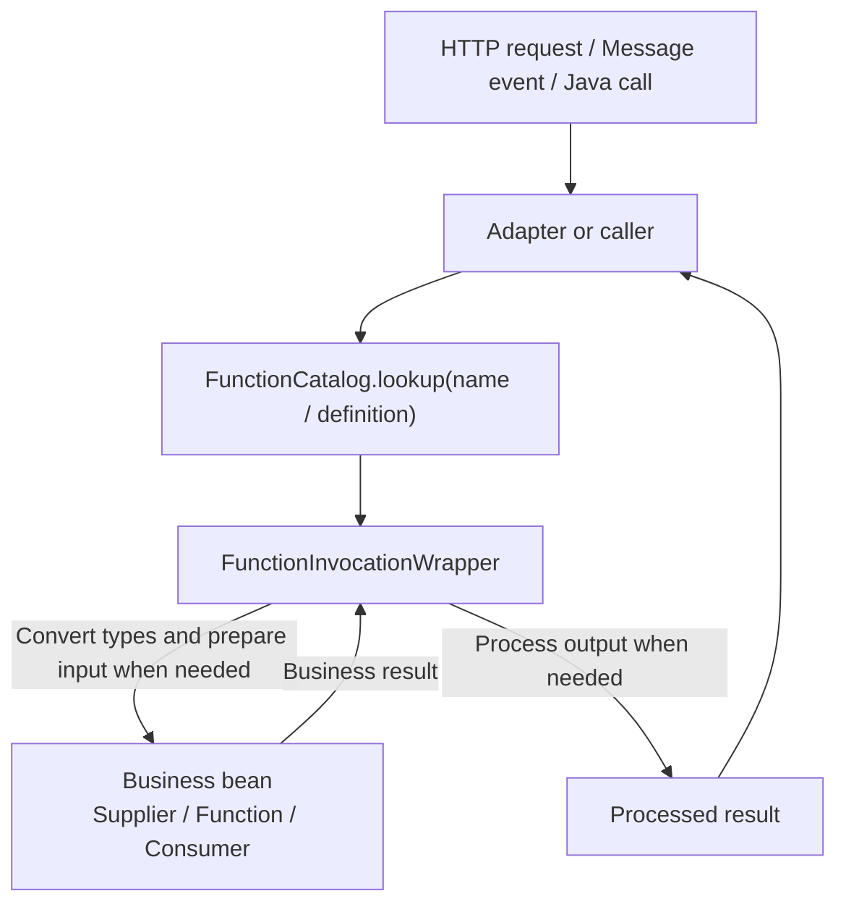
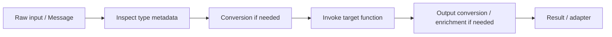

# The Role of FunctionInvocationWrapper in Spring Cloud Function

**Chapter:** FunctionCatalog  
**Module:** Spring Cloud Function (`SPRING_CLOUD_FUNCTION`)

A `Supplier`, `Function`, or `Consumer` only needs to contain business logic to be reusable across Java, HTTP, event systems, or serverless environments. However, these invocation environments do not always send and receive the same data types: HTTP may send JSON, a message broker carries payloads alongside headers, and a Java service may pass DTOs directly.

Spring Cloud Function bridges those differences by placing functional beans into a **unified execution model**. The `FunctionInvocationWrapper` class is a key part of this model: it wraps the target function, retains required metadata, and coordinates pre/post-invocation steps. When retrieving a function via `FunctionCatalog`, the caller is usually working with this wrapped representation rather than the raw bean.

This lesson explains **what the wrapper does, how it differs from the raw bean, how to inspect it via API, and what limitations to keep in mind when integrating**. After studying it, you will be able to:

1. Explain the role of `FunctionInvocationWrapper` along the `FunctionCatalog.lookup(...)` path.
2. Distinguish three layers: the business bean, Spring Cloud Function's wrapper, and protocol adapters.
3. Use the wrapper to inspect function name, input/output types, function kind, and composition state.
4. Understand data conversion via `MessageConverter` and `ConversionService`.
5. Know when to use `FunctionCatalog` or functional interfaces, and when to treat the wrapper purely as an integration detail.

## 1. What Is FunctionInvocationWrapper?

In Spring Cloud Function's source code, `FunctionInvocationWrapper` is declared inside `SimpleFunctionRegistry`:

```java
// Nested import inside SimpleFunctionRegistry:
import org.springframework.cloud.function.context.catalog.SimpleFunctionRegistry.FunctionInvocationWrapper;
```

It is a **wrapper class**, not a class you extend to write business functionality. Typically, you declare beans using standard Java functional interfaces:

```java
@Bean("normalizeOrderCode")
public Function<String, String> normalizeOrderCode() {
    return value -> value.trim().toUpperCase(Locale.ROOT);
}
```

When calling:

```java
Function<String, String> function =
    catalog.lookup(Function.class, "normalizeOrderCode");
```

Spring Cloud Function finds the matching definition and provides an **instrumented/wrapped** function object through which type conversion, message context handling, and composition can be applied. In versions that expose `FunctionInvocationWrapper` as above, inspection code can receive the wrapper explicitly:

```java
FunctionInvocationWrapper wrapper =
    catalog.lookup("normalizeOrderCode");
```

The second snippet requires importing `org.springframework.cloud.function.context.catalog.SimpleFunctionRegistry.FunctionInvocationWrapper`; `catalog` is injected by Spring with type `org.springframework.cloud.function.context.FunctionCatalog`.

**Important point:** `FunctionCatalog` is the primary interface for applications to look up functions; `FunctionInvocationWrapper` is an implementation class managed by the framework. Ordinary business code should depend on `Function`, `Supplier`, or `Consumer`, using the wrapper type only when inspecting metadata or writing specialized integrations.

### 1.1. Three Layers in an Invocation



| Layer | Responsibility |
| --- | --- |
| **Business bean** | Processes data per Java contract, e.g., `Function<Order, Receipt>` |
| **FunctionCatalog and wrapper** | Looks up name/definition; holds type metadata; coordinates conversion, invocation, composition, and output handling |
| **Adapter** | Receives/sends HTTP, event bindings, or serverless invocations; maps protocol/data to the catalog-provided function |

The wrapper does not start an HTTP server, create a message broker, or deploy a serverless function to the cloud on its own. Those tasks belong to adapters and deployment infrastructure.

## 2. Why Isn't Calling the Bean Directly Enough?

Suppose you retrieve a bean like this:

```java
Function<String, String> direct =
    context.getBean("normalizeOrderCode", Function.class);

String answer = direct.apply("  ord-42  "); // ORD-42
```

This is a direct Java call; external code guarantees the input is a `String`. `ApplicationContext` only returns the Spring bean (possibly with standard Spring proxies), without adding Spring Cloud Function's message-conversion pipeline to that call.

When looking up via the catalog:

```java
Function<String, String> wrapped =
    catalog.lookup(Function.class, "normalizeOrderCode");

String answer = wrapped.apply("  ord-42  "); // ORD-42
```

With an input already matching the expected type, both paths usually yield the same output. Differences emerge when the execution environment needs to **look up by definition**, **convert payloads/Messages into the type required by the function**, or **compose multiple functions**.

| Requirement | Direct Bean | Function Retrieved via FunctionCatalog |
| --- | --- | --- |
| Call `apply(String)` with properly typed input | Yes | Yes |
| Look up a function name or definition from configuration | Must build selection logic manually | Supported by the catalog |
| Chain `normalizeOrderCode|addPrefix` from config string | Call `andThen(...)` or write chaining code manually | Catalog resolves composition |
| Convert `Message<byte[]>` into a DTO | Caller must handle conversion | Wrapper can use converters when metadata/config match |
| Inspect metadata and kind of a catalog-managed function | Requires reflection or inspecting bean declarations | Wrapper exposes inspection methods |
| Connect HTTP, events, or serverless | Needs corresponding protocol layer | Still needs corresponding adapters |

**Do not use `direct == wrapped` as a correctness check.** The object returned from the catalog may be a distinct wrapper; two calls producing the same result does not guarantee identical object identity or Java class.

## 3. Which Steps Does the Wrapper Coordinate During Execution?

Conceptually, the sequence when a wrapper receives an input can include:

1. **Receiving data from the caller:** a Java object, a `Message<?>`, or a reactive publisher type.
2. **Determining the type accepted by the target function:** using metadata from the functional bean/registration.
3. **Converting input when needed:** for example, decoding a message with `contentType=application/json` into a DTO.
4. **Invoking the target object:** `get()`, `apply(input)`, or `accept(input)` per the functional contract.
5. **Processing output when needed:** converting the result type, interacting with the message envelope/headers per applicable rules, or passing data to the next function in a composition.
6. **Returning the result to the caller/adapter:** the adapter then maps the result back to the protocol.



This is a **conceptual model**, not a guarantee that every step always runs. If data already matches the target type, conversion may be skipped. If input or output is a reactive publisher, dedicated stream-handling rules apply. If input is a `Message<?>`, the returned result type also depends on the function signature, wrapper, and message configuration.

### 3.1. How Do MessageConverter and ConversionService Differ?

Spring Cloud Function uses familiar Spring conversion mechanisms:

| Input Form | Mechanism Typically Used | Key Information Sources |
| --- | --- | --- |
| `Message<?>` containing payload and headers | Spring `MessageConverter` | Function's input type, `contentType` header, and available converters |
| Non-`Message` data | Spring `ConversionService` | Source type, target type, and registered converters/formatters |
| Already matches Java type | Can invoke target directly | No extra conversion required |

For example, `Function<OrderRequest, Receipt>` expects an `OrderRequest` DTO. If an adapter sends a `Message<byte[]>` containing JSON, the wrapper can use a converter to construct `OrderRequest` before invoking the logic. If given a structure unsupported by registered converters, conversion can fail; Spring Cloud Function does not promise to understand every format automatically.

`contentType` is **hint information for selecting a converter**, not a guarantee that the payload can be converted into any arbitrary target type. Both the function's type metadata and a matching converter are required.

### 3.2. Headers and Envelopes Are Not Always Preserved As-Is

If a function declares `Function<Message<OrderRequest>, Message<Receipt>>`, the function itself handles reading or writing headers. If a function declares `Function<OrderRequest, Receipt>`, the adapter/wrapper can handle the message envelope so business logic does not depend on `Message<?>`.

Do not assume every `wrapper.apply(message)` call returns a `Message<?>` with all original headers intact. Whether headers are preserved or added depends on the function signature, settings such as `copy-input-headers`, and adapter behavior. Test with your exact application version and configuration.

## 4. Complete Example: Inspecting the Wrapper in a Spring Boot App

The following application uses Spring Boot and a compatible `spring-cloud-function-context`. It declares all three function kinds, adds a second `Function` to test composition, and inspects `FunctionInvocationWrapper` inside an `ApplicationRunner`.

```java
import java.lang.reflect.Type;
import java.util.Locale;
import java.util.function.Consumer;
import java.util.function.Function;
import java.util.function.Supplier;

import org.springframework.beans.factory.annotation.Qualifier;
import org.springframework.boot.ApplicationRunner;
import org.springframework.boot.SpringApplication;
import org.springframework.boot.autoconfigure.SpringBootApplication;
import org.springframework.cloud.function.context.FunctionCatalog;
import org.springframework.cloud.function.context.catalog.SimpleFunctionRegistry.FunctionInvocationWrapper;
import org.springframework.context.annotation.Bean;

@SpringBootApplication
public class WrapperDemoApplication {

    public static void main(String[] args) {
        SpringApplication.run(WrapperDemoApplication.class, args);
    }

    @Bean("newOrderCode")
    public Supplier<String> newOrderCode() {
        return () -> "ord-42";
    }

    @Bean("normalizeOrderCode")
    public Function<String, String> normalizeOrderCode() {
        return value -> value.trim().toUpperCase(Locale.ROOT);
    }

    @Bean("addPrefix")
    public Function<String, String> addPrefix() {
        return value -> "ID-" + value;
    }

    @Bean("auditOrderCode")
    public Consumer<String> auditOrderCode() {
        return value -> System.out.println("AUDIT: " + value);
    }

    @Bean
    public ApplicationRunner inspectWrapper(
            @Qualifier("normalizeOrderCode")
            Function<String, String> directBean,
            FunctionCatalog catalog) {
        return args -> {
            FunctionInvocationWrapper wrapper =
                catalog.lookup("normalizeOrderCode");

            if (wrapper == null) {
                throw new IllegalStateException("Missing function");
            }

            Type inputType = wrapper.getInputType();
            Type outputType = wrapper.getOutputType();

            System.out.println(
                "Definition: " + wrapper.getFunctionDefinition());
            System.out.println("Input type: " + inputType);
            System.out.println("Output type: " + outputType);
            System.out.println("Is Function: " + wrapper.isFunction());
            System.out.println("Is composed: " + wrapper.isComposed());

            String directResult = directBean.apply("  ord-42  ");

            Function<String, String> throughCatalog =
                catalog.lookup(Function.class, "normalizeOrderCode");
            if (throughCatalog == null) {
                throw new IllegalStateException(
                    "Cannot look up normalizeOrderCode");
            }

            String catalogResult =
                throughCatalog.apply("  ord-42  ");

            System.out.println("Direct: " + directResult);
            System.out.println("Catalog: " + catalogResult);
            // Both lines print ORD-42.

            FunctionInvocationWrapper composed =
                catalog.lookup("normalizeOrderCode|addPrefix");
            if (composed == null) {
                throw new IllegalStateException(
                    "Cannot compose functions");
            }

            System.out.println("Composed: " + composed.isComposed());
            System.out.println(
                composed.apply("  ord-42  ")); // ID-ORD-42
        };
    }
}
```

**Reading the output:**

- `wrapper.getFunctionDefinition()` returns the name/definition currently handled by the catalog, here `normalizeOrderCode`.
- `getInputType()` and `getOutputType()` reveal the type metadata held by the wrapper; for the bean above, that is `String`. The printed representation of a `Type` is not necessarily just the word `String`.
- `isFunction()` reflects a function having both input and output; `isComposed()` indicates whether the wrapper represents a composition.
- When looking up `normalizeOrderCode|addPrefix`, the catalog creates a composed function representation; the sample call outputs `ID-ORD-42`.

You do not need `spring-cloud-function-web`, Spring Cloud Stream, or a broker to inspect the wrapper in Java code. Adapters are only required when exposing the same function outside the application.

### 4.1. Why Still Use Function<T, R> in Business Services?

In the sample application, `throughCatalog` is typed as `Function<String, String>`, while `wrapper` is typed as `FunctionInvocationWrapper`. Both support calling `apply(...)`, yet their goals differ:

- `Function<String, String>` expresses the **business contract** that normal application code needs.
- `FunctionInvocationWrapper` lets you inspect Spring Cloud Function's **metadata and integration behavior**.

Because the wrapper lives inside the registry implementation, coupling business code deeply to its specific methods can make version upgrades harder. Use `FunctionCatalog` and standard Java functional interfaces at application boundaries; use the wrapper API directly only when truly needed.

## 5. Metadata Observable from FunctionInvocationWrapper

With the wrapper API available in reference versions, you can inspect the following methods:

| Method | Meaning | How to Interpret |
| --- | --- | --- |
| `getFunctionDefinition()` | Resolved name or definition string | `normalizeOrderCode` or `normalizeOrderCode|addPrefix` |
| `getInputType()` | Function input type as `java.lang.reflect.Type` | Can be a simple type, `Message<T>`, or reactive type |
| `getOutputType()` | Output type as `Type` | For `Consumer`, there may be no output type |
| `getRawInputType()`, `getRawOutputType()` | Raw Java class corresponding to the metadata | Does not carry full generic type arguments |
| `isSupplier()` | Wrapper describes a function with no input | `Supplier` uses `get()` |
| `isFunction()` | Wrapper describes a function with input and output | `Function` uses `apply(...)` |
| `isConsumer()` | Wrapper describes a function with no business output | `Consumer` uses `accept(...)` |
| `isComposed()` | Wrapper represents a composition | Differs from a single standalone bean |
| `isInputTypeMessage()`, `isOutputTypeMessage()` | Whether input/output involves `Message` | Helps adapters understand envelopes |
| `isInputTypePublisher()`, `isOutputTypePublisher()` | Whether input/output is a reactive publisher | Important when integrating `Flux`/`Mono` |

**Version note:** class/method names in this table reflect Spring Cloud Function versions that include `SimpleFunctionRegistry.FunctionInvocationWrapper`. When building integration libraries or upgrading major versions, check the Javadoc or source code for your project's exact artifact. Do not assume all internal members remain unchanged indefinitely.

### 5.1. The Wrapper Can Implement All Three Interfaces

In its implementation, `FunctionInvocationWrapper` may implement `Function<Object, Object>`, `Supplier<Object>`, `Consumer<Object>`, and `Runnable` to unify invocation entry points. This **does not mean** a functional bean is all three kinds simultaneously from a business standpoint.

The true function kind must be determined from metadata and the target definition:

```java
FunctionInvocationWrapper producer =
    catalog.lookup("newOrderCode");
FunctionInvocationWrapper transformer =
    catalog.lookup("normalizeOrderCode");
FunctionInvocationWrapper sink =
    catalog.lookup("auditOrderCode");

if (producer == null || transformer == null || sink == null) {
    throw new IllegalStateException("Catalog is incomplete");
}

System.out.println(producer.isSupplier());   // true
System.out.println(transformer.isFunction()); // true
System.out.println(sink.isConsumer());        // true
```

In production code, looking up with the explicit interface type is clearer:

```java
Supplier<String> producer =
    catalog.lookup(Supplier.class, "newOrderCode");

Function<String, String> transformer =
    catalog.lookup(Function.class, "normalizeOrderCode");

Consumer<String> sink =
    catalog.lookup(Consumer.class, "auditOrderCode");
```

After checking each variable is non-`null`, call `producer.get()`, `transformer.apply(input)`, and `sink.accept(input)` respectively. For `Consumer`, do not expect a business return value from the wrapper's `apply(...)`; `Consumer` follows the `void accept(...)` contract.

### 5.2. Do Not Confuse Raw Types with Actual Payload Types

`getRawInputType()` may report `Message.class` or `Flux.class`, while the underlying data type is `Message<OrderRequest>` or `Flux<OrderRequest>`. To inspect generic arguments, use `getInputType()`/`getOutputType()` with appropriate reflection APIs; never read the raw class name and assume the payload is `String`.

Similarly, `catalog.lookup(Function.class, "validateOrder")` only specifies the interface group; it does not verify the full `Function<OrderRequest, Receipt>` signature at compile time due to Java *type erasure*.

## 6. Example: Converting a Message into a DTO

Consider the business logic:

```java
record OrderRequest(String orderId, long amount) {}
record OrderDecision(String orderId, boolean accepted) {}

@Bean("validateOrder")
public Function<OrderRequest, OrderDecision> validateOrder() {
    return order -> new OrderDecision(
        order.orderId(),
        order.amount() > 0
    );
}
```

When calling directly, you must construct the exact object:

```java
OrderRequest input = new OrderRequest("ORD-42", 1500);
OrderDecision decision = directValidator.apply(input);
```

In this snippet, `directValidator` is a `Function<OrderRequest, OrderDecision>` injected by Spring under the name `validateOrder`. If the initial data is JSON from HTTP or a broker, a conversion step is needed before the business function can process it.

Through the catalog path, you can simulate a request as a message:

```java
import java.nio.charset.StandardCharsets;
import org.springframework.messaging.Message;
import org.springframework.messaging.MessageHeaders;
import org.springframework.messaging.support.MessageBuilder;

// Assume FunctionCatalog catalog has been injected.
FunctionInvocationWrapper wrapped = catalog.lookup("validateOrder");
if (wrapped == null) {
    throw new IllegalStateException("validateOrder missing");
}

Message<byte[]> incoming = MessageBuilder
    .withPayload((
        "{\"orderId\":\"ORD-42\",\"amount\":1500}"
    ).getBytes(StandardCharsets.UTF_8))
    .setHeader(MessageHeaders.CONTENT_TYPE, "application/json")
    .build();

// Requires an appropriate JSON MessageConverter in the application.
Object result = wrapped.apply(incoming);
System.out.println(result);
```

This **illustrates the conversion path** and must run in an application configured with a converter supporting JSON and the target DTO (for example, appropriate Jackson configuration). The result may be represented as a DTO, a `Message<?>`, or whatever output shape the adapter requires; do not blindly cast `result`. In integration tests, explicitly verify the actual payload, headers, and data types.

If you only want to test the business logic itself, a direct unit test with `OrderRequest` is simpler. If you want to test that Spring Cloud Function receives `Message<byte[]>` and converts it into a DTO, you must test **the catalog/wrapper path with converters**, not just invoke the Java bean directly.

## 7. How Does the Wrapper Coordinate Composition?

Using the two beans from the main example:

```java
@Bean("normalizeOrderCode")
public Function<String, String> normalizeOrderCode() {
    return value -> value.trim().toUpperCase(Locale.ROOT);
}

@Bean("addPrefix")
public Function<String, String> addPrefix() {
    return value -> "ID-" + value;
}
```

In plain Java, two functions can be chained using `andThen(...)`:

```java
Function<String, String> manual = directNormalize
    .andThen(directAddPrefix);
String value = manual.apply("  ord-42  "); // ID-ORD-42
```

Here `directNormalize` and `directAddPrefix` are two injected beans. Spring Cloud Function supports an equivalent via a **definition**:

```java
FunctionInvocationWrapper composed =
    catalog.lookup("normalizeOrderCode|addPrefix");

if (composed == null) {
    throw new IllegalStateException("No composed function");
}

System.out.println(composed.isComposed()); // true
System.out.println(composed.getFunctionDefinition());
// normalizeOrderCode|addPrefix

System.out.println(composed.apply("  ord-42  "));
// ID-ORD-42
```

The wrapper retains metadata and coordinates the steps in the composition pipeline; as a result, the framework can handle conversions at the boundaries between functions when configuration and converters match.

**Limitation:** not every combination of functions can be chained arbitrarily. For example, a `Consumer` has no business output to feed into another `Function`; reactive types also follow specific rules. Let the catalog resolve valid definitions and test chains with real data.

### 7.1. Why Not Call andThen Arbitrarily on the Wrapper?

The `FunctionInvocationWrapper` implementation has its own composition logic, including metadata and conversion management. Calling `wrapper.andThen(rawJavaFunction)` yourself is not necessarily supported; some versions require the composed component to also be a wrapper.

When you need composition managed by Spring Cloud Function, prefer:

```java
Function<String, String> pipeline =
    catalog.lookup(
        Function.class, "normalizeOrderCode|addPrefix");
```

This is also convenient for adapters because the same definition can be declared in configuration:

```properties
spring.cloud.function.definition=normalizeOrderCode|addPrefix
```

The `definition` property selects the function or function chain for adapters to use; it does not register a new Java bean named after that string.

## 8. Reactive Functions and the Wrapper

Spring Cloud Function also supports Project Reactor reactive functions:

```java
@Bean("normalizeStream")
public Function<Flux<String>, Flux<String>> normalizeStream() {
    return flux -> flux.map(
        s -> s.trim().toUpperCase(Locale.ROOT)
    );
}
```

The example above requires importing `reactor.core.publisher.Flux` and `java.util.function.Function`. When looked up via the catalog, the wrapper can expose `isInputTypePublisher()` and `isOutputTypePublisher()` so adapters know the input/output are publisher-based.

Do not assume that for `Function<Flux<String>, Flux<String>>` the framework invokes your function once per individual `String`. This function receives an entire publisher according to the reactive contract; invocation strategy and stream management follow the adapter's rules. Imperative functions like `Function<String, String>` follow a different execution model.

At integration time, the wrapper's function kind and metadata help adapters decide conversion paths and result handling; they do not replace the developer's understanding of asynchronicity, backpressure, or subscription lifecycles.

## 9. Testing the Wrapper and Business Behavior

With `WrapperDemoApplication` in section 4 and compatible Spring Boot Test/JUnit 5 dependencies, you can verify:

```java
import static org.junit.jupiter.api.Assertions.*;

import java.util.function.Function;
import org.junit.jupiter.api.Test;
import org.springframework.beans.factory.annotation.Autowired;
import org.springframework.beans.factory.annotation.Qualifier;
import org.springframework.boot.test.context.SpringBootTest;
import org.springframework.cloud.function.context.FunctionCatalog;
import org.springframework.cloud.function.context.catalog.SimpleFunctionRegistry.FunctionInvocationWrapper;

@SpringBootTest(classes = WrapperDemoApplication.class)
class FunctionInvocationWrapperTest {

    @Autowired
    private FunctionCatalog catalog;

    @Autowired
    @Qualifier("normalizeOrderCode")
    private Function<String, String> directBean;

    @Test
    void preservesBusinessBehaviorAndExposesMetadata() {
        FunctionInvocationWrapper wrapper =
            catalog.lookup("normalizeOrderCode");

        assertNotNull(wrapper);
        assertEquals(
            "normalizeOrderCode", wrapper.getFunctionDefinition());
        assertTrue(wrapper.isFunction());
        assertFalse(wrapper.isComposed());
        assertEquals(String.class, wrapper.getInputType());
        assertEquals(String.class, wrapper.getOutputType());

        String input = "  ord-42  ";
        assertEquals(
            directBean.apply(input), wrapper.apply(input));
    }

    @Test
    void compositionHasASeparateDefinition() {
        FunctionInvocationWrapper composed =
            catalog.lookup("normalizeOrderCode|addPrefix");

        assertNotNull(composed);
        assertTrue(composed.isComposed());
        assertEquals(
            "ID-ORD-42", composed.apply("  ord-42  "));
    }

    @Test
    void supplierAndConsumerHaveDifferentRoles() {
        FunctionInvocationWrapper supplier =
            catalog.lookup("newOrderCode");
        FunctionInvocationWrapper consumer =
            catalog.lookup("auditOrderCode");

        assertNotNull(supplier);
        assertNotNull(consumer);
        assertTrue(supplier.isSupplier());
        assertTrue(consumer.isConsumer());
    }
}
```

The test above verifies metadata, composition, and that the wrapper still invokes the business logic properly. To verify **JSON/message conversion**, write a separate test with converters and payloads. Do not claim conversion is verified solely by passing a `String` to a `Function<String, String>`.

### 9.1. Why Not Assert on the Concrete Wrapper Class in Every Test?

If a test's goal is to ensure the adapter/application resolves the right function and processes inputs properly, test against the stable API:

```java
Function<String, String> operation =
    catalog.lookup(Function.class, "normalizeOrderCode");
assertNotNull(operation);
assertEquals("ORD-42", operation.apply("  ord-42  "));
```

Only when the goal is specifically to inspect **`FunctionInvocationWrapper` metadata** do you need to import the implementation class. Separating the two kinds of tests makes Spring Cloud Function upgrades easier to evaluate.

## 10. Common Misconceptions

| Claim / Error | Actual Cause | How to Address |
| --- | --- | --- |
| "FunctionInvocationWrapper is the interface where I write business logic." | It is a framework-managed wrapper | Write `Supplier`, `Function`, or `Consumer` and register as a Spring bean |
| "Beans retrieved via `getBean` already have SCF conversion." | `getBean` does not attach the catalog's instrumentation layer | Use `FunctionCatalog.lookup(...)` on integration paths |
| "Having a wrapper means any JSON converts automatically." | Requires proper metadata, content type, and converters | Test with real payload formats and register converters as needed |
| "The wrapper always returns `Message<?>`." | Output shape depends on input, function signature, and configuration | Verify output/adapter contract before casting |
| "The wrapper is always the same object as the bean." | The catalog may return a wrapped instance | Compare behavior, not object identity |
| "Wrapper implements all three interfaces, so every function is all three kinds." | That is an implementation technique to unify entry points | Use metadata and the properly typed business interface |
| "Chaining wrapper with an arbitrary Java Function works like `a|b`." | Catalog composition manages metadata/conversion separately | Use a function definition and verify type compatibility |
| "Adding a function to the catalog means it has an HTTP endpoint." | Adapters are a separate layer | Check dependencies, export rules, mappings, or bindings |
| "You can rely completely on wrong names when only one function exists." | Single-function fallback can mask typos | Look up with exact names, inspect the catalog, and check config |
| "Passing `Function.class` verifies `String → DTO` generics." | Java type erasure | Maintain concrete bean signatures and test with real data |

## 11. Hands-On Exercises

1. Run `WrapperDemoApplication`. Compare results when calling `directBean.apply(...)` versus `catalog.lookup(Function.class, "...").apply(...)` with the same input.
2. Use `FunctionInvocationWrapper` to print `getFunctionDefinition()`, `getInputType()`, and `getOutputType()` for `normalizeOrderCode`; explain why metadata differs from business output.
3. Look up `normalizeOrderCode|addPrefix` and check `isComposed()`. Reverse the order to `addPrefix|normalizeOrderCode`, test input `"  ord-42  "`, and explain why the output/processing chain differs.
4. Declare an additional `Function<OrderRequest, OrderDecision> validateOrder`, try calling it directly with a DTO, and try calling the wrapper with a `Message<byte[]>` carrying JSON; observe the conditions required for the converter to work.
5. Call `isSupplier()`, `isFunction()`, and `isConsumer()` on three different beans and explain why sharing the same wrapper class does not mean all three share the same business contract.
6. Create a `Function<Flux<String>, Flux<String>>` function. Inspect publisher metadata and explain the difference between receiving a publisher and receiving individual elements.

### Interview Question

**Q:** Why does Spring Cloud Function need `FunctionInvocationWrapper` when Java already provides `java.util.function.Function`?

**A:** `Function` describes a pure Java data-processing contract. `FunctionInvocationWrapper` adds a shared coordination layer so Spring Cloud Function can retain metadata, convert data when needed, support composition, and let adapters invoke the same logic from HTTP, events, or serverless. As a result, business logic does not need to handle individual protocols directly.

## 12. Key Takeaways

- `FunctionInvocationWrapper` is a **wrapper around functional beans** in Spring Cloud Function's registration/lookup mechanism; regular applications create `Supplier`, `Function`, or `Consumer` beans rather than creating wrappers themselves.
- Looking up via `FunctionCatalog` yields an instrumented function representation; retrieving a bean directly from `ApplicationContext` only uses standard Spring bean behavior.
- The wrapper retains metadata such as function definition, input/output types, function kind, and composition state, helping coordinate type conversion via `MessageConverter` or `ConversionService`.
- Conversion, header handling, and composition **depend on data types, metadata, and configuration**, rather than being transformations that run unconditionally on every call.
- Prefer the stable `FunctionCatalog` interface and standard functional interfaces in business code; access the wrapper directly only when inspection or deep integration truly requires it.

### References

- [Spring Cloud Function — Programming Model](https://docs.spring.io/spring-cloud-function/reference/spring-cloud-function/programming-model.html): wrappers, conversion, composition, `Message`, and content type negotiation.
- [Spring Cloud Function — Functional Bean Definitions](https://docs.spring.io/spring-cloud-function/reference/functional.html): registering and inspecting functions in the catalog.
- [Source code of SimpleFunctionRegistry and FunctionInvocationWrapper](https://github.com/spring-cloud/spring-cloud-function/blob/main/spring-cloud-function-context/src/main/java/org/springframework/cloud/function/context/catalog/SimpleFunctionRegistry.java): location of the wrapper class and inspection methods; when applying in practice, check the tag/version of the dependency in use.
