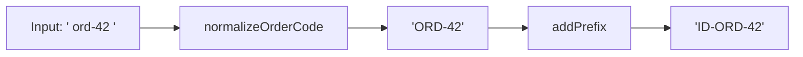

# Selecting a Single Function or Function Composition Definition in Spring Cloud Function

**Chapter:** FunctionCatalog  
**Module:** Spring Cloud Function (`SPRING_CLOUD_FUNCTION`)

In Spring Cloud Function, business logic is declared as `Supplier`, `Function`, or `Consumer` beans so it can be reused without depending on the invocation protocol. A single function can be called from Java, exposed over HTTP, receive events via Spring Cloud Stream, or run in a serverless environment. When an application has multiple functions, the key question is: **which function should execute, or which functions should be composed in what order?**

`FunctionCatalog` supports looking up functions by **name/function definition**. The `spring.cloud.function.definition` property lets adapters select that same name/definition from configuration, instead of hardcoding each invocation path in source code. A definition can be just a single name like `normalizeOrderCode`, or a chain like `normalizeOrderCode|addPrefix`.

After this lesson, you will be able to:

- Select a specific functional bean using `FunctionCatalog.lookup(...)` or `spring.cloud.function.definition`.
- Distinguish **bean name**, **function definition**, **composition**, and **multiple independent definitions**.
- Predict the execution order, input/output types, and resulting interface kind when composing functions.
- Choose definitions for Java, Spring Cloud Stream, HTTP, and serverless adapters.
- Write tests to verify output, catch misconfigured names, and avoid relying on fallback.

## 1. From Bean Name to Function Definition

Suppose the application has two beans:

```java
@Bean("normalizeOrderCode")
public Function<String, String> normalizeOrderCode() {
    return input -> input.trim().toUpperCase(Locale.ROOT);
}

@Bean("addPrefix")
public Function<String, String> addPrefix() {
    return input -> "ID-" + input;
}
```

These are **two functional beans**. Their names are `normalizeOrderCode` and `addPrefix`, as specified by `@Bean("...")`. You can select each function individually or request a pipeline combining both:

| Function Definition | Meaning | With Input `"  ord-42  "` |
| --- | --- | --- |
| `normalizeOrderCode` | Run only the normalization function | `ORD-42` |
| `addPrefix` | Only add the prefix | `ID-  ord-42  ` |
| `normalizeOrderCode|addPrefix` | Normalize, then add the prefix | `ID-ORD-42` |
| `addPrefix|normalizeOrderCode` | Add the prefix, then normalize | `ID-  ORD-42  ` |

Composition order **matters**. Chaining two functions of the same type does not guarantee the same output when the order is reversed. `normalizeOrderCode|addPrefix` is a **definition**, not necessarily the name of a new Spring bean.



### 1.1. Three Easily Confused Concepts

| Concept | Example | Role |
| --- | --- | --- |
| **Bean name** | `normalizeOrderCode` | Name of the functional object managed by Spring |
| **Function definition** | `normalizeOrderCode|addPrefix` | Specifies a single function or function chain to use |
| **Binding/HTTP mapping** | `normalizeOrderCode-in-0`, HTTP path | How an adapter attaches the function to a protocol or external source/sink |

`FunctionCatalog` uses the definition to resolve functions. Adapters like Spring Cloud Stream still need a binder, destination, and binding name; HTTP adapters need paths and HTTP methods. **A definition does not automatically create an HTTP endpoint, broker, or new Spring bean.**

## 2. Syntax for Selecting One or More Definitions

In Spring Cloud Function, common syntax forms include:

| Syntax | Effect | Notes |
| --- | --- | --- |
| `foo` | Select a single function | Uses registered bean name |
| `foo|bar` | Compose `foo` then `bar` | Preferred syntax |
| `foo,bar` | Comma can be used instead of `|` to compose functions | Documented in Spring Cloud Function docs |
| `foo|bar|baz` | Compose three functions in order | Each step's output must fit the next step's input |
| `foo;bar` | **Two independent definitions** in list-supporting adapters, e.g., Stream or Web | Does not mean "run `foo` then `bar`" |
| `foo|bar;baz` | One composed definition `foo|bar`, plus a separate definition `baz` | Export/binding behavior depends on the adapter |

Important points to remember:

- **`|` (pipe)** denotes a processing pipeline. Spring Cloud Function docs also allow `,` as a composition delimiter, though `|` is clearer.
- **`;` (semicolon)** is used when an adapter accepts a list of **multiple selected functions**. For example, Spring Cloud Stream can create separate bindings for `foo` and `bar`; Spring Cloud Function Web can restrict which functions are exported.
- Do not treat `catalog.lookup("foo;bar")` as the standard way to get a composed function; use `catalog.lookup("foo|bar")` when you want **a single pipeline**.

When configuring in YAML, you can wrap a value containing `|` in quotes:

```yaml
spring:
  cloud:
    function:
      definition: "normalizeOrderCode|addPrefix"
```

If you omit quotes in this YAML example, most parsers still read it because `|` in the middle of a string does not open a *block scalar*. Using quotes avoids confusion with YAML syntax and clarifies that the entire string is a single value.

## 3. Spring Boot Example: Declaring a Set of Business Functions

The standalone application below uses Spring Boot with a compatible Spring Cloud Function context. It provides different functions so you can select one or compose them into a pipeline.

```java
import java.util.Locale;
import java.util.function.Consumer;
import java.util.function.Function;
import java.util.function.Supplier;

import org.springframework.boot.ApplicationRunner;
import org.springframework.boot.SpringApplication;
import org.springframework.boot.autoconfigure.SpringBootApplication;
import org.springframework.cloud.function.context.FunctionCatalog;
import org.springframework.context.annotation.Bean;

@SpringBootApplication
public class FunctionSelectionApplication {

    public static void main(String[] args) {
        SpringApplication.run(FunctionSelectionApplication.class, args);
    }

    @Bean("issueOrderCode")
    public Supplier<String> issueOrderCode() {
        return () -> "  ord-42  ";
    }

    @Bean("normalizeOrderCode")
    public Function<String, String> normalizeOrderCode() {
        return value -> value.trim().toUpperCase(Locale.ROOT);
    }

    @Bean("addPrefix")
    public Function<String, String> addPrefix() {
        return value -> "ID-" + value;
    }

    @Bean("codeLength")
    public Function<String, Integer> codeLength() {
        return String::length;
    }

    @Bean("auditOrderCode")
    public Consumer<String> auditOrderCode() {
        return value -> System.out.println("AUDIT: " + value);
    }

    @Bean
    public ApplicationRunner demonstrate(FunctionCatalog catalog) {
        return args -> {
            Function<String, String> one =
                catalog.lookup(Function.class, "normalizeOrderCode");
            Function<String, String> composed =
                catalog.lookup(
                    Function.class, "normalizeOrderCode|addPrefix");
            Function<String, Integer> measured =
                catalog.lookup(
                    Function.class,
                    "normalizeOrderCode|addPrefix|codeLength");

            if (one == null || composed == null || measured == null) {
                throw new IllegalStateException(
                    "A required function definition was not resolved");
            }

            String input = "  ord-42  ";
            System.out.println(one.apply(input));       // ORD-42
            System.out.println(composed.apply(input));  // ID-ORD-42
            System.out.println(measured.apply(input));  // 9
        };
    }
}
```

**Explanation:** `codeLength` takes `String` and returns `Integer`. After the three steps `normalizeOrderCode|addPrefix|codeLength`, the result is the character count of `ID-ORD-42`, which is `9`. The pipeline now has the contract **`Function<String, Integer>`**, no longer `Function<String, String>`.

To run this example, the application needs the `spring-cloud-function-context` dependency along with compatible Spring Boot components. Looking up the catalog in Java alone does not require `spring-cloud-function-web` or a Spring Cloud Stream binder.

## 4. Selecting a Specific Function

### 4.1. Selecting in Java Code

With the beans from section 3:

```java
Function<String, String> selected =
    catalog.lookup(Function.class, "normalizeOrderCode");

if (selected == null) {
    throw new IllegalStateException("normalizeOrderCode not found");
}

String result = selected.apply("  ord-42  ");
// ORD-42
```

`catalog` is injected by Spring into the caller with type `FunctionCatalog`. The `lookup(Function.class, "name")` overload explicitly states the **interface kind** you expect; it does not verify `String → String` generics at runtime. The caller still needs to know the bean's exact contract.

Example selecting a `Supplier` or `Consumer`:

```java
Supplier<String> supplier =
    catalog.lookup(Supplier.class, "issueOrderCode");
Consumer<String> consumer =
    catalog.lookup(Consumer.class, "auditOrderCode");

if (supplier == null || consumer == null) {
    throw new IllegalStateException("Missing Supplier or Consumer");
}

String issued = supplier.get();
consumer.accept(issued);
```

Use `get()` for `Supplier`, `accept(input)` for `Consumer`, and `apply(input)` for `Function`. Avoid calling `apply(...)` on a `Consumer` per its Java contract.

### 4.2. Selecting via Configuration

When using adapters, decouple function selection from source code:

```properties
spring.cloud.function.definition=normalizeOrderCode
```

Or:

```yaml
spring:
  cloud:
    function:
      definition: normalizeOrderCode
```

For Spring Cloud Stream, this property tells the framework **which function is bound to bindings**. For Spring Cloud Function Web, it can affect which functions are exported/mapped. Serverless adapters also have their own rules for choosing entry points or definitions.

**Do not confuse the two selection paths:** a line `spring.cloud.function.definition=normalizeOrderCode` does not prevent Java code from calling `catalog.lookup(Function.class, "addPrefix")`. It only specifies the default choice or selection list for **the integration context using that property**. Direct catalog access still follows catalog rules.

### 4.3. Why Write Explicit Names Even When Only One Function Exists?

When only one eligible functional bean exists, Spring Cloud Function may apply **single-function fallback**: a lookup with an empty or non-matching name may still resolve to that sole function. If a second function is added later, that behavior can change.

Spring Cloud Function documentation specifically recommends setting `spring.cloud.function.definition` when using Spring Cloud Stream, even when the application currently has only one function.

In versions that support it, you can require exact-name lookups via:

```properties
spring.cloud.function.single-function-fallback-enabled=false
```

Check your exact dependency version and actual runtime behavior before relying on this toggle. Exact names and tests remain necessary regardless of whether fallback is enabled or disabled.

## 5. Selecting a Composition Pipeline

Suppose you want to normalize a code, add a prefix, and then count characters. There are two ways to express this.

**Composing directly in Java:**

```java
Function<String, String> normalize = value ->
    value.trim().toUpperCase(Locale.ROOT);
Function<String, String> prefix = value -> "ID-" + value;
Function<String, Integer> length = String::length;

Function<String, Integer> manual =
    normalize.andThen(prefix).andThen(length);

System.out.println(manual.apply("  ord-42  ")); // 9
```

**Composing via Spring Cloud Function:**

```java
Function<String, Integer> pipeline =
    catalog.lookup(
        Function.class,
        "normalizeOrderCode|addPrefix|codeLength");

if (pipeline == null) {
    throw new IllegalStateException("Pipeline not found");
}

System.out.println(pipeline.apply("  ord-42  ")); // 9
```

Both approaches can produce `9`. The catalog approach uses **bean names**, can be supplied to adapters via `spring.cloud.function.definition`, and is wrapped by Spring Cloud Function to handle metadata/conversion when appropriate. Java's `andThen(...)` uses function object references already held in code.

### 5.1. Verifying Compatibility Between Steps

Consider the pipeline `a|b|c`:

```text
a : A -> B
b : B -> C
c : C -> D
---------------
pipeline : A -> D
```

Each step must produce a value that the next step can accept. Spring Cloud Function provides type conversion in appropriate contexts, but **you should never use conversion to mask a poorly designed data contract**. Define each bean's input/output types clearly.

| Definition | Input Type | Output Type | Meaning |
| --- | --- | --- | --- |
| `normalizeOrderCode` | `String` | `String` | Normalize |
| `normalizeOrderCode|addPrefix` | `String` | `String` | Normalize, then add prefix |
| `normalizeOrderCode|addPrefix|codeLength` | `String` | `Integer` | Normalize, add prefix, count characters |
| `codeLength|addPrefix` | `String` | Clear mismatch: `Integer` to `String` | Do not rely on the framework fixing this type mismatch automatically |

**Order is part of the contract:** `normalizeOrderCode|addPrefix` and `addPrefix|normalizeOrderCode` may both resolve yet produce different outputs. Before changing a definition in production, have tests proving the new order matches business requirements.

### 5.2. Composition Is Not Function Routing

Composition creates **a fixed processing chain**. Routing selects **one target handler** based on configuration, headers, or another rule. Spring Cloud Function provides an infrastructure router named `functionRouter` for routing, but that does not automatically turn `a|b` into a dynamic choice between `a` and `b`.

If you want to invoke both sequentially, use `a|b`. If you want to pick one of the two conditionally when a message arrives, study routing separately and restrict the allowed target functions.

## 6. Composition Across Supplier, Function, and Consumer

Spring Cloud Function also supports composing different function kinds, provided the order and data types make sense. The **resulting interface kind of the composition** depends on the positions of source/transformer/sink:

| Chain | Resulting Kind | Primary Usage |
| --- | --- | --- |
| `Function<A,B>|Function<B,C>` | `Function<A,C>` | Accept a value, return a value |
| `Supplier<A>|Function<A,B>` | `Supplier<B>` | Produce and then transform data |
| `Function<A,B>|Consumer<B>` | `Consumer<A>` | Receive data, transform it, and perform side effect |
| `Supplier<A>|Consumer<A>` | `Runnable` | Produce data and handle it, with no business argument/return value |
| `Consumer<A>|Function<A,B>` | **Does not compose normally** | `Consumer` has no output to pass onward |
| `Consumer<A>|Supplier<B>` | **Does not compose normally** | `Consumer` produces no value for the next step |

Examples using the beans from section 3:

```java
Supplier<String> producedAndNormalized =
    catalog.lookup(
        Supplier.class, "issueOrderCode|normalizeOrderCode");

Consumer<String> normalizedAndAudited =
    catalog.lookup(
        Consumer.class, "normalizeOrderCode|auditOrderCode");

if (producedAndNormalized == null
        || normalizedAndAudited == null) {
    throw new IllegalStateException("Composition unavailable");
}

System.out.println(producedAndNormalized.get()); // ORD-42
normalizedAndAudited.accept("  ord-42  ");
// AUDIT: ORD-42
```

In the first chain, `Supplier` produces data and `Function` processes it further, so the result is still retrieved via `get()`. In the second chain, `Function` normalizes and `Consumer` logs it, so the caller invokes `accept(...)`.

`issueOrderCode|auditOrderCode` logically results in the equivalent of a `Runnable`. In real integrations, the adapter must properly support the source/sink model and trigger lifecycle; you cannot treat a `Runnable` as a `Function<String,String>`.

### 6.1. Special Rules for Reactive Functions

Example:

```java
@Bean("normalizeStream")
public Function<Flux<String>, Flux<String>> normalizeStream() {
    return stream ->
        stream.map(value -> value.trim().toUpperCase(Locale.ROOT));
}
```

This snippet uses `reactor.core.publisher.Flux`. A reactive function receives and returns a publisher, unlike an imperative `Function<String,String>` that processes one value at a time. In Spring Cloud Stream, a reactive function may be invoked once with a reference to the stream, whereas an imperative function is invoked per event. When compositions mix the two forms, adapters and the framework follow specific rules; check documentation matching your dependency version and test with real streaming data.

## 7. Comparing Selection in Java, Spring Cloud Stream, and HTTP

### 7.1. Java: Call lookup with Your Chosen Definition

In Java code:

```java
Function<String, String> selected =
    catalog.lookup(Function.class, "normalizeOrderCode");

Function<String, String> composed =
    catalog.lookup(
        Function.class, "normalizeOrderCode|addPrefix");
```

Both calls are valid even when the application has additional functional beans. Always check the lookup result before calling `apply(...)`.

### 7.2. Spring Cloud Stream: Selecting Handlers and Bindings

With Spring Cloud Stream and a suitable binder dependency, the adapter can connect a `Function` to a broker. Selecting **one** pipeline:

```yaml
spring:
  cloud:
    function:
      definition: "normalizeOrderCode|addPrefix"
```

If you need two independent handlers on separate bindings, you can configure:

```properties
spring.cloud.function.definition=normalizeOrderCode;addPrefix
```

These are **two definitions**, so Spring Cloud Stream can configure bindings for each function under the functional binding model. The `;` does not make the output of `normalizeOrderCode` flow automatically into the input of `addPrefix`.

Example selecting `normalizeOrderCode` alone:

```properties
spring.cloud.function.definition=normalizeOrderCode
spring.cloud.stream.bindings.normalizeOrderCode-in-0.destination=orders.raw
spring.cloud.stream.bindings.normalizeOrderCode-out-0.destination=orders.normalized
```

`-in-0` and `-out-0` follow the binding convention for a `Function` with one input and one output. With a composition, default binding names can contain the entire long definition; you can assign readable binding names using `spring.cloud.stream.function.bindings`. Check Spring Cloud Stream documentation for your exact version to determine actual pipeline binding names.

### 7.3. Spring Cloud Function Web: Selecting Exported Functions

When Spring Cloud Function Web is installed, functions can be invoked via HTTP mappings. Per Spring Cloud Function Web documentation:

- A single function may be mapped to the root path in default configurations.
- With multiple functions, the function name can appear in the path.
- `spring.cloud.function.definition=normalizeOrderCode|addPrefix` can select a pipeline to map to the root path.
- The form `spring.cloud.function.definition=normalizeOrderCode;addPrefix` is used to **limit the set of exported functions**, each mapped separately by name, rather than defining a composition chain.

For example, once the web adapter is installed in the application and beans are properly exported:

```bash
curl -H "Content-Type: text/plain" \
  -d "  ord-42  " \
  http://localhost:8080/normalizeOrderCode
```

For compositions, the adapter also supports path representations such as `/normalizeOrderCode,addPrefix` according to the documentation. Exact URLs and HTTP methods must be checked against your web adapter version, export configuration, and application port.

**Do not infer directly from Stream behavior to HTTP.** The same property is interpreted by different adapters in different contexts (bindings vs. exports). Always test on the actual adapter.

### 7.4. Serverless: Selecting the Right Entry Point

In a serverless environment, an adapter can retrieve a function via `FunctionCatalog` or a function definition and map cloud events/invocations to function calls. The same `normalizeOrderCode` bean can be reused, while handler declarations, packaging, and deployment depend on the cloud platform and chosen adapter.

When multiple functions exist, clearly specify which definition the entry point should handle and verify the platform's payload format. The `definition` property does not deploy the function to a serverless environment by itself.

## 8. Selecting Definitions Dynamically in Application Code

Some systems need to choose among pre-approved handlers, such as normalizing a code or normalizing and adding a prefix. Because `FunctionCatalog` accepts a definition string, you can build a dispatcher class. Never pass arbitrary strings from a request directly into the catalog without valid selection rules.

```java
import java.util.Map;
import java.util.function.Function;

import org.springframework.cloud.function.context.FunctionCatalog;
import org.springframework.stereotype.Service;

@Service
public class OrderCodeDispatcher {

    private static final Map<String, String> DEFINITIONS = Map.of(
        "normalize", "normalizeOrderCode",
        "standard", "normalizeOrderCode|addPrefix"
    );

    private final FunctionCatalog catalog;

    public OrderCodeDispatcher(FunctionCatalog catalog) {
        this.catalog = catalog;
    }

    public String process(String mode, String value) {
        String definition = mode == null
            ? null : DEFINITIONS.get(mode);
        if (definition == null) {
            throw new IllegalArgumentException("Unsupported mode: " + mode);
        }

        Function<String, String> selected =
            catalog.lookup(Function.class, definition);
        if (selected == null) {
            throw new IllegalStateException(
                "Function definition unavailable: " + definition);
        }

        return selected.apply(value);
    }
}
```

Application code here only allows two known **business modes**. Each mode maps to a fixed definition, preventing external users from crafting arbitrary composition chains or targeting internal functions. Adapter-level `spring.cloud.function.definition` remains the adapter's selection and **does not change automatically** just because the Java service looks up another mode.

If a definition accepts different input/output types, you cannot force everything into `Function<String,String>` as in the example; model distinct contracts for each pipeline type.

## 9. Testing: Single Function, Composition, and Ordering

With `FunctionSelectionApplication` in section 3 and compatible Spring Boot Test/JUnit 5 dependencies, you can verify contracts by name/definition:

```java
import static org.junit.jupiter.api.Assertions.*;

import java.util.function.Consumer;
import java.util.function.Function;
import java.util.function.Supplier;

import org.junit.jupiter.api.Test;
import org.springframework.beans.factory.annotation.Autowired;
import org.springframework.boot.test.context.SpringBootTest;
import org.springframework.cloud.function.context.FunctionCatalog;

@SpringBootTest(classes = FunctionSelectionApplication.class)
class FunctionSelectionApplicationTest {

    @Autowired
    FunctionCatalog catalog;

    @Test
    void selectsOneFunctionByName() {
        assertTrue(catalog.getNames(Function.class)
                .contains("normalizeOrderCode"));

        Function<String, String> selected =
            catalog.lookup(Function.class, "normalizeOrderCode");

        assertNotNull(selected);
        assertEquals("ORD-42", selected.apply("  ord-42  "));
    }

    @Test
    void composesFunctionsInTheSpecifiedOrder() {
        Function<String, String> pipeline =
            catalog.lookup(
                Function.class, "normalizeOrderCode|addPrefix");

        assertNotNull(pipeline);
        assertEquals("ID-ORD-42", pipeline.apply("  ord-42  "));
    }

    @Test
    void compositionCanChangeTheOutputType() {
        Function<String, Integer> pipeline =
            catalog.lookup(
                Function.class,
                "normalizeOrderCode|addPrefix|codeLength");

        assertNotNull(pipeline);
        assertEquals(9, pipeline.apply("  ord-42  ").intValue());
    }

    @Test
    void composesSupplierAndFunction() {
        Supplier<String> supplier =
            catalog.lookup(
                Supplier.class, "issueOrderCode|normalizeOrderCode");

        assertNotNull(supplier);
        assertEquals("ORD-42", supplier.get());
    }

    @Test
    void composesFunctionAndConsumer() {
        Consumer<String> sink =
            catalog.lookup(
                Consumer.class, "normalizeOrderCode|auditOrderCode");

        assertNotNull(sink);
        assertDoesNotThrow(() -> sink.accept("  ord-42  "));
    }
}
```

The `Consumer` test above uses a demo bean that only prints to the console. When a `Consumer` writes to a database or publishes real events, replace its dependencies with test doubles or a test environment to avoid triggering unwanted side effects.

### 9.1. Checking Wrong Names Without Being Masked by Fallback

To verify exact names, inspect `catalog.getNames(Function.class)` and the components of a definition before lookup. Reason: when only one eligible function exists, single-function fallback in some versions/configurations can cause `lookup("wrongName")` to still return the sole function.

In applications with multiple functions and strict configuration, you can add a test for non-existent names, but never assume a non-`null` lookup result proves the queried name is actually registered.

### 9.2. Do Not Rely on Catalog Ordering

`getNames(...)` returns a set of names for observation. Element order in this set does not dictate execution order. **Pipeline order must be explicitly written in the definition**, and tests must verify the corresponding output.

## 10. Common Errors When Selecting or Composing Functions

| Symptom / Misconception | Cause to Check | Resolution |
| --- | --- | --- |
| Only one function exists, so wrong-name lookup still runs | Single-function fallback may be enabled | Use exact names, inspect catalog, check version's fallback-disable option |
| Added a second function and adapter fails to pick one | Previously relied on single-function guessing | Set `spring.cloud.function.definition` explicitly |
| `foo;bar` does not run sequentially | `;` separates multiple definitions in supporting adapters | Use `foo|bar` when you want a pipeline |
| `foo|bar` yields unexpected output | Wrong order of the two steps | Check input/output of each step and intentionally test reversed order |
| Definition using method name is not found | Bean was explicitly named with `@Bean("...")` | Use the exact bean name |
| Pipeline fails to resolve or throws type error | One component unregistered, filtered out, or type-incompatible | Check `getNames(...)`, generic signatures, and conversion |
| Composing `Consumer|Function` fails | `Consumer` produces no output to pass onward | Redesign order or processing flow |
| `Supplier|Function` but caller invokes `apply(input)` | Composition result is still a `Supplier` | Call `get()` |
| `Function|Consumer` but caller expects a return value | Composition result is a `Consumer` | Call `accept(input)` and handle side effects |
| Web does not expose the right pipeline | Missing Web adapter or mismatched export/mapping config | Check dependencies and Web rules for your version |
| Stream fails to receive/send data | Unconfigured binder/destination or wrong binding name | Check definition, `-in-0`/`-out-0`, and broker config |
| Building definition string directly from user input | May accidentally invoke internal functions or unintended chains | Define an allowlist of modes/definitions |

## 11. Hands-On Exercises

1. **Select a single function:** run the sample application, look up `normalizeOrderCode` and `addPrefix` individually. Pass the same `"  ord-42  "` string and explain why the outputs differ.
2. **Test ordering:** compare `normalizeOrderCode|addPrefix` with `addPrefix|normalizeOrderCode`. Write a test enforcing the order required by the product.
3. **Three-step composition:** run `normalizeOrderCode|addPrefix|codeLength` and explain why the final output is `Integer`. Predict the result for `"  ord-9  "` before running it.
4. **Classify results:** predict the resulting interface kind and invocation method for `issueOrderCode|normalizeOrderCode`, `normalizeOrderCode|auditOrderCode`, and `issueOrderCode|auditOrderCode`.
5. **Distinguish delimiters:** configure `spring.cloud.function.definition=normalizeOrderCode;addPrefix` in a test Spring Cloud Stream application. Observe the separate bindings; then change it to `normalizeOrderCode|addPrefix` to create one pipeline.
6. **Reuse over HTTP:** when Spring Cloud Function Web is present, try accessing the endpoint by function name and the composition endpoint per the adapter's documentation. Distinguish HTTP mapping from `FunctionCatalog.lookup(...)`.
7. **Controlled selection:** add a `length` mode to `OrderCodeDispatcher`. Because the output of the new definition is `Integer`, design a separate contract or properly typed result model rather than forcing everything to `String`.

### Interview Scenario

**Q:** An application has two beans `normalizeOrderCode` and `addPrefix`. What is the difference between:

```properties
spring.cloud.function.definition=normalizeOrderCode|addPrefix
```

and:

```properties
spring.cloud.function.definition=normalizeOrderCode;addPrefix
```

**A:** The `|` creates a composite definition: `normalizeOrderCode` runs first and passes its result to `addPrefix`. The `;` denotes two independent definitions in adapters that support lists (such as Spring Cloud Stream or Spring Cloud Function Web); each handler can have its own bindings/endpoints and they do not automatically pass output from one to the other.

## 12. Key Takeaways

- **Selecting one function:** use the exact bean name in `catalog.lookup(...)` or `spring.cloud.function.definition`.
- **Composing functions:** use `|` (or `,` as supported by documentation), keeping order and data contracts clear across every step.
- **Selecting multiple independent definitions:** in list-supporting adapters, use `;`; do not confuse it with composition.
- **Resulting type after composition** can be `Function`, `Supplier`, `Consumer`, or `Runnable` depending on the chain.
- `FunctionCatalog` resolves function logic; Stream, Web, and serverless adapters determine bindings, endpoints, or entry points. The same logic can be reused, provided each adapter is configured properly.
- When multiple functions exist, always specify definitions intentionally and test inputs/outputs; do not rely on single-function fallback or catalog listing order.

### References

- [Spring Cloud Function — Programming Model: Function definition and Function Composition](https://docs.spring.io/spring-cloud-function/reference/spring-cloud-function/programming-model.html): lookup by name, `|`/`,`, composition across `Supplier`/`Function`/`Consumer`, and routing.
- [Spring Cloud Function — Standalone Web Applications](https://docs.spring.io/spring-cloud-function/reference/spring-cloud-function/standalone-web-applications.html): path mapping, composition, and exporting function lists with `;`.
- [Spring Cloud Stream — Producing and Consuming Messages](https://docs.spring.io/spring-cloud-stream/reference/spring-cloud-stream/producing-and-consuming-messages.html): selecting one or more functional beans with `spring.cloud.function.definition`.
- [Spring Cloud Stream — Functional Binding Names](https://docs.spring.io/spring-cloud-stream/reference/spring-cloud-stream/functional-binding-names.html): `-in-0`/`-out-0` conventions and renaming bindings for compositions.
