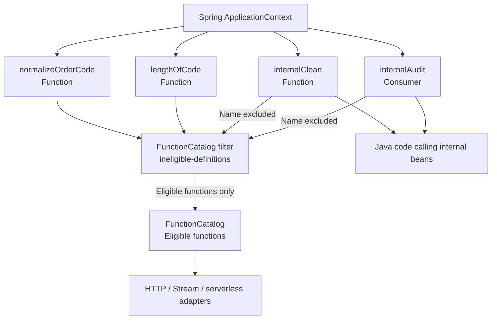
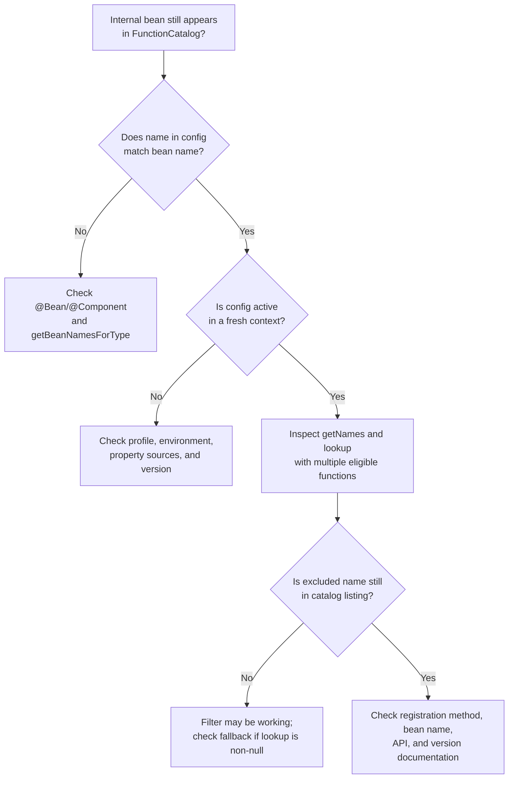

# Excluding Beans with spring.cloud.function.ineligible-definitions

**Chapter:** FunctionCatalog  
**Module:** Spring Cloud Function (`SPRING_CLOUD_FUNCTION`)

In Spring Cloud Function, beans implementing `Supplier`, `Function`, and `Consumer` are candidates for the framework to discover and register with `FunctionCatalog`. This is the foundation that enables business logic to be reused independently of invocation protocols: called from Java, over HTTP, via events in Spring Cloud Stream, or from a serverless environment.

However, **not every Spring bean with a functional type is intended to be exposed as a business function**. A library might create a `Function` for internal data transformation; a service might use a `Consumer` for logging; an application might need a helper function for another bean without wanting that helper to become a candidate selectable by adapters.

Spring Cloud Function provides the **`spring.cloud.function.ineligible-definitions`** property to specify **bean names to exclude from the candidate set registered in FunctionCatalog**. This lesson explains how to use the property, its effect on the catalog and adapters, how to verify its behavior, and misconceptions to avoid.

After this lesson, you will be able to:

1. Distinguish a bean existing in `ApplicationContext` from a bean eligible to appear in `FunctionCatalog`.
2. Configure one or more bean names using `spring.cloud.function.ineligible-definitions`.
3. Explain why an excluded function can still be injected and invoked directly in Java.
4. Verify catalog filtering with `getNames(...)`, `lookup(...)`, and Spring Boot tests.
5. Distinguish catalog filtering from selecting `spring.cloud.function.definition`, HTTP export limits, and security authorization.
6. Diagnose cases where a filtered name still returns a result on wrong-name lookup due to *single-function fallback*.

## 1. The Problem: Both Are Java Functions, Yet Serve Different Purposes

Suppose an order service has four beans:

| Bean Name | Type | Role | Should Adapters Call It Directly? |
| --- | --- | --- | --- |
| `normalizeOrderCode` | `Function<String, String>` | Normalize order code | Yes |
| `lengthOfCode` | `Function<String, Integer>` | Calculate code length | Yes |
| `internalClean` | `Function<String, String>` | Helper function trimming whitespace | No |
| `internalAudit` | `Consumer<String>` | Record internal operational info | No |

All four are valid Spring beans. Yet only the first two are designed as **functions discoverable at the Spring Cloud Function layer**.

Without filtering configured, `internalClean` and `internalAudit` can also become `FunctionCatalog` candidates because they use standard Java functional interfaces.

The issue is not merely a longer name list. When adapters or orchestration code use function names, unwanted candidates can cause:

- Accidental function selection in configuration or routing messages.
- Difficulty telling business functions apart from internal utilities.
- Altered default function-guessing behavior as the number of functional beans grows.
- Risk of widening the scope of functions exported by adapters if access controls are missing.

**Solution:** keep the necessary beans in the Spring context, but exclude inappropriate names from the catalog's candidate set.



In the diagram, arrows from internal beans to the filter illustrate that they are **evaluated and then excluded from becoming catalog candidates**. They are not removed from `ApplicationContext`.

## 2. What Exactly Does ineligible-definitions Do?

Spring Cloud Function documentation describes two filtering layers:

1. **Framework default filter:** automatically excludes certain beans known not to belong as functional candidates.
2. **Application-supplied list:** uses `spring.cloud.function.ineligible-definitions` to add **bean definition names** you want to exclude.

Example from the official documentation:

```properties
spring.cloud.function.ineligible-definitions=foo,bar
```

This means: `foo` and `bar` are **bean names** that should not be considered candidates for `FunctionCatalog`. This is **not** a list of Java class names, package names, or HTTP paths.

### 2.1. What Changes and What Does Not?

| Aspect | After Putting a Name in ineligible-definitions |
| --- | --- |
| Spring `ApplicationContext` | Bean can still exist and be managed by Spring |
| Constructor injection / `@Qualifier` | Bean can still be injected directly if Spring conditions are met |
| `context.getBean("internalClean")` | Bean can still be retrieved via Spring |
| `FunctionCatalog` | Excluded name is no longer a functional candidate for normal catalog registration/lookup |
| Composition via catalog | Do not rely on excluded names to build composition chains |
| Adapters relying on FunctionCatalog | Filtered beans should not be treated as selectable/exportable catalog functions |
| Java access or other endpoints | **Not automatically blocked**; this is not a security mechanism |

Key takeaway: **filtering from the catalog is completely different from destroying a Spring bean**.

If `internalClean` is a helper function injected into `normalizeOrderCode`, both beans can still collaborate directly in Java. Only `internalClean`'s eligibility in the catalog changes.

### 2.2. Why Does the Framework Also Have a Default Filter?

A real `ApplicationContext` contains many beans supplied by Spring Boot auto-configuration and other libraries. Some of those beans may happen to implement `java.util.function.Function`, `Supplier`, or `Consumer` for internal purposes.

If all of them entered the catalog, an adapter using Spring Cloud Function could mistake them for business functions. Hence, the framework includes built-in exclusions for known internal beans. The `ineligible-definitions` property lets applications **append their own specific names**, rather than rewriting the default exclusion list from scratch.

Do not hardcode a list of "default beans always filtered out" without checking your exact Spring Cloud Function version, because infrastructure beans and filtering rules can change across releases.

## 3. Proper Configuration Syntax

### 3.1. Single Bean

In `application.properties`:

```properties
spring.cloud.function.ineligible-definitions=internalClean
```

### 3.2. Multiple Beans

Use commas to separate **bean definition names**:

```properties
spring.cloud.function.ineligible-definitions=internalClean,internalAudit
```

In `application.yml`:

```yaml
spring:
  cloud:
    function:
      ineligible-definitions: "internalClean,internalAudit"
```

This directly reflects the documented comma-separated list syntax. For a specific version or binder, use the syntax it supports and verify the actual outcome.

### 3.3. Combining with Function Definition for Adapters

You can simultaneously configure **internal function exclusion** and **which function an adapter uses**:

```yaml
spring:
  cloud:
    function:
      ineligible-definitions: "internalClean,internalAudit"
      definition: normalizeOrderCode
```

The two properties **do not overlap in role**:

- `ineligible-definitions`: certain names **must not serve as catalog candidates**.
- `definition`: **selects a function or composition** from usable functions for an integration context.

If you set `definition: internalClean` while simultaneously excluding `internalClean`, the configuration contradicts itself: the adapter requests a function that the catalog is not allowed to recognize as a candidate. The exact outcome (no binding created, failure to resolve, error message, etc.) depends on the adapter and version, but the proper configuration is to select an **eligible** function.

### 3.4. Exact Bean Name Matters More Than Method Name

```java
@Bean("internalClean")
public Function<String, String> trimInput() {
    return String::trim;
}
```

The bean name is `internalClean`, not `trimInput`. Therefore:

```properties
spring.cloud.function.ineligible-definitions=internalClean
```

is the unambiguous choice. Do not confuse the Java method name with the explicitly declared bean name.

Similarly, when using `@Component("internalClean")`, check the actual bean name. Do not rely on class names, guessed aliases, or a pattern like `internal*` unless your version's documentation states wildcards are supported.

## 4. Self-Contained Spring Boot Example: Filter Helpers, Keep Business Functions

This example has **two public functional beans** and **two internal helper beans**. Keeping two valid candidates also ensures naming errors are not masked by single-function fallback.

```java
import java.util.Locale;
import java.util.Set;
import java.util.function.Consumer;
import java.util.function.Function;

import org.springframework.beans.factory.annotation.Qualifier;
import org.springframework.boot.ApplicationRunner;
import org.springframework.boot.SpringApplication;
import org.springframework.boot.autoconfigure.SpringBootApplication;
import org.springframework.cloud.function.context.FunctionCatalog;
import org.springframework.context.ApplicationContext;
import org.springframework.context.annotation.Bean;

@SpringBootApplication
public class FunctionFilterApplication {

    public static void main(String[] args) {
        SpringApplication.run(FunctionFilterApplication.class, args);
    }

    // Helper bean: still needed inside Java code.
    @Bean("internalClean")
    public Function<String, String> internalClean() {
        return String::trim;
    }

    // Business bean: adapters can select it by name.
    @Bean("normalizeOrderCode")
    public Function<String, String> normalizeOrderCode(
            @Qualifier("internalClean")
            Function<String, String> clean) {
        return value ->
            clean.apply(value).toUpperCase(Locale.ROOT);
    }

    // Another business bean.
    @Bean("lengthOfCode")
    public Function<String, Integer> lengthOfCode() {
        return String::length;
    }

    // Internal bean: do not want adapters to pick it as a sink.
    @Bean("internalAudit")
    public Consumer<String> internalAudit() {
        return value -> System.out.println("INTERNAL AUDIT: " + value);
    }

    @Bean
    public ApplicationRunner inspectFiltering(
            ApplicationContext context,
            FunctionCatalog catalog) {
        return args -> {
            System.out.println(
                "Spring contains internalClean: "
                    + context.containsBean("internalClean"));
            System.out.println(
                "Spring contains internalAudit: "
                    + context.containsBean("internalAudit"));

            Set<String> functionNames =
                catalog.getNames(Function.class);
            Set<String> allNames = catalog.getNames(null);

            System.out.println("Catalog functions: " + functionNames);
            System.out.println("Catalog all: " + allNames);

            Function<String, String> normalize =
                catalog.lookup(
                    Function.class, "normalizeOrderCode");
            if (normalize == null) {
                throw new IllegalStateException(
                    "normalizeOrderCode not available");
            }

            System.out.println(
                normalize.apply("  ord-42  ")); // ORD-42
        };
    }
}
```

To run the example **with filtering enabled**, add the configuration:

```properties
spring.cloud.function.ineligible-definitions=internalClean,internalAudit
spring.cloud.function.definition=normalizeOrderCode
```

**Expected observations:**

| Check | Expectation |
| --- | --- |
| `context.containsBean("internalClean")` | `true` |
| `context.containsBean("internalAudit")` | `true` |
| `catalog.getNames(Function.class)` | Contains `normalizeOrderCode`, `lengthOfCode` |
| `catalog.getNames(null)` | Should not contain `internalClean`, `internalAudit` among candidates |
| `lookup(Function.class, "normalizeOrderCode")` | Invocable and produces `ORD-42` |
| `normalizeOrderCode` calling `internalClean` | Still works via Java injection |

The catalog listing may contain other framework-registered functions. Therefore, do not assert `getNames(null).size() == 2`; assert **required names are present and excluded names are absent**.

### 4.1. Why Does normalizeOrderCode Still Work?

`normalizeOrderCode` receives the dependency:

```java
@Qualifier("internalClean")
Function<String, String> clean
```

Spring still manages the `internalClean` bean because `ineligible-definitions` does not delete Spring beans. When `normalizeOrderCode.apply(...)` runs `clean.apply(...)`, that is a **direct Java call to the helper bean**, not an independent catalog lookup.

This is important for design: you can keep a functional collaborator as an internal component without exposing it as a function entry point.

### 4.2. When Should a Helper Function Become an Ordinary Service?

If `internalClean` only serves a couple of services, sometimes a clearer design is a service class with an explicit method:

```java
import org.springframework.stereotype.Component;

@Component
public class OrderCodeCleaner {
    public String clean(String value) {
        return value.trim();
    }
}
```

With `OrderCodeCleaner`, the class does not implement `Function`, so it never becomes a catalog candidate purely by implementing a functional interface. This is an **alternative design choice** to the `internalClean` bean in the example, not advice to create both.

If the bean is already needed as a `Function` in several places, or comes from an unmodifiable library, `ineligible-definitions` remains the right tool.

## 5. Verifying via ApplicationContext and FunctionCatalog

To investigate a filtered name, inspect **two separate sources of truth**:

### 5.1. Spring ApplicationContext: Does the Bean Exist?

```java
String[] javaFunctions =
    context.getBeanNamesForType(Function.class);

String[] javaConsumers =
    context.getBeanNamesForType(Consumer.class);
```

These lines assume `context` has type `ApplicationContext`. They show which beans Spring recognizes by type. A bean appearing in this list is **not guaranteed** to be a catalog candidate.

### 5.2. FunctionCatalog: Which Functions Are Discoverable?

```java
Set<String> functions =
    catalog.getNames(Function.class);

Set<String> consumers =
    catalog.getNames(Consumer.class);

Set<String> all =
    catalog.getNames(null);
```

With filtering configured, `internalClean` and `internalAudit` should not appear as catalog candidates. Meanwhile, `normalizeOrderCode` and `lengthOfCode` should exist in the `Function` group.

**Note:** `getNames(...)` is a catalog inspection tool; when you need to prove a function executes properly, look it up with `lookup(...)` and test behavior on sample data. Do not assume a name appearing in the catalog automatically grants an HTTP endpoint.

### 5.3. Why Does Looking Up an Excluded Name Sometimes Still Return a Function?

This is a common trap: **single-function fallback**.

If after filtering only **one eligible functional bean** remains, some Spring Cloud Function versions/configurations allow:

```java
// Assume catalog only has normalizeOrderCode left and fallback is enabled:
Function<String, String> result =
    catalog.lookup(Function.class, "internalClean");
```

In that case, `result` **may not be** the `internalClean` bean. The catalog may return the **sole remaining function under a different name** due to fallback. Thus, a non-null lookup result **does not prove filtering failed**.

To verify accurately:

1. Check whether `catalog.getNames(null)` contains the excluded name.
2. Use a fixture with **two or more valid functional candidates**, like `normalizeOrderCode` and `lengthOfCode` in this example.
3. Or disable fallback when supported by your actual version:

```properties
spring.cloud.function.single-function-fallback-enabled=false
```

Do not assume this toggle exists in every older version; check the docs and test against your resolved dependency. If looking up a filtered name still returns a function in a single-function app, first identify **which function it actually returned**.

## 6. Impact on Definition, Composition, and Adapters

### 6.1. spring.cloud.function.definition Selects from Eligible Functions

```properties
spring.cloud.function.ineligible-definitions=internalClean,internalAudit
spring.cloud.function.definition=normalizeOrderCode
```

When an adapter uses `spring.cloud.function.definition`, it requests `normalizeOrderCode` from the catalog. Because it is an allowed function, this selection is valid.

Conversely:

```properties
spring.cloud.function.ineligible-definitions=internalClean
spring.cloud.function.definition=internalClean
```

is an inconsistent configuration: one property excludes `internalClean`, while the other requests that exact name. Fix the definition name or revisit the exclusion decision; do not rely on fallback making the app "pick" a different function.

### 6.2. Composition Cannot Depend on a Filtered-Out Candidate

When `normalizeOrderCode` and `lengthOfCode` are both recognized by the catalog:

```java
Function<String, Integer> pipeline =
    catalog.lookup(
        Function.class, "normalizeOrderCode|lengthOfCode");

if (pipeline == null) {
    throw new IllegalStateException("Pipeline unavailable");
}
System.out.println(pipeline.apply("  ord-42  ")); // 6
```

This is a valid composition because `normalizeOrderCode` returns `String` and `lengthOfCode` accepts `String`.

Meanwhile, the chain:

```text
internalClean|normalizeOrderCode
```

is not a definition to rely on once `internalClean` has been marked ineligible. If you want cleaning logic before normalization, there are two options:

- Keep calling `internalClean` directly from inside `normalizeOrderCode`, as shown in section 4.
- If you truly want it to be a lookup-able composition link, reconsider excluding it or extract a dedicated business bean intended for exposure.

In either case, **do not turn filtering into a routing/composition mechanism**; it strictly governs candidate eligibility.

### 6.3. HTTP, Spring Cloud Stream, and Serverless

| Usage Environment | Effect of Catalog Filtering | What Still Needs Configuration |
| --- | --- | --- |
| Java calling `FunctionCatalog.lookup(...)` | Excluded name is no longer a normal catalog candidate | Name checks, function type, and fallback handling |
| Spring Cloud Function Web | Catalog-based adapter should not export excluded name as a callable function | Web dependency, mappings, export config, Spring Security |
| Spring Cloud Stream | Excluded function should not be chosen as a function binding via catalog | `spring.cloud.function.definition`, binder, destination, binding names |
| Serverless adapter | Excluded function should not become a normal entry-point lookup target | Handler/entry point, event mapping, cloud platform config |
| Java code calling internal beans | Not removed from `ApplicationContext` | DI, bean lifecycle, and access controls per app architecture |

**Catalog filtering is not a security feature.** A custom controller can still inject `internalClean` and invoke it; another endpoint could expose that logic without going through the catalog. Restricting who can invoke which functionality must be enforced at the API, authentication, authorization, infrastructure, and application design layers.

### 6.4. HTTP Export Limits Are Not the Same as ineligible-definitions

Spring Cloud Function Web allows specifying a list of function definitions to control which functions are exported by the adapter, for example:

```properties
spring.cloud.function.definition=normalizeOrderCode;lengthOfCode
```

In adapters supporting this syntax, `;` indicates **multiple independent definitions**, not sequential composition.

Comparison:

| Mechanism | Meaning |
| --- | --- |
| `ineligible-definitions=internalClean` | Do not treat `internalClean` as a catalog functional candidate |
| `definition=normalizeOrderCode` | Select `normalizeOrderCode` for an integration context |
| `definition=normalizeOrderCode;lengthOfCode` | Select multiple independent definitions in supporting adapters |
| `definition=normalizeOrderCode|lengthOfCode` | Select a composition pipeline |

An explicit export list for Web or Stream only adjusts **the corresponding adapter**; it does not replace excluding candidates from the catalog.

## 7. Automated Tests for Filtering Behavior

With `FunctionFilterApplication` from section 4 and compatible Spring Boot Test/JUnit 5 dependencies, write tests:

```java
import static org.junit.jupiter.api.Assertions.*;

import java.util.Set;
import java.util.function.Consumer;
import java.util.function.Function;

import org.junit.jupiter.api.Test;
import org.springframework.beans.factory.annotation.Autowired;
import org.springframework.beans.factory.annotation.Qualifier;
import org.springframework.boot.test.context.SpringBootTest;
import org.springframework.cloud.function.context.FunctionCatalog;
import org.springframework.context.ApplicationContext;

@SpringBootTest(
    classes = FunctionFilterApplication.class,
    properties = {
        "spring.cloud.function.ineligible-definitions=internalClean,internalAudit"
    }
)
class IneligibleDefinitionsTest {

    @Autowired
    private ApplicationContext context;

    @Autowired
    private FunctionCatalog catalog;

    @Autowired
    @Qualifier("internalClean")
    private Function<String, String> directClean;

    @Test
    void excludedBeansRemainInSpringContext() {
        assertTrue(context.containsBean("internalClean"));
        assertTrue(context.containsBean("internalAudit"));

        assertEquals("ord-42",
            directClean.apply("  ord-42  "));
    }

    @Test
    void catalogContainsBusinessFunctionsOnly() {
        Set<String> functions =
            catalog.getNames(Function.class);
        Set<String> allNames =
            catalog.getNames(null);

        assertTrue(functions.contains("normalizeOrderCode"));
        assertTrue(functions.contains("lengthOfCode"));

        assertFalse(allNames.contains("internalClean"));
        assertFalse(allNames.contains("internalAudit"));
    }

    @Test
    void businessFunctionsStillExecute() {
        Function<String, String> normalize =
            catalog.lookup(Function.class, "normalizeOrderCode");
        Function<String, Integer> length =
            catalog.lookup(Function.class, "lengthOfCode");

        assertNotNull(normalize);
        assertNotNull(length);

        String normalized = normalize.apply("  ord-42  ");
        assertEquals("ORD-42", normalized);
        assertEquals(6, length.apply(normalized).intValue());
    }

    @Test
    void excludedNamesAreNotNormalLookupCandidates() {
        // Have at least two valid functional beans to avoid
        // single-function fallback masking the result.
        assertTrue(catalog.getNames(Function.class)
            .containsAll(Set.of("normalizeOrderCode", "lengthOfCode")));

        assertNull(
            catalog.lookup(Function.class, "internalClean"));
        assertNull(
            catalog.lookup(Consumer.class, "internalAudit"));
    }
}
```

These tests verify three separate contracts:

1. **Spring beans still exist:** excluding from the catalog does not break dependency injection.
2. **Catalog listing reflects the filter:** internal names are no longer candidates, while business names remain.
3. **Business logic still works:** `normalizeOrderCode` still uses `internalClean` internally, and public functions remain resolvable.

The tests do not assert `catalog.size() == 2` or that `getNames(null)` equals an exact two-element set, because the framework may supply additional infrastructure functions. Nor do they send messages to a broker or HTTP: that is the job of adapter integration tests at the next layer.

### 7.1. Comparing Against the Unfiltered Case

To observe before and after:

1. Run the application without `spring.cloud.function.ineligible-definitions` and record `getNames(null)`.
2. Start **a fresh context** with the property set to `internalClean,internalAudit`.
3. Compare which candidate names disappeared.
4. Check `context.containsBean(...)` in both cases.

Do not edit an external config file at runtime and expect an existing catalog to immediately rebuild all registrations. Verify on a fresh startup or fresh context where the effective configuration values are active.

## 8. Distinguishing from Other Spring Mechanisms

Several other tools appear to "hide" or "select" a bean, yet operate at **different layers**.

| Mechanism | Primary Effect | Deletes Spring Bean? | Is It Security? |
| --- | --- | --- | --- |
| `spring.cloud.function.ineligible-definitions` | Filters `FunctionCatalog` candidates by name | No | No |
| `@Qualifier("name")` | Selects which dependency is injected | No | No |
| `@Primary` | Prioritizes one bean when multiple DI candidates exist | No | No |
| `@ConditionalOnProperty` | Conditional bean creation in Spring context | May prevent bean from being created | No |
| `spring.cloud.function.definition` | Selects function/definition for adapters | No | No |
| HTTP export configuration | Selects functions mapped by Web adapter | Not necessarily | Does not replace security |
| Spring Security / API authorization | Controls access permissions | No | Yes, if designed properly |

### Example: @Primary Does Not Exclude a Function from the Catalog

If there are two `Function<String, String>` beans, putting `@Primary` on one helps Spring choose it at an injection point without `@Qualifier`. That **does not mean** the other bean cannot be discovered by the catalog.

If you want only `normalizeOrderCode` as a catalog candidate while keeping `internalClean` strictly internal, use the name-filtering property or refactor `internalClean` into a service that does not implement a functional interface, depending on architecture.

### Example: @ConditionalOnProperty Differs from Catalog Exclusion

If a bean's condition is not satisfied, Spring may skip creating that bean altogether. In that case, not only the catalog but also Java code depending on that bean is affected.

By contrast, `ineligible-definitions` allows the bean to exist in the Spring context and be injected, solely preventing it from becoming a Spring Cloud Function catalog candidate.

## 9. Diagnosing When Configuration Has No Effect



### 9.1. Debugging Checklist

- **Right key?** `spring.cloud.function.ineligible-definitions`, not `spring.cloud.function.definition`.
- **Right list format?** Comma-separated names like `foo,bar`.
- **Right bean name?** Check `@Bean("explicitName")`, `@Component("name")`, and the Spring context bean list.
- **Configuration loaded?** Inspect `application.yml`, active profiles, environment variables, and higher-precedence property sources.
- **What type is the bean?** `Supplier`, `Function`, `Consumer`; are wrappers or special registration methods used?
- **Which layer are you inspecting?** `getBeanNamesForType(...)` returns Spring beans; `catalog.getNames(...)` returns catalog candidate names.
- **Is fallback active?** If only one function remains, `lookup("filteredOutName") != null` is not enough to claim filtering failed.
- **Testing the right adapter?** Web/Stream/serverless have their own selection and export configurations.
- **Which version?** Consult documentation matching your runtime Spring Cloud Function version.

### 9.2. Common Errors Table

| Symptom | Possible Cause | Resolution |
| --- | --- | --- |
| Internal name still in `getNames(null)` | Typo in bean name, property not loaded, or special registration | Check bean definition name and effective configuration |
| Spring fails to inject `internalClean` | Bean not created or disabled by Spring configuration | Inspect `ApplicationContext`; `ineligible-definitions` itself never deletes beans |
| Lookup of filtered name returns another function | Single-function fallback is still enabled | Check names in catalog and test with multiple valid functions |
| Business function disappeared from catalog | Accidentally added public name to the ineligible list | Fix exclusion list and restart with a fresh context |
| Composition cannot find `internalClean` | That component was excluded from the catalog | Call it directly as a collaborator or redesign the pipeline |
| Stream does not create expected binding | Definition points to an excluded or misspelled name | Pick an eligible function and check binder settings |
| HTTP still exposes internal logic | Custom controller/route outside catalog or different config | Audit APIs and authorization; `ineligible-definitions` is not security |
| Used `@Primary` but catalog still lists both | `@Primary` only selects DI injection candidates | Use `ineligible-definitions` for beans not meant for the catalog |

## 10. Real-World Scenario: Preventing an Internal Helper from Becoming an Endpoint

An e-commerce application has a business pipeline `normalizeOrderCode` invoked over HTTP or via events. The same application also has `internalAudit` that logs operational information.

Initially, a developer writes:

```java
@Bean("internalAudit")
public Consumer<String> internalAudit() {
    return text -> System.out.println("AUDIT: " + text);
}
```

In Java terms, this is simply a `Consumer<String>`. However, to Spring Cloud Function, that bean is also a functional bean and can be recognized as a catalog candidate. If you do not want adapters selecting it independently, configure:

```properties
spring.cloud.function.ineligible-definitions=internalAudit
spring.cloud.function.definition=normalizeOrderCode
```

Expected outcome:

1. `internalAudit` remains a Spring bean; internal services can inject it to write logs.
2. The catalog excludes `internalAudit` from the candidate set, so adapter definitions should not point to it.
3. `normalizeOrderCode` remains lookup-able by name and can be used from Java, HTTP, or events via the corresponding adapter.

**Safety boundary:** if the system has another HTTP controller that directly calls `internalAudit.accept(...)`, this filter configuration will not block that controller. Endpoints must be protected with authentication, authorization, and proper API design. Also avoid logging sensitive data to the console simply because the example uses `System.out.println(...)`.

## 11. Hands-On Exercises

1. **Filter one bean:** run `FunctionFilterApplication` without filtering configured and record the name list. Add `spring.cloud.function.ineligible-definitions=internalClean`, restart, and compare `getNames(Function.class)`.
2. **Filter two types:** add `internalAudit` to the list. Use `getNames(null)` and `getNames(Consumer.class)` to verify the result. Why does `ApplicationContext.containsBean("internalAudit")` still return `true`?
3. **Use a collaborator:** verify `normalizeOrderCode.apply("  ord-42  ")` still returns `ORD-42` even though `internalClean` is excluded from the catalog.
4. **Test composition:** run `normalizeOrderCode|lengthOfCode`. Then try `internalClean|normalizeOrderCode` and explain why an excluded function should not be used as a definition component.
5. **Handle fallback:** create a version where only one function is allowed in the catalog. Observe `lookup("internalClean")` and compare with `catalog.getNames(null)`. Explain why non-`null` does not mean that name is registered.
6. **Redesign the helper:** replace the `internalClean` bean with an `OrderCodeCleaner` service that does not implement `Function`. Compare this approach with filter configuration, noting the pros and trade-offs of each.
7. **Adapters:** if your project includes Spring Cloud Function Web or Spring Cloud Stream, set `definition=normalizeOrderCode` and verify the adapter calls the right function; do not use `internalAudit` as an entry point.

### Interview Question

**Q:** What is the difference between `spring.cloud.function.ineligible-definitions=internalClean` and `spring.cloud.function.definition=normalizeOrderCode`?

**A:** The first property **excludes `internalClean` from the FunctionCatalog candidate list** without removing the bean from the Spring context. The second property **selects `normalizeOrderCode` as the function or definition for an integration context**; it does not inherently remove other functions from the catalog. The two properties complement each other and do not replace authorization mechanisms.

## 12. Key Takeaways

- `spring.cloud.function.ineligible-definitions` accepts a **comma-separated list of bean definition names**, such as `internalClean,internalAudit`.
- Spring Cloud Function already has a **default filter** for certain unsuitable beans; this property lets applications append additional names to exclude.
- An excluded bean **can still exist in `ApplicationContext` and be injected directly**. Only its eligibility as a functional candidate in the catalog changes.
- Do not use `lookup("filteredOutName") != null` as proof that exclusion failed when only one function remains: account for *single-function fallback*.
- Clearly distinguish **candidate filtering** (`ineligible-definitions`), **definition selection** (`spring.cloud.function.definition`), **adapter export/binding**, and **system security**.
- A reliable verification method is to cross-check `ApplicationContext` against `FunctionCatalog.getNames(...)`, test lookup and business behavior, and then run appropriate adapter tests.

### References

- [Spring Cloud Function — Programming Model: Filtering ineligible functions](https://docs.spring.io/spring-cloud-function/reference/spring-cloud-function/programming-model.html): default filters, `spring.cloud.function.ineligible-definitions=foo,bar` syntax, `FunctionCatalog`, and function definitions.
- [Spring Cloud Function — Functional Bean Definitions](https://docs.spring.io/spring-cloud-function/reference/functional.html): inspecting function names currently in the catalog.
- [Spring Cloud Function 4.0.4 — Reference Guide](https://docs.spring.io/spring-cloud-function/docs/4.0.4/reference/html/spring-cloud-function.html): examples of filtering functional beans in an earlier release line.
- [Spring Cloud Stream — Producing and Consuming Messages](https://docs.spring.io/spring-cloud-stream/reference/spring-cloud-stream/producing-and-consuming-messages.html): selecting functions bound to bindings via function definitions.
