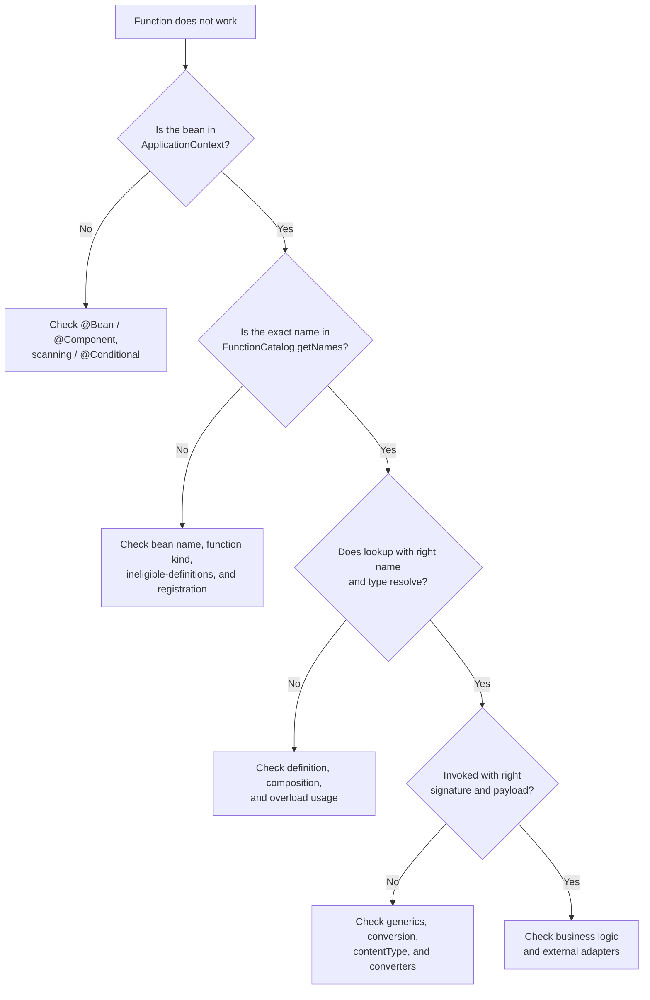

# Identifying Non-Existent, Misnamed, or Mismatched-Signature Functions

**Chapter:** FunctionCatalog  
**Module:** Spring Cloud Function (`SPRING_CLOUD_FUNCTION`)

Spring Cloud Function helps write business logic as `Supplier`, `Function`, and `Consumer` beans for reuse regardless of how they are invoked. The same function can run from Java code, be called over HTTP, handle events via Spring Cloud Stream, or be deployed in a serverless environment. At the center of that selection and execution mechanism is **`FunctionCatalog`**.

When an invocation fails, a "function not found" message can mask several distinct causes: no Spring bean exists, a wrong name was used, the wrong functional interface was selected, generic types were misassigned, or the submitted payload could not be converted. The proper diagnostic approach is to **identify which layer the error occurred in**, rather than randomly tweaking `spring.cloud.function.definition` or changing function signatures.

This lesson walks through a repeatable process to distinguish those cases, complete with Spring Boot examples, error tables, JUnit tests, and notes for exposing functions via HTTP/events/serverless.

## 1. Four Error Categories to Distinguish

| Category | Example | Question to Check |
| --- | --- | --- |
| **Non-existent / unregistered function** | `lookup("notRegistered")` | Was the bean actually created by Spring and discovered by the catalog? |
| **Wrong name or definition** | Bean named `normalizeOrderCode` but called as `normaliseOrderCode` | Does the actual name, `@Bean("...")`, or composition string match? |
| **Wrong function kind** | Expecting `Supplier` when the actual bean is `Function` | Does the function use `get()`, `apply(input)`, or `accept(input)`? |
| **Wrong data-type signature** | `Function<String, Integer>` used as `Function<String, String>` | Are input/output types, generics, message/payload, and converters correct? |

Specifically, **signature** has two layers:

1. **Interface kind:** `Supplier<O>`, `Function<I,O>`, or `Consumer<I>`. They differ in parameter count and invocation method.
2. **Data types:** for example, `Function<String,Integer>` differs from `Function<OrderRequest,OrderDecision>`, even though both belong to `Function.class`.

An error at the interface-kind layer is not the same as an error at the generics layer. Nor should errors caused by HTTP adapters or message bindings be conflated with `FunctionCatalog` errors.



This diagram represents a pragmatic troubleshooting order, not the internal source code. There are cases where the catalog uses custom registration or fallback lookup mechanisms, so final conclusions must rest on observed names and behavior.

## 2. Master the APIs Before Diagnosing

`FunctionCatalog` is typically injected into a Spring bean:

```java
import java.util.Set;
import java.util.function.Consumer;
import java.util.function.Function;
import java.util.function.Supplier;
import org.springframework.cloud.function.context.FunctionCatalog;

// Assume the catalog variable has been injected by Spring.
Set<String> all = catalog.getNames(null);
Set<String> suppliers = catalog.getNames(Supplier.class);
Set<String> functions = catalog.getNames(Function.class);
Set<String> consumers = catalog.getNames(Consumer.class);

Function<String, String> operation =
    catalog.lookup(Function.class, "normalizeOrderCode");
```

| API | What Is It Used For? | What Does It Not Prove? |
| --- | --- | --- |
| `getNames(null)` | List function names recognized by the catalog | Does not guarantee every name has an HTTP route or binding |
| `getNames(Function.class)` | Inspect candidates in the `Function` group | Cannot distinguish `String → String` from `String → Integer` generics |
| `getNames(Supplier.class)`, `getNames(Consumer.class)` | Inspect candidates by group | Does not imply the function is side-effect-free |
| `lookup("name")` | Resolve a name/definition into a function representation | Does not prove the name truly exists if single-function fallback is enabled |
| `lookup(Function.class, "name")` | Express expected interface kind and look up by name | Not a full verification of generic type arguments |
| `ApplicationContext.getBean("name")` | Retrieve a Spring bean directly | Does not verify catalog candidate eligibility |

`FunctionCatalog.lookup(...)` may return a **wrapper** managed by Spring Cloud Function. When a name cannot be resolved, the API usually does not return a usable function; however, with *single-function fallback*, a wrong name can still map to the sole function. Additionally, lookup or invocation can throw exceptions upon encountering invalid definitions, wrong kinds, or conversion errors. **Do not write code assuming every failure simply returns `null`.**

## 3. Sample Application: Enough Function Types to Distinguish Errors

The following example uses Spring Boot and a compatible Spring Cloud Function context. It includes multiple functional beans so that testing a misspelled name is not accidentally rescued by *single-function fallback*.

```java
import java.util.Locale;
import java.util.Set;
import java.util.function.Consumer;
import java.util.function.Function;
import java.util.function.Supplier;

import org.springframework.boot.ApplicationRunner;
import org.springframework.boot.SpringApplication;
import org.springframework.boot.autoconfigure.SpringBootApplication;
import org.springframework.cloud.function.context.FunctionCatalog;
import org.springframework.context.ApplicationContext;
import org.springframework.context.annotation.Bean;

@SpringBootApplication
public class FunctionDiagnosisApplication {

    public static void main(String[] args) {
        SpringApplication.run(FunctionDiagnosisApplication.class, args);
    }

    // Bean name is normalizeOrderCode, NOT normalize().
    @Bean("normalizeOrderCode")
    public Function<String, String> normalize() {
        return value -> value.trim().toUpperCase(Locale.ROOT);
    }

    @Bean("codeLength")
    public Function<String, Integer> countCharacters() {
        return String::length;
    }

    @Bean("issueOrderCode")
    public Supplier<String> issueOrderCode() {
        return () -> "ord-42";
    }

    @Bean("auditOrderCode")
    public Consumer<String> auditOrderCode() {
        return value -> System.out.println("AUDIT: " + value);
    }

    @Bean
    public ApplicationRunner inspectCatalog(
            ApplicationContext context,
            FunctionCatalog catalog) {
        return args -> {
            System.out.println(
                "Bean exists: "
                    + context.containsBean("normalizeOrderCode"));

            print("All", catalog.getNames(null));
            print("Suppliers", catalog.getNames(Supplier.class));
            print("Functions", catalog.getNames(Function.class));
            print("Consumers", catalog.getNames(Consumer.class));

            Function<String, String> normalizer =
                catalog.lookup(Function.class, "normalizeOrderCode");

            if (normalizer == null) {
                throw new IllegalStateException(
                    "Required function was not resolved");
            }
            System.out.println(
                normalizer.apply("  ord-42  ")); // ORD-42
        };
    }

    private static void print(String label, Set<String> names) {
        System.out.println(label + ":");
        names.stream().sorted()
            .forEach(name -> System.out.println("  - " + name));
    }
}
```

**Expectations for business names:**

| Group | Expected Names |
| --- | --- |
| `Supplier` | `issueOrderCode` |
| `Function` | `normalizeOrderCode`, `codeLength` |
| `Consumer` | `auditOrderCode` |

The lists may contain infrastructure names such as `functionRouter`. Do not compare them for exact equality against just these four names. Check that the returned set **contains the required names**.

## 4. Case A: Function Does Not Exist or Is Not Registered

### 4.1. A Java Object Does Not Automatically Become a Spring Bean

```java
Function<String, String> localOnly = String::trim;
```

The local variable above is not automatically managed by Spring, so you cannot expect:

```java
catalog.lookup(Function.class, "localOnly");
```

to return that lambda.

For a function to be discovered by the catalog in a standard Spring Boot model, declare a bean:

```java
@Bean("trimOrderCode")
public Function<String, String> trimOrderCode() {
    return String::trim;
}
```

Besides `@Bean`, you can use `@Component` within component scan scope or an explicit registration mechanism supported by Spring Cloud Function.

### 4.2. Bean Not Created Due to Spring Configuration

A `@Component` class outside scanning scope, a `@Bean` whose condition is unmet, or an unimported configuration class can all prevent the bean from existing.

Do not start by editing `FunctionCatalog.lookup(...)` if:

```java
context.containsBean("trimOrderCode") // false
```

In that case, check:

- Is the class containing `@Bean` part of a loaded Spring configuration?
- Is the `@Component` within scanning scope?
- Has the required profile been activated?
- Is a `@Conditional...` annotation causing Spring to skip the bean?
- Are there bean initialization errors in startup logs?

**Distinction:** if `ApplicationContext.getBean(...)` reports a missing bean, the issue lies in Spring registration; the catalog cannot fix it with a different function definition.

### 4.3. Bean Exists, Yet the Catalog Does Not Recognize It

An ordinary bean may exist in Spring without being eligible as a functional bean. Moreover, Spring Cloud Function has filters for candidates that should not be registered, including custom exclusion lists:

```properties
spring.cloud.function.ineligible-definitions=trimOrderCode
```

When marked ineligible, `trimOrderCode` can still be injected or retrieved from the Spring context, yet it should not appear in the normal catalog candidate list.

In this situation, cross-check **both layers**:

```java
boolean beanExists =
    context.containsBean("trimOrderCode");

boolean catalogContainsName =
    catalog.getNames(Function.class)
           .contains("trimOrderCode");
```

If `beanExists == true` while `catalogContainsName == false`, inspect the bean type, registration method, `ineligible-definitions` configuration, and framework version. Do not conclude that the Spring bean does not exist.

## 5. Case B: Wrong Bean Name or Mistyped Function Definition

### 5.1. Java Method Name Is Not Necessarily the Bean Name

In the sample application:

```java
@Bean("normalizeOrderCode")
public Function<String, String> normalize() {
    return value -> value.trim().toUpperCase(Locale.ROOT);
}
```

The lookup name is **`normalizeOrderCode`**, not `normalize`. The two calls below carry different meanings:

```java
// Correct:
catalog.lookup(Function.class, "normalizeOrderCode");

// Not the declared bean name:
catalog.lookup(Function.class, "normalize");
```

If you write `@Bean` without passing a name, the default bean name is the method name. With `@Component("name")`, the explicit name in the annotation is likewise what must be checked.

### 5.2. Typos, Letter Case, and Whitespace

Assuming the right name is `normalizeOrderCode`:

| Configuration Value | Remark |
| --- | --- |
| `normalizeOrderCode` | Correct name |
| `normaliseOrderCode` | Misspelled `normalize` |
| `NormalizeOrderCode` | Different leading letter case |
| `normalizeOrderCodes` | Extra trailing character |
| `normalize()` | Method name, not the bean name in the example |
| `normalizeOrderCode|addPrefix` | Two-step definition; requires an `addPrefix` bean to exist |

Do not guess names by looking at class names. Print `catalog.getNames(null)`, verify the actual bean name, and normalize configuration strings at their source.

### 5.3. One Component in a Composition Does Not Exist

A function definition can describe a chain:

```properties
spring.cloud.function.definition=normalizeOrderCode|codeLength
```

This chain is type-compatible: `normalizeOrderCode` takes/returns `String`, and `codeLength` takes `String` and returns `Integer`.

However, if you configure:

```properties
spring.cloud.function.definition=normalizeOrderCode|missingStep
```

then `missingStep` is not a registered bean in the example. The catalog lacks all components needed to assemble the intended pipeline. Depending on the version and invocation path, resolution may fail or throw an exception; do not assume names will be auto-corrected.

When debugging compositions:

1. Split the definition on `|`.
2. Check each component in `getNames(...)`.
3. Check the kind and signature of each component.
4. Check the order of previous output to next input.
5. Look up the full definition and test with small, predictable inputs.

## 6. Case C: Wrong Supplier, Function, or Consumer Group

The three interfaces have different invocation contracts:

| Interface | Signature | Correct Invocation | Examples in Lesson |
| --- | --- | --- | --- |
| `Supplier<O>` | Takes no parameters, returns `O` | `supplier.get()` | `issueOrderCode` |
| `Function<I,O>` | Takes `I`, returns `O` | `function.apply(input)` | `normalizeOrderCode`, `codeLength` |
| `Consumer<I>` | Takes `I`, returns no value | `consumer.accept(input)` | `auditOrderCode` |

**Correct example:**

```java
Supplier<String> source =
    catalog.lookup(Supplier.class, "issueOrderCode");
Function<String, String> normalizer =
    catalog.lookup(Function.class, "normalizeOrderCode");
Consumer<String> audit =
    catalog.lookup(Consumer.class, "auditOrderCode");

if (source == null || normalizer == null || audit == null) {
    throw new IllegalStateException("Required functions missing");
}

String normalized = normalizer.apply(source.get());
audit.accept(normalized);
```

**Flawed reasoning example:** trying to invoke `issueOrderCode` using `apply("x")`. By its business contract, this is a `Supplier`, so it accepts no input.

### 6.1. Why Can Relying Only on instanceof Be Misleading?

The representation returned from `FunctionCatalog` may be Spring Cloud Function's `FunctionInvocationWrapper`. In some versions, the wrapper implements multiple functional interfaces to unify invocation paths. Therefore, do not use:

```java
Object candidate = catalog.lookup("issueOrderCode");
boolean looksLikeAFunction = candidate instanceof Function;
```

as a test for the **original business kind**. An `instanceof` check on the wrapper class does not necessarily reflect the underlying bean's signature.

Cross-check `catalog.getNames(Supplier.class)`, `getNames(Function.class)`, `getNames(Consumer.class)`, bean declarations, and—when needed—function-kind metadata from the wrapper.

### 6.2. Inspecting FunctionInvocationWrapper Metadata

When your version provides this API and you are performing deep diagnostics:

```java
import java.lang.reflect.Type;
import org.springframework.cloud.function.context.catalog.SimpleFunctionRegistry.FunctionInvocationWrapper;

// Assume catalog has been injected by Spring.
FunctionInvocationWrapper wrapper =
    catalog.lookup("codeLength");

if (wrapper == null) {
    throw new IllegalStateException("codeLength missing");
}

System.out.println(wrapper.getFunctionDefinition());
System.out.println(wrapper.isFunction());
Type input = wrapper.getInputType();
Type output = wrapper.getOutputType();
System.out.println(input + " -> " + output);
```

For the `codeLength` bean, input/output metadata can reflect `String → Integer`. This is a useful diagnostic tool, though `FunctionInvocationWrapper` is an implementation class: when upgrading Spring Cloud Function, recheck the API on your exact artifact version.

In business code, prefer `FunctionCatalog` and standard Java interfaces rather than depending on internal wrapper classes.

## 7. Case D: Generic Mismatches and Type Erasure

This is a subtler mistake than picking the wrong function group. Two beans:

```java
@Bean("normalizeOrderCode")
public Function<String, String> normalize() {
    return value -> value.trim().toUpperCase(Locale.ROOT);
}

@Bean("codeLength")
public Function<String, Integer> countCharacters() {
    return String::length;
}
```

both belong to `Function.class`, yet have different return types. The following lookup is **correct**:

```java
Function<String, Integer> length =
    catalog.lookup(Function.class, "codeLength");

if (length == null) {
    throw new IllegalStateException("codeLength missing");
}
Integer result = length.apply("ORD-42"); // 6
```

By contrast, the snippet below **assigns the wrong expected type**:

```java
// Intentionally wrong example, do not use in applications:
Function<String, String> wrong =
    catalog.lookup(Function.class, "codeLength");

// codeLength actually returns Integer, NOT String.
// String result = wrong.apply("ORD-42");
```

The issue is that `Function.class` only carries the raw interface class after generic type erasure. Java allows the assignment above because the generic signature of `lookup(...)` is inferred from the target variable, yet that **does not prove** the actual function returns `String`. When using the result as a `String`, the program may encounter a `ClassCastException` or a runtime error depending on the conversion path.

**Rule:** the interface kind and generic types must be verified against the bean signature and real data, not inferred from the receiving variable of `lookup`.

### 7.1. Wrong Input Type

If `codeLength` expects `String`, the call below violates the compile-time contract:

```java
Function<String, Integer> length =
    catalog.lookup(Function.class, "codeLength");

// Does not compile: length.apply(42);
// Because 42 is an int/Integer, not a String.
```

If you bypass generics using raw types or reflection, the error may surface only at runtime. Spring Cloud Function's wrapper may attempt type conversion in supported scenarios, yet **there is no guarantee every input will automatically convert into the right type**.

### 7.2. Wrong Output Type When Composing Functions

Consider the chain:

```text
normalizeOrderCode : String -> String
codeLength          : String -> Integer
```

Therefore:

```text
normalizeOrderCode|codeLength : String -> Integer
```

Never assign this pipeline logic to `Function<String,String>` and expect a string. Whenever a definition changes, verify the **final output contract** and update the calling code/adapter receiving the result accordingly.

## 8. Signature Mismatches Due to Payload, Message, and Content Type

A Java signature can be completely valid while calls through an adapter still fail because the payload cannot be converted into the type the function expects.

Example:

```java
record OrderRequest(String id, long amount) {}
record OrderDecision(String id, boolean accepted) {}

@Bean("validateOrder")
public Function<OrderRequest, OrderDecision> validateOrder() {
    return order ->
        new OrderDecision(order.id(), order.amount() > 0);
}
```

**Direct call with proper type:**

```java
OrderRequest request = new OrderRequest("ORD-42", 1500);
OrderDecision decision = validator.apply(request);
```

Here, `validator` is a `Function<OrderRequest,OrderDecision>` bean injected by Spring.

**Via adapter:** the input might be a `Message<byte[]>` carrying JSON. Spring Cloud Function uses function type metadata alongside appropriate converters, such as `MessageConverter`, to construct `OrderRequest` from the payload; for non-`Message` inputs, `ConversionService` may be used.

These are **distinct** problems:

| Symptom | Possible Cause | What to Check |
| --- | --- | --- |
| `lookup("validateOrder")` does not resolve | Wrong name/bean/definition | `@Bean`, `getNames(...)`, ineligible config |
| Lookup succeeds but applying payload fails | Malformed JSON, schema mismatch, missing suitable converter | Payload, `contentType`, converters, and metadata |
| DTO is constructed but business value is invalid | Application validation rules | Validation and domain processing |
| Output right in Java but wrong over HTTP/message | Output conversion step or adapter | Output type, serialization, protocol configuration |

### 8.1. Generic Metadata Matters

Spring Cloud Function usually infers data types from the signature:

```java
@Bean("validateOrder")
public Function<OrderRequest, OrderDecision> validateOrder() {
    return order ->
        new OrderDecision(order.id(), order.amount() > 0);
}
```

If replaced by a raw `Function` or a lambda registered without sufficient metadata, the framework may not know which type to deserialize JSON into. During manual registration, APIs like `FunctionRegistration` can supply type metadata, though exact configuration depends on registration style and version.

Never "fix" this by arbitrarily casting `Message<?>` to a DTO. Inspect the input type declared by the bean and how the adapter passes data to the wrapper.

### 8.2. Content-Type Is Not Magic

For JSON, the `contentType=application/json` header can guide the framework to choose an appropriate converter. If the actual data is plain text or malformed JSON, conversion can still fail.

When debugging:

1. Print the actual payload type provided by the adapter in a test environment.
2. Check the bean signature and generic metadata.
3. Verify `contentType` matches the payload.
4. Check that converters/JSON mappers are on the classpath.
5. Test calling directly with a valid DTO first, then calling via the adapter with the corresponding payload.

Successfully calling `Function<OrderRequest,OrderDecision>` directly with a DTO **does not prove** HTTP or message conversion works.

## 9. Special Trap: Single-Function Fallback Masking Wrong Names

Spring Cloud Function supports *single-function fallback*: when only **one eligible functional bean** exists, the catalog may map an empty name or any arbitrary name lookup to that sole function.

Suppose only `normalizeOrderCode` is registered. In some configurations:

```java
Function<String, String> maybe =
    catalog.lookup(Function.class, "normaliseOrderCode");

// May be non-null, even though the real bean is named normalizeOrderCode.
```

This leads to a common diagnostic mistake:

> "I called a misspelled name and still got a `Function`; so that name must be a valid alias."

Incorrect: the result may come from fallback. Once another `Function` or `Consumer` is added, the selection behavior can change and the misspelled name error surfaces.

### 9.1. How to Verify the Real Name

```java
String requestedName = "normaliseOrderCode";
boolean nameRegistered =
    catalog.getNames(null).contains(requestedName);

System.out.println(nameRegistered); // false in this example
```

If strict lookup is required, verify the name is present in the catalog and belongs to the application's allowed function list **before calling lookup**.

### 9.2. Disabling Fallback When Supported by Version

```properties
spring.cloud.function.single-function-fallback-enabled=false
```

Current Spring Cloud Function documentation describes this toggle. When working on an older project, check the documentation for your **exact artifact version** and test runtime behavior; a property unsupported by your version will not produce the effect you expect.

In all cases, explicitly configuring `spring.cloud.function.definition` for adapters reduces reliance on default function-selection rules.

## 10. Safe Diagnostic Path for Business Applications

When an application allows selecting functions by name, it is safer to explicitly define which functions are permitted. For example, a service that only permits running the normalization function:

```java
import java.util.Set;
import java.util.function.Function;
import org.springframework.cloud.function.context.FunctionCatalog;
import org.springframework.stereotype.Service;

@Service
public class OrderCodeFunctionResolver {

    private static final Set<String> ALLOWED =
        Set.of("normalizeOrderCode");

    private final FunctionCatalog catalog;

    public OrderCodeFunctionResolver(FunctionCatalog catalog) {
        this.catalog = catalog;
    }

    public Function<String, String> requireNormalizer(String name) {
        if (name == null || !ALLOWED.contains(name)) {
            throw new IllegalArgumentException(
                "Unsupported function name: " + name);
        }

        if (!catalog.getNames(Function.class).contains(name)) {
            throw new IllegalStateException(
                "Function is not registered as Function: " + name);
        }

        Function<String, String> function =
            catalog.lookup(Function.class, name);

        if (function == null) {
            throw new IllegalStateException(
                "Lookup failed for function: " + name);
        }

        return function;
    }
}
```

The service above addresses three issues:

- **Disallowed names:** rejected before lookup, avoiding accidental calls to internal functions.
- **Name missing from the Function group:** fails with a clearer error than letting `apply(...)` fail later.
- **Unresolved lookup:** throws a meaningful application exception rather than a `NullPointerException` when calling on `null`.

This class only allows a single known contract `Function<String,String>`. If a dispatcher needs to support functions with varying generics, design **explicitly typed contracts** for each mode rather than casting every catalog result to `Function<String,String>`.

An allowlist of functions does not replace API authentication or authorization. Never expose the ability to run arbitrary function definitions sent by external callers without enforcing business intent and access controls.

## 11. JUnit Tests: Proving Correct Names and Signatures

Assuming `FunctionDiagnosisApplication` from section 3 and compatible Spring Boot Test/JUnit 5 dependencies are available:

```java
import static org.junit.jupiter.api.Assertions.*;

import java.util.Set;
import java.util.function.Consumer;
import java.util.function.Function;
import java.util.function.Supplier;

import org.junit.jupiter.api.Test;
import org.springframework.beans.factory.annotation.Autowired;
import org.springframework.boot.test.context.SpringBootTest;
import org.springframework.cloud.function.context.FunctionCatalog;
import org.springframework.context.ApplicationContext;

@SpringBootTest(classes = FunctionDiagnosisApplication.class)
class FunctionDiagnosisApplicationTest {

    @Autowired
    private ApplicationContext context;

    @Autowired
    private FunctionCatalog catalog;

    @Test
    void registeredNamesMatchTheBusinessContract() {
        Set<String> all = catalog.getNames(null);

        assertTrue(all.contains("normalizeOrderCode"));
        assertTrue(all.contains("codeLength"));
        assertTrue(all.contains("issueOrderCode"));
        assertTrue(all.contains("auditOrderCode"));

        assertFalse(all.contains("normaliseOrderCode"));
        assertFalse(all.contains("normalize"));
        assertTrue(context.containsBean("normalizeOrderCode"));
    }

    @Test
    void groupMembershipMatchesTheInterface() {
        assertTrue(catalog.getNames(Function.class)
            .containsAll(Set.of("normalizeOrderCode", "codeLength")));
        assertTrue(catalog.getNames(Supplier.class)
            .contains("issueOrderCode"));
        assertTrue(catalog.getNames(Consumer.class)
            .contains("auditOrderCode"));
    }

    @Test
    void correctGenericContractsProduceExpectedValues() {
        Function<String, String> normalize =
            catalog.lookup(Function.class, "normalizeOrderCode");
        Function<String, Integer> length =
            catalog.lookup(Function.class, "codeLength");

        assertNotNull(normalize);
        assertNotNull(length);

        String normalized = normalize.apply("  ord-42  ");
        assertEquals("ORD-42", normalized);
        assertEquals(6, length.apply(normalized).intValue());
    }

    @Test
    void unknownFunctionIsNotAnAlias() {
        // There are multiple eligible beans, so we do not rely on
        // single-function fallback behavior.
        assertFalse(catalog.getNames(null)
            .contains("definitelyMissingOrderFunction"));

        assertNull(catalog.lookup(
            Function.class, "definitelyMissingOrderFunction"));
    }

    @Test
    void simpleCompositionHasIntegerOutput() {
        Function<String, Integer> pipeline =
            catalog.lookup(
                Function.class, "normalizeOrderCode|codeLength");

        assertNotNull(pipeline);
        assertEquals(6, pipeline.apply("  ord-42  ").intValue());
    }
}
```

These tests verify **names**, **interface group membership**, **execution behavior**, and **output types** using predictable examples. They do not assert `catalog.size() == 4` because the catalog may include additional infrastructure functions and counting semantics can depend on the registry.

### 11.1. Should You Write Tests That Intentionally Trigger ClassCastException?

You can write an isolated test to demonstrate *type erasure* in a learning environment, but in product contract tests, verify the correct type using representative data. Intentionally assigning `Function<String,Integer>` to `Function<String,String>` and asserting it fails can tightly couple tests to a specific version's wrapper/conversion details.

If you need to prove concrete types prior to execution, combine wrapper metadata checks with a test using real inputs/outputs. Runtime type assertions in tests do not replace maintaining clear signatures on the bean itself.

### 11.2. Testing Negative Cases and Versions

A test expecting `lookup("wrongName") == null` may fail in an application with only one functional bean because of single-function fallback, even though that name truly does not exist. Therefore:

- Use a fixture with multiple eligible functional beans as in this example.
- Or disable fallback if your actual version supports it.
- Always also verify `getNames(null)` does not contain the wrong name.

When upgrading Spring Cloud Function, rerun both positive and negative tests against the new classpath.

## 12. When Errors Occur in HTTP, Stream, or Serverless

Adapters build on the catalog yet add their own configuration and error-handling layers. Never conclude "FunctionCatalog cannot find the function" solely from an HTTP 404 or a missing output message.

| Symptom | Layer Worth Checking | Example Causes |
| --- | --- | --- |
| HTTP returns `404` | Web adapter / mapping / export | Missing route or exported name differs from called name |
| HTTP reports payload error | HTTP/message conversion | Wrong `Content-Type`, JSON/schema mismatch, or missing converter |
| Spring Cloud Stream creates no binding | Stream adapter and `definition` | Wrong name selected, missing binder, or binding config error |
| Stream receives event but handler fails | Type/payload metadata or logic | DTO mismatch, converter issue, domain error |
| Router reports no target function | Routing rules and catalog | Header/definition points to an unregistered name |
| Serverless handler does not run | Deployment/entry point/adapter | Wrong handler name, packaging, or payload mapping |

### 12.1. Checking in Order

1. **Spring layer:** was the bean created?
2. **Catalog layer:** is the name right, is the group right, and does lookup resolve?
3. **Signature layer:** are input/output generics, composition, and message conversion compatible?
4. **Adapter layer:** are function definition, mapping/binding, routing, and protocol settings right?
5. **Business layer:** given valid input, does the function produce the expected output?

For example, if Java calls `catalog.lookup(Function.class, "normalizeOrderCode")` and `apply("ord-42")` succeeds while HTTP returns 404, the next step is checking the Web adapter, path, and export rules; there is no need to modify normalization logic just because a route is missing.

### 12.2. Observing the Catalog via Actuator When Web Is Present

If the application includes Spring Boot Actuator alongside a web stack and exposes the endpoint:

```yaml
management:
  endpoints:
    web:
      exposure:
        include: health,info,functions
```

you can inspect the catalog:

```bash
curl http://localhost:8080/actuator/functions
```

The response can reveal names, function kinds, and input/output types recognized by the framework, helping pinpoint kind/generic mismatches. This endpoint only works when compatible dependencies, configuration, and endpoint protections are in place. **This is an observability endpoint, not a function-execution endpoint.**

Do not expose full management information to the public internet; restrict Actuator endpoints and logged data in production environments.

## 13. Quick Lookup Table for Causes and Fixes

| Symptom | Possible Cause | Appropriate Fix |
| --- | --- | --- |
| Bean missing from Spring context | Missing `@Bean`/`@Component`, scan, or condition | Fix registration/configuration |
| Spring has bean but catalog does not list it | Not a functional bean, excluded, or different registration | Check bean type and `ineligible-definitions` |
| `normalize` not found despite `normalize()` method | `@Bean("normalizeOrderCode")` renamed the bean | Use `normalizeOrderCode` |
| Wrong-name lookup still returns a function | Single-function fallback | Check `getNames(null)` and strict configuration |
| Mistook `Supplier` for `Function` | Wrong interface group | Check `getNames(type)` and call the right `get/apply/accept` |
| Assigned `Function<String,Integer>` to `Function<String,String>` | Wrong generics inferred after lookup | Check bean signature and test output types |
| Composition step not found | Misspelled one component name | Verify each name/definition individually |
| Composition steps incompatible | Previous output differs from next input | Adjust order/signatures or intentional conversion |
| Lookup succeeds but JSON input fails | Missing metadata or wrong converter/payload | Check `contentType`, schema, and JSON mapper |
| HTTP 404 while Java call succeeds | Wrong path or Web export settings | Diagnose adapter, do not alter the bean |
| Stream fails to receive messages | Wrong definition/binding/binder | Inspect Spring Cloud Stream configuration |
| Negative test unstable | Single-function fixture/version-specific fallback | Isolate test fixture or disable supported fallback |

## 14. Practice Exercises and Interview Scenarios

1. **Wrong name:** using the sample application, try looking up `normalize` instead of `normalizeOrderCode`. Use `getNames(null)` and `context.containsBean(...)` to explain which layer is wrong.
2. **Missing bean:** create a local `Function<String,String>` lambda and try looking it up by variable name. Convert it into a `@Bean("trimOrderCode")` bean and compare.
3. **Wrong group:** look up `issueOrderCode`, `normalizeOrderCode`, and `auditOrderCode`. Create a table clearly showing how to call `get()`, `apply(...)`, and `accept(...)`.
4. **Wrong generic:** explain why `codeLength` returns `Integer` even though `lookup(Function.class, ...)` carries no generic type. Write a test proving the output is `6` for input `ORD-42`.
5. **Composition:** test `normalizeOrderCode|codeLength`, then replace `codeLength` with an unregistered name. Write a checklist to verify each component.
6. **Fallback:** create an app with only one functional bean left, try looking up a wrong name. Check whether the wrong name appears in `getNames(null)`; then test on a version supporting `single-function-fallback-enabled=false`.
7. **DTO/JSON:** create `Function<OrderRequest,OrderDecision>`. Write a direct DTO unit test and an HTTP or message JSON integration test to distinguish business errors from converter errors.
8. **Adapters:** create a Web endpoint invoking `normalizeOrderCode`. If HTTP returns 404 while Java lookup succeeds, document the investigation steps without modifying the function's code.

### Interview Question 1

**Q:** Why can `catalog.lookup(Function.class, "codeLength")` be assigned to a `Function<String,String>` variable even though the actual bean returns `Integer`?

**A:** The `Function.class` argument is a raw class carrying no generic type parameters. Java can infer generic parameters from the receiving variable without verifying the bean's signature. Therefore, you must cross-check the actual declared signature and verify runtime/output types rather than trusting the receiving variable alone.

### Interview Question 2

**Q:** Why is `lookup("notRegistered") != null` not enough to prove a function exists?

**A:** In an application with only one eligible functional bean, single-function fallback can return that sole function even when the lookup name does not match. You must check catalog names, fallback configuration, and the signature of the function actually resolved.

### Interview Question 3

**Q:** A `Function<OrderRequest,OrderDecision>` passes unit tests yet fails to process HTTP JSON. Should you modify the function body first?

**A:** Not yet. First inspect the HTTP adapter, content type, JSON mapper, input/output metadata, and converters. If unit tests with valid DTOs already pass, the root cause likely lies in the data conversion step prior to invoking the logic.

## 15. Summary

- **Non-existent**: verify the Spring bean was created and recognized by the catalog; distinguish registration issues from exclusion via `ineligible-definitions`.
- **Wrong name**: cross-reference actual bean names from `@Bean("...")` and `getNames(...)`; check each component when using compositions.
- **Wrong interface group**: `Supplier` uses `get()`, `Function` uses `apply(input)`, and `Consumer` uses `accept(input)`.
- **Wrong generic**: `Function.class` does not fully verify input/output types; keep concrete bean signatures and verify actual outputs.
- **Wrong conversion**: a matching name and successful lookup do not prove JSON/`Message` payloads can convert into DTOs; check converters, content types, and adapters.
- **Single-function fallback** can mask typos. Use name listings, controlled negative tests, and version-appropriate strict configuration.
- **Layered diagnosis**—Spring → FunctionCatalog → signature/conversion → adapter → business logic—fixes the right bug while preserving reusability across HTTP, events, and serverless.

### References

- [Spring Cloud Function — Programming Model](https://docs.spring.io/spring-cloud-function/reference/spring-cloud-function/programming-model.html): registration, `FunctionCatalog.lookup`, function definitions, fallback, composition, and type conversion.
- [Spring Cloud Function — Functional Bean Definitions](https://docs.spring.io/spring-cloud-function/reference/functional.html): listing function names, catalog inspection, and Actuator `functions`.
- [Spring Cloud Function — Standalone Web Applications](https://docs.spring.io/spring-cloud-function/reference/spring-cloud-function/standalone-web-applications.html): exporting and invoking functions over HTTP.
- [Spring Cloud Stream — Producing and Consuming Messages](https://docs.spring.io/spring-cloud-stream/reference/spring-cloud-stream/producing-and-consuming-messages.html): selecting functions via function definitions and connecting to message bindings.
