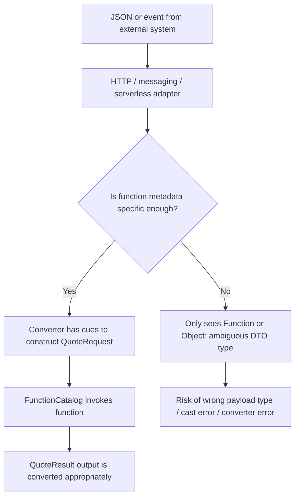

# Losing Type Information When Using Raw Types, Object, or Dynamically Registered Lambdas

Spring Cloud Function lets you write logic as a `Supplier`, `Function`, or `Consumer` and reuse it over HTTP, message broker events, or serverless environments. However, for an adapter to receive JSON or a message and invoke the right function, the framework needs to know **what payload type the function actually expects**. Declarations such as a raw `Function`, `Function<Object, Object>`, or a lambda dynamically registered with `Function.class` can make the type information insufficiently specific.

This lesson belongs to the **Data Types** chapter and focuses on three causes that lose or obscure generic metadata: using **raw types**, using **`Object` as the published type**, and **registering lambdas dynamically without accompanying type descriptions**. The goal is to recognize the risks, fix the declarations, and verify that a function retrieved via `FunctionCatalog` still converts data properly at the protocol boundary.

## 1. Where Is Type Information Used?

Suppose the system calculates a price quote via a Java function:

```java
public record QuoteRequest(String sku, int quantity) {}
public record QuoteResult(String sku, long amount) {}

Function<QuoteRequest, QuoteResult> quote = request ->
    new QuoteResult(request.sku(), request.quantity() * 1_000L);
```

Regarding **Java logic**, the variable `quote` has the signature `Function<QuoteRequest, QuoteResult>`; the compiler verifies that the lambda handles `QuoteRequest` and returns `QuoteResult`. But when data arrives from JSON or an event into the function, Spring Cloud Function and the adapter must solve a different problem: which Java class should the incoming payload be converted into before calling `apply()`?

With a concretely declared bean:

```java
@Bean
public Function<QuoteRequest, QuoteResult> quote() {
    return request -> new QuoteResult(
        request.sku(), request.quantity() * 1_000L
    );
}
```

Spring can read the generic signature from **the return type of the `@Bean` method**. When a compatible adapter invokes the function, this metadata helps determine the input/output types to coordinate payload conversion. Conversion also depends on `content-type`, converters, DTO structure, and adapter configuration.

Three layers to distinguish:

| Layer | Question to Answer | Source of Information |
| --- | --- | --- |
| Java compilation | What types does `apply()` accept and return? | Generics on variables, interfaces, and methods |
| Function registration | Does `FunctionCatalog` know the function's concrete types? | Metadata from bean/class or explicit type registration |
| HTTP/message/serverless boundary | Which DTO is the external payload converted into? | Function metadata **plus** converters, content type, and adapter |

Java **type erasure** does not mean all generic signatures vanish: parameterization information on a concretely declared method or class can still be read via reflection. However, a lambda object usually does not retain `QuoteRequest`/`QuoteResult` as reliable metadata on its runtime class itself. Therefore, **the type published at registration** matters just as much as the type the source code used to compile the lambda.

## 2. Raw Types: Signatures Missing Generic Arguments

A raw type is using a generic interface while omitting type arguments: `Function` instead of `Function<I, O>`, `Supplier` instead of `Supplier<O>`, `Consumer` instead of `Consumer<I>`.

### Problematic Example

The snippet below intentionally uses a raw type for illustration. Assume `QuoteRequest` and `QuoteResult` are already defined as in the previous section:

```java
import java.util.function.Function;
import org.springframework.context.annotation.Bean;

@Bean
@SuppressWarnings("rawtypes")
public Function quoteRaw() {
    Function<QuoteRequest, QuoteResult> implementation = request ->
        new QuoteResult(request.sku(), request.quantity() * 1_000L);

    return implementation;
}
```

Inside the method, `implementation` is still a `Function<QuoteRequest, QuoteResult>`. However, **the type contract of `@Bean` is only `Function`**. If a function discovery mechanism only sees this signature, it cannot infer `QuoteRequest` and `QuoteResult` from the return type's generic arguments. This can remove the cues needed to select a converter for JSON or messages.

Another downside is that a raw function can be called with the wrong type and only fail at runtime:

```java
@SuppressWarnings({"rawtypes", "unchecked"})
Function unsafe = (Function<QuoteRequest, QuoteResult>) request ->
    new QuoteResult(request.sku(), request.quantity() * 1_000L);

unsafe.apply("this is not a QuoteRequest"); // Can throw ClassCastException
```

Here the compiler no longer enforces that `apply()` receives a `QuoteRequest`. That is a Java type-safety issue; deserialization failures at the Spring Cloud Function boundary are another consequence of publishing insufficient metadata.

### How to Fix It

```java
@Bean
public Function<QuoteRequest, QuoteResult> quote() {
    return request -> new QuoteResult(
        request.sku(), request.quantity() * 1_000L
    );
}
```

Declare full generics **directly on the bean registration method**. Do not merely keep types in a local variable or use unchecked casts to hide compiler warnings.

## 3. `Object`: Generics Present, but the Contract Is Too Broad

`Function<Object, Object>` **is not a raw type**: it has both generic arguments, yet both are merely `Object`. Java knows the published contract is strictly accept `Object`, return `Object`; what remains unknown is the **business type**.

```java
@Bean
public Function<Object, Object> quoteTooBroad() {
    return input -> {
        QuoteRequest request = (QuoteRequest) input;
        return new QuoteResult(
            request.sku(), request.quantity() * 1_000L
        );
    };
}
```

In a direct call `quoteTooBroad.apply(new QuoteRequest("P-01", 2))`, the cast can succeed. But an adapter receiving JSON `{"sku":"P-01","quantity":2}` has no reason to conclude on its own that it should construct a `QuoteRequest`, because the metadata only advertises `Object`. Depending on the converter and adapter, the actual object passed in may be another type (such as a `Map`), in which case casting to `QuoteRequest` can fail. Do not assume converters always return a `Map` or always throw a fixed exception type.

Comparing signatures:

| Declaration | What Metadata Can Express | Consequence |
| --- | --- | --- |
| `Function<QuoteRequest, QuoteResult>` | Concrete input DTO and output DTO | Enough type data for the framework to choose an appropriate conversion path |
| `Function<Object, Object>` | Input/output are `Object` | Does not identify the business DTO |
| `Function<?, ?>` | Two unspecified wildcard arguments | Cannot be treated as a concrete DTO |
| `Function<QuoteRequest, Object>` | Concrete input, general output | Output consumer struggles to infer `QuoteResult` |
| `Consumer<Object>` | `Object` input, no result | Does not specify which event class to handle |
| `Supplier<Object>` | `Object` output, no input | Does not specify the emitted data type |

Using `Object` **is not automatically wrong**. A function forwarding heterogeneous data or a routing component may intentionally accept `Object` or `Message<?>`. The problem arises when **in reality it only handles one DTO**, yet the API publishes an overly broad contract. In that case, use the concrete DTO or explicitly implement type classification, checking, and conversion for your intended purpose.

## 4. Dynamically Registered Lambdas: Variable Types Don't Automatically Become Bean Metadata

A lambda's signature may be crystal clear in source code:

```java
Function<QuoteRequest, QuoteResult> quote = request ->
    new QuoteResult(request.sku(), request.quantity() * 1_000L);
```

Yet the following registration publishes a bean under the raw class `Function.class`:

```java
// Example placed inside ApplicationContextInitializer<GenericApplicationContext>
context.registerBean("quote", Function.class, () -> quote);
```

Java preserves the type for the `quote` variable at compile time, whereas `Function.class` **has no generic parameters**. Dynamic registration APIs do not automatically obtain the `Function<QuoteRequest, QuoteResult>` signature just because the developer previously assigned the lambda to a generic-typed variable. Spring Cloud Function can discover types via other mechanisms depending on how it is registered, but you should not rely on guessing types from the lambda's synthetic class (*synthetic class*).

This happens especially often when:

- Registering multiple functions dynamically from configuration instead of static `@Bean` methods.
- Creating lambdas in a factory that returns `Function`, `Object`, or a general interface.
- Storing functions of different types in a `Map<String, Function>` or `List<Function<?, ?>>` without retaining each element's metadata.
- Wrapping a function in a decorator/proxy and publishing only the wrapper class without concrete generics.

In every case, the key question is: **does the type metadata at the final registration point still describe the real input and output?**

## 5. Fixing Dynamic Registration with `FunctionRegistration`

Spring Cloud Function provides `FunctionRegistration` to pair a function with metadata, including input/output type information. When there is no `@Bean` method carrying clear generics, you can **declare types explicitly**.

The example below illustrates registering a function using Spring Cloud Function's functional bean style. The code uses Java 17 or later (`record`), Spring Boot, and the corresponding Spring Cloud Function dependencies:

```java
package demo;

import java.util.function.Function;

import org.springframework.boot.SpringBootConfiguration;
import org.springframework.cloud.function.context.FunctionRegistration;
import org.springframework.cloud.function.context.FunctionalSpringApplication;
import org.springframework.cloud.function.context.catalog.FunctionTypeUtils;
import org.springframework.context.ApplicationContextInitializer;
import org.springframework.context.support.GenericApplicationContext;

@SpringBootConfiguration
public class QuoteApplication
        implements ApplicationContextInitializer<GenericApplicationContext> {

    public record QuoteRequest(String sku, int quantity) {}
    public record QuoteResult(String sku, long amount) {}

    public static void main(String[] args) {
        FunctionalSpringApplication.run(QuoteApplication.class, args);
    }

    @Override
    public void initialize(GenericApplicationContext context) {
        Function<QuoteRequest, QuoteResult> quote = request -> {
            if (request.quantity() <= 0) {
                throw new IllegalArgumentException("quantity must be positive");
            }
            return new QuoteResult(
                request.sku(), request.quantity() * 1_000L
            );
        };

        context.registerBean("quote", FunctionRegistration.class,
            () -> new FunctionRegistration<>(quote)
                .type(FunctionTypeUtils.functionType(
                    QuoteRequest.class, QuoteResult.class
                )));
    }
}
```

This code does two clear things:

1. `quote` holds the business logic independently of the invocation protocol.
2. `FunctionTypeUtils.functionType(QuoteRequest.class, QuoteResult.class)` describes the `Function<QuoteRequest, QuoteResult>` metadata for `FunctionRegistration` to supply during registration.

`FunctionRegistration` is a **registration mechanism specific to Spring Cloud Function**; it does not mean every dynamically registered bean in `GenericApplicationContext` must use this class. The example illustrates the functional application startup pattern; in applications bootstrapping Spring differently, ensure the `ApplicationContextInitializer` executes before the catalog looks up the function.

### `Supplier` and `Consumer` Also Need Proper Metadata

For functions that produce or consume data, `FunctionTypeUtils` provides corresponding type-building methods:

```java
// Placed in the context where the corresponding FunctionRegistration is being built.
FunctionTypeUtils.supplierType(QuoteResult.class);
FunctionTypeUtils.consumerType(QuoteRequest.class);
```

Do not assign a fake input type to a `Supplier` or a fake output type to a `Consumer`: those two function kinds have their own contracts.

### When Input/Output Use Nested Generics

For `Function<Message<QuoteRequest>, Message<QuoteResult>>`, `Message.class` alone **does not express the payload type**. Nested types can be represented via `ResolvableType`:

```java
import java.lang.reflect.Type;
import org.springframework.core.ResolvableType;
import org.springframework.messaging.Message;

Type requestMessage = ResolvableType.forClassWithGenerics(
    Message.class, QuoteRequest.class
).getType();

Type resultMessage = ResolvableType.forClassWithGenerics(
    Message.class, QuoteResult.class
).getType();

Type messageFunctionType = FunctionTypeUtils.functionType(
    requestMessage, resultMessage
);

// Use messageFunctionType inside FunctionRegistration.type(...).
```

The snippet above assumes `QuoteRequest`, `QuoteResult`, and `FunctionTypeUtils` are already in scope. Supplying accurate nested metadata helps describe the payload, while header mapping, JSON, or batching is still determined by the adapter/converter.

## 6. A Concrete `Function` Class Can Also Preserve Generics

If you do not want to pass types separately in `FunctionRegistration`, another option is to put the generic contract on the implementing class declaration:

```java
import java.util.function.Function;

public final class QuoteFunction
        implements Function<QuoteRequest, QuoteResult> {

    @Override
    public QuoteResult apply(QuoteRequest request) {
        return new QuoteResult(
            request.sku(), request.quantity() * 1_000L
        );
    }
}
```

Because `QuoteFunction` implements `Function<QuoteRequest, QuoteResult>` in its class declaration, reflection can find the generic pair from the interface. Spring Cloud Function can leverage this metadata when the concrete class is registered properly. However, a factory or proxy that re-exposes this object as a raw `Function` can obscure the information the framework observes. Verify the type at **the catalog entry point**, not only on the implementation class.

Which approach should you choose?

| Organization Style | When Appropriate | What to Preserve |
| --- | --- | --- |
| `@Bean` method returning `Function<I, O>` | Function declared statically in Spring configuration | Concrete generics on the bean return type |
| Class `implements Function<I, O>` | Named logic needing reuse or standalone testing | Generic interface on the registered class |
| `FunctionRegistration` with `.type(...)` | Dynamically created/registered functions, lambdas, or decorators | Accurate input/output metadata, including nested types |

## 7. Impact When Passing Through HTTP, Messaging, or Composition

The problem does not necessarily appear when calling `quote.apply(new QuoteRequest(...))` directly; it usually surfaces **at the boundary**, where the framework must construct Java objects from external data.



### HTTP

For example, with the Spring Cloud Function Web adapter installed and exposing the `quote` function, a request can look like:

```bash
curl -X POST http://localhost:8080/quote \
  -H 'Content-Type: application/json' \
  -d '{"sku":"P-01","quantity":2}'
```

Expected result when metadata, converter, and configuration all align:

```json
{"sku":"P-01","amount":2000}
```

If registered as `Function<Object, Object>`, you cannot conclude from that signature that JSON will automatically be converted into `QuoteRequest`. If a raw type is used, even the generic pair may no longer be available on the bean definition. Both situations require testing the actual conversion flow rather than merely observing that a direct Java lambda call succeeds.

### Messaging and `Message<T>`

With a function `Function<Message<QuoteRequest>, Message<QuoteResult>>`, metadata not only states that the argument is a `Message`, but also describes the inner payload type. In an event-producing/consuming system, missing generics can leave converters without enough information to deserialize the payload. The `contentType` header, binder configuration, and specific converters still participate in the decision. Do not treat a payload error as proof that the message broker itself stripped generics: generics are metadata of **the function inside the Java application**, not present in every event sent over the network.

### Function Composition

Suppose you have two functions:

```java
Function<QuoteRequest, QuoteResult> quote = /* ... */;
Function<QuoteResult, String> format = /* ... */;
```

Contractually, the composition `quote|format` transforms `QuoteRequest` into `String`. But if the first function is published as `Function<Object, Object>`, the surface metadata of the pipeline may not clearly describe the business type pair. Composition does not automatically fix a broken contract: keep accurate types on each function and verify results at the junction, especially when using `Message<T>` or message conversion.

## 8. Inspecting Metadata with Reflection to Understand the Issue

Spring Framework's `ResolvableType` helps inspect generics on Java declarations:

```java
import java.lang.reflect.Method;
import java.util.function.Function;
import org.springframework.core.ResolvableType;

class FunctionBeans {
    public Function<QuoteRequest, QuoteResult> typed() {
        return request -> new QuoteResult(request.sku(), 1_000L);
    }

    @SuppressWarnings("rawtypes")
    public Function raw() {
        return typed();
    }

    public Function<Object, Object> broad() {
        return value -> value;
    }
}

Method typedMethod = FunctionBeans.class.getMethod("typed");
Method rawMethod = FunctionBeans.class.getMethod("raw");
Method broadMethod = FunctionBeans.class.getMethod("broad");

ResolvableType typed = ResolvableType.forMethodReturnType(typedMethod)
    .as(Function.class);
ResolvableType raw = ResolvableType.forMethodReturnType(rawMethod)
    .as(Function.class);
ResolvableType broad = ResolvableType.forMethodReturnType(broadMethod)
    .as(Function.class);

System.out.println(typed.getGeneric(0).resolve());  // QuoteRequest
System.out.println(typed.getGeneric(1).resolve());  // QuoteResult
System.out.println(broad.getGeneric(0).resolve());  // java.lang.Object
System.out.println(broad.getGeneric(1).resolve());  // java.lang.Object

// raw.getGeneric(...) does not reliably provide concrete DTOs.
```

This is **illustrative code consisting of snippets placed in a valid Java context**, with `QuoteRequest`/`QuoteResult` already declared; the `Method ...` and `System.out.println(...)` statements can be placed inside a `main` method or a test. `ResolvableType` is used here to understand what information can be read from method signatures; it does not imply Spring Cloud Function must run this exact snippet on every registration path.

Key takeaway: `typed` has concrete DTO metadata; `broad` provides only `Object`; `raw` does not express DTOs via generics. Casting the result of `FunctionCatalog.lookup(...)` to `Function<QuoteRequest, QuoteResult>` **does not retroactively add metadata** to a bean registered without types.

## 9. How to Verify in an Application

A test that invokes a lambda directly can prove the logic is right, but it does not show whether the adapter converts JSON/events into the right type. Verify at two layers:

1. **Catalog check:** Is the function registered under the right name, with the right `Supplier`/`Function`/`Consumer` shape, and with the expected input/output metadata?
2. **Adapter integration check:** Send real payloads through HTTP or the corresponding binder/test harness, confirming DTO conversion, logic execution, and output serialization.

Example catalog test in Java (assuming the Spring context has registered `quote`):

```java
import static org.junit.jupiter.api.Assertions.assertEquals;
import static org.junit.jupiter.api.Assertions.assertNotNull;

import java.util.function.Function;
import org.junit.jupiter.api.Test;
import org.springframework.beans.factory.annotation.Autowired;
import org.springframework.boot.test.context.SpringBootTest;
import org.springframework.cloud.function.context.FunctionCatalog;

@SpringBootTest
class QuoteCatalogTest {
    @Autowired FunctionCatalog catalog;

    @Test
    void quoteIsCallable() {
        Function<QuoteRequest, QuoteResult> function = catalog.lookup("quote");
        assertNotNull(function);

        QuoteResult result = function.apply(new QuoteRequest("P-01", 2));
        assertEquals(2_000L, result.amount());
    }
}
```

The DTOs in the test example must be imported from their declaring class (or placed in the same scope); the application and test dependencies must be configured properly. **The test above only verifies lookup and Java invocation**, not JSON conversion directly. With functional registration, the test startup configuration must also run the initializer that registers the function.

When an adapter reports an error, check these in turn:

| Symptom | What to Check | Remediation |
| --- | --- | --- |
| Input is a `Map`/unexpected object | Does the bean declare `Object`/a raw type? | Publish the concrete DTO or handle classification manually |
| `ClassCastException` inside `apply()` | Does the runtime type match what the lambda casts to? | Fix the bean type and test conversion |
| Function lookup works, but JSON request fails | `content-type`, converter, DTO shape, bean registration | Test at the protocol boundary; don't rely solely on unit tests |
| Dynamic lambda works directly, fails via adapter | Registered via `Function.class` without `.type(...)`? | Use `FunctionRegistration` with explicit types |
| Composition pipeline returns wrong type | Output/input contract at each link | Fix individual signatures or add a conversion function |

Do not deduce the cause from a single exception alone; the same runtime error can stem from an invalid payload, DTO validation, converter configuration, or the inner function logic itself.

## 10. Practice Exercises

**Exercise 1 — Identify the lost information.**

```java
@Bean
public Function rawLength() {
    return (Function<String, Integer>) String::length;
}
```

*Question:* The compiler knows the lambda's type in the cast expression, yet what does the bean signature publish? If fixed to preserve generics, what would the declaration look like?

*Suggested answer:* The bean publishes a raw `Function`, without `String` and `Integer` in generic arguments. Change it to `public Function<String, Integer> rawLength()` and keep an appropriate lambda body.

**Exercise 2 — Distinguish raw types from `Object`.**

```java
Function<Object, Object> identity = value -> value;
```

*Question:* Is `identity` a raw type? Why can it be valid when building a pass-through function, yet insufficient when the function actually only accepts `QuoteRequest`?

*Suggested answer:* It is not a raw type; it is a valid generic declaration with the contract `Object` → `Object`. If the business logic requires `QuoteRequest`, the published information is too broad to reliably assist converting JSON to that DTO.

**Exercise 3 — Fix dynamic registration.**

```java
Function<QuoteRequest, QuoteResult> quote = /* business logic */;
context.registerBean("quote", Function.class, () -> quote);
```

*Question:* How do you re-register this with Spring Cloud Function so that metadata is preserved?

*Suggested answer:* Use `FunctionRegistration` and `.type(FunctionTypeUtils.functionType(QuoteRequest.class, QuoteResult.class))` as shown in Section 5. If nested generics are involved, provide a sufficiently detailed `Type` rather than just the wrapper class.

**Exercise 4 — Investigate an HTTP failure.**

A `Function<Object, Object>` casts its input to `QuoteRequest`, passes unit tests, and fails when JSON is sent over HTTP. Name three places to check before modifying the logic.

*Suggested answer:* (1) The bean's signature and registration metadata; (2) `content-type`, converter, and JSON/DTO structure; (3) the actual runtime data type received by `apply()` at the HTTP boundary. Afterward, fix the type contract and add an integration test.

## Takeaways

- **Raw types** like `Function` completely drop generic arguments on the published signature.
- **`Object`** does not erase generics, but makes the contract too broad when the real business logic expects a specific DTO.
- **Dynamically registered lambdas** can lose input/output metadata if registered only through raw `Function.class`, even when the local variable is declared with full types.
- **Preferred fixes** are returning a concrete `Function<I, O>` from `@Bean`, implementing a class `Function<I, O>` with explicit generics, or registering dynamically with `FunctionRegistration` and `.type(...)`.
- **Completion criteria:** the function is both callable in Java and accepts and returns the right types when invoked through the configured HTTP, event, or serverless adapter.

Further reading: [Spring Cloud Function — Functional Bean Definitions](https://docs.spring.io/spring-cloud-function/reference/functional.html) on declaring functions functionally and `FunctionRegistration`.
