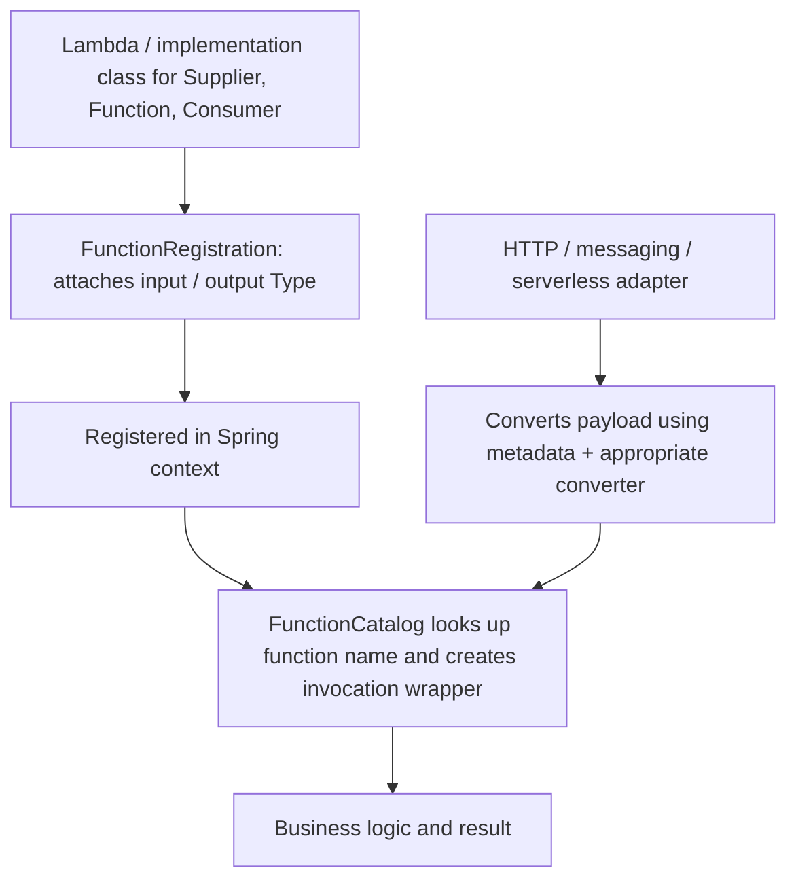

# FunctionRegistration and Explicit Type Declarations

In Spring Cloud Function, you can develop a business function using `Supplier`, `Function`, or `Consumer`, register it into `FunctionCatalog`, and then invoke that same logic from HTTP, events, or serverless environments. To convert data at protocol boundaries into appropriate Java objects, the framework must know **what type the function accepts and what type it returns**.

With a `@Bean` method that has a clear generic signature, Spring can usually read this information from the method declaration. However, with **dynamically registered lambdas**, `Function.class`, or a factory that does not expose generics, DTO type information may not be retained. `FunctionRegistration` is Spring Cloud Function's mechanism for **registering a function together with explicit type metadata**.

This lesson belongs to the **Data Types** chapter. After studying it, you will be able to:

- Explain the role of `FunctionRegistration` and the `java.lang.reflect.Type` object passed via `.type(...)`.
- Register `Function<I, O>`, `Supplier<O>`, and `Consumer<I>` using `FunctionTypeUtils`.
- Describe nested types such as `Message<PriceRequest>`, `List<PriceRequest>`, and `Flux<PriceRequest>`.
- Choose between `@Bean` declarations, generic-implementing classes, and explicit type registration.
- Verify function names, type contracts, and payload conversions through `FunctionCatalog` or actual adapters.

## 1. Why Are Explicit Type Declarations Important?

Suppose a pricing function has the contract:

```java
public record PriceRequest(String productId, int quantity) {}
public record PriceResponse(String productId, long totalVnd) {}

Function<PriceRequest, PriceResponse> calculatePrice =
    request -> new PriceResponse(
        request.productId(),
        request.quantity() * 1_000L
    );
```

In Java source code, the compiler knows the input is `PriceRequest` and the output is `PriceResponse`. However, the following two bean registration approaches do not supply the same amount of information to components that need to resolve generics:

```java
// Standard declaration: the bean signature expresses both DTOs.
@Bean
public Function<PriceRequest, PriceResponse> calculatePrice() {
    return request -> new PriceResponse(
        request.productId(),
        request.quantity() * 1_000L
    );
}
```

```java
// Dynamic registration: publishes only the raw class Function.class.
context.registerBean("calculatePrice", Function.class, () -> calculatePrice);
```

The second snippet sits in a context where `context` and `calculatePrice` have already been declared. Even though the lambda variable carries generics at compile time, `Function.class` **does not contain** `PriceRequest` and `PriceResponse`. Nor is the lambda's runtime class a reliable place from which to infer those two DTOs.

| Publication Style | Exploitable Input/Output Info | Meaning |
| --- | --- | --- |
| `@Bean Function<PriceRequest, PriceResponse>` | `PriceRequest` → `PriceResponse` | Spring can resolve from the method signature |
| `Function` (raw type) | No concrete generic parameters | Missing DTO contract at the publication point |
| `Function<Object, Object>` | `Object` → `Object` | Metadata exists, but is too broad |
| Lambda registered with `Function.class` | Only `Function` class info at initial registration | Actual lambda types can be lost |
| `FunctionRegistration` and `.type(...)` | Explicitly supplied type | Works even when the lambda does not expose generics |

**Type erasure does not erase all Java generic metadata**: declarations such as `Function<PriceRequest, PriceResponse>` on a method or on an interface implemented by a class can be read via reflection. However, if the registration API publishes only a raw class, you cannot rely on a local variable's type to reliably reconstruct that metadata.

## 2. What Does `FunctionRegistration` Contain?

Picture a registration as having three parts:

```text
FunctionRegistration
├── target: Java function executing logic (Supplier / Function / Consumer)
├── name(s): name(s) identifying the function in FunctionCatalog
└── type: full generic description of the function (java.lang.reflect.Type)
```

`FunctionRegistration` is **the registration descriptor object**; it does not replace `Function.apply`, `Supplier.get`, or `Consumer.accept`. The target still holds the business logic. Metadata tells Spring Cloud Function which types to use when normalizing invocations and assisting data conversion.

Core example:

```java
Function<PriceRequest, PriceResponse> target = request ->
    new PriceResponse(request.productId(), request.quantity() * 1_000L);

FunctionRegistration<Function<PriceRequest, PriceResponse>> registration =
    new FunctionRegistration<>(target)
        .type(FunctionTypeUtils.functionType(
            PriceRequest.class,
            PriceResponse.class
        ));
```

Here, `FunctionTypeUtils.functionType(...)` builds a `Type` value equivalent to **`Function<PriceRequest, PriceResponse>`**. The `.type(...)` method takes **the type of the entire function interface**, not merely the input type.

Important distinction:

```text
PriceRequest.class
    Represents only the PriceRequest class.

FunctionTypeUtils.functionType(PriceRequest.class, PriceResponse.class)
    Represents Function<PriceRequest, PriceResponse>.
```

Therefore, `.type(PriceRequest.class)` is **not** how you declare the input for a `Function`. Pass the full functional type, or an implementation class whose interface metadata is sufficiently specific.

## 3. Complete Example: Registering a `Function` as a Functional Bean

The example below uses Java 17 or later (for `record`), Spring Boot, and compatible Spring Cloud Function dependencies. We create a lambda, supply metadata, and register it with `GenericApplicationContext`.

```java
package demo.function;

import java.util.function.Function;

import org.springframework.boot.SpringBootConfiguration;
import org.springframework.cloud.function.context.FunctionRegistration;
import org.springframework.cloud.function.context.FunctionalSpringApplication;
import org.springframework.cloud.function.context.catalog.FunctionTypeUtils;
import org.springframework.context.ApplicationContextInitializer;
import org.springframework.context.support.GenericApplicationContext;

@SpringBootConfiguration
public class PriceApplication
        implements ApplicationContextInitializer<GenericApplicationContext> {

    public record PriceRequest(String productId, int quantity) {}
    public record PriceResponse(String productId, long totalVnd) {}

    public static void main(String[] args) {
        FunctionalSpringApplication.run(PriceApplication.class, args);
    }

    @Override
    public void initialize(GenericApplicationContext context) {
        Function<PriceRequest, PriceResponse> calculatePrice = request -> {
            if (request == null || request.quantity() <= 0) {
                throw new IllegalArgumentException(
                    "quantity must be a positive number"
                );
            }

            long total = Math.multiplyExact(request.quantity(), 1_000L);
            return new PriceResponse(request.productId(), total);
        };

        context.registerBean(
            "calculatePrice",
            FunctionRegistration.class,
            () -> new FunctionRegistration<>(calculatePrice)
                .type(FunctionTypeUtils.functionType(
                    PriceRequest.class,
                    PriceResponse.class
                ))
        );
    }
}
```

**Reading the example in execution order:**

1. `calculatePrice` is a plain Java lambda, independent of HTTP or message brokers.
2. `FunctionTypeUtils.functionType(PriceRequest.class, PriceResponse.class)` describes the `Function<PriceRequest, PriceResponse>` contract.
3. `new FunctionRegistration<>(calculatePrice).type(...)` attaches that contract to the target.
4. `context.registerBean("calculatePrice", FunctionRegistration.class, ...)` places the registration into the Spring context so Spring Cloud Function discovers it and uses the name `calculatePrice` for lookups.
5. `FunctionalSpringApplication` boots the application in the functional mode used by the example.

`@SpringBootConfiguration` in the functional sample does not automatically enable all auto-configurations the way `@SpringBootApplication` does. If the application needs a Web adapter, messaging binder, database access, or other integrations, add the right dependencies and enable the required configuration for your startup mode. The snippet above illustrates registration and the type contract; by itself, it does not prove an HTTP endpoint is live.

### Illustrating Function Invocation over HTTP

Once the application has the Spring Cloud Function Web adapter and the `calculatePrice` endpoint is exposed, a request can look like:

```bash
curl -X POST http://localhost:8080/calculatePrice \
  -H 'Content-Type: application/json' \
  -d '{"productId":"P-100","quantity":3}'
```

Illustrative result when the JSON converter and adapter configuration match:

```json
{"productId":"P-100","totalVnd":3000}
```

Knowing `Function<PriceRequest, PriceResponse>` helps the framework determine the expected DTOs. It **does not install** a JSON converter on its own, replace input validation, or dictate response mechanics across every serverless platform.

## 4. Declaring Types for `Supplier` and `Consumer` as Well

The three function kinds have different generic contracts:

| Kind | Business Method | Input Type | Output Type | `Type`-Building Helper |
| --- | --- | --- | --- | --- |
| `Supplier<O>` | `get()` | None | `O` | `FunctionTypeUtils.supplierType(O.class)` |
| `Function<I, O>` | `apply(I)` | `I` | `O` | `FunctionTypeUtils.functionType(I.class, O.class)` |
| `Consumer<I>` | `accept(I)` | `I` | None | `FunctionTypeUtils.consumerType(I.class)` |

Example registering two more functions inside `initialize(...)`:

```java
import java.util.function.Consumer;
import java.util.function.Supplier;

Supplier<PriceRequest> sampleRequest =
    () -> new PriceRequest("P-100", 1);

Consumer<PriceResponse> auditPrice =
    response -> System.out.println(
        "Audit product " + response.productId()
    );

context.registerBean(
    "sampleRequest",
    FunctionRegistration.class,
    () -> new FunctionRegistration<>(sampleRequest)
        .type(FunctionTypeUtils.supplierType(PriceRequest.class))
);

context.registerBean(
    "auditPrice",
    FunctionRegistration.class,
    () -> new FunctionRegistration<>(auditPrice)
        .type(FunctionTypeUtils.consumerType(PriceResponse.class))
);
```

The `PriceRequest` and `PriceResponse` types in this example are the records from Section 3; the `import` statements belong at the top of the Java file, and the registration calls belong inside `initialize(...)`. `Supplier` has no input and `Consumer` has no output under the Java contract; therefore, do not fabricate fake types like `Function<Void, O>` or `Function<I, Void>` and treat them as fully equivalent.

## 5. Nested Types: Why Is `Class<?>` Not Enough?

For `Function<Message<PriceRequest>, Message<PriceResponse>>`, passing `Message.class` only identifies the wrapper class without expressing **the inner payload**. Likewise, `List.class` does not describe the element type.

`java.lang.reflect.Type` is the common interface for many forms of Java types; `Class<?>` is only one of them. For parameterized types, you can use Spring's `ResolvableType` to build a `Type` that retains nested generics.

### Registering `Message<I>` → `Message<O>`

The following snippet illustrates building the metadata (the DTOs, target, and `FunctionTypeUtils` import are declared in the application context):

```java
import java.lang.reflect.Type;
import org.springframework.core.ResolvableType;
import org.springframework.messaging.Message;

Type inputMessageType = ResolvableType.forClassWithGenerics(
    Message.class, PriceRequest.class
).getType();

Type outputMessageType = ResolvableType.forClassWithGenerics(
    Message.class, PriceResponse.class
).getType();

Type signature = FunctionTypeUtils.functionType(
    inputMessageType,
    outputMessageType
);

// Use: new FunctionRegistration<>(messageFunction).type(signature)
```

The actual target must match the signature, for example:

```java
import java.util.function.Function;
import org.springframework.messaging.Message;
import org.springframework.messaging.support.MessageBuilder;

Function<Message<PriceRequest>, Message<PriceResponse>> messageFunction =
    message -> {
        PriceRequest request = message.getPayload();
        PriceResponse response = new PriceResponse(
            request.productId(),
            request.quantity() * 1_000L
        );
        return MessageBuilder.withPayload(response)
            .copyHeaders(message.getHeaders())
            .build();
    };
```

`Message<PriceRequest>` indicates that **the Java input is a message**, with `PriceRequest` as its payload; this differs from `Function<PriceRequest, PriceResponse>`, which receives the DTO directly. Converters and adapters remain responsible for interpreting payload/headers at the boundary. Do not pass `Message<I>` metadata if the actual target only accepts `I`.

### Lists with Element Types

You can use `ParameterizedTypeReference` to obtain a `Type` for a list:

```java
import java.lang.reflect.Type;
import java.util.List;
import org.springframework.core.ParameterizedTypeReference;

Type inputList = new ParameterizedTypeReference<List<PriceRequest>>() {}
    .getType();
Type outputList = new ParameterizedTypeReference<List<PriceResponse>>() {}
    .getType();

Type listFunctionType = FunctionTypeUtils.functionType(
    inputList, outputList
);
```

Declaring `Function<List<PriceRequest>, List<PriceResponse>>` describes **a single list object** on each side. It does not automatically enable batch mode in a message broker, nor does it mean a `Supplier` will emit individual elements separately.

### Reactive Types

If the target handles Project Reactor publishers, describe both the wrapper and the element type:

```java
import java.lang.reflect.Type;
import org.springframework.core.ResolvableType;
import reactor.core.publisher.Flux;

Type inputFlux = ResolvableType.forClassWithGenerics(
    Flux.class, PriceRequest.class
).getType();

Type outputFlux = ResolvableType.forClassWithGenerics(
    Flux.class, PriceResponse.class
).getType();

Type reactiveFunctionType = FunctionTypeUtils.functionType(
    inputFlux, outputFlux
);
```

The metadata represents `Function<Flux<PriceRequest>, Flux<PriceResponse>>`, which differs from a contract accepting/returning a single item. The reactive target itself determines how the data stream is transformed and how error signals are handled; metadata does not turn an imperative lambda into a reactive pipeline.

## 6. Supplying an Implementation Class Instead of Building `Type` Manually

Not every case requires `FunctionTypeUtils.functionType(...)`. If a class **implements a concrete generic interface**, the class declaration can preserve enough information for the framework to read:

```java
public final class PriceFunction
        implements Function<PriceRequest, PriceResponse> {

    @Override
    public PriceResponse apply(PriceRequest request) {
        long total = Math.multiplyExact(request.quantity(), 1_000L);
        return new PriceResponse(request.productId(), total);
    }
}
```

When registering this class, Spring Cloud Function also supports declarations such as:

```java
context.registerBean(
    "calculatePrice",
    FunctionRegistration.class,
    () -> new FunctionRegistration<>(new PriceFunction())
        .type(PriceFunction.class)
);
```

This snippet assumes `PriceFunction` and the two DTOs are in an accessible scope. Choosing `.type(PriceFunction.class)` makes sense because the class explicitly declares `implements Function<PriceRequest, PriceResponse>`. By contrast, `.type(Function.class)` cannot express the DTO pair from the raw class. For a lambda, the safe and clear option is to pass `FunctionTypeUtils.functionType(...)`.

| Declaration Style | Where Can Metadata Be Inferred From? | When to Use |
| --- | --- | --- |
| `@Bean Function<I, O>` | Generics on the method return type | Standard Spring applications declaring beans |
| `class X implements Function<I, O>` | Generics on the class's implemented interface | Logic warranting its own class, easy to test and reuse |
| `FunctionRegistration<>(lambda).type(Type)` | Explicitly attached `Type` | Factories, dynamic lambdas, functional startup |

## 7. Interacting with `FunctionCatalog` and Composition

Once the function is properly registered in the context and Spring Cloud Function initializes the catalog, it can be looked up by name. Example using `FunctionCatalog`:

```java
import java.util.function.Function;
import org.springframework.cloud.function.context.FunctionCatalog;

Function<PriceRequest, PriceResponse> function =
    catalog.lookup(Function.class, "calculatePrice");

PriceResponse result = function.apply(
    new PriceRequest("P-100", 3)
);

System.out.println(result.totalVnd());  // 3000
```

This snippet is used inside a method with a Spring-injected `catalog` variable and the previously declared records. Generics on the variable receiving the lookup result make Java code easier to read, **but casting when retrieving from the catalog does not fix incorrectly registered metadata**.

You can also register a formatting function:

```java
Function<PriceResponse, String> formatPrice =
    response -> response.productId() + ": " + response.totalVnd();

context.registerBean(
    "formatPrice",
    FunctionRegistration.class,
    () -> new FunctionRegistration<>(formatPrice)
        .type(FunctionTypeUtils.functionType(
            PriceResponse.class,
            String.class
        ))
);
```

When both functions are in the catalog, the composition expression can be:

```yaml
spring:
  cloud:
    function:
      definition: calculatePrice|formatPrice
```

```text
PriceRequest
    │
    ▼
calculatePrice : Function<PriceRequest, PriceResponse>
    │ PriceResponse
    ▼
formatPrice : Function<PriceResponse, String>
    │
    ▼
String
```

The `PriceResponse` output of the first function matches the `PriceResponse` input of the second function. If metadata mistakenly declares `String` in the middle, the composition expression still has valid names, yet the contract does not match and risks conversion or type errors at runtime. **Composition relies on valid functions and accurate metadata; it does not make misdeclared metadata correct.**

## 8. What `.type(...)` Can and Cannot Do



| What `.type(...)` Supports | What `.type(...)` Does Not Guarantee |
| --- | --- |
| Clearly declaring the target's generic contract | Running runtime type checks on every value |
| Preserving DTO info when beans are registered dynamically | Turning malformed JSON into a valid DTO on its own |
| Expressing `Message<T>` / `List<T>` / `Flux<T>` types | Installing an HTTP adapter, message binder, or serverless handler |
| Helping the catalog choose conversion and composition paths | Fixing a target that has bad casts or buggy logic |
| Avoiding type guessing from metadata-less lambda classes | Guaranteeing every protocol preserves all message headers |

Protocol independence resides in **the business function logic**, while the adapter is responsible for bridging Java types with actual inputs and outputs. When deploying the same function over HTTP and events, the same type metadata can be reused, but each entry path should be tested separately.

## 9. Common Declaration Mistakes

### Mistake A — Passing the Payload Type Instead of the Function Type

```java
// Wrong purpose:
new FunctionRegistration<>(calculatePrice)
    .type(PriceRequest.class);

// Correct:
new FunctionRegistration<>(calculatePrice)
    .type(FunctionTypeUtils.functionType(
        PriceRequest.class, PriceResponse.class
    ));
```

`FunctionRegistration.type(...)` describes a full functional signature. `PriceRequest.class` is not `Function<PriceRequest, PriceResponse>`.

### Mistake B — Metadata Does Not Match the Logic

```java
Function<PriceRequest, PriceResponse> target = /* ... */;

// Incorrect: advertises the wrong input type.
new FunctionRegistration<>(target)
    .type(FunctionTypeUtils.functionType(
        String.class, PriceResponse.class
    ));
```

This snippet illustrates a declaration error; the `/* ... */` part requires an implementation to compile. `.type(...)` **does not rewrite the lambda**, so when an adapter supplies a string according to metadata, a target expecting `PriceRequest` can fail. Always keep `Type` aligned with the target's actual types.

### Mistake C — Storing Only `List.class` or `Message.class`

```java
// Loses element types inside the wrapper:
FunctionTypeUtils.functionType(Message.class, Message.class);

// When a concrete payload is needed, use a Type for Message<PriceRequest>
// and Message<PriceResponse> as shown in Section 5.
```

### Mistake D — Confusing the Registration Name with the Method Name

In `context.registerBean("calculatePrice", ...)`, `calculatePrice` is the registration name in the context. It does not necessarily match the lambda variable name or initializer method name. When `FunctionCatalog.lookup(...)` returns `null`, check the registered/discovered name, `spring.cloud.function.definition`, and startup mode.

### Mistake E — Bootstrapping in the Wrong Application Mode

With the `ApplicationContextInitializer<GenericApplicationContext>` pattern, ensure the initializer actually executes. `FunctionalSpringApplication` in the Section 3 example implements the functional initialization pattern documented by Spring Cloud Function. If using another Spring Boot setup, verify that the initializer is properly registered; declaring an initializer class without running it leaves the registration absent from the context.

## 10. Verifying at Three Levels

**Level 1 — registration object metadata.** In unit tests or diagnostic tools, you can inspect the declared `Type`:

```java
import java.lang.reflect.Type;
import org.springframework.core.ResolvableType;

Type signature = FunctionTypeUtils.functionType(
    PriceRequest.class, PriceResponse.class
);

ResolvableType contract = ResolvableType.forType(signature)
    .as(Function.class);

System.out.println(contract.getGeneric(0).resolve()); // PriceRequest
System.out.println(contract.getGeneric(1).resolve()); // PriceResponse
```

This illustrative code assumes `Function` and `FunctionTypeUtils` are imported and the records exist in scope. For a real registration, inspect `registration.getType()` to check the actual `Type` attached to the target rather than recreating one manually.

**Level 2 — catalog lookup.** Verify the name and target registered by the application:

```java
// Example body of a test inside an initialized context:
Function<PriceRequest, PriceResponse> function =
    catalog.lookup(Function.class, "calculatePrice");

assertNotNull(function);
PriceResponse response = function.apply(
    new PriceRequest("P-100", 3)
);
assertEquals(3000L, response.totalVnd());
```

This example uses JUnit assertions and the `catalog` bean from the context. For functional applications, the test configuration must trigger the initializer just like production startup. This test verifies lookup and execution on Java objects; it does not prove the adapter can deserialize JSON.

**Level 3 — testing across the real boundary.** Send JSON over HTTP if the Web adapter is enabled, or send messages using the corresponding binder's test harness. Check `content-type`, payload, DTO conversion, logic, and returned output. For serverless, verify the event format and adapter of the target deployment platform.

| Symptom | Where to Check First |
| --- | --- |
| Function not found by name | Bean registration, initializer, name in `FunctionCatalog` |
| Catalog invocation works, but input has wrong type | `.type(...)`, wrapper, converter, `content-type` |
| `ClassCastException` inside lambda | Metadata mismatch with target or runtime payload |
| `Message` receives wrong payload DTO | Generics of `Message<T>` and message converter |
| Error occurs only after chaining two functions | Output/input types at the junction and how composition handles wrappers |
| Unit test passes, but HTTP/event fails | Adapter integration test, DTO mapping, protocol configuration |

## 11. Practice Exercises

**Exercise 1 — Complete the metadata.** A lambda accepts `String` and returns `Integer`. Fill in the missing part:

```java
Function<String, Integer> count = String::length;

context.registerBean("count", FunctionRegistration.class,
    () -> new FunctionRegistration<>(count)
        .type(/* fill in here */));
```

*Answer:* `FunctionTypeUtils.functionType(String.class, Integer.class)`.

**Exercise 2 — Choose the right helper.** Given `Supplier<PriceRequest>` and `Consumer<PriceResponse>`, which APIs build their corresponding metadata?

*Answer:* `FunctionTypeUtils.supplierType(PriceRequest.class)` and `FunctionTypeUtils.consumerType(PriceResponse.class)`. `Supplier` has no input; `Consumer` has no output.

**Exercise 3 — Nested generics.** A function accepts `Message<List<PriceRequest>>`. Why is `Message.class` insufficient? State the generic layers that must be preserved.

*Answer:* `Message.class` only represents the outer wrapper. You need a `Type` retaining the `Message` → `List` → `PriceRequest` chain, which can be created with nested `ResolvableType` and passed into `FunctionTypeUtils.functionType(inputType, outputType)` alongside the right output type.

**Exercise 4 — Choosing a registration style.** A project uses static `@Bean` methods whose return type is already `Function<PriceRequest, PriceResponse>`. Is it necessary to write `FunctionRegistration` for every function?

*Answer:* Not required. Spring can resolve generics from an explicit `@Bean` signature. `FunctionRegistration` is especially useful when registering functions functionally or dynamically where generic metadata is not available on a bean declaration.

**Exercise 5 — Finding a runtime bug.** A lambda actually expects `PriceRequest`, but was registered with `FunctionTypeUtils.functionType(String.class, PriceResponse.class)`. Direct unit tests pass, while HTTP requests fail. What would you fix?

*Answer:* Fix the metadata to `Function<PriceRequest, PriceResponse>`, then check the JSON DTO, converter, and HTTP integration. Direct unit tests do not verify the adapter's conversion step.

## Conclusion

`FunctionRegistration` lets Spring Cloud Function keep **the business function and its type contract** together when registering functionally. For a `Function<I, O>` lambda, use `.type(FunctionTypeUtils.functionType(I.class, O.class))`; `Supplier` and `Consumer` have their own helpers. For `Message<T>`, `List<T>`, or `Flux<T>`, provide a fully parameterized `Type`, not just the wrapper `Class`.

Accurate metadata is an important prerequisite for `FunctionCatalog`, composition, and HTTP/messaging/serverless adapters to understand data; it does not replace business logic, validation, or converters. Verify both **the registered types** and **behavior across the actual protocol**.

**References:**

- [Spring Cloud Function — Functional Bean Definitions](https://docs.spring.io/spring-cloud-function/reference/functional.html): official examples of `ApplicationContextInitializer`, `FunctionRegistration`, and `.type(...)`.
- [Spring Cloud Function — Programming Model](https://docs.spring.io/spring-cloud-function/reference/spring-cloud-function/programming-model.html): the `FunctionCatalog` model, function signatures, and reactive functions.
