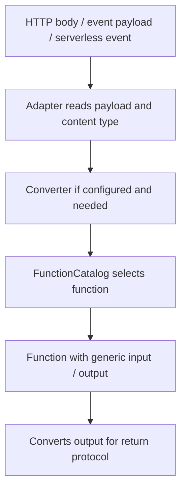

# Converting String, byte[], POJOs, and Collections

A business function in **Spring Cloud Function** can be invoked via HTTP, events, or serverless environments while running the exact same Java code. However, data arriving from protocols is typically text, byte arrays, or JSON, whereas an application's `Function<I, O>` may expect a POJO or a collection of objects. **Data conversion** is the bridge between the content transmitted at the protocol boundary and the Java types published by the function.

This lesson belongs to the **Data Types** chapter and focuses on four common payload shapes: `String`, `byte[]`, POJOs (structured Java objects), and collections such as `List<T>`. We will distinguish conversions performed explicitly by Java code from conditional conversions assisted by adapters and message converters, then apply them to `Supplier`, `Function`, `Consumer`, `FunctionCatalog`, and composition.

After this lesson, you will be able to read a function's type contract accurately, choose an appropriate payload format, preserve generics when passing lists of DTOs, and verify conversion at both the Java and HTTP/messaging levels.

## 1. Four Data Shapes and Two Places Where Conversion Can Happen

| Data Shape | Java Example | Common Boundary Form | What to Watch Out For |
| --- | --- | --- | --- |
| Text | `String` | Plain text, JSON string | Charset and JSON quote interpretation |
| Raw bytes | `byte[]` | Binary payload, encoded content | Bytes carry no charset or structure metadata on their own |
| Business object | `OrderRequest` | JSON object | Fields, data types, constructors/records, and converter rules |
| Collection | `List<OrderItem>` | JSON array or adapter batch | Must preserve both the collection type **and** the element type |

Example processing pipeline:



There are **two layers of conversion**:

1. **Inside Java logic:** written explicitly by the developer, e.g. `text.getBytes(StandardCharsets.UTF_8)` or `new String(bytes, UTF_8)`. The outcome depends directly on that code.
2. **At the adapter boundary:** an HTTP adapter, messaging adapter, or serverless adapter may rely on the generic signature, `content-type`, and available converters to turn an incoming payload into Java objects. This capability **depends on configuration and the adapter**; it is not guaranteed for every payload or protocol.

`FunctionCatalog` manages and supplies functions; converters handle payload formatting. Successfully registering `Function<OrderRequest, OrderResult>` does not mean any JSON is valid or every adapter is automatically enabled.

## 2. Running Example: A Group of Functions with Different Inputs and Outputs

Let's build pricing and text-processing functions. The Java 17+ example uses `record` and `Stream.toList()`; older Java versions can replace records with regular DTOs and the corresponding collector.

```java
package example.function;

import java.nio.charset.StandardCharsets;
import java.util.List;
import java.util.Locale;
import java.util.Objects;
import java.util.function.Function;

import org.springframework.context.annotation.Bean;
import org.springframework.context.annotation.Configuration;

@Configuration
public class PayloadFunctions {

    public record OrderItem(
        String sku, int quantity, long unitPriceVnd
    ) {}

    public record ItemTotal(String sku, long subtotalVnd) {}

    public record OrderRequest(
        String orderId, List<OrderItem> items
    ) {}

    public record OrderResult(String orderId, long totalVnd) {}

    @Bean
    public Function<String, byte[]> encodeUtf8() {
        return text -> text.getBytes(StandardCharsets.UTF_8);
    }

    @Bean
    public Function<byte[], String> decodeUtf8() {
        return bytes -> new String(bytes, StandardCharsets.UTF_8);
    }

    @Bean
    public Function<String, String> normalizeText() {
        return text -> text.strip().toUpperCase(Locale.ROOT);
    }

    @Bean
    public Function<OrderRequest, OrderResult> calculateOrder() {
        return request -> {
            Objects.requireNonNull(request, "request");
            List<OrderItem> items =
                Objects.requireNonNull(request.items(), "items");

            long total = 0L;
            for (OrderItem item : items) {
                total = Math.addExact(total, subtotal(item));
            }
            return new OrderResult(request.orderId(), total);
        };
    }

    @Bean
    public Function<List<OrderItem>, List<ItemTotal>> calculateLines() {
        return items -> {
            Objects.requireNonNull(items, "items");
            return items.stream()
                .map(item -> new ItemTotal(
                    item.sku(), subtotal(item)
                ))
                .toList();
        };
    }

    private static long subtotal(OrderItem item) {
        Objects.requireNonNull(item, "item");
        if (item.quantity() <= 0 || item.unitPriceVnd() < 0) {
            throw new IllegalArgumentException(
                "quantity must be positive and unitPriceVnd nonnegative"
            );
        }
        return Math.multiplyExact(
            item.unitPriceVnd(), item.quantity()
        );
    }
}
```

The `@Bean` methods advertise input/output types directly on their return types. This is a useful source of metadata for Spring Cloud Function to identify each function's contract when registering it in `FunctionCatalog`:

| Function | Input | Output |
| --- | --- | --- |
| `encodeUtf8` | `String` | `byte[]` |
| `decodeUtf8` | `byte[]` | `String` |
| `normalizeText` | `String` | `String` |
| `calculateOrder` | `OrderRequest` | `OrderResult` |
| `calculateLines` | `List<OrderItem>` | `List<ItemTotal>` |

This class illustrates logic and bean registration. Invoking these function names over HTTP requires the Spring Cloud Function Web adapter and suitable application configuration; invoking them via a message broker requires adding the corresponding adapter/binder.

## 3. `String`: Text Is Not Synonymous with JSON

`String` represents a Java character sequence (UTF-16 at the API level), whereas content sent over the network is encoded into bytes using a charset, usually UTF-8. The following payloads are different:

```text
Plain text (text/plain):
  Hello

JSON string (application/json):
  "Hello"

JSON object (application/json):
  {"message":"Hello"}
```

Plain text starts with the character `H`. A JSON string has quotation marks and JSON escaping rules. A JSON object contains a `message` field and is structurally an object. **Do not treat these three shapes as the same payload merely because they all contain words.**

In Java:

```java
Function<String, String> normalize = text ->
    text.strip().toUpperCase(Locale.ROOT);

System.out.println(normalize.apply("  hello  "));
// HELLO
```

With a properly configured Web adapter, a call sending raw text can be expressed as:

```bash
curl -X POST http://localhost:8080/normalizeText \
  -H 'Content-Type: text/plain; charset=UTF-8' \
  --data-binary '  hello spring  '
```

The Java value expected by the logic is `"  hello spring  "`; the computed result is `"HELLO SPRING"`. The body shape and `Content-Type` **on the HTTP response** still depend on the configured adapter/converter. When sending a JSON string instead of text/plain, use valid JSON syntax and verify whether the adapter interprets scalar JSON into `String` as you expect.

### Charset and Data Integrity

```java
String text = "Café";
byte[] utf8 = text.getBytes(StandardCharsets.UTF_8);
String restored = new String(utf8, StandardCharsets.UTF_8);

System.out.println(text.equals(restored)); // true
```

Do not use `text.getBytes()` or `new String(bytes)` without specifying a charset when the system needs consistent exchange across environments; those overloads depend on the JVM's default platform charset. In addition, `new String(bytes, UTF_8)` may replace invalid UTF-8 byte sequences with replacement characters, so **it must not be treated as lossless decoding of arbitrary bytes**.

If the data must be valid UTF-8, decode strictly:

```java
import java.nio.ByteBuffer;
import java.nio.charset.CharacterCodingException;
import java.nio.charset.CodingErrorAction;
import java.nio.charset.StandardCharsets;

String strictUtf8(byte[] payload) throws CharacterCodingException {
    return StandardCharsets.UTF_8.newDecoder()
        .onMalformedInput(CodingErrorAction.REPORT)
        .onUnmappableCharacter(CodingErrorAction.REPORT)
        .decode(ByteBuffer.wrap(payload))
        .toString();
}
```

If the bytes are not valid UTF-8, this method throws `CharacterCodingException`. Functions handling text from untrusted sources can choose an error-reporting or replacement strategy according to business requirements.

## 4. `byte[]`: Binary Content and Text Encoding Are Two Different Things

`byte[]` merely holds a sequence of bytes and carries no self-describing metadata indicating whether it is an image, a PDF file, UTF-8, JSON, or compressed data. The same Java type can represent:

- UTF-8-encoded text content;
- Part or all of a binary file;
- JSON serialized into UTF-8;
- Encrypted/compressed data from an external system.

Therefore, `Function<byte[], String>` only means the function accepts bytes and returns a string; it is **not enough** to conclude whether the input bytes are UTF-8, base64, or JSON. In the `decodeUtf8` example, interpreting bytes as UTF-8 is an explicit decision in the code.

```java
byte[] incoming = new byte[] {72, 105, 33};  // "Hi!" in ASCII/UTF-8
String text = new String(incoming, StandardCharsets.UTF_8);
byte[] roundTrip = text.getBytes(StandardCharsets.UTF_8);

System.out.println(text); // Hi!
// roundTrip contains elements 72, 105, 33
```

**Never use `byte[].toString()` to decode text**: that method produces the Java array's identity representation, not its decoded contents.

### When Using `application/octet-stream`

Over HTTP, binary payloads are typically accompanied by `Content-Type: application/octet-stream`. In messaging, similar information may reside in the `contentType` header or adapter-specific metadata. A `Function<byte[], byte[]>` can pass or process bytes without parsing them as text. Whether request bytes reach the target directly as `byte[]` or pass through an intermediate converter still depends on the adapter.

Do not blindly convert every binary payload into a String for processing. Arbitrary decoding can corrupt data, especially when the input is an image, compressed archive, encrypted payload, or invalid UTF-8 bytes.

### `byte[]` and Base64

Base64 is **a way to encode bytes into characters**, useful when a protocol only accepts text/JSON; it is not the same as UTF-8 decoding:

```java
import java.util.Base64;

byte[] raw = new byte[] {0, 1, 2, (byte) 255};
String encoded = Base64.getEncoder().encodeToString(raw);
byte[] restored = Base64.getDecoder().decode(encoded);

System.out.println(encoded);                 // AAEC/w==
System.out.println(java.util.Arrays.equals(raw, restored)); // true
```

The actual base64 output of the snippet above is `AAEC/w==`. If a JSON system represents binary data using base64, both sides must agree on that convention. **Do not mistake a base64 string for raw UTF-8 text content.**

## 5. POJOs: JSON Objects Need Target Class Metadata

A POJO in this context is a Java data object—either a class with appropriate getters/setters/constructors or a Java `record`. Using the `OrderRequest` example:

```json
{
  "orderId": "ORD-101",
  "items": [
    {"sku": "BOOK-1", "quantity": 2, "unitPriceVnd": 5000},
    {"sku": "PEN-2", "quantity": 1, "unitPriceVnd": 3000}
  ]
}
```

If the adapter and JSON converter are properly configured and read the `Function<OrderRequest, OrderResult>` signature, the expected conversion steps are:

```text
HTTP/event JSON object
    ↓ deserialize as OrderRequest
OrderRequest("ORD-101", List<OrderItem>)
    ↓ calculateOrder.apply(...)
OrderResult("ORD-101", 13000)
    ↓ serialize (if output is represented as JSON)
{"orderId":"ORD-101","totalVnd":13000}
```

HTTP example (assuming the adapter exposes `calculateOrder` and the JSON converter supports records):

```bash
curl -X POST http://localhost:8080/calculateOrder \
  -H 'Content-Type: application/json' \
  -d '{"orderId":"ORD-101","items":[{"sku":"BOOK-1","quantity":2,"unitPriceVnd":5000},{"sku":"PEN-2","quantity":1,"unitPriceVnd":3000}]}'
```

Illustrative result with matching configuration:

```json
{"orderId":"ORD-101","totalVnd":13000}
```

Distinguish **deserialization** (JSON → POJO), **business processing** (POJO → another POJO), and **serialization** (POJO → JSON). The generic signature tells the converter the target type, but does not perform business validation. For example:

- JSON missing `items` may populate `null` in the record depending on the converter and settings; the `calculateOrder` code above explicitly checks and throws an error.
- Zero or negative `quantity` is not rejected simply because the Java type is `int`; the example enforces a business rule in `subtotal()`.
- Very large numbers can overflow; the example uses `Math.multiplyExact` and `Math.addExact` to detect overflow rather than silently returning an incorrect total.
- If JSON field names differ from DTO property names, appropriate converter mapping rules are needed.

A syntactically valid JSON payload does not automatically satisfy the data contract. In particular, `{"items": {...}}` (object) differs from `{"items": [{...}]}` (array).

### Explicitly Parsing JSON in Code

When business logic genuinely receives a JSON `String` or JSON `byte[]` and needs to parse it **inside the function**, use a codec/JSON library explicitly. Illustrative example with Jackson 2:

```java
import com.fasterxml.jackson.databind.ObjectMapper;

ObjectMapper mapper = new ObjectMapper();
String json = """
    {"orderId":"ORD-101","items":[
      {"sku":"BOOK-1","quantity":2,"unitPriceVnd":5000}
    ]}
    """;

PayloadFunctions.OrderRequest order =
    mapper.readValue(json, PayloadFunctions.OrderRequest.class);

byte[] jsonBytes = mapper.writeValueAsBytes(order);
```

This snippet assumes Jackson's checked exceptions are handled (for example `throws JsonProcessingException`/`Exception` in a test method). JSON library APIs/packages can vary by Spring Boot version; the example uses Jackson 2 and requires the corresponding dependency. If the adapter has already deserialized directly into `OrderRequest`, **do not parse JSON a second time inside the business function**.

## 6. Collections: `List<OrderItem>` Has Two Levels of Type Information

A JSON list is represented with square brackets:

```json
[
  {"sku":"BOOK-1","quantity":2,"unitPriceVnd":5000},
  {"sku":"PEN-2","quantity":1,"unitPriceVnd":3000}
]
```

The `calculateLines` function has the contract:

```java
Function<List<PayloadFunctions.OrderItem>,
         List<PayloadFunctions.ItemTotal>> calculateLines;
```

This is **a single List-typed input**, different from two separate invocations of `Function<OrderItem, ItemTotal>`. In a single invocation, the lambda receives the entire list and returns a new list.

If the system supports deserializing a JSON array according to the function's generics, the corresponding result is:

```json
[
  {"sku":"BOOK-1","subtotalVnd":10000},
  {"sku":"PEN-2","subtotalVnd":3000}
]
```

The prerequisite is that the converter and adapter understand `List<OrderItem>`, not just the raw class `List.class`.

### Why Can `List.class` or `List<Object>` Cause Errors?

In Java, generics undergo *type erasure*. A method/bean explicitly declaring `List<OrderItem>` still retains generic metadata readable via reflection, but if you only publish `List` or `List<Object>`, the converter lacks specific element class information. With some JSON mappers, a list of JSON objects read into a genericless type can become `Map` instances; casting each element to `OrderItem` then triggers a `ClassCastException`.

```java
// Preserve the element contract on the bean:
@Bean
public Function<List<PayloadFunctions.OrderItem>,
                List<PayloadFunctions.ItemTotal>> calculateLines() {
    return items -> items.stream()
        .map(item -> new PayloadFunctions.ItemTotal(
            item.sku(),
            Math.multiplyExact(item.unitPriceVnd(), item.quantity())
        ))
        .toList();
}
```

The snippet above only illustrates **declaring the bean's return type**, assuming `PayloadFunctions` and the DTOs are already defined; when compiling in an actual application, register only one bean named `calculateLines` (do not add a second example bean with the same name as in Section 2). The main version in Section 2 validates data before computing.

### Parsing `List<T>` with Jackson

If code must convert a JSON array into a List manually, use a parameterized type token instead of `List.class` alone:

```java
import java.util.List;
import com.fasterxml.jackson.core.type.TypeReference;
import com.fasterxml.jackson.databind.ObjectMapper;

ObjectMapper mapper = new ObjectMapper();
String payload = """
    [{"sku":"BOOK-1","quantity":2,"unitPriceVnd":5000}]
    """;

List<PayloadFunctions.OrderItem> items = mapper.readValue(
    payload,
    new TypeReference<List<PayloadFunctions.OrderItem>>() {}
);
```

This is also a Jackson 2 snippet, assuming checked exceptions are handled. `new TypeReference<List<OrderItem>>() {}` preserves the element type so Jackson constructs the right DTOs. Similarly, in `FunctionRegistration` when registering lambdas dynamically, preserve the nested `Type` of `List<OrderItem>` and `List<ItemTotal>`; passing only `List.class` lacks required information.

### A List Is Not a Reactive Stream or Broker Batch

| Java Contract | Input Unit Received by Logic | What Not to Assume |
| --- | --- | --- |
| `Function<OrderItem, ItemTotal>` | One element | Do not assume the adapter will invoke it multiple times for a JSON array |
| `Function<List<OrderItem>, List<ItemTotal>>` | One list | Does not automatically enable message broker batch mode |
| `Function<Flux<OrderItem>, Flux<ItemTotal>>` | One Reactor publisher | Does not mean the logic operates on an in-memory List |
| `Consumer<Message<List<OrderItem>>>` | One Message containing a List | Does not itself determine ack count or how the binder groups events |

`Flux<T>` processes a reactive data stream with subscription, backpressure, and error signals; `List<T>` is a finite in-memory data structure. The two types may hold the same DTOs, yet they follow different processing models.

## 7. `Message<T>`: Separating Payload and Metadata

When processing events, alongside content there are headers such as correlation IDs, content types, or routing metadata. Spring Messaging represents messages using `Message<T>`:

```java
import java.util.function.Function;
import org.springframework.context.annotation.Bean;
import org.springframework.messaging.Message;
import org.springframework.messaging.support.MessageBuilder;

@Bean
public Function<Message<PayloadFunctions.OrderRequest>,
                Message<PayloadFunctions.OrderResult>> calculateOrderEvent() {
    return incoming -> {
        PayloadFunctions.OrderRequest request = incoming.getPayload();
        long total = 0L;

        for (PayloadFunctions.OrderItem item : request.items()) {
            total = Math.addExact(
                total,
                Math.multiplyExact(item.unitPriceVnd(), item.quantity())
            );
        }

        PayloadFunctions.OrderResult result =
            new PayloadFunctions.OrderResult(request.orderId(), total);

        MessageBuilder<PayloadFunctions.OrderResult> builder =
            MessageBuilder.withPayload(result);

        Object correlationId = incoming.getHeaders().get("correlationId");
        if (correlationId != null) {
            builder.setHeader("correlationId", correlationId);
        }
        return builder.build();
    };
}
```

This is a standalone illustrative bean that can be placed in another `@Configuration`; the price calculation is shortened to highlight the `Message` structure and is not meant to replace the validation logic in Section 2 in production.

`Message<OrderRequest>` means **the Java input object is a Message**, whose inner payload is `OrderRequest`. When the payload arrives from a broker as `byte[]` or JSON `String`, the adapter and converter can use the generic `OrderRequest` to convert it. However, headers from different adapters may be mapped or normalized differently; do not assume every header passes through unchanged between HTTP, brokers, and serverless.

Do not blindly copy all headers when changing the payload format. For example, keeping an old `contentType` from binary data when the new payload is JSON can mislead downstream converters. Selectively copy the headers you need and let the adapter/converter set format metadata appropriately.

### `Supplier<T>` and `Consumer<T>` at the Conversion Boundary

For `Supplier<OrderResult>`, the function takes no input; the outbound adapter may need to serialize `OrderResult` to JSON or a target-protocol message. For `Consumer<OrderRequest>`, the converter may need to construct `OrderRequest` from the payload before calling `accept(...)`; `Consumer` itself has no return value.

```java
import java.util.function.Consumer;
import java.util.function.Supplier;

@Bean
public Supplier<PayloadFunctions.OrderResult> sampleOrderResult() {
    return () -> new PayloadFunctions.OrderResult("ORD-101", 13000L);
}

@Bean
public Consumer<PayloadFunctions.OrderRequest> auditOrder() {
    return request -> System.out.println("Received: " + request.orderId());
}
```

These are two standalone illustrative beans that can be placed in a Spring configuration class with the DTOs imported or referenced via `PayloadFunctions`. The supplier's emission cadence and the consumer's acknowledgment behavior depend on the adapter/binder; the generic signature only describes the business types.

## 8. Composing Functions with Compatible Types

Each `Function<I, O>` has a well-defined input/output contract. Spring Cloud Function supports composition by function name, for example chaining three functions from Section 2:

```text
byte[]
  │
  ▼
decodeUtf8: Function<byte[], String>
  │ String
  ▼
normalizeText: Function<String, String>
  │ String
  ▼
encodeUtf8: Function<String, byte[]>
  │
  ▼
byte[]
```

You can select the chain in configuration:

```yaml
spring:
  cloud:
    function:
      definition: decodeUtf8|normalizeText|encodeUtf8
```

When selecting the composite function, the chain's overall input is `byte[]` and its output is `byte[]`. Each link's signature matches the Java types:

1. `decodeUtf8` returns `String`, matching the `String` input of `normalizeText`.
2. `normalizeText` returns `String`, matching the `String` input of `encodeUtf8`.
3. The composite accepts expected UTF-8 bytes and returns UTF-8 bytes corresponding to the normalized text.

**Accurate metadata does not guarantee valid data**: if the input bytes are not UTF-8, a simple decoder may substitute replacement characters; for strict requirements, choose the strict decoder from Section 3. Composition does not guess or repair charsets.

If you need to chain `calculateOrder` with an invoice-formatting function, the next function must accept `OrderResult` or there must be an explicit conversion step. Do not assume Spring automatically converts arbitrary POJOs to `String` at every junction between functions.

## 9. Looking Up via `FunctionCatalog` and Distinguishing Unit Tests from Protocol Tests

`FunctionCatalog` is the entry point for looking up functions by name. With a Spring context containing the beans from Section 2:

```java
import java.util.function.Function;
import org.springframework.cloud.function.context.FunctionCatalog;

// Placed in a method with an injected catalog variable.
Function<PayloadFunctions.OrderRequest, PayloadFunctions.OrderResult> fn =
    catalog.lookup("calculateOrder");

PayloadFunctions.OrderRequest input =
    new PayloadFunctions.OrderRequest(
        "ORD-101",
        java.util.List.of(
            new PayloadFunctions.OrderItem("BOOK-1", 2, 5000),
            new PayloadFunctions.OrderItem("PEN-2", 1, 3000)
        )
    );

PayloadFunctions.OrderResult result = fn.apply(input);
System.out.println(result.totalVnd()); // 13000
```

This Java call verifies the function name and logic on an **already constructed** POJO. It does not prove that an HTTP JSON body or message payload will be converted into `OrderRequest` properly. To test conversion, send payloads through the deployed adapter and verify both runtime types and results.

Example inputs to test:

| Case | Payload / Header | What to Observe |
| --- | --- | --- |
| Plain text | `text/plain; charset=UTF-8`, with whitespace | `String` is normalized properly |
| UTF-8 bytes | `application/octet-stream` and valid bytes | `decodeUtf8` produces the expected string |
| Invalid charset bytes | Non-UTF-8 bytes | Error/replacement policy behaves as intended |
| JSON object | `application/json` and valid OrderRequest | Converter constructs the right POJO |
| JSON array | `application/json` and `List<OrderItem>` | Each element is an OrderItem, not a Map |
| Malformed JSON shape | `items` is an object instead of an array | Converter or validation reports an appropriate error |
| Message with headers | Payload + `correlationId` | Data and required headers are preserved properly |

For HTTP, run an application with the Web adapter. For messaging, test with the binder/test binder or real infrastructure. Serverless platforms may wrap events in a platform-specific structure; test the target platform's event envelope rather than assuming it matches an HTTP request.

## 10. Common Mistakes and How to Diagnose Them

### Mistake A — Reading Arbitrary Bytes as a String

```java
// Unsuitable for arbitrary binary content:
String content = new String(binaryPayload, StandardCharsets.UTF_8);
```

If the payload is an image or compressed data, turning it into a String does not reveal its format and can corrupt data. Keep `byte[]` and use a parser/codec suited to the actual format. If it is text, agree on a charset.

### Mistake B — Declaring `Function<Object, Object>` and Casting to a DTO

```java
@Bean
public Function<Object, Object> unsafeOrder() {
    return payload -> {
        PayloadFunctions.OrderRequest order =
            (PayloadFunctions.OrderRequest) payload;
        return order.orderId();
    };
}
```

An adapter receiving JSON may construct a generic structure instead of `OrderRequest` because the metadata only declares `Object`. Publish `Function<OrderRequest, String>` if that is the true contract. Raw `Function` or dynamically registered lambdas missing type metadata carry a similar risk.

### Mistake C — Dropping Element Types When Reading a JSON Array

```java
// Supplying only raw List class to the JSON parser:
List<?> values = mapper.readValue(json, List.class);

// Use TypeReference<List<OrderItem>> when parsing manually,
// or let the converter read the List<OrderItem> generic from the bean.
```

This snippet assumes `mapper` is a Jackson ObjectMapper and `json` contains a JSON array; checked exceptions must be handled. If the parser creates a `List<Map<...>>` and code casts it to `List<OrderItem>`, the failure may only surface when extracting an element.

### Mistake D — Sending the Wrong `Content-Type`

Sending a JSON object while declaring `text/plain` may cause the adapter to treat the body as plain text. Sending raw bytes while declaring `application/json` may trigger inappropriate JSON parsing. Keep **the actual payload**, `content-type`, generic signature, and converter aligned.

### Mistake E — Confusing Element Count with Function Invocation Count

A JSON array does not automatically turn into multiple invocations of `Function<Item, Result>`. Conversely, `Function<List<Item>, List<Result>>` does not automatically enable a message broker's batch consumer. Invocation count depends on the adapter and configuration; the function's Java contract must match.

### Mistake F — Ignoring Validation and Overflow

Successful deserialization does not mean the data is valid for business rules. `int quantity` can still be 0 or negative, `items` can be `null`, and price multiplication can overflow. Validate inputs and define how each adapter reports errors.

## 11. Practice Exercises

**Exercise 1 — Choose the right conversion methods.** Write a round-trip conversion between `String "Hello"` and UTF-8 `byte[]`. Should `byte[].toString()` be used?

*Answer:* Use `text.getBytes(StandardCharsets.UTF_8)` and `new String(bytes, StandardCharsets.UTF_8)`. `byte[].toString()` does not decode the contents.

**Exercise 2 — Read a collection contract.** A bean returns `Function<List<OrderItem>, List<ItemTotal>>`. Which classes does the converter need to know when parsing a JSON array?

*Answer:* Input is a `List` of `OrderItem` elements; output is a `List` of `ItemTotal` elements. Knowing only `List.class` is not enough to identify the element types.

**Exercise 3 — Distinguish a JSON string from a JSON object.** How does a payload `"hello"` with `Content-Type: application/json` differ from `{"message":"hello"}`?

*Answer:* The first payload is a JSON string value; the second is a JSON object with a `message` field. They correspond to different Java types and mapping behaviors, depending on the converter/adapter.

**Exercise 4 — Plan a composition.** You want to accept UTF-8 bytes, trim leading/trailing whitespace, uppercase the text, and return UTF-8 bytes. Which functions should be composed?

*Answer:* `decodeUtf8|normalizeText|encodeUtf8`. The overall contract is `Function<byte[], byte[]>`, assuming the actual input is valid UTF-8.

**Exercise 5 — Spot an HTTP conversion bug.** A unit test calling `calculateOrder.apply(OrderRequest)` directly passes, but an HTTP JSON POST fails. Name at least four things to check.

*Answer:* Verify that the Web adapter/endpoint is active, the `Content-Type` header is accurate, the JSON object/array matches the DTO, the generic signature is fully published, the converter supports records/DTOs, and the payload passes business validation.

**Exercise 6 — Binary data over a JSON protocol.** When is base64 needed, and why shouldn't you use `new String(raw, UTF_8)`?

*Answer:* When a protocol transports bytes inside a text/JSON field by base64 convention, encode/decode base64 on both ends. Arbitrary bytes are not necessarily valid UTF-8, so decoding them as text can corrupt the data.

## Takeaways

- `String` is text; `byte[]` is raw bytes. Converting between them as text requires specifying a charset, typically UTF-8. Base64 is a separate encoding for representing bytes as characters.
- JSON objects map to POJOs when the converter knows the target class; JSON arrays map to collections when **element generics** are preserved.
- `FunctionCatalog`, adapters, and converters use the bean's type contract to assist payload conversion, though conversion success still depends on `content-type`, data shape, and protocol configuration.
- `List<T>`, `Flux<T>`, and `Message<T>` are not interchangeable: each carries distinct semantics for data units, stream processing, and headers.
- Calling a Java function directly only tests logic. To verify conversion, send real data through the HTTP, messaging, or serverless adapter in use.

**Further reading:** [Spring Cloud Function Reference](https://docs.spring.io/spring-cloud-function/reference/) (programming model, function composition, and message conversion). The exact mechanics of each Spring Cloud Function adapter should be checked against that adapter's documentation.
