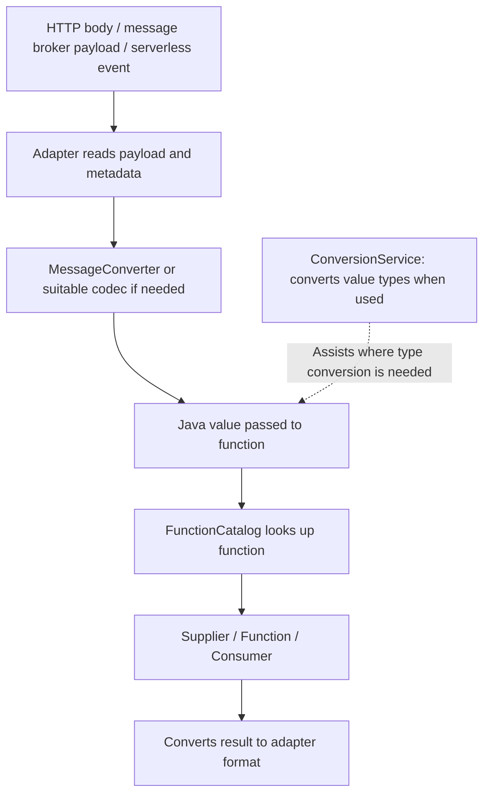

# Role of MessageConverter and ConversionService

Spring Cloud Function lets you build business logic using `Supplier<T>`, `Function<I, O>`, and `Consumer<T>`, register them in `FunctionCatalog`, and invoke them over HTTP, event systems, or serverless environments. Those protocols do not necessarily send Java objects of the exact type a function expects: an HTTP request has a JSON body, a broker may deliver a payload as bytes, and a business argument may carry a string identifier that needs conversion into a domain type.

In the **Data Types** chapter, two mechanisms are often confused: **`MessageConverter`** and **`ConversionService`**. Both relate to data conversion, yet they solve different problems:

- **`MessageConverter`** handles the payload of a **message**, typically using the target type and metadata such as `contentType`. One example is converting JSON inside `Message<byte[]>` into a DTO.
- **`ConversionService`** converts **a Java value from one type to another**, such as `"12"` to `Integer` or a `String` to a business domain identifier class.

Both mechanisms are Spring Framework foundations. How Spring Cloud Function, the HTTP adapter, Spring Cloud Stream binders, or serverless adapters use them depends on the specific configuration and version. This lesson covers their API contracts, illustrative Java examples, and how to verify the data path so you do not equate a conversion being possible with an adapter automatically performing it.

## 1. Quick Distinction Before Writing Code

| Criterion | `MessageConverter` | `ConversionService` |
| --- | --- | --- |
| Common API | `org.springframework.messaging.converter.MessageConverter` | `org.springframework.core.convert.ConversionService` |
| Unit of work | `Message<?>` with payload and headers | An individual Java value |
| Inputs | Payload, target type, headers such as `contentType` | Source type, target type, registered converters |
| Typical example | JSON `byte[]` → `OrderRequest` | `"5"` → `Integer` |
| Output | Converted payload or a new `Message<?>` | A Java value of the target type |
| Protocol metadata | Can participate in converter selection | Not directly aware of HTTP/broker headers |
| Extension | Write/register `MessageConverter`, use composite | Write `Converter<S,T>`, `ConverterFactory`, or `GenericConverter` |
| What it doesn't guarantee on its own | Valid DTO, existing endpoint, all headers preserved | Parsing JSON into a POJO or configuring adapters automatically |

**Key point:** `MessageConverter` ties to *message contracts and transport formats*; `ConversionService` ties to *relationships between Java value types*. An application may use both, but you should not assume a fixed fallback chain applies to every HTTP request or event.

### Big Picture of Conversion at the Application Boundary



This diagram is a **conceptual model**, not a claim that every adapter calls a `MessageConverter` class before calling the catalog. Some adapters have their own codec mechanisms. To verify the actual path, test with the deployed adapter and configuration.

## 2. Shared Business Example Across Protocols

Suppose a store receives requests to create orders. The logic's contract is an input POJO and an output POJO. Below is the complete bean using Java 17 or later (for `record`):

```java
package demo.order;

import java.util.function.Function;
import org.springframework.context.annotation.Bean;
import org.springframework.context.annotation.Configuration;

@Configuration
public class OrderFunctions {

    public record OrderRequest(String orderId, int quantity) {}

    public record OrderReceipt(
        String orderId,
        long totalVnd,
        String status
    ) {}

    @Bean
    public Function<OrderRequest, OrderReceipt> createReceipt() {
        return request -> {
            if (request == null ||
                request.orderId() == null ||
                request.orderId().isBlank() ||
                request.quantity() <= 0) {
                throw new IllegalArgumentException(
                    "orderId and positive quantity are required"
                );
            }

            long total = Math.multiplyExact(
                request.quantity(), 50_000L
            );

            return new OrderReceipt(
                request.orderId(),
                total,
                "ACCEPTED"
            );
        };
    }
}
```

The `Function<OrderRequest, OrderReceipt>` signature gives Spring Cloud Function the type information needed to assist payload conversion. Not every converter can turn every format into `OrderRequest`: conversion requires a compatible source format and a matching converter/codec.

A plain Java call against this bean:

```java
OrderFunctions.OrderReceipt receipt = createReceipt.apply(
    new OrderFunctions.OrderRequest("ORD-001", 2)
);

System.out.println(receipt.totalVnd()); // 100000
```

The snippet above assumes `createReceipt` is a `Function<OrderRequest, OrderReceipt>` variable obtained from the bean. Here the input is already a POJO, so **no JSON deserialization is needed**. Passing this unit test does not prove that an HTTP or messaging adapter will convert JSON into the right DTO.

## 3. `MessageConverter`: Message-Aware Payload Transformation

Spring Messaging's `MessageConverter` interface provides two primary conversion directions:

```java
// Conceptual signatures of org.springframework.messaging.converter.MessageConverter
Object fromMessage(Message<?> message, Class<?> targetClass);

Message<?> toMessage(Object payload, MessageHeaders headers);
```

These are two signature declarations to explain the API; actual methods may also appear through extended interfaces or other overloads. `fromMessage(...)` reads the source message and converts the payload to the target type, whereas `toMessage(...)` packages/serializes a Java value into a new message.

Important headers commonly read via `MessageHeaders`:

```java
MessageHeaders.CONTENT_TYPE          // "contentType"
MessageHeaders.ID
MessageHeaders.TIMESTAMP
```

The `contentType` value can be a MIME type like `application/json`, `text/plain`, or `application/octet-stream`. A converter must rely on both the target type and the data format; seeing `byte[]` alone cannot tell whether it is JSON, an image, or compressed data.

### Some Common Converters

| Spring Messaging Converter | Typical Purpose | Things to Note |
| --- | --- | --- |
| `StringMessageConverter` | Text payloads and `String` | Appropriate charset and MIME type |
| `ByteArrayMessageConverter` | `byte[]` payloads | Bytes do not self-describe their structure |
| `MappingJackson2MessageConverter` | JSON ↔ Java values via Jackson 2 | Requires Jackson and compatible type/format configuration |
| `CompositeMessageConverter` | Tries a list of converters in order | Order and each converter's support rules affect the outcome |

Not all of these classes are instantiated or configured identically by every Spring Cloud Function adapter. For instance, Spring MVC has the `HttpMessageConverter` family for HTTP bodies; Spring Messaging has `MessageConverter` for `Message<?>`. The two API families **have similar names, but are not the same interface**.

## 4. Converting a JSON `Message<byte[]>` into a POJO

Here is an example invoking a specific converter directly to see the exact input, metadata, and output. We use Spring Messaging's `MappingJackson2MessageConverter` with Jackson 2 supporting Java records (Jackson 2.12 or later).

```java
import java.nio.charset.StandardCharsets;

import org.springframework.messaging.Message;
import org.springframework.messaging.MessageHeaders;
import org.springframework.messaging.converter.MappingJackson2MessageConverter;
import org.springframework.messaging.support.MessageBuilder;
import org.springframework.util.MimeTypeUtils;

MappingJackson2MessageConverter converter =
    new MappingJackson2MessageConverter();

String json = """
    {"orderId":"ORD-001","quantity":2}
    """;

Message<byte[]> incoming = MessageBuilder
    .withPayload(json.getBytes(StandardCharsets.UTF_8))
    .setHeader(
        MessageHeaders.CONTENT_TYPE,
        MimeTypeUtils.APPLICATION_JSON
    )
    .build();

Object converted = converter.fromMessage(
    incoming,
    OrderFunctions.OrderRequest.class
);

if (!(converted instanceof OrderFunctions.OrderRequest request)) {
    throw new IllegalStateException(
        "Cannot convert incoming JSON to OrderRequest"
    );
}

System.out.println(request.orderId());  // ORD-001
System.out.println(request.quantity()); // 2
```

Place this snippet in a Java method that can throw exceptions and access `OrderFunctions`. With valid JSON content and compatible libraries, `fromMessage(...)` can produce `OrderRequest`. Otherwise, the converter may not support the format/target type and return `null` or throw a conversion error depending on the implementation and situation.

Three pieces of information determine this example:

1. **Payload:** the byte array genuinely holds UTF-8 JSON, not arbitrary bytes.
2. **Header:** `MessageHeaders.CONTENT_TYPE` carries the `application/json` MIME type.
3. **Target type:** `OrderRequest.class` tells the converter which DTO to construct.

If you omit the target type or pass `Object.class`, you cannot assume the converter will create `OrderRequest`. If the payload is a JPEG yet declares `application/json`, decoding fails even though the header looks valid.

### Reverse Direction: DTO → JSON Message

```java
import java.util.Map;

OrderFunctions.OrderReceipt receipt =
    new OrderFunctions.OrderReceipt(
        "ORD-001", 100_000L, "ACCEPTED"
    );

MessageHeaders headers = new MessageHeaders(Map.of(
    MessageHeaders.CONTENT_TYPE,
    MimeTypeUtils.APPLICATION_JSON
));

Message<?> outbound = converter.toMessage(receipt, headers);
if (outbound == null) {
    throw new IllegalStateException("Cannot serialize receipt");
}

System.out.println(outbound.getHeaders().getContentType());
// application/json
```

This snippet continues the context with the `converter` variable from the previous example. The outbound message payload may be `byte[]` or another form depending on converter implementation/configuration. **Do not cast the output to `String` without checking the actual payload type.** Producing JSON output also does not mean the message is automatically sent to a broker; emitting events belongs to the adapter/binder.

## 5. Selecting Converters by `contentType`, Target Type, and Order

In a system supporting text, bytes, and JSON, an application can use a composite converter:

```java
import java.util.List;
import org.springframework.messaging.converter.ByteArrayMessageConverter;
import org.springframework.messaging.converter.CompositeMessageConverter;
import org.springframework.messaging.converter.MappingJackson2MessageConverter;
import org.springframework.messaging.converter.StringMessageConverter;

CompositeMessageConverter converters =
    new CompositeMessageConverter(List.of(
        new MappingJackson2MessageConverter(),
        new StringMessageConverter(),
        new ByteArrayMessageConverter()
    ));
```

This is **a custom-built composite in Java code**, not a claim about the default converter order of every adapter. A composite tries converters in order; one converter may skip an unsupported message so the next converter gets a chance to handle it.

When evaluating conversion, check all of the following together:

| Actual Payload | Declared `contentType` | Desired Java Type | Remarks |
| --- | --- | --- | --- |
| Bytes containing JSON object | `application/json` | `OrderRequest` | Can use a compatible JSON converter |
| Raw text `String` | `text/plain` | `String` | Fits text converter |
| Image/binary bytes | `application/octet-stream` | `byte[]` | Keep bytes and use a format-specific parser |
| Bytes containing JSON array | `application/json` | `List<OrderRequest>` | Needs element generic metadata; see Section 8 |
| Arbitrary bytes | `application/json` | `OrderRequest` | A MIME type does not turn malformed bytes into JSON |
| String `"42"` | `text/plain` | `Integer` | Check whether the converter/adapter supports scalars and value conversion |

In messaging, the header is `contentType` (camelCase in `MessageHeaders`); in HTTP, the standard header is `Content-Type`. Adapters may map between them, but do not assume every header always passes through untouched.

## 6. `ConversionService`: Converting Java Value Types

Spring Framework provides `ConversionService` with representative methods:

```java
boolean canConvert(Class<?> sourceType, Class<?> targetType);

<T> T convert(Object source, Class<T> targetType);
```

A `ConversionService` typically manages multiple converters for type pairs. Spring's `DefaultConversionService` already registers many common conversions, such as from `String` to numeric types:

```java
import org.springframework.core.convert.support.DefaultConversionService;

DefaultConversionService conversionService =
    new DefaultConversionService();

boolean possible = conversionService.canConvert(
    String.class, Integer.class
);

Integer quantity = conversionService.convert("12", Integer.class);

System.out.println(possible);  // true
System.out.println(quantity);  // 12
```

`ConversionService` takes the `String` value `"12"` and produces `Integer 12`. It does not need a `Message<?>` and does not inspect `contentType`. A `String` that looks like a JSON object is not automatically parsed into `OrderRequest` by `DefaultConversionService`.

If you call:

```java
conversionService.convert("not-a-number", Integer.class);
```

the numeric conversion can throw a `ConversionException` (commonly `ConversionFailedException`). Having a converter registered does not guarantee every source value is valid.

### Extending with `Converter<S, T>`

Suppose the business domain uses a dedicated class for order codes. We want to strip leading/trailing whitespace and reject blank codes right when converting from `String`:

```java
import org.springframework.core.convert.converter.Converter;
import org.springframework.core.convert.support.DefaultConversionService;

record OrderId(String value) {}

Converter<String, OrderId> orderIdConverter = source -> {
    String normalized = source.strip();
    if (normalized.isEmpty()) {
        throw new IllegalArgumentException("order id cannot be blank");
    }
    return new OrderId(normalized);
};

DefaultConversionService conversions =
    new DefaultConversionService();

conversions.addConverter(
    String.class,
    OrderId.class,
    orderIdConverter
);

OrderId id = conversions.convert(" ORD-001 ", OrderId.class);
System.out.println(id.value()); // ORD-001
```

Here `OrderId` is a domain type; `ConversionService` itself knows nothing about JSON or brokers. It only runs the converter when application code or an integrated component asks to convert `String` → `OrderId`.

For more complex conversion requirements, Spring also provides `ConverterFactory` and `GenericConverter`. Those variants suit cases where one converter supports multiple target types or needs richer source/target type descriptions.

## 7. Using `ConversionService` Inside a Business Function

To be certain whether a conversion service is invoked, the simplest approach is to **call it explicitly inside the function**. The example below uses Java 17+ and dedicated Spring configuration:

```java
package demo.order;

import java.util.function.Function;

import org.springframework.beans.factory.annotation.Qualifier;
import org.springframework.context.annotation.Bean;
import org.springframework.context.annotation.Configuration;
import org.springframework.core.convert.ConversionService;
import org.springframework.core.convert.support.DefaultConversionService;

@Configuration
public class OrderCodeFunctions {

    public record OrderId(String value) {}

    @Bean("orderIdConversionService")
    public ConversionService orderIdConversionService() {
        DefaultConversionService service =
            new DefaultConversionService();

        service.addConverter(
            String.class,
            OrderId.class,
            raw -> {
                String id = raw.strip();
                if (id.isEmpty()) {
                    throw new IllegalArgumentException("empty order id");
                }
                return new OrderId(id);
            }
        );
        return service;
    }

    @Bean
    public Function<String, String> normalizeOrderId(
        @Qualifier("orderIdConversionService")
        ConversionService conversionService
    ) {
        return raw -> conversionService
            .convert(raw, OrderId.class)
            .value();
    }
}
```

When a Java call supplies `" ORD-001 "`, `normalizeOrderId` uses the custom converter to return `"ORD-001"`. The published bean signature is `Function<String, String>` because that is the actual contract with callers.

Note: creating a custom `ConversionService` bean **does not guarantee all Spring Cloud Function adapters will automatically use that bean to deserialize every message**. In this example, integration is explicit because the function directly injects and calls `conversionService.convert(...)`. If you want a converter to participate in boundary conversion, check the extension/registration mechanism supported by that specific adapter.

## 8. Type Metadata: POJOs, `Message<T>`, and Collections

A converter can only convert reliably when it knows the true target type. Differences often appear with nested generics.

| Function Signature | What the Function Actually Receives | Metadata to Preserve |
| --- | --- | --- |
| `Function<String, Integer>` | `String` | Input `String`, output `Integer` |
| `Function<OrderRequest, OrderReceipt>` | Input DTO | `OrderRequest` and `OrderReceipt` |
| `Function<Message<OrderRequest>, Message<OrderReceipt>>` | Entire `Message` | Wrapper type and payload type |
| `Function<List<OrderRequest>, List<OrderReceipt>>` | A list of DTOs | `List` and each element's type |
| `Consumer<Message<List<OrderRequest>>>` | Message with List payload | `Message` → `List` → `OrderRequest` |

### The Problem with `List.class`

JSON array:

```json
[
  {"orderId":"ORD-001","quantity":2},
  {"orderId":"ORD-002","quantity":1}
]
```

If the converter only sees `List.class`, it does not know the objects inside the list are `OrderRequest`. Some JSON mappers may create `Map` instances for elements; casting that list to `List<OrderRequest>` does not actually turn the elements into DTOs.

When parsing a JSON array manually with Jackson 2, you can use `TypeReference`:

```java
import java.util.List;
import com.fasterxml.jackson.core.type.TypeReference;
import com.fasterxml.jackson.databind.ObjectMapper;

ObjectMapper mapper = new ObjectMapper();
String json = """
    [{"orderId":"ORD-001","quantity":2}]
    """;

List<OrderFunctions.OrderRequest> requests = mapper.readValue(
    json,
    new TypeReference<List<OrderFunctions.OrderRequest>>() {}
);
```

Place the snippet inside a method that handles Jackson's checked exceptions. `TypeReference<List<OrderRequest>>` preserves the element type for the JSON mapper. With `@Bean Function<List<OrderRequest>, List<OrderReceipt>>`, Spring can read generic information from the method signature; however, whether it is applied at the boundary depends on the adapter and converter.

### `SmartMessageConverter` and Type Hints

The `MessageConverter.fromMessage(Message<?>, Class<?>)` API only accepts a `Class<?>`, so it cannot represent all nested generics. Spring Messaging has `SmartMessageConverter`, which extends the API with a `conversionHint` parameter so implementations can use additional type information when appropriate. **How the hint is packaged and interpreted depends on the converter**; it does not mean every implementation automatically deserializes `List<T>` merely because some hint is provided.

With `FunctionRegistration` in Spring Cloud Function, when registering a lambda dynamically, declare the full `Type` of the entire `Function<List<I>, List<O>>` (for instance using `ResolvableType` or a `ParameterizedTypeReference`). Properly preserved metadata still requires a converter/adapter that supports that structure.

## 9. How Do HTTP, Messaging, and Serverless Use Conversion Differently?

### HTTP

When the Spring Cloud Function Web adapter is installed, started, and exposes `createReceipt`, an illustrative request:

```bash
curl -X POST http://localhost:8080/createReceipt \
  -H 'Content-Type: application/json' \
  -d '{"orderId":"ORD-001","quantity":2}'
```

Expected result when the JSON converter and configuration align:

```json
{"orderId":"ORD-001","totalVnd":100000,"status":"ACCEPTED"}
```

The HTTP `Content-Type` header helps describe the body; the `Function<OrderRequest, OrderReceipt>` signature indicates the logic's input and output classes. The HTTP adapter may use specific body/codec handling mechanisms. You cannot assume the standalone `MappingJackson2MessageConverter` created manually in Section 4 is the exact instance used by the HTTP adapter.

### Messaging

With Spring Cloud Stream or an event adapter, messages may carry a byte payload and a `contentType` header. The framework/binder can convert the payload before invoking the consumer or function, depending on how bindings and converters are configured.

Example function that also reads headers:

```java
import java.util.function.Consumer;
import org.springframework.context.annotation.Bean;
import org.springframework.messaging.Message;

@Bean
public Consumer<Message<OrderFunctions.OrderRequest>> auditOrderEvent() {
    return message -> {
        OrderFunctions.OrderRequest request = message.getPayload();
        Object correlationId =
            message.getHeaders().get("correlationId");

        System.out.printf(
            "orderId=%s quantity=%d correlationId=%s%n",
            request.orderId(), request.quantity(), correlationId
        );
    };
}
```

This is a sample bean placed in a `@Configuration` class that can access `OrderFunctions`. The `Message<OrderRequest>` signature means the target expects a `Message` whose payload is the DTO. If the adapter receives JSON bytes, `getPayload()` will only be an `OrderRequest` when proper conversion occurs. Headers like `correlationId` may be mapped differently depending on the binder; do not assume all headers from HTTP and brokers behave identically.

### Serverless

A lambda/function on a serverless platform may receive a platform-defined event envelope. The serverless adapter is typically responsible for delivering this event to the Spring Cloud Function and representing the returned result. Metadata, converters, and event-mapping configuration must match the actual envelope. **Do not assume** a serverless event is a raw HTTP body or that every message carries `contentType` under the same convention.

## 10. Relationship with `FunctionCatalog` and Composition

`FunctionCatalog` helps look up functions by name and can enable composing multiple functions. `MessageConverter` and `ConversionService` handle data shapes, yet they do not automatically fix a composition pipeline with a broken contract.

Suppose there are two beans:

```java
@Bean
public Function<OrderFunctions.OrderRequest,
                OrderFunctions.OrderReceipt> createReceipt() {
    return request -> new OrderFunctions.OrderReceipt(
        request.orderId(),
        Math.multiplyExact(request.quantity(), 50_000L),
        "ACCEPTED"
    );
}

@Bean
public Function<OrderFunctions.OrderReceipt, String> renderReceipt() {
    return receipt -> receipt.orderId() + ":" + receipt.totalVnd();
}
```

This is an **illustrative signature snippet for viewing composition**; do not add a duplicate `createReceipt` alongside the full bean from Section 2 in the same application. When both functions are properly registered and configuration allows:

```yaml
spring:
  cloud:
    function:
      definition: createReceipt|renderReceipt
```

Processing pipeline:

```text
OrderRequest
  └─ createReceipt ──> OrderReceipt
                         └─ renderReceipt ──> String
```

`OrderReceipt` at the junction is already a Java object of the right type, so there is no need to serialize it to JSON and parse it back. If you chain `Function<OrderRequest, OrderReceipt>` → `Function<Integer, String>`, the two contracts do not match. Do not rely on a converter being able to convert some values to assume composition will resolve any arbitrary mismatch.

Catalog test:

```java
import java.util.function.Function;
import org.springframework.cloud.function.context.FunctionCatalog;

// Inside a test/method with an injected FunctionCatalog catalog.
Function<OrderFunctions.OrderRequest, OrderFunctions.OrderReceipt> fn =
    catalog.lookup("createReceipt");

OrderFunctions.OrderReceipt result = fn.apply(
    new OrderFunctions.OrderRequest("ORD-001", 2)
);

System.out.println(result.totalVnd()); // 100000
```

Calling directly with a POJO **does not verify JSON/event conversion**. To evaluate converters at the boundary, send real payloads via HTTP or a message binder/test binder and inspect runtime types, results, and required headers.

## 11. When Do You Need a Custom Converter?

In many applications, built-in converters are sufficient for `String`, `byte[]`, basic numbers, and JSON POJOs. Only add a custom converter if you genuinely have a custom format or domain type:

| Need | Mechanism to Consider | Reason |
| --- | --- | --- |
| Order code string → `OrderId` | `Converter<String, OrderId>` + `ConversionService` | Java value conversion with clear business rules |
| Numeric string → `Integer` | `DefaultConversionService` where applicable | Scalar type conversion is already supported |
| JSON bytes → DTO | Adapter's `MessageConverter`/JSON codec | Structured content with format metadata |
| Custom binary format → domain object | `MessageConverter`/decoder registered properly with adapter | Must parse bytes according to a defined layout |
| JSON array → `List<DTO>` | JSON converter with generic info | Must preserve the element class |
| `Message<DTO>` needing headers preserved | Function accepting `Message<DTO>` and suitable adapter | Payload and message metadata play separate roles |

If you choose to write a custom `MessageConverter`, specify the supported MIME types, payload/target types, byte and encoding handling, unsupported cases, and error reporting. Adding a converter to a manually created `CompositeMessageConverter` **does not necessarily** make every adapter use that composite; integrate via the extension mechanism published by the adapter.

If you choose to write a `Converter<S,T>` for `ConversionService`, clearly define valid source values, null/blank behavior, input errors, and lossless rules. Do not try to use a `String` → DTO domain converter as a substitute for a JSON parser if the input has real JSON structure.

## 12. Layer-by-Layer Error Diagnosis

| Symptom | Possibilities to Check | How to Verify |
| --- | --- | --- |
| HTTP returns an error before invoking function | `Content-Type` header, converter/codec, JSON shape | Send an integration request and inspect boundary logs |
| Function receives a `Map` instead of a DTO | Overly broad/raw generic signature or missing metadata | Inspect `@Bean`/`FunctionRegistration` types |
| `fromMessage(...)` does not produce DTO | `contentType`, payload, target class, selected converter | Test the converter directly with the same message |
| `ConversionService.canConvert(...)` is false | Source/target type pair not registered | Register `Converter<S,T>` on the service in use |
| `ConversionFailedException` | Source value cannot be converted by converter | Check input data, target type, and root cause |
| JSON array becomes a list of `Map`s | Missing element generic metadata | Use `List<DTO>` + supporting converter or type token |
| `ClassCastException` inside lambda | Runtime type differs from business type | Check registration, converter, and casts |
| Unit test passes, message broker fails | Test only invokes Java, missing adapter test | Send a real event with matching headers/`contentType` |
| Header disappears after changing payload | Wrapper or binder modifies/drops headers | Select headers to preserve and inspect output message |
| Error occurs only after composition | Output/input types between two functions mismatch | Inspect each bean signature and function definition chain |

### Effective Inspection Order

1. **Function:** check the `Supplier<T>`, `Function<I,O>`, or `Consumer<T>` signature, including nested generics.
2. **Registration metadata:** inspect the `@Bean` return type or `FunctionRegistration.type(...)` when using dynamic lambdas.
3. **Source payload:** confirm whether it is bytes, text, JSON object, or JSON array—never guess format from file extensions or variable names.
4. **Content type and converters:** inspect headers, configured implementations, and target-type support.
5. **Java values:** verify `payload.getClass()` or element types in an appropriate test; avoid logging sensitive data.
6. **Adapter and composition:** verify endpoints/bindings, header policies, and compatibility across functions.

## 13. Self-Check Practice

**Exercise 1 — Choose the right tool.** A message has a byte payload containing JSON `{"orderId":"ORD-001","quantity":2}`, header `contentType=application/json`, and target `OrderRequest`. Which mechanism should come to mind?

*Answer:* A JSON `MessageConverter`/codec in the adapter combined with target type `OrderRequest`. `ConversionService` by default is not a specialized tool for parsing JSON objects.

**Exercise 2 — Convert an identifier.** A `String " ORD-001 "` needs to become `OrderId` after trimming whitespace. Which mechanism fits?

*Answer:* A `Converter<String, OrderId>` registered with `ConversionService`, or explicit conversion logic inside the function. This is a Java value-type conversion.

**Exercise 3 — Preserve list generics.** Why is `List.class` not enough to deserialize a JSON array into `List<OrderRequest>`?

*Answer:* `List.class` does not retain `OrderRequest` as the element type. Use `List<OrderRequest>` metadata, `TypeReference<List<OrderRequest>>` when parsing with Jackson, or the equivalent supported adapter metadata/hint mechanism.

**Exercise 4 — Understand test coverage.** A test calling `catalog.lookup("createReceipt").apply(new OrderRequest(...))` succeeds. Can you conclude the HTTP JSON path works?

*Answer:* Not yet. The test confirms lookup and logic with an already-constructed POJO; you need an additional test sending real JSON through the Web adapter to verify deserialization, `content-type`, and serialization.

**Exercise 5 — Choose an investigation order.** A `Consumer<Message<OrderRequest>>` receives a byte payload in an event-driven environment. List what to check.

*Answer:* The bean's generic type, function registration, actual byte payload, `contentType` header, whether the converter/binder can deserialize `OrderRequest`, and how the adapter delivers the `Message` to the `Consumer`.

**Exercise 6 — Chain functions.** Function A returns `OrderReceipt`; Function B accepts `OrderReceipt` and returns `String`. Should A serialize to JSON and B parse it in between?

*Answer:* No, not when composition operates on properly typed Java objects. Declare `Function<..., OrderReceipt>` for A and `Function<OrderReceipt, String>` for B, then test the composition.

## Takeaways

- **`MessageConverter`** operates on `Message<?>`, payloads, headers, and target types; `contentType` can help choose how to deserialize/serialize.
- **`ConversionService`** converts Java values by source/target type pair and can be extended via `Converter<S,T>`. It is not a JSON parser by default.
- **Generic signatures** on beans and `FunctionRegistration` metadata tell Spring Cloud Function the input/output contract; missing concrete types can leave converters without enough cues.
- **Adapters determine integration points.** Spring Messaging `MessageConverter`, Spring MVC `HttpMessageConverter`, and adapter codecs are related, yet are not a single shared API across every protocol.
- **Two-level testing:** invoke `FunctionCatalog` with POJOs to test logic, then test over HTTP, messaging, or serverless to confirm real-world conversion.

**References:** [Spring Cloud Function Reference](https://docs.spring.io/spring-cloud-function/reference/), [Spring Framework — Type Conversion](https://docs.spring.io/spring-framework/reference/core/validation/convert.html), and [Spring Framework — Message Conversion](https://docs.spring.io/spring-framework/reference/integration.html). When using specific APIs, consult the documentation matching your project's versions of Spring Framework, Spring Cloud Function, and adapters.
