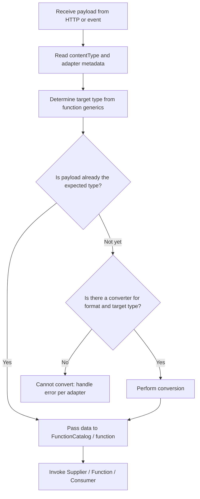

# Relationship Between contentType and Target Type

In **Spring Cloud Function**, business logic is modeled using `Supplier<T>`, `Function<I, O>`, or `Consumer<T>`, registered into `FunctionCatalog`, and can then be invoked over HTTP, events, or serverless environments. Incoming data from protocols does not arrive as ready-made Java objects: it may be JSON encoded as bytes, a piece of text, or a message carrying both payload and headers.

To convert data properly, you must understand the relationship between **`contentType`** and **target type** (*target type*):

- **`contentType` indicates the format in which the payload is represented**, such as `application/json`, `text/plain`, or `application/octet-stream`.
- **Target type indicates the Java value expected after conversion**, such as `OrderRequest`, `String`, `byte[]`, or `List<OrderRequest>`.
- **The actual payload content** must conform to the declared format and have a structure compatible with the target type.

These three pieces work together so adapters and converters can decide whether data conversion is possible. Knowing `contentType` alone is not enough to deduce the Java class, and knowing the Java class alone is not enough to know how a byte sequence should be decoded.

This lesson belongs to the **Data Types** chapter and focuses on the relationship between the format axis and the data-type axis, how they appear in Spring Messaging/HTTP, examples with DTOs and collections, and how to diagnose errors when the protocol changes while function logic is reused.

## 1. Two Independent Axes: Transport Format and Java Type Contract

Suppose a system receives order information:

```json
{"orderId":"ORD-101","quantity":2}
```

If the data is sent as JSON, `contentType` may be `application/json`. Yet that same JSON can map to different Java objects depending on the *target type* requested by the receiver:

| Actual Payload | `contentType` | Requested Target Type | Meaning |
| --- | --- | --- | --- |
| `{"orderId":"ORD-101","quantity":2}` | `application/json` | `OrderRequest` | Deserialize JSON object into DTO |
| Same JSON object | `application/json` | `Map<String, Object>` | Convert into a key/value structure when converter supports generics |
| Same JSON object | `application/json` | `String` | May not require object parsing; behavior depends on converter/adapter |
| `"ORD-101"` (JSON string) | `application/json` | `String` | Deserialize scalar JSON string per JSON rules |
| `ORD-101` (plain text) | `text/plain` | `String` | Read text; requires knowing charset |
| Arbitrary bytes | `application/octet-stream` | `byte[]` | Keep payload in binary form |
| JSON array | `application/json` | `List<OrderRequest>` | Needs both collection type and element type |

**One MIME type can pair with many Java types**, and **one Java type can be represented in many formats** if corresponding converters support them. For example, `OrderRequest` can be encoded as JSON; in another system, the same DTO might be encoded in a custom binary format. In that case, a suitable converter for that format is required.

Conversely, matching header values do not automatically make a payload valid. Sending the string `hello` with `contentType=application/json` does not turn it into a JSON object; sending `{"quantity":"two"}` to a JSON converter does not guarantee constructing a DTO with an `int quantity` field.

## 2. Where Does `contentType` Appear?

Similar names appear in different contexts:

| Environment | Common Representation | Who Sets It? |
| --- | --- | --- |
| HTTP request | `Content-Type: application/json` header | HTTP client or upstream gateway |
| HTTP response | Response `Content-Type` header | HTTP adapter or response writer |
| Spring Messaging | `MessageHeaders.CONTENT_TYPE`, key name `contentType` | Component creating the message, adapter, or binder |
| Event/broker | Header/property or adapter metadata | Producer, binder, and broker mapping rules |
| Serverless event | Platform-specific field/metadata | Serverless platform and adapter |

In Spring Messaging, you can create a message carrying a content-type header:

```java
import java.nio.charset.StandardCharsets;
import org.springframework.messaging.Message;
import org.springframework.messaging.MessageHeaders;
import org.springframework.messaging.support.MessageBuilder;
import org.springframework.util.MimeTypeUtils;

byte[] body = """
    {"orderId":"ORD-101","quantity":2}
    """.getBytes(StandardCharsets.UTF_8);

Message<byte[]> message = MessageBuilder.withPayload(body)
    .setHeader(
        MessageHeaders.CONTENT_TYPE,
        MimeTypeUtils.APPLICATION_JSON
    )
    .build();
```

This message still has a runtime payload of `byte[]`: **setting the header does not automatically deserialize bytes into a DTO**. The header merely provides metadata for a downstream conversion component if that component reads and supports it.

### `Content-Type` and `Accept` in HTTP

These two HTTP headers serve two distinct purposes:

- Request `Content-Type` describes how the **incoming body** is encoded.
- `Accept` describes the response format the client **wishes to receive**.

Example:

```http
POST /calculateOrder HTTP/1.1
Content-Type: application/json
Accept: application/json

{"orderId":"ORD-101","quantity":2}
```

`Accept` does not replace `Content-Type`, and `Accept: application/json` does not turn a `text/plain` body into JSON. Whether an adapter supports response content negotiation depends on the implementation. When invoking a `Function<OrderRequest, OrderReceipt>`, Java type information from the function is still required for payload conversion.

## 3. Where Is the Target Type Determined From?

Spring Cloud Function can rely on the generic type metadata of the registered bean. For example:

```java
@Bean
public Function<OrderRequest, OrderReceipt> calculateOrder() {
    return request -> new OrderReceipt(
        request.orderId(),
        Math.multiplyExact(request.quantity(), 50_000L)
    );
}
```

The `Function<OrderRequest, OrderReceipt>` signature tells us:

1. The logic expects `OrderRequest` as input.
2. The logic produces `OrderReceipt` as output.
3. If an adapter has payload conversion support and an appropriate converter, it can use `OrderRequest` as the input target type and `OrderReceipt` to handle the output.

The snippet above only illustrates the signature; full DTOs and configuration appear in the next section. This comes from Java generics, **not from the string `application/json`**. A MIME type only identifies content representation; it does not contain the business class name `OrderRequest`.

When using dynamically registered lambdas, generics can be obscured by `Function.class` or raw types. In that case, you can supply a `Type` via `FunctionRegistration.type(...)` to preserve the function's true target types. Details are in Section 9.

## 4. Complete Example: Receiving JSON and Processing a DTO

Using Java 17 or later to define record DTOs and a `Function` bean:

```java
package demo.function;

import java.util.function.Function;
import org.springframework.context.annotation.Bean;
import org.springframework.context.annotation.Configuration;

@Configuration
public class OrderFunctions {

    public record OrderRequest(String orderId, int quantity) {}

    public record OrderReceipt(String orderId, long totalVnd) {}

    @Bean
    public Function<OrderRequest, OrderReceipt> calculateOrder() {
        return request -> {
            if (request == null ||
                request.orderId() == null ||
                request.orderId().isBlank() ||
                request.quantity() <= 0) {
                throw new IllegalArgumentException(
                    "A valid orderId and positive quantity are required"
                );
            }

            long totalVnd = Math.multiplyExact(
                request.quantity(), 50_000L
            );
            return new OrderReceipt(request.orderId(), totalVnd);
        };
    }

    @Bean
    public Function<String, String> normalizeCode() {
        return code -> code.strip().toUpperCase(
            java.util.Locale.ROOT
        );
    }
}
```

Note: the application needs the Spring Cloud Function dependency and `OrderFunctions` registered in the Spring context. Declaring a function with `@Bean` does not create an HTTP endpoint by itself unless the corresponding adapter is installed and running.

### When Invoked over HTTP

With the Spring Cloud Function Web adapter configured to expose `calculateOrder` and a JSON converter supporting records:

```bash
curl -X POST http://localhost:8080/calculateOrder \
  -H 'Content-Type: application/json' \
  -H 'Accept: application/json' \
  -d '{"orderId":"ORD-101","quantity":2}'
```

Expected data result:

```json
{"orderId":"ORD-101","totalVnd":100000}
```

Here, `Content-Type: application/json` tells the HTTP adapter the incoming body is JSON; `Function<OrderRequest, OrderReceipt>` tells it the Java target expects `OrderRequest`. If the converter can deserialize JSON into the record, the function is invoked with that object. The actual response body and headers still depend on the adapter and environment configuration.

In the same application, `normalizeCode` accepts `String`:

```bash
curl -X POST http://localhost:8080/normalizeCode \
  -H 'Content-Type: text/plain; charset=UTF-8' \
  --data-binary '  ord-101  '
```

The value returned by the logic is `ORD-101`. This fits plain-text payloads; there is no need to pretend that HTTP body is a JSON object and try to deserialize it into a DTO.

### What If the Wrong Content-Type Is Sent?

Try sending the JSON body from the first example while changing the header to `text/plain`. The adapter may treat the body as plain text, skip the needed JSON parser, or report an incompatibility error. **Do not predict a single universal HTTP status code** across every adapter or version; what matters is recognizing that the two pieces of metadata no longer align.

## 5. Conversion Decision Flow: All Three Pieces Are Needed

The converter selection process can be pictured as follows:



This diagram shows **conditions to check**, not a fixed method-call sequence in Spring Cloud Function's internals. Across different adapters, parsing/codec steps may run before or after catalog wrappers and may not use the exact same implementation.

When conversion fails to occur, ask three questions:

1. **What is the actual format?** Valid JSON bytes, a JSON array, plain text, or arbitrary binary?
2. **What format does `contentType` describe?** Is the header present, overwritten, and using the right MIME/charset?
3. **What Java type does the function expect?** A DTO, string, bytes, message wrapper, or collection with element generics?

A request that satisfies all three axes still needs the converter present, properly configured, and data passing business validation.

## 6. Hands-On with Spring Messaging `MessageConverter`

Spring Messaging provides the `MessageConverter` interface to convert between `Message<?>` payloads and Java objects. The following snippet **invokes a converter directly** to observe the relationship between the content-type header and the target type, without requiring the Web adapter to run.

```java
import java.nio.charset.StandardCharsets;

import org.springframework.messaging.Message;
import org.springframework.messaging.MessageHeaders;
import org.springframework.messaging.converter.MappingJackson2MessageConverter;
import org.springframework.messaging.support.MessageBuilder;
import org.springframework.util.MimeTypeUtils;

MappingJackson2MessageConverter converter =
    new MappingJackson2MessageConverter();

String json = """
    {"orderId":"ORD-101","quantity":2}
    """;

Message<byte[]> input = MessageBuilder
    .withPayload(json.getBytes(StandardCharsets.UTF_8))
    .setHeader(
        MessageHeaders.CONTENT_TYPE,
        MimeTypeUtils.APPLICATION_JSON
    )
    .build();

Object result = converter.fromMessage(
    input,
    OrderFunctions.OrderRequest.class
);

if (!(result instanceof OrderFunctions.OrderRequest request)) {
    throw new IllegalStateException("Cannot convert payload to OrderRequest");
}

System.out.println(request.orderId()); // ORD-101
```

This example assumes Spring Messaging and a compatible Jackson JSON converter supporting Java records are installed; the snippet should be placed inside a method or test with the appropriate `OrderFunctions` import/class. It illustrates:

- The `contentType=application/json` header helps the converter recognize the JSON format.
- The `OrderRequest.class` argument is **the target type** for deserialization.
- The payload remains bytes when constructing the message, and only becomes a DTO if the converter converts it successfully.

`fromMessage(...)` can fail to convert when given an unsupported target type or header; depending on the case it may return `null` or throw an exception. **Do not equate a converter returning `null` with a guarantee that the application will return a specific HTTP status code.**

### Keeping the Payload Unchanged Without a Converter

Suppose the target is genuinely `Function<byte[], byte[]>` and the input is already valid `byte[]`. An adapter may pass the payload straight to the function without JSON conversion, even when a header is present. This depends on the actual processing path; in direct Java code, `byte[]` does not magically turn into a POJO because of a header:

```java
byte[] original = input.getPayload();
System.out.println(original.getClass().getName()); // [B
```

If the logic accepts bytes, parsing the content is the responsibility of that logic or an intentionally configured converter. **`contentType` does not force every byte array to be deserialized before reaching the target.**

## 7. Reference Table of Matching and Mismatched Scenarios

| Payload | `contentType` | Target Type | Expectation or Risk |
| --- | --- | --- | --- |
| `{"orderId":"ORD-101","quantity":2}` | `application/json` | `OrderRequest` | Can construct DTO if JSON converter and mapping support it |
| Same JSON object | `text/plain` | `OrderRequest` | Text converter may not construct DTO; fix format/header |
| `hello` | `application/json` | `OrderRequest` | Not a valid JSON object; conversion can fail |
| `"hello"` | `application/json` | `String` | Valid JSON string; depends on scalar converter handling |
| `hello` | `text/plain; charset=UTF-8` | `String` | Suitable for receiving plain text |
| Arbitrary bytes | `application/octet-stream` | `byte[]` | Suitable for binary-processing functions |
| JSON array of multiple orders | `application/json` | `List<OrderRequest>` | Requires element generics and supporting converter |
| JSON array of multiple orders | `application/json` | `OrderRequest` | Array shape differs from object; mapping can fail |
| JSON object with `"quantity":"two"` | `application/json` | `OrderRequest` | Wrong value type; converter or validation can error |
| POJO `OrderRequest` created in Java | No header needed on direct call | `OrderRequest` | `apply(...)` can run directly without JSON step |

The examples above show how to reason about **compatibility**. Which exact converter is selected, which exception is thrown, and whether an adapter applies special handling must be verified with corresponding integration tests.

## 8. Nested Generics: contentType Cannot Express Element Types

Consider a function that expects a list:

```java
@Bean
public Function<
    java.util.List<OrderFunctions.OrderRequest>,
    java.util.List<OrderFunctions.OrderReceipt>
> calculateOrders() {
    return orders -> orders.stream()
        .map(order -> new OrderFunctions.OrderReceipt(
            order.orderId(),
            Math.multiplyExact(order.quantity(), 50_000L)
        ))
        .toList();
}
```

This is a standalone example bean placed in a `@Configuration` class with accessible `OrderFunctions` DTOs. The signature states that **a single call receives the entire list**, not automatically multiple separate calls to `Function<OrderRequest, OrderReceipt>`.

The HTTP payload could be:

```json
[
  {"orderId":"ORD-101","quantity":2},
  {"orderId":"ORD-102","quantity":1}
]
```

In this case, `Content-Type: application/json` only indicates the payload uses JSON syntax. It **does not state** that the list contains `OrderRequest` rather than `Map<String, Object>` or some other DTO. The `List<OrderRequest>` information lives in the function's generic signature or explicit registration metadata.

If only raw `List.class` is published, the converter may not know the element type. For example, with Jackson 2, when code explicitly deserializes a JSON array, use a type token:

```java
import java.util.List;
import com.fasterxml.jackson.core.type.TypeReference;
import com.fasterxml.jackson.databind.ObjectMapper;

ObjectMapper mapper = new ObjectMapper();
String jsonArray = """
    [{"orderId":"ORD-101","quantity":2}]
    """;

List<OrderFunctions.OrderRequest> orders = mapper.readValue(
    jsonArray,
    new TypeReference<List<OrderFunctions.OrderRequest>>() {}
);
```

This Jackson snippet sits in a context that handles checked exceptions. `TypeReference<List<OrderRequest>>` informs the JSON mapper of the element type, for the same reason generic metadata must be preserved on beans. **Do not assume every `MessageConverter.fromMessage(message, List.class)` will discover element types on its own.** Converters supporting type hints or adapters supplying generic metadata can perform deeper conversion, which should be verified in your specific context.

### When a Function Accepts `Message<OrderRequest>`

`Message<T>` is a wrapper containing a payload and headers. If a target publishes `Consumer<Message<OrderRequest>>`, the outer Java type is `Message`, while `OrderRequest` is the inner payload type:

```java
import java.util.function.Consumer;
import org.springframework.context.annotation.Bean;
import org.springframework.messaging.Message;

@Bean
public Consumer<Message<OrderFunctions.OrderRequest>> auditOrders() {
    return message -> {
        OrderFunctions.OrderRequest order = message.getPayload();
        Object correlationId =
            message.getHeaders().get("correlationId");

        System.out.printf(
            "Order %s, correlationId=%s%n",
            order.orderId(), correlationId
        );
    };
}
```

This is an illustrative bean in a Spring configuration class; the adapter can supply a `Message<OrderRequest>` with a DTO payload only if the conversion path aligns. The `contentType` header neither erases nor creates `correlationId`; preserving or mapping other headers is determined by the adapter and message-construction steps.

## 9. Dynamic Registration: Preserving Target Types Alongside contentType

In a functional application, lambdas may be dynamically registered into the context. If registered only with the raw class `Function.class`, input/output metadata may no longer be specific enough for a converter to determine the target type.

Spring Cloud Function provides `FunctionRegistration` and `FunctionTypeUtils` to attach an explicit type to a target:

```java
import java.util.function.Function;

import org.springframework.cloud.function.context.FunctionRegistration;
import org.springframework.cloud.function.context.catalog.FunctionTypeUtils;

// Placed inside ApplicationContextInitializer<GenericApplicationContext>.
Function<OrderFunctions.OrderRequest, OrderFunctions.OrderReceipt> fn =
    request -> new OrderFunctions.OrderReceipt(
        request.orderId(),
        Math.multiplyExact(request.quantity(), 50_000L)
    );

context.registerBean(
    "calculateOrder",
    FunctionRegistration.class,
    () -> new FunctionRegistration<>(fn)
        .type(FunctionTypeUtils.functionType(
            OrderFunctions.OrderRequest.class,
            OrderFunctions.OrderReceipt.class
        ))
);
```

Here `context` is the `GenericApplicationContext` passed to `initialize(...)` once the initializer is registered and executed. If you choose this registration approach, do not simultaneously declare another bean named `calculateOrder` like the one in Section 4 within the same application.

**The right relationship:** `.type(...)` declares the function's Java types; `contentType` declares the payload format of a specific request/message. Both may be needed at the boundary, and neither replaces the other.

A `Function<OrderRequest, OrderReceipt>` with accurate metadata still cannot parse arbitrary bytes when the header claims `application/json`; conversely, valid JSON is not enough for a converter to reliably produce `OrderRequest` if registration only advertises `Function<Object, Object>`.

## 10. How Does contentType Affect Supplier, Function, and Consumer?

| Kind | Java Contract | How contentType Can Participate |
| --- | --- | --- |
| `Supplier<OrderReceipt>` | No input, provides `OrderReceipt` | Outbound adapter can serialize output in target format |
| `Function<OrderRequest, OrderReceipt>` | Accepts DTO, returns DTO | Inbound adapter reads payload per content type; outbound represents result |
| `Consumer<OrderRequest>` | Accepts DTO, no Java return value | Inbound adapter can deserialize event; ack/retry decided by caller system |
| `Function<Message<OrderRequest>, Message<OrderReceipt>>` | Accepts/returns full message wrapper | Message content type and headers can affect payload conversion and downstream steps |

With `Supplier`, there is no input to convert from an HTTP body before running `get()`. With `Consumer`, there is no business output to serialize from the result of `accept()`. An HTTP response or binder acknowledgment may still exist, yet that is not a generic output of `Consumer`.

When a `Function` returns a Java object, distinguish **the output type** from its signature and **the output content type** decided by the adapter/binder. Do not manually copy an old `contentType` header onto a message whose new payload is in a different format; doing so can cause downstream consumers to pick the wrong converter.

## 11. Content Type When Composing Multiple Functions

Suppose the application defines:

```java
@Bean
public Function<OrderFunctions.OrderReceipt, String> renderReceipt() {
    return receipt ->
        receipt.orderId() + ": " + receipt.totalVnd() + " VND";
}
```

Once `calculateOrder` and `renderReceipt` are registered, you can select the pipeline:

```yaml
spring:
  cloud:
    function:
      definition: calculateOrder|renderReceipt
```

The pipeline contract is:

```text
HTTP/event JSON
  └─ [adapter reads contentType; deserializes as OrderRequest]
          ↓
      OrderRequest
          │
          ▼
      calculateOrder : Function<OrderRequest, OrderReceipt>
          │ OrderReceipt
          ▼
      renderReceipt : Function<OrderReceipt, String>
          │
          ▼
         String
  └─ [adapter represents output per its rules]
```

At **the junction between two Java functions**, the data is already an `OrderReceipt` object, so there is normally no need to serialize it to JSON and deserialize it back. `contentType` matters primarily when interacting with adapters or when composition itself works with wrappers/metadata requiring conversion. Do not assume that setting `contentType=application/json` allows any two incompatible functions to chain automatically.

For example, `Function<OrderRequest, OrderReceipt>` is not automatically compatible with `Function<Integer, String>` because the latter expects `Integer`, not `OrderReceipt`. Adjust the contract or add an explicit Java conversion step.

## 12. Error Diagnosis and Testing Strategy

### Common Mistakes

| Symptom | What to Check | How to Fix |
| --- | --- | --- |
| JSON body treated as plain text | Wrong or missing `Content-Type` or `contentType` header | Fix header and verify adapter receives metadata |
| HTTP reports unsupported media type | Format accepted by adapter/converter | Use matching MIME type or install required converter |
| Function receives `Map` instead of DTO | Bean generics, raw `Function`, `Object`, or dynamic registration | Declare `Function<OrderRequest, ...>` / concrete metadata |
| Valid JSON syntax fails to produce DTO | Field/shape mismatch with class, record support in converter | Align payload, DTO, or JSON mapping |
| JSON array turns into `List<Map>` | Only `List.class` known, missing element generics | Supply `List<OrderRequest>` and a converter able to resolve it |
| Binary wrongly turned into text | Non-text bytes or mismatched charset | Keep `byte[]` or use the right codec/charset |
| Output header no longer matches | Payload format changed while old header stayed | Set outbound metadata matching the new payload |
| Direct Java call passes, HTTP/broker fails | Java call bypassed conversion step | Add integration tests through the real protocol |
| Composition receives wrong type | Previous function output mismatches next function input | Check each generic signature and conversion step |

### Verification Procedure

1. **Confirm bean signature or `FunctionRegistration.type(...)`:** does the function truly accept `OrderRequest`, or does it advertise `Object`?
2. **Capture actual test payload:** is it a JSON object, JSON array, plain text, or raw bytes? Note the charset if applicable.
3. **Inspect adapter metadata:** does HTTP `Content-Type` or Spring Message `contentType` match the payload? Was it altered mid-pipeline?
4. **Verify configured converters:** do they support both the MIME type and the target class/generics? For collections, is the element type supplied?
5. **Separate two test levels:** test logic with pre-built Java objects; test conversion with real HTTP requests/events through the corresponding adapter.
6. **Check output:** are the returned Java type, serialized representation, and response/message content type consistent?

Example logic check via catalog when the application has the `calculateOrder` bean:

```java
import java.util.function.Function;
import org.springframework.cloud.function.context.FunctionCatalog;

// Placed in a test/method with FunctionCatalog catalog from Spring context.
Function<OrderFunctions.OrderRequest, OrderFunctions.OrderReceipt> fn =
    catalog.lookup("calculateOrder");

OrderFunctions.OrderReceipt receipt = fn.apply(
    new OrderFunctions.OrderRequest("ORD-101", 2)
);

System.out.println(receipt.totalVnd()); // 100000
```

When run directly like this, there is no HTTP body or JSON message to parse. This tests the catalog and business logic, **not proof that the `contentType` → DTO step works**. Add tests against the actual adapter in your real system.

### Recommended Boundary Test Cases

| Test Case | Payload and Metadata | What to Confirm |
| --- | --- | --- |
| Valid JSON | JSON object + `application/json` | DTO and business result are right |
| Malformed format | Plain-text body + `application/json` | Clear error handling, no guessing an object |
| Wrong shape | JSON array + single DTO target | Converter errors or adapter responds appropriately |
| Invalid data | `quantity` is a non-numeric string | Conversion/validation reports an error |
| Plain text | Plain text + `text/plain`, `String` target | Content and charset are right |
| Nested generics | JSON array + `List<OrderRequest>` | Elements are DTOs, not raw maps |
| Message with headers | `contentType` and `correlationId` | Payload and needed headers are handled properly |
| Missing content type | No format header | Observe adapter's default policy rather than guessing |

## 13. Self-Check Practice

**Exercise 1 — Identify the two axes.** An event contains JSON bytes `{"orderId":"ORD-101","quantity":2}` and header `contentType=application/json`. What else does `Function<OrderRequest, OrderReceipt>` need to convert the bytes into a DTO?

*Answer:* It must know the target Java type is `OrderRequest` from generics/registration and have a JSON converter supporting that DTO type. `contentType` only describes the JSON format.

**Exercise 2 — Same type, different formats.** Can `Function<String, String>` treat HTTP plain text and a JSON string identically?

*Answer:* Both can yield a `String` value when supported by the adapter and converter, yet `hello` (plain text) differs from `"hello"` (JSON string). Send the right `Content-Type` and test how the adapter interprets scalar JSON.

**Exercise 3 — Why doesn't a header fix a raw type?** A lambda actually expects `OrderRequest` but was registered with `Function.class`. Is merely adding `contentType=application/json` to the message enough?

*Answer:* No. Headers do not preserve a lambda's generics; you must publish `Function<OrderRequest, OrderReceipt>` or use `FunctionRegistration.type(...)` with the matching type pair.

**Exercise 4 — JSON arrays.** A message with `contentType=application/json` holds an array of orders. Can you assume it becomes `List<OrderRequest>` if the converter is only given `List.class`?

*Answer:* No. The converter needs the element type `OrderRequest` via generic metadata or a supported type hint.

**Exercise 5 — HTTP headers.** A client POSTs a JSON body with `Content-Type: text/plain` and `Accept: application/json`. Which header needs to be fixed to describe the input accurately?

*Answer:* The request's `Content-Type` must be `application/json`. `Accept` only specifies the desired response format.

**Exercise 6 — Testing.** A unit test calling `calculateOrder.apply(new OrderRequest(...))` passes, yet broker events pass the wrong type to the function. List the steps to investigate.

*Answer:* Check the actual bytes/payload, the `contentType` header, the registered generic types, the converter/binder in use, the runtime class of the payload after conversion, and run an integration test through the adapter.

## Takeaways

- **`contentType` describes the transport format, while target type describes the expected Java result.** Both must align with the actual payload content.
- **Java types usually come from generic signatures** on `Supplier`, `Function`, `Consumer`, or `FunctionRegistration` metadata; MIME types do not contain DTO names.
- **Converters/adapters are the links that perform conversion.** Having the right header and type is only a precondition enabling conversion; they do not replace converters, mapping, and validation.
- **Do not equate `Content-Type` with `Accept`**, a JSON object with a JSON string, `List<T>` with `List.class`, or `Message<T>` with payload `T`.
- **Protocol-independent logic reuse** does not eliminate the need to test each HTTP, event, or serverless entry point: the same function can receive payloads represented very differently at the boundary.

**References:** [Spring Cloud Function Reference](https://docs.spring.io/spring-cloud-function/reference/), [Spring Framework — Message Conversion](https://docs.spring.io/spring-framework/reference/integration.html), and [Spring Framework — Type Conversion](https://docs.spring.io/spring-framework/reference/core/validation/convert.html). For specific converter or adapter defaults, consult the documentation for the exact version you are deploying.
