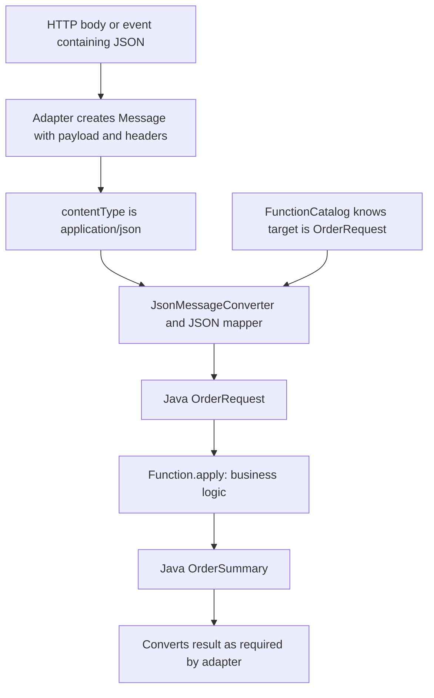

# Converting JSON with JsonMessageConverter

When writing business logic with **Spring Cloud Function**, we typically declare functions using `Supplier<T>`, `Function<I, O>`, or `Consumer<T>`. The same function can be invoked from HTTP, events, or serverless environments through `FunctionCatalog` and compatible adapters. However, data arriving from external systems is usually **JSON as text or bytes**, whereas the Java function expects concrete **DTOs/POJOs**. `JsonMessageConverter` bridges that gap in Spring Cloud Function's message conversion flow.

This lesson belongs to the **Data Types** chapter and focuses on how `JsonMessageConverter` uses `contentType` together with the target type to read/write JSON, how to preserve function generics, handle JSON objects and arrays, distinguish framework-driven conversion from manual deserialization, configure the JSON mapper, and diagnose common failures.

After this lesson, you will be able to:

1. Explain the role of `JsonMessageConverter` in Spring Cloud Function's converter stack.
2. Identify the three prerequisites for converting JSON into a DTO: **actual payload**, **`contentType`**, and **target Java type**.
3. Define `Function<OrderRequest, OrderSummary>` and invoke it over HTTP or a `Message<byte[]>` containing JSON.
4. Recognize the limitations around JSON arrays, `List<T>`, `Message<T>` wrappers, and dynamically registered beans.
5. Understand Jackson/Gson configuration, the allowlisted MIME `type=...` mechanism, and how to test JSON conversion at the adapter boundary.

## 1. Why Do We Need JsonMessageConverter?

Suppose a system receives JSON:

```json
{
  "orderId": "ORD-101",
  "lines": [
    {"sku": "BOOK", "quantity": 2, "unitPriceVnd": 50000},
    {"sku": "PEN", "quantity": 1, "unitPriceVnd": 30000}
  ]
}
```

The business logic has the contract:

```java
Function<OrderRequest, OrderSummary> calculateOrder;
```

To call `calculateOrder.apply(...)`, Java needs an `OrderRequest` object, not a JSON string or byte array. When an adapter receives a message, the framework can execute:



This diagram illustrates **roles**, not a claim that every adapter always creates a `Message` object or invokes the same converter in that exact order. Spring Cloud Function can normalize invocations via the catalog; HTTP, messaging, and serverless each have their own integration mechanisms. In particular, **setting `contentType=application/json` alone does not turn a payload into `OrderRequest`** if the target type or a suitable converter is missing.

### Three Elements That Must Always Align

| Component | Example | Verification Question |
| --- | --- | --- |
| Actual payload | UTF-8 bytes containing a JSON object | Is the content valid JSON syntax and structure? |
| `contentType` | `application/json` | Does the message/HTTP adapter know this is JSON? |
| Target type | `OrderRequest` | Do the bean/registration generics specify which DTO to construct? |

If the content is `{"quantity":"two"}` while the DTO has an `int quantity` field, a JSON converter will still hit a data-type error. If the content is a JSON array while the target type is a single DTO, the data shape will not match either.

## 2. How Does Spring Cloud Function's JsonMessageConverter Differ from Similarly Named Converters?

Spring Cloud Function provides a stack of `MessageConverter`s used when normalizing messages. The framework documentation typically describes these converters:

| Converter | Typically Served Format | Role |
| --- | --- | --- |
| **`JsonMessageConverter`** | `application/json` | Converts JSON payloads ↔ POJOs through a JSON mapper |
| `ByteArrayMessageConverter` | `application/octet-stream` | Processes or forwards byte arrays |
| `StringMessageConverter` | `text/plain` | Converts content to text |

In Spring Cloud Function, `JsonMessageConverter` is a JSON converter **provided by the framework**. Typical applications do not have to `new` this converter themselves for `Function<I, O>` beans to work. The framework selects converters when it needs to convert between message payloads and function types.

Distinguish it from two other APIs:

- **`org.springframework.messaging.converter.MappingJackson2MessageConverter`** is a Spring Messaging implementation using Jackson. It can be called or registered directly in Spring Messaging programs, but it is **not a synonym** for `JsonMessageConverter` in Spring Cloud Function.
- **`org.springframework.http.converter.HttpMessageConverter`** is Spring MVC's HTTP converter family. It operates during HTTP body handling; do not conclude that every Spring Cloud Function HTTP path must go through a `MappingJackson2MessageConverter` instance.

In the Spring Cloud Function model, when input is `Message<?>` the framework can use the `MessageConverter` stack; when input is an unwrapped value, a `ConversionService` path or custom handling may be used. The exact conversion path should be verified against the running catalog/adapter.

### Message Conversion API at the Contract Level

Spring Messaging describes the basic methods of the `MessageConverter` interface:

```java
Object fromMessage(Message<?> message, Class<?> targetClass);
Message<?> toMessage(Object payload, MessageHeaders headers);
```

These are **illustrative signatures**, not a standalone compilable Java class. `fromMessage` uses the source message and target class to produce a Java object; `toMessage` turns a Java value into an outbound message. Implementations/adapters may also support overloads or type hints for nested generics.

## 3. Complete Example: A Function Accepting and Returning POJOs

Below is a bean configuration using **Java 17 or later** because it uses `record`. The example uses `long` for VND amounts to avoid `float`/`double` rounding errors in integer math. For currencies with fractional units, use `BigDecimal` with explicit rounding rules.

```java
package demo.function;

import java.util.List;
import java.util.Objects;
import java.util.function.Function;

import org.springframework.context.annotation.Bean;
import org.springframework.context.annotation.Configuration;

@Configuration
public class OrderFunctions {

    public record OrderLine(
        String sku,
        int quantity,
        long unitPriceVnd
    ) {}

    public record OrderRequest(
        String orderId,
        List<OrderLine> lines
    ) {}

    public record OrderSummary(
        String orderId,
        int lineCount,
        long totalVnd
    ) {}

    @Bean
    public Function<OrderRequest, OrderSummary> calculateOrder() {
        return request -> {
            Objects.requireNonNull(request, "request");
            if (request.orderId() == null ||
                request.orderId().isBlank()) {
                throw new IllegalArgumentException("orderId is required");
            }

            List<OrderLine> lines =
                Objects.requireNonNull(request.lines(), "lines");
            if (lines.isEmpty()) {
                throw new IllegalArgumentException("lines cannot be empty");
            }

            long total = 0L;
            for (OrderLine line : lines) {
                Objects.requireNonNull(line, "line");
                if (line.sku() == null || line.sku().isBlank() ||
                    line.quantity() <= 0 || line.unitPriceVnd() < 0L) {
                    throw new IllegalArgumentException("invalid order line");
                }
                long subtotal = Math.multiplyExact(
                    line.quantity(),
                    line.unitPriceVnd()
                );
                total = Math.addExact(total, subtotal);
            }

            return new OrderSummary(
                request.orderId(),
                lines.size(),
                total
            );
        };
    }
}
```

The published signature is:

```text
Function<
    OrderRequest,   // Java input: OrderRequest
    OrderSummary    // Java output: OrderSummary
>
```

`JsonMessageConverter` **does not replace business logic**. It can create `OrderRequest` from JSON upfront, while `calculateOrder` remains responsible for validating order IDs, quantities, unit prices, and computing the total. Successful deserialization by the converter alone does not mean an order is valid.

For the JSON example in Section 1, the expected business result is:

```json
{
  "orderId": "ORD-101",
  "lineCount": 2,
  "totalVnd": 130000
}
```

## 4. Sending JSON over HTTP: The Adapter Routes Content to the Right Function

Suppose the application has the Spring Cloud Function Web adapter installed, started with the required configuration, and exposes the `calculateOrder` bean. A client can send:

```bash
curl -X POST http://localhost:8080/calculateOrder \
  -H 'Content-Type: application/json' \
  -H 'Accept: application/json' \
  -d '{"orderId":"ORD-101","lines":[{"sku":"BOOK","quantity":2,"unitPriceVnd":50000},{"sku":"PEN","quantity":1,"unitPriceVnd":30000}]}'
```

Illustrative response body under a JSON-enabled configuration:

```json
{"orderId":"ORD-101","lineCount":2,"totalVnd":130000}
```

Coordinating factors:

1. HTTP header `Content-Type: application/json` describes how the request body is encoded.
2. The adapter passes the body and metadata into the appropriate invocation mechanism.
3. `FunctionCatalog` holds the `Function<OrderRequest, OrderSummary>` generic metadata from the bean.
4. An appropriate JSON converter/codec deserializes the JSON object into `OrderRequest`.
5. The function computes the total and the adapter renders the result into the response.

The HTTP header `Accept: application/json` expresses the response format the client prefers; **it does not substitute for the request's `Content-Type`**. Content negotiation behavior varies by adapter, so test with your exact dependencies and version.

If the application only has the `Function` bean without a Web adapter, the curl command will not magically create an endpoint. Similarly, when running over an event broker or serverless platform, data may arrive inside a custom envelope; never assume every invocation looks like an HTTP POST.

## 5. Observing JSON Conversion Through FunctionCatalog

A practical check is to compare **direct Java calls with an existing DTO** against **calling the catalog with a `Message` containing JSON**. Direct invocation:

```java
import java.util.List;
import java.util.function.Function;

Function<OrderFunctions.OrderRequest, OrderFunctions.OrderSummary> fn =
    applicationContext.getBean("calculateOrder", Function.class);

OrderFunctions.OrderRequest request =
    new OrderFunctions.OrderRequest(
        "ORD-101",
        List.of(
            new OrderFunctions.OrderLine("BOOK", 2, 50000),
            new OrderFunctions.OrderLine("PEN", 1, 30000)
        )
    );

OrderFunctions.OrderSummary result = fn.apply(request);
System.out.println(result.totalVnd()); // 130000
```

This example sits inside a method with an `applicationContext` variable from Spring. Calling the bean directly with `OrderRequest` **does not test JSON conversion**, because the DTO was already constructed beforehand.

To pass through `FunctionCatalog`'s wrapper using a JSON `Message<byte[]>`:

```java
import java.nio.charset.StandardCharsets;
import java.util.function.Function;

import org.springframework.cloud.function.context.FunctionCatalog;
import org.springframework.messaging.Message;
import org.springframework.messaging.MessageHeaders;
import org.springframework.messaging.support.MessageBuilder;
import org.springframework.util.MimeTypeUtils;

// Placed inside a test/method with an injected FunctionCatalog catalog.
String json = """
    {"orderId":"ORD-101","lines":[
      {"sku":"BOOK","quantity":2,"unitPriceVnd":50000},
      {"sku":"PEN","quantity":1,"unitPriceVnd":30000}
    ]}
    """;

Message<byte[]> incoming = MessageBuilder
    .withPayload(json.getBytes(StandardCharsets.UTF_8))
    .setHeader(
        MessageHeaders.CONTENT_TYPE,
        MimeTypeUtils.APPLICATION_JSON
    )
    .build();

Function<Message<byte[]>, ?> function = catalog.lookup("calculateOrder");
Object returned = function.apply(incoming);

if (returned == null) {
    throw new AssertionError("Function returned no result");
}
System.out.println("Catalog result type: " + returned.getClass());
```

This snippet tests **the wrapper/catalog conversion path inside Spring Cloud Function** once the context and converters are properly initialized. This is an illustrative snippet; the return value may be wrapped in a `Message` and its payload may be a Java value or serialized data depending on the lookup method, adapter, and version. Therefore, the next step is inspecting the output body or message per your environment's contract rather than blindly casting the result.

**Key distinction:** if `calculateOrder` successfully receives `OrderRequest` from a JSON `Message<byte[]>`, you have additionally verified the catalog's type conversion mechanism; you still need a separate integration test to verify the real HTTP endpoint or binder.

## 6. How Do contentType, Payload, and Target Type Work Together?

In Spring Messaging, the header name is typically `MessageHeaders.CONTENT_TYPE` (string key `contentType`). An HTTP adapter may map HTTP `Content-Type` to this header. For messages without a content-type header, the Spring Cloud Function documentation describes **a default of `application/json` in the framework's conversion path**; individual adapters or binders may apply different defaults or metadata.

| Input Payload | `contentType` Header | Target Java Type | Remarks |
| --- | --- | --- | --- |
| UTF-8 bytes containing JSON object | `application/json` | `OrderRequest` | Classic case for the JSON converter |
| String containing JSON object | `application/json` | `OrderRequest` | Convertible if the converter supports `String` input |
| Raw non-JSON bytes | `application/json` | `OrderRequest` | Header does not make invalid bytes valid JSON |
| Bytes containing JSON object | `text/plain` | `OrderRequest` | May route to text handling inappropriately |
| Plain text `hello` | `text/plain` | `String` | Suitable for plain-text handling |
| JSON string `"hello"` | `application/json` | `String` | JSON scalar; check converter/adapter support |
| JSON array of orders | `application/json` | `List<OrderRequest>` | Needs element generics preserved |
| JSON object of an order | `application/json` | `List<OrderRequest>` | Shape mismatch; can fail |
| Existing `OrderRequest` | Conversion may be skipped | `OrderRequest` | No JSON deserialization needed when type already matches |

Do not look solely at `contentType` and claim with certainty which converter will run; Spring Cloud Function considers both the actual payload type and the function's expected type, while adapters may use their own codec mechanisms.

### JSON String vs. Plain Text

```text
text/plain
hello

application/json
"hello"

application/json
{"message":"hello"}
```

These are three distinct structures. A `Function<String, String>` is not automatically compatible with a JSON object simply because it has a `message` field. If you want to handle an object with fields, declare a DTO or parse explicitly.

## 7. JsonMapper and Choosing Jackson or Gson

The Spring Cloud Function documentation describes the `org.springframework.cloud.function.json.JsonMapper` abstraction that enables the framework to use JSON engines such as **Jackson** or **Gson**. `JsonMessageConverter` relies on this JSON mapper layer to convert data according to configuration/classpath.

| Component | Role |
| --- | --- |
| `JsonMessageConverter` | Converts JSON message payloads to target types or vice versa |
| `JsonMapper` | Abstracts underlying JSON read/write operations |
| Jackson / Gson | Library performing serialization/deserialization |
| `contentType=application/json` | Hints JSON format to the converter |
| `Function<I, O>` signature | Identifies the target Java classes |

If both Jackson and Gson are on the classpath, **precedence rules can depend on version and configuration**. Spring Cloud Function provides the property:

```yaml
spring:
  cloud:
    function:
      preferred-json-mapper: jackson
```

Common choices are `jackson` or `gson` depending on the documented Spring Cloud Function version. The configuration snippet above specifies the desired mapper and is not mandatory for every application. Check the documentation for your exact version and dependencies before configuring.

When schemas involve enums, dates/times, field names differing from Java, polymorphic DTOs, or custom structures, the mapper may require modules, adapters, or custom rules. Successful conversion depends on both mapper configuration and data shape, not just the JSON header.

**Do not deserialize manually a second time** if your function already receives a framework-created DTO. Only use `ObjectMapper`, `JsonMapper`, or a JSON library directly when your logic genuinely needs to read/write JSON inside the function.

## 8. JSON Arrays and Generics: Element Type Must Be Known

Consider a JSON array:

```json
[
  {"orderId":"ORD-101","lines":[{"sku":"BOOK","quantity":2,"unitPriceVnd":50000}]},
  {"orderId":"ORD-102","lines":[{"sku":"PEN","quantity":1,"unitPriceVnd":30000}]}
]
```

A function processing the whole list can be defined as:

```java
import java.util.List;
import java.util.function.Function;
import org.springframework.context.annotation.Bean;

@Bean
public Function<
    List<OrderFunctions.OrderRequest>,
    List<OrderFunctions.OrderSummary>
> calculateOrders(
        Function<OrderFunctions.OrderRequest,
                 OrderFunctions.OrderSummary> calculateOrder) {
    return orders -> orders.stream()
        .map(calculateOrder)
        .toList();
}
```

This is an **additional illustrative bean** placed in a separate configuration class and must inject the right `calculateOrder` bean. If the application has multiple `Function` beans, use `@Qualifier("calculateOrder")` to select the exact implementation. A single call to `calculateOrders` receives the entire list, unlike two automatic calls to `Function<OrderRequest, OrderSummary>`.

For JSON array payloads, `List.class` **does not indicate that elements are `OrderRequest`**. With a generic parser, elements may be instantiated as `Map`s and fail when the lambda calls `order.lines()`. The `List<OrderRequest>` contract on the `@Bean` method or dynamic registration metadata can supply the missing type detail. However, the converter/adapter must also support parameterized types to perform deep deserialization.

### If Code Explicitly Uses Jackson to Parse a List

```java
import java.util.List;
import com.fasterxml.jackson.core.type.TypeReference;
import com.fasterxml.jackson.databind.ObjectMapper;

ObjectMapper mapper = new ObjectMapper();
String json = """
    [{"orderId":"ORD-101","lines":[
      {"sku":"BOOK","quantity":2,"unitPriceVnd":50000}
    ]}]
    """;

List<OrderFunctions.OrderRequest> orders = mapper.readValue(
    json,
    new TypeReference<List<OrderFunctions.OrderRequest>>() {}
);
```

This snippet uses the Jackson 2 API in a context that handles checked exceptions. `TypeReference<List<OrderRequest>>` preserves the element type. It illustrates the generic principle and **does not mean Spring Cloud Function always runs this exact Jackson snippet inside `JsonMessageConverter`**: the JSON mapper and type-hint mechanism may differ.

If you use `Function<Flux<OrderRequest>, Flux<OrderSummary>>`, that is a Project Reactor reactive pipeline, **different from `Function<List<...>, List<...>>`**. Sending a JSON array does not automatically enable message broker batch consumption either.

## 9. When a Function Accepts Message<T> Instead of a Direct DTO

With the signature `Function<OrderRequest, OrderSummary>`, the business function does not need to care about headers. With `Function<Message<OrderRequest>, Message<OrderSummary>>`, the function can access both payload and headers:

```java
import java.util.function.Function;
import org.springframework.context.annotation.Bean;
import org.springframework.beans.factory.annotation.Qualifier;
import org.springframework.messaging.Message;
import org.springframework.messaging.support.MessageBuilder;

@Bean
public Function<
    Message<OrderFunctions.OrderRequest>,
    Message<OrderFunctions.OrderSummary>
> calculateOrderMessage(
    @Qualifier("calculateOrder")
    Function<OrderFunctions.OrderRequest,
             OrderFunctions.OrderSummary> calculateOrder
) {
    return incoming -> {
        OrderFunctions.OrderSummary summary =
            calculateOrder.apply(incoming.getPayload());

        MessageBuilder<OrderFunctions.OrderSummary> builder =
            MessageBuilder.withPayload(summary);

        Object correlationId = incoming.getHeaders().get("correlationId");
        if (correlationId != null) {
            builder.setHeader("correlationId", correlationId);
        }
        return builder.build();
    };
}
```

Place this bean in a `@Configuration` class that can access `OrderFunctions` and the `calculateOrder` bean. Logic expecting `Message<OrderRequest>` assumes `getPayload()` is already an `OrderRequest`. The adapter can convert JSON bytes into the DTO using the nested generics if both it and the converter support them.

When transforming a payload from JSON bytes to a POJO or from a POJO to a JSON message, choose which headers to preserve. **Do not mechanically copy every header**, especially `contentType` or legacy format metadata that may no longer match the new output. Correlation IDs are typically business metadata worth preserving intentionally.

## 10. Dynamic Types via MIME Type Parameter and Allowlist

Normally you should publish `Function<OrderRequest, OrderSummary>` so the framework clearly knows the target types. However, Spring Cloud Function also documents `JsonMessageConverter`'s ability to read a type name from a `type` parameter in the MIME type, for example:

```text
Content-Type: application/json;type=demo.function.OrderFunctions$OrderRequest
```

This feature is useful when signatures are unspecific, such as `Function<Object, Object>`, or when types are decided dynamically at the boundary. However, it introduces a risk: accepting arbitrary class names from untrusted headers could let a sender ask the framework to load/deserialize unintended classes.

**Spring Cloud Function requires declaring classes permitted via the MIME `type` parameter in a classpath resource**:

```text
META-INF/deserializable.types
```

Example **illustrative content** for this file (placed at `src/main/resources/META-INF/deserializable.types` in a real application):

```text
demo.function.OrderFunctions$OrderRequest
```

In this example, `OrderRequest` is a `record` nested inside `OrderFunctions`, so its binary class name uses `$`. If your DTO is a top-level class, the full name follows `demo.function.OrderRequest`. Do not add this example file path to the current lesson module; it is purely a configuration illustration for a Spring Cloud Function project.

Rules to follow:

1. List only the specific DTO classes allowed from external sources; never arbitrarily allowlist entire Java packages.
2. Prefer **concrete generic signatures** instead of letting clients choose the Java class whenever the business logic always expects one DTO.
3. Data must still satisfy the target class's JSON schema and validation rules.
4. Configuration and class names should be verified against your exact Spring Cloud Function version, especially during library upgrades.

The `Content-Type: application/json;type=...` header only has meaning under the framework's support and allowlist mechanism; do not treat it as a universal convention across all HTTP JSON parsers or message brokers.

## 11. Dynamically Registering Lambdas with Explicit Type Metadata

A lambda can lose generic information at registration time if only `Function.class` is published:

```java
Function<OrderFunctions.OrderRequest, OrderFunctions.OrderSummary> fn =
    request -> new OrderFunctions.OrderSummary(
        request.orderId(),
        request.lines().size(),
        0L
    );

// Bean signature only publishes raw Function.class:
context.registerBean("summaryRaw", Function.class, () -> fn);
```

This snippet intentionally illustrates the metadata problem; `0L` is just a placeholder not meant for real pricing. With dynamic lambdas, attach a `Type` via `FunctionRegistration`:

```java
import org.springframework.cloud.function.context.FunctionRegistration;
import org.springframework.cloud.function.context.catalog.FunctionTypeUtils;

context.registerBean(
    "summary",
    FunctionRegistration.class,
    () -> new FunctionRegistration<>(fn)
        .type(FunctionTypeUtils.functionType(
            OrderFunctions.OrderRequest.class,
            OrderFunctions.OrderSummary.class
        ))
);
```

Both code snippets belong inside an `ApplicationContextInitializer<GenericApplicationContext>` or suitable dynamic registration context. `.type(...)` specifies **the function's types**, while `contentType=application/json` specifies **the format of a payload**. The two complement each other and do not replace each other.

If you can declare `@Bean Function<OrderRequest, OrderSummary>` as in Section 3, you usually do not need `FunctionRegistration` just to repeat already explicit generics.

## 12. JSON Output, Supplier, Consumer, and Composition

`JsonMessageConverter` supports data conversion in **both inbound and outbound directions** when an adapter needs to represent results as JSON. The three function kinds have distinct characteristics:

| Java Contract | Where Is JSON Conversion Needed? | Notes |
| --- | --- | --- |
| `Supplier<OrderSummary>` | On output when emitting results to adapter | Supplier takes no input payload |
| `Function<OrderRequest, OrderSummary>` | Input JSON → DTO and optionally output DTO → JSON | Fits request/response data APIs |
| `Consumer<OrderRequest>` | Input JSON → DTO | Consumer has no Java business output |
| `Function<Message<OrderRequest>, Message<OrderSummary>>` | Payloads inside message wrappers on both sides | Inspect headers and payloads carefully |

Examples:

```java
import java.util.function.Consumer;
import java.util.function.Supplier;
import org.springframework.context.annotation.Bean;

@Bean
public Supplier<OrderFunctions.OrderSummary> sampleSummary() {
    return () -> new OrderFunctions.OrderSummary("ORD-101", 2, 130000L);
}

@Bean
public Consumer<OrderFunctions.OrderRequest> auditRequest() {
    return request -> System.out.println(
        "Audit order " + request.orderId()
    );
}
```

These beans are standalone examples inside a configuration class; when `Supplier` emits, how `Consumer` handles acknowledgments/retries, and response formatting are governed by the adapter.

### Composition via FunctionCatalog

You can add a display-formatting function:

```java
@Bean
public Function<OrderFunctions.OrderSummary, String> formatSummary() {
    return summary -> summary.orderId() + ": " +
        summary.totalVnd() + " VND";
}
```

Select the pipeline:

```yaml
spring:
  cloud:
    function:
      definition: calculateOrder|formatSummary
```

```text
JSON at adapter boundary
  ↓ deserialize into OrderRequest
OrderRequest
  ↓ calculateOrder
OrderSummary
  ↓ formatSummary
String
  ↓ adapter formats output appropriately
HTTP response / event / serverless result
```

At the junction between the two Java functions, the data is already an `OrderSummary`. There is no need to serialize it to JSON and parse it back just to pass it into `formatSummary`. When two functions have mismatched output/input types, verify composition's conversion behavior or add an explicit conversion function—do not assume the JSON converter resolves every mismatch.

## 13. Common Errors and How to Diagnose Them

| Symptom | Hypothesis to Check | Remediation |
| --- | --- | --- |
| JSON body treated as plain text | Missing or wrong `Content-Type`/`contentType` | Set `application/json`, verify adapter maps headers |
| `ClassCastException` in business function | Bean uses raw `Function`, `Object`, or JSON didn't become DTO | Keep concrete generics, check converter and runtime type |
| JSON parse error | Malformed body syntax or wrong field types | Inspect actual JSON and DTO |
| JSON array produces `List<Map>` | Missing element type metadata | Preserve `List<OrderRequest>` or suitable type token |
| JSON-to-record fails | Mapper/version and constructor/field structure | Check JSON mapper, record support, and field mapping |
| Only Java tests pass, HTTP fails | Java test bypassed JSON conversion | Test through the real Web adapter/binder |
| `Content-Type: application/json;type=...` ignored or rejected | Class missing from `META-INF/deserializable.types` | Explicitly allowlist exact class or use static generics |
| JSON output differs from expected | Adapter picked different mapper/format or misconfigured property | Check `preferred-json-mapper` and output content type |
| Message headers lost | Target returned a new `Message<?>` or adapter altered metadata | Check header-copying/setting policy |
| Composition breaks at next step | Output type incompatible with next input | Check each function's signature and junction conversion |

### Layered Verification

**Layer 1 — Java logic:** construct `OrderRequest` and call `calculateOrder.apply(...)`. Verify totals, validation, and overflow handling.

**Layer 2 — Catalog/message conversion:** send a `Message<byte[]>` containing JSON with `MessageHeaders.CONTENT_TYPE` set and invoke the function from `FunctionCatalog`. Verify the wrapper actually converts input to the DTO, and observe the output type.

**Layer 3 — Adapter:** send a real HTTP request, broker event, or serverless envelope. Verify headers, codec, and HTTP status/ack/retry per adapter. Only this step fully confirms the deployed protocol.

Besides valid inputs, test JSON missing `lines`, negative quantities, wrong field types, an array instead of an object, and non-JSON payloads. If error responses vary across adapters, document the observed behavior rather than attributing one universal exception or status to every environment.

## 14. Practice Exercises

**Exercise 1 — Read the conversion contract.** A message has a UTF-8 byte payload containing a JSON object, `contentType=application/json`, and target `Function<OrderRequest, OrderSummary>`. What else does the converter need besides the header?

*Answer:* It needs the Java target type `OrderRequest` determined from function generics or registration metadata, a compatible JSON mapper, and a payload matching the DTO structure.

**Exercise 2 — Distinguish converters.** Are Spring Messaging's `MappingJackson2MessageConverter` and Spring Cloud Function's `JsonMessageConverter` the same class?

*Answer:* No. Both can handle JSON conversion, yet they belong to different integration layers; `JsonMessageConverter` is part of Spring Cloud Function's stack, while `MappingJackson2MessageConverter` is a Spring Messaging implementation.

**Exercise 3 — List generics.** Why is `List.class` insufficient to ensure a JSON array becomes `List<OrderRequest>`?

*Answer:* `List.class` does not retain the element type; you need `List<OrderRequest>` or an equivalent type hint supported by the converter/adapter to instantiate each DTO accurately.

**Exercise 4 — Two content forms.** How does payload `hello` with `Content-Type: text/plain` differ from `"hello"` with `Content-Type: application/json`?

*Answer:* The first is plain text; the second is a JSON string with quotes and escaping rules. Depending on the converter, both may yield a `String`, but they are not the same representation at the boundary.

**Exercise 5 — Dynamic types.** If a system selects the DTO class via the MIME `type=...` parameter, why must `META-INF/deserializable.types` be used?

*Answer:* To restrict which classes untrusted inputs can ask to deserialize. Allowlist the minimum required DTOs; if the contract is known ahead of time, prefer concrete generic signatures.

**Exercise 6 — Choose test levels.** A direct test calling `calculateOrder.apply(new OrderRequest(...))` passes. Can you conclude HTTP JSON POST works?

*Answer:* Not yet. That test verifies Java logic; you need tests via the catalog wrapper and an HTTP JSON POST integration test through the Web adapter to verify `contentType`, converter, and response serialization.

**Exercise 7 — Composition.** When chaining `Function<OrderRequest, OrderSummary>` with `Function<OrderSummary, String>`, is JSON serialization/deserialization needed at the junction?

*Answer:* When the framework composes functions over properly typed Java objects, no intermediate JSON step is needed. JSON conversion is normally needed at HTTP/message/serverless boundaries or at configured type-conversion points.

## Takeaways

- **`JsonMessageConverter` is a JSON converter in Spring Cloud Function**: it assists converting JSON `Message<?>` payloads to POJOs and back when format and type metadata align.
- **Three elements must align:** actual payload, `contentType`, and target Java type from generics/registration; a header alone cannot determine the DTO.
- **`FunctionCatalog` can wrap functions to assist conversion**; calling a Java bean directly with a DTO does not verify JSON parsing.
- **`JsonMapper` abstracts Jackson/Gson**, and `spring.cloud.function.preferred-json-mapper` must match your framework version and dependencies.
- **Nested types like `List<OrderRequest>` or `Message<OrderRequest>` need complete metadata** and converter support; `List.class` does not describe the element type.
- **Use MIME `type=...` only when needed and restrict allowed classes** via `META-INF/deserializable.types`, especially if headers originate externally.
- **Test both logic and protocol boundaries** so a function is genuinely reusable across HTTP, events, and serverless.

**References:** [Spring Cloud Function — Programming Model / Provided MessageConverters](https://docs.spring.io/spring-cloud-function/reference/spring-cloud-function/programming-model.html) and [Spring Cloud Function Reference](https://docs.spring.io/spring-cloud-function/reference/). When integrating Jackson/Gson and Web/messaging/serverless adapters, cross-check the documentation for your exact framework version.
