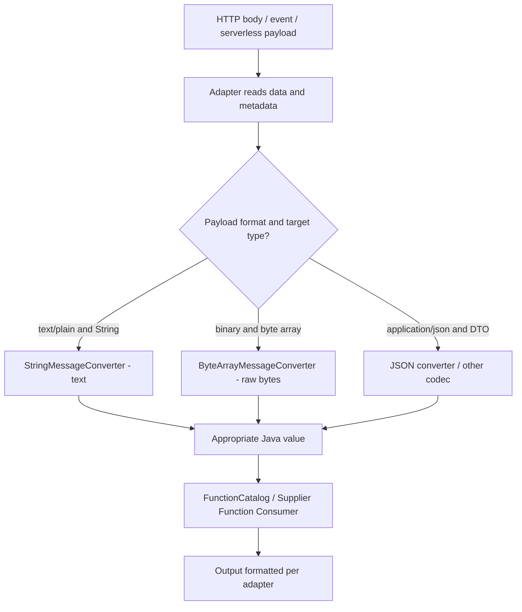

# StringMessageConverter and ByteArrayMessageConverter

Spring Cloud Function encourages separating business logic into Java functions: `Supplier<T>`, `Function<I, O>`, and `Consumer<T>`. The same function can be placed in `FunctionCatalog`, combined with other functions (*composition*), and invoked over HTTP, message broker events, or serverless environments. Yet at the protocol boundary, data usually travels over the wire as strings or byte arrays, not necessarily as the exact Java objects the function expects.

In the **Data Types** chapter, two important converters to distinguish are **`StringMessageConverter`** and **`ByteArrayMessageConverter`**. One targets text; the other targets binary data. Understanding their scope helps avoid charset bugs, mistaking JSON for plain text, corrupting binary files, and declaring wrong function generics.

After this lesson, you will be able to:

1. Explain how converters rely on **target data type**, **current payload type**, and **`contentType`**.
2. Use `StringMessageConverter` for text content and `ByteArrayMessageConverter` for `byte[]`.
3. Distinguish message-converter processing from explicit `String` ↔ `byte[]` conversions written in Java.
4. Write Spring Cloud Function beans that accept/return text and binary data, then look them up via `FunctionCatalog`.
5. Build tests covering UTF-8, invalid bytes, MIME types, message headers, and function composition.

## 1. Context: Payloads Are Not Always DTOs

An HTTP request or event can carry different kinds of content:

| Boundary Payload | Common MIME Type | Java Type Function May Expect | Appropriate Handling |
| --- | --- | --- | --- |
| Text `Hello` | `text/plain; charset=UTF-8` | `String` | Text converter or byte decoding with charset |
| Byte sequence of a file | `application/octet-stream` | `byte[]` | Keep byte data intact |
| JSON object `{"id":"A1"}` | `application/json` | DTO/POJO | JSON converter, not just text/binary converter |
| JSON array `[{"id":"A1"}]` | `application/json` | `List<DTO>` | JSON converter with element generic metadata |
| Bytes containing UTF-8 text | `text/plain` | `String` | Convert bytes → string using charset |
| Non-UTF-8 bytes | `application/octet-stream` | `byte[]` | Do not automatically turn into a string |

`contentType` **describes the payload's format**. The function's generic signature **describes the target Java type**. Both must match the actual data. Knowing the converter name alone is not enough to predict every case: the outcome also depends on the adapter, registered converters, and MIME/charset configuration.

### Conceptual Conversion Flow



This is a **role diagram**, not a fixed internal call flow for every adapter. An adapter may convert data at a different stage or use its own codec. The real path must be verified through integration tests.

## 2. Spring Messaging vs. Spring Cloud Function: Distinguishing API Scopes

Spring Framework has two classes in the `org.springframework.messaging.converter` package:

- `org.springframework.messaging.converter.StringMessageConverter`.
- `org.springframework.messaging.converter.ByteArrayMessageConverter`.

They implement **Spring Messaging**'s `MessageConverter` contract, working with `Message<?>` and `MessageHeaders`. Spring Cloud Function also has message conversion mechanisms and converters serving text/byte types within the framework stack. **Do not equate** a manually instantiated Spring Messaging converter with the default instance used by a particular Spring Cloud Function adapter.

In addition, Spring MVC has the `org.springframework.http.converter.HttpMessageConverter` family for reading/writing **HTTP bodies**, including `StringHttpMessageConverter` and `ByteArrayHttpMessageConverter`. Similar names do not mean they share the same interface or run through the same pipeline.

| Component | Primary Responsibility | Where Commonly Encountered |
| --- | --- | --- |
| Spring Messaging `StringMessageConverter` | Converts text-formatted message payloads to/from `String` | `Message<?>`, message converters, some messaging integrations |
| Spring Messaging `ByteArrayMessageConverter` | Handles `byte[]` message payloads | Messages with binary content |
| Spring MVC `StringHttpMessageConverter` | Reads/writes text over HTTP | Web MVC |
| Spring MVC `ByteArrayHttpMessageConverter` | Reads/writes bytes over HTTP | Web MVC |
| JSON message converter / codec | Parses JSON into DTOs and serializes back | When payload is `application/json` |
| Spring Cloud Function `FunctionCatalog` | Looks up, normalizes, and composes functions | Spring Cloud Function invocation layer |

Accordingly, this lesson uses **Spring Messaging converters** to demonstrate the `MessageConverter` API directly, and then relates them to Spring Cloud Function without assuming every adapter uses the exact same class/instance.

## 3. Common Contract of MessageConverter

Spring Messaging defines two conversion directions:

```java
// Illustrative signatures from MessageConverter:
Object fromMessage(Message<?> message, Class<?> targetClass);
Message<?> toMessage(Object payload, MessageHeaders headers);
```

`fromMessage(...)` takes a message that already has a payload, along with the **target type** the caller needs. `toMessage(...)` turns a Java value into a message with appropriate headers.

In Spring Messaging:

```java
MessageHeaders.CONTENT_TYPE   // Header name: "contentType"
```

MIME values are commonly represented using `org.springframework.util.MimeType`, such as `MimeTypeUtils.TEXT_PLAIN` and `MimeTypeUtils.APPLICATION_OCTET_STREAM`.

A converter may not support a given format/type pair, in which case `fromMessage(...)` or `toMessage(...)` can return `null`; certain data or configuration errors may throw exceptions. Never treat having a header like `text/plain` as proof that all bytes convert cleanly into a string.

### Three Factors That Decide

```text
Actual payload          contentType header          Target Java type
    byte[]        +         text/plain         +        String
     │                          │                         │
     └──────────────────────────┴─────────────────────────┘
                                ↓
                Text converter if supported
                                ↓
                              String
```

Conversely, if the target type is `byte[]` and the content is a binary file, picking a text converter to try decoding it can corrupt the data.

## 4. StringMessageConverter: Converting Text Content

Spring Messaging's `StringMessageConverter` serves `String` payloads. It can convert a message payload from bytes to a string using the right charset when configuration/format supports it; on the outbound side, the implementation can represent `String` as bytes or keep it as text depending on configuration.

### Reading Message<byte[]> into String

The example below uses Java 17+ and Spring Messaging:

```java
import java.nio.charset.StandardCharsets;

import org.springframework.messaging.Message;
import org.springframework.messaging.MessageHeaders;
import org.springframework.messaging.converter.StringMessageConverter;
import org.springframework.messaging.support.MessageBuilder;
import org.springframework.util.MimeTypeUtils;

StringMessageConverter converter = new StringMessageConverter();

byte[] raw = "Hello".getBytes(StandardCharsets.UTF_8);

Message<byte[]> incoming = MessageBuilder.withPayload(raw)
    .setHeader(
        MessageHeaders.CONTENT_TYPE,
        MimeTypeUtils.parseMimeType("text/plain;charset=UTF-8")
    )
    .build();

Object converted = converter.fromMessage(incoming, String.class);

if (!(converted instanceof String text)) {
    throw new IllegalStateException("Cannot convert message to text");
}

System.out.println(text); // Hello
```

In this example:

1. The actual payload is `byte[]` containing the UTF-8 bytes of `"Hello"`.
2. `contentType` describes it as `text/plain` and declares the charset.
3. The `String.class` argument indicates the Java type the code expects.
4. The converter performs the appropriate conversion; downstream logic receives a `String`.

This operation is completely different from parsing a JSON object into a POJO. `StringMessageConverter` should not be treated as a JSON parser.

### Converting String into a Message

```java
import java.util.Map;
import org.springframework.messaging.Message;
import org.springframework.messaging.MessageHeaders;

MessageHeaders headers = new MessageHeaders(Map.of(
    MessageHeaders.CONTENT_TYPE,
    MimeTypeUtils.parseMimeType("text/plain;charset=UTF-8")
));

Message<?> outgoing = converter.toMessage("Hello", headers);

if (outgoing == null) {
    throw new IllegalStateException("Cannot create text message");
}

Object payload = outgoing.getPayload();
System.out.println(payload.getClass().getName());
```

This snippet continues the previous example with the `converter` variable already created. Depending on the configured serialized payload class and how the adapter handles it, the outbound payload may be bytes or another value supported by the converter. **Do not immediately cast `outgoing.getPayload()` to `String` or `byte[]` without checking the implementation's contract.**

### Charset Is a Data Contract, Not a Decorative Detail

Two Java strings can contain identical characters yet produce different byte sequences when encoded with different charsets. For example:

```java
import java.nio.charset.StandardCharsets;
import java.util.Arrays;

String text = "Café";
byte[] utf8 = text.getBytes(StandardCharsets.UTF_8);
String restored = new String(utf8, StandardCharsets.UTF_8);

System.out.println(text.equals(restored)); // true
System.out.println(Arrays.toString(utf8));
```

If a producer uses UTF-8 while a consumer decodes with another charset, characters can become corrupted. When no charset is present in the MIME type, check the converter's and library version's default policy; for cross-system communication, **declaring the charset or explicitly standardizing on UTF-8** is much easier to control.

For invalid UTF-8 bytes, decoding APIs may substitute replacement characters under default policies. If text data is required to be valid, use a decoder configured to report errors (see Section 10).

## 5. ByteArrayMessageConverter: Preserving Byte Data

Spring Messaging's `ByteArrayMessageConverter` is meant for `byte[]` payloads, typically paired with MIME `application/octet-stream`. Its goal is to pass/preserve the exact **byte sequence**, not to guess whether the content is an image, JSON, PDF, or text.

### Reading a Binary Message

```java
import java.util.Arrays;

import org.springframework.messaging.Message;
import org.springframework.messaging.MessageHeaders;
import org.springframework.messaging.converter.ByteArrayMessageConverter;
import org.springframework.messaging.support.MessageBuilder;
import org.springframework.util.MimeTypeUtils;

ByteArrayMessageConverter converter = new ByteArrayMessageConverter();

byte[] data = new byte[] {0, 1, 2, 3, (byte) 255};

Message<byte[]> incoming = MessageBuilder.withPayload(data)
    .setHeader(
        MessageHeaders.CONTENT_TYPE,
        MimeTypeUtils.APPLICATION_OCTET_STREAM
    )
    .build();

Object converted = converter.fromMessage(incoming, byte[].class);

if (!(converted instanceof byte[] bytes)) {
    throw new IllegalStateException("Cannot read binary payload");
}

System.out.println(Arrays.equals(data, bytes)); // true
```

This converter **does not parse** bytes into a POJO and **does not turn** binary data into UTF-8 text. If business logic needs to understand a file format, you must use a parser/decoder for that format. For example, images need an image library; ZIP files need a ZIP reader; JSON needs a JSON converter/mapper.

### Outbound Direction

```java
import java.util.Map;
import org.springframework.messaging.Message;
import org.springframework.messaging.MessageHeaders;

MessageHeaders headers = new MessageHeaders(Map.of(
    MessageHeaders.CONTENT_TYPE,
    MimeTypeUtils.APPLICATION_OCTET_STREAM
));

Message<?> output = converter.toMessage(data, headers);
if (output == null || !(output.getPayload() instanceof byte[] sent)) {
    throw new IllegalStateException("Expected byte payload");
}

System.out.println(Arrays.equals(data, sent)); // true
```

This snippet continues the context where `converter` and `data` already exist. The result confirms the **contents** remain intact. Do not rely on whether the byte array is copied or shares the same reference: if you need to guard against accidental mutation, copy defensively at the business boundary with `Arrays.copyOf(...)`.

### Direct Comparison of the Two Converters

| Aspect | StringMessageConverter | ByteArrayMessageConverter |
| --- | --- | --- |
| Common target Java type | `String` | `byte[]` |
| Common MIME type | `text/plain` | `application/octet-stream` |
| Interprets charset? | Yes, when converting bytes ↔ text | Not its primary responsibility |
| Parses JSON objects? | Should not be treated as a JSON parser | No |
| Keeps binary bytes intact? | Unsuitable for arbitrary bytes | Suitable |
| Needs to know business DTOs? | No, when the goal is text | No, when the goal is raw bytes |
| When is another converter needed? | When the goal is DTO/JSON or structured formats | When files/JSON must be parsed into objects |

## 6. Writing Spring Cloud Functions for Text and Binary Data

Instead of letting business beans depend directly on Spring Messaging converters, declare explicit types and let the adapter handle payload conversion at the boundary.

Example Spring Boot/Spring Cloud Function configuration using Java 17:

```java
package demo.function;

import java.nio.charset.StandardCharsets;
import java.util.Arrays;
import java.util.Locale;
import java.util.function.Consumer;
import java.util.function.Function;
import java.util.function.Supplier;

import org.springframework.context.annotation.Bean;
import org.springframework.context.annotation.Configuration;

@Configuration
public class PayloadFunctions {

    @Bean
    public Function<String, String> normalizeText() {
        return text -> text.strip().toUpperCase(Locale.ROOT);
    }

    @Bean
    public Function<byte[], byte[]> copyBinary() {
        return input -> Arrays.copyOf(input, input.length);
    }

    @Bean
    public Function<String, byte[]> encodeUtf8() {
        return text -> text.getBytes(StandardCharsets.UTF_8);
    }

    @Bean
    public Function<byte[], String> decodeUtf8() {
        return bytes -> new String(bytes, StandardCharsets.UTF_8);
    }

    @Bean
    public Supplier<String> readiness() {
        return () -> "READY";
    }

    @Bean
    public Consumer<byte[]> auditBytes() {
        return bytes -> System.out.println(
            "Received binary payload of length " + bytes.length
        );
    }
}
```

These beans contain pure Java logic following clear contracts:

| Bean | Contract | Purpose |
| --- | --- | --- |
| `normalizeText` | `Function<String, String>` | Normalize text |
| `copyBinary` | `Function<byte[], byte[]>` | Create a byte copy |
| `encodeUtf8` | `Function<String, byte[]>` | Encode text as UTF-8 |
| `decodeUtf8` | `Function<byte[], String>` | Decode UTF-8 bytes to string |
| `readiness` | `Supplier<String>` | Supply text with no input |
| `auditBytes` | `Consumer<byte[]>` | Receive bytes with no business return value |

`encodeUtf8` and `decodeUtf8` **perform type conversion explicitly in code**, rather than relying on `ByteArrayMessageConverter` to decide charsets. `normalizeText` likewise does not need to know whether data came from HTTP or a broker; as long as the adapter turns text into a `String`, the logic is reusable.

Note that `decodeUtf8` demonstrates common decoding without strict UTF-8 validation. For untrusted data, see Section 10 to choose an appropriate error policy.

## 7. HTTP Examples: How MIME Type Affects Body Reading

Once the application has the Spring Cloud Function Web adapter and exposes the corresponding beans, you can try:

**Sending text:**

```bash
curl -X POST http://localhost:8080/normalizeText \
  -H 'Content-Type: text/plain; charset=UTF-8' \
  --data-binary '  hello function  '
```

The logical return value is `HELLO FUNCTION`. Response body and headers depend on the Web adapter and result serialization. Here HTTP `Content-Type` describes the **request body**, while `Accept` (if sent) describes the response format the client expects.

**Sending bytes:**

```bash
printf 'binary bytes' | curl -X POST \
  http://localhost:8080/copyBinary \
  -H 'Content-Type: application/octet-stream' \
  --data-binary @-
```

The sent payload consists of the bytes of that sample text, yet `copyBinary` still handles them as **raw bytes** without decoding. This example uses `printf` in a shell that supports it; on Windows PowerShell, pass raw bytes using the corresponding tool syntax.

Both curl commands only make sense if the HTTP adapter is installed and running with the corresponding endpoints. **Do not claim that the Spring Cloud Function Web adapter must use Spring Messaging's `StringMessageConverter` or `ByteArrayMessageConverter` instances in these two HTTP examples.** It may use its own conversion/codec mechanism.

### Same Bytes, Different Declared MIME Type

If you send ZIP bytes with `Content-Type: text/plain`, a text converter may be selected and attempt to interpret those bytes as characters. That will not turn a ZIP file into valid text. Conversely, sending a JSON string with `application/octet-stream` to `Function<SomeDto, ...>` may not qualify the JSON converter to run.

Always keep aligned:

```text
Actual content ⇄ contentType ⇄ function's Java types
```

A mismatch in any one of the three can cause conversion to be skipped, unsupported, or fail.

## 8. Spring Messaging Message<T>: Payload and Headers

A function can accept and preserve message metadata when processing events:

```java
import java.util.Arrays;
import java.util.function.Function;

import org.springframework.context.annotation.Bean;
import org.springframework.messaging.Message;
import org.springframework.messaging.support.MessageBuilder;

@Bean
public Function<Message<byte[]>, Message<byte[]>> preserveBinary() {
    return incoming -> {
        byte[] copy = Arrays.copyOf(
            incoming.getPayload(),
            incoming.getPayload().length
        );

        MessageBuilder<byte[]> builder =
            MessageBuilder.withPayload(copy);

        Object correlationId =
            incoming.getHeaders().get("correlationId");
        if (correlationId != null) {
            builder.setHeader("correlationId", correlationId);
        }

        return builder.build();
    };
}
```

Place this bean in a Spring configuration class; this is an illustrative snippet independent from `PayloadFunctions` in Section 6. The `Function<Message<byte[]>, Message<byte[]>>` contract differs from `Function<byte[], byte[]>`: in the first case, the logic receives the `Message` wrapper, enabling header access.

Do not automatically copy every header if the output changes format. For example, a function converting `byte[]` into a JSON object while keeping `contentType=application/octet-stream` can cause a downstream consumer to choose the wrong converter. In `preserveBinary`, the payload remains bytes so the adapter can set or keep an appropriate MIME type, though you should check header policies on the real broker path.

### Correlation Headers Are Not Content Types

`correlationId` may be used to match requests and responses or trace events; `contentType` describes the payload format. They serve different purposes. Spring Cloud Function lets you reuse the same function over HTTP and messaging, yet each adapter may normalize or rename headers. Do not assume every header from a broker appears verbatim at an HTTP endpoint.

## 9. FunctionCatalog, Generics, and Composition

Spring Cloud Function looks up functions by name via `FunctionCatalog`. With the beans in Section 6, you can invoke them directly in Java:

```java
import java.util.function.Function;
import org.springframework.cloud.function.context.FunctionCatalog;

// In a test/method with an injected FunctionCatalog catalog.
Function<String, String> function = catalog.lookup("normalizeText");

String result = function.apply("  hello  ");
System.out.println(result); // HELLO
```

In this call, the input is already a `String`; thus it verifies lookup and logic, **not** whether a `byte[]` message payload is properly converted by a converter.

### Composition Does Not Mean Automatic Conversion at Every Junction

You can select a chain:

```yaml
spring:
  cloud:
    function:
      definition: decodeUtf8|normalizeText|encodeUtf8
```

In terms of Java types:

```text
byte[]
  │
  ▼
decodeUtf8 : Function<byte[], String>
  │ String
  ▼
normalizeText : Function<String, String>
  │ String
  ▼
encodeUtf8 : Function<String, byte[]>
  │
  ▼
byte[]
```

Here **the `decodeUtf8` and `encodeUtf8` functions themselves perform the Java type changes**. `ByteArrayMessageConverter` does not automatically turn bytes into text simply because the next function in the composition takes `String`. Output/input contracts at each link must match, or an explicit supported conversion step must be added.

Also, composition outputs may be formatted by the adapter according to its own rules. Do not conclude that a `byte[]` output defaults to `application/octet-stream` in every environment; check actual headers and converters.

## 10. Controlling Encoding Errors and Binary Data

`byte[]` carries no charset metadata. Forcing a byte sequence into a string can lose data if the bytes do not represent valid text. In Java, `new String(bytes, UTF_8)` may replace malformed byte sequences with replacement characters instead of throwing an error.

### Strict UTF-8 Decoding When Needed

```java
import java.nio.ByteBuffer;
import java.nio.charset.CharacterCodingException;
import java.nio.charset.CodingErrorAction;
import java.nio.charset.StandardCharsets;

String decodeStrictUtf8(byte[] bytes)
        throws CharacterCodingException {
    return StandardCharsets.UTF_8.newDecoder()
        .onMalformedInput(CodingErrorAction.REPORT)
        .onUnmappableCharacter(CodingErrorAction.REPORT)
        .decode(ByteBuffer.wrap(bytes))
        .toString();
}
```

This is a utility method placed in a Java class or test. It throws `CharacterCodingException` if the input is not valid UTF-8, preventing silent data alteration. How errors, dead-lettering, or retries are handled depends on business rules and the adapter.

### Base64 Is Not Charset Conversion

If a protocol requires representing binary data inside a JSON string field, both sides can agree on Base64:

```java
import java.util.Base64;
import java.util.Arrays;

byte[] binary = new byte[] {0, 1, 2, (byte) 255};
String base64 = Base64.getEncoder().encodeToString(binary);
byte[] decoded = Base64.getDecoder().decode(base64);

System.out.println(base64); // AAEC/w==
System.out.println(Arrays.equals(binary, decoded)); // true
```

Base64 merely encodes bytes into characters according to a standard scheme; it does not turn bytes into meaningful UTF-8 prose or a POJO. When transferring raw files, `application/octet-stream` with `byte[]` is usually more appropriate than calling `new String(binary, UTF_8)`.

### Large Payloads and Memory Cost

A `Function<byte[], byte[]>` typically holds the entire payload in memory. Copying the array temporarily doubles memory usage proportional to payload size. For large files or long streams, consider appropriate streaming/reactive adapters; **`byte[]` does not imply streaming**. Using `Flux<byte[]>` or `InputStream` is a separate contract and is not activated merely by using MIME type octet-stream.

## 11. When Do You Need a JSON Converter Instead of These Two?

HTTP sends:

```json
{"sku":"BOOK","quantity":2}
```

A function declared as `Function<OrderRequest, OrderReceipt>` needs a converter capable of parsing JSON into the target object. `StringMessageConverter` can read a payload into a `String` under matching conditions, and `ByteArrayMessageConverter` can preserve bytes; **neither creates DTOs from JSON syntax**.

| Business Goal | Suggested Function Contract | Conversion Component to Consider |
| --- | --- | --- |
| Normalize text | `Function<String, String>` | Text converter for network payloads |
| Store/forward binary files | `Function<byte[], byte[]>` | Byte converter or adapter's binary path |
| Parse JSON to calculate an order | `Function<OrderRequest, OrderReceipt>` | JSON converter + DTO metadata |
| Process a JSON array of objects | `Function<List<OrderRequest>, List<OrderReceipt>>` | JSON converter supporting element generics |
| Convert text bytes to string with explicit rules | `Function<byte[], String>` | Explicit decode/charset code, optionally converter at boundary |

For `List<T>`, element types must be preserved. If only `List.class` is published, a JSON mapper may produce `Map` elements instead of the expected DTOs. Generic metadata from a `@Bean` method or `FunctionRegistration.type(...)` tells the framework the expected Java types, while the adapter/converter must also support that structure.

## 12. Diagnosing Errors by Symptom

| Symptom | What to Check | Remediation |
| --- | --- | --- |
| Garbled accented/non-ASCII characters | Producer/consumer charset, `contentType` | Standardize on UTF-8, inspect actual bytes |
| `byte[].toString()` gives strange output | Printing array identity instead of decoding | Use `new String(bytes, charset)` only for text bytes |
| Binary payload corrupted after passing through text | Non-text bytes or replacement characters | Keep `byte[]`, never coerce to text |
| Converter returns `null` | Unsupported MIME type or target type | Check headers, converter registration, and target class |
| HTTP text works, event fails | Two adapters differ in body/header passing | Check content type and binder in event environment |
| JSON object doesn't become POJO | Text/byte converter used instead of JSON, missing generics | Select JSON converter and publish concrete DTO |
| `ClassCastException` reading event | Payload is still `byte[]`/`String` while function casts to DTO | Check boundary conversion and type metadata |
| Large files cause memory pressure | Entire byte array loaded/copied | Consider streaming and size limits |
| Composition fails at junction | Previous function returns type incompatible with next input | Fix generics or add an explicit conversion step |
| `Consumer` receives data but emits no output | `Consumer<T>` has no return value | Use `Function<I,O>` if business output is needed |

### Practical Investigation Sequence

1. **Inspect the function contract:** `String`, `byte[]`, `Message<T>`, or DTO? Are full generics preserved?
2. **Inspect the actual bytes:** did the sender transmit UTF-8 text, JSON, or binary? Never guess from variable names.
3. **Inspect MIME type and charset:** do `text/plain`, `application/octet-stream`, and `application/json` match the content?
4. **Verify converter/adapter:** which converter is being invoked, and does it support both source and target?
5. **Test input/output at Java and boundary levels:** unit tests with pre-built objects and integration tests with real payloads.
6. **Check composition and headers:** do types at junctions match, and is outbound metadata still valid?

## 13. Standalone Test Examples for Both Converters

Here are two JUnit 5 tests using Spring Messaging directly to demonstrate how each converter processes specific messages. They do not require starting the HTTP adapter.

```java
import static org.junit.jupiter.api.Assertions.assertArrayEquals;
import static org.junit.jupiter.api.Assertions.assertEquals;

import java.nio.charset.StandardCharsets;

import org.junit.jupiter.api.Test;
import org.springframework.messaging.Message;
import org.springframework.messaging.MessageHeaders;
import org.springframework.messaging.converter.ByteArrayMessageConverter;
import org.springframework.messaging.converter.StringMessageConverter;
import org.springframework.messaging.support.MessageBuilder;
import org.springframework.util.MimeTypeUtils;

class MessageConversionTest {

    @Test
    void readsUtf8TextMessage() {
        Message<byte[]> msg = MessageBuilder
            .withPayload("Hello".getBytes(StandardCharsets.UTF_8))
            .setHeader(
                MessageHeaders.CONTENT_TYPE,
                MimeTypeUtils.parseMimeType("text/plain;charset=UTF-8")
            )
            .build();

        Object output = new StringMessageConverter()
            .fromMessage(msg, String.class);

        assertEquals("Hello", output);
    }

    @Test
    void preservesBinaryPayload() {
        byte[] bytes = {0, 1, 2, (byte) 255};
        Message<byte[]> msg = MessageBuilder.withPayload(bytes)
            .setHeader(
                MessageHeaders.CONTENT_TYPE,
                MimeTypeUtils.APPLICATION_OCTET_STREAM
            )
            .build();

        Object output = new ByteArrayMessageConverter()
            .fromMessage(msg, byte[].class);

        assertArrayEquals(bytes, (byte[]) output);
    }
}
```

Both tests require appropriate JUnit 5 and Spring Messaging dependencies. Testing through `FunctionCatalog` can also be added to ensure the bean is looked up by the right name:

```java
// In a test with FunctionCatalog catalog:
Function<String, String> normalize = catalog.lookup("normalizeText");
assertEquals("HELLO", normalize.apply("  hello  "));
```

This catalog test uses `java.util.function.Function`, JUnit assertions, and a context containing the `normalizeText` bean. It **only confirms Java logic and catalog lookup**, not that the Web adapter or binder converted bytes to text. Add an HTTP `text/plain` test or a message test with the corresponding binder when deploying in practice.

## 14. Practice Exercises

**Exercise 1 — Choose a converter.** A message has a `byte[]` payload containing UTF-8 text `"Hello"` and `contentType=text/plain;charset=UTF-8`. Target is `String`. Which converter fits?

*Answer:* `StringMessageConverter` or an equivalent text path supported by the adapter; the charset must be declared properly. `ByteArrayMessageConverter` is not a tool for interpreting text.

**Exercise 2 — Why not JSON?** A client sends `{"sku":"BOOK"}` with `Content-Type: application/json`, and the target is a DTO. Can `StringMessageConverter` alone produce the DTO?

*Answer:* No. A text converter can provide a `String`, but it does not parse a JSON object into a DTO. A JSON converter/mapper and target Java type metadata are required.

**Exercise 3 — What do bytes mean?** A `Function<byte[], byte[]>` receives a ZIP file with `contentType=application/octet-stream`. Should it automatically call `new String(bytes, UTF_8)` before processing?

*Answer:* No. ZIP bytes are binary data; decoding them as text can alter and corrupt the contents. Keep `byte[]` or use a ZIP parser.

**Exercise 4 — Choose function types.** You want to accept text, uppercase it, and return UTF-8 bytes. Write the two functions and the composition name.

*Suggested answer:* `Function<String, String> normalizeText` and `Function<String, byte[]> encodeUtf8`; composition `normalizeText|encodeUtf8` with `String` input and `byte[]` output.

**Exercise 5 — Fix garbled accented characters.** A producer sends UTF-8, yet a consumer reads using a different charset. Where should you check?

*Answer:* The actual bytes produced by the sender, the MIME `charset` in `contentType`, the converter's default configuration, and how the adapter handles headers. Standardize on UTF-8 and test with accented text.

**Exercise 6 — When is Message<T> needed?** A consumer needs to read `correlationId` and a `byte[]` payload from an event. Which signature fits?

*Answer:* `Consumer<Message<byte[]>>` if the adapter supports message wrappers. The function reads `message.getHeaders()` and `message.getPayload()`; use `Consumer<byte[]>` when headers are not needed.

**Exercise 7 — What level is tested?** A test `catalog.lookup("copyBinary").apply(byte[])` passes. Does that prove the HTTP endpoint reads `octet-stream` bodies properly?

*Answer:* No. The Java test already supplied a byte array. You must test through the Web adapter or binder with a real request/event and MIME `application/octet-stream`.

## Takeaways

- **`StringMessageConverter` serves `String` text values**, typically paired with `text/plain` and a charset; it does not parse JSON objects or binary files.
- **`ByteArrayMessageConverter` serves `byte[]`**, typically paired with `application/octet-stream`; preserving bytes does not mean decoding or understanding the content.
- **`contentType`, actual payload, and target type must align.** A MIME type does not construct a DTO or repair malformed bytes.
- **Spring Messaging `MessageConverter` differs from Spring MVC `HttpMessageConverter`.** Depending on the Spring Cloud Function adapter, the actual integration point may differ.
- **Generic types on `Supplier`/`Function`/`Consumer` provide the Java contract**, while the adapter/converter determines how payloads cross the protocol.
- **Composition requires matching Java types at every junction.** `String` ↔ `byte[]` conversions can be written explicitly as `encodeUtf8` and `decodeUtf8` functions.
- **Test both direct converters and adapters** to verify a function truly works across HTTP, events, and serverless.

**References:** [Spring Cloud Function Reference](https://docs.spring.io/spring-cloud-function/reference/) and [Spring Framework — Messaging](https://docs.spring.io/spring-framework/reference/integration.html). Exact behavior, default converters, and MIME handling per adapter should be checked against the version in use.
