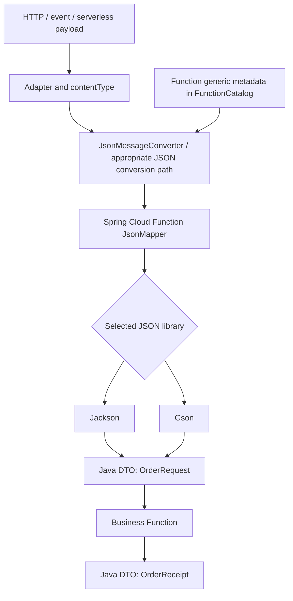

# JsonMapper, Jackson, and Gson Options Across Versions

**Spring Cloud Function** lets you build business logic as protocol-independent `Supplier<T>`, `Function<I, O>`, and `Consumer<T>` functions. The same function can be registered in `FunctionCatalog`, composed with other functions, and invoked over HTTP, events, or serverless environments. To turn JSON from these protocols into Java objects, the framework needs a mechanism for reading and writing JSON. Two common libraries are **Jackson** and **Gson**; Spring Cloud Function provides an abstraction named **`JsonMapper`** to work with them.

This lesson belongs to the **Data Types** chapter. The challenge is not only choosing a JSON library: **class names, packages, dependencies, default configurations, and customization APIs can change when upgrading Spring Boot, Spring Cloud Function, or Jackson**. In particular, Spring Boot 4 switches its default to Jackson 3, while many Spring Boot 3/Jackson 2 examples still appear online. Copying an import or configuration snippet from a different version's documentation can prevent compilation, pick an unintended mapper, or serialize payloads differently from your API contract.

After studying this lesson, you will be able to:

- Distinguish Spring Cloud Function's `JsonMapper` from Jackson 3's `JsonMapper`.
- Explain Jackson/Gson selection rules and the `spring.cloud.function.preferred-json-mapper` option.
- Write a `Function<Request, Response>` bean with explicit generics that converts JSON through an appropriate adapter.
- Compare Jackson 2, Jackson 3, and Gson code without mixing packages.
- Read auto-configuration differences between Spring Boot 3 and Spring Boot 4 accurately.
- Inspect the actual mapper in an application and build a checklist for version upgrades.

## 1. Three Layers to Distinguish

To avoid conceptual confusion, separate three layers:

| Layer | Component | Responsibility |
| --- | --- | --- |
| Business logic | `Function<OrderRequest, OrderReceipt>` | Handles only Java objects and returns results |
| Spring Cloud Function | `FunctionCatalog`, `JsonMessageConverter`, `org.springframework.cloud.function.json.JsonMapper` | Normalizes invocations and assists JSON ↔ Java conversion when needed |
| JSON library | Jackson 2, Jackson 3, or Gson | Provides the actual parser, serializer, and mapping rules |

Conceptual flow:



This is a role diagram, **not a fixed internal call sequence**. Some HTTP or serverless adapters have their own codecs/converters, and not every catalog invocation requires conversion. If you already call `function.apply(new OrderRequest(...))`, the DTO already exists and no JSON parser is needed at that step.

### Two Pieces of Information That Cannot Replace Each Other

- `contentType=application/json` states that **the payload is represented as JSON**.
- `Function<OrderRequest, OrderReceipt>` states **which DTO Java expects**.

A JSON header does not identify the `OrderRequest` class by itself; conversely, target type `OrderRequest` does not turn arbitrary strings or bytes into valid JSON. Converters and mappers must support both the format and the mapping.

## 2. Two Classes Named JsonMapper: Import Collision Risk

The name **`JsonMapper`** can refer to two different APIs:

| Fully Qualified Name | Ecosystem | Purpose |
| --- | --- | --- |
| `org.springframework.cloud.function.json.JsonMapper` | Spring Cloud Function | JSON read/write abstraction used by the framework; injectable as a bean in suitable configurations |
| `tools.jackson.databind.json.JsonMapper` | Jackson 3 (common in Spring Boot 4) | Jackson 3 library JSON mapper, with builder and Jackson APIs |
| `com.fasterxml.jackson.databind.ObjectMapper` | Jackson 2 (common in Spring Boot 3) | General-purpose data mapper for reading/writing data, including JSON |
| `com.google.gson.Gson` | Gson | Reads/writes JSON using the Gson API |

**The first two JsonMapper classes are not the same class and are not interchangeable.** When you see:

```java
import org.springframework.cloud.function.json.JsonMapper;
```

that is Spring Cloud Function's API. By contrast:

```java
import tools.jackson.databind.json.JsonMapper;
```

is Jackson 3's API. If one source file needs both, avoid conflicting short-name imports; use **fully qualified class names** where needed.

That is why you must check **the actual dependency versions** before copying any JSON mapper example.

## 3. Rules for Selecting Jackson or Gson in Spring Cloud Function

Spring Cloud Function's 4.3 and 5.0 documentation, in the **“Note on JSON options”** section, describes:

1. If only a compatible Jackson library is on the classpath, the framework uses the Jackson-based mapper.
2. If only a compatible Gson library is present, the framework uses Gson.
3. When **both Jackson and Gson** are present, that section documents **Gson as the default choice**, unless you specify `spring.cloud.function.preferred-json-mapper` as `jackson` or `gson`.

Important note: some other descriptions of `JsonMessageConverter` use the phrase “Jackson (DEFAULT)”. Therefore, **do not deduce runtime selection solely from a single introductory sentence or just because the project uses Spring Boot**. Configure it explicitly whenever both libraries are on the classpath and verify the actual bean after application startup.

### Choosing Jackson Explicitly

```yaml
spring:
  cloud:
    function:
      preferred-json-mapper: jackson
```

### Choosing Gson Explicitly

```yaml
spring:
  cloud:
    function:
      preferred-json-mapper: gson
```

This is a **Spring Cloud Function property**, not equivalent to Spring Boot properties starting with `spring.jackson.*`. Setting `jackson` does not automatically add Jackson dependencies to the project; you need libraries and integrations compatible with your Spring Cloud Function version.

| Classpath and Configuration | Intent | What to Verify |
| --- | --- | --- |
| Only compatible Jackson present | JSON via Jackson | `JsonMapper` bean and Jackson modules present |
| Only compatible Gson present | JSON via Gson | Gson present and mapper registered |
| Both present, unspecified | Follows version default rules | Don't guess; check docs/runtime |
| Both present, `preferred-json-mapper: jackson` | Prefer Jackson | Application actually selects Jackson mapper |
| Both present, `preferred-json-mapper: gson` | Prefer Gson | Application actually selects Gson mapper |
| Configured for Jackson, dependency missing | Precondition unmet | Check dependencies and startup messages |

Library choice can affect handling of records, dates/times, enums, null values, property names, numeric types, and JSON polymorphism. A system with a stable schema must verify compatibility of both **inputs** and **outputs** when changing mappers.

## 4. Version Orientation Table: Spring Cloud Function, Spring Boot, and Jackson

This table summarizes **common API and default differences**, not a guarantee that arbitrary patch versions can be mixed freely. Before deploying, check the official compatibility matrix for your project's Spring Boot/Spring Cloud release train.

| Environment | Typical JSON API | Things to Watch Out For |
| --- | --- | --- |
| Spring Cloud Function 4.x with compatible Spring Boot 3.x | Spring Cloud Function `JsonMapper`; Jackson 2 `com.fasterxml.jackson.*` or Gson | Select mapper via SCF property; Boot 3 Jackson 2 customizers do not automatically control every SCF instance |
| Spring Cloud Function 5.x with compatible Spring Boot 4.x | Spring Cloud Function `JsonMapper`; Spring Boot 4 prefers Jackson 3 `tools.jackson.*`, with a Jackson 2 compatibility path | Check exact minor/patch versions, dependencies, and the mapper SCF picks; do not mix Jackson 2/3 |
| Using Gson directly in any compatible setup | `com.google.gson.Gson` | Gson's API differs from Jackson; check version support for Java records, type adapters, and null serialization |
| Applications containing both Jackson and Gson | Multiple libraries present simultaneously | Explicitly declare `preferred-json-mapper` and test conversion end-to-end |

**Spring Boot 3:** typically uses Jackson 2, class `com.fasterxml.jackson.databind.ObjectMapper`. **Spring Boot 4:** defaults to Jackson 3, moving many packages and artifacts to `tools.jackson.*`. Spring Boot 4 includes a **Jackson 2 compatibility** option to assist migration, though documentation marks that path as temporary/deprecated.

Two pitfalls to avoid:

- **Do not extrapolate “Spring Boot 4 uses Jackson 3” into “any version of every Spring Cloud Function adapter automatically supports all Jackson 3 APIs.”** Always use a compatible version pair.
- **Do not extrapolate “Spring Cloud Function 5.x” into “freely usable with Spring Boot 3.x.”** Follow official dependency management / release trains.

### Why Distinguish “Boot Preference” from “Cloud Function Preference”?

In Spring Boot 4, auto-configuration can create a Jackson 3 `tools.jackson.databind.json.JsonMapper` bean and treat Jackson 3 as Boot's default. Meanwhile, `spring.cloud.function.preferred-json-mapper` belongs to Spring Cloud Function's own JSON mapper selection mechanism.

Therefore, **“Boot defaults to Jackson 3” does not guarantee “SCF selected that exact Jackson 3 instance.”** When an application has Gson, Jackson 2, and Jackson 3 together, inspect the runtime bean/class and test JSON conversion through the actual adapter.

## 5. End-to-End Business Example: Keeping the Function Independent of the JSON Mapper

Let's start with a simple function using Java 17 or later:

```java
package demo.function;

import java.util.function.Function;

import org.springframework.context.annotation.Bean;
import org.springframework.context.annotation.Configuration;

@Configuration
public class ReceiptFunctions {

    public record ReceiptRequest(String orderId, int quantity) {}

    public record ReceiptResult(
        String orderId,
        long amountVnd,
        String status
    ) {}

    @Bean
    public Function<ReceiptRequest, ReceiptResult> createReceipt() {
        return request -> {
            if (request == null ||
                request.orderId() == null ||
                request.orderId().isBlank() ||
                request.quantity() <= 0) {
                throw new IllegalArgumentException(
                    "A valid orderId and positive quantity are required"
                );
            }

            long amount = Math.multiplyExact(
                request.quantity(),
                50_000L
            );

            return new ReceiptResult(
                request.orderId(),
                amount,
                "ACCEPTED"
            );
        };
    }
}
```

This function imports neither Jackson, Gson, nor `JsonMapper`. It only accepts `ReceiptRequest` and returns `ReceiptResult`, staying true to Spring Cloud Function's protocol-independent business logic reuse.

Illustrative input JSON:

```json
{"orderId":"ORD-101","quantity":2}
```

Expected output JSON when the adapter and mapper support records:

```json
{"orderId":"ORD-101","amountVnd":100000,"status":"ACCEPTED"}
```

The `Function<ReceiptRequest, ReceiptResult>` signature supplies the target Java types. `contentType=application/json` supplies payload format info. The mapper converts JSON into the DTO when invoked by the adapter/converter; **validation and calculations** remain inside the business function.

### Invoking over HTTP

When the application has the Spring Cloud Function Web adapter and the `createReceipt` endpoint is exposed:

```bash
curl -X POST http://localhost:8080/createReceipt \
  -H 'Content-Type: application/json' \
  -H 'Accept: application/json' \
  -d '{"orderId":"ORD-101","quantity":2}'
```

The result can be the `ReceiptResult` JSON above, given the right adapter/codec and configuration. **Having a `@Bean Function` alone does not create an HTTP endpoint**; the corresponding adapter must be installed and initialized.

Switching mappers between Jackson ↔ Gson **should not require changing `createReceipt` logic**, though mapping configuration or DTO annotations may need adjustment if the two mappers handle features differently.

## 6. Injecting Spring Cloud Function's JsonMapper When Manual JSON Handling Is Needed

Spring Cloud Function documentation describes `org.springframework.cloud.function.json.JsonMapper` as an injectable bean. Some branches expose `fromJson(Object, Type)` and `toJson(Object)` to read/write JSON; the code below uses those APIs. Check the Javadoc of the exact `spring-cloud-function-context` artifact you use when upgrading major versions.

```java
package demo.function;

import java.nio.charset.StandardCharsets;
import java.util.Objects;

import org.springframework.cloud.function.json.JsonMapper;
import org.springframework.stereotype.Component;

@Component
public class ReceiptJsonCodec {

    private final JsonMapper jsonMapper;

    public ReceiptJsonCodec(JsonMapper jsonMapper) {
        this.jsonMapper = Objects.requireNonNull(jsonMapper);
    }

    public ReceiptFunctions.ReceiptRequest parse(String json) {
        return jsonMapper.fromJson(
            json,
            ReceiptFunctions.ReceiptRequest.class
        );
    }

    public String serialize(ReceiptFunctions.ReceiptResult result) {
        byte[] jsonBytes = jsonMapper.toJson(result);
        return new String(jsonBytes, StandardCharsets.UTF_8);
    }
}
```

This is **an explicit JSON-processing service**, not a required step for every Spring Cloud Function. If the adapter already deserialized `ReceiptRequest` before invoking `createReceipt`, do not parse JSON again inside the function.

`toJson(...)` returns bytes in the illustrated SCF API; `new String(..., UTF_8)` is appropriate when the output is genuinely UTF-8 JSON. When working with bytes produced by another library, check the actual encoding rather than assuming.

To avoid confusing classes:

```java
// Spring Cloud Function:
org.springframework.cloud.function.json.JsonMapper scfMapper;

// Jackson 3:
tools.jackson.databind.json.JsonMapper jackson3Mapper;

// Jackson 2:
com.fasterxml.jackson.databind.ObjectMapper jackson2Mapper;

// Gson:
com.google.gson.Gson gson;
```

This snippet only compares type names in **an environment containing the corresponding dependencies**; it does not mean you should add all three libraries to a real application.

## 7. Direct Example with Jackson 2: Spring Boot 3.x

In projects using **Jackson 2**, the standard namespace is `com.fasterxml.jackson.*`. The example below uses the Jackson 2 API inside a method/test that handles Jackson's checked exceptions:

```java
import com.fasterxml.jackson.databind.ObjectMapper;

ObjectMapper mapper = new ObjectMapper();

String json = """
    {"orderId":"ORD-101","quantity":2}
    """;

ReceiptFunctions.ReceiptRequest request = mapper.readValue(
    json,
    ReceiptFunctions.ReceiptRequest.class
);

ReceiptFunctions.ReceiptResult result =
    new ReceiptFunctions.ReceiptResult(
        request.orderId(), 100_000L, "ACCEPTED"
    );

String output = mapper.writeValueAsString(result);
System.out.println(output);
```

In a Spring Boot 3 application, inject the Boot-configured `ObjectMapper` instead of calling `new ObjectMapper()` manually, especially when you need date/time modules, naming strategies, or custom serializers.

A manually created `ObjectMapper` **does not automatically share the configuration of the mapper used by Spring Boot or Spring Cloud Function**. A test calling only a self-created instance does not prove HTTP/messaging paths use that same instance.

### Common Jackson 2 Configuration in Boot 3

Example setting property naming when applicable auto-configuration is active:

```yaml
spring:
  jackson:
    property-naming-strategy: SNAKE_CASE
```

When applied to the relevant mapper, the Java field `orderId` may appear in JSON as `order_id`. However, do not assume a `spring.jackson.*` property **necessarily** affects every `JsonMapper` that Spring Cloud Function constructs on its own. Verify the actual injected bean or converter-used mapper.

## 8. Direct Example with Jackson 3: Spring Boot 4.x

**Jackson 3** moves most packages from `com.fasterxml.jackson.*` to `tools.jackson.*`. For JSON, the representative API is:

```java
import tools.jackson.databind.json.JsonMapper;

JsonMapper mapper = JsonMapper.builder().build();

String json = """
    {"orderId":"ORD-101","quantity":2}
    """;

ReceiptFunctions.ReceiptRequest request = mapper.readValue(
    json,
    ReceiptFunctions.ReceiptRequest.class
);

String output = mapper.writeValueAsString(
    new ReceiptFunctions.ReceiptResult(
        request.orderId(), 100_000L, "ACCEPTED"
    )
);
```

This is a **Jackson 3 API sample**; it only compiles when the corresponding Jackson 3 dependency is present. In Spring Boot 4, prefer the auto-configured mapper and Boot 4 customizers for general needs.

According to the Spring Boot 4 migration guide:

- Boot 4 prefers **Jackson 3** in default auto-configuration.
- Several class and package names have changed; you cannot simply swap artifacts and keep all Jackson 2 imports intact.
- Spring Boot 4 offers a **Jackson 2** compatibility option to ease migration, but it is a deprecated/temporary path.
- Several groups of JSON parser/read/write properties have also changed; consult the migration guide before copying Boot 3 configuration files.

### When You Must Keep Jackson 2 Temporarily in Boot 4

Spring Boot 4 provides a compatibility support module:

```gradle
implementation("org.springframework.boot:spring-boot-jackson2")
```

And corresponding Jackson 2 properties move under:

```yaml
spring:
  jackson2:
    # Corresponding Jackson 2 properties selected per Boot 4 docs.
```

This is an **example for recognizing modules/properties**, not a recommendation to mix Jackson 2 into every Boot 4 application. Upgrade code to Jackson 3 when possible and treat the legacy module strictly as a transitional step. Avoid mixing Jackson 2 and Jackson 3 arbitrarily without controlling which mapper is in use.

## 9. Example with Gson and Differences to Test

Gson has its own API and does not inherit from Jackson:

```java
import com.google.gson.Gson;

Gson gson = new Gson();

String json = """
    {"orderId":"ORD-101","quantity":2}
    """;

ReceiptFunctions.ReceiptRequest request = gson.fromJson(
    json,
    ReceiptFunctions.ReceiptRequest.class
);

String output = gson.toJson(
    new ReceiptFunctions.ReceiptResult(
        request.orderId(), 100_000L, "ACCEPTED"
    )
);
```

This code assumes **a Gson version that supports Java records**. On older Gson versions, records or newer Java types may need special handling; do not assume code using records works on every Gson release ever published.

Key differences:

| Aspect | Jackson 2/3 | Gson |
| --- | --- | --- |
| Read JSON API | `readValue(...)` | `fromJson(...)` |
| Write JSON API | `writeValueAsString(...)`, `writeValueAsBytes(...)` | `toJson(...)` |
| Custom configuration | Modules, serializers/deserializers, and version-specific builders | `GsonBuilder`, `TypeAdapter` |
| Generic `List<T>` handling | Type token / version-specific `JavaType` | `TypeToken<T>` |
| Nulls, records, date/time behavior | Depends on modules/config | Depends on version and adapters |
| Participation in Spring Cloud Function | Via SCF's `JsonMapper` when selected | Via SCF's `JsonMapper` when selected |

### Generics with Gson

When parsing a JSON array into `List<ReceiptRequest>`, do not pass `List.class` because element types are lost:

```java
import java.lang.reflect.Type;
import java.util.List;
import com.google.gson.reflect.TypeToken;

Type targetType =
    new TypeToken<List<ReceiptFunctions.ReceiptRequest>>() {}.getType();

List<ReceiptFunctions.ReceiptRequest> requests =
    gson.fromJson(
        """
        [{"orderId":"ORD-101","quantity":2}]
        """,
        targetType
    );
```

This snippet continues using the `gson` variable above. Across JSON libraries, preserving generics is essential for mappers to know element types; **not every adapter extracts type hints from the exact same API**.

## 10. List<T>, Message<T>, and Function Metadata

For example, the same JSON array can map to different Java contracts:

| Signature | Logical Processing Unit | What the Converter Must Know |
| --- | --- | --- |
| `Function<ReceiptRequest, ReceiptResult>` | One DTO | `ReceiptRequest` |
| `Function<List<ReceiptRequest>, List<ReceiptResult>>` | One list | Both `List` and element type |
| `Consumer<Message<ReceiptRequest>>` | One message with DTO | `Message` wrapper and payload type |
| `Function<Flux<ReceiptRequest>, Flux<ReceiptResult>>` | One reactive stream | Publisher along with element type |

`List<T>` differs from `Flux<T>`: `List` is an in-memory collection, whereas `Flux` is a reactive publisher. Sending a JSON array does not automatically enable message broker batch mode, nor does it mean the adapter splits it into multiple function invocations.

### Declaring Clear Generics on @Bean

```java
@Bean
public Function<
    java.util.List<ReceiptFunctions.ReceiptRequest>,
    java.util.List<ReceiptFunctions.ReceiptResult>
> createReceipts(
    @org.springframework.beans.factory.annotation.Qualifier("createReceipt")
    Function<ReceiptFunctions.ReceiptRequest,
             ReceiptFunctions.ReceiptResult> single
) {
    return requests -> requests.stream()
        .map(single)
        .toList();
}
```

This is an additional illustrative bean in a `@Configuration` class with access to `ReceiptFunctions`. Java 16+ is required for `Stream.toList()`; the shared example uses Java 17. The `List<ReceiptRequest>` contract preserves the element type, whereas `List.class` conveys no such detail.

If a lambda is registered dynamically and a factory exposes only raw `Function.class`, Spring may fail to resolve generics; in that case use `FunctionRegistration.type(...)` and `FunctionTypeUtils` with a parameterized `Type`. **Choosing Jackson or Gson does not recover generics lost at registration time.**

## 11. Spring Cloud Function and Spring Boot Do Not Necessarily Share One Mapper Instance

An application may simultaneously contain:

1. An `org.springframework.cloud.function.json.JsonMapper` bean registered by Spring Cloud Function.
2. A Jackson 2 `com.fasterxml.jackson.databind.ObjectMapper` bean or Jackson 3 `tools.jackson.databind.json.JsonMapper` bean configured by Spring Boot.
3. A `com.google.gson.Gson` bean or a custom `GsonBuilder`.

These beans do not necessarily share the same lifecycle, configuration, or serializers. **Do not see one customized `ObjectMapper` bean and assume all HTTP, messaging, and serverless paths use that exact configuration.**

You can add a startup bean solely to observe which mapper implementation Spring Cloud Function injects in dev/test environments:

```java
package demo.function;

import org.springframework.boot.ApplicationRunner;
import org.springframework.cloud.function.json.JsonMapper;
import org.springframework.context.annotation.Bean;
import org.springframework.context.annotation.Configuration;

@Configuration
class JsonMapperDiagnostics {

    @Bean
    ApplicationRunner inspectCloudFunctionMapper(JsonMapper mapper) {
        return args -> System.out.println(
            "Spring Cloud Function JsonMapper implementation: " +
            mapper.getClass().getName()
        );
    }
}
```

This snippet requires SCF's `JsonMapper` bean to be registered in the context; if missing, injection fails and you must investigate dependencies/auto-configuration. The class name in logs is helpful evidence, though it does not replace testing with real data.

**Never log JSON payloads containing personal data, tokens, or secrets** just to diagnose converters. In production, log only the mapper class, MIME type, function name, and non-sensitive error codes.

### Verifying Mapper Selection by Behavior

Use two test cases:

- **Simple round-trip:** convert a valid `ReceiptRequest` to JSON and read it back; confirm `orderId` and `quantity` remain intact.
- **Boundary contract:** POST JSON through the Web adapter or send a `Message<byte[]>` with `contentType=application/json` through a test binder; confirm the target receives the right DTO type and output conforms to the expected JSON schema.

Testing a manually instantiated `new Gson()` or `new ObjectMapper()` does not confirm Spring Cloud Function is using that instance.

## 12. Testing When Switching Mappers Across Versions

A direct Java test:

```java
import static org.junit.jupiter.api.Assertions.assertEquals;

import java.util.function.Function;
import org.junit.jupiter.api.Test;

class ReceiptFunctionTest {

    @Test
    void calculatesReceiptWithoutJsonMapper() {
        Function<ReceiptFunctions.ReceiptRequest,
                 ReceiptFunctions.ReceiptResult> function =
            new ReceiptFunctions().createReceipt();

        ReceiptFunctions.ReceiptResult result = function.apply(
            new ReceiptFunctions.ReceiptRequest("ORD-101", 2)
        );

        assertEquals(100_000L, result.amountVnd());
        assertEquals("ACCEPTED", result.status());
    }
}
```

This test proves **business logic does not depend on the mapper**, but it does not prove conversion at HTTP or message adapters. Therefore, when switching Jackson ↔ Gson or Boot 3 ↔ Boot 4, add boundary tests.

| Test Case | Why It Matters |
| --- | --- |
| Normal JSON object | Confirms DTO conversion under current config |
| Missing fields, null, empty strings | Checks null/default differences and validation |
| Unknown properties | Checks mapper's unknown-fields policy |
| `snake_case`/`camelCase` field names | Checks naming strategy or annotations |
| Enums, dates/times, timezones | Mappers/modules can produce different output |
| `List<ReceiptRequest>` | Confirms element generic preservation |
| Large numbers, overflow, decimals | Checks numeric types, precision, and validation |
| Malformed JSON or wrong shape | Checks conversion errors and adapter responses |
| JSON output result | Confirms naming, nulls, format, and media type |
| Composition `createReceipt|formatReceipt` | Confirms Java types match at the junction |

For HTTP, `Content-Type: application/json` describes **request** formatting; `Accept` describes the desired response format. For Spring Messaging, the header is typically `MessageHeaders.CONTENT_TYPE` (key `contentType`). Serverless adapters may wrap payloads inside platform-specific event envelopes, so test on the target platform rather than assuming every event is a raw HTTP body.

## 13. Controlled Upgrade Strategy

When preparing to migrate from Spring Boot 3/Jackson 2 to Spring Boot 4/Jackson 3 or upgrade Spring Cloud Function:

1. **Lock a compatible version matrix:** cross-check supported Spring Cloud release train, Spring Boot, Spring Framework, and Java versions.
2. **Inventory actual dependencies:** Jackson 2, Jackson 3, Gson, and modules. Do not inspect direct dependencies alone; other libraries can pull in transitive dependencies.
3. **Separate APIs in code:** audit imports for `com.fasterxml.jackson.*`, `tools.jackson.*`, `com.google.gson.*`, and `org.springframework.cloud.function.json.*`.
4. **Configure SCF preference explicitly:** set `spring.cloud.function.preferred-json-mapper` whenever both Jackson and Gson may coexist, and verify the property is still supported in your running version.
5. **Migrate customizations:** serializers, deserializers, modules, date/time types, null policies, and naming strategies per the new API/version.
6. **Test logic and converters separately:** JSON-independent Java unit tests plus real JSON integration tests via HTTP/messaging/serverless.
7. **Check security and patches:** prefer supported releases and review Spring Cloud Function security advisories before deploying.
8. **Monitor output contracts:** use schema/golden JSON tests to catch unintended changes, especially in event producers/consumers.

### Don't Change Everything at Once

Whenever possible, separate changes to **runtime/framework**, **JSON library**, **serializers**, **DTOs**, and **event schemas** into distinct test steps. When Jackson packages, default mappers, field formats, and adapter mappings all change simultaneously, diagnosing failures becomes far harder.

### Version-Specific Security Notes

As of **November 24, 2026**, recent Spring advisories published concerning Spring Cloud Function include:

- **CVE-2026-59439:** unbounded JSON collection handling that can lead to memory consumption; the advisory lists OSS fix **5.0.5** and corresponding commercial fixes.
- **CVE-2026-59440:** risk of loading system/platform classes via the dynamic type parameter in content type; the advisory lists OSS fix **5.0.6** and corresponding commercial fixes.

Because patch details evolve over time and across support branches, verify **official advisories** against your application version before deployment. Never treat switching mappers to Jackson or Gson as a substitute for patching an affected Spring Cloud Function release.

## 14. Common Errors When Using JsonMapper, Jackson, and Gson

| Symptom | Hypothesis to Check | Remediation |
| --- | --- | --- |
| `JsonMapper` not found on import | Confusing SCF JsonMapper with Jackson 3 JsonMapper | Check full package and dependencies |
| Jackson 2 code fails to compile on Boot 4 | Jackson 3 package/API changes | Update imports and APIs, or use temporary compatibility per docs |
| Spring Cloud Function unexpectedly picks Gson | Both libraries on classpath without preference set | Set `preferred-json-mapper: jackson` and verify at runtime |
| `spring.jackson.*` set, yet events differ | Boot mapper and SCF converter configured differently | Inspect actual beans and adapter path |
| Gson fails on Java records | Gson version or type adapter mismatch | Upgrade to a compatible version or use suited DTOs/adapters |
| JSON array turns into `List<Map>` | Element generics lost | Preserve `List<T>`, type token, or registration metadata |
| DTO receives `null` / missing fields | JSON mapping and null/default policies | Enforce validation and test schemas |
| JSON output renames fields | Different naming strategy/annotations | Add contract tests for JSON output |
| FunctionCatalog works, HTTP fails | Unit test bypassed boundary JSON parsing | Test via Web adapter and inspect `contentType` |
| Error occurs only in serverless | Different event envelope, mapper, or runtime | Test on target adapter and platform |
| Using `Function<Object,Object>` with JSON | Missing concrete target type | Publish generics or `FunctionRegistration.type(...)` |

### Pinpointing Where Conversion Actually Fails

```text
JSON from client/event
  ├─ Valid contentType and structure?     → if not: check producer
  ├─ Compatible converter/mapper?         → if not: dependencies/configuration
  ├─ Target Java type metadata present?   → if not: @Bean/generics/registration
  ├─ Deserialized into DTO?               → if not: JSON fields/types/mapper
  ├─ Function logic succeeded?            → if not: validation/business logic
  └─ Output serialized per contract?      → if not: response mapper/adapter
```

Do not see a `ClassCastException` inside a lambda and immediately switch Jackson/Gson; the bug may stem from declaring a raw `Function` or missing generic metadata. Conversely, preserving accurate generics does not guarantee a parser will accept malformed JSON.

## 15. Practice Exercises

**Exercise 1 — Distinguish the two JsonMappers.** Why are these two imports not equivalent?

```java
import org.springframework.cloud.function.json.JsonMapper;
// versus
import tools.jackson.databind.json.JsonMapper;
```

*Answer:* One class belongs to Spring Cloud Function's abstraction; the other is Jackson 3's JSON mapper. They live in different artifacts/packages and are not interchangeable.

**Exercise 2 — Choose a mapper explicitly.** An application has both Jackson and Gson on the classpath, and you want SCF to prefer Jackson. Write the needed YAML configuration.

*Answer:*

```yaml
spring:
  cloud:
    function:
      preferred-json-mapper: jackson
```

Ensure the SCF version supports this property and a compatible Jackson mapper is on the classpath, then verify the actual bean.

**Exercise 3 — Jackson 2 vs. Jackson 3.** In Spring Boot 3, examples commonly import `com.fasterxml.jackson.databind.ObjectMapper`. In Spring Boot 4 defaulting to Jackson 3, what is the typical JSON mapper package/class?

*Answer:* `tools.jackson.databind.json.JsonMapper`. Do not mix Jackson 2 and 3 APIs just because class names look similar.

**Exercise 4 — Verify the right layer.** A test calling `createReceipt.apply(new ReceiptRequest(...))` passes, yet HTTP JSON POST fails. What should you inspect first?

*Answer:* `Content-Type` header, actual JSON body, bean generics, adapter converter/mapper, selected mapper configuration, and deserialization/validation errors. A direct unit test does not exercise JSON conversion.

**Exercise 5 — JSON arrays.** A function accepts `List<ReceiptRequest>`, yet the parser library is given only `List.class`. What can happen?

*Answer:* The mapper does not know the element type and may create `Map` objects instead of DTOs. A type token or generic metadata understood by the converter is required.

**Exercise 6 — Business-logic rule.** If switching from Jackson to Gson, should you modify `Function<ReceiptRequest, ReceiptResult>` to import Gson inside the function?

*Answer:* Generally no. Keep business logic accepting/returning DTOs; handle JSON conversion at the adapter/mapper layer. Only use a JSON library directly inside business code when the domain task explicitly involves manual JSON manipulation.

**Exercise 7 — Controlled upgrade.** Name four things to verify when moving from Boot 3/Jackson 2 to Boot 4/Jackson 3.

*Answer:* Compatible version matrix; packages/APIs and dependencies; custom serializers/modules/properties; DTO/JSON input-output tests through adapters. Also check SCF's mapper bean and security advisories.

**Exercise 8 — Distinguish auto-configuration.** Spring Boot 4 automatically creates a Jackson 3 `JsonMapper` bean. Can you guarantee every request going through Spring Cloud Function uses that exact bean?

*Answer:* No. You must inspect SCF's `JsonMapper` mechanism and actual adapters, especially when Gson or Jackson 2 are also present.

## Takeaways

- **`org.springframework.cloud.function.json.JsonMapper` is Spring Cloud Function's abstraction**, while **`tools.jackson.databind.json.JsonMapper` is Jackson 3's class**. Do not confuse their imports.
- **`spring.cloud.function.preferred-json-mapper`** selects `jackson` or `gson` in supported Spring Cloud Function configurations; it does not replace dependencies.
- **Spring Boot 3 typically uses Jackson 2** with `com.fasterxml.jackson.*`; **Spring Boot 4 defaults to Jackson 3** with `tools.jackson.*` and provides a temporary Jackson 2 compatibility path.
- **Spring Boot's mapper and Spring Cloud Function's mapper abstraction are not guaranteed to be the same instance.** Verify runtime configuration and test real HTTP, messaging, or serverless paths.
- **Keep concrete generics on `Supplier`, `Function`, `Consumer`, or `FunctionRegistration`**, especially with `List<T>` and `Message<T>`. A mapper cannot fix raw-type errors.
- **Reusing Java logic does not mean every adapter shares the same input/output format.** JSON conversion requires valid payloads, `contentType`, target types, and supporting libraries.
- **When upgrading, prioritize compatible version pairs, security patches, and contract tests** before changing mappers in production.

**Official references:**

- [Spring Cloud Function 4.3 — Programming Model, Note on JSON options](https://docs.spring.io/spring-cloud-function/reference/4.3/spring-cloud-function/programming-model.html)
- [Spring Cloud Function 5.0 — Programming Model, Note on JSON options](https://docs.spring.io/spring-cloud-function/reference/5.0/spring-cloud-function/programming-model.html)
- [Spring Boot 4 — JSON](https://docs.spring.io/spring-boot/reference/features/json.html)
- [Spring Boot 4.0 Migration Guide](https://github.com/spring-projects/spring-boot/wiki/Spring-Boot-4.0-Migration-Guide)
- [Spring Cloud Function JSON Collections — CVE-2026-59439](https://spring.io/security/cve-2026-59439/)
- [Spring Cloud Function Dynamic Type — CVE-2026-59440](https://spring.io/security/cve-2026-59440/)

The examples here illustrate **principles and version-branch differences**, rather than prescribing a single dependency version. In real projects, always consult the exact Javadoc and documentation for your running versions of Spring Cloud Function and Spring Boot.
