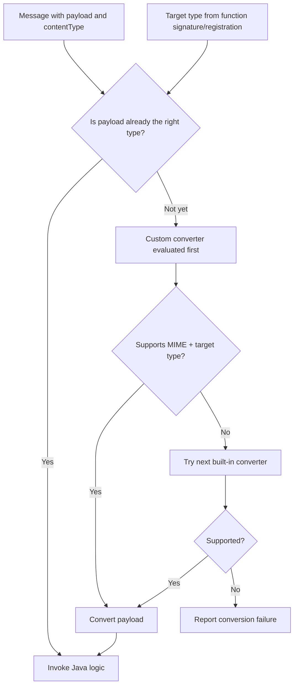

# Registering Custom MessageConverters and Selection Order

In **Spring Cloud Function**, business logic is written using `Supplier<T>`, `Function<I, O>`, and `Consumer<T>`, then placed into `FunctionCatalog` so it can be invoked via HTTP, event systems, or serverless environments. These functions should accept and return **clear Java types**. However, a real-world application may need to read payloads in custom formats that built-in converters do not understand: barcodes, delimiter-separated text records, binary protocols, or legacy system structures.

The **Data Types** chapter therefore requires an essential skill: **writing and registering a custom `MessageConverter`**, while understanding **converter selection order** so you do not accidentally hijack JSON, plain text, or raw bytes.

This lesson focuses on Spring Cloud Function's mechanism, illustrated with Spring Messaging's `org.springframework.messaging.converter.MessageConverter` and `AbstractMessageConverter`. Examples explicitly note when they only demonstrate the Java API, when they test the converter directly, and when a real HTTP/messaging/serverless adapter is required.

After studying it, you will be able to:

- Explain why a custom converter is added to the selection list and when it is actually invoked.
- Distinguish **converter precedence** from **support for the target type, MIME type, and payload**.
- Build a converter for `application/vnd.demo.order-command` that turns UTF-8 bytes into `OrderCommand` and serializes it back to bytes.
- Register the converter as a Spring bean so Spring Cloud Function can discover it.
- Test both `fromMessage(...)` and `toMessage(...)`, MIME mismatch cases, and invalid data.
- Avoid conflicts when multiple custom converters exist or when altering how `application/json` is handled.

## 1. When Do You Need a Custom MessageConverter?

Suppose a legacy sales system sends a command line:

```text
PEN-1|2
```

Here `PEN-1` is the SKU and `2` is the quantity. The sender advertises this format with:

```http
Content-Type: application/vnd.demo.order-command
```

Business logic wants to receive:

```java
public record OrderCommand(String sku, int quantity) {}
```

If you send the bytes of `PEN-1|2` to a `Function<OrderCommand, OrderReceipt>`, Spring Cloud Function needs a mechanism to convert the source payload into `OrderCommand`. Built-in JSON, text, and byte converters do not know that `|`-delimited syntax.

**A custom `MessageConverter` is appropriate when:**

1. The payload has a defined format, yet no built-in converter satisfies the application's contract.
2. You want to separate parsing/serialization responsibility at **the boundary** from `Function.apply(...)` logic.
3. You need to reuse that format across multiple functions or multiple converter-aware adapters.
4. You want control over MIME types, size limits, and error-reporting policies for a custom format.

**You do not need a custom converter if** the conversion is already fully supported by the framework (JSON → DTO, `text/plain` → `String`, `application/octet-stream` → `byte[]`) or if only an internal Java function needs a simple type conversion. For Java value types like `String` → `OrderId`, `ConversionService` and `Converter<S, T>` are often a better fit.

| Need | Mechanism to Consider First | Why |
| --- | --- | --- |
| JSON object to DTO | Built-in JSON converter | No need to rewrite a JSON parser |
| Text to `String` | Text message converter | String/charset reading already exists |
| Binary preserved as `byte[]` | Byte-array converter | Do not blindly decode as text |
| `String` to a domain value in Java | `ConversionService` | Independent of message headers |
| Format `PEN-1\|2` to `OrderCommand` | Custom `MessageConverter` | Must parse format rules at the boundary |
| Specialized data with many headers/metadata | Suitable adapter and custom converter | Must verify header propagation/preservation |

## 2. In What Order Does Spring Cloud Function Select Converters?

When an invocation needs to convert a `Message<?>` payload into the Java type declared by a function, Spring Cloud Function can evaluate a **stack of `MessageConverter`s**. According to the Programming Model documentation, the framework uses **the first converter that can perform an appropriate conversion**.

Built-in converters are typically listed in the documentation in priority order:

| Position in Built-In Stack | Converter | Typical Supported Case |
| --- | --- | --- |
| 1 | `JsonMessageConverter` | `application/json` ↔ DTO/POJO via JSON mapper |
| 2 | `ByteArrayMessageConverter` | `application/octet-stream` and `byte[]` |
| 3 | `StringMessageConverter` | `text/plain` and `String` |

**Important point:** official documentation states that **custom converters are placed at the head of the stack and have higher priority than built-in converters**. A brief sentence in the same section uses the word “appended,” yet the highlighted note explicitly clarifies that custom implementations sit at the **head of the stack**. When reasoning about ordering, follow the explicitly documented priority rule and **verify on your actual version**.

Conceptual order example:

```text
Custom converter A
Custom converter B            ← order between A/B must be verified
JsonMessageConverter
ByteArrayMessageConverter
StringMessageConverter
```

Do not assume the order between A and B solely from `@Bean` method declaration order. If multiple custom converters accept the same MIME type/target type, the outcome may depend on how Spring Cloud Function collects and orders beans in your version. **Avoid overlapping support scopes** or test and configure ordering through the mechanism supported by that version.

### Higher Priority Does Not Mean Always Winning

A custom converter should only accept responsibility when **MIME type**, **target type**, and **actual payload type** all match it. For example, a converter supporting `application/vnd.demo.order-command` and target `OrderCommand` should **not** claim:

- `application/json` containing another DTO.
- `text/plain` where the function expects `String`.
- A ZIP file payload with target `byte[]`.
- A business DTO that the converter does not know how to serialize.

If a converter returns `null` to indicate **not supported**, the stack can try the next converter. If the converter **matched the format yet the payload structure is invalid**, throw a clear conversion error rather than returning broken data or letting a later converter guess the content as another format.



This is a **conceptual diagram**, not the exact call sequence of every adapter or Spring Cloud Function's source code. Some adapters parse the body before calling the catalog or use their own codecs. The goal is to understand selection conditions, not predict internal method names.

## 3. Relationship Between contentType and Target Type

In Spring Messaging, the MIME type typically lives in the `MessageHeaders.CONTENT_TYPE` header, whose key is `contentType`. In HTTP, the header is `Content-Type` and the adapter can map it to message metadata.

| Data at Boundary | `contentType` | Target Java Type | Potentially Suitable Converter |
| --- | --- | --- | --- |
| `PEN-1\|2` (UTF-8 bytes) | `application/vnd.demo.order-command` | `OrderCommand` | This lesson's custom converter |
| `{"sku":"PEN-1","quantity":2}` | `application/json` | `OrderCommand` | JSON converter |
| `hello` | `text/plain` | `String` | String converter |
| Binary data | `application/octet-stream` | `byte[]` | Byte-array converter |
| `PEN-1\|2` | `application/json` | `OrderCommand` | Not valid JSON; should not be parsed as custom format |
| `PEN-1\|2` | Custom MIME | `String` | Target is not `OrderCommand`; this converter should reject |

The MIME type **does not contain the target Java type**. Information about `OrderCommand` can come from the signature:

```java
@Bean
public Function<OrderCommand, OrderReceipt> processOrder() {
    // ...
}
```

Or from explicit metadata when registering a lambda with `FunctionRegistration.type(...)`. If only raw `Function.class` or `Function<Object,Object>` is published, converters may lack enough information to select `OrderCommand`. Adding a custom MIME header does not automatically repair lost generics.

## 4. Designing the Custom Format Before Writing the Converter

Example using an illustrative MIME type:

```text
application/vnd.demo.order-command
```

Payload format: `<sku>|<quantity>`, where SKU consists only of uppercase letters, digits, and hyphens, up to 24 characters. Quantity is an integer from 1 to 10,000.

```text
Valid:
PEN-1|2
BOOK-42|10

Invalid:
PEN-1|0
PEN-1|abc
PEN-1|2|unexpected
pen-1|2
```

We choose to:

- Encode the binary payload in **UTF-8** with a size limit of 256 bytes.
- Convert only when **the target type is `OrderCommand`**.
- Handle only the declared custom MIME type.
- If MIME or target type does not match, the converter **declines**.
- If the format matches yet the payload is invalid, throw a conversion exception.
- When serializing `OrderCommand`, emit UTF-8 bytes in this exact format.

**Size limits and validation are part of the format contract**, not mere decoration. A custom converter handling payloads from a broker or HTTP can receive untrusted input.

## 5. Creating the DTO and Custom MessageConverter

The following snippets are presented as **two standalone Java classes** in the same `demo.function` package. There is no need to create files outside the lesson scope at this step; these are templates for learners to apply in their projects.

### 5.1. Business DTO

```java
package demo.function;

public record OrderCommand(String sku, int quantity) {}
```

Records require Java 16 or later; examples in this lesson assume **Java 17+**.

### 5.2. Converter Supporting application/vnd.demo.order-command

```java
package demo.function;

import java.nio.ByteBuffer;
import java.nio.charset.CharacterCodingException;
import java.nio.charset.CodingErrorAction;
import java.nio.charset.StandardCharsets;

import org.springframework.messaging.Message;
import org.springframework.messaging.MessageHeaders;
import org.springframework.messaging.converter.AbstractMessageConverter;
import org.springframework.messaging.converter.MessageConversionException;
import org.springframework.util.MimeType;

public final class OrderCommandMessageConverter
        extends AbstractMessageConverter {

    public static final MimeType MIME_TYPE =
        new MimeType("application", "vnd.demo.order-command");

    private static final int MAX_PAYLOAD_BYTES = 256;
    private static final int MAX_QUANTITY = 10_000;

    public OrderCommandMessageConverter() {
        super(MIME_TYPE);
        setStrictContentTypeMatch(true);
        setSerializedPayloadClass(byte[].class);
    }

    @Override
    protected boolean supports(Class<?> clazz) {
        return OrderCommand.class.equals(clazz);
    }

    @Override
    protected Object convertFromInternal(
            Message<?> message,
            Class<?> targetClass,
            Object conversionHint) {

        // This converter only accepts bytes; it does not guess formats
        // from arbitrary Java object types.
        if (!(message.getPayload() instanceof byte[] raw)) {
            return null;
        }
        if (raw.length > MAX_PAYLOAD_BYTES) {
            throw new MessageConversionException(
                message, "Order command payload is too large"
            );
        }

        final String line;
        try {
            line = StandardCharsets.UTF_8.newDecoder()
                .onMalformedInput(CodingErrorAction.REPORT)
                .onUnmappableCharacter(CodingErrorAction.REPORT)
                .decode(ByteBuffer.wrap(raw))
                .toString();
        } catch (CharacterCodingException ex) {
            throw new MessageConversionException(
                message, "Order command is not valid UTF-8", ex
            );
        }

        String[] fields = line.split("\\|", -1);
        if (fields.length != 2 ||
                !fields[0].matches("[A-Z0-9-]{1,24}")) {
            throw new MessageConversionException(
                message, "Expected SKU|quantity"
            );
        }

        final int quantity;
        try {
            quantity = Integer.parseInt(fields[1]);
        } catch (NumberFormatException ex) {
            throw new MessageConversionException(
                message, "Quantity must be an integer", ex
            );
        }

        if (quantity < 1 || quantity > MAX_QUANTITY) {
            throw new MessageConversionException(
                message, "Quantity is out of range"
            );
        }
        return new OrderCommand(fields[0], quantity);
    }

    @Override
    protected Object convertToInternal(
            Object payload,
            MessageHeaders headers,
            Object conversionHint) {

        if (!(payload instanceof OrderCommand order)) {
            return null;
        }
        if (order.sku() == null ||
                !order.sku().matches("[A-Z0-9-]{1,24}") ||
                order.quantity() < 1 ||
                order.quantity() > MAX_QUANTITY) {
            throw new MessageConversionException(
                "Invalid OrderCommand for serialization"
            );
        }

        return (order.sku() + "|" + order.quantity())
            .getBytes(StandardCharsets.UTF_8);
    }
}
```

**Key points to understand in this implementation:**

1. `super(MIME_TYPE)` advertises the supported format. `AbstractMessageConverter` checks the MIME type and class before deciding to call the conversion logic.
2. `setStrictContentTypeMatch(true)` prevents the converter from accepting messages missing a matching content type; this is an intentional choice for a custom format and does not mean every converter must use strict mode by default.
3. `supports(Class<?>)` **accepts only `OrderCommand`**, avoiding hijacking targets like `String`, `byte[]`, or other DTOs.
4. `convertFromInternal(...)` handles only `byte[]` payloads. It decodes UTF-8 strictly, checks syntax, and validates quantity.
5. `convertToInternal(...)` serializes the DTO using the same byte convention. `setSerializedPayloadClass(byte[].class)` makes the byte output intent explicit during serialization.
6. `conversionHint` can carry extra metadata supplied by the caller; this converter does not need to use it.

**Never use `new String(raw)` with the default charset** when the format specifies UTF-8; nor let `byte[].toString()` stand in for real decoding. When switching to a structured binary format, use a proper parser instead of a simple `split(...)`.

### 5.3. Return null or Throw an Exception?

| Condition | Intended Behavior | Reason |
| --- | --- | --- |
| MIME other than `application/vnd.demo.order-command` | Decline converter | Give other converters a chance |
| Target type other than `OrderCommand` | Decline converter | Avoid claiming the wrong type |
| Payload type is not `byte[]` | Return `null` in sample converter | Do not coerce unsupported input types |
| Matching format but invalid UTF-8 | Throw `MessageConversionException` | Payload violates contract |
| Matching MIME but missing fields or bad quantity | Throw `MessageConversionException` | Do not silently return a broken DTO |
| Valid DTO during serialization | Return UTF-8 `byte[]` | Preserve format on outbound path |

Note: `AbstractMessageConverter` may skip conversion when the payload is already an instance of the target Java type. That makes sense: not every call needs deserialization. To test the parser, tests must pass `Message<byte[]>` rather than passing an `OrderCommand` and concluding the converter ran.

## 6. Registering the Converter as a Bean for Spring Cloud Function Discovery

Spring Cloud Function documents: implement Spring Messaging's `MessageConverter` and **publish it as a Spring bean**. Dedicated configuration example:

```java
package demo.function;

import java.util.function.Function;

import org.springframework.context.annotation.Bean;
import org.springframework.context.annotation.Configuration;
import org.springframework.messaging.converter.MessageConverter;

@Configuration
public class OrderCommandConfiguration {

    @Bean
    public MessageConverter orderCommandMessageConverter() {
        return new OrderCommandMessageConverter();
    }

    public record OrderReceipt(
        String sku, int quantity, long totalVnd
    ) {}

    @Bean
    public Function<OrderCommand, OrderReceipt> priceOrder() {
        return command -> {
            long total = Math.multiplyExact(
                command.quantity(), 25_000L
            );
            return new OrderReceipt(
                command.sku(),
                command.quantity(),
                total
            );
        };
    }
}
```

When the context contains this bean, compatible Spring Cloud Function mechanisms can collect the custom converter and place it into the stack with **higher priority than built-in converters**. There is no need to rename the bean to `jsonMessageConverter` or overwrite default converters.

The `priceOrder` function preserves exact generics:

```text
Function<OrderCommand, OrderReceipt>
         │                │
         ▼                ▼
     Input type      Output type
```

The custom converter only knows `OrderCommand`. **It does not automatically know how to serialize `OrderReceipt` to JSON.** When returning `OrderReceipt`, the outbound adapter needs an appropriate format/converter (such as JSON) or a dedicated converter/contract for the output.

### Why Doesn't Just Using `new` Register It?

```java
// Sufficient to test the converter directly in Java,
// but does not add the converter to Spring Cloud Function:
MessageConverter local = new OrderCommandMessageConverter();
```

For Spring Cloud Function to discover it, the converter must reside in the context via a supported extension mechanism. Instantiating a converter with `new` inside a regular test or method **does not change the application's converter stack**.

If using **functional** startup with `GenericApplicationContext` instead of `@Configuration`, ensure the converter is registered as a bean in the initialized context and that the initializer actually runs. Do not confuse registering a `FunctionRegistration` with registering a `MessageConverter`: they serve different roles.

## 7. Unit Testing the Converter in Both Directions

Testing the converter directly isolates the parser from HTTP, binders, and `FunctionCatalog`. Test using JUnit 5 and Spring Messaging:

```java
package demo.function;

import static org.junit.jupiter.api.Assertions.*;

import java.nio.charset.StandardCharsets;
import java.util.Map;

import org.junit.jupiter.api.Test;
import org.springframework.messaging.Message;
import org.springframework.messaging.MessageHeaders;
import org.springframework.messaging.support.MessageBuilder;
import org.springframework.util.MimeTypeUtils;

class OrderCommandMessageConverterTest {

    private final OrderCommandMessageConverter converter =
        new OrderCommandMessageConverter();

    @Test
    void readsCustomFormat() {
        Message<byte[]> message = MessageBuilder
            .withPayload("PEN-1|2".getBytes(StandardCharsets.UTF_8))
            .setHeader(
                MessageHeaders.CONTENT_TYPE,
                OrderCommandMessageConverter.MIME_TYPE
            )
            .build();

        Object result = converter.fromMessage(
            message, OrderCommand.class
        );

        assertEquals(new OrderCommand("PEN-1", 2), result);
    }

    @Test
    void writesCustomFormat() {
        MessageHeaders headers = new MessageHeaders(Map.of(
            MessageHeaders.CONTENT_TYPE,
            OrderCommandMessageConverter.MIME_TYPE
        ));

        Message<?> result = converter.toMessage(
            new OrderCommand("PEN-1", 2), headers
        );

        assertNotNull(result);
        assertArrayEquals(
            "PEN-1|2".getBytes(StandardCharsets.UTF_8),
            (byte[]) result.getPayload()
        );
    }

    @Test
    void doesNotClaimJsonMessages() {
        Message<byte[]> jsonMessage = MessageBuilder
            .withPayload("PEN-1|2".getBytes(StandardCharsets.UTF_8))
            .setHeader(
                MessageHeaders.CONTENT_TYPE,
                MimeTypeUtils.APPLICATION_JSON
            )
            .build();

        assertNull(converter.fromMessage(
            jsonMessage, OrderCommand.class
        ));
    }
}
```

Note: The third test **does not verify that the JSON converter succeeds**. It verifies that the custom converter **declines an out-of-scope MIME type**, giving another suitable converter a chance to be tried.

### Testing Invalid Data

```java
@Test
void rejectsInvalidQuantity() {
    Message<byte[]> message = MessageBuilder
        .withPayload("PEN-1|abc".getBytes(StandardCharsets.UTF_8))
        .setHeader(
            MessageHeaders.CONTENT_TYPE,
            OrderCommandMessageConverter.MIME_TYPE
        )
        .build();

    assertThrows(
        org.springframework.messaging.converter.MessageConversionException.class,
        () -> converter.fromMessage(message, OrderCommand.class)
    );
}
```

This is an additional method inside the test class above, reusing `converter`, `MessageBuilder`, `MessageHeaders`, `StandardCharsets`, and JUnit 5 assertions. Also add tests for payloads exceeding 256 bytes, invalid UTF-8, quantity 0, quantity above the limit, and invalid SKU formatting.

## 8. Checking Order Explicitly with CompositeMessageConverter

One way to demonstrate the **sequential trial algorithm** without starting a server is to build a `CompositeMessageConverter` explicitly:

```java
import java.util.List;

import org.springframework.messaging.converter.CompositeMessageConverter;
import org.springframework.messaging.converter.MessageConverter;
import org.springframework.messaging.converter.StringMessageConverter;
import org.springframework.messaging.converter.ByteArrayMessageConverter;

MessageConverter custom = new OrderCommandMessageConverter();

CompositeMessageConverter composite =
    new CompositeMessageConverter(List.of(
        custom,
        new ByteArrayMessageConverter(),
        new StringMessageConverter()
    ));
```

In this snippet, **the order is dictated by the code creating the composite**, and the composite tries converters in order until one produces a matching result. This is **not proof** that an application's catalog uses this exact list of three instances or the exact order written in the test.

The ordering of converters automatically collected by Spring Cloud Function must be verified in a real context, especially if **multiple custom beans** have overlapping handling scopes.

### Avoiding Two Converters Claiming the Same Format

Suppose two custom converters both claim `application/json` and both return true from `supports(OrderCommand.class)`. Whichever converter is tried first can claim the payload and prevent the built-in JSON converter or the other custom converter from running.

**Design recommendations:**

- For a new format, use a dedicated MIME type and concrete target class.
- If overriding default JSON handling, define the exact contract to override, narrow applicable classes, and regression-test all relevant JSON flows.
- With multiple custom converters, partition MIME types or target types to avoid contention; do not rely on `@Bean` declaration order.
- If a project relies on `@Order`/`Ordered`, **verify** how your exact version collects custom converters rather than treating the annotation as a universal guarantee.
- When strict ordering is required, consider managing a composite in a scope you control or using an adapter's published extension point, then integration-test it.

## 9. FunctionCatalog and Verifying Real Conversion

In Spring Cloud Function, you can look up the `priceOrder` bean via `FunctionCatalog`:

```java
import java.util.function.Function;
import org.springframework.cloud.function.context.FunctionCatalog;

// Inside a method/test with an injected FunctionCatalog catalog.
Function<OrderCommand, OrderCommandConfiguration.OrderReceipt> fn =
    catalog.lookup("priceOrder");

OrderCommandConfiguration.OrderReceipt result =
    fn.apply(new OrderCommand("PEN-1", 2));

System.out.println(result.totalVnd()); // 50000
```

This test verifies the catalog and logic on an **already constructed Java object**; it does not prove `OrderCommandMessageConverter` was invoked.

To verify conversion through the wrapper/catalog, send a `Message<byte[]>` with the custom MIME type:

```java
import java.nio.charset.StandardCharsets;
import java.util.function.Function;

import org.springframework.messaging.Message;
import org.springframework.messaging.MessageHeaders;
import org.springframework.messaging.support.MessageBuilder;

Message<byte[]> incoming = MessageBuilder
    .withPayload("PEN-1|2".getBytes(StandardCharsets.UTF_8))
    .setHeader(
        MessageHeaders.CONTENT_TYPE,
        OrderCommandMessageConverter.MIME_TYPE
    )
    .build();

Function<Message<byte[]>, ?> wrapped = catalog.lookup("priceOrder");
Object output = wrapped.apply(incoming);

System.out.println(output == null
    ? "No output"
    : output.getClass().getName());
```

This snippet is a **test pattern inside a context integrated with Spring Cloud Function converters**; it does not assert that the wrapped output type is always `OrderReceipt` or always `Message<OrderReceipt>`. Lookup style, result wrapping, outbound conversion, and adapter behavior vary by version/configuration. Inspect actual outputs and assertions declared in your project.

Another diagnostic technique is placing an observation point inside the converter's `convertFromInternal(...)` during integration tests or selective logging (never logging sensitive data). From there you can distinguish:

1. Whether the converter bean was instantiated by Spring.
2. Whether the converter was actually evaluated by the framework.
3. Whether the converter was selected or returned `null`.
4. Whether the converted payload has the expected `OrderCommand` type.

## 10. Invoking over HTTP, Events, and Serverless

### HTTP: Sending the Custom Format

With the Spring Cloud Function Web adapter active and exposing `priceOrder`, an illustrative request:

```bash
curl -X POST http://localhost:8080/priceOrder \
  -H 'Content-Type: application/vnd.demo.order-command' \
  --data-binary 'PEN-1|2'
```

When the adapter converts the request into a message and uses the registered custom converter, the input can become:

```java
new OrderCommand("PEN-1", 2)
```

Logic returns:

```java
new OrderCommandConfiguration.OrderReceipt(
    "PEN-1", 2, 50_000L
)
```

**Do not assume** the HTTP response is necessarily JSON in this example: the outbound path requires an appropriate adapter, MIME/response configuration, and converter. If you need a stable JSON response, configure and verify the outbound side accordingly; the sample custom converter only supports `OrderCommand` and does not serialize `OrderReceipt`.

### Events / Spring Cloud Stream

An event with a byte payload and header:

```text
payload:     PEN-1|2  (UTF-8 bytes)
contentType: application/vnd.demo.order-command
```

When using a Spring Cloud Stream binder, confirm that the binder propagates/maps the content type into the function invocation properly and that the conversion layer picks up the custom bean. Do not assume broker headers share the exact same names or structures as Spring `MessageHeaders` across every adapter.

If the target function is `Consumer<OrderCommand>`, success means the logic is invoked with the right DTO type. Acknowledgments, retries, dead-lettering, and ordering are **the binder/infrastructure's responsibility**, not behavior automatically added by a custom converter.

### Serverless

A serverless adapter may receive a platform-specific **event envelope** containing payload, base64, and content-type fields. Before the custom converter has a chance to run, the adapter must map that information into a message or Java value understood by Spring Cloud Function.

Do not assume `application/vnd.demo.order-command` is accepted out of the box by every serverless platform. Check the specific adapter and add integration tests matching the target event format.

## 11. Interacting with Supplier, Consumer, and Composition

The three function kinds have distinct contracts:

| Function | Role the Converter Can Play | What Not to Confuse |
| --- | --- | --- |
| `Supplier<OrderCommand>` | Serialize `OrderCommand` when adapter emits custom format | `Supplier` has no input |
| `Function<OrderCommand, OrderReceipt>` | Deserialize custom input; output needs another converter/format | Input custom converter doesn't serialize a different output DTO |
| `Consumer<OrderCommand>` | Deserialize custom event before `accept(...)` | `Consumer` returns no business output |
| `Function<Message<OrderCommand>, Message<OrderCommand>>` | Converter can apply to the wrapper's payload | Headers and payloads are not automatically preserved across all adapters |

Example adding a quantity-normalizing function:

```java
@Bean
public Function<OrderCommand, OrderCommand> atLeastTwo() {
    return order -> new OrderCommand(
        order.sku(), Math.max(2, order.quantity())
    );
}
```

This is an additional bean placed in a `@Configuration` class; import `java.util.function.Function`. They can be composed:

```yaml
spring:
  cloud:
    function:
      definition: atLeastTwo|priceOrder
```

```text
Custom byte payload
    ↓ [converted to OrderCommand at boundary]
OrderCommand
    ↓ atLeastTwo: Function<OrderCommand, OrderCommand>
OrderCommand
    ↓ priceOrder: Function<OrderCommand, OrderReceipt>
OrderReceipt
    ↓ [output formatted per adapter]
Response / event
```

At the junction between the two functions, both output and target are `OrderCommand`, so **there is no need to serialize to custom bytes and parse back**. If you use `Function<OrderCommand, String>` and chain it into `Function<OrderReceipt, ...>`, the two contracts mismatch; a custom converter does not make arbitrary compositions valid.

## 12. Distinguishing Unsupported Messages from Invalid Payloads

A custom converter should adhere to two outcome categories:

### Out of Scope for the Converter

For example, a message with `contentType=application/json` and target `OrderCommand`. This lesson's custom converter uses strict MIME matching and **declines**; the conversion mechanism can then try the built-in JSON converter. This is a **valid fallback**.

### In Scope, but Invalid Data

For example, `contentType=application/vnd.demo.order-command`, target `OrderCommand`, payload `PEN-1|abc`. The converter accepted the MIME/target, yet the data violates the schema. **Report a concrete error** rather than silently guessing or returning a malformed `OrderCommand`.

For untrusted sources, consider:

- Enforcing byte length limits before constructing a `String` to avoid unnecessary memory consumption.
- Never calling `Class.forName(...)` on type names supplied arbitrarily by headers.
- Never deserializing arbitrary sender-chosen classes.
- Checking UTF-8 strictly whenever the format mandates UTF-8.
- Using allowlists for codes, fields, and lengths; bounding quantity ranges.
- Never logging full events if they contain personal data or secrets.
- Defining error/ack/retry strategies in the adapter so a poisoned message does not trigger infinite consumer retries.

## 13. Troubleshooting: Why Wasn't the Custom Converter Called?

| Symptom | Possible Cause | How to Verify |
| --- | --- | --- |
| Converter does not appear in app | Missing `MessageConverter` bean, config class not scanned | Inspect Spring context and bean types |
| Bean created, but parser never runs | Input is already `OrderCommand`, or adapter uses another path | Check actual payload type and catalog/adapter flow |
| Converter skipped for custom MIME | `contentType` header missing or unmapped | Log non-sensitive MIME type at test boundary |
| MIME matches, still doesn't run | `supports(Class<?>)` doesn't match target type | Inspect generics on `@Bean`/`FunctionRegistration` |
| Data is `String`, converter only takes `byte[]` | Runtime payload has unexpected shape | Fix adapter or carefully broaden converter |
| JSON no longer works as before | Custom converter claimed `application/json` or is too broad | Restrict MIME/target; run JSON regression tests |
| Behavior changes after adding 2nd custom converter | Two converters have overlapping scopes | Eliminate overlap or verify ordering |
| HTTP fails while converter test passes | Web adapter does not route through same converter/format | Test HTTP end-to-end and configure response |
| Event converter passes, broker fails | Different binder/header mapping or delivery error | Test the binder and real messages |
| Custom input works, response fails | Output type differs from `OrderCommand`, no outbound converter | Check output format and serializer |
| Unicode characters replaced | Producer/consumer charset mismatch | Standardize on UTF-8 and inspect raw bytes |
| `Function<Object,Object>` gets wrong type | Missing concrete target generics | Publish `Function<OrderCommand, ...>` or explicit type |

### Practical Troubleshooting Sequence

1. **Check the bean:** was the converter created by Spring and registered in the right context?
2. **Check the input:** is the actual payload `byte[]`, `String`, or an already-converted DTO?
3. **Check the MIME type:** what is `MessageHeaders.CONTENT_TYPE`; did the adapter overwrite it?
4. **Check generics:** does the function genuinely advertise input `OrderCommand`, or a raw type?
5. **Check precedence:** which custom converters run first, and does another converter claim the same type?
6. **Check the output:** is the converted payload right, are output headers right, and does the adapter have a serializer for the result?
7. **Test the full path:** converter unit test → catalog test → HTTP/broker/serverless integration test.

## 14. Practice Exercises

**Exercise 1 — Registering a converter.** An implementation named `OrderCommandMessageConverter` is complete. What must be declared so Spring Cloud Function can discover it?

*Answer:* Publish a Spring bean of type `org.springframework.messaging.converter.MessageConverter`, for example:

```java
@Bean
public MessageConverter orderCommandMessageConverter() {
    return new OrderCommandMessageConverter();
}
```

### Exercise 2 — Converter Order

A custom converter supports `application/vnd.demo.order-command`, while the built-in JSON converter supports `application/json`. If a request carries `application/json` and the target is `OrderCommand`, which converter should handle it?

*Answer:* The custom converter must **decline** the mismatched MIME type so the JSON converter gets a chance to process it. Higher priority does not mean a custom converter claims every payload.

### Exercise 3 — Right MIME, Wrong Quantity

Payload `PEN-1|abc` carries the custom content type and target `OrderCommand`. Should the converter return `null` or throw an error?

*Answer:* Once the converter has claimed the format and target type yet the payload violates the schema, throw a concrete conversion error. `null` should be reserved for cases outside the converter's scope.

### Exercise 4 — Multiple Custom Converters

Two converter beans both support `application/json` and `OrderCommand`. Can you rely on `@Bean` method naming order to guarantee converter A runs before B?

*Answer:* No. Avoid overlapping scopes, or verify how your version orders beans and write integration tests for the real order. Reading documentation about default converter order alone is not enough to determine ordering between two custom beans.

### Exercise 5 — Distinguishing Test Levels

A test `catalog.lookup("priceOrder").apply(new OrderCommand("PEN-1",2))` passes. Does that confirm the converter is registered and invoked?

*Answer:* Not yet. The input is already an `OrderCommand`. You need direct converter tests using `Message<byte[]>` and integration tests through the wrapper/adapter with the custom MIME type.

### Exercise 6 — Output Differs from Input

The custom converter supports only `OrderCommand`, while `Function<OrderCommand, OrderReceipt>` returns `OrderReceipt`. Can you assume the response will automatically be JSON?

*Answer:* No. Check the outbound content type and the adapter's serializer/converter. A custom inbound converter does not automatically know how to serialize `OrderReceipt`.

### Exercise 7 — Choosing an Alternative Mechanism

Internal logic wants to convert `String` to `OrderId` without message headers or a new wire format. Is writing a custom `MessageConverter` necessary?

*Answer:* No. A `Converter<String, OrderId>` registered with `ConversionService` or explicit conversion in code is usually a better fit.

### Exercise 8 — Checking Encoding Errors

A custom payload is declared as UTF-8 by the producer, yet contains an invalid byte sequence. Should the converter decode using `new String(raw)` and continue?

*Answer:* No. Use explicit UTF-8; if the schema mandates valid UTF-8, use a `CharsetDecoder` with `CodingErrorAction.REPORT` and report a clear error.

## 15. Takeaways

- Spring Cloud Function supports extending its message conversion stack with **custom `MessageConverter` beans**.
- According to Spring Cloud Function documentation, **custom converters take precedence ahead of built-in converters**; built-in defaults are typically JSON, byte-array, and text in the documented order.
- **The first converter capable of converting is used.** `contentType`, target type, and runtime payload type determine whether a converter applies.
- With `AbstractMessageConverter`, **constrain MIME types and `supports(Class<?>)`** to avoid accidentally hijacking JSON, bytes, or text.
- Distinguish **unsupported** (allow fallback) from **malformed payload** (throw error). Enforce size limits, charset checks, and validation.
- Keep generics on `Supplier`, `Function`, `Consumer`, or `FunctionRegistration` explicit; a converter cannot fix lost types on its own.
- **Test at three layers:** direct Java converter tests, `FunctionCatalog`, and HTTP/messaging/serverless adapters. A passing Java test does not prove every protocol works.

**Official references:**

- [Spring Cloud Function — Programming Model, User-defined Message Converters](https://docs.spring.io/spring-cloud-function/reference/spring-cloud-function/programming-model.html)
- [Spring Cloud Function 4.3 — Programming Model](https://docs.spring.io/spring-cloud-function/reference/4.3/spring-cloud-function/programming-model.html)
- [Spring Cloud Function 5.0 — Programming Model](https://docs.spring.io/spring-cloud-function/reference/5.0/spring-cloud-function/programming-model.html)
- [Spring Framework — AbstractMessageConverter Javadoc](https://docs.spring.io/spring-framework/docs/current/javadoc-api/org/springframework/messaging/converter/AbstractMessageConverter.html)

APIs and ordering are explained per framework documentation; in production projects, verify your exact **Spring Cloud Function/Spring Framework and adapter versions** before treating default behaviors as a stable contract.
