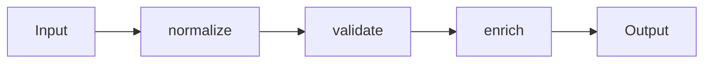
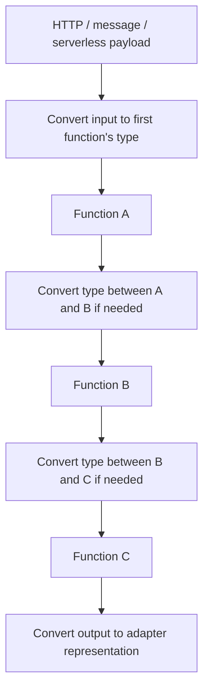

# Type Conversion Between Functions in a Composition Pipeline

**Spring Cloud Function** lets you model business logic with `Supplier<T>`, `Function<I, O>`, and `Consumer<T>`, register them in `FunctionCatalog`, and compose multiple functions into a pipeline (*function composition*). This pipeline can be reused from HTTP, events, or serverless environments, provided the adapter and configuration match.

A problem arises when **the previous function's output type differs from the next function's input type**. For example, the first step returns `String "3"` while the next step expects `Integer 3`; or the previous step returns a `Message<byte[]>` containing JSON while the next step expects a POJO. Spring Cloud Function has a type-conversion mechanism during composition, yet that capability **does not mean every type pair converts automatically**.

In the **Data Types** chapter, this lesson explains how to choose among three options:

1. **Compose functions with already compatible types**: simplest and easiest to verify.
2. **Add an explicit conversion step**: gives precise control over data, errors, and limits.
3. **Rely on conversion supported by `FunctionCatalog`**: useful when `ConversionService` or `MessageConverter` can convert types at the boundary between two functions.

The goal is to understand **when the framework can connect functions of different types**, when a converter or intermediate function is required, and how to test the real catalog execution path instead of confusing it with plain Java's `Function.andThen(...)`.

## 1. Viewing Composition as a Chain of Type Contracts

Given three functions:

```text
A: Function<X, Y>
B: Function<Y, Z>
C: Function<Z, R>

Pipeline A|B|C:
X -> Y -> Z -> R
```

The junctions are boundaries between the **output type** of the left function and the **input type** of the right function. If both sides share the same Java type, data can typically pass straight through. If types differ, an appropriate conversion mechanism is required.

| Left Output | Right Input | Initial Assessment |
| --- | --- | --- |
| `OrderTotal` | `OrderTotal` | Directly compatible |
| `String` containing digits `"3"` | `Integer` | Convertible by a configured `ConversionService` |
| Non-numeric `String` | `Integer` | Conversion will fail |
| `Message<byte[]>` containing JSON | `OrderRequest` | Needs `contentType`, target type, and suitable JSON converter |
| `byte[]` containing an image | `OrderRequest` | No meaningful conversion without a codec/convention |
| `List<Map<String,Object>>` | `List<OrderRequest>` | Needs element types preserved and generic-aware converter |
| `Flux<OrderRequest>` | `List<OrderRequest>` | Different data models; not an automatic cast |

A pipeline can be syntactically valid in terms of function names yet still fail at runtime due to **unsuitable data values**, lost type metadata, or missing converters for the expected type pair.

### Two Notions of “Composition” That Are Not Identical

**Plain Java** provides `Function.andThen(...)`:

```java
Function<String, Integer> parse = Integer::parseInt;
Function<Integer, Long> price = n -> n.longValue() * 50_000L;

Function<String, Long> pipeline = parse.andThen(price);
System.out.println(pipeline.apply("3")); // 150000
```

These signatures are already compatible: `parse` returns `Integer` and `price` takes `Integer`. But if the first function returns `String` and the next takes `Integer` with **no intermediate step**, the Java compiler rejects calling `andThen(...)` directly with those generic types.

**Spring Cloud Function composition** operates through functions normalized/wrapped inside `FunctionCatalog`. The framework additionally supports **type conversion (content-type negotiation)**, enabling certain pairs of functions that would not align under plain Java generics to be composed through catalog wrappers. That capability depends on available converters and runtime type metadata.

## 2. Syntax for Declaring Pipelines in Spring Cloud Function

A pipeline can be expressed using the `|` symbol in configuration:

```yaml
spring:
  cloud:
    function:
      definition: normalize|validate|enrich
```

Execution flows **from left to right**:



Spring Cloud Function documentation also mentions the comma `,` as an alternative delimiter for defining composition in supported contexts, though for illustrating an ordered pipeline, this lesson consistently uses `|`.

Outside configuration, you can ask the catalog to look up a composition by name:

```java
import java.util.function.Function;
import org.springframework.cloud.function.context.FunctionCatalog;

// catalog variable injected from Spring context.
Function<?, ?> composition = catalog.lookup("normalize|validate|enrich");
```

The snippet above is an **API snippet** and does not define those three sample beans. When real code calls `lookup(...)`, you must know the pipeline's input/output types, and results may be wrapped differently when invoked with `Message<?>`.

**Using `|` alone does not create new converters.** The catalog still needs to know the function beans and how to convert data appropriately between each pair.

## 3. Complete Java Example Used Throughout the Lesson

Suppose a pricing system computes totals from quantity. The first step starts with an order request, and the final step produces either a total or formatted display text. The Java 17+ example uses `record`:

```java
package demo.function;

import java.util.Locale;
import java.util.function.Function;
import java.util.function.Supplier;
import java.util.function.Consumer;

import org.springframework.context.annotation.Bean;
import org.springframework.context.annotation.Configuration;

@Configuration
public class OrderPipelineFunctions {

    public record OrderRequest(String orderId, int quantity) {}

    public record OrderTotal(String orderId, long totalVnd) {}

    @Bean
    public Function<OrderRequest, OrderTotal> calculateOrder() {
        return request -> {
            requireValid(request);
            long total = Math.multiplyExact(
                (long) request.quantity(), 50_000L
            );
            return new OrderTotal(request.orderId(), total);
        };
    }

    @Bean
    public Function<OrderTotal, String> renderOrder() {
        return total -> total.orderId() + ": " +
            total.totalVnd() + " VND";
    }

    @Bean
    public Function<OrderRequest, String> quantityText() {
        return request -> {
            requireValid(request);
            return Integer.toString(request.quantity());
        };
    }

    @Bean
    public Function<String, Integer> parseQuantity() {
        return value -> {
            int quantity = Integer.parseInt(value.strip());
            if (quantity <= 0) {
                throw new IllegalArgumentException(
                    "quantity must be positive"
                );
            }
            return quantity;
        };
    }

    @Bean
    public Function<Integer, Long> priceQuantity() {
        return quantity -> {
            if (quantity == null || quantity <= 0) {
                throw new IllegalArgumentException(
                    "quantity must be positive"
                );
            }
            return Math.multiplyExact(quantity.longValue(), 50_000L);
        };
    }

    @Bean
    public Function<Long, String> formatPrice() {
        return amount -> String.format(
            Locale.ROOT, "%d VND", amount
        );
    }

    @Bean
    public Supplier<OrderRequest> sampleOrder() {
        return () -> new OrderRequest("ORD-101", 3);
    }

    @Bean
    public Consumer<Long> auditTotal() {
        return amount -> System.out.println(
            "Total in VND: " + amount
        );
    }

    private static void requireValid(OrderRequest request) {
        if (request == null ||
            request.orderId() == null ||
            request.orderId().isBlank() ||
            request.quantity() <= 0) {
            throw new IllegalArgumentException(
                "orderId and positive quantity are required"
            );
        }
    }
}
```

The `@Bean` methods advertise complete input/output types. This lets the framework read the generic metadata needed for conversion:

| Bean | Input | Output |
| --- | --- | --- |
| `calculateOrder` | `OrderRequest` | `OrderTotal` |
| `renderOrder` | `OrderTotal` | `String` |
| `quantityText` | `OrderRequest` | `String` |
| `parseQuantity` | `String` | `Integer` |
| `priceQuantity` | `Integer` | `Long` |
| `formatPrice` | `Long` | `String` |
| `sampleOrder` | No input | `OrderRequest` |
| `auditTotal` | `Long` | No output |

This is a business bean configuration. To invoke function names over HTTP or a message broker, the application needs the corresponding adapter and dependencies; adding `@Configuration` alone does not create endpoints.

## 4. Case 1: Types Already Match

First pipeline:

```yaml
spring:
  cloud:
    function:
      definition: calculateOrder|renderOrder
```

Boundary:

```text
OrderRequest
  ↓ calculateOrder
OrderTotal
  ↓ renderOrder
String
```

At the junction, `calculateOrder` returns the exact `OrderTotal` that `renderOrder` accepts. There is no need to serialize the intermediate object to JSON and deserialize it back.

Example call via the catalog in a test/method with `FunctionCatalog` injected:

```java
Function<OrderPipelineFunctions.OrderRequest, String> pipeline =
    catalog.lookup("calculateOrder|renderOrder");

String output = pipeline.apply(
    new OrderPipelineFunctions.OrderRequest("ORD-101", 3)
);

System.out.println(output); // ORD-101: 150000 VND
```

The expected logical output is `ORD-101: 150000 VND`. Because the test input is already a DTO, this code **does not test JSON conversion at the boundary**.

**Design preference:** whenever you can publish functions whose output and input types match directly, composition becomes easier to read, easier to test, and less dependent on converter configuration.

## 5. Case 2: Adding an Explicit Conversion Function

Suppose `quantityText` returns the string `"3"`, while `priceQuantity` expects `Integer 3`. To avoid relying on implicit type coercion, we add `parseQuantity`:

```yaml
spring:
  cloud:
    function:
      definition: quantityText|parseQuantity|priceQuantity|formatPrice
```


Trial invocation:

```java
Function<OrderPipelineFunctions.OrderRequest, String> pipeline =
    catalog.lookup(
        "quantityText|parseQuantity|priceQuantity|formatPrice"
    );

String output = pipeline.apply(
    new OrderPipelineFunctions.OrderRequest("ORD-101", 3)
);

System.out.println(output); // 150000 VND
```

**Advantages of an explicit conversion step:**

- The `String` → `Integer` parsing rules live directly inside `parseQuantity`.
- You control whitespace trimming, rejecting zero/negative numbers, and error reporting.
- You can unit-test the parsing step independently without an adapter or `ConversionService`.
- Functions are wired with already matching Java types, reducing reliance on runtime conversion.

**Trade-off:** adds one bean and one composition step. If an application has many simple scalar conversions, `ConversionService` can help avoid writing repetitive conversion functions.

## 6. Case 3: FunctionCatalog Converts Types at the Junction

Official Spring Cloud Function documentation calls this capability **“Type conversion (Content-Type negotiation)”**. The framework can convert function input data **and during function composition**, allowing certain functions whose types would be incompatible in plain Java calls to be chained via catalog wrappers.

Let's try removing `parseQuantity` from the pipeline:

```yaml
spring:
  cloud:
    function:
      definition: quantityText|priceQuantity|formatPrice
```

Boundary requiring conversion:

```text
OrderRequest
  ↓ quantityText
String "3"
  ┆ [ConversionService: String → Integer if supported]
Integer 3
  ↓ priceQuantity
Long 150000
  ↓ formatPrice
String "150000 VND"
```

In Spring Cloud Function, when an intermediate input is **an unwrapped value (not a `Message`)**, the framework can use `ConversionService` to convert it into the next function's declared type. If the context has a `String` → `Integer` converter (such as common scalar converters) and the wrapper applies it at the junction, this chain can run without `parseQuantity`.

Example test **on the exact target version and context**:

```java
Function<OrderPipelineFunctions.OrderRequest, String> pipeline =
    catalog.lookup("quantityText|priceQuantity|formatPrice");

String output = pipeline.apply(
    new OrderPipelineFunctions.OrderRequest("ORD-101", 3)
);

System.out.println(output); // expected when conversion applies: 150000 VND
```

This is **a case that must be tested at runtime**, not inferred solely from Java signatures. If no converter exists, conversion does not apply on that invocation path, or data is invalid, the wrapper can fail. Use the chain with `parseQuantity` in Section 5 if you want explicit, configuration-independent parsing rules.

### Difference from Java's Function.andThen(...)

The snippet below is invalid with respect to generics if calling `andThen` directly:

```java
Function<OrderPipelineFunctions.OrderRequest, String> first =
    new OrderPipelineFunctions().quantityText();
Function<Integer, Long> second =
    new OrderPipelineFunctions().priceQuantity();

// DOES NOT COMPILE: first returns String, second expects Integer.
// Function<OrderRequest, Long> bad = first.andThen(second);
```

Java checks generics at compile time; `FunctionCatalog` wraps functions and can perform type conversion **at runtime**. This is a core distinction of this topic. Do not claim “Java `andThen` will cast types automatically,” because that is false.

## 7. Two Mechanisms: ConversionService and MessageConverter

Spring Cloud Function uses two mechanisms from Spring Framework:

| Input at Conversion Time | Mechanism Typically Used by Framework | Example |
| --- | --- | --- |
| Java value not wrapped in `Message<?>` | `ConversionService` | `String "3"` → `Integer 3` |
| `Message<?>` carrying payload + headers | `MessageConverter` | JSON `byte[]` → `OrderRequest` |
| Value already of the right type | Conversion may be skipped | `OrderTotal` → `OrderTotal` |
| Custom-formatted payload | Custom converter or explicit conversion step | Custom text line → DTO |

`ConversionService` handles **Java value types** and does not know whether a string is JSON. `MessageConverter` handles **messages** together with metadata such as `contentType`. Both require target type information; missing generics on beans can prevent the framework from knowing which class to convert into.

### Illustrating ConversionService

```java
import org.springframework.core.convert.support.DefaultConversionService;

DefaultConversionService conversions =
    new DefaultConversionService();

System.out.println(
    conversions.canConvert(String.class, Integer.class)
); // true with DefaultConversionService

Integer value = conversions.convert("3", Integer.class);
System.out.println(value); // 3
```

The snippet above only confirms that **a standalone `DefaultConversionService` instance** can turn `String` into `Integer`. It **does not prove** that instance is the service used by a Spring Cloud Function wrapper inside your application.

If you need a custom domain value converter such as `String` → `OrderId`, you can write a `Converter<String, OrderId>` and register it with the `ConversionService` used on the execution path. If an adapter does not use your custom conversion service bean, adding `@Bean` alone will not necessarily alter composition behavior; verify the extension point for your version.

### Illustrating MessageConverter

A message containing JSON needs all of the following simultaneously:

1. **Payload** that is genuinely valid JSON.
2. Appropriate **`contentType`**, typically `application/json`.
3. **Target type** from the function signature or `FunctionRegistration.type(...)`.
4. **Converter/mapper** supported by the adapter/catalog.

```text
Message<byte[]>
  headers: contentType=application/json
  payload: {"orderId":"ORD-101","quantity":3}
               |
               | JsonMessageConverter + target type
               v
          OrderRequest
               |
               v
          calculateOrder
```

Do not expect the `contentType` header alone to turn a message into any arbitrary DTO. Likewise, raw `Function<Object,Object>` fails to supply a concrete target type even when the JSON is valid.

## 8. Intermediate Messages Inside Composition

Suppose one step produces a `Message<byte[]>` containing JSON while the next step expects a POJO. This is a **message-based conversion** case rather than plain scalar conversion:

```text
Function<Integer, Message<byte[]>> quantityToJson
    output:
       payload = {"quantity":3}
       contentType = application/json
                     |
                     | Payload converted when wrapper/adapter supports it
                     v
Function<QuantityRequest, Long> calculateQuantity
    input: QuantityRequest(quantity=3)
```

For simple examples that do not depend on a JSON library, we can create an illustrative bean:

```java
package demo.function;

import java.nio.charset.StandardCharsets;
import java.util.function.Function;

import org.springframework.context.annotation.Bean;
import org.springframework.context.annotation.Configuration;
import org.springframework.messaging.Message;
import org.springframework.messaging.MessageHeaders;
import org.springframework.messaging.support.MessageBuilder;
import org.springframework.util.MimeTypeUtils;

@Configuration
public class JsonBridgeFunctions {

    public record QuantityRequest(int quantity) {}

    @Bean
    public Function<Integer, Message<byte[]>> quantityToJson() {
        return quantity -> {
            if (quantity == null || quantity <= 0) {
                throw new IllegalArgumentException(
                    "quantity must be positive"
                );
            }
            byte[] bytes = (
                "{\"quantity\":" + quantity + "}"
            ).getBytes(StandardCharsets.UTF_8);

            return MessageBuilder.withPayload(bytes)
                .setHeader(
                    MessageHeaders.CONTENT_TYPE,
                    MimeTypeUtils.APPLICATION_JSON
                )
                .build();
        };
    }

    @Bean
    public Function<QuantityRequest, Long> calculateQuantity() {
        return request -> Math.multiplyExact(
            (long) request.quantity(), 50_000L
        );
    }
}
```

This sample builds JSON from **a single validated integer value** and is not a general-purpose DTO serialization solution. In real applications, use a JSON mapper when data is complex or contains text fields requiring escaping.

Composition idea:

```yaml
spring:
  cloud:
    function:
      definition: quantityToJson|calculateQuantity
```

**Do not assume this pipeline automatically runs across every version.** This is an integration test case for message conversion at a composition boundary. To succeed, the wrapper must handle the `Message<byte[]>` emitted by the first function, recognize `contentType=application/json`, identify target type `QuantityRequest`, and have a suitable JSON converter. If the invocation path does not support this combination, add an explicit JSON-parsing step or align the signatures.

Similarly, an outbound `Message<T>` may carry headers that matter to the next step. **Do not blindly copy every header when changing the payload format**: keeping an old binary `contentType` when the new payload is JSON, or vice versa, can mislead downstream converters.

## 9. Boundary Conversions at Pipeline Ends Differ from Inter-Function Conversion

A composition invocation can have three conversion points:



- **Inbound:** HTTP body `application/json` must become `OrderRequest` for the first function.
- **Mid-pipeline:** `String` produced by function A may need to become `Integer` for function B; this is the main focus of this lesson.
- **Outbound:** the final Java object may need to be serialized to JSON/text/bytes for the adapter to return.

These three points may use different mechanisms or metadata. For example, HTTP `Accept: application/json` specifies the response the client desires; it does not convert `String` to `Integer` at the junction between two Java functions.

A common mistake is seeing HTTP JSON POST work and concluding **all type pairs inside the composition also convert automatically**. That is false: each junction has its own **source type, target type, and runtime data**.

## 10. Fetching Composition via FunctionCatalog and Testing the Right Layer

`FunctionCatalog` wraps functional beans. When retrieving a bean directly from `ApplicationContext`, you get plain Java code. When looking up through the catalog, the framework can add composition, conversion, and other features.

### Test A: Verify Logic and Type-Matched Composition

```java
import static org.junit.jupiter.api.Assertions.assertEquals;

import java.util.function.Function;
import org.junit.jupiter.api.Test;
import org.springframework.beans.factory.annotation.Autowired;
import org.springframework.cloud.function.context.FunctionCatalog;

// Placed in a test class configured with a Spring context containing
// OrderPipelineFunctions and FunctionCatalog.
@Autowired
FunctionCatalog catalog;

@Test
void composesTypedFunctions() {
    Function<OrderPipelineFunctions.OrderRequest, String> chain =
        catalog.lookup("calculateOrder|renderOrder");

    assertEquals(
        "ORD-101: 150000 VND",
        chain.apply(
            new OrderPipelineFunctions.OrderRequest("ORD-101", 3)
        )
    );
}
```

This snippet is **the body of a JUnit 5 test class** with suitable Spring Test configuration; it requires the corresponding Spring Cloud Function and JUnit/Boot Test dependencies. This test verifies type-matched composition, not JSON conversion.

### Test B: Verify an Explicit Conversion Step

```java
@Test
void composesWithExplicitParsing() {
    Function<OrderPipelineFunctions.OrderRequest, String> chain =
        catalog.lookup(
            "quantityText|parseQuantity|priceQuantity|formatPrice"
        );

    assertEquals(
        "150000 VND",
        chain.apply(
            new OrderPipelineFunctions.OrderRequest("ORD-101", 3)
        )
    );
}
```

The `parseQuantity` step is an explicitly programmed conversion. If this test fails, check bean name ordering, validation, and generic types before suspecting the JSON mapper.

### Test C: Verify Automatic Conversion If the System Relies on It

```java
@Test
void checksCatalogConversionBetweenStages() {
    Function<OrderPipelineFunctions.OrderRequest, Long> chain =
        catalog.lookup("quantityText|priceQuantity");

    Long result = chain.apply(
        new OrderPipelineFunctions.OrderRequest("ORD-101", 3)
    );

    assertEquals(150_000L, result);
}
```

This is **a test of the catalog's conversion feature** and must be executed in your actual context and version. If no converter applies or supports it, the test will fail; in that case add the `parseQuantity` step or register an appropriate conversion service. Never mark a test as “passing” simply because example code appears in a lesson.

### Test D: Verify JSON at the Boundary

With a properly started HTTP Web adapter, send:

```bash
curl -X POST http://localhost:8080/calculateOrder \
  -H 'Content-Type: application/json' \
  -H 'Accept: application/json' \
  -d '{"orderId":"ORD-101","quantity":3}'
```

This tests **converting HTTP JSON into `OrderRequest`** and the output of a specific function; if you want to test a composition endpoint, configure the Web adapter to expose the intended chain. Output body and HTTP status/headers depend on the adapter/converter; do not assume every environment shares the same response format.

## 11. Lost Generic Types Make Junction Conversion Unpredictable

Spring Cloud Function relies on function metadata to know **the actual output** of the previous step and **the target type** of the next step. If a lambda is registered only with a raw type, that metadata can be lost:

```java
// Avoid this if you want the framework to read generics accurately:
@Bean
@SuppressWarnings({"rawtypes", "unchecked"})
public Function rawQuantity() {
    return value -> "3";
}
```

Java generics are erased at runtime for many registration forms; metadata can still be read from `@Bean` method signatures or explicit registration metadata. Therefore, **publish complete types on the return type**:

```java
@Bean
public Function<OrderPipelineFunctions.OrderRequest, String>
        quantityTextTyped() {
    return request -> Integer.toString(request.quantity());
}
```

This snippet is a **separate illustrative bean**; do not register it with the same name as an existing bean in the sample class unless intentionally creating a new function.

When dynamic registration is needed in a `GenericApplicationContext`, use `FunctionRegistration` to preserve type info:

```java
import java.util.function.Function;

import org.springframework.cloud.function.context.FunctionRegistration;
import org.springframework.cloud.function.context.catalog.FunctionTypeUtils;

// Inside ApplicationContextInitializer<GenericApplicationContext>:
Function<OrderPipelineFunctions.OrderRequest, String> function =
    request -> Integer.toString(request.quantity());

context.registerBean(
    "quantityFromRegistration",
    FunctionRegistration.class,
    () -> new FunctionRegistration<>(function)
        .type(FunctionTypeUtils.functionType(
            OrderPipelineFunctions.OrderRequest.class,
            String.class
        ))
);
```

`context` is the `GenericApplicationContext` passed into the executed initializer. `FunctionRegistration` metadata specifies both the input and output of the function; it **is not a converter** and does not automatically add conversion between arbitrary type pairs.

### Generic Collections and Message<T> Are More Complex

| Type at Previous Step | Type at Next Step | Common Issue |
| --- | --- | --- |
| `List<OrderRequest>` | `List<OrderRequest>` | Types match if actual elements match |
| Raw `List` | `List<OrderRequest>` | Element generics unknown; may contain `Map`s |
| `Message<OrderRequest>` | `OrderRequest` | Requires payload/wrapper handling per SCF rules |
| `Message<byte[]>` containing JSON | `OrderRequest` | Needs `contentType` and JSON converter |
| `Flux<OrderRequest>` | `List<OrderRequest>` | Different publisher/collection models, not simple scalar conversion |

When dynamically registering `List<T>`, supply a parameterized `Type` representing both the collection type and element type, not merely `List.class`. Otherwise, a JSON parser may produce `List<Map>`, causing errors only when the next step calls DTO methods.

## 12. Supplier, Consumer, and Composition Limits

Spring Cloud Function supports more composition shapes than plain Java's `Function.andThen`:

| Pipeline | Overall Contract | Notes |
| --- | --- | --- |
| `Function<A,B>\|Function<B,C>` | `Function<A,C>` | One input and one output |
| `Supplier<A>\|Function<A,B>` | `Supplier<B>` | No external input |
| `Function<A,B>\|Consumer<B>` | `Consumer<A>` | No business output |
| `Supplier<A>\|Consumer<A>` | Semantically `Runnable` | Triggers fetching data and consuming it |
| `Consumer<A>\|Function<...>` | Invalid | Consumer ends the stream and produces no data for the next step |

A conversion point may still be needed in `Supplier<A>` → `Function<B,C>` or `Function<A,B>` → `Consumer<C>` if `A/B/C` are incompatible, though **only when a suitable converter exists**.

Example using beans from Section 3:

```yaml
spring:
  cloud:
    function:
      definition: sampleOrder|calculateOrder|renderOrder
```

This definition forms a composite supplier: `sampleOrder` emits `OrderRequest`, `calculateOrder` produces `OrderTotal`, and `renderOrder` produces `String`. No inbound HTTP body is needed to call `get()`; when running through an event adapter, emission timing depends on triggers/binders.

Pipeline ending with a consumer:

```yaml
spring:
  cloud:
    function:
      definition: quantityText|parseQuantity|priceQuantity|auditTotal
```

The result is semantically a consumer: it accepts `OrderRequest`, computes `Long`, and calls `auditTotal.accept(...)`, producing no Java output to pass into another function. Note that the `function.definition` property in these examples applies to a single selected invocation path; do not place two `spring.cloud.function.definition` properties in the same config expecting both to apply simultaneously.

## 13. Imperative, Reactive, and Cross-Publisher Conversions

An imperative function typically processes one value per `apply(...)`:

```java
Function<Integer, String> formatOne =
    number -> "value=" + number;
```

A reactive function can process a `Flux<T>` publisher:

```java
import reactor.core.publisher.Flux;

Function<Flux<Integer>, Flux<String>> formatStream =
    numbers -> numbers.map(number -> "value=" + number);
```

**Do not treat `Flux<Integer>` as `List<Integer>` or `Integer`** simply because both involve integers. Reactive publishers have subscription, error, backpressure, and lifecycle semantics distinct from in-memory collections.

Spring Cloud Function supports composition/adaptation across some imperative/reactive function shapes, yet that does not mean every `Flux<T>` → `List<T>` or element conversion happens automatically. In many cases, write `map(...)`/`flatMap(...)` explicitly in the reactive pipeline:

```java
Function<Flux<String>, Flux<Long>> reactivePrice =
    texts -> texts
        .map(Integer::parseInt)
        .map(number -> Math.multiplyExact(
            number.longValue(), 50_000L
        ));
```

Here code explicitly converts each string to an integer and computes the price. Never assume an HTTP message converter automatically runs per `Flux` element across every adapter.

## 14. Headers, contentType, and Intermediate Data

When a chain operates on `Message<?>`, headers can affect conversion. An incorrect format header or one carried over from an earlier step can cause the next converter to misinterpret the payload.

Example of a function that replaces the payload and must set an appropriate content type:

```java
import java.nio.charset.StandardCharsets;
import java.util.function.Function;

import org.springframework.messaging.Message;
import org.springframework.messaging.MessageHeaders;
import org.springframework.messaging.support.MessageBuilder;
import org.springframework.util.MimeTypeUtils;

Function<Message<String>, Message<byte[]>> encodePlainText =
    incoming -> {
        byte[] bytes = incoming.getPayload()
            .getBytes(StandardCharsets.UTF_8);

        MessageBuilder<byte[]> builder =
            MessageBuilder.withPayload(bytes);

        Object correlationId =
            incoming.getHeaders().get("correlationId");
        if (correlationId != null) {
            builder.setHeader("correlationId", correlationId);
        }

        return builder
            .setHeader(
                MessageHeaders.CONTENT_TYPE,
                MimeTypeUtils.parseMimeType(
                    "text/plain;charset=UTF-8"
                )
            )
            .build();
    };
```

This is a standalone Java function illustrating header handling; it does not need to be registered as a bean to illustrate the principle. It copies only `correlationId` when present rather than **copying all headers** and leaving an incompatible `contentType`.

If the output is UTF-8 text bytes, `text/plain;charset=UTF-8` fits better than `application/json`. If the output is a PDF/ZIP file, use the exact binary MIME type and **never** decode arbitrarily to `String`.

Spring Cloud Function has its own mechanisms for customizing/copying headers in certain situations; message binder and serverless adapter rules can differ. Test the actual path to observe which headers are kept, replaced, or dropped.

## 15. Typical Errors at Pipeline Junctions

| Symptom | Possible Cause | Remediation |
| --- | --- | --- |
| Java `andThen(...)` won't compile | Output/input generics mismatch | Add intermediate `Function<Y,Z>` or verified catalog conversion |
| Catalog looks up chain, `apply(...)` fails | Runtime cannot convert between types | Check source/target, `ConversionService`, custom converter |
| `NumberFormatException` chaining String → Integer | Actual value is not a valid integer | Add validation and explicit parsing |
| `ClassCastException` in downstream function | Arriving object has wrong type or lost generics | Check `@Bean` return type and registration |
| `MessageConversionException` | Message payload/MIME/target incompatible | Fix `contentType` or choose suitable converter |
| `List<Map>` instead of `List<DTO>` | Missing element generic metadata | Preserve `List<T>` or proper type token |
| First step works, next step isn't called | Conversion failure at junction | Test step by step and inspect runtime types |
| Composition returns unexpected output | Wrapper/adapter serializes or wraps `Message` | Inspect runtime type and output body |
| `contentType` header is stale | Payload format changed while old header stayed | Set header matching the new payload |
| Supplier/Consumer chain produces no output | Consumer is the terminal step | Do not chain further functions after a Consumer |
| Flux/List not automatically compatible | Different publisher/collection models | Write controlled reactive/collection transformations |

### Six Debugging Questions

1. **Which function runs before, and which runs after?** Print the composition configuration and verify exact order.
2. **What runtime class does the previous step actually output?** For example `String`, `Integer`, `Message`, `byte[]`, or `List`.
3. **What target type does the catalog know?** Read the bean generics or `FunctionRegistration.type(...)`.
4. **Is there a matching converter?** For plain values check `ConversionService`; for `Message` check `MessageConverter`, `contentType`, and headers.
5. **Is the data valid for that converter?** `"3"` can parse as a number; `"three"` cannot.
6. **Which layer are you testing?** Plain Java bean, catalog wrapper, HTTP adapter, or event binder?

To inspect a pipeline, you can add a `peek` step in **development environments** that logs only the payload's class name—never log entire orders or sensitive data. In production, use proper tests and tracing/metrics instead of ad-hoc logging.

## 16. Practice Exercises

**Exercise 1 — Matching types.** Given `Function<OrderRequest,OrderTotal>` and `Function<OrderTotal,String>`, is a JSON converter needed at the junction?

*Answer:* No, if the first step already returns a properly typed `OrderTotal` object; its output can pass directly to the next function. JSON converters may be needed at protocol boundaries, not automatically at every Java boundary.

**Exercise 2 — Explicit conversion chain.** `quantityText` returns `String`, `priceQuantity` accepts `Integer`, and `formatPrice` accepts `Long`. Provide a pipeline that does not depend on automatic conversion.

*Answer:* `quantityText|parseQuantity|priceQuantity|formatPrice`, where `parseQuantity` is `Function<String,Integer>`.

**Exercise 3 — Java andThen vs. catalog.** Why does `Function<OrderRequest,String>.andThen(Function<Integer,Long>)` fail to compile, while Spring Cloud Function says it can convert types during composition?

*Answer:* Java's `andThen` checks generics at compile time and requires compatible intermediate types. `FunctionCatalog` uses wrappers and can convert types at runtime via Spring mechanisms when matching converters and metadata exist.

**Exercise 4 — ConversionService or MessageConverter?** The previous step returns `String "3"`, and the next step expects `Integer`. If the junction input is a plain Java value, which mechanism is typically considered?

*Answer:* `ConversionService`. `MessageConverter` is typically used when the input is a `Message<?>` carrying payload and headers.

**Exercise 5 — JSON Message.** The previous step returns `Message<byte[]>` with `contentType=application/json`; the next step expects `OrderRequest`. Is the JSON header alone enough?

*Answer:* No. You need valid JSON, `OrderRequest` target generics/metadata, and a catalog/adapter path supporting the converter. Test this boundary explicitly.

**Exercise 6 — Lists and generics.** One step returns `List<Map<String,Object>>`, and the next expects `List<OrderRequest>`. Why shouldn't you force it with a cast?

*Answer:* Casting does not transform each `Map` element into a DTO, and generics are erased at runtime. Map each element explicitly or use a converter with a type token/element metadata.

**Exercise 7 — Supplier + Consumer.** If a composition ends with `Consumer<T>`, can you chain another function that expects output from that consumer?

*Answer:* No. A consumer has `void` output; it terminates the chain. A `Supplier<T>\|Consumer<T>` has `Runnable` semantics.

**Exercise 8 — Testing.** A test calling `new OrderPipelineFunctions().calculateOrder().apply(...)` succeeds. Does this prove automatic conversion between `quantityText` and `priceQuantity` works?

*Answer:* No. That test invokes a bean directly without catalog wrappers. You must look up `quantityText|priceQuantity` through `FunctionCatalog` in a context with real converters.

**Exercise 9 — Stale header.** A previous step creates new JSON bytes while keeping `contentType=text/plain`. The next step expects a DTO. What can go wrong?

*Answer:* A converter may choose the text path or refuse converting bytes to a DTO. Set metadata matching the new payload and test the adapter.

## 17. Takeaways

- **Function composition is a chain of type contracts.** Each junction pairs the previous function's output type with the next function's input type.
- **Java `andThen(...)` requires compatible generics**, whereas **Spring Cloud Function's `FunctionCatalog` can convert types during composition** when supported.
- **`ConversionService`** typically converts **Java values not wrapped in a `Message`**; **`MessageConverter`** handles `Message<?>` payloads with metadata like `contentType`.
- **No converter guarantees turning any arbitrary type into any other type.** Data must be valid, the target type must be known, and the adapter must invoke the right mechanism.
- **Adding an explicit conversion function is a clear choice**, especially when validation, business rules, or strict error handling are required.
- **Preserve generic metadata** on `@Bean` or `FunctionRegistration`, particularly for `Message<T>` wrappers and `List<T>` collections.
- **Do not treat `Flux`, `List`, `Message`, and DTOs as interchangeable.** Distinguish publishers, collections, wrappers, and payload formats.
- **Test by layer:** Java logic, composition via the catalog, and then HTTP/messaging/serverless adapters to confirm real behavior.

**References:**

- [Spring Cloud Function — Programming Model: Function Composition](https://docs.spring.io/spring-cloud-function/reference/spring-cloud-function/programming-model.html)
- [Spring Cloud Function — Type conversion (Content-Type negotiation)](https://docs.spring.io/spring-cloud-function/reference/5.0/spring-cloud-function/programming-model.html)
- [Spring Framework — Type Conversion](https://docs.spring.io/spring-framework/reference/core/validation/convert.html)

Exact conversion behavior can vary by **Spring Cloud Function/Spring Framework and adapter versions**, so when applying this in a project, verify your actual libraries, type metadata, and integration tests.
