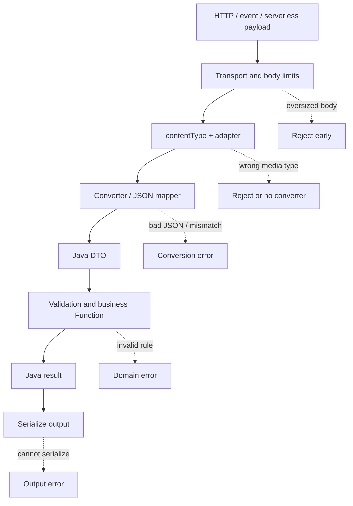
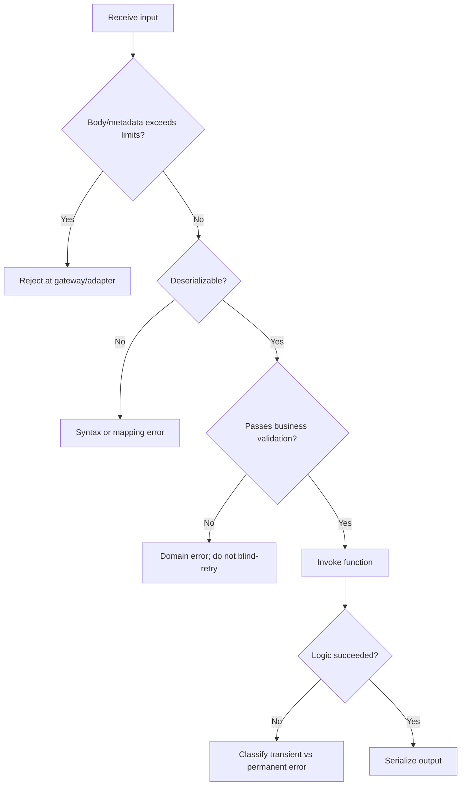

# JSON Errors, Type Mismatches, and Deserialization Limits

Spring Cloud Function helps you write business logic as `Supplier<T>`, `Function<I, O>`, and `Consumer<T>` beans, then look them up via `FunctionCatalog`, compose them, and expose the same function to HTTP, event systems, or serverless platforms. To make that work, adapters usually have to convert external data—JSON, strings, or bytes—into the Java types advertised by the function.

This conversion does not always succeed. There are **JSON syntax errors**, **shape or field-type mismatches**, **lost generic metadata**, **values violating business rules**, as well as risks of **excessive resource consumption or unintended class loading during deserialization**. In the **Data Types** chapter, this lesson guides you through categorizing and handling those issues instead of catching every exception and returning a generic message.

Objectives after this lesson:

1. Distinguish errors occurring **before entering the function**, **inside function logic**, and **after the function returns a result**.
2. Diagnose invalid JSON payloads, wrong MIME types, incompatible fields/types, and lost generics on `List<T>` and `Message<T>`.
3. Design DTOs and validation to avoid assuming “successful deserialization” means “valid data.”
4. Bound payload size, JSON nesting depth, collection element counts, and resource usage before/during parsing.
5. Understand the risks of dynamic type selection via `Content-Type;type=...` and allowlist principles.
6. Test across three layers: Java functions, catalog/converters, and HTTP/event/serverless adapters.

> **Example scope:** Java 17 or later. Snippets using Jackson 2 are clearly marked and do not apply verbatim to Jackson 3 using the `tools.jackson.*` package. Conversion and exception behavior across HTTP, binders, or serverless depends on versions and integration setup; do not assume one universal HTTP status code or retry mechanism across every adapter.

## 1. Distinguishing Four Error Categories Before Editing Code

| Category | Examples | Primarily Responsible Layer |
| --- | --- | --- |
| **Syntax/format** | JSON missing braces, plain-text body with `contentType=application/json` | Adapter, JSON parser, message converter |
| **Type mapping** | JSON array with single DTO target; `quantity="two"` for `int`; `List<Map>` instead of `List<OrderRequest>` | JSON mapper, generic metadata, conversion service |
| **Business rules** | `quantity=-2`, blank `orderId`, monetary total overflowing `long` | Validation in function/domain |
| **Resources and security** | Oversized JSON, excessive nesting, millions of array elements, unsafe class selection via header | Gateway/adapter/parser limits, type controls, and security patches |

This classification avoids two common reasoning mistakes:

- **Not every parse error comes from Spring Cloud Function.** Decoders in Spring MVC, Spring Messaging, the JSON mapper, or platform adapters may fail before the function logic is ever called.
- **Not every constructed DTO is valid.** A JSON parser can construct `OrderRequest(quantity=-2)` without complaint, yet business logic must reject it.

### Error Location Diagram



This diagram illustrates architectural responsibilities, not a fixed call stack for every Spring Cloud Function adapter. Some adapters use their own codecs, so verify actual exceptions in your application.

## 2. An End-to-End Business Example

Suppose a system accepts orders containing multiple line items. The `Function<OrderRequest, OrderReceipt>` bean uses accurate generics so the catalog knows the input and output types.

```java
package demo.function;

import java.util.List;
import java.util.Objects;
import java.util.function.Function;

import org.springframework.context.annotation.Bean;
import org.springframework.context.annotation.Configuration;

@Configuration
public class OrderFunctions {

    public record OrderLine(
        String sku,
        int quantity,
        long unitPriceVnd
    ) {}

    public record OrderRequest(
        String orderId,
        List<OrderLine> lines
    ) {}

    public record OrderReceipt(
        String orderId,
        int lineCount,
        long totalVnd
    ) {}

    private static final int MAX_LINES = 100;
    private static final int MAX_QUANTITY = 10_000;

    @Bean
    public Function<OrderRequest, OrderReceipt> calculateOrder() {
        return request -> {
            Objects.requireNonNull(request, "request");

            if (request.orderId() == null ||
                !request.orderId().matches("[A-Z0-9-]{1,32}")) {
                throw new IllegalArgumentException(
                    "Invalid orderId"
                );
            }

            List<OrderLine> lines =
                Objects.requireNonNull(request.lines(), "lines");
            if (lines.isEmpty() || lines.size() > MAX_LINES) {
                throw new IllegalArgumentException(
                    "Invalid line count"
                );
            }

            long total = 0L;
            for (OrderLine line : lines) {
                if (line == null || line.sku() == null ||
                    !line.sku().matches("[A-Z0-9-]{1,24}") ||
                    line.quantity() < 1 ||
                    line.quantity() > MAX_QUANTITY ||
                    line.unitPriceVnd() < 0) {
                    throw new IllegalArgumentException(
                        "Invalid order line"
                    );
                }

                long amount = Math.multiplyExact(
                    (long) line.quantity(),
                    line.unitPriceVnd()
                );
                total = Math.addExact(total, amount);
            }

            return new OrderReceipt(
                request.orderId(),
                lines.size(),
                total
            );
        };
    }
}
```

Valid JSON example:

```json
{
  "orderId": "ORD-101",
  "lines": [
    {"sku": "BOOK-1", "quantity": 2, "unitPriceVnd": 50000},
    {"sku": "PEN-1", "quantity": 1, "unitPriceVnd": 30000}
  ]
}
```

Business result:

```json
{"orderId":"ORD-101","lineCount":2,"totalVnd":130000}
```

The function operates purely on Java DTOs, not raw HTTP bodies, keeping the logic reusable across protocols. However, the validation code above runs **after** data has been deserialized; it does not protect the parser from a massive body upfront. The resource-limits section addresses that separately.

## 3. JSON Syntax Errors: No DTO Yet to Invoke the Function

JSON has strict syntax rules. The following payloads are invalid:

```text
{"orderId":"ORD-101","lines":[]    // missing closing }
{orderId:"ORD-101"}                  // unquoted property name
{"quantity": 01}                     // invalid leading zero on number
{"quantity": }                       // missing value
```

A standard JSON parser cannot read these structures under strict settings. With Jackson 2, syntax errors may surface as a `JsonParseException` or an appropriate `JsonProcessingException`. Adapters may wrap the exception in another type.

Standalone parsing test example with Jackson 2:

```java
import com.fasterxml.jackson.core.JsonProcessingException;
import com.fasterxml.jackson.databind.ObjectMapper;

ObjectMapper mapper = new ObjectMapper();

String badJson = """
    {"orderId":"ORD-101","lines":[}
    """;

try {
    mapper.readValue(
        badJson,
        OrderFunctions.OrderRequest.class
    );
    throw new AssertionError("Expected invalid JSON");
} catch (JsonProcessingException expected) {
    System.out.println("Invalid JSON syntax or mapping");
}
```

This snippet uses the Jackson 2 API inside a method/test with access to `OrderFunctions`. When debugging, inspect the **root cause** in the exception chain to distinguish syntax errors from mapping errors. Avoid catching an overly broad exception and labeling every failure a “syntax error.”

**How to prevent:** producers must emit valid JSON, maintain integration tests for input contracts, verify Content-Type metadata, and reject malformed bodies. Never silently “repair” untrusted JSON with regex before feeding it to a parser.

## 4. Valid JSON That Is Incompatible with Java Types

A payload can be valid JSON yet fail to convert into the target class.

| Payload | Target | Problem |
| --- | --- | --- |
| `[{"orderId":"ORD-101"}]` | `OrderRequest` | Array instead of object |
| `{"orderId":"ORD-101"}` | `List<OrderRequest>` | Object instead of array |
| `{"quantity":"two"}` | DTO with `int quantity` | String cannot be parsed as number |
| `{"lines":{}}` | DTO with `List<OrderLine> lines` | Object instead of array |
| `{"unitPriceVnd":999999999999999999999}` | `long` | Value exceeds `long` range |
| `{"lines":[null]}` | `List<OrderLine>` | Parser may allow null; business logic must reject |
| `{"quantity":null}` | DTO with primitive `int` | Mapper may supply a default value or fail depending on config |

In Jackson 2, structural mapping errors commonly involve `JsonMappingException` or subclasses like `MismatchedInputException`, though **the exact exception class depends on the scenario and version**. Gson and Jackson 3 use different APIs/exceptions, so do not build multi-library error handling around a single Jackson 2 exception type.

### Primitive Nulls Are a Trap

If a DTO declares `int quantity`, it cannot represent `null` in Java. Some configurations deserialize JSON `null` to the primitive default (`0`), whereas strict configurations reject it. Therefore:

- Do not assume `quantity == 0` necessarily means the client sent `0`.
- If you need to distinguish “omitted” from “sent 0,” consider `Integer` or an explicit boundary DTO with clear validation.
- Configure strict mapper settings if the contract requires rejecting nulls or coercion.
- Always enforce business conditions after conversion.

### Unknown Fields Do Not Always Trigger Errors

Extra JSON like `"isAdmin":true` on a DTO lacking that field may be ignored or fail depending on library/configuration. Never rely on unverified default mapper behavior as a security boundary. Authorization checks must be enforced in the domain/service layer, never left to whether a mapper “ignores unknown fields.”

## 5. contentType, Adapters, and Selecting the Wrong Converter

In Spring Cloud Function, payload conversion typically requires coordinating:

1. **Actual payload:** bytes, text, JSON object, JSON array.
2. **`contentType`:** describes the payload format, such as `application/json`.
3. **Target type:** from generic signature `Function<I,O>` or `FunctionRegistration.type(...)`.
4. **Present converter/codec:** must support both the format and target.

HTTP request example:

```bash
curl -X POST http://localhost:8080/calculateOrder \
  -H 'Content-Type: application/json' \
  -H 'Accept: application/json' \
  -d '{"orderId":"ORD-101","lines":[{"sku":"BOOK-1","quantity":2,"unitPriceVnd":50000}]}'
```

This command only works when the Web adapter is installed and the `calculateOrder` endpoint is exposed. Request `Content-Type` differs from `Accept`: the former describes the sent body, while the latter describes the desired response.

If you send JSON while declaring `text/plain`, the adapter may take the text-processing path, fail to find a converter suited for `OrderRequest`, or return an error. Conversely, sending arbitrary binary with `application/json` causes the parser to attempt JSON parsing and fail.

### MessageHeaders in Event Systems

```java
import java.nio.charset.StandardCharsets;
import org.springframework.messaging.Message;
import org.springframework.messaging.MessageHeaders;
import org.springframework.messaging.support.MessageBuilder;
import org.springframework.util.MimeTypeUtils;

Message<byte[]> incoming = MessageBuilder
    .withPayload(
        "{\"orderId\":\"ORD-101\",\"lines\":[]}"
            .getBytes(StandardCharsets.UTF_8)
    )
    .setHeader(
        MessageHeaders.CONTENT_TYPE,
        MimeTypeUtils.APPLICATION_JSON
    )
    .build();
```

The message above has a runtime payload of `byte[]`: **setting a header does not construct the DTO by itself**. When a `Consumer<OrderRequest>` is invoked through a conversion-enabled adapter, the framework/binder can use the content type and target type to deserialize. A payload with `lines=[]` must still be rejected by business logic once the function runs.

Do not assume HTTP parsers, Spring Messaging converters, and serverless adapters share the same implementation or error-reporting rules.

## 6. Raw Types, Object, and Collection Generics

An explicitly typed function:

```java
@Bean
public Function<
    OrderFunctions.OrderRequest,
    OrderFunctions.OrderReceipt
> calculateOrder() {
    // Code as in the complete example in Section 2
}
```

provides target `OrderRequest` and output `OrderReceipt` to the framework. However, a lambda registered with `Function.class` or `Function<Object,Object>` can leave target type metadata too vague. JSON converters may then return a `Map`, `List<Map>`, or lack the domain class to instantiate.

**Never use a cast to patch lost generics:**

```java
// Unsafe: casting does not turn a Map into an OrderRequest.
Object payload = java.util.Map.of("orderId", "ORD-101");
OrderFunctions.OrderRequest request =
    (OrderFunctions.OrderRequest) payload; // ClassCastException
```

If dynamic lambda registration is required, use `FunctionRegistration.type(...)` and `FunctionTypeUtils` to publish explicit input/output types in the appropriate context. Type metadata only states **the expected type**; it does not replace a JSON parser capable of instantiating DTOs.

### Why Is List.class Not Enough?

JSON array:

```json
[
  {"orderId":"ORD-101","lines":[]},
  {"orderId":"ORD-102","lines":[]}
]
```

If Jackson is given only `List.class`, elements may be constructed as `Map`s. In Java, `List<OrderRequest>` retains generic details on method signatures or type tokens, whereas `List.class` carries no element type.

With **Jackson 2** when parsing manually:

```java
import java.util.List;
import com.fasterxml.jackson.core.type.TypeReference;
import com.fasterxml.jackson.databind.ObjectMapper;

ObjectMapper mapper = new ObjectMapper();
String json = """
    [{"orderId":"ORD-101","lines":[]}]
    """;

List<OrderFunctions.OrderRequest> orders = mapper.readValue(
    json,
    new TypeReference<List<OrderFunctions.OrderRequest>>() {}
);
```

This snippet belongs in a method/test handling `JsonProcessingException`. It illustrates preserving element types in Jackson 2 and **does not imply every adapter calls this exact `TypeReference` API**. A field `lines=[]` can deserialize cleanly yet still violate the business rule “at least one order line.”

### Message<T> and Flux<T> Also Need Metadata

| Signature | Meaning | Risk When Metadata Is Missing |
| --- | --- | --- |
| `Function<OrderRequest, OrderReceipt>` | One request → one result | POJO arrives as Map/Object |
| `Function<List<OrderRequest>, List<OrderReceipt>>` | One invocation processes a list | List elements become Maps |
| `Consumer<Message<OrderRequest>>` | Handles payload and headers | Confusing Message wrapper with payload |
| `Function<Flux<OrderRequest>, Flux<OrderReceipt>>` | Reactive publisher stream | Confusing Flux with List or single items |

`Flux<T>` differs from `List<T>`: it is a reactive publisher with subscription and backpressure. A JSON array does not automatically turn into a reactive stream or a series of separate broker events. Check your adapter's contract.

## 7. What Are Deserialization Limits?

**Deserialization** is the process of reading an external representation and constructing Java objects. Even when JSON is valid, the data can be too large or too complex:

- **Large bodies:** transmitting tens of MBs inflates I/O and parser memory.
- **Overly long strings/property names:** strains memory allocation.
- **Deep nesting:** deeply nested objects/arrays consume stack and CPU.
- **Extremely long numbers:** parsing numbers with thousands of digits consumes heavy resources.
- **Huge arrays:** a single JSON array can allocate millions of DTOs, risking `OutOfMemoryError`.
- **Compressed payloads:** a small compressed request can expand into a huge payload after decompression.
- **Repeated event retries:** a single malicious payload may be parsed repeatedly.

A **post-deserialization check** such as `if (list.size() > 100)` helps business logic, yet **cannot prevent the parser from having already allocated an oversized list beforehand**. Protecting resources requires layered limits.

### Four Complementary Layers of Defense

| Layer | Limits to Consider | Timing |
| --- | --- | --- |
| Gateway/HTTP server/binder | Request size, message size, timeouts, decompression | **Before** loading the full payload |
| Payload reader | Byte/char count and valid charset | Before parsing or during streaming |
| JSON parser | Nesting depth, string/number length, document length, token count if version supports it | **During** parsing |
| Domain/application | Collection count, code lengths, numeric ranges, totals | While processing items or after bounded DTO creation |

Thresholds such as 256 KiB or 100 order lines in the following examples are **illustrative contract values**, not Spring Cloud Function's built-in defaults.

## 8. Depth and Length Limits with Jackson 2

Jackson 2.15+ provides `StreamReadConstraints` in `com.fasterxml.jackson.core`. Newer Jackson 2 releases expand available constraints; method names and defaults can vary by version. This example uses **Jackson 2.17+**:

```java
import com.fasterxml.jackson.core.JsonFactory;
import com.fasterxml.jackson.core.StreamReadConstraints;
import com.fasterxml.jackson.databind.ObjectMapper;

StreamReadConstraints constraints = StreamReadConstraints.builder()
    .maxNestingDepth(64)
    .maxStringLength(100_000)
    .maxNumberLength(100)
    .maxDocumentLength(256L * 1024)
    .build();

JsonFactory factory = JsonFactory.builder()
    .streamReadConstraints(constraints)
    .build();

ObjectMapper mapper = new ObjectMapper(factory);
```

These constraints apply to **mappers using that exact newly created `JsonFactory`**. Some checks (such as document length) may operate chunk-by-chunk and depend on byte/char input; do not treat them as a complete substitute for body-size limits at the HTTP server/binder.

Specifically:

1. **Parser constraints do not automatically bound array element counts.** Enforce collection limits separately.
2. **A manually constructed mapper is not automatically Spring Cloud Function's mapper.** If SCF uses its `JsonMapper` abstraction or an adapter uses another codec, configure at the proper integration point and verify.
3. **Jackson 3 uses the `tools.jackson.*` package**; do not copy Jackson 2 imports verbatim into a Spring Boot 4/Jackson 3 project.
4. Avoid calling global-default override methods indiscriminately in libraries; configure factories/mappers scoped to your application control.

### Testing Overly Deep JSON

```java
import com.fasterxml.jackson.core.JsonProcessingException;

String tooDeep = "[".repeat(70) + "0" + "]".repeat(70);

try {
    mapper.readTree(tooDeep);
    throw new AssertionError("Expected nesting limit");
} catch (JsonProcessingException expected) {
    System.out.println("JSON exceeds parser limits");
}
```

This test uses the configured `mapper` above. With a nesting limit of 64, 70 array levels must be rejected by the parser. At runtime, inspect the specific exception cause; catching `JsonProcessingException` in the snippet simply demonstrates the check.

## 9. Bounding JSON Array Elements Before Materializing the Entire List

This is a critical point: calling `mapper.readValue(bytes, new TypeReference<List<T>>() {})` directly on untrusted data can allocate a huge list before code checks `size()`. To enforce limits **while reading**, use a streaming parser with a counter.

The example below illustrates a Jackson 2 parser specifically for an **`OrderRequest` array**:

```java
package demo.function;

import java.io.IOException;
import java.util.ArrayList;
import java.util.List;

import com.fasterxml.jackson.core.JsonParser;
import com.fasterxml.jackson.core.JsonToken;
import com.fasterxml.jackson.databind.ObjectMapper;

public final class BoundedOrderArrayReader {

    private static final int MAX_BYTES = 256 * 1024;
    private static final int MAX_ORDERS = 100;

    private final ObjectMapper mapper;

    public BoundedOrderArrayReader(ObjectMapper mapper) {
        this.mapper = mapper;
    }

    public List<OrderFunctions.OrderRequest> read(byte[] raw)
            throws IOException {
        if (raw == null || raw.length > MAX_BYTES) {
            throw new IllegalArgumentException("JSON payload too large");
        }

        try (JsonParser parser =
                 mapper.getFactory().createParser(raw)) {

            if (parser.nextToken() != JsonToken.START_ARRAY) {
                throw new IllegalArgumentException("Expected JSON array");
            }

            List<OrderFunctions.OrderRequest> result =
                new ArrayList<>();

            while (true) {
                JsonToken token = parser.nextToken();
                if (token == JsonToken.END_ARRAY) {
                    break;
                }
                if (token == null) {
                    throw new IllegalArgumentException(
                        "Unterminated JSON array"
                    );
                }
                if (result.size() >= MAX_ORDERS) {
                    throw new IllegalArgumentException(
                        "Too many orders"
                    );
                }
                if (token != JsonToken.START_OBJECT) {
                    throw new IllegalArgumentException(
                        "Expected JSON object element"
                    );
                }

                result.add(mapper.readValue(
                    parser, OrderFunctions.OrderRequest.class
                ));
            }

            if (parser.nextToken() != null) {
                throw new IllegalArgumentException(
                    "Trailing JSON content"
                );
            }
            return List.copyOf(result);
        }
    }
}
```

Explanation:

- The array is read **element by element**; before the 101st element, the code catches the `MAX_ORDERS` breach.
- The byte limit is checked **before opening the parser in this method**, though bytes were already loaded into `raw` earlier. Transport layers must cap size before allocating that array.
- Each element still requires the JSON mapper and business validation; element-count limits do not replace nesting/string/number limits.
- `List.copyOf(result)` returns an unmodifiable list; it rejects `null` elements (here the parser already requires objects).
- This example shows an **explicit implementation pattern** when you control parsing. It **does not mean the default JSON converter of every Spring Cloud Function adapter uses this `BoundedOrderArrayReader` class**.

For huge JSON arrays, it is often better to change the contract to **streaming events** with per-message bounds or explicit pagination/batching rather than cramming all data into one invocation.

## 10. Never Pick Arbitrary Java Classes from JSON or Headers

Some conversion mechanisms allow specifying target types via metadata. Spring Cloud Function supports the MIME `type` parameter, for example:

```text
Content-Type: application/json;type=demo.function.OrderFunctions$OrderRequest
```

This feature targets cases where the function signature omits concrete target types, such as `Function<Object,Object>`. However, letting external sources arbitrarily choose **class names** to load/deserialize poses security risks.

Spring Cloud Function documentation specifies that when using the `type` parameter, allowed classes must be listed in:

```text
src/main/resources/META-INF/deserializable.types
```

Illustrative file content:

```text
demo.function.OrderFunctions$OrderRequest
```

Because `OrderRequest` in the example is a nested record inside `OrderFunctions`, its binary name uses `$`. Top-level DTOs use full names like `demo.function.OrderRequest`. The allowlist should contain **only the minimum required classes**, never broad package wildcards.

**Safer design:** if the function always processes orders, declare `Function<OrderRequest, OrderReceipt>` and **never let clients dictate Java class names**. MIME `type=...` is a framework-specific capability, not a mandatory property of JSON messages.

### What to Avoid

- Never take a class name from `Content-Type`/JSON and call `Class.forName(...)` unchecked.
- Never enable polymorphic deserialization via default typing for arbitrary classes from external input without strict type constraints.
- Never include secrets, tokens, or internal paths in error responses sent to clients.
- Never treat an allowlist as a substitute for **upgrading an affected Spring Cloud Function version** or validating payloads.

## 11. Spring Cloud Function Security Advisories Published in November 2026

As of **November 24, 2026**, Spring published two advisories on **November 19, 2026** directly related to this lesson's topic:

| ID | Disclosed Issue | Disclosed Patched OSS Version |
| --- | --- | --- |
| **CVE-2026-59439** | Unbounded inbound JSON arrays can cause excessive memory consumption | **Spring Cloud Function 5.0.5** |
| **CVE-2026-59440** | Allowing `type` specification via content type without sufficient protection against system/platform classes | **Spring Cloud Function 5.0.5** |

According to the two advisories, affected OSS ranges listed include **5.0.0–5.0.4**, **4.3.0–4.3.4**, and **4.0.0–4.2.4**. Spring also lists patches reserved for **Enterprise Support** such as `4.3.5` and `4.2.5`, which should not be confused with publicly available OSS releases.

**Appropriate action:** identify your application's actual Spring Cloud Function version, read the official advisories, upgrade to a supported branch/patch, and retest. Payload/collection bounds and allowlists remain valuable defense-in-depth, not an excuse to keep running a framework release with known vulnerabilities.

**Sources:**

- [Spring — CVE-2026-59439: Unbounded JSON Collection](https://spring.io/security/cve-2026-59439/)
- [Spring — CVE-2026-59440: Arbitrary Class Loading](https://spring.io/security/cve-2026-59440/)

Advisories may be updated as new patches arrive or support timelines change; in real deployments, review the latest advisory content rather than hardcoding version ranges into project policies.

## 12. Business Validation Is Not JSON Deserialization

Successfully turning JSON into `OrderRequest` only means an object was created; **it does not prove product quantities are valid**, SKUs are permitted, or unit prices make sense.

The function in Section 2 checks:

- `orderId` is non-blank, at most 32 characters, and uses only allowed characters.
- `lines` has between 1 and 100 elements.
- Each line has a valid `sku`, `quantity` between 1 and 10,000, and non-negative unit price.
- `Math.multiplyExact` and `Math.addExact` reject calculations that overflow `long`.

These checks run **after deserialization** to protect business invariants. For public APIs, you can use Jakarta Bean Validation—such as `@NotBlank`, `@Size`, `@Min`, `@Max`, and `@Valid`—if dependencies and the adapter provide validation hooks. **Adding annotations to a record alone does not guarantee Spring Cloud Function automatically invokes a validator for every function bean.** If invoking a validator manually, handle `ConstraintViolation` according to your application contract.

### Distinguishing Two Failure Sources at Ingestion

```text
Input: {"quantity":"three"}
    └─ Likely fails while mapping String to int; function never runs.

Input: {"quantity":-3}
    └─ Completely valid JSON; DTO can be created,
       yet the function must reject it for violating business rules.
```

Do not lump both together as “invalid JSON,” because fixing the root cause in each case is completely different.

## 13. HTTP, Events, and Serverless Handle Errors Differently

| Environment | What to Verify | What Not to Assume |
| --- | --- | --- |
| HTTP | Media type, body size, parse errors, response/status mapping | Every JSON error is always HTTP 400; every oversized payload yields the same code across adapters |
| Spring Cloud Stream/broker | `contentType` header, ack/retry, DLQ, batching, message limits | A converter throwing an exception makes the broker automatically route to DLQ |
| Serverless | Event envelope, base64, timeouts, memory limits, retry policy | Events are always raw HTTP bodies or errors always return an HTTP status |
| Calling `FunctionCatalog` in Java | Wrapper conversion, generics, exception chain | Successful lookup proves binder/HTTP works |

Over HTTP, some stacks return **400** for unreadable bodies, **415** for unsupported media types, or **413** for payloads exceeding size limits. Those are **common HTTP conventions**, not a guarantee of a particular Spring Cloud Function Web adapter release. Configure exception handling and test against your real deployment.

With brokers, a bad payload can trigger endless retries if no retry limit or dead-letter policy exists. Define **poison message** rules clearly: when to retry (transient errors), when to discard, when to route to a DLQ, or when to ask the producer to fix it. Never log entire malicious JSON payloads for debugging.

## 14. When Errors Appear Only in Composition

A pipeline may look reasonable:

```text
parseOrder : Function<String, OrderRequest>
    |
calculateOrder : Function<OrderRequest, OrderReceipt>
    |
renderReceipt : Function<OrderReceipt, String>
```

If `parseOrder` takes a JSON string, it needs a parser executed by code or a converter. Once `calculateOrder` already receives an `OrderRequest`, the junction into that function does not need to parse JSON again.

**Junction errors** commonly result from:

1. Previous function returns a `Map`, while the next expects `OrderRequest`.
2. Previous function returns `String` and the next expects `Integer`, with no conversion service or unparseable data.
3. Previous function returns `Message<byte[]>` whose `contentType` is stale or whose downstream wrapper does not support the needed conversion.
4. A dynamically registered lambda only advertises raw `Function.class`, losing the catalog's target type.
5. A `Consumer<T>` is placed before a function expecting output, even though consumers return no business value.

Do not “fix” it by casting `(OrderRequest) rawObject` if the runtime value is a `Map`. The solution is **restoring generic metadata**, placing the JSON mapper at the right spot, or adding an explicit Java conversion function.

## 15. Logging and Observing Errors Without Leaking Data

When debugging, the following fields are usually informative enough:

| What to Log | What to Restrict/Avoid |
| --- | --- |
| Function/composition name | Full JSON bodies containing personal data |
| Runtime payload type | Passwords, tokens, access keys in JSON/headers |
| Normalized `contentType` | Full unfiltered request headers |
| Error category: syntax/mapping/validation/limit | Detailed stack traces sent straight to clients |
| Body size in bytes, applied limits | Multi-megabyte malicious data strings |
| Format-validated Correlation ID | Unbounded trust in client-supplied header values |

When logging parse errors, prefer **exception class, approximate offset, and internal error code** instead of echoing the offending input snippet. With untrusted payloads, logging raw bodies can also introduce **log injection** or fill disks.

### Routing Errors by Responsibility



Proper classification helps HTTP return controlled error responses and lets messaging apply meaningful retry/DLQ policies. Never treat every bad-data exception as a transient error deserving infinite retries.

## 16. Layered Testing

### Level 1 — Unit Testing Logic Without JSON

```java
import static org.junit.jupiter.api.Assertions.*;

import java.util.List;
import java.util.function.Function;

import org.junit.jupiter.api.Test;

class OrderFunctionUnitTest {

    private final Function<
        OrderFunctions.OrderRequest,
        OrderFunctions.OrderReceipt
    > function = new OrderFunctions().calculateOrder();

    @Test
    void calculatesValidOrder() {
        var request = new OrderFunctions.OrderRequest(
            "ORD-101",
            List.of(new OrderFunctions.OrderLine(
                "BOOK-1", 2, 50_000L
            ))
        );

        assertEquals(
            100_000L,
            function.apply(request).totalVnd()
        );
    }

    @Test
    void rejectsEmptyOrder() {
        var request = new OrderFunctions.OrderRequest(
            "ORD-101", List.of()
        );

        assertThrows(
            IllegalArgumentException.class,
            () -> function.apply(request)
        );
    }
}
```

These two tests verify business logic once a DTO already exists. They **do not** exercise the JSON parser, generics, or adapters.

### Level 2 — Testing Converters/Parsers and Limits

Verify that:

- Syntactically invalid JSON is rejected.
- JSON arrays/objects with wrong shapes are rejected.
- Numeric fields out of range or unparseable fail.
- Oversized bodies and overly deep JSON are rejected.
- A 101-element array is blocked before materializing the full collection per the explicit parser's `MAX_ORDERS=100` contract.
- Valid JSON produces the right DTO, not a `Map`.

Example with the bounded parser from Section 9:

```java
import static org.junit.jupiter.api.Assertions.*;
import org.junit.jupiter.api.Test;

@Test
void rejectsOversizedRawPayload() {
    BoundedOrderArrayReader reader =
        new BoundedOrderArrayReader(new ObjectMapper());

    byte[] raw = new byte[256 * 1024 + 1];
    assertThrows(
        IllegalArgumentException.class,
        () -> reader.read(raw)
    );
}
```

This method sits inside a test class importing `com.fasterxml.jackson.databind.ObjectMapper`, JUnit 5, and `BoundedOrderArrayReader`. It verifies the byte limit **in the reader**, not the transport limit before allocating the raw byte array.

### Level 3 — FunctionCatalog and Real Adapters

When the application has beans in the Spring context:

```java
import java.util.function.Function;
import org.springframework.cloud.function.context.FunctionCatalog;

// Inside a test/method with an injected FunctionCatalog catalog:
Function<OrderFunctions.OrderRequest,
         OrderFunctions.OrderReceipt> fn =
    catalog.lookup("calculateOrder");

OrderFunctions.OrderReceipt receipt = fn.apply(
    new OrderFunctions.OrderRequest(
        "ORD-101",
        java.util.List.of(
            new OrderFunctions.OrderLine("BOOK-1", 2, 50_000L)
        )
    )
);
```

This is still a Java call with a pre-built DTO. To test real JSON conversion, send an HTTP POST or a `Message<byte[]>` with `contentType=application/json` through the **adapter/converter used by the application**, and verify:

- The actual runtime type received by the function.
- Error mapping and HTTP status or binder retry policy.
- Body and element-count limits at their configured layers.
- Response serialization and non-leaking error messages.

### Recommended Test Case Matrix

| Test Input | Expectation |
| --- | --- |
| Valid JSON object, matching DTO | Function computes accurately |
| JSON missing closing brace | Parse/conversion error; logic never runs |
| JSON array instead of object | Mapping error or adapter reports incompatibility |
| `quantity="two"` | Fails numeric conversion; conversion error |
| `quantity=-3` | Deserialization may succeed, yet business logic rejects |
| `lines=[]` | Business logic rejects per contract |
| `lines` exceeding 100 elements | Blocked before/during parsing or before logic per configured mechanism |
| JSON nesting exceeding limit | Parser reports constraint error |
| Body exceeding transport limit | Adapter/gateway rejects before parsing entire payload |
| `contentType=text/plain` with JSON body | Does not assume automatic DTO parsing |
| `Function<Object,Object>` or raw type | Confirms converter does not infer wrong type |
| MIME `type=...` absent from allowlist | Blocks selecting unlisted classes |
| Repeated failing event | Retry/DLQ follows defined policy |

## 17. Scenario Q&A

**Exercise 1 — Are these two errors the same?** Both `{"quantity":"three"}` and `{"quantity":-3}` fail. Why shouldn't they be handled as the exact same error?

*Answer:* The first likely fails during deserialization to `int`; the second may construct a DTO yet violate business rules. They occur at two different layers.

**Exercise 2 — What is needed to convert JSON to a DTO?** A `Message<byte[]>` carries `contentType=application/json`. Is that alone enough for the function to receive `OrderRequest`?

*Answer:* No. The payload must be valid JSON, target type `OrderRequest` must be supplied via generics/registration, and the converter/adapter must support the conversion.

**Exercise 3 — Raw generics.** Why can `Function.class` or `List.class` cause errors during deserialization?

*Answer:* They may fail to tell the framework the DTO type or element type, causing the parser to create `Map`, `List<Map>`, or lack a clear conversion target.

**Exercise 4 — Too-late limits.** Why is `if (orders.size() > 100)` after `mapper.readValue(..., List.class)` insufficient against huge JSON arrays?

*Answer:* The mapper may have already allocated a massive list before `size()` is checked. You must bound body size before buffering and bound element counts **during streaming parsing**, or use a patched/framework-supported solution.

**Exercise 5 — Parser constraints.** Does `maxNestingDepth(64)` automatically limit array elements to 64?

*Answer:* No. Nesting depth measures nested object/array levels; a flat array can hold millions of elements. A separate element-count threshold is needed.

**Exercise 6 — Dynamic types.** Why shouldn't clients send arbitrary Java class names in `application/json;type=...`?

*Answer:* That provides a dynamic type-selection path from untrusted input, risking unintended class loading or deserialization. Prefer static generics, enforce `META-INF/deserializable.types`, and upgrade to a patched framework release.

**Exercise 7 — HTTP vs. broker.** Must JSON parse errors always return HTTP 400 and must brokers always send them to a DLQ?

*Answer:* No. HTTP status is determined by the adapter/error handler; retry/DLQ behavior is determined by the binder/infrastructure and configuration. Test in the actual target environment.

**Exercise 8 — Does replacing Jackson with Gson fix generic errors?**

*Answer:* No. Switching JSON mappers does not give raw `Function<Object,Object>` a target type or teach `List.class` its element type.

**Exercise 9 — Choosing remediation order.** An application easily hits OOM on huge JSON arrays. What should you do before merely increasing heap size?

*Answer:* Check your Spring Cloud Function version and patches, cap message/body size at the boundary, configure parser constraints, and bound element counts while reading. Increasing heap alone cannot stop unbounded inputs.

## 18. Takeaways

- **Classify errors accurately:** JSON syntax, Java type mismatch, business validation, or resource exhaustion/security.
- **`contentType` does not decide the DTO by itself**, and `Function<I,O>` generics do not make structurally invalid JSON valid. Converters need format, target type, and a valid payload together.
- **Successful deserialization does not equal valid data.** Check nulls, ranges, counts, numeric types, and overflow in business logic or explicitly invoked validation.
- **Never coerce a `Map` to a DTO with a cast** or expect `List.class` to preserve element types. Keep generics on beans/registrations or use appropriate type tokens.
- **Enforce layered limits:** transport, byte payload, parser depth/string/number, and collection element count while reading. Checking after materializing a huge list is too late to prevent OOM.
- **Dynamic type selection requires an allowlist**; never let external input freely dictate Java classes.
- **Review advisories and update Spring Cloud Function**, especially for the JSON collection and class-loading vulnerabilities disclosed in November 2026.
- **Test across three layers:** Java functions, converters/catalog, and HTTP/messaging/serverless adapters; log enough for diagnostics without leaking sensitive payloads.

**Further reading:**

- [Spring Cloud Function — Programming Model: Type Conversion, Message Converters](https://docs.spring.io/spring-cloud-function/reference/spring-cloud-function/programming-model.html)
- [Spring Security Advisory — CVE-2026-59439](https://spring.io/security/cve-2026-59439/)
- [Spring Security Advisory — CVE-2026-59440](https://spring.io/security/cve-2026-59440/)
- [Jackson 2.17 — StreamReadConstraints Javadoc](https://javadoc.io/static/com.fasterxml.jackson.core/jackson-core/2.17.3/com/fasterxml/jackson/core/StreamReadConstraints.html)
- [Jackson 3 — StreamReadConstraints Javadoc](https://javadoc.io/static/tools.jackson.core/jackson-core/3.1.6/tools.jackson.core/tools/jackson/core/StreamReadConstraints.html)

These examples explain design and verification patterns; they **do not replace** Content QA, project testing, or checking exact versions of Spring Cloud Function, Spring Boot, Jackson/Gson, and adapters in your deployment.
