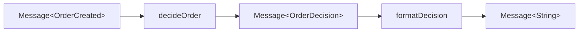

# Building Responses with `MessageBuilder`

## 1. Problem Statement: Returning Business Data Alongside Metadata

In **Spring Cloud Function** (`SPRING_CLOUD_FUNCTION`), business logic can be packaged as `Supplier`, `Function`, and `Consumer`, registered via `FunctionCatalog`, chained using *composition*, and executed over HTTP, events, or serverless environments. A `Function<OrderRequest, OrderResult>` is sufficient when the receiver only needs the business result. However, in flows that require a trace ID (`correlationId`), result code (`resultCode`), or processing unit (`processedBy`), you can return `Message<OrderResult>`.

`Message<T>` belongs to Spring Messaging and consists of a **payload** of type `T` and **headers** of type `MessageHeaders`. `MessageBuilder` is a convenient way to build that message:

```java
Message<String> reply = MessageBuilder.withPayload("ACCEPTED")
        .setHeader("correlationId", "req-42")
        .setHeader("resultCode", "ORDER_ACCEPTED")
        .build();
```

This snippet creates **an in-memory message object**. It does not by itself send an HTTP response, publish an event to a broker, or call a serverless API: transport and data conversion remain the responsibility of the integration adapter.

After this lesson, you will know how to build responses with `MessageBuilder`, select and forward required headers, distinguish business outcomes from protocol errors, and test responses without an HTTP server or message broker.

## 2. Role of `MessageBuilder` and Its Main Methods

`MessageBuilder`'s fully qualified name is `org.springframework.messaging.support.MessageBuilder`. It creates an object implementing `org.springframework.messaging.Message<T>` and provides operations to add metadata before calling `build()`.

```text
          withPayload(data)       fromMessage(existing)
                  \                 /
                   \               /
                       Builder
                         |
                setHeader / copyHeaders
                         |
                       build()
                         |
                     Message<T>
                    /          \
             payload: T     MessageHeaders
```

| Method | Purpose | Usage example |
|---|---|---|
| `withPayload(value)` | Create a builder with a new payload | Newly computed business result |
| `fromMessage(message)` | Initialize a builder from an existing message | Keep payload, add or change metadata |
| `setHeader(key, value)` | Set or replace a header by key | `correlationId`, `processedBy` |
| `setHeaderIfAbsent(key, value)` | Set a default when the key is absent | Default source identifier |
| `copyHeaders(map)` | Copy headers from a map | Forwarding multiple metadata entries |
| `copyHeadersIfAbsent(map)` | Copy only keys the builder does not yet contain | Keep priority for already-set values |
| `removeHeader(key)` | Remove a header | Drop metadata that is no longer appropriate |
| `build()` | Finalize the message | Return `Message<T>` |

Two important notes: with `MessageBuilder.withPayload(...)`, the payload must be **non-`null`**; and `MessageHeaders` on the created message is a **read-only map**. Do not use `message.getHeaders().put(...)` to update it. If you need a new response or different headers, create a new message.

## 3. Minimal Example: Building a Response with Payload and Headers

```java
import org.springframework.messaging.Message;
import org.springframework.messaging.MessageHeaders;
import org.springframework.messaging.support.MessageBuilder;
import org.springframework.util.MimeTypeUtils;

Message<String> reply = MessageBuilder.withPayload("Order received")
        .setHeader("resultCode", "ORDER_RECEIVED")
        .setHeader("correlationId", "req-42")
        .setHeader(MessageHeaders.CONTENT_TYPE, MimeTypeUtils.TEXT_PLAIN)
        .build();

System.out.println(reply.getPayload());
// Order received
System.out.println(reply.getHeaders().get("resultCode"));
// ORDER_RECEIVED
System.out.println(reply.getHeaders().get("correlationId"));
// req-42
```

`withPayload("...")` specifies the `String` result data. The `setHeader(...)` calls attach metadata. `MessageHeaders.CONTENT_TYPE` represents the internal `contentType` header; `MimeTypeUtils.TEXT_PLAIN` denotes the `text/plain` media type, though it **does not by itself encode or send data over the network**. `build()` finalizes the `Message<String>` object.

Spring Messaging also provides system headers such as `id` and `timestamp`. A message identifier is not synonymous with an order ID or transaction ID; store business IDs in the payload or in a clearly defined custom header.

## 4. Spring Cloud Function Example: Returning `Message<OrderDecision>`

Suppose a function receives an order event and returns an approval decision along with the request correlation ID. Because it needs to read input headers and produce output headers, the appropriate signature is `Function<Message<OrderCreated>, Message<OrderDecision>>`. Example using Java 17+:

```java
package com.example.functions;

import java.util.function.Function;

import org.springframework.context.annotation.Bean;
import org.springframework.context.annotation.Configuration;
import org.springframework.messaging.Message;
import org.springframework.messaging.support.MessageBuilder;

@Configuration
public class OrderFunctions {

    public record OrderCreated(String orderId, long amount) {}

    public record OrderDecision(
            String orderId,
            String status,
            String reason
    ) {}

    // Pure business logic, reusable across contexts.
    private static OrderDecision evaluate(OrderCreated order) {
        boolean accepted = order.orderId() != null
                && !order.orderId().isBlank()
                && order.amount() > 0;

        return new OrderDecision(
                order.orderId(),
                accepted ? "ACCEPTED" : "REJECTED",
                accepted ? "Valid order" : "Invalid id or amount"
        );
    }

    @Bean
    public Function<Message<OrderCreated>, Message<OrderDecision>> decideOrder() {
        return incoming -> {
            OrderDecision decision = evaluate(incoming.getPayload());

            MessageBuilder<OrderDecision> builder = MessageBuilder
                    .withPayload(decision)
                    .setHeader("processedBy", "decideOrder")
                    .setHeader(
                            "resultCode",
                            "ACCEPTED".equals(decision.status())
                                    ? "ORDER_ACCEPTED"
                                    : "ORDER_REJECTED"
                    );

            String correlationId = incoming.getHeaders()
                    .get("correlationId", String.class);

            if (correlationId != null) {
                builder.setHeader("correlationId", correlationId);
            }

            return builder.build();
        };
    }
}
```

Here `evaluate(...)` **does not depend on HTTP, a broker, or `MessageBuilder`**. It returns an `OrderDecision` from an `OrderCreated` and can be reused in a plain POJO function. `decideOrder()` handles the message envelope: extracting the payload, invoking business logic, building the response, and attaching headers.

The function intentionally sets `processedBy` and `resultCode` from internal logic. `correlationId` is forwarded if present; other headers are not copied indiscriminately. The sender might include a `source` header, but this function does not copy it to the output. When calling `get("correlationId", String.class)`, if the header exists with a type other than `String`, the API may throw a type error; contracts between systems should specify and normalize value types.

### Calling the function directly

```java
import java.util.function.Function;

import org.springframework.messaging.Message;
import org.springframework.messaging.support.MessageBuilder;

import com.example.functions.OrderFunctions;
import com.example.functions.OrderFunctions.OrderCreated;
import com.example.functions.OrderFunctions.OrderDecision;

Function<Message<OrderCreated>, Message<OrderDecision>> fn =
        new OrderFunctions().decideOrder();

Message<OrderCreated> request = MessageBuilder
        .withPayload(new OrderCreated("ORD-101", 120_000))
        .setHeader("correlationId", "checkout-8")
        .setHeader("source", "checkout-service")
        .build();

Message<OrderDecision> reply = fn.apply(request);

System.out.println(reply.getPayload().status());
// ACCEPTED
System.out.println(reply.getHeaders().get("correlationId"));
// checkout-8
System.out.println(reply.getHeaders().get("resultCode"));
// ORDER_ACCEPTED
System.out.println(reply.getHeaders().get("source"));
// null: source is not copied from input
```

Invoking the `Function` bean directly lets you inspect **the exact message produced by the function's logic**. When invoked via `FunctionCatalog`, an HTTP adapter, or a binder, the framework may perform additional conversion/mapping depending on how it is integrated.

## 5. How Does `withPayload(...)` Differ from `fromMessage(...)`?

### Creating a new payload

When the result is a different object from the input, use `withPayload(result)`:

```java
Message<OrderDecision> output = MessageBuilder
        .withPayload(new OrderDecision("ORD-101", "ACCEPTED", "Valid order"))
        .setHeader("correlationId", "checkout-8")
        .build();
```

This is the usual choice in `Function<Message<I>, Message<O>>`: `I` and `O` can be completely different types.

### Keeping the payload and adding metadata

If the payload stays the same, using `fromMessage(existing)` is more convenient:

```java
Message<String> incoming = MessageBuilder
        .withPayload("order.received")
        .setHeader("correlationId", "req-55")
        .build();

Message<String> annotated = MessageBuilder.fromMessage(incoming)
        .setHeader("processedBy", "eventValidator")
        .build();

// annotated still has payload "order.received".
// annotated has correlationId and processedBy.
```

`fromMessage(...)` uses an existing message to initialize the builder; it is not a tool for changing a payload from type `I` to type `O`. Do not rely on `id` or `timestamp` always being preserved/regenerated when copying messages: they are technical metadata with their own rules, not cross-hop business identifiers.

## 6. Three Strategies for Handling Headers When Returning a Response

### A. Selectively set only the headers actually needed

```java
Message<String> output = MessageBuilder.withPayload("ACCEPTED")
        .setHeader("correlationId", "req-42")
        .setHeader("processedBy", "orderProcessor")
        .build();
```

This strategy is easy to control because only metadata defined in the contract is placed into the response.

### B. Copy and then replace or remove

If the contract requires keeping many headers, you can use:

```java
// incoming is a Message<?> created in a previous step.
Message<String> output = MessageBuilder.withPayload("ACCEPTED")
        .copyHeaders(incoming.getHeaders())
        .removeHeader("source")
        .setHeader("processedBy", "orderProcessor")
        .build();
```

`copyHeaders(...)` puts headers into the builder, after which `setHeader(...)` can override values for matching keys and `removeHeader(...)` drops unwanted keys. Use this only after reviewing metadata from the sender: headers may contain a `contentType` that is no longer accurate, broker properties, or sensitive values.

### C. Keep already-set headers and fill in only missing ones

```java
import java.util.Map;

Message<String> output = MessageBuilder.withPayload("ACCEPTED")
        .setHeader("processedBy", "orderProcessor")
        .copyHeadersIfAbsent(Map.of(
                "processedBy", "upstream",
                "correlationId", "req-42"
        ))
        .build();

// processedBy = "orderProcessor" because the builder already had this value.
// correlationId = "req-42" because the builder did not have it beforehand.
```

`setHeaderIfAbsent(key, value)` is a useful variant for a single header. Define precedence clearly: metadata produced by **the current processing step** should usually overwrite same-named values supplied by the client, whereas defaults should only be added if missing.

| Header | Usually sensible strategy | Why? |
|---|---|---|
| `correlationId` | Forward after verifying the expected type | Links multiple hops of the same transaction |
| `processedBy`, `resultCode` | Recreate in the current function | Accurately reflects the actor and outcome just processed |
| `contentType` | Re-evaluate according to the output payload | Type/format may have changed |
| `replyChannel`, `errorChannel` | Keep only when the integration actually uses them | Transport-channel-specific metadata |
| Broker or retry headers | Map per adapter contract | Do not have identical meaning across protocols |
| Tokens, permissions, `tenantId` | Validate and filter at the trust boundary | Client-asserted headers do not prove access rights |

**Immutability note:** `MessageHeaders` is a read-only map, but if a header value references a mutable object, that object itself can still be mutated. For messages crossing a broker, prefer small, clear, serializable value types.

## 7. Responses with `contentType`: Setting a Header Is Not Encoding Data

The message model, Java data type, and wire format serve distinct roles:

| Concept | Role |
|---|---|
| `Message<OrderDecision>` | The payload in Java code is an `OrderDecision` |
| `contentType` | Metadata hinting content format at the conversion boundary, e.g., `application/json` |
| Converter/adapter | Converts between JSON, bytes, DTOs, and transport protocols |

The following example attaches a JSON media type to a DTO response:

```java
import org.springframework.messaging.Message;
import org.springframework.messaging.MessageHeaders;
import org.springframework.messaging.support.MessageBuilder;
import org.springframework.util.MimeTypeUtils;

import com.example.functions.OrderFunctions.OrderDecision;

OrderDecision decision = new OrderDecision(
        "ORD-101", "ACCEPTED", "Valid order");

Message<OrderDecision> response = MessageBuilder.withPayload(decision)
        .setHeader(MessageHeaders.CONTENT_TYPE, MimeTypeUtils.APPLICATION_JSON)
        .build();
```

When reading `response.getPayload()` in Java, the data **is still an `OrderDecision` object**. The `contentType` header does not run a JSON converter by itself. If the adapter has a matching converter, it can use that metadata and the function signature to determine how to encode the output.

If the result is plain text, you can create:

```java
Message<String> response = MessageBuilder
        .withPayload("Order has been approved")
        .setHeader(MessageHeaders.CONTENT_TYPE, MimeTypeUtils.TEXT_PLAIN)
        .build();
```

When a function changes the payload from a DTO to `String` or `byte[]`, **you should not mechanically copy the input's `contentType` as-is**. Furthermore, the Spring Messaging `contentType` header and HTTP `Content-Type` do not automatically follow identical mapping rules across every adapter; test your actual outbound configuration.

## 8. Business Responses, HTTP Status, and System Errors

`MessageBuilder` represents result data and metadata. It is not an API for directly controlling HTTP status codes, broker acknowledgments, or serverless retries.

| Scenario | Sensible business-layer outcome | What to keep in mind |
|---|---|---|
| Valid order | `OrderDecision(status="ACCEPTED")` | Receiver reads the outcome from the payload |
| Order rejected by business rules | `OrderDecision(status="REJECTED")` | This can be a normal business response |
| Unexpected system error | Defined exception/error flow | Adapter decides retries, error response, dead-lettering, etc. |

Setting `resultCode=ORDER_REJECTED` **does not mean the HTTP response will have status 400**. Likewise, a response with status `REJECTED` does not by itself cause a binder to retry. If a web API must return a specific HTTP status code, use the integration layer's response-control mechanism and verify it with an integration test. If a message must be published to a broker, configure the appropriate output binding or adapter.

## 9. `MessageBuilder` in `FunctionCatalog` and Composition

The `decideOrder` function above is a Spring Cloud Function bean. It can be looked up via `FunctionCatalog` once the Spring context has registered the bean:

```java
import java.util.function.Function;

import org.springframework.cloud.function.context.FunctionCatalog;
import org.springframework.messaging.Message;
import org.springframework.messaging.support.MessageBuilder;

import com.example.functions.OrderFunctions.OrderCreated;
import com.example.functions.OrderFunctions.OrderDecision;

// catalog is the FunctionCatalog bean injected from the Spring context.
Function<Message<OrderCreated>, Message<OrderDecision>> fn =
        catalog.lookup("decideOrder");

Message<OrderCreated> input = MessageBuilder
        .withPayload(new OrderCreated("ORD-102", 80_000))
        .setHeader("correlationId", "checkout-9")
        .build();

Message<OrderDecision> output = fn.apply(input);
```

Suppose there is a second bean `formatDecision` with signature `Function<Message<OrderDecision>, Message<String>>`. When the types are compatible, Spring Cloud Function can compose them:

```properties
spring.cloud.function.definition=decideOrder|formatDecision
```



If `formatDecision` needs `correlationId`, that metadata must be present in the message after `decideOrder`. Define a header-forwarding contract and test **the composed chain itself via `FunctionCatalog`**, because wrapping/unwrapping, composition, and conversion mechanisms can affect the message observed by each step.

With **Spring Cloud Function Web**, the adapter receives the HTTP body/headers and performs appropriate conversions; with **Spring Cloud Stream**, the binder connects to the broker; in **serverless**, the adapter maps the runtime event. The response-building logic using `MessageBuilder` can be reused, while which headers become HTTP response headers, broker metadata, or event fields still depends on the adapter and configuration.

## 10. Testing Responses with JUnit 5

The following test verifies the `decideOrder` bean from section 4 at the Java logic level, without starting an HTTP server or broker:

```java
package com.example.functions;

import static org.junit.jupiter.api.Assertions.assertEquals;
import static org.junit.jupiter.api.Assertions.assertNull;

import java.util.function.Function;

import org.junit.jupiter.api.Test;
import org.springframework.messaging.Message;
import org.springframework.messaging.support.MessageBuilder;

import com.example.functions.OrderFunctions.OrderCreated;
import com.example.functions.OrderFunctions.OrderDecision;

class OrderFunctionsTest {

    private final Function<Message<OrderCreated>, Message<OrderDecision>> fn =
            new OrderFunctions().decideOrder();

    @Test
    void acceptedOrderReturnsPayloadAndSelectedHeaders() {
        Message<OrderCreated> input = MessageBuilder
                .withPayload(new OrderCreated("ORD-101", 120_000))
                .setHeader("correlationId", "checkout-8")
                .setHeader("source", "checkout-service")
                .build();

        Message<OrderDecision> result = fn.apply(input);

        assertEquals("ORD-101", result.getPayload().orderId());
        assertEquals("ACCEPTED", result.getPayload().status());
        assertEquals("ORDER_ACCEPTED", result.getHeaders().get("resultCode"));
        assertEquals("decideOrder", result.getHeaders().get("processedBy"));
        assertEquals("checkout-8", result.getHeaders().get("correlationId"));
        assertNull(result.getHeaders().get("source"));

        // Input still retains its original header.
        assertEquals("checkout-service", input.getHeaders().get("source"));
    }

    @Test
    void rejectedOrderIsAnExplicitBusinessResponse() {
        Message<OrderCreated> input = MessageBuilder
                .withPayload(new OrderCreated("ORD-103", -100))
                .build();

        Message<OrderDecision> result = fn.apply(input);

        assertEquals("REJECTED", result.getPayload().status());
        assertEquals("ORDER_REJECTED", result.getHeaders().get("resultCode"));
        assertNull(result.getHeaders().get("correlationId"));
    }

    @Test
    void optionalCorrelationIdCanBeAbsent() {
        Message<OrderCreated> input = MessageBuilder
                .withPayload(new OrderCreated("ORD-104", 10_000))
                .build();

        Message<OrderDecision> result = fn.apply(input);

        assertEquals("ACCEPTED", result.getPayload().status());
        assertNull(result.getHeaders().get("correlationId"));
    }
}
```

These tests verify **the output payload**, **the response headers**, and **that the input is not mutated directly**. They do not prove HTTP status codes, JSON serialization, or broker header mapping. For each real adapter, add integration tests covering inbound/outbound paths, content types, DTO conversion, and errors.

## 11. Common Mistakes When Building Responses

| Symptom | Possible Cause | How to Address |
|---|---|---|
| Cannot create a response with a `null` payload | Standard builders require a valid payload | Define a result type that explicitly represents "no data" |
| `correlationId` is lost across steps | Output message does not forward required headers | Select headers per the contract and test each step |
| `processedBy` is overwritten by an old value | Unsuitable order of copying/setting headers | Set high-priority headers after `copyHeaders` or use `copyHeadersIfAbsent` |
| HTTP headers do not appear on output | Adapter does not automatically map every business header | Verify mapping behavior in the adapter |
| Client receives the wrong format | Stale `contentType` kept after payload changed type | Redefine the output format and configure converters |
| Cannot modify `message.getHeaders()` | Headers are a read-only map | Use `MessageBuilder` to create a new message |
| Setting `resultCode=ERROR` still returns a success HTTP status | Business headers do not control HTTP status | Handle HTTP responses via the adapter/integration layer |

## 12. Practice Exercise: Payment Result Response

Write a `Function<Message<PaymentRequest>, Message<PaymentResult>>` following these steps:

1. Create DTOs `PaymentRequest(paymentId, amount)` and `PaymentResult(paymentId, status, message)`. If `amount > 0`, set `status=APPROVED`; otherwise `status=DECLINED`.
2. Use `MessageBuilder.withPayload(result)` to build the response; add `processedBy=paymentValidator` and the corresponding `resultCode`.
3. Forward the `String` header `correlationId` if present, without copying `source` or other sensitive metadata.
4. Try using `copyHeaders(...)` as an alternative, and analyze the risks from `contentType` and broker-specific headers.
5. Write unit tests for approved payments, declined payments, and missing `correlationId`; assert both payload and headers.
6. Register the function in `FunctionCatalog` and try composing it with a notification-building function. If deploying over HTTP, events, or serverless, add an integration test verifying response mapping.

**Remember:** `MessageBuilder` is used to create **responses carrying both payload and metadata**. Choose `withPayload(...)` when producing a new result, `fromMessage(...)` when keeping the payload and adding headers, and only forward metadata that is meaningful to the receiver. Business logic remains protocol-independent; the adapter determines how the message is converted and transmitted over HTTP, a broker, or serverless.
