# Mapping HTTP Headers and Platform Metadata into `Message`

## 1. Why Do We Need a Metadata Mapping Layer?

In **SPRING_CLOUD_FUNCTION (Spring Cloud Function)**, business logic is built as `Supplier`, `Function`, and `Consumer`, registered via `FunctionCatalog`, optionally chained using *composition*, and deployed over HTTP, event streams, or serverless environments. For the same function to be reusable across these invocation styles, the function needs to see **data and metadata under a consistent contract**, rather than depending directly on `HttpServletRequest`, a Kafka record, or a cloud platform's event type.

For example, the same order-placed event can enter the system in different forms:

- HTTP: JSON in the request body and an `X-Correlation-ID: req-42` header.
- Broker: event payload along with a correlation attribute in message headers; possibly accompanied by topic, partition, or delivery metadata.
- Serverless: an event envelope containing business data and context fields provided by the platform.

Inside the business function, we want to use a simple contract:

```java
Function<Message<OrderPlaced>, Message<OrderReceipt>>
```

Here `Message<T>` is the **Spring Messaging** interface consisting of `getPayload()` and `getHeaders()`. The function only needs to know the internal header named `correlationId`, not whether the original entry point used `X-Correlation-ID`, a message attribute, or a field in an event envelope.

**Metadata mapping** is the process of selecting, type-checking, normalizing names, and transferring information from the protocol/platform into `MessageHeaders`; the reverse process can carry selected result headers out to the outbound protocol. It does **not** mean copying every external header into the message.

The goal of this lesson is to distinguish metadata at each layer, understand adapter behavior, implement transparent HTTP mapping, handle CloudEvents and broker/serverless data, and test both inbound and outbound directions.

## 2. Three Information Layers Along a Request's Path

```mermaid
flowchart LR
    A["HTTP / Broker / Serverless<br/>body + platform metadata"] --> B["Adapter + converter<br/>validate, normalize, map"]
    B --> C["Message&lt;OrderPlaced&gt;<br/>payload + internal headers"]
    C --> D["FunctionCatalog / Function<br/>protocol-independent logic"]
    D --> E["Message&lt;OrderReceipt&gt;<br/>payload + result headers"]
    E --> F["Outbound adapter<br/>select headers + serialize"]
    F --> G["HTTP response / event / runtime result"]
```



| Layer | Examples | Responsibility |
|---|---|---|
| Protocol or platform | HTTP `Content-Type`, `X-Correlation-ID`, Kafka offset, CloudEvents `ce-id` | Carries information tied to the transport mechanism |
| In-application `Message<T>` | Payload `OrderPlaced`; headers `correlationId`, `eventId` | Establishes a stable contract for business processing |
| Business logic | `Function<Message<OrderPlaced>, Message<OrderReceipt>>` | Reads required metadata, processes data, and produces results |

Spring Cloud Function provides adaptation mechanisms for function types and message conversion. **Whether a specific header automatically appears in `MessageHeaders`, under what name, and with what data type depends on the adapter, version, configuration, and actual invocation method.** Therefore, for headers important to business logic, define the contract explicitly and write integration tests.

## 3. Classifying HTTP Headers Before Mapping

HTTP headers serve many different purposes. Not every header needs to become metadata for a function:

| HTTP header | Meaning at the HTTP boundary | How to handle when building `Message` |
|---|---|---|
| `Content-Type` | Format of the request body, e.g. `application/json` | Let the converter handle it; map to internal `contentType` when appropriate |
| `Accept` | Response format the client can accept | Usually belongs to HTTP content negotiation; no need to pass into business logic |
| `X-Correlation-ID` | Correlation ID by system convention, not a mandatory standard header | Validate and normalize into `correlationId` |
| `traceparent`, `tracestate` | Distributed tracing context per W3C | Prefer letting tracing/observability libraries manage these |
| `Authorization`, `Cookie` | Authentication or session credentials | Handle in the security layer; do not pass raw values through functions |
| `X-Tenant-ID`, `X-User-ID` | Values that may be client-asserted | Use only when authenticated and bound to a trusted identity |
| `Host`, `Connection`, `Content-Length` | HTTP transport metadata | Do not bring verbatim into the business contract |

For instance, the following two HTTP requests have the same meaning because HTTP header names are **case-insensitive**:

```http
POST /orders HTTP/1.1
Content-Type: application/json
X-Correlation-ID: checkout-42

{"orderId":"ORD-42","amount":150000}
```

```http
POST /orders HTTP/1.1
content-type: application/json
x-correlation-id: checkout-42

{"orderId":"ORD-42","amount":150000}
```

However, `MessageHeaders` is a string-keyed map in Java: `"correlationId"`, `"CorrelationId"`, and `"X-Correlation-ID"` are **not the same key**. The integration layer should normalize all of them into one agreed-upon internal name.

An HTTP header can also have multiple values. For a header used as a single identifier, define explicit rules for when a client sends multiple values or an invalid string, instead of silently picking an arbitrary value.

## 4. Two Ways to Handle HTTP in a Spring Cloud Function Application

### Approach 1: Using the Spring Cloud Function Web Adapter

Spring Cloud Function Web can expose function beans as HTTP endpoints. The web adapter receives the request, selects the function, handles the body, and performs conversions matching the function signature and converter configuration. When `Message<T>` is used on input, the framework can supply metadata from the request according to the adapter's mechanism.

Example bean signature:

```java
@Bean
public Function<Message<OrderPlaced>, Message<OrderReceipt>> handleOrder() {
    return incoming -> MessageBuilder
            .withPayload(new OrderReceipt(
                    incoming.getPayload().orderId(), "ACCEPTED"))
            .build();
}
```

This is a minimal illustration using the `OrderPlaced` and `OrderReceipt` DTOs that will be declared in full in section 5. When using only the Web adapter, you do not have to write a `@RestController` for every function. However, **do not assume** that the HTTP header `X-Correlation-ID` is always renamed to `correlationId`, or that an output `Message` with a `resultCode` header guarantees the HTTP response will include that header. Use integration tests to verify the concrete mapping in the running web stack.

### Approach 2: Writing a Thin HTTP Layer for Explicit Mapping

If the system needs fixed internal header names, strict validation policies, or custom response mapping, you can place a `@RestController` as the boundary layer. The controller accepts `HttpHeaders` and the body, constructs the input `Message`, invokes the `Function` bean, and then builds the HTTP response from **only the information permitted to be exposed**. The business logic remains independent of HTTP.

The following sections illustrate this second approach using Spring MVC and Java 17+.

## 5. Complete Example: Normalizing HTTP Headers into `MessageHeaders`

### 5.1. Business logic unaware of HTTP headers

Create the order-processing function bean. The bean only recognizes the normalized header name `correlationId` and produces `processedBy` on output:

```java
package com.example.orders;

import java.util.function.Function;

import org.springframework.context.annotation.Bean;
import org.springframework.context.annotation.Configuration;
import org.springframework.messaging.Message;
import org.springframework.messaging.support.MessageBuilder;

@Configuration
public class OrderFunctions {

    public record OrderPlaced(String orderId, long amount) {}
    public record OrderReceipt(String orderId, String status) {}

    @Bean
    public Function<Message<OrderPlaced>, Message<OrderReceipt>> handleOrder() {
        return incoming -> {
            OrderPlaced order = incoming.getPayload();
            boolean valid = order.orderId() != null
                    && !order.orderId().isBlank()
                    && order.amount() > 0;

            OrderReceipt receipt = new OrderReceipt(
                    order.orderId(),
                    valid ? "ACCEPTED" : "REJECTED"
            );

            MessageBuilder<OrderReceipt> builder = MessageBuilder
                    .withPayload(receipt)
                    .setHeader("processedBy", "handleOrder");

            String correlationId = incoming.getHeaders()
                    .get("correlationId", String.class);
            if (correlationId != null) {
                builder.setHeader("correlationId", correlationId);
            }
            return builder.build();
        };
    }
}
```

When called directly with a `Message<OrderPlaced>`, it processes the order without needing a servlet, broker, or cloud event. The `status=REJECTED` field illustrates a business outcome; the corresponding HTTP status code is a decision for the HTTP layer.

### 5.2. Controller mapping in the HTTP → `Message` direction

This example uses Spring MVC. It assumes the application includes Spring Web and Spring Cloud Function, with the `handleOrder` bean registered above.

```java
package com.example.orders;

import java.util.List;
import java.util.UUID;
import java.util.function.Function;

import org.springframework.beans.factory.annotation.Qualifier;
import org.springframework.http.HttpHeaders;
import org.springframework.http.HttpStatus;
import org.springframework.http.MediaType;
import org.springframework.http.ResponseEntity;
import org.springframework.messaging.Message;
import org.springframework.messaging.support.MessageBuilder;
import org.springframework.web.bind.annotation.PostMapping;
import org.springframework.web.bind.annotation.RequestBody;
import org.springframework.web.bind.annotation.RequestHeader;
import org.springframework.web.bind.annotation.RestController;
import org.springframework.web.server.ResponseStatusException;

import com.example.orders.OrderFunctions.OrderPlaced;
import com.example.orders.OrderFunctions.OrderReceipt;

@RestController
public class OrderHttpController {

    private final Function<Message<OrderPlaced>, Message<OrderReceipt>> handler;

    public OrderHttpController(
            @Qualifier("handleOrder")
            Function<Message<OrderPlaced>, Message<OrderReceipt>> handler) {
        this.handler = handler;
    }

    @PostMapping(
            path = "/orders",
            consumes = MediaType.APPLICATION_JSON_VALUE,
            produces = MediaType.APPLICATION_JSON_VALUE
    )
    public ResponseEntity<OrderReceipt> accept(
            @RequestBody OrderPlaced body,
            @RequestHeader HttpHeaders httpHeaders) {

        String correlationId = readCorrelationId(httpHeaders);

        // Map the HTTP body and normalized header into the internal Message.
        Message<OrderPlaced> incoming = MessageBuilder.withPayload(body)
                .setHeader("correlationId", correlationId)
                .setHeader("source", "http-api")
                .build();

        Message<OrderReceipt> outgoing = handler.apply(incoming);

        // Export only metadata published in the HTTP contract.
        HttpHeaders responseHeaders = new HttpHeaders();
        responseHeaders.set(
                "X-Correlation-ID",
                outgoing.getHeaders().get("correlationId", String.class));
        responseHeaders.set(
                "X-Processed-By",
                outgoing.getHeaders().get("processedBy", String.class));

        return new ResponseEntity<>(
                outgoing.getPayload(), responseHeaders, HttpStatus.OK);
    }

    private static String readCorrelationId(HttpHeaders headers) {
        // HttpHeaders supports case-insensitive HTTP header lookup.
        List<String> values = headers.get("X-Correlation-ID");

        if (values == null || values.isEmpty()) {
            return UUID.randomUUID().toString();
        }

        // Under a single-identifier contract, multiple values are rejected.
        if (values.size() != 1
                || !values.get(0).matches("[A-Za-z0-9._-]{1,64}")) {
            throw new ResponseStatusException(
                    HttpStatus.BAD_REQUEST, "Invalid X-Correlation-ID");
        }
        return values.get(0);
    }
}
```

Notice the decisions made at the boundary:

1. Spring MVC decodes the JSON request body into `OrderPlaced` using a converter matching `Content-Type`. `MessageBuilder` does not parse JSON on its own.
2. `HttpHeaders` is queried using the HTTP name `X-Correlation-ID`, validated for length, character set, and value count; when absent, the controller generates a new ID.
3. The controller uses the internal name **`correlationId`** and adds `source=http-api`. The `handleOrder` function does not need to know the original HTTP header name.
4. The function returns `Message<OrderReceipt>`. The controller maps only `correlationId` and `processedBy` to response headers; it does not copy all `MessageHeaders`.
5. `ResponseEntity` determines the HTTP status, response body, and headers. The example intentionally returns `200 OK` for both `ACCEPTED` and `REJECTED` because `REJECTED` is treated as a business outcome; another API may specify a different HTTP code.

**Example of calling the controller's custom endpoint:**

```bash
curl -i -X POST http://localhost:8080/orders \
  -H "Content-Type: application/json" \
  -H "X-Correlation-ID: checkout-42" \
  -d '{"orderId":"ORD-42","amount":150000}'
```

Sample response (other HTTP headers added by the server may vary):

```http
HTTP/1.1 200 OK
Content-Type: application/json
X-Correlation-ID: checkout-42
X-Processed-By: handleOrder

{"orderId":"ORD-42","status":"ACCEPTED"}
```

This `/orders` path and response mapping belong to the **illustrative controller**, not a guarantee of default endpoints or header names auto-generated by the Spring Cloud Function Web adapter.

## 6. Distinguishing `Content-Type`, `Accept`, and Internal `contentType`

A common confusion is treating all "content types" as a single thing.

| Information | Where? | What question does it answer? |
|---|---|---|
| HTTP request `Content-Type` | HTTP headers on the sender side | In what format did the client send the body? |
| HTTP request `Accept` | HTTP headers on the sender side | Which response formats can the client accept? |
| `MessageHeaders.CONTENT_TYPE`, i.e., `contentType` | Spring Messaging `MessageHeaders` | In what format is the message payload expected to be converted? |
| HTTP response `Content-Type` | HTTP headers on the responder side | In what format is the server returning the response body? |

For example, a function can receive `Message<OrderPlaced>` even though the HTTP request body was originally JSON text. Spring MVC or the adapter/converter performed the step from JSON to a Java DTO. Conversely, `Message<OrderReceipt>` holds a DTO payload, not JSON bytes just because the `contentType` header carries `application/json`.

```java
import org.springframework.messaging.Message;
import org.springframework.messaging.MessageHeaders;
import org.springframework.messaging.support.MessageBuilder;
import org.springframework.util.MimeTypeUtils;

import com.example.orders.OrderFunctions.OrderReceipt;

Message<OrderReceipt> outgoing = MessageBuilder
        .withPayload(new OrderReceipt("ORD-42", "ACCEPTED"))
        .setHeader(MessageHeaders.CONTENT_TYPE, MimeTypeUtils.APPLICATION_JSON)
        .build();
```

In this snippet, `getPayload()` still returns an `OrderReceipt` object. The header merely represents metadata that a converter/adapter can use. When exposing an HTTP API with the controller in section 5, Spring MVC encodes the response body based on its converters and media type configuration.

If a `Function` transforms a payload from a DTO into `String` or `byte[]`, copying the old `contentType` can misrepresent the output format. Redefine the media type contract and test the actual transmitted content.

## 7. Mapping CloudEvents: Event Metadata Is Not the Business Body

**CloudEvents** is a widely used specification for describing events across protocols. A CloudEvent has context attributes such as `specversion`, `id`, `source`, and `type`, together with `data` containing the event data. When transported over HTTP, there are two common modes:

**Binary content mode:** the body holds the event data; context attributes are represented as `ce-*` HTTP headers (while the data content type can travel via HTTP `Content-Type`).

```http
POST /events HTTP/1.1
Content-Type: application/json
ce-specversion: 1.0
ce-id: evt-1001
ce-source: /checkout
ce-type: com.example.order.placed

{"orderId":"ORD-42","amount":150000}
```

**Structured content mode:** the entire event envelope lives in the body, typically JSON with media type `application/cloudevents+json`:

```json
{
  "specversion": "1.0",
  "id": "evt-1001",
  "source": "/checkout",
  "type": "com.example.order.placed",
  "data": {
    "orderId": "ORD-42",
    "amount": 150000
  }
}
```

If we normalize these two modes into an internal contract, we can choose:

| CloudEvents | Suggested internal header | Notes |
|---|---|---|
| `id` / HTTP `ce-id` | `eventId` | Event identifier in the producer's context, distinct from `MessageHeaders.ID` |
| `source` / `ce-source` | `eventSource` | Event source; not synonymous with an authenticated identity |
| `type` / `ce-type` | `eventType` | Event classification, e.g., `com.example.order.placed` |
| `specversion` / `ce-specversion` | Can store `eventSpecVersion` if truly needed | Envelope validation belongs to the adapter |
| `data` | `Message<OrderPlaced>.getPayload()` | Decode into DTO only after format validation |

Example of building a message **after the adapter has decoded and validated the event context**:

```java
OrderPlaced order = new OrderPlaced("ORD-42", 150000);

Message<OrderPlaced> incoming = MessageBuilder.withPayload(order)
        .setHeader("eventId", "evt-1001")
        .setHeader("eventSource", "/checkout")
        .setHeader("eventType", "com.example.order.placed")
        .build();
```

CloudEvents `id` identifies the **event**; `correlationId` is an application convention for linking multiple processing steps. You should not automatically equate the two values. Similarly, `traceparent` belongs to distributed tracing context and does not automatically become `correlationId`.

In particular, **not every JSON HTTP request is a CloudEvent**, and merely having `ce-id` does not mean every Spring Cloud Function adapter will automatically create an internal `eventId` header. The application must determine which CloudEvents mode it uses and verify the conversion mechanism of the configured adapter/library.

## 8. Metadata from Brokers and Serverless Environments

When using **Spring Cloud Stream** with a binder, or a serverless adapter, metadata comes from the transport system and event envelope. They do not necessarily share names with HTTP headers.

| Source | Metadata you may encounter | How should it enter `MessageHeaders`? |
|---|---|---|
| Kafka via binder | Record key, topic, partition, offset, timestamp, record headers | Let the binder/adapter extract them; normalize only business fields truly needed |
| RabbitMQ via binder | Routing key, message properties, delivery metadata | Read via adapter/binder; do not couple business logic to RabbitMQ-specific header names |
| AWS API Gateway / Lambda | HTTP headers, request context, request ID, event metadata | Adapter decodes envelope; decide which metadata is trusted and forwarded |
| AWS SQS / Lambda | `messageId`, message attributes, receipt handle, receive timestamp | Distinguish event ID, business correlation, and message ack/delete mechanics |
| CloudEvents over HTTP/broker | `id`, `source`, `type`, `subject`, `time`, extension attributes | Normalize when the app actually uses CloudEvents; do not assume they are always present |

For example, an application can choose a contract:

```text
HTTP:       X-Correlation-ID = "checkout-42"
Broker:     message attribute "correlation_id" = "checkout-42"
Serverless: event.detail.correlationId = "checkout-42"
                       |
             [normalizing adapter]
                       v
MessageHeaders["correlationId"] = "checkout-42"
                       |
                 handleOrder()
```

The lines above illustrate a **design convention**. `correlation_id` and `event.detail.correlationId` are not built-in fields provided by every binder or cloud platform. It is the sender/adapter contract that dictates where the value comes from.

Do not stuff details such as Kafka offsets, SQS receipt handles, redelivery metadata, or runtime request context objects into the business payload "for convenience". They carry transport or message-lifecycle meaning; protocol-independent steps usually do not need and should not depend on them.

### Header data types matter too

`MessageHeaders` is a `Map<String, Object>`. Values can be `String`, numbers, timestamps, `byte[]`, or object types placed by the adapter; they are not necessarily JSON-like strings. For example:

```java
static String readOptionalCorrelationId(Message<?> incoming) {
    Object raw = incoming.getHeaders().get("correlationId");
    if (raw == null) {
        return null;
    }
    if (raw instanceof String correlationId) {
        return correlationId;
    }
    throw new IllegalArgumentException("correlationId must be a String");
}
```

Do not blindly cast every header to `String`, and do not assume every value is serializable across every broker. For messages traversing multiple systems, prefer simple types and consistent formatting conventions.

## 9. Trust Boundaries: Which Headers May Become Business Data?

HTTP headers and event metadata can come from external callers, be spoofed, or arrive malformed. Therefore, the mapping layer must **validate the source and validate the value** before metadata influences business decisions.

Practical principles:

1. **Do not trust client-asserted authorization metadata.** `X-User-ID` or `X-Tenant-ID` does not prove identity. If a tenant is needed in `Message`, obtain it from an authenticated and authorized principal/claims at the trust boundary.
2. **Limit the size and character set of identifiers.** For `X-Correlation-ID` in the example, character set and length are checked before mapping; invalid values receive HTTP 400. This prevents unwieldy data in logs and tracing.
3. **Define a policy for duplicate headers.** A single business identifier should follow a single-value rule. Do not arbitrarily join multiple values and treat them as one ID.
4. **Do not copy `Authorization`, cookies, tokens, or entire request contexts.** Forward only metadata serving authorized functionality, avoiding leaks into brokers, logs, and downstream services.
5. **Use observability libraries for trace context.** `traceparent` and `tracestate` must follow propagation standards and mechanisms; rolling your own easily breaks tracing or creates invalid context.
6. **Distinguish trusted sources of `X-Forwarded-*`.** Use only values set by a trusted reverse proxy/gateway according to system configuration.

If user context must travel across a function chain, pass **verified and minimal necessary information**, not all raw HTTP headers. Authorization checks should still be enforced at the appropriate processing points, rather than relying solely on a header having passed through an adapter.

## 10. Reverse Mapping from `Message` Out to HTTP or Events

A function's output can contain both data and metadata:

```java
Message<OrderReceipt> result = MessageBuilder
        .withPayload(new OrderReceipt("ORD-42", "ACCEPTED"))
        .setHeader("correlationId", "checkout-42")
        .setHeader("processedBy", "handleOrder")
        .setHeader("resultCode", "ORDER_ACCEPTED")
        .build();
```

Mapping out to HTTP should be defined explicitly. For example, `correlationId` can become `X-Correlation-ID`; `resultCode` can appear in the response body or header if the API contract requires it. However, `MessageHeaders.ID`, `timestamp`, broker metadata, or security data do not by default belong in HTTP response headers.

If another adapter uses `Message<OrderReceipt>` to publish an event, it may need serialization, an output binding, an event type, and its own selection of message headers. **There is no guarantee that "returning `Message` automatically publishes an event"** without the corresponding adapter and outbound configuration.

Setting `resultCode=ORDER_REJECTED` in a header also **does not automatically make the HTTP status 400** or cause a binder to retry. HTTP status, acknowledgment, retries, dead-lettering, and runtime error codes are integration-layer behaviors. Distinguish **business outcomes** from **technical failures**.

## 11. `FunctionCatalog`, Composition, and Metadata Contracts

Once the `handleOrder` bean is registered, it can be looked up and invoked via `FunctionCatalog`:

```java
import java.util.function.Function;

import org.springframework.cloud.function.context.FunctionCatalog;
import org.springframework.messaging.Message;
import org.springframework.messaging.support.MessageBuilder;

import com.example.orders.OrderFunctions.OrderPlaced;
import com.example.orders.OrderFunctions.OrderReceipt;

// catalog is injected from the Spring context.
Function<Message<OrderPlaced>, Message<OrderReceipt>> fn =
        catalog.lookup("handleOrder");

Message<OrderPlaced> incoming = MessageBuilder
        .withPayload(new OrderPlaced("ORD-50", 210_000))
        .setHeader("correlationId", "req-50")
        .build();

Message<OrderReceipt> result = fn.apply(incoming);
```

Suppose a second function has signature `Function<Message<OrderReceipt>, Message<String>>` and needs `correlationId`. When output/input types are compatible, you can use composition:

```properties
spring.cloud.function.definition=handleOrder|formatReceipt
```

The key requirement is that **headers needed by the downstream function must be present with the right type at the boundary between the two steps**. An intermediate function can create a new `Message` and lose metadata if it does not forward it. Spring Cloud Function's wrapping/unwrapping or header propagation can also depend on signatures and versions; test the exact combination invoked via `FunctionCatalog`.

A stable way to organize this is to let **each adapter** translate external-protocol metadata into the internal contract (`correlationId`, `eventId`, etc.), and let logic functions work on those normalized names. Requirements specific to HTTP or binders stay at the boundary layer instead of leaking into business processing.

## 12. Two-Level Testing: Function Logic and HTTP Mapping

### 12.1. Unit tests for the `Function` bean

You do not need to start an HTTP server to verify that the function uses payloads and headers properly:

```java
package com.example.orders;

import static org.junit.jupiter.api.Assertions.assertEquals;
import static org.junit.jupiter.api.Assertions.assertNull;

import java.util.function.Function;

import org.junit.jupiter.api.Test;
import org.springframework.messaging.Message;
import org.springframework.messaging.support.MessageBuilder;

import com.example.orders.OrderFunctions.OrderPlaced;
import com.example.orders.OrderFunctions.OrderReceipt;

class OrderFunctionsTest {

    @Test
    void usesNormalizedCorrelationHeader() {
        Function<Message<OrderPlaced>, Message<OrderReceipt>> fn =
                new OrderFunctions().handleOrder();

        Message<OrderPlaced> request = MessageBuilder
                .withPayload(new OrderPlaced("ORD-42", 150000))
                .setHeader("correlationId", "checkout-42")
                .setHeader("source", "http-api")
                .build();

        Message<OrderReceipt> result = fn.apply(request);

        assertEquals("ACCEPTED", result.getPayload().status());
        assertEquals("checkout-42",
                result.getHeaders().get("correlationId"));
        assertEquals("handleOrder",
                result.getHeaders().get("processedBy"));
        assertNull(result.getHeaders().get("source"));
    }
}
```

This test proves the logic depends only on the internal name `correlationId`, without needing to know whether the request came from HTTP or a broker.

### 12.2. Testing controller mapping with Spring MVC

For `OrderHttpController` in section 5, you can test HTTP header reading, response header emission, and JSON decoding. Example with Spring Boot Test, Spring MVC Test, and JUnit 5:

```java
package com.example.orders;

import static org.springframework.test.web.servlet.request.MockMvcRequestBuilders.post;
import static org.springframework.test.web.servlet.result.MockMvcResultMatchers.*;

import org.junit.jupiter.api.Test;
import org.springframework.beans.factory.annotation.Autowired;
import org.springframework.boot.test.autoconfigure.web.servlet.WebMvcTest;
import org.springframework.context.annotation.Import;
import org.springframework.http.MediaType;
import org.springframework.test.web.servlet.MockMvc;

@WebMvcTest(OrderHttpController.class)
@Import(OrderFunctions.class)
class OrderHttpControllerTest {

    @Autowired
    private MockMvc mvc;

    @Test
    void mapsHttpHeaderToMessageAndBack() throws Exception {
        mvc.perform(post("/orders")
                .contentType(MediaType.APPLICATION_JSON)
                .header("x-correlation-id", "checkout-42")
                .content("{\"orderId\":\"ORD-42\",\"amount\":150000}"))
            .andExpect(status().isOk())
            .andExpect(header().string("X-Correlation-ID", "checkout-42"))
            .andExpect(header().string("X-Processed-By", "handleOrder"))
            .andExpect(jsonPath("$.status").value("ACCEPTED"));
    }

    @Test
    void rejectsInvalidCorrelationId() throws Exception {
        mvc.perform(post("/orders")
                .contentType(MediaType.APPLICATION_JSON)
                .header("X-Correlation-ID", "bad value!")
                .content("{\"orderId\":\"ORD-43\",\"amount\":5000}"))
            .andExpect(status().isBadRequest());
    }
}
```

In applications with Spring Security or custom filters, web tests need appropriate authentication/CSRF setup. The tests above target the rules of the illustrative controller and do not replace testing the actual path of the **Spring Cloud Function Web adapter**, Spring Cloud Stream binder, or serverless adapter.

Consider adding the following test cases for your deployment environment:

| Test case | Expected result to verify |
|---|---|
| HTTP headers with varying uppercase/lowercase | Normalized to a single internal header |
| Missing `X-Correlation-ID` | Generates a new ID or handles per published policy |
| Duplicate, oversized, or malformed header | Does not silently accept an ambiguous identifier |
| Invalid JSON payload or wrong content type | Converter/adapter returns an appropriate error |
| Chain of two `Function` beans | `correlationId` still exists with the right type at the next step |
| Broker/serverless event | Actual metadata is extracted and mapped properly without relying on HTTP assumptions |
| HTTP response or emitted event | Only defined metadata is propagated outward |

## 13. Common Errors and How to Fix Them

| Symptom | Possible Cause | Resolution |
|---|---|---|
| `incoming.getHeaders().get("correlationId")` returns `null` when client sends `X-Correlation-ID` | Missing header rename step, or adapter keeps a different name | Normalize at the boundary and test mapping |
| HTTP sends `x-correlation-id` but code looks up only one casing variant | Confusing HTTP header naming rules with an internal map | Use `HttpHeaders` at the boundary; store only the canonical internal name |
| Function receives `String`/`byte[]` instead of DTO | Converter, content type, or signature mismatch | Check conversion configuration and actual input data |
| Type mismatch when reading a header | Adapter supplies number/list/bytes while code casts to `String` | Verify types and convert explicitly at the boundary |
| Broker headers leak into HTTP response | Copying all `MessageHeaders` indiscriminately | Emit only headers included in the response contract |
| Using `ce-id` as the tracking ID for every request | Confusing event ID with correlation ID | Distinguish event, message, and business-flow identifiers |
| Trusting client-sent `X-Tenant-ID` or permissions | Bypassing authentication/authorization | Obtain identity context from a verified source |
| `resultCode=ERROR` yet HTTP status is still 200 | Business headers do not dictate HTTP status | Map status at the HTTP layer per the API contract |
| Function works over HTTP but fails when moved to a broker | Metadata names/types and conversion differ across adapters | Normalize to an internal contract and write integration tests per adapter |

## 14. Practice Exercise: Unifying Metadata for Three Event Sources

Build a protocol-independent `Function<Message<PaymentRequested>, Message<PaymentDecision>>` receiving a payload with `paymentId` and `amount`. The function returns `APPROVED` when the amount is positive and `DECLINED` when invalid; the result includes `processedBy=paymentValidator` and preserves `correlationId` if present.

1. Design an internal header contract with `correlationId`, `eventId`, and `eventSource`; explain which headers are required and which are optional.
2. For HTTP, accept `X-Correlation-ID` and a JSON body, validate inputs, and build `Message<PaymentRequested>`.
3. For CloudEvents, support `id/source/type` data under one chosen transport mode; map `id` to `eventId` without confusing it with `correlationId`.
4. For a broker or serverless, identify the exact metadata fields of the adapter you use and write the corresponding normalization layer. Do not assume metadata always shares names with HTTP headers.
5. Return `Message<PaymentDecision>` from the function; on HTTP emit only published response headers, and for events specify which details map to the outgoing event.
6. Test function logic, case-insensitive HTTP header names, malformed formats, missing headers, untrusted metadata, and a composition chain. Add integration tests for each real adapter.

**Remember:** HTTP headers, CloudEvents attributes, and broker/serverless metadata belong to **the transport layer**. `MessageHeaders` is **the internal contract** that a `Function` can rely on. To make the same logic work reliably across HTTP, events, and serverless, normalize metadata names, types, and trust at the boundary, select only the headers you truly need, and verify mapping in both directions with tests.
