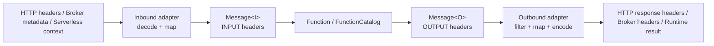

# Distinguishing Input Headers, Output Headers, and Transport Headers

## 1. Problem Statement: One Piece of Information, Multiple Boundaries

In **SPRING_CLOUD_FUNCTION (Spring Cloud Function)**, we write business logic as `Supplier`, `Function`, or `Consumer`, register and invoke them via `FunctionCatalog`, chain multiple functions via *composition*, and then deploy over HTTP, events, or serverless environments. This reuse becomes confusing if the application treats everything named *header* as the same kind of data.

Consider an invoice-approval request:

1. The client calls HTTP with `X-Correlation-ID: req-42`.
2. The HTTP layer converts the request into `Message<InvoiceSubmitted>`, setting the internal header `correlationId=req-42`.
3. The `decideInvoice` function reads that header for tracing and produces a `Message<InvoiceDecision>` with `correlationId=req-42` and `resultCode=INVOICE_ACCEPTED`.
4. The HTTP layer decides whether to return `X-Correlation-ID` and `X-Invoice-Result` in the response.
5. If the same function processes an event from a broker, the adapter may obtain `correlationId` from a different message attribute, while offset, partition, or delivery tag remain part of the transport infrastructure.

These pieces of information are related, yet they **do not share the same responsibility**. We must clearly distinguish three roles:

- **Input header:** metadata attached to `Message<T>` **when the function is invoked**, for the function to read, validate, or use.
- **Output header:** metadata inside the `Message<R>` **returned by the function**, for downstream processing steps or the outbound adapter to use.
- **Transport header/metadata:** metadata belonging to HTTP, a message broker, or a serverless runtime; read, mapped, or generated by the transport layer and adapters.

These three terms describe **roles at a boundary**, not three separate Java types. In Spring Messaging, both input and output headers are represented by `MessageHeaders`; a header may appear in both directions without automatically appearing on the wire.

### Learning Objectives

After this lesson, you will be able to identify where a header originates and who owns it; design controlled metadata propagation rules; build a protocol-independent `Function`; and trace header paths across HTTP, brokers, serverless, and composition.

## 2. Message Flow Model and Handoff Points



Example of `correlationId` across each hop:

| Hop | Sample name and value | Role | Responsible component |
|---|---|---|---|
| HTTP request | `X-Correlation-ID: req-42` | **Inbound** transport header | Client/gateway, validated at the HTTP layer |
| `Message<InvoiceSubmitted>` | `correlationId = "req-42"` | Function **input** header | Normalized by the inbound adapter |
| `Message<InvoiceDecision>` | `correlationId = "req-42"` | Function **output** header | Intentionally preserved by the function per contract |
| HTTP response | `X-Correlation-ID: req-42` | **Outbound** transport header | Outbound adapter decides to expose it |
| Broker message at another hop | Attribute or header per broker/binder convention | Transport metadata of the new hop | Mapped by the binder/adapter |

Key point: the same name, such as `correlationId`, may be used across multiple hops. However, **its presence at an earlier hop does not guarantee it appears at a later hop**. Every traversal through an adapter or a function constructing a new message needs explicit rules.

## 3. Input Headers: What the Function Actually Receives

In Spring Cloud Function, when metadata must be accessed alongside the payload, the function signature can accept `Message<I>`:

```java
Function<Message<InvoiceSubmitted>, InvoiceDecision>
```

`Message<I>` belongs to `org.springframework.messaging.Message`. Its two core methods are `getPayload()` and `getHeaders()`. `MessageHeaders` implements `Map<String, Object>`, so **header values are not required to be `String`**.

Example of reading an input header:

```java
import org.springframework.messaging.Message;

static String readCorrelationId(Message<?> input) {
    Object raw = input.getHeaders().get("correlationId");
    if (raw == null) {
        return null;
    }
    if (!(raw instanceof String id)) {
        throw new IllegalArgumentException("correlationId must be a String");
    }
    return id;
}
```

The function reads the **internal** name `correlationId`, not `X-Correlation-ID` directly. The HTTP layer can rename the header, while a binder or serverless adapter can pull the value from a different source and normalize it to the same name.

Points to check for input headers:

- **Source:** did the metadata come from a client, gateway, binder, or runtime? Is it trustworthy?
- **Key name:** `correlationId` differs from `CorrelationId` and `X-Correlation-ID` in a regular `Map<String, Object>`, unlike case-insensitive HTTP header lookup.
- **Type:** the value may be a `String`, number, `byte[]`, or an adapter-specific type.
- **Required vs. optional:** if the header is missing, how should it be handled? Generate a value at the boundary, allow `null`, or reject the request?
- **Scope of use:** does the function only need it for tracing, or do business decisions depend on this header?

Do not use a client-asserted header such as `X-User-ID` or `X-Tenant-ID` as proof of authentication or authorization. If tenant information is needed, obtain it from a verified identity context at the appropriate boundary.

## 4. Output Headers: What the Function Explicitly Publishes

When metadata needs to be returned, use the signature `Function<Message<I>, Message<O>>` or `Function<I, Message<O>>`. You can build the response with `MessageBuilder`:

```java
import org.springframework.messaging.Message;
import org.springframework.messaging.support.MessageBuilder;

Message<String> result = MessageBuilder.withPayload("APPROVED")
        .setHeader("resultCode", "INVOICE_ACCEPTED")
        .setHeader("processedBy", "invoiceValidator")
        .setHeader("correlationId", "req-42")
        .build();
```

Here `resultCode` and `processedBy` describe **the result just produced**, while `correlationId` maintains the link with the input. There is no universal rule that all input headers must be forwarded.

### Why not copy all headers by default?

```java
// Assumes incoming is a Message<InvoiceSubmitted>.
Message<String> output = MessageBuilder
        .withPayload("APPROVED")
        .copyHeaders(incoming.getHeaders())
        .setHeader("processedBy", "invoiceValidator")
        .build();
```

`copyHeaders(...)` can be appropriate when the contract genuinely requires preserving many metadata fields. However, the input may carry the old payload's `contentType`, error/routing headers, `replyChannel`, binder-specific metadata, or information that must not cross a trust boundary. If the payload changes from a DTO to `String`, a `contentType=application/json` copied from the input may no longer accurately describe the intended output format.

Usually, start from `MessageBuilder.withPayload(result)`, then **select each needed header individually**. Use `MessageBuilder.fromMessage(input)` when you want to keep the same payload and modify metadata; it is not a tool for converting a payload to a new type `O`.

> `MessageHeaders` is a read-only map once the message is constructed. To update headers, create a new `Message`; avoid calling `message.getHeaders().put(...)`. Read-only map semantics do not imply every object stored as a header value is deeply immutable.

## 5. Transport Headers: Metadata Belonging to HTTP, Brokers, and Serverless

**Transport headers** describe the protocol or environment delivering the data. Some may be useful to business logic, but most are managed by the integration layer.

| Environment | Sample transport metadata | Where is it typically handled? |
|---|---|---|
| HTTP | `Content-Type`, `Accept`, `Authorization`, `Cookie`, `X-Correlation-ID`, `traceparent` | Web adapter, controller, filters, security, tracing |
| Kafka | Topic, partition, offset, record key, record headers, timestamp | Kafka client, binder/adapter, listener/container |
| RabbitMQ | Exchange, routing key, delivery tag, message properties | Client, binder/adapter, message listener |
| SQS/Lambda | `messageId`, receipt handle, message attributes, request context | Runtime/adapter and message acknowledgment mechanism |
| CloudEvents | `id`, `source`, `type`, `specversion`, `subject`, `time` | CloudEvents SDK/adapter or event normalization layer |

For example, a `Kafka offset` locates a record within a partition—it is not an order ID or request identifier. An `SQS receipt handle` is tied to message processing/deletion mechanics and is unsuitable for turning into a business header on an HTTP response.

Binders/adapters may populate certain transport metadata into `MessageHeaders` using their own names and types. **Do not infer a fixed Spring Messaging header name across all binders**; check the contract and configuration of the adapter you are using.

### A header can change roles across hops

```text
HTTP request X-Correlation-ID       [inbound transport]
            |
      HTTP adapter validates and renames
            v
MessageHeaders["correlationId"]      [Function A input]
            |
      Function A preserves correlationId
            v
MessageHeaders["correlationId"]      [Function A output]
            |
      Function B receives A's result
            v
MessageHeaders["correlationId"]      [Function B input]
            |
      adapter writes broker header
            v
Broker message attribute            [outbound transport]
```

This explains why the terms *input* and *output* must be anchored to **a specific function or step**. An output header from Function A can become an input header for Function B, yet it is not a "transport header" until it crosses an adapter boundary.

## 6. Complete Business Example: Building Output Selectively

The following Java 17+ example uses a Spring Cloud Function bean to process invoices. Outcome logic relies on the payload; metadata serves only for tracing and describing the result.

```java
package com.example.invoice;

import java.util.function.Function;

import org.springframework.context.annotation.Bean;
import org.springframework.context.annotation.Configuration;
import org.springframework.messaging.Message;
import org.springframework.messaging.support.MessageBuilder;

@Configuration
public class InvoiceFunctions {

    public record InvoiceSubmitted(String invoiceId, long amount) {}
    public record InvoiceDecision(String invoiceId, String status) {}

    private static InvoiceDecision decide(InvoiceSubmitted invoice) {
        boolean accepted = invoice.invoiceId() != null
                && !invoice.invoiceId().isBlank()
                && invoice.amount() > 0;

        return new InvoiceDecision(
                invoice.invoiceId(),
                accepted ? "ACCEPTED" : "REJECTED"
        );
    }

    @Bean
    public Function<Message<InvoiceSubmitted>, Message<InvoiceDecision>>
            decideInvoice() {
        return incoming -> {
            InvoiceDecision decision = decide(incoming.getPayload());

            String correlationId = incoming.getHeaders()
                    .get("correlationId", String.class);

            MessageBuilder<InvoiceDecision> builder = MessageBuilder
                    .withPayload(decision)
                    .setHeader("resultCode",
                            "ACCEPTED".equals(decision.status())
                                    ? "INVOICE_ACCEPTED"
                                    : "INVOICE_REJECTED")
                    .setHeader("processedBy", "decideInvoice");

            if (correlationId != null) {
                builder.setHeader("correlationId", correlationId);
            }
            return builder.build();
        };
    }
}
```

In this example:

1. **Input header:** `correlationId` is read from `incoming.getHeaders()`.
2. **Output headers:** `correlationId` is conditionally preserved; `resultCode` and `processedBy` are newly generated by this processing step.
3. **Transport headers:** the function makes no reference to `X-Correlation-ID`, Kafka topics, HTTP status codes, or receipt handles. Those belong to the outer layer.
4. **Payload:** `InvoiceSubmitted` transforms into `InvoiceDecision`, and headers are not stuffed into the DTO as business fields.

`InvoiceDecision.status=REJECTED` is a **business outcome** in this example. It does not automatically mean HTTP 400, throwing an exception, or a broker retry. Status/acknowledgment rules belong to each adapter.

## 7. HTTP Layer Example: Bidirectional Mapping Without Leaking Internal Headers

In Spring Cloud Function Web, the adapter can receive an HTTP request, construct the appropriate input for the bean, and handle the response. When custom mapping rules are needed, a thin Spring MVC controller can be used: the controller only handles protocol concerns, while the `decideInvoice` bean stays unchanged.

This example uses the class from section 6, assuming Spring Web and Spring Messaging are available in the application:

```java
package com.example.invoice;

import java.util.List;
import java.util.UUID;
import java.util.function.Function;

import org.springframework.beans.factory.annotation.Qualifier;
import org.springframework.http.HttpHeaders;
import org.springframework.http.MediaType;
import org.springframework.http.ResponseEntity;
import org.springframework.http.HttpStatus;
import org.springframework.messaging.Message;
import org.springframework.messaging.support.MessageBuilder;
import org.springframework.web.bind.annotation.PostMapping;
import org.springframework.web.bind.annotation.RequestBody;
import org.springframework.web.bind.annotation.RequestHeader;
import org.springframework.web.bind.annotation.RestController;
import org.springframework.web.server.ResponseStatusException;

import com.example.invoice.InvoiceFunctions.InvoiceSubmitted;
import com.example.invoice.InvoiceFunctions.InvoiceDecision;

@RestController
public class InvoiceHttpController {

    private final Function<Message<InvoiceSubmitted>,
                           Message<InvoiceDecision>> decide;

    public InvoiceHttpController(
            @Qualifier("decideInvoice")
            Function<Message<InvoiceSubmitted>, Message<InvoiceDecision>>
                    decide) {
        this.decide = decide;
    }

    @PostMapping(
            path = "/invoices",
            consumes = MediaType.APPLICATION_JSON_VALUE,
            produces = MediaType.APPLICATION_JSON_VALUE
    )
    public ResponseEntity<InvoiceDecision> submit(
            @RequestBody InvoiceSubmitted body,
            @RequestHeader HttpHeaders requestHeaders) {

        String correlationId = normalizeCorrelationId(requestHeaders);

        // HTTP input -> normalized input headers for the Function.
        Message<InvoiceSubmitted> input = MessageBuilder
                .withPayload(body)
                .setHeader("correlationId", correlationId)
                .setHeader("source", "http")
                .build();

        Message<InvoiceDecision> output = decide.apply(input);

        // Output headers -> HTTP response headers permitted for exposure.
        HttpHeaders responseHeaders = new HttpHeaders();
        responseHeaders.set("X-Correlation-ID",
                output.getHeaders().get("correlationId", String.class));
        responseHeaders.set("X-Invoice-Result",
                output.getHeaders().get("resultCode", String.class));

        // processedBy and source are not sent out over HTTP.
        return ResponseEntity.ok()
                .headers(responseHeaders)
                .body(output.getPayload());
    }

    private static String normalizeCorrelationId(HttpHeaders headers) {
        List<String> values = headers.get("X-Correlation-ID");
        if (values == null || values.isEmpty()) {
            return UUID.randomUUID().toString();
        }
        if (values.size() != 1
                || !values.get(0).matches("[A-Za-z0-9._-]{1,64}")) {
            throw new ResponseStatusException(
                    HttpStatus.BAD_REQUEST, "Invalid X-Correlation-ID");
        }
        return values.get(0);
    }
}
```

This layer has two explicit mapping points:

- **HTTP input:** `X-Correlation-ID` is validated and normalized to `correlationId`. If missing, the boundary layer generates a UUID. HTTP headers are case-insensitive, so `x-correlation-id` is also matched via `HttpHeaders`.
- **HTTP output:** only `correlationId` and `resultCode` become `X-Correlation-ID` and `X-Invoice-Result`. `processedBy` stays in `Message` for internal logic and is not automatically exposed over HTTP.

The payload is converted from JSON into `InvoiceSubmitted` by Spring MVC, which then encodes `InvoiceDecision` to JSON. `MessageBuilder` does not serialize DTOs directly. The snippet returns HTTP 200 for both `ACCEPTED` and `REJECTED` invoices because that is the illustrative contract; if the API requires HTTP 422 for invalid invoices, that rule must be defined and implemented separately in the controller.

Example request:

```bash
curl -i -X POST http://localhost:8080/invoices \
  -H "Content-Type: application/json" \
  -H "X-Correlation-ID: req-42" \
  -d '{"invoiceId":"INV-42","amount":90000}'
```

Sample response:

```http
HTTP/1.1 200 OK
Content-Type: application/json
X-Correlation-ID: req-42
X-Invoice-Result: INVOICE_ACCEPTED

{"invoiceId":"INV-42","status":"ACCEPTED"}
```

**This is the behavior of the illustrative controller**, not a promise that Spring Cloud Function Web will automatically emit these exact HTTP response headers for every function. Invocation paths via the Web adapter, binder, or serverless adapter must be tested against your actual version and configuration.

## 8. `Content-Type` and `contentType`: Same Topic, Different Layers

A major source of confusion is **headers related to content format**:

| Name | Where does it appear? | Primary role |
|---|---|---|
| HTTP request `Content-Type` | Transport header of an HTTP request | Describes the request body format, e.g., JSON |
| HTTP request `Accept` | Transport header of an HTTP request | States which response formats the client accepts |
| `MessageHeaders.CONTENT_TYPE` / `contentType` | Spring Messaging input or output header | Metadata assisting payload conversion |
| HTTP response `Content-Type` | Transport header of an HTTP response | Indicates the format of the body actually sent |

Java example:

```java
import org.springframework.messaging.Message;
import org.springframework.messaging.MessageHeaders;
import org.springframework.messaging.support.MessageBuilder;
import org.springframework.util.MimeTypeUtils;

import com.example.invoice.InvoiceFunctions.InvoiceDecision;

Message<InvoiceDecision> output = MessageBuilder
        .withPayload(new InvoiceDecision("INV-42", "ACCEPTED"))
        .setHeader(MessageHeaders.CONTENT_TYPE, MimeTypeUtils.APPLICATION_JSON)
        .build();
```

Here `output.getPayload()` is still an **`InvoiceDecision` in Java**, not a JSON string. The converter/adapter decides how bytes and protocol headers are written out. Do not assume output `contentType` stays unchanged from input when a `Function` changes the payload from a DTO to `String` or another data type.

When an adapter turns a `Message` into an HTTP response, mapping `contentType` to HTTP `Content-Type` depends on the adaptation mechanism. HTTP response configuration should accurately reflect the actual format and be verified with integration tests.

## 9. Broker Case: Transport Metadata Can Be Misused

With Spring Cloud Stream and a binder, events can carry a payload alongside transport-environment attributes. Conceptual diagram:

```text
Kafka record
  key            -> record key (transport)
  topic          -> destination topic (transport)
  partition      -> partition (transport)
  offset         -> position in log (transport)
  record headers -> may contain correlation-id per contract
                     |
                 binder/adapter
                     |
Message<InvoiceSubmitted>
  headers["correlationId"] = "req-42"   (input)
                     |
                decideInvoice
                     |
Message<InvoiceDecision>
  headers["correlationId"] = "req-42"   (output)
  headers["resultCode"] = "INVOICE_ACCEPTED"
                     |
                 binder/adapter
                     |
New Kafka record (if output binding is configured)
```

`correlation-id` in record headers is **a name chosen by convention for this example**, not a guarantee that Kafka/Spring Cloud Stream automatically creates that header. A binder may inject transport metadata into `MessageHeaders` under its own names and filter certain headers when sending; details depend on the binder, serializer, configuration, and version.

**Do not copy `offset`, `partition`, reply channel, delivery tag, or receipt handle** just for the sake of "keeping all headers". They belong to the receiving hop's context and may be meaningless when emitting a new event. Likewise, do not use offset as a business identifier; if steps need linking, define a separate `correlationId`.

When a `Function<Message<I>, Message<O>>` runs via Stream, `Message<O>` is the logical result of the function. **Actually publishing the outbound message** also requires appropriate function definition, output binding, and broker configuration; returning a result with headers does not mean it was successfully published.

## 10. Serverless and CloudEvents Cases

In serverless environments, an event envelope can include data and runtime-provided metadata. For instance, an SQS event received by Lambda has `messageId`, message attributes, and delivery properties. They are not synonymous with business headers and should not all be forwarded into the output.

A common platform-independent event format is **CloudEvents**. A CloudEvent context has `id`, `source`, `type`, and `specversion`; `data` holds the event payload. In CloudEvents HTTP binary content mode, context attributes are represented as `ce-*` headers:

```http
POST /events HTTP/1.1
Content-Type: application/json
ce-specversion: 1.0
ce-id: event-101
ce-source: /billing
ce-type: com.example.invoice.submitted

{"invoiceId":"INV-42","amount":90000}
```

An adapter layer can normalize them:

| CloudEvents metadata | Suggested internal header | Role |
|---|---|---|
| `ce-id` or context `id` | `eventId` | Identifies the event in CloudEvents context |
| `ce-source` or `source` | `eventSource` | Declared event producer in the event |
| `ce-type` or `type` | `eventType` | Event classification |
| `data` | Payload `InvoiceSubmitted` | Business data of the event |

**`eventId` is distinct from `MessageHeaders.ID` and distinct from `correlationId`.** An event can be replayed as a new message, or multiple events belonging to the same workflow can share a `correlationId`. Do not default to treating `ce-id` as the application correlation header.

The names `eventId`, `eventSource`, and `eventType` in the table are **illustrative design conventions**. The application's CloudEvents adapter must actively produce them if functions expect them; having `ce-id` over HTTP does not guarantee every Spring Cloud Function runtime automatically renames it to `eventId`.

## 11. Headers Flowing Through Composition and `FunctionCatalog`

Suppose we chain two steps:

```text
Message<InvoiceSubmitted>
     |
     v
 decideInvoice
     |
     v
Message<InvoiceDecision>   [correlationId, resultCode]
     |
     v
 formatInvoiceNotice
     |
     v
Message<String>            [headers created/kept by formatInvoiceNotice]
```

If the second bean has signature `Function<Message<InvoiceDecision>, Message<String>>`, it can read `correlationId` from `decideInvoice`'s result. However, when this function creates a new `Message<String>`, it must decide which headers belong on **its own** result.

With registered beans and compatible signatures, an example definition is:

```properties
spring.cloud.function.definition=decideInvoice|formatInvoiceNotice
```

When looked up via `FunctionCatalog`, wrapping/unwrapping, conversion, and header propagation can depend on how functions are registered, input/output types, and adapters. **Do not treat a header surviving one step as proof it will survive every composition.** Verify both individual bean behavior and the output of the actual composed chain.

A clean design is:

- Payloads represent business data, e.g., `InvoiceSubmitted` and `InvoiceDecision`.
- Internal headers follow agreed names and types, e.g., `correlationId: String`.
- Each step keeps or creates only metadata needed by downstream steps.
- HTTP, broker, and serverless boundaries handle renaming, validating, and encoding metadata for their respective protocols.

## 12. Who Is Allowed to Create, Replace, and Expose a Header?

Distinguishing these three roles is also how you establish **trust boundaries**:

| Header or metadata | Appropriate owner | Usage rule |
|---|---|---|
| `correlationId` | Gateway or validated adapter | Normalize and restrict length/format |
| `processedBy` | Current processing step | Set by the server; do not trust client-sent values |
| `resultCode` | Business logic | Derived from the current processing outcome |
| HTTP `Authorization` | Security authentication layer | Do not copy raw tokens to outbound events |
| `traceparent` | Tracing system and dedicated adapters | Propagate via standard propagation mechanisms |
| `tenantId` | Verified identity context | Do not treat self-asserted headers as access rights |
| Kafka offset, SQS receipt handle | Broker/runtime | Leave management to the transport layer |
| `Content-Type` / `contentType` | Converter/adapter and media type contract | Update to match the actual data format |

Before copying a header from input to output, ask: **Who created it? Has it been validated? Why does the receiver need it? Is it still accurate at the new hop? Is it safe to expose to the target protocol?**

For example, an HTTP request might send `X-Invoice-Result: INVOICE_ACCEPTED` to spoof an outcome. The `decideInvoice` function must compute `resultCode` from the payload and overwrite any such value rather than copying it from the client.

## 13. Testing at Two Layers to Catch Dropped or Leaked Headers

### 13.1. Testing pure function logic

JUnit 5 can invoke the `Function` bean directly without HTTP or a broker:

```java
package com.example.invoice;

import static org.junit.jupiter.api.Assertions.assertEquals;
import static org.junit.jupiter.api.Assertions.assertNull;

import java.util.function.Function;

import org.junit.jupiter.api.Test;
import org.springframework.messaging.Message;
import org.springframework.messaging.support.MessageBuilder;

import com.example.invoice.InvoiceFunctions.InvoiceSubmitted;
import com.example.invoice.InvoiceFunctions.InvoiceDecision;

class InvoiceFunctionsTest {

    @Test
    void returnsOnlyApprovedOutputHeaders() {
        Function<Message<InvoiceSubmitted>, Message<InvoiceDecision>> fn =
                new InvoiceFunctions().decideInvoice();

        Message<InvoiceSubmitted> input = MessageBuilder
                .withPayload(new InvoiceSubmitted("INV-42", 90000))
                .setHeader("correlationId", "req-42")
                .setHeader("source", "http")
                .setHeader("resultCode", "CLIENT_FORGED_RESULT")
                .build();

        Message<InvoiceDecision> output = fn.apply(input);

        assertEquals("ACCEPTED", output.getPayload().status());
        assertEquals("req-42", output.getHeaders().get("correlationId"));
        assertEquals("INVOICE_ACCEPTED", output.getHeaders().get("resultCode"));
        assertEquals("decideInvoice", output.getHeaders().get("processedBy"));
        assertNull(output.getHeaders().get("source"));

        // Input header remains unchanged.
        assertEquals("CLIENT_FORGED_RESULT",
                input.getHeaders().get("resultCode"));
    }

    @Test
    void handlesMissingOptionalInputHeader() {
        Function<Message<InvoiceSubmitted>, Message<InvoiceDecision>> fn =
                new InvoiceFunctions().decideInvoice();

        Message<InvoiceSubmitted> input = MessageBuilder
                .withPayload(new InvoiceSubmitted("INV-43", -10))
                .build();

        Message<InvoiceDecision> output = fn.apply(input);

        assertEquals("REJECTED", output.getPayload().status());
        assertEquals("INVOICE_REJECTED",
                output.getHeaders().get("resultCode"));
        assertNull(output.getHeaders().get("correlationId"));
    }
}
```

The first test proves that a forged `resultCode` on input **does not appear on output**, while `correlationId` is preserved per contract. The second test shows that an optional input header may be absent when calling the function directly, whereas the example's HTTP adapter generates an ID if the request lacks one.

### 13.2. Testing the HTTP boundary

For the controller in section 7, Spring MVC Test/`MockMvc` can verify both inbound and outbound transport headers:

```java
package com.example.invoice;

import static org.springframework.test.web.servlet.request.MockMvcRequestBuilders.post;
import static org.springframework.test.web.servlet.result.MockMvcResultMatchers.*;

import org.junit.jupiter.api.Test;
import org.springframework.beans.factory.annotation.Autowired;
import org.springframework.boot.test.autoconfigure.web.servlet.WebMvcTest;
import org.springframework.context.annotation.Import;
import org.springframework.http.MediaType;
import org.springframework.test.web.servlet.MockMvc;

@WebMvcTest(InvoiceHttpController.class)
@Import(InvoiceFunctions.class)
class InvoiceHttpControllerTest {

    @Autowired
    MockMvc mvc;

    @Test
    void mapsTransportHeadersInBothDirections() throws Exception {
        mvc.perform(post("/invoices")
                .contentType(MediaType.APPLICATION_JSON)
                .header("x-correlation-id", "req-42")
                .content("{\"invoiceId\":\"INV-42\",\"amount\":90000}"))
            .andExpect(status().isOk())
            .andExpect(header().string("X-Correlation-ID", "req-42"))
            .andExpect(header().string(
                    "X-Invoice-Result", "INVOICE_ACCEPTED"))
            .andExpect(header().doesNotExist("processedBy"))
            .andExpect(jsonPath("$.status").value("ACCEPTED"));
    }

    @Test
    void rejectsInvalidTransportHeader() throws Exception {
        mvc.perform(post("/invoices")
                .contentType(MediaType.APPLICATION_JSON)
                .header("X-Correlation-ID", "bad value!")
                .content("{\"invoiceId\":\"INV-43\",\"amount\":10}"))
            .andExpect(status().isBadRequest());
    }
}
```

In applications with Spring Security enabled, HTTP tests need appropriate authentication/CSRF configuration. These two tests verify **the illustrative controller** rather than proving the default mapping of Spring Cloud Function Web. For binders/serverless, write integration tests against the actual infrastructure.

Scenarios to include in a transport test suite:

| Scenario | Expectation to verify |
|---|---|
| HTTP headers with different casing | Read accurately via `HttpHeaders` and normalized to `correlationId` |
| Missing, wrong-type, or multi-valued input header | Applies explicit default/rejection policy |
| Function step creating a new `Message` | Only required headers are retained |
| Composition of two functions | Header needed by the second function arrives with the expected type |
| HTTP output | Does not leak `Authorization`, `processedBy`, or unintended broker metadata |
| Publishing broker events | Headers are serialized/mapped with the right names and types and actually delivered |
| Serverless/CloudEvents events | Distinguishes `eventId`, `correlationId`, and runtime context |
| Payload type change | `contentType` and actual transmitted data are compatible |

## 14. Common Pitfalls

| Symptom | Typical Cause | Fix |
|---|---|---|
| HTTP has `X-Correlation-ID` yet function reads `correlationId` as `null` | Adapter did not rename or filtered the header | Check boundary mapping; do not guess default names |
| Output `Message` has `resultCode` yet HTTP lacks `X-Invoice-Result` | No rule exporting the header to HTTP | Configure the adapter or implement in the controller |
| Header disappears after composition | Intermediate step does not forward it, or wrapping/conversion behaves differently than expected | Test `FunctionCatalog` with the actual composed chain |
| HTTP response carries unexpected Kafka headers | Copying all headers from the input message | Filter outbound headers using an allowlist |
| Wrong serialization or converter behavior | Old `contentType` retained after payload changed type | Update the media type contract and test actual bytes |
| Using Kafka offset as a transaction ID | Confusing transport metadata with business identifiers | Use `invoiceId` in payload and `correlationId` per contract |
| Security flaw from `X-Tenant-ID` | Trusting client-asserted values | Use verified identity context |
| Returning `resultCode=INVOICE_REJECTED` yet HTTP status is still 200 | Business headers do not control HTTP status | Explicitly map HTTP codes at the web layer |

## 15. Practice Exercise: Tracing and Implementing a Header's Path

Design a `Function<Message<PaymentRequested>, Message<PaymentDecision>>`. The `PaymentRequested(paymentId, amount)` payload and `PaymentDecision(paymentId, status)` result contain only business data. Requests may arrive from HTTP or a broker.

1. Define an internal `correlationId: String` header, optional when invoking the function directly. In the HTTP adapter, read it from `X-Correlation-ID`, validate format, and generate a new ID if missing.
2. Write pure processing logic: if `amount > 0`, set `status=APPROVED`; otherwise `status=DECLINED`. Return `Message<PaymentDecision>` with `resultCode`, keeping `correlationId` only when valid.
3. Define HTTP response transport headers: emit only `X-Correlation-ID` and `X-Payment-Result`; do not send `processedBy` or the HTTP request's `Authorization` header outward.
4. For a broker, identify which record/message attribute carries the correlation ID, which adapter reads it, and the mapping rules into `MessageHeaders`. Distinguish it from topic, partition, offset, and key.
5. Try composing with a notification-building function via `FunctionCatalog`, and verify `correlationId` on the second function's input.
6. Write unit tests for missing input headers, forged `resultCode` headers, and payload results. Write integration tests for HTTP/broker to verify metadata is actually transmitted.

**Remember:** **input** headers belong to `Message` when a function receives data; **output** headers belong to `Message` when a function produces results; **transport** headers belong to HTTP, binders, or runtimes at the protocol boundary. Spring Cloud Function helps reuse logic across `Supplier`, `Function`, `Consumer`, and adapters, but renaming, validating, selecting, and forwarding metadata requires an explicit contract and tests at every boundary.
