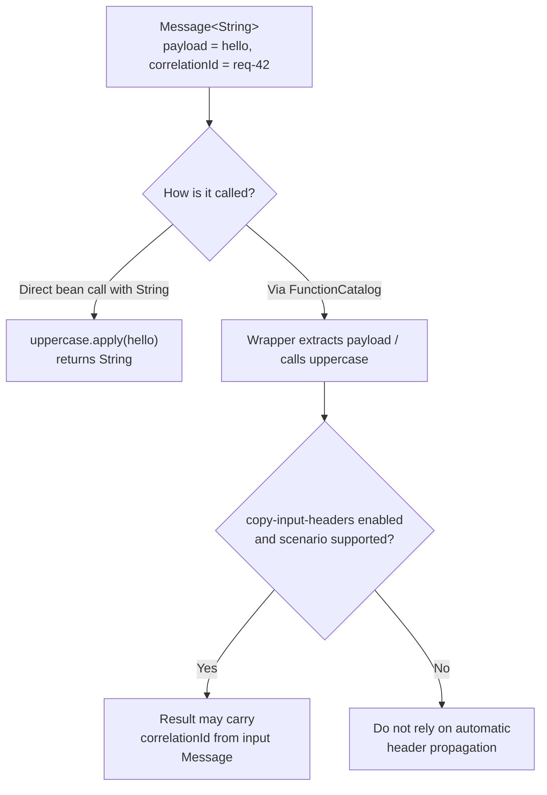

# Selective Header Copying and the `copy-input-headers` Configuration

## 1. Problem Statement: Preserving the Right Metadata When a Function Builds a New Result

In **SPRING_CLOUD_FUNCTION (Spring Cloud Function)**, business logic is written using `Supplier`, `Function`, and `Consumer`, registered via `FunctionCatalog`, chained into pipelines (*composition*), and invoked over HTTP, events, or serverless environments. Even though the same function can be deployed across multiple protocols, **input metadata is not automatically valid output metadata**.

Suppose an order-processing function receives:

```text
Message<OrderSubmitted>
├── payload: OrderSubmitted("ORD-17", 120000)
└── headers:
    correlationId = "checkout-42"      [needed for tracing]
    contentType   = "application/json" [input format]
    source        = "mobile-app"       [self-asserted sender]
    replyChannel  = ...                [integration context]
    id            = ...                [message identifier]
    timestamp     = ...                [message creation time]
```

The function produces `OrderDecision("ORD-17", "ACCEPTED")` and needs to forward `correlationId`. If all headers are copied, it might carry along a stale `contentType`, infrastructure metadata, or data that must not be propagated. If nothing is copied, the next step may lose `correlationId` and fail to correlate the outcome with the original request.

Spring Cloud Function supports solving this in two main ways:

1. **Select headers explicitly in function code**, typically using `MessageBuilder` to create `Message<O>` from the new payload.
2. **Enable `copy-input-headers` per function name** so `FunctionCatalog` helps propagate input headers in supported cases.

This lesson explains **exactly when to use which approach**, why automatic configuration does not replace security policies or protocol mapping, and how to verify the results with tests.

## 2. Understanding Header Copying Correctly

`Message<T>` belongs to `org.springframework.messaging.Message` and has two parts:

- `getPayload()`: business data of type `T`.
- `getHeaders()`: `MessageHeaders`, effectively a map with `String` keys and `Object` values.

When we talk about **copying input headers**, we mean taking some or all key–value pairs from `incoming.getHeaders()` and putting them into the result message. That does **not** necessarily mean preserving HTTP headers on the wire, keeping every broker message attribute, or preserving per-message identifiers across multiple processing steps.

| Mechanism | Who performs it? | Output contract | Level of control |
|---|---|---|---|
| Selecting individual keys via `MessageBuilder.setHeader(...)` | Business code or wrapper layer | Code-constructed `Message<O>` | High: supports allowlisting, renaming, and validation |
| `MessageBuilder.copyHeaders(...)` | Message-building code | Code-constructed `Message<O>` | Broad copying; requires active filtering |
| `copy-input-headers=true` | Wrapper via `FunctionCatalog` in supported cases | Framework-adapted result | Convenient, but not a per-key allowlist configuration |
| HTTP/binder/serverless header mapping | Adapter | Protocol headers or metadata | Depends on adapter, configuration, and version |

**The most important takeaway:** `copy-input-headers` is **a property of invoking a function through `FunctionCatalog`**. It is not a `MessageBuilder` instruction and does not automatically turn every HTTP request header into an HTTP response header.

## 3. Selective Copying with `MessageBuilder`

### 3.1. Complete example with `Function<Message<I>, Message<O>>`

We need a function that receives an order, validates the amount, and returns a decision. The metadata contract is:

- `correlationId`: optional `String` header, forwarded after validation.
- `resultCode`: newly created from the function's outcome.
- `processedBy`: newly created; do not trust a client-supplied value with the same name.
- All other headers: not copied by default.

Java 17+ example:

```java
package com.example.orders;

import java.util.function.Function;

import org.springframework.context.annotation.Bean;
import org.springframework.context.annotation.Configuration;
import org.springframework.messaging.Message;
import org.springframework.messaging.support.MessageBuilder;

@Configuration
public class OrderFunctions {

    public record OrderSubmitted(String orderId, long amount) {}
    public record OrderDecision(String orderId, String status) {}

    private static OrderDecision decide(OrderSubmitted order) {
        boolean accepted = order.orderId() != null
                && !order.orderId().isBlank()
                && order.amount() > 0;
        return new OrderDecision(
                order.orderId(),
                accepted ? "ACCEPTED" : "REJECTED"
        );
    }

    @Bean
    public Function<Message<OrderSubmitted>, Message<OrderDecision>>
            decideOrder() {
        return incoming -> {
            OrderDecision result = decide(incoming.getPayload());

            MessageBuilder<OrderDecision> builder =
                    MessageBuilder.withPayload(result)
                            .setHeader("processedBy", "decideOrder")
                            .setHeader(
                                    "resultCode",
                                    "ACCEPTED".equals(result.status())
                                            ? "ORDER_ACCEPTED"
                                            : "ORDER_REJECTED"
                            );

            Object rawId = incoming.getHeaders().get("correlationId");
            if (rawId != null) {
                if (!(rawId instanceof String)) {
                    throw new IllegalArgumentException(
                            "correlationId must be a String");
                }

                String correlationId = (String) rawId;
                if (!correlationId.matches("[A-Za-z0-9._-]{1,64}")) {
                    throw new IllegalArgumentException(
                            "Invalid correlationId");
                }
                builder.setHeader("correlationId", correlationId);
            }

            return builder.build();
        };
    }
}
```

The function returns a brand-new `Message<OrderDecision>`. `MessageBuilder.withPayload(result)` sets the output payload; the three `setHeader(...)` calls attach only the required metadata. If the input contains `source`, `Authorization`, `replyChannel`, or `contentType`, this code does not carry them into the result message.

Validating `correlationId`'s format here demonstrates defensive coding; in a real application, untrusted headers should be normalized right at the HTTP/broker/serverless adapter. The function can still guard its own input contract so it can be called safely from different sources.

### 3.2. Calling directly to observe the result

```java
import java.util.function.Function;

import org.springframework.messaging.Message;
import org.springframework.messaging.support.MessageBuilder;

import com.example.orders.OrderFunctions;
import com.example.orders.OrderFunctions.OrderSubmitted;
import com.example.orders.OrderFunctions.OrderDecision;

Function<Message<OrderSubmitted>, Message<OrderDecision>> fn =
        new OrderFunctions().decideOrder();

Message<OrderSubmitted> input = MessageBuilder
        .withPayload(new OrderSubmitted("ORD-17", 120_000))
        .setHeader("correlationId", "checkout-42")
        .setHeader("source", "mobile-app")
        .setHeader("processedBy", "client-forged")
        .build();

Message<OrderDecision> output = fn.apply(input);

System.out.println(output.getPayload().status());
// ACCEPTED
System.out.println(output.getHeaders().get("correlationId"));
// checkout-42
System.out.println(output.getHeaders().get("processedBy"));
// decideOrder
System.out.println(output.getHeaders().get("source"));
// null
```

Because the example calls the `Function` instance directly, the values above are produced by **`decideOrder` itself**. No header propagation mechanism from `FunctionCatalog` is involved in this direct call.

## 4. `MessageBuilder` Operations for Copying and Removing Headers

Spring Messaging provides several operations that should be distinguished:

| API | Effect | Example |
|---|---|---|
| `setHeader("k", v)` | Sets/replaces `k` in the builder | Overwrite `processedBy` |
| `setHeaderIfAbsent("k", v)` | Sets only if no value is present yet | Provide a default value |
| `copyHeaders(map)` | Copies headers from `map` into the builder | Forward multiple headers |
| `copyHeadersIfAbsent(map)` | Copies only headers not yet present | Preserve previously set values |
| `removeHeader("k")` | Removes a header from the builder | Drop stale `contentType` |
| `MessageBuilder.fromMessage(existing)` | Starts from an existing message | Add metadata while keeping payload |

**Case 1 — Keep a few approved headers**

```java
Message<String> output = MessageBuilder.withPayload("DONE")
        .setHeader("correlationId", "checkout-42")
        .setHeader("processedBy", "shipping")
        .build();
```

This is the easiest approach to control because you never copy arbitrary data from untrusted sources.

**Case 2 — Copy many headers, then remove or override**

```java
// incoming is a previously created Message<String>.
Message<String> output = MessageBuilder.withPayload("DONE")
        .copyHeaders(incoming.getHeaders())
        .removeHeader("source")
        .removeHeader("contentType")
        .setHeader("processedBy", "shipping")
        .build();
```

`setHeader(...)` after `copyHeaders(...)` replaces the value for any matching key. `removeHeader(...)` removes keys from the builder. This is useful when many metadata entries must be kept, yet you **must still inspect all incoming headers before broad copying**. Simply removing two keys in an example is not enough to form a real system's security policy.

**Case 3 — Function-generated values take higher priority**

```java
import java.util.Map;

Message<String> output = MessageBuilder.withPayload("DONE")
        .setHeader("processedBy", "shipping")
        .copyHeadersIfAbsent(Map.of(
                "processedBy", "upstream",
                "correlationId", "checkout-42"
        ))
        .build();

// processedBy remains "shipping".
// correlationId is added because it was not present before.
```

`copyHeadersIfAbsent(...)` is suitable when you want to fill in default metadata without overwriting values already determined by the function.

**Case 4 — Change metadata only, keeping the payload intact**

```java
Message<String> original = MessageBuilder.withPayload("order.created")
        .setHeader("correlationId", "checkout-42")
        .build();

Message<String> annotated = MessageBuilder.fromMessage(original)
        .setHeader("processedBy", "audit")
        .build();
```

`fromMessage(original)` is convenient when keeping the payload. When producing **a new payload type**, e.g., `OrderSubmitted` → `OrderDecision`, use `withPayload(newResult)` and decide which headers to preserve.

`MessageHeaders` on a constructed message is a read-only map, so do not execute `original.getHeaders().put(...)`. Read-only applies to the headers map; if a header value is a mutable object, that object itself can still change.

## 5. Configuring `copy-input-headers`: Syntax and Meaning

When a function **processes only payloads** (e.g., `Function<String, String>`), Spring Cloud Function can accept a `Message` at the invocation layer via `FunctionCatalog`, extract the payload for the bean, and then build a compatible result. To support propagating input headers to the output through the wrapper, the framework provides the boolean configuration `copy-input-headers` keyed by **function name**.

Suppose there is a bean named `uppercase`:

```java
package com.example.functions;

import java.util.Locale;
import java.util.function.Function;

import org.springframework.context.annotation.Bean;
import org.springframework.context.annotation.Configuration;

@Configuration
public class TextFunctions {

    @Bean
    public Function<String, String> uppercase() {
        return input -> input.toUpperCase(Locale.ROOT);
    }
}
```

In `application.yml`:

```yaml
spring:
  cloud:
    function:
      configuration:
        uppercase:
          copy-input-headers: true
```

Or `application.properties`:

```properties
spring.cloud.function.configuration.uppercase.copy-input-headers=true
```

General syntax:

```text
spring.cloud.function.configuration.<function-name>.copy-input-headers=true
```

Here `uppercase` is the **registered/looked-up function bean name**, not the Java class name or HTTP endpoint name. If the application uses another function, replace `uppercase` with the name matching your application's definition.

According to the Spring Cloud Function documentation, this property requests **propagating input headers** for a function when invoked through a supported wrapping mechanism. It is convenient when you want to retain many headers in a pure POJO transformation step. However:

- It is a **broad copying mechanism**; it offers no syntax to pick `correlationId` while dropping `Authorization`, `replyChannel`, or `contentType`.
- It **does not change the `uppercase` bean's code**; the bean keeps the `Function<String, String>` signature and remains unaware of headers.
- It **does not apply to direct calls** such as `uppercase.apply("...")` outside `FunctionCatalog`, since that call has no `Message` input at all.
- If the function **already returns `Message<O>` itself**, manage the headers you want to keep right inside the function. Spring Cloud Function documentation states that the framework does not automatically copy all headers onto a `Message` returned by the function itself, beyond any necessary payload conversion steps.
- The actual observed result and headers may also be influenced by input/output types, converters, and adapters. Test on your application's Spring Cloud Function version.

> The full property name above is documented in the official reference under **Input Header propagation**: [Spring Cloud Function – Programming model](https://docs.spring.io/spring-cloud-function/reference/spring-cloud-function/programming-model.html).

## 6. Configuration vs. Function Code: Two Calls Produce Different Outcomes

The key point is that **the raw function** and **the function looked up via `FunctionCatalog`** play different roles.



Direct example:

```java
TextFunctions config = new TextFunctions();
String output = config.uppercase().apply("hello");
// "HELLO" — no input Message or headers to copy.
```

Example via catalog in a configured Spring context:

```java
import java.util.function.Function;

import org.springframework.cloud.function.context.FunctionCatalog;
import org.springframework.messaging.Message;
import org.springframework.messaging.support.MessageBuilder;

// catalog is injected from the Spring context containing the uppercase bean.
// Requesting output conversion to application/json as in the SCF reference example.
Function<Message<String>, Message<byte[]>> wrapped =
        catalog.lookup("uppercase", "application/json");

Message<String> incoming = MessageBuilder.withPayload("hello")
        .setHeader("correlationId", "req-42")
        .build();

Message<byte[]> result = wrapped.apply(incoming);

System.out.println(result.getHeaders().get("correlationId"));
// req-42 when copy-input-headers configuration applies.
```

When looked up via the catalog, the type `Function<Message<String>, Message<byte[]>>` represents **the adapter/wrapper-supported invocation**, whereas the underlying bean still declares `Function<String, String>`. The example requests the `application/json` output format so the wrapper converts the payload to bytes. What this lesson checks is whether the `correlationId` header appears after the configured call. This is also the lookup pattern used in the **Input Header propagation** section of the Spring Cloud Function documentation.

Do not write `new TextFunctions().uppercase().apply(message)`: the raw bean only accepts `String`, so that call **does not match the Java signature**. Type adaptation and wrapping belong to `FunctionCatalog`.

## 7. Decision Table: Use `copy-input-headers` or Select in Code?

| Bean signature | Actual requirement | Appropriate approach |
|---|---|---|
| `Function<I, O>` | No headers needed on the result | Keep plain POJOs; leave copying disabled |
| `Function<I, O>` | Want the wrapper to broadly propagate input headers in supported cases | Set `copy-input-headers=true`, invoke via `FunctionCatalog`, and test |
| `Function<Message<I>, O>` | Read input metadata; output needs no custom business metadata | Verify wrapper/adapter expectations via tests; if an explicit output header contract is needed, return `Message<O>` |
| `Function<I, Message<O>>` | Create new headers without relying on input headers | Build `Message<O>` with `MessageBuilder` |
| `Function<Message<I>, Message<O>>` | Keep only a few headers and add new ones | Selectively copy via `MessageBuilder` in code |
| `Function<Message<I>, Message<O>>` | Keep most input headers under a specific contract | `copyHeaders(...)` then remove/replace invalid headers; still test thoroughly |

**Practical rule:** if an output header carries business or security significance, express its creation, validation, and forwarding in an explicit contract. `copy-input-headers` is convenient for broad copying through the wrapper, but it does not replace selective header logic.

## 8. Headers That Should Not Be Forwarded Mechanically

Certain headers require careful scrutiny when passed between functions:

| Header / Header Group | Risk if copied verbatim | How to handle |
|---|---|---|
| `correlationId` | Loss of tracing if dropped; spoofing/malformed values if every input is trusted | Validate at boundary, use a stable type, preserve intentionally |
| `contentType` | Payload changed DTO → `String` while old JSON media type remains | Redefine output format and matching converter |
| `Authorization`, tokens, cookies | Credential leakage into brokers, logs, or other services | Handle at security boundary; never copy verbatim |
| Client-supplied `tenantId`, `userId` | May lead to unauthorized identity/access usage | Derive from verified principal or authenticated context |
| `replyChannel`, `errorChannel` | Carries infrastructure channels unsuitable for the next hop | Keep only when integration requires them |
| Kafka partition/offset, Rabbit delivery tag, SQS receipt handle | Metadata tied to a specific message delivery, invalid for a new message | Let binder/runtime manage them |
| `MessageHeaders` `id`, `timestamp` | Confusing technical IDs with order or request IDs | Store `orderId` in payload and `correlationId` per contract |
| `traceparent`/`tracestate` | Broken trace context if stitched or copied indiscriminately | Prefer standard instrumentation/tracing libraries |
| Framework routing control headers | Accidental function or destination triggering from untrusted input | Filter and control at the adapter |

For instance, a function receives `Message<OrderSubmitted>` with `contentType=application/json` and returns `Message<String>` containing a summary text. If all headers are copied, the output `contentType` may be wrong. Changing the `contentType` header also **does not by itself convert the payload into JSON or bytes**; Spring Cloud Function selects converters based on signatures, metadata, and the invocation/adapter path.

Note: HTTP header names are case-insensitive, whereas keys in `MessageHeaders` are Java strings; `X-Correlation-ID` and `correlationId` are not automatically treated as the same key. Name normalization is the responsibility of the HTTP/binder/serverless layer.

## 9. `copy-input-headers` and Composition

Spring Cloud Function allows chaining functions into pipelines, for example:

```properties
spring.cloud.function.definition=uppercase|addPrefix
```

Here `uppercase` has signature `Function<String, String>`, and `addPrefix` also accepts and returns `String`. If the input source is `Message<String>`, headers traverse **adaptation boundaries** between functions.

```text
Message<String> (correlationId=req-42)
             |
             v
       FunctionCatalog
             |
             v
       uppercase (POJO)
             |
       header propagation?
             |
             v
       addPrefix (POJO)
             |
             v
       Pipeline Message/output
```

To be certain `correlationId` appears after the entire chain:

1. Identify **the actual function/definition name** being looked up or exposed.
2. Identify which stage needs to read or forward metadata.
3. If using `copy-input-headers`, configure it on the exact function name to which the wrapper applies the setting; do not assume a property on `uppercase` automatically governs every composition.
4. Invoke **the composed definition itself via `FunctionCatalog`** in your tests and inspect the output headers.
5. When a downstream step strictly requires specific headers, prefer making steps accept/return `Message` and selectively copying per contract.

`FunctionCatalog`'s wrapper performs type normalization, composition, and potentially other conversion or enrichment logic. Therefore, whether `correlationId` propagates across a composition must be verified on **the actual invocation path**, not inferred from a single bean working when called directly.

## 10. Connection to HTTP, Spring Cloud Stream, and Serverless

A function bean can be exposed over HTTP or process events without embedding protocol APIs in its logic. However, **two distinct copying steps** must be kept separate:

1. **Inside the framework:** from the function/wrapper's input `Message` to the output `Message`, via function code or `copy-input-headers`.
2. **At the protocol boundary:** from HTTP request/broker/serverless event into a Spring `Message`, and from a Spring `Message` out to an HTTP response/broker message/serverless result.

| Environment | Where input headers may originate | Who decides outbound transport headers? |
|---|---|---|
| Spring Cloud Function Web | HTTP body/headers via the web adapter | Web adapter or controller/response config |
| Spring Cloud Stream | Message headers/attributes via binder | Binder, output binding, serializer, and mapping config |
| Serverless adapter | Runtime event envelope, request/context metadata | Adapter and platform result contract |

**Setting `copy-input-headers=true` does not guarantee an HTTP response carries `X-Correlation-ID`, does not configure a Kafka output binding, and does not control broker retries/acks.** It only affects header propagation within `FunctionCatalog`-supported function invocations.

For example, an HTTP request carries `X-Correlation-ID: req-42`. First, the HTTP layer must decide whether to map it to `MessageHeaders["correlationId"]`. Next, the function or wrapper decides whether to keep `correlationId` on the output. Finally, the HTTP adapter must have a rule to emit `correlationId` back as a response header if the API requires it.

Similarly, a Kafka message may carry a `correlation-id` record header by convention. The binder must translate it into appropriate internal metadata; the fact that the function keeps the internal header does not prove the outbound message has a record header with the expected name/type. You must test through the binder itself.

## 11. Testing Selective Headers with JUnit 5

Example testing `decideOrder()` from section 3 directly. This test does **not** depend on `copy-input-headers`:

```java
package com.example.orders;

import static org.junit.jupiter.api.Assertions.assertEquals;
import static org.junit.jupiter.api.Assertions.assertNull;
import static org.junit.jupiter.api.Assertions.assertThrows;

import java.util.function.Function;

import org.junit.jupiter.api.Test;
import org.springframework.messaging.Message;
import org.springframework.messaging.support.MessageBuilder;

import com.example.orders.OrderFunctions.OrderSubmitted;
import com.example.orders.OrderFunctions.OrderDecision;

class OrderFunctionsTest {

    private final Function<Message<OrderSubmitted>, Message<OrderDecision>> fn =
            new OrderFunctions().decideOrder();

    @Test
    void keepsOnlyApprovedBusinessHeaders() {
        Message<OrderSubmitted> input = MessageBuilder
                .withPayload(new OrderSubmitted("ORD-17", 120_000))
                .setHeader("correlationId", "checkout-42")
                .setHeader("source", "mobile-app")
                .setHeader("processedBy", "client-forged")
                .build();

        Message<OrderDecision> output = fn.apply(input);

        assertEquals("ACCEPTED", output.getPayload().status());
        assertEquals("checkout-42",
                output.getHeaders().get("correlationId"));
        assertEquals("ORDER_ACCEPTED",
                output.getHeaders().get("resultCode"));
        assertEquals("decideOrder",
                output.getHeaders().get("processedBy"));
        assertNull(output.getHeaders().get("source"));
        assertEquals("client-forged",
                input.getHeaders().get("processedBy"));
    }

    @Test
    void worksWhenOptionalCorrelationIdIsMissing() {
        Message<OrderSubmitted> input = MessageBuilder
                .withPayload(new OrderSubmitted("ORD-18", 100))
                .build();

        Message<OrderDecision> output = fn.apply(input);

        assertEquals("ACCEPTED", output.getPayload().status());
        assertNull(output.getHeaders().get("correlationId"));
    }

    @Test
    void rejectsHeaderWithUnexpectedType() {
        Message<OrderSubmitted> input = MessageBuilder
                .withPayload(new OrderSubmitted("ORD-19", 100))
                .setHeader("correlationId", 12345)
                .build();

        assertThrows(IllegalArgumentException.class, () -> fn.apply(input));
    }
}
```

This unit test verifies business logic and the header policy enforced by the bean. It does not prove that an HTTP response, Kafka message, or serverless event is mapped as expected.

## 12. Testing `copy-input-headers` via `FunctionCatalog`

Because this property operates in **the wrapper**, you need a test with a Spring context and `FunctionCatalog`. The following example uses Spring Boot Test with Spring Cloud Function auto-configuration on the classpath:

```java
package com.example.functions;

import static org.junit.jupiter.api.Assertions.assertEquals;

import java.util.Locale;
import java.util.function.Function;

import org.junit.jupiter.api.Test;
import org.springframework.beans.factory.annotation.Autowired;
import org.springframework.boot.SpringBootConfiguration;
import org.springframework.boot.autoconfigure.EnableAutoConfiguration;
import org.springframework.boot.test.context.SpringBootTest;
import org.springframework.cloud.function.context.FunctionCatalog;
import org.springframework.context.annotation.Bean;
import org.springframework.messaging.Message;
import org.springframework.messaging.support.MessageBuilder;

@SpringBootTest(
        classes = CopyInputHeadersTest.TestApplication.class,
        properties = {
                "spring.cloud.function.configuration.uppercase.copy-input-headers=true"
        }
)
class CopyInputHeadersTest {

    @SpringBootConfiguration
    @EnableAutoConfiguration
    static class TestApplication {
        @Bean
        Function<String, String> uppercase() {
            return s -> s.toUpperCase(Locale.ROOT);
        }
    }

    @Autowired
    private FunctionCatalog catalog;

    @Test
    void configuredWrapperPropagatesInputHeader() {
        Function<Message<String>, Message<byte[]>> wrapped =
                catalog.lookup("uppercase", "application/json");

        Message<String> input = MessageBuilder.withPayload("hello")
                .setHeader("correlationId", "req-42")
                .build();

        Message<byte[]> result = wrapped.apply(input);

        assertEquals("req-42",
                result.getHeaders().get("correlationId"));
    }
}
```

For a `Function<String, String>` bean, the test **must invoke through the catalog and pass a `Message` to the wrapper** to exercise the property. Calling `new TestApplication().uppercase().apply("hello")` has no `MessageHeaders` and does not test header propagation.

In a real application, also add a test **without the property enabled** to compare behavior, and test **the actual function exposed through its adapter**. Differences caused by converters, versions, composite definitions, or binders must be caught at the integration layer. Do not assume result `Message` objects will keep or regenerate system keys `id`/`timestamp` identically across message constructions.

## 13. Common Pitfalls

| Symptom | Possible Cause | How to Fix |
|---|---|---|
| `copy-input-headers=true` is set, yet direct bean calls have no headers | Property applies to the `FunctionCatalog` wrapper | Invoke via the catalog/adapter and pass a `Message` in tests |
| Property has no expected effect when the function already returns `Message` | Function builds its own output header contract | Use `MessageBuilder` selectively inside the function |
| Property attached to the wrong name | Used class/endpoint name instead of function/definition name | Verify bean name and catalog lookup name |
| Old `contentType` copied after payload type changed | Input format metadata carried over to output | Redefine media type and converters |
| Missing `correlationId` after composition | A step fails to forward it, or mapping differs from expectation | Test each step and the full composed definition |
| `processedBy` overwritten by sender's value | `copyHeaders(...)` called after setting high-priority headers | Set it last or use `copyHeadersIfAbsent(...)` |
| Sensitive headers appear on outbound events | Copying all headers without filtering | Use an allowlist and enforce checks at the adapter |
| Kafka metadata copied into HTTP response | Confusing internal headers with transport metadata | Select outbound HTTP headers separately per contract |
| Using `MessageHeaders.ID` as order ID | Confusing technical message ID with business ID | Store `orderId` in payload and `correlationId` per contract |
| Expecting `resultCode=REJECTED` output header to trigger HTTP 400 automatically | Business metadata does not control HTTP status | Handle HTTP status codes in the adapter/controller |

## 14. Practice Exercise: Applying Both Approaches and Evaluating Them

Build a Spring Cloud Function application with two functions:

1. `normalizeEmail`: `Function<String, String>`, using `strip()` and `toLowerCase(Locale.ROOT)` to normalize emails. Configure `spring.cloud.function.configuration.normalizeEmail.copy-input-headers=true`. Invoke via `FunctionCatalog` with a `Message<String>` containing `correlationId` and `source`; inspect the output metadata.
2. `validateRegistration`: `Function<Message<RegistrationRequest>, Message<RegistrationDecision>>`. The function reads the DTO, produces `ACCEPTED` or `REJECTED`, adds `processedBy` and `resultCode`, and keeps `correlationId` only if its type and format are valid.
3. Set `contentType=application/json` on input and then change the payload to `String`. Analyze why `contentType` must be revisited when using `copyHeaders(...)`.
4. Try adding client-asserted `Authorization` or `tenantId`. Design a rule that **never forwards unverified credentials/claims**.
5. Write one test calling the second bean directly, one test calling the first bean via `FunctionCatalog`, and one integration test exposing the function over HTTP or Spring Cloud Stream.
6. Compose two type-compatible functions with a third step using composition. Inspect headers at each boundary; decide where wrapper configuration suffices and where headers should be managed explicitly in code.

**Remember:** `copy-input-headers` lets Spring Cloud Function propagate input headers via **the wrapper** in supported scenarios, using the syntax `spring.cloud.function.configuration.<function-name>.copy-input-headers=true`. It is handy for broad copying, **not a substitute for a selective header policy**. When only specific metadata such as `correlationId` should move forward, construct the output `Message` with `MessageBuilder`, validate source/type, and retain only required keys. For the same `Function` to work across HTTP, events, or serverless, also verify header mapping at the actual adapter.
