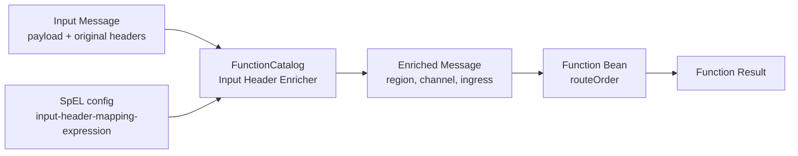

# Adding Headers with `input-header-mapping-expression`

## 1. Motivation: Normalizing Metadata Before Business Processing

In **SPRING_CLOUD_FUNCTION (Spring Cloud Function)**, operations are written using `Supplier`, `Function`, and `Consumer`, registered through `FunctionCatalog`, chained using *composition*, and reusable across HTTP, events, or serverless environments. Even when inputs arrive from different protocols, functions should see metadata under agreed-upon names and types.

Suppose a system receives a message containing:

```text
payload = "ORD-42"
headers = {
    "path": "north/express",
    "correlationId": "req-42"
}
```

An order-routing function needs to read `region=north` and `channel=express` separately. You could split the `path` string inside business code, but that is metadata normalization work that belongs before business decisions. Spring Cloud Function provides **`input-header-mapping-expression`**: configuring Spring Expression Language (**SpEL**) expressions to add or compute input headers right at the wrapper layer before the `Function` bean receives the data.

Configuration example:

```properties
spring.cloud.function.configuration.routeOrder.input-header-mapping-expression.region=headers.path.split('/')[0]
spring.cloud.function.configuration.routeOrder.input-header-mapping-expression.channel=headers.path.split('/')[1]
spring.cloud.function.configuration.routeOrder.input-header-mapping-expression.ingress='edge'
```

When `routeOrder` is invoked via `FunctionCatalog` with a `Message` containing `path=north/express`, the configuration above adds the `region`, `channel`, and `ingress` headers for the bean to use. The function does not need to know that `region` and `channel` were split from an input string.

After this lesson, you will be able to:

- Declare the `input-header-mapping-expression` configuration syntax properly and write basic SpEL expressions.
- Understand execution timing and the difference between calling a bean directly versus looking up a function through `FunctionCatalog`.
- Distinguish input enrichment, output enrichment, and copying all headers.
- Test successful mapping, missing headers, or failing expressions; design mandatory validation in the right place.
- Apply the same metadata contract when the function runs over HTTP, a broker, or serverless.

## 2. At Which Step Does `input-header-mapping-expression` Run?

`Message<T>` belongs to `org.springframework.messaging.Message` and provides `getPayload()` and `getHeaders()`. Headers are stored in `MessageHeaders`, which can be read like a map from `String` to `Object`. Once built into a `Message`, headers are read-only; the framework or code adding headers constructs a new appropriate message.

`input-header-mapping-expression` sits in **the enrichment layer of `FunctionCatalog`**. Conceptual flow:



Key steps:

1. The adapter or caller constructs a `Message<T>` from the payload and initial metadata.
2. `FunctionCatalog` looks up the function and applies enrichment configuration matching the function/definition name.
3. SpEL expressions are evaluated against the input data, e.g., reading `headers.path` and splitting it into multiple values.
4. The framework adds the configured headers before the `Function` bean actually runs.
5. The bean reads the enriched headers if evaluation succeeded, then produces a result according to its contract.

Spring Cloud Function has supported **Input/Output Enrichment since version 3.1.3**. The APIs and property syntax used in this lesson are based on the Spring Cloud Function documentation, section [Input/Output Enrichment](https://docs.spring.io/spring-cloud-function/reference/spring-cloud-function/programming-model.html).

> Calling the bean directly via `new MyFunctions().routeOrder().apply(message)` **does not trigger** `FunctionCatalog` enrichment. This configuration is a feature of the wrapper layer when the function is looked up/executed via the catalog or an adapter using the catalog.

## 3. Configuration Syntax: Function Name, Target Header Name, and Expression

General structure:

```text
spring.cloud.function.configuration.<function-name>.input-header-mapping-expression.<target-header>=<SpEL>
```

| Part | Example | Meaning |
|---|---|---|
| `spring.cloud.function.configuration` | Configuration prefix | Groups per-function Spring Cloud Function settings |
| `<function-name>` | `routeOrder` | Function/definition name used by `FunctionCatalog` |
| `input-header-mapping-expression` | Fixed key | Requests SpEL evaluation to enrich **input** headers |
| `<target-header>` | `region`, `channel` | Key to be placed into the input's `MessageHeaders` |
| `<SpEL>` | `headers.path.split('/')[0]` | How to compute the target header value from the message |

Example in `application.properties`:

```properties
spring.cloud.function.configuration.routeOrder.input-header-mapping-expression.region=headers.path.split('/')[0]
spring.cloud.function.configuration.routeOrder.input-header-mapping-expression.channel=headers.path.split('/')[1]
spring.cloud.function.configuration.routeOrder.input-header-mapping-expression.ingress='edge'
```

Equivalent format in `application.yml`:

```yaml
spring:
  cloud:
    function:
      configuration:
        routeOrder:
          input-header-mapping-expression:
            region: "headers.path.split('/')[0]"
            channel: "headers.path.split('/')[1]"
            ingress: "'edge'"
```

In YAML, the outer double quotes denote a **YAML string**. For `ingress`, the single quotes **inside the string** are SpEL literal syntax. If you write `ingress: edge` instead of `ingress: "'edge'"`, SpEL may try to look up a property or variable named `edge` rather than producing the constant string `"edge"`.

`routeOrder` must match the registered function bean name or the configured definition name under lookup. Do not substitute the class name `OrderFunctions`, an endpoint URL, or a Kafka topic name.

## 4. SpEL Context: `payload`, `headers`, and Literal Values

The root object used by SpEL for enrichment is the input message. For a `Message<?>`, both **`payload`** and **`headers`** are accessible inside expressions.

Example message constructed in Java:

```java
import org.springframework.messaging.Message;
import org.springframework.messaging.support.MessageBuilder;

Message<String> input = MessageBuilder.withPayload("ORD-42")
        .setHeader("path", "north/express")
        .setHeader("correlationId", "req-42")
        .build();
```

Illustrative expressions:

| SpEL expression | Value for the message above | Usage |
|---|---|---|
| `headers.path` | `"north/express"` | Reads the entire `path` header |
| `headers.path.split('/')[0]` | `"north"` | Extracts the first segment of the path |
| `headers.path.split('/')[1]` | `"express"` | Extracts the second segment |
| `headers['correlationId']` | `"req-42"` | Accesses a header key using map indexing |
| `payload` | `"ORD-42"` | Reads the current payload |
| `'edge'` | `"edge"` | SpEL string literal |

Example configuring a header derived from the payload:

```properties
spring.cloud.function.configuration.routeOrder.input-header-mapping-expression.requestId=payload
```

This configuration only makes sense if the payload is actually a string identifier. If the payload is a DTO, `payload` returns **the DTO object**, not automatically converted into an ID or JSON string. Choose an expression matching the data type and verify it in tests.

### Notes on header names and types

- `MessageHeaders` uses `String` keys and `Object` values. `headers.path.split('/')` assumes `path` exists and is a `String` with a compatible `split` method.
- HTTP headers are case-insensitive, whereas Java keys `"path"`, `"Path"`, or `"X-Path"` do not automatically collide in `MessageHeaders`.
- `headers.path` is convenient shorthand for simple keys. For names with hyphens or dots, map syntax such as `headers['X-Correlation-ID']` can be clearer; however, verify the exact header name actually populated by the adapter.
- The expression `split('/')[1]` requires a second element to be present; if the data lacks a delimiter, an evaluation error can occur.
- The produced value might not be a `String`. If the bean uses `get("region", String.class)`, make sure the SpEL expression returns the right type.

**SpEL does not replace an input contract.** It is convenient for extracting or adding simple structured metadata. Complex rules for authentication, authorization, or normalizing untrusted input belong in an adapter or an explicit processing step.

## 5. Complete Example: Routing Orders by `region` and `channel`

We create a bean accepting `Message<String>`, where the payload is an order ID. The business logic only cares about two normalized headers: `region` and `channel`. The `ingress` header is used to observe the processing entry point.

### 5.1. Defining the `Function` bean

```java
package com.example.routing;

import java.util.function.Function;

import org.springframework.context.annotation.Bean;
import org.springframework.context.annotation.Configuration;
import org.springframework.messaging.Message;
import org.springframework.messaging.support.MessageBuilder;

@Configuration
public class RouteFunctions {

    @Bean
    public Function<Message<String>, Message<String>> routeOrder() {
        return incoming -> {
            String region = incoming.getHeaders().get("region", String.class);
            String channel = incoming.getHeaders().get("channel", String.class);
            String ingress = incoming.getHeaders().get("ingress", String.class);

            // Do not assume SpEL expressions always evaluate successfully.
            if (region == null || region.isBlank()
                    || channel == null || channel.isBlank()) {
                throw new IllegalArgumentException(
                        "Missing or invalid routing headers");
            }

            String summary = region + ":" + channel
                    + ":" + incoming.getPayload();

            MessageBuilder<String> response = MessageBuilder
                    .withPayload(summary)
                    .setHeader("processedBy", "routeOrder");

            if (ingress != null) {
                response.setHeader("observedIngress", ingress);
            }

            // Keep only metadata actually needed on output.
            String correlationId = incoming.getHeaders()
                    .get("correlationId", String.class);
            if (correlationId != null) {
                response.setHeader("correlationId", correlationId);
            }

            return response.build();
        };
    }
}
```

**Bean input contract:** `region` and `channel` are required; `ingress` and `correlationId` are optional. `region` and `channel` are derived from `path` when enrichment is active. Business code is allowed to reject messages missing required metadata.

**Bean output contract:** payload `"north:express:ORD-42"`, headers `processedBy=routeOrder`, `observedIngress=edge`, and `correlationId=req-42` if present. The bean **does not forward `path`, `region`, or `channel`** unless explicitly requested. Adding input headers does not imply those headers are automatically carried into the output message.

### 5.2. Configuring enrichment for the matching bean name

```properties
spring.cloud.function.configuration.routeOrder.input-header-mapping-expression.region=headers.path.split('/')[0]
spring.cloud.function.configuration.routeOrder.input-header-mapping-expression.channel=headers.path.split('/')[1]
spring.cloud.function.configuration.routeOrder.input-header-mapping-expression.ingress='edge'
```

If the application has multiple function beans, when exposing via an adapter you can use:

```properties
spring.cloud.function.definition=routeOrder
```

The `spring.cloud.function.definition` property specifies the function selected for the adapter. `input-header-mapping-expression` specifies how metadata is added before invoking that function. These two properties serve different purposes.

### 5.3. Looking up and calling via `FunctionCatalog`

```java
import java.util.function.Function;

import org.springframework.cloud.function.context.FunctionCatalog;
import org.springframework.messaging.Message;
import org.springframework.messaging.support.MessageBuilder;

// catalog is the FunctionCatalog bean injected by Spring.
Function<Message<String>, Message<String>> function =
        catalog.lookup("routeOrder");

Message<String> input = MessageBuilder
        .withPayload("ORD-42")
        .setHeader("path", "north/express")
        .setHeader("correlationId", "req-42")
        .build();

Message<String> output = function.apply(input);

System.out.println(output.getPayload());
// north:express:ORD-42

System.out.println(output.getHeaders().get("observedIngress"));
// edge

System.out.println(output.getHeaders().get("correlationId"));
// req-42

System.out.println(output.getHeaders().get("region"));
// null: this example does not copy region to the output automatically.
```

Mapping expressions are applied in **the catalog wrapper** before the bean reads `region` and `channel`. Calling the bean directly, such as `new RouteFunctions().routeOrder().apply(input)`, **does not automatically add** those two headers. Given the same `input` containing only `path`, the direct call hits the `"Missing or invalid routing headers"` check; that is the intended behavior in this example.

## 6. When an Expression Fails: Framework Logs WARN Yet Still Calls the Function

This is a particularly important characteristic of `input-header-mapping-expression`. Spring Cloud Function documentation notes that when evaluating an enrichment expression fails, the framework **logs a WARN message and continues executing the function** as normal. The enrichment mechanism does not by default turn an expression error into rejecting the entire message.

Example:

```properties
spring.cloud.function.configuration.routeOrder.input-header-mapping-expression.channel=headers.path.split('/')[1]
```

If `headers.path` equals `"north"`, `split('/')` has no `[1]` element; evaluating `channel` can fail. Similarly, if `path` does not exist, calling `split` on a missing value can also fail. The framework may log something like:

```text
WARN ... InputEnricher : Failed while evaluating expression ...
```

**Consequence:** do not treat enrichment as "fail-closed" validation. If the bean requires `channel` for routing or authorization, the bean/adapter must explicitly check mandatory conditions and reject invalid input.

In the example in section 5, the bean performs:

```java
if (region == null || region.isBlank()
        || channel == null || channel.isBlank()) {
    throw new IllegalArgumentException(
            "Missing or invalid routing headers");
}
```

Thus, even if a mapping expression fails and the framework still hands control to the bean, **the bean itself** rejects input missing required metadata. Whether the exception maps to an HTTP status, retry, dead-letter, or error notification depends on the adapter and actual error-handling contract.

If data missing `path` is a normal business scenario, apply an agreed-upon default at the HTTP/broker boundary or write a Java enrichment function with explicit checks. Do not rely on SpEL errors to represent a business branch.

## 7. Distinguishing Input Enrichment, Output Enrichment, and Copying Headers

These mechanisms serve different purposes:

| Mechanism | Point of impact | Example | Use case |
|---|---|---|---|
| `input-header-mapping-expression` | **Before** the bean receives `Message` | Split `path` into `region` and `channel` | Normalizing or enriching input metadata |
| `output-header-mapping-expression` | **After** the function result inside the wrapper | Attach a header describing the result from available data | Enriching metadata on the output message |
| `copy-input-headers` | Propagates headers from input to output in the wrapper when applicable | Keep input headers across a pure POJO function | Broad copying without per-key selection |
| `MessageBuilder.setHeader(...)` | Inside message-building code | Keep only `correlationId` | When validation, filtering, renaming, or business rules are needed |

Example of an output enrichment property, to show the naming difference:

```properties
spring.cloud.function.configuration.routeOrder.output-header-mapping-expression.stage='completed'
```

Whereas `input-header-mapping-expression.ingress='edge'` adds metadata **for `routeOrder` to read before processing**, `output-header-mapping-expression.stage='completed'` targets **the result message after the function runs**. An output `stage` value is not an input header that the bean can read during that same invocation.

Conversely, `copy-input-headers=true` does not parse a `path` to derive `region` and `channel`. It supports **propagating existing headers** in certain scenarios when called via `FunctionCatalog`. If the function returns a `Message<O>` it built itself, define the output header contract in code; do not rely on the framework copying all headers for every function shape.

### When should you write a Java enrichment function?

If normalization logic is complex, needs to access another service, requires schema validation, or must surface explicit errors, you can create an enrichment bean:

```java
@Bean
public Function<Message<String>, Message<String>> normalizeRoute() {
    return incoming -> {
        String path = incoming.getHeaders().get("path", String.class);
        if (path == null) {
            throw new IllegalArgumentException("path is required");
        }

        String[] parts = path.split("/", -1);
        if (parts.length != 2
                || parts[0].isBlank() || parts[1].isBlank()) {
            throw new IllegalArgumentException("Invalid path");
        }

        return MessageBuilder.fromMessage(incoming)
                .setHeader("region", parts[0])
                .setHeader("channel", parts[1])
                .build();
    };
}
```

Then you can use composition `normalizeRoute|routeOrder` with compatible signatures, provided you test the definition via the catalog. Writing Java is more verbose than a property, yet it lets you define validation, errors, and auditing rules much more clearly.

## 8. Mapping Headers from HTTP, Brokers, and Serverless into the Same Contract

`input-header-mapping-expression` evaluates against **the `Message` received by the framework**, not directly against an HTTP servlet request, Kafka record, or Lambda context object. The adapter layer is responsible for placing the body and transport metadata into `Message` beforehand.

| Environment | What input metadata might be | What to verify before applying SpEL |
|---|---|---|
| Spring Cloud Function Web | HTTP headers, request body | Header names placed into `MessageHeaders` by the web adapter, data types, and body decoding |
| Spring Cloud Stream | Broker record headers/attributes, binder metadata | Binder mappings, header types, and serialization mechanics |
| Serverless adapter | Runtime event envelope, message attributes, request context | Which fields the adapter extracts, internal names, and trust source |

For instance, the same routing concept might appear as:

```text
HTTP request:       X-Route: north/express
Kafka event header: route-path = north/express
Serverless event:   detail.route = north/express
                         |
                  normalizing adapter
                         v
MessageHeaders["path"] = "north/express"
                         |
               input-header-mapping-expression
                         v
MessageHeaders["region"]  = "north"
MessageHeaders["channel"] = "express"
                         |
                     routeOrder
```

This is **an application-defined illustrative convention**; Spring Cloud Function does not guarantee that `X-Route`, `route-path`, and `detail.route` automatically map to the same `path` key. When the same function must run across HTTP, a broker, or serverless, implement and test the normalization step at each boundary.

Similarly, the Spring Messaging `contentType` header differs in abstraction level from HTTP `Content-Type`. Adding headers via SpEL does not automatically serialize a payload to JSON or convert bytes to a DTO; converters/adapters and the function signature determine actual conversion.

## 9. Security and Limiting SpEL Scope

SpEL is a powerful expression language capable of accessing properties and invoking methods in contexts permitted by the framework. **Expressions provided by application configuration must be treated as privileged configuration**, managed solely by trusted operators or deployment pipelines.

Key principles:

1. **Never take expressions directly from client-controlled HTTP headers or event metadata and feed them into configuration.** To read a header value, the expression must be **static configuration**, e.g. `headers.path`; the value of `path` is treated as data and must be validated.
2. **Protect configuration modification permissions and management endpoints.** Prevent untrusted sources from substituting properties containing SpEL.
3. **Do not use SpEL to make authorization decisions solely from self-asserted headers.** Headers like `X-Tenant-ID` or `X-User-ID` do not prove identity; authenticate and authorize at the trust boundary.
4. **Constrain length and format of data used in expressions.** A very long `path`, missing delimiter, or non-`String` type can cause evaluation failures or produce unintended metadata.
5. **Do not propagate sensitive information by default.** Enriching input headers does not mean `Authorization`, cookies, tokens, or tracing payloads may travel to every downstream step.

If enrichment affects mandatory business conditions, add checks in code, since an expression evaluation failure **does not automatically halt function invocation**.

## 10. Composition: Which Function Does the Configuration Belong To?

Suppose a system has a metadata-enrichment step and a business step:

```properties
spring.cloud.function.definition=normalizeRoute|routeOrder
```

In composition, boundaries between functions and wrappers can differ from a single invocation. You need to understand **which function definition name is looked up**, where `input-header-mapping-expression` attaches, and when `Message` is converted or wrapped.

A sound verification approach:

1. Start with a standalone `catalog.lookup("routeOrder")` call using a well-formed `Message` with `path` to confirm the enrichment property works.
2. Run the composed definition `catalog.lookup("normalizeRoute|routeOrder")` and verify `region` and `channel` appear properly at the `routeOrder` step.
3. Whether attaching properties by individual function name or composite definition name, verify actual configuration mechanics on your Spring Cloud Function version; do not assume a single step's property automatically applies to every composition chain.
4. For complex boundaries, consider a dedicated enrichment bean and test each step rather than relying on multiple layers of automatic mapping.

Do not mix up `input-header-mapping-expression` with `spring.cloud.function.routing-expression`. Both can use SpEL in certain contexts, but **routing** selects the target function/route, whereas **input header enrichment** adds metadata to the message prior to invocation. Allowing clients to influence routing carries its own security rules; understanding mapping syntax does not mean routing is safe with untrusted data.

## 11. Advanced Case: Multiple Inputs

Spring Cloud Function documentation describes indexed syntax immediately after `input-header-mapping-expression` for multi-input functions:

```properties
spring.cloud.function.configuration.echo.input-header-mapping-expression[0].key1='hello1'
spring.cloud.function.configuration.echo.input-header-mapping-expression[1].key2='hello2'
```

The indices `[0]` and `[1]` refer to **the corresponding input positions** in a multi-input function model. This is an advanced case, typically associated with reactive models and function arity, not configuration needed for an ordinary `Function<Message<String>, Message<String>>`. If an application handles multiple input bindings, verify syntax against your version and test each input channel separately.

## 12. Testing `input-header-mapping-expression` via `FunctionCatalog`

Because enrichment belongs to the `FunctionCatalog` wrapper, unit tests calling the bean directly **are not enough** to verify the property. The following JUnit 5 + Spring Boot Test example starts a small Spring context, declares the `routeOrder` bean from section 5, and configures the three expressions:

```java
package com.example.routing;

import static org.junit.jupiter.api.Assertions.assertEquals;
import static org.junit.jupiter.api.Assertions.assertNull;

import java.util.function.Function;

import org.junit.jupiter.api.Test;
import org.springframework.beans.factory.annotation.Autowired;
import org.springframework.boot.SpringBootConfiguration;
import org.springframework.boot.autoconfigure.EnableAutoConfiguration;
import org.springframework.boot.test.context.SpringBootTest;
import org.springframework.cloud.function.context.FunctionCatalog;
import org.springframework.context.annotation.Import;
import org.springframework.messaging.Message;
import org.springframework.messaging.support.MessageBuilder;

@SpringBootTest(
        classes = RouteFunctionMappingTest.TestApp.class,
        properties = {
                "spring.cloud.function.configuration.routeOrder."
                        + "input-header-mapping-expression.region="
                        + "headers.path.split('/')[0]",
                "spring.cloud.function.configuration.routeOrder."
                        + "input-header-mapping-expression.channel="
                        + "headers.path.split('/')[1]",
                "spring.cloud.function.configuration.routeOrder."
                        + "input-header-mapping-expression.ingress='edge'"
        }
)
class RouteFunctionMappingTest {

    @SpringBootConfiguration
    @EnableAutoConfiguration
    @Import(RouteFunctions.class)
    static class TestApp {}

    @Autowired
    private FunctionCatalog catalog;

    @Test
    void enrichesHeadersBeforeCallingBusinessFunction() {
        Function<Message<String>, Message<String>> function =
                catalog.lookup("routeOrder");

        Message<String> input = MessageBuilder
                .withPayload("ORD-42")
                .setHeader("path", "north/express")
                .setHeader("correlationId", "req-42")
                .build();

        Message<String> result = function.apply(input);

        assertEquals("north:express:ORD-42", result.getPayload());
        assertEquals("edge",
                result.getHeaders().get("observedIngress"));
        assertEquals("req-42",
                result.getHeaders().get("correlationId"));
        assertEquals("routeOrder",
                result.getHeaders().get("processedBy"));

        // region/channel are input enrichment;
        // the function code does not publish them on output.
        assertNull(result.getHeaders().get("region"));
        assertNull(result.getHeaders().get("channel"));
    }
}
```

This example assumes the test classpath has the appropriate dependencies for Spring Boot Test and Spring Cloud Function. `TestApp` enables auto-configuration and imports `RouteFunctions` so the Spring context can register the function bean and `FunctionCatalog`. A project with complex application configuration may require adjustments for its specific version. This is an illustrative pattern for testing bean-name-based enrichment, not a command executed during this lesson.

### Additional test cases to include

| Case | What to verify |
|---|---|
| `path=north/express` | Bean sees `region=north` and `channel=express` |
| Missing `path` header | Enrichment may log WARN, yet bean still detects missing required values and rejects input |
| `path=north` missing second part | `[1]` expression fails to produce valid `channel`; error handled per contract |
| `path` has a non-`String` type | Do not assume `split` exists or produces the right result type |
| Calling bean directly without catalog | No automatic enrichment occurs |
| Changing `Function` into a composite definition | Verify config applies at the right point and headers persist downstream |
| Invoking via HTTP/broker/serverless | Ensure the adapter actually produces `headers.path` before enrichment runs |
| Payload or content type conversion | Verify converters and actual output format rather than inferring from metadata |

If a missing `path` must yield HTTP 400, the HTTP status rule belongs to the HTTP adapter/controller layer. If the message arrives from a broker, an exception in the bean may trigger a retry or dead-letter depending on the binder. `input-header-mapping-expression` itself does not define those transport policies.

## 13. Common Pitfalls and Fixes

| Symptom | Possible Cause | Resolution |
|---|---|---|
| New headers do not appear in the bean | Bean called directly; wrong function name in property; adapter uses a different lookup | Invoke via `FunctionCatalog`; verify definition name and config |
| `ingress=edge` is not created | Unquoted SpEL `edge` interpreted as a property/variable | Use literal `'edge'` in the property value |
| `headers.path` evaluates to `null` | Actual header has a different name or adapter did not put it into `Message` | Inspect headers after the adapter and standardize key names |
| `split('/')[1]` fails | `path` lacks a delimiter, is missing a segment, or is not a string | Validate input and use normalization logic with validation |
| WARN logged yet function still runs | Framework ignores enrichment errors by design | Do not treat enrichment as rejection; validate in bean/adapter |
| Header exists on input only, not on output | Enrichment adds headers before the bean; function controls output | Build output headers with `MessageBuilder` or controlled output enrichment |
| Enabled `copy-input-headers` yet cannot split `path` | Copying differs from evaluating SpEL expressions | Use `input-header-mapping-expression` |
| HTTP header `X-Route` cannot be read via `headers.path` | No rule mapping HTTP header name to internal name | Normalize at the web adapter/controller |
| Different results when composing functions | Config attached to wrong definition or wrapping/conversion changed | Test the composition itself via catalog |
| Sensitive data leaks or wrong security context | Expression reads untrusted headers and forwards without filtering | Lock down config, authenticate at boundary, and restrict output metadata |

## 14. Practice Exercise: Enriching Metadata Before a Payment Function

Create `Function<Message<String>, Message<String>> validatePayment` whose payload is a payment ID, while header `route` holds `"vn/priority"` by application convention.

1. Configure `input-header-mapping-expression.country=headers.route.split('/')[0]` and `input-header-mapping-expression.serviceLevel=headers.route.split('/')[1]` for the `validatePayment` bean.
2. Add a default header `ingress='payment-gateway'` using a valid SpEL literal in `application.properties` or `application.yml`.
3. Inside the bean, read `country` and `serviceLevel`, verify they exist and belong to an allowed set; return `Message<String>` with a result payload and add `processedBy=validatePayment`.
4. Set `correlationId` on the input message and forward that header only after verifying its type. Demonstrate that `country` is not copied to the output automatically unless code explicitly sets it.
5. Use `FunctionCatalog.lookup("validatePayment")` to test `route=vn/priority`; compare with calling the bean directly.
6. Test `route=vn`, missing `route`, and a non-string `route` header. Observe the enrichment warning, then prove that bean validation catches missing required metadata.
7. Add a second step via composition and inspect headers received by the downstream step. Finally, expose the function via HTTP or an event binder and verify how the adapter maps header names.

**Remember:** `input-header-mapping-expression` configures **SpEL to add or compute input headers before a `Function` bean runs through `FunctionCatalog`**, using the pattern `spring.cloud.function.configuration.<function-name>.input-header-mapping-expression.<target-header>=<SpEL>`. It is useful for compact metadata transformations like splitting strings, reading headers, and setting defaults. Expression evaluation errors may only log WARN and continue calling the function, so mandatory validation must live in the bean or adapter; output and transport headers still require their own contracts and tests.
