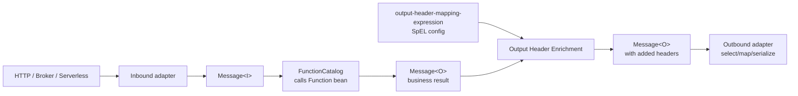

# Adding Headers with `output-header-mapping-expression`

## 1. Problem Statement: Adding Metadata After a Function Produces Its Result

In **SPRING_CLOUD_FUNCTION (Spring Cloud Function)**, business logic is organized into `Supplier`, `Function`, and `Consumer`, registered via `FunctionCatalog`, chained using *composition*, and deployable over HTTP, event streams, or serverless environments. When a function returns a result, downstream steps sometimes need metadata such as processing stage, response classification code, or observational details about the result.

Suppose a string-normalization function receives `"  hello  "` and returns `"HELLO"`. The business logic is only responsible for normalizing content. However, an adapter or downstream step also needs to know the length of the result string and the name of the completed stage:

```text
Message<String> after the function runs:
  payload = "HELLO"
  headers = {
    processedBy = "normalizeReceipt",
    resultCode = "NORMALIZED"
  }

Message<String> after output header enrichment:
  payload = "HELLO"
  headers = {
    processedBy = "normalizeReceipt",
    resultCode = "NORMALIZED",
    stage = "done",
    outputLength = 5,
    outputCode = "NORMALIZED"
  }
```

Spring Cloud Function provides **`output-header-mapping-expression`** to compute and add headers to **the output message** using Spring Expression Language (**SpEL**). Enrichment is performed through `FunctionCatalog`'s invocation wrapper, keeping simple metadata annotations separate from business code.

Example `application.properties`:

```properties
spring.cloud.function.configuration.normalizeReceipt.output-header-mapping-expression.stage='done'
spring.cloud.function.configuration.normalizeReceipt.output-header-mapping-expression.outputLength=payload.length()
spring.cloud.function.configuration.normalizeReceipt.output-header-mapping-expression.outputCode=headers['resultCode']
```

In this example, `stage` is set to a constant string, `outputLength` is computed from **the processed payload**, and `outputCode` reads a **header present on the result message**. This configuration **does not** create HTTP response headers, configure a broker output binding, or automatically publish an event: those belong to the outbound adapter.

The goal of this lesson is to understand when SpEL is evaluated, declare function and header names properly, build testable examples, handle failing expressions, and distinguish output enrichment from header copying or protocol mapping.

## 2. Where Output Enrichment Sits in the Processing Chain

`Message<T>` is the Spring Messaging interface (`org.springframework.messaging.Message`). A message contains `getPayload()` and `getHeaders()`, where `MessageHeaders` is a read-only map from header name to value. When headers need to be added, the framework or code constructs a new corresponding output message rather than mutating `getHeaders().put(...)` directly.



Three milestones must be distinguished:

1. **Before the function:** the adapter receives external protocol data and provides appropriate input; `input-header-mapping-expression` (if configured) targets metadata that the bean will see.
2. **Inside the function:** the bean computes the result payload and can explicitly construct `Message<O>` with business-defined headers.
3. **After the function:** `output-header-mapping-expression` is applied by the wrapper to add headers to the result. The business step that just executed **cannot read back** a header created after that very invocation.

The third point is critical: if the `normalizeReceipt` bean needs `stage` to decide how to process, you cannot set `stage` solely via output enrichment. Instead, compute `stage` inside the bean or use appropriate input enrichment. Output enrichment serves **result consumers**, such as the next function or the outbound adapter.

> Spring Cloud Function documents **Input/Output Enrichment** in the official reference since version 3.1.3: [Programming model – Input/Output Enrichment](https://docs.spring.io/spring-cloud-function/reference/spring-cloud-function/programming-model.html). Actual behavior should be tested on the specific version and adapter used by your application.

## 3. Standard Configuration Syntax

General property pattern:

```text
spring.cloud.function.configuration.<function-name>.output-header-mapping-expression.<target-header>=<SpEL>
```

| Part | Example | Purpose |
|---|---|---|
| `spring.cloud.function.configuration` | Fixed prefix | Groups per-function Spring Cloud Function configuration |
| `<function-name>` | `normalizeReceipt` | Bean/definition name looked up by `FunctionCatalog` |
| `output-header-mapping-expression` | Fixed prefix | Computes headers **after** the function result |
| `<target-header>` | `stage`, `outputLength` | Name of the target header to add |
| `<SpEL>` | `'done'`, `payload.length()` | Expression computing the header's value |

With `application.properties`:

```properties
spring.cloud.function.configuration.normalizeReceipt.output-header-mapping-expression.stage='done'
spring.cloud.function.configuration.normalizeReceipt.output-header-mapping-expression.outputLength=payload.length()
spring.cloud.function.configuration.normalizeReceipt.output-header-mapping-expression.outputCode=headers['resultCode']
```

With `application.yml`:

```yaml
spring:
  cloud:
    function:
      configuration:
        normalizeReceipt:
          output-header-mapping-expression:
            stage: "'done'"
            outputLength: "payload.length()"
            outputCode: "headers['resultCode']"
```

Both configurations mean the same thing. In YAML, the outer double quotes are **YAML string syntax**; in the value of `stage`, the **inner** single quotes belong to **SpEL string literal syntax**. If you write `stage: done` without SpEL's single quotes, the engine may try to access a property named `done` and fail evaluation.

Note: `<function-name>` is the function name used by `FunctionCatalog`, **not** the Java class name, REST URL, or broker topic name. In an application with multiple functions, an entry-point property such as `spring.cloud.function.definition=normalizeReceipt` determines which function the adapter selects; its role differs from `output-header-mapping-expression`.

## 4. What Does SpEL Read When Enriching Output Headers?

Output enrichment expressions are evaluated **against the result message**, so you can reference **`payload`** and **`headers`** of **the output**. This pattern also appears in the official documentation:

```properties
spring.cloud.function.configuration.split.output-header-mapping-expression.keyOut1='hello1'
spring.cloud.function.configuration.split.output-header-mapping-expression.keyOut2=headers.contentType
```

`keyOut1` receives the constant string `"hello1"`; `keyOut2` reads the existing `contentType` on the result message. This is an **illustrative configuration from the documentation**, not a guarantee that every result has `contentType` or that the header is always a string.

Given the sample output:

```java
Message<String> result = MessageBuilder.withPayload("HELLO")
        .setHeader("processedBy", "normalizeReceipt")
        .setHeader("resultCode", "NORMALIZED")
        .build();
```

We can use:

| Expression | Expected value | Explanation |
|---|---|---|
| `'done'` | `"done"` | String literal |
| `payload` | `"HELLO"` | **Output** payload |
| `payload.length()` | `5` (integer) | Length of the result string |
| `headers['resultCode']` | `"NORMALIZED"` | Output header `resultCode` |
| `headers.processedBy` | `"normalizeReceipt"` | Map property access for simple keys |
| `headers['missingHeader']` | Usually no useful value | Depends on evaluation and how the framework handles `null` |

**Header data types matter.** `outputLength=payload.length()` yields an integer, not automatically the string `"5"`. Receivers call `get("outputLength", Integer.class)` when the contract specifies an integer. If an adapter transfers headers to HTTP or a broker, the wire data type may be encoded/transformed by its own mechanism.

For a DTO payload, you can choose expressions based on the result object, e.g., `payload.status()` if the object is a Java record with a `status()` accessor. Verify the payload type **after wrapper conversions**, because if a converter turns the object into `byte[]`, DTO methods will no longer apply.

### Do not confuse input and output

If the input had `headers.source` while the function built an output `Message` containing only `resultCode` and `processedBy`, the output expression `headers.source` is **not guaranteed** to see `source`. It runs against **the result context**, without automatic access to all input headers from the prior call.

For output enrichment to use a specific piece of input metadata, an explicit forwarding rule is needed in the function or wrapper—for instance, the function intentionally preserves `correlationId` in `Message<O>`. Do not rely on every header being copied automatically.

## 5. Complete Spring Cloud Function Example: Bean Builds Response, Wrapper Enriches Metadata

The following Java 17+ example keeps business logic independent of HTTP, Kafka, RabbitMQ, or serverless. The bean uses `Message<String>` to read an optional `correlationId`, process the string, and build the result; **the three output headers `stage`, `outputLength`, and `outputCode` are not created in code**, but configured in the next section.

```java
package com.example.functions;

import java.util.Locale;
import java.util.function.Function;

import org.springframework.context.annotation.Bean;
import org.springframework.context.annotation.Configuration;
import org.springframework.messaging.Message;
import org.springframework.messaging.support.MessageBuilder;

@Configuration
public class ReceiptFunctions {

    @Bean
    public Function<Message<String>, Message<String>> normalizeReceipt() {
        return incoming -> {
            String normalized = incoming.getPayload()
                    .strip()
                    .toUpperCase(Locale.ROOT);

            String resultCode = normalized.isBlank()
                    ? "EMPTY"
                    : "NORMALIZED";

            MessageBuilder<String> builder = MessageBuilder
                    .withPayload(normalized)
                    .setHeader("processedBy", "normalizeReceipt")
                    .setHeader("resultCode", resultCode);

            // Carry forward only required business metadata.
            Object correlation = incoming.getHeaders().get("correlationId");
            if (correlation != null) {
                if (!(correlation instanceof String id)
                        || !id.matches("[A-Za-z0-9._-]{1,64}")) {
                    throw new IllegalArgumentException(
                            "Invalid correlationId");
                }
                builder.setHeader("correlationId", correlation);
            }

            return builder.build();
        };
    }
}
```

The function handles exactly two tasks: producing the normalized payload and setting headers belonging to **the business contract** (`processedBy`, `resultCode`, and `correlationId` when valid). It knows nothing about HTTP/broker transport headers, nor does it generate `stage` or `outputLength` itself.

### 5.1. Configuring output enrichment

```properties
spring.cloud.function.definition=normalizeReceipt
spring.cloud.function.configuration.normalizeReceipt.output-header-mapping-expression.stage='done'
spring.cloud.function.configuration.normalizeReceipt.output-header-mapping-expression.outputLength=payload.length()
spring.cloud.function.configuration.normalizeReceipt.output-header-mapping-expression.outputCode=headers['resultCode']
```

With input `"  hello  "`, the bean outputs a `Message<String>` containing payload `"HELLO"`, `processedBy=normalizeReceipt`, and `resultCode=NORMALIZED`. When invoked through the catalog with the configuration above, the wrapper also adds `stage=done`, `outputLength=5`, and `outputCode=NORMALIZED`.

The name `outputCode` in the example illustrates mapping an existing `resultCode` header to a new name. If a real application does not need a second name, omit this property. Enrichment should produce **useful metadata**, not arbitrarily duplicate every field.

### 5.2. Invoking via `FunctionCatalog`

```java
import java.util.function.Function;

import org.springframework.cloud.function.context.FunctionCatalog;
import org.springframework.messaging.Message;
import org.springframework.messaging.support.MessageBuilder;

// catalog is injected from the Spring context containing the normalizeReceipt bean.
Function<Message<String>, Message<String>> fn =
        catalog.lookup("normalizeReceipt");

Message<String> input = MessageBuilder.withPayload("  hello  ")
        .setHeader("correlationId", "req-42")
        .setHeader("source", "web-client")
        .build();

Message<String> output = fn.apply(input);

System.out.println(output.getPayload());
// HELLO
System.out.println(output.getHeaders().get("stage"));
// done
System.out.println(output.getHeaders().get("outputLength"));
// 5 (Integer)
System.out.println(output.getHeaders().get("outputCode"));
// NORMALIZED
System.out.println(output.getHeaders().get("correlationId"));
// req-42
```

For example, `source` is not actively copied by the bean. When the active configuration has no copy-input-headers policy, do not assume `source` will appear on output. In particular, output enrichment **does not have a feature to automatically copy all input headers**.

### 5.3. When calling the bean directly

```java
import com.example.functions.ReceiptFunctions;

Message<String> direct = new ReceiptFunctions()
        .normalizeReceipt()
        .apply(input);

System.out.println(direct.getPayload());               // HELLO
System.out.println(direct.getHeaders().get("resultCode")); // NORMALIZED
System.out.println(direct.getHeaders().get("stage"));      // null
```

Here `direct.getHeaders().get("stage")` is `null` because the bean code does not create this header and the call **does not pass through the `FunctionCatalog` wrapper**. The same bean can yield different *framework-added metadata* depending on the invocation path. Therefore, testing this configuration must go through the catalog or an actual adapter using the catalog.

## 6. Differences Between Input Enrichment, Output Enrichment, and Copying Headers

| Mechanism | Timing | Primary data source | Effect |
|---|---|---|---|
| `input-header-mapping-expression` | Before calling the bean | **Input** payload/headers | Adds headers the bean can read |
| `output-header-mapping-expression` | After the bean produces a result | **Output** payload/headers | Adds headers for downstream steps/adapters |
| `copy-input-headers` | When wrapper supports propagating headers | Existing input headers | Broad copying; does not compute new headers via SpEL |
| `MessageBuilder.setHeader(...)` | Inside message-building code | Application data and rules | Explicitly selects, validates, or overrides individual headers |
| Adapter header mapping | HTTP/broker/serverless boundary | Protocol metadata | Translates between internal and transport header names/types |

The following two properties illustrate **two different points in time**:

```properties
# Before the bean: the bean can read the ingress header.
spring.cloud.function.configuration.normalizeReceipt.input-header-mapping-expression.ingress='api'

# After the bean: the result consumer can see the stage header.
spring.cloud.function.configuration.normalizeReceipt.output-header-mapping-expression.stage='done'
```

If the bean does not copy `ingress` to the result, **the output does not automatically contain `ingress`** merely because it existed on input. Meanwhile, the output `stage` only appears after the bean finishes running.

Configuring `copy-input-headers` per function name, e.g., `spring.cloud.function.configuration.someFunction.copy-input-headers=true`, is a separate mechanism for broadly propagating input metadata when function types/wrappers allow it. It does not replace computing `outputLength=payload.length()`.

For a function returning a `Message<O>` constructed by the function itself, Spring Cloud Function documentation states that the framework does not automatically rewrite that `Message`'s entire header set beyond appropriate payload conversion. When mandatory metadata like `correlationId` must be forwarded, set it explicitly with `MessageBuilder`, and verify the exact output enrichment result through the catalog.

## 7. Naming and Typing Output Headers

A good output header needs **clear semantics**, **a stable type**, and **an identified consumer**:

| Header | Sample value | Internal type | Meaning |
|---|---|---|---|
| `stage` | `"done"` | `String` | Processing stage label |
| `outputLength` | `5` | `Integer` | Character count of the result payload in the example |
| `outputCode` | `"NORMALIZED"` | `String` | Renamed copy of the result code |
| `correlationId` | `"req-42"` | `String` | Links requests across steps |
| `contentType` | `application/json` or `text/plain` | Depends on converter/adapter | Payload media type hint |
| `processedBy` | `"normalizeReceipt"` | `String` | Business step that produced the result |

**Do not use result headers to replace essential business data.** If a receiver needs to determine order status, keep the status in the payload DTO (`OrderDecision.status`). An `outputCode` header is fine for observability or integration, but it can be dropped/renamed by adapters.

With SpEL `payload.length()`, the result in this example is Java's `String.length()` character count, not the UTF-8 byte size of an HTTP response. When you need the wire payload size, compute it at the appropriate serialization/transport layer.

### Can it replace an existing header?

Within the same configuration, if `<target-header>` collides with a header already present in `Message<O>`, value contention can occur between code and enrichment. **Do not rely on an untested precedence order**; name headers clearly and separate business-owned metadata from adapter-facing metadata. If overriding under a specific rule is unavoidable, express it in code or integration-test it on your exact framework version.

## 8. When SpEL Fails to Evaluate

Spring Cloud Function documentation notes that if an enrichment expression errors out, the framework **logs a WARN message and continues executing the function flow**, rather than turning an expression failure into a hard exception by default. With output enrichment, the consequence is especially easy to overlook: the business result may be produced while expected metadata is missing.

Example of a broken configuration:

```properties
spring.cloud.function.configuration.normalizeReceipt.output-header-mapping-expression.invalid=payload.unknownMethod()
```

With payload `"HELLO"`, `unknownMethod()` does not exist on `String`, so the expression fails to evaluate. The framework may log a WARN about expression evaluation; **do not assume the payload or other headers will be discarded**. Exact log messages and logger names can vary by version.

A subtler example:

```properties
spring.cloud.function.configuration.normalizeReceipt.output-header-mapping-expression.outputCode=headers['missingResultCode'].toString()
```

If `missingResultCode` does not exist, calling `toString()` on the missing value can fail. If `outputCode` is only for logging, the system can keep running without this metadata; however, if a receiver relies on it for routing or access control, **validate the contract before acting on it**.

Proper solutions:

1. For headers **mandatory for business logic**, create and validate them inside the `Function` itself or a Java step with explicit validation.
2. For **protocol-level** headers, perform mapping and validation in the adapter at the trust boundary.
3. For **optional** metadata, use output enrichment and monitor/log if an expression fails to yield the expected value.
4. Write tests for wrong-typed payloads, missing source headers, and broken SpEL configurations; do not test only a single happy path.

**Note:** A SpEL error differs from an exception thrown by the bean. If `normalizeReceipt` throws a business or technical exception, the framework and adapter handle it according to their own error, retry, or HTTP status mechanisms; output enrichment is not a layer that catches or repairs business errors automatically.

## 9. When Should You Write a Dedicated Enrichment Function?

SpEL configuration is handy for short, self-contained, readable transformations. When you need multiple conditionals, missing-data handling, complex type checks, or a header allowlist, a dedicated `Function` is easier to control.

Example of an enrichment function running **after** a business function:

```java
package com.example.functions;

import java.util.function.Function;

import org.springframework.context.annotation.Bean;
import org.springframework.context.annotation.Configuration;
import org.springframework.messaging.Message;
import org.springframework.messaging.support.MessageBuilder;

@Configuration
public class OutputMetadataFunctions {

    @Bean
    public Function<Message<String>, Message<String>> addOutputMetadata() {
        return result -> {
            String payload = result.getPayload();
            if (payload == null || payload.isBlank()) {
                throw new IllegalArgumentException(
                        "Cannot publish blank result");
            }

            return MessageBuilder.fromMessage(result)
                    .setHeader("stage", "done")
                    .setHeader("outputLength", payload.length())
                    .build();
        };
    }
}
```

With two compatible beans `normalizeReceipt` and `addOutputMetadata`, you can use composition:

```properties
spring.cloud.function.definition=normalizeReceipt|addOutputMetadata
```

```text
Input Message<String>
        |
        v
 normalizeReceipt
        |
        v
Business result Message<String>
        |
        v
 addOutputMetadata
        |
        v
Message<String> with stage and outputLength
```

Using Java allows mandatory checks and throwing exceptions on invalid payloads. If you choose this route, avoid keeping `output-header-mapping-expression` entries that set the same keys unless the system has an explicit coordination rule and ordering tests.

**Composition adds wrapping/conversion layers.** In production deployments, look up and test the exact `normalizeReceipt|addOutputMetadata` definition through the catalog; do not assume a property attached to a single bean name behaves identically in every pipeline.

## 10. Impact on HTTP, Brokers, and Serverless

`output-header-mapping-expression` creates **metadata inside the output `Message`**. Whether that metadata appears outside the application is a separate step.

| Environment | After output enrichment | What to verify at the adapter |
|---|---|---|
| Spring Cloud Function Web | `Message<?>` has `stage`, `outputLength`, etc. | Which headers become HTTP response headers, names/types, content negotiation |
| Spring Cloud Stream | `Message<?>` has output metadata | Which headers the binder serializes to broker headers; whether output binding is configured and events are sent |
| Serverless adapter | Function returns metadata-enriched result | What body/envelope the runtime expects, and whether metadata maps to response/event |
| In-Java `FunctionCatalog` call | Caller receives result via wrapper | Payload type after converters and actual headers on the result |

Example of the relationship:

```text
FunctionCatalog output Message<String>
  payload       = "HELLO"
  headers.stage = "done"
  headers.outputLength = 5
                       |
                  HTTP adapter
                       |
HTTP response:
  body = "HELLO"          [after serialization]
  headers = ...            [depends on adapter rules]
```

Do not write requirements like "set `outputLength` as an HTTP header" without an explicit mapping contract in the web adapter or controller. With Spring Cloud Function Web, certain `Message<?>` signatures have mechanisms to copy output message headers into HTTP headers; with brokers and serverless, mappings can differ. **Integration tests must measure behavior on the actual adapter in use.**

In particular, `resultCode=REJECTED` or `stage=done` **does not automatically change HTTP status to 400/500**, nor does it control broker acknowledgment/retry. Those policies belong to the protocol layer.

### `contentType` and data conversion

Output enrichment can read `headers.contentType` as in the official documentation example, yet **the `contentType` header does not encode the payload by itself**. Converters rely on Java signatures, metadata, and configuration to serialize objects to JSON, text, or bytes. If a function changes the payload from a DTO to `String` while copying `contentType=application/json` from input, the media type may no longer match.

When checking the actual response format, measure it in adapter tests rather than inferring from `headers.contentType`. If an expression reads `headers.contentType` when the header has not been set, the added value may be missing or invalid depending on converter and SpEL rules.

## 11. Safety When Using SpEL in Configuration

SpEL is a powerful expression language able to access properties and invoke methods. Therefore, property files containing `output-header-mapping-expression` are **privileged configuration**, modifiable only by trusted sources through controlled deployment pipelines.

Key principles:

- **Never take SpEL expressions directly from clients, HTTP headers, or message attributes** and place them into configuration. Expressions must be managed as application code/configuration; external payloads and headers are only data inputs to fixed expressions.
- **Do not put sensitive data into output headers** via leaky expressions such as copying tokens, cookies, or internal identifiers. Receivers or adapters may transmit them over HTTP or a broker.
- **Do not use self-asserted output headers to make access decisions.** If a trusted `tenantId` or `userId` is needed, obtain it from the proper authentication/authorization context before use.
- **Keep names and types stable.** For example, `outputLength` is an integer in Spring Messaging; consumers should handle it according to the type contract rather than coercing everything to `String`.
- **Monitor enrichment warnings.** Expression errors may not halt the pipeline, so tests or monitoring are needed to detect missing critical metadata.

If an output header drives routing or security, validate/set it via explicit code or adapter mechanisms rather than relying solely on an optional expression that can silently fail.

## 12. Testing Output Enrichment with Spring Boot Test and `FunctionCatalog`

Because configuration lives in the wrapper, unit tests calling the bean directly **are not enough** to verify the property. The following example creates a small Spring context with the `normalizeReceipt` bean from section 5 and verifies the result when looked up via the catalog.

```java
package com.example.functions;

import static org.junit.jupiter.api.Assertions.assertEquals;
import static org.junit.jupiter.api.Assertions.assertNull;

import java.util.function.Function;

import org.junit.jupiter.api.Test;
import org.springframework.beans.factory.annotation.Autowired;
import org.springframework.boot.SpringBootConfiguration;
import org.springframework.boot.autoconfigure.EnableAutoConfiguration;
import org.springframework.boot.test.context.SpringBootTest;
import org.springframework.cloud.function.context.FunctionCatalog;
import org.springframework.context.annotation.Import;
import org.springframework.messaging.Message;
import org.springframework.messaging.support.MessageBuilder;

@SpringBootTest(
        classes = OutputHeaderMappingTest.TestApp.class,
        properties = {
                "spring.cloud.function.configuration.normalizeReceipt."
                        + "output-header-mapping-expression.stage='done'",
                "spring.cloud.function.configuration.normalizeReceipt."
                        + "output-header-mapping-expression.outputLength="
                        + "payload.length()",
                "spring.cloud.function.configuration.normalizeReceipt."
                        + "output-header-mapping-expression.outputCode="
                        + "headers['resultCode']"
        }
)
class OutputHeaderMappingTest {

    @SpringBootConfiguration
    @EnableAutoConfiguration
    @Import(ReceiptFunctions.class)
    static class TestApp {}

    @Autowired
    FunctionCatalog catalog;

    @Test
    void enrichesTheOutputMessageAfterBusinessLogic() {
        Function<Message<String>, Message<String>> fn =
                catalog.lookup("normalizeReceipt");

        Message<String> request = MessageBuilder.withPayload("  hello  ")
                .setHeader("correlationId", "req-42")
                .build();

        Message<String> result = fn.apply(request);

        assertEquals("HELLO", result.getPayload());
        assertEquals("NORMALIZED", result.getHeaders().get("resultCode"));
        assertEquals("normalizeReceipt",
                result.getHeaders().get("processedBy"));
        assertEquals("req-42", result.getHeaders().get("correlationId"));

        assertEquals("done", result.getHeaders().get("stage"));
        assertEquals(5, result.getHeaders().get("outputLength"));
        assertEquals("NORMALIZED",
                result.getHeaders().get("outputCode"));
    }

    @Test
    void directBeanCallDoesNotApplyCatalogEnrichment() {
        Message<String> request = MessageBuilder.withPayload("  hello  ")
                .build();

        Message<String> result = new ReceiptFunctions()
                .normalizeReceipt()
                .apply(request);

        assertEquals("HELLO", result.getPayload());
        assertEquals("NORMALIZED",
                result.getHeaders().get("resultCode"));
        assertNull(result.getHeaders().get("stage"));
        assertNull(result.getHeaders().get("outputLength"));
    }
}
```

The first test proves that the same function can have its output headers enriched via `FunctionCatalog`. The second test clarifies the difference when **calling the Java bean directly**.

These code snippets are instructional examples requiring Spring Boot Test and Spring Cloud Function dependencies matching your application's version; no build or test commands were executed in this lesson.

### Additional test cases to add

| Test case | Expected result to confirm |
|---|---|
| Payload `"  hello  "` | Output `HELLO`, `outputLength=5` |
| Empty/whitespace payload | Bean produces `resultCode=EMPTY`, matching output length |
| Output header `resultCode` present | `headers['resultCode']` expression produces `outputCode` |
| Expression calls a nonexistent method | Framework logs WARN; missing-metadata handling policy is verified |
| Direct bean invocation | `stage` and `outputLength` from properties do not appear automatically |
| Composite definition invocation | Headers exist at the required boundary between steps |
| Via HTTP/broker/serverless | Actual headers on the target protocol match the adapter contract |
| Output converter changes payload type | SpEL expression remains valid for actual output type or a Java alternative is used |

## 13. Common Confusions and Mistakes

| Symptom | Possible Cause | Fix |
|---|---|---|
| No `stage` after calling the bean | Bean called directly, bypassing the catalog wrapper | Test and invoke through `FunctionCatalog` or the actual adapter |
| Property has no effect | `<function-name>` does not match the function/definition name | Verify bean name and catalog lookup name |
| `stage` value is not `"done"` | Forgot SpEL single quotes, so `done` is treated as a property | Use `stage='done'` or YAML `stage: "'done'"` |
| `payload.length()` fails | Payload after conversion is not a `String` | Choose an expression matching the output type or compute in Java |
| `headers['resultCode']` has no value | Bean did not set the header or wrapper altered the message | Inspect the output message and enrichment timing |
| Output SpEL fails yet business result is still sent | Enrichment error may only log WARN | Validate required headers and enforce policy in bean/adapter |
| Header exists in `Message` but not in HTTP/broker | Adapter filters, renames, or does not map the header | Check serializer, binding, and response mapping |
| `copy-input-headers` does not create `outputLength` | Copying headers differs from computing values via output SpEL | Use `output-header-mapping-expression` |
| Input metadata lost after the function | Function builds a new output `Message` without preserving input headers | Selectively call `MessageBuilder.setHeader(...)` when required by contract |
| `stage` or `resultCode` used as HTTP status | Internal headers do not automatically control status | Control HTTP status in the adapter/controller |
| Header leaks internal data | Enrichment or adapter exposes disallowed fields | Apply an allowlist and enforce checks at the trust boundary |

## 14. Practice: Emitting Metadata for Payment Processing Results

Build a `Function<Message<String>, Message<String>> validatePayment` bean receiving a payment ID payload and returning a normalized string. Requirements:

1. In code, use `MessageBuilder` to produce a `Message<String>` with header `resultCode` (`PAYMENT_ACCEPTED` or `PAYMENT_REJECTED`) from business logic; keep `correlationId` only when it has the right type and format.
2. Declare `output-header-mapping-expression.stage='validated'` and `output-header-mapping-expression.outputCode=headers['resultCode']` to add metadata **after** the bean.
3. Add `output-header-mapping-expression.outputLength=payload.length()`. Identify the Java type of `outputLength` and explain why it is a character count rather than an HTTP byte count.
4. Create an input containing `source`, `contentType`, and `correlationId`. Decide which headers may move from input to output; explain why output enrichment is not an automatic input-header copying mechanism.
5. Write a test via `FunctionCatalog.lookup("validatePayment")` to assert `stage`, `outputCode`, and `outputLength`, then call the bean directly to observe that wrapper-added headers do not appear.
6. Test a broken output expression, inspect the WARN log, and verify system behavior when metadata is missing. Design mandatory validation if downstream relies on that value to operate.
7. Compose with a type-compatible `publishReceipt` function. Test headers at the composition boundary; then run an HTTP or broker adapter to verify how headers map out to the target protocol.

**Remember:** `output-header-mapping-expression` configures **SpEL to enrich headers on the result message after a bean runs through `FunctionCatalog`**. The syntax is `spring.cloud.function.configuration.<function-name>.output-header-mapping-expression.<target-header>=<SpEL>`. Expressions operate on **the result's payload and headers**, not automatically all input metadata. For mandatory headers or headers affecting security/business logic, enforce checks in code/adapters; for HTTP, events, and serverless, test the `Message`-to-transport mapping step separately.
