# Handling Failing Header Enrichment Expressions

## 1. Scenario: The Function Still Runs Even When a Header Fails to Populate

In **SPRING_CLOUD_FUNCTION (Spring Cloud Function)**, we can write business logic using `Supplier`, `Function`, and `Consumer`, register them via `FunctionCatalog`, chain functions with *composition*, and reuse the same logic across HTTP, events, or serverless. To avoid putting simple metadata manipulations into business code, Spring Cloud Function supports **Input/Output Enrichment** using Spring Expression Language (**SpEL**):

```properties
spring.cloud.function.configuration.decidePayment.input-header-mapping-expression.region=headers.route.split('/')[0]
spring.cloud.function.configuration.decidePayment.input-header-mapping-expression.channel=headers.route.split('/')[1]
spring.cloud.function.configuration.decidePayment.output-header-mapping-expression.resultLabel=headers['resultCode']
```

Suppose a message has `route=vn/priority`. The first two expressions extract `region=vn` and `channel=priority` before the `decidePayment` function executes. However, if the input data is only `route=vn`, the expression accessing `split('/')[1]` has no second element and **can fail during evaluation**.

This is an easily misunderstood point: under the Input/Output Enrichment mechanism described in the Spring Cloud Function documentation, when an expression fails to evaluate, the framework **logs a warning (`WARN`) and continues executing the function**, instead of aborting the entire request by default. Enrichment is designed to add metadata, **not to replace mandatory validation**.

If `channel` determines the payment method, access rights, or processing route, continuing without checking can cause business bugs. Conversely, if the expression only creates a secondary header for observability, continuing to return the result may be the desired behavior.

After this lesson, you will:

- Distinguish SpEL errors **before** and **after** the function, as well as enrichment errors from bean or adapter errors.
- Identify common causes: missing headers, type mismatches, out-of-bounds indices, invalid expressions, and payload type differences.
- Write **fail-closed** functions for mandatory metadata despite enrichment's continue-on-error behavior.
- Decide when to use SpEL and when to switch to Java enrichment with explicit validation.
- Test via `FunctionCatalog`, check WARN logs, and verify behavior over HTTP, a broker, or serverless.

## 2. Where Are Expressions Evaluated?

```mermaid
flowchart LR
    A["HTTP / Broker / Serverless"] --> B["Adapter + conversion"]
    B --> C["Message&lt;I&gt;<br/>payload + original headers"]
    C --> D["Input enrichment<br/>SpEL"]
    D --> E["Function Bean<br/>business processing"]
    E --> F["Message&lt;O&gt; / output"]
    F --> G["Output enrichment<br/>SpEL"]
    G --> H["Outbound adapter"]
    D -. "Expression error: WARN; does not block bean by default" .-> E
    G -. "Expression error: WARN; output may miss header" .-> H
```

Spring Messaging's `Message<T>` provides `getPayload()` and `getHeaders()`. `MessageHeaders` is a read-only map with `String` keys and `Object` values. Input/output enrichment is applied in **the wrapper layer of `FunctionCatalog`**, not by a hidden method inside the bean's Java code.



The two configuration families occupy different positions:

| Configuration | Evaluation timing | Context SpEL reads | Impact if header creation fails |
|---|---|---|---|
| `input-header-mapping-expression` | Before calling the `Function` bean | **Input** `payload` and `headers` | The bean may run without the expected header |
| `output-header-mapping-expression` | After the bean produces its result | **Output** `payload` and `headers` | The business result may be produced, while downstream metadata is missing |

Syntax:

```text
spring.cloud.function.configuration.<function-name>.input-header-mapping-expression.<header-name>=<SpEL>
spring.cloud.function.configuration.<function-name>.output-header-mapping-expression.<header-name>=<SpEL>
```

`<function-name>` is the function bean/definition name used by `FunctionCatalog`, not the Java class name or HTTP URL. `<header-name>` is the key added to `MessageHeaders`. `<SpEL>` is the expression evaluated on the message at the appropriate point.

Example `application.yml`:

```yaml
spring:
  cloud:
    function:
      configuration:
        decidePayment:
          input-header-mapping-expression:
            region: "headers.route.split('/')[0]"
            channel: "headers.route.split('/')[1]"
            ingress: "'gateway'"
          output-header-mapping-expression:
            resultLabel: "headers['resultCode']"
```

In YAML, outer double quotes protect the configuration string. For `ingress`, the **inner** single quotes are how SpEL creates the constant string `"gateway"`. Writing `ingress: gateway` without a SpEL literal can make the engine try to access a property named `gateway`.

> The scope of **"log WARN and continue"** in this lesson is **errors while evaluating an enrichment expression**. Invalid property syntax, an unregistered bean, missing dependencies, or Spring context startup failures are **different classes of failure**; you cannot assume every configuration error is ignored so the application starts up.

## 3. Why Do Enrichment Expressions Fail?

A SpEL expression that succeeds on sample data can still fail on other messages. Common causes:

| Error category | Example config/input | Practical issue | Prevention |
|---|---|---|---|
| Missing source header | `headers.route.split('/')` when `route` is absent | No value on which to invoke the method | Define mandatory headers and validate at adapter/bean |
| Wrong data type | `route=123`, expression calls `split('/')` | Numeric value lacks that string method | Specify header types and normalize at the boundary |
| Index out of bounds | `route=vn`, expression `split('/')[1]` | Second segment does not exist | Validate `route` schema before splitting |
| Wrong name or casing | `headers.route` when actual header is `X-Route` | Reads the wrong `MessageHeaders` key | Normalize names in the adapter; inspect actual message |
| Wrong SpEL literal | `ingress=gateway` instead of `ingress='gateway'` | Engine interprets it as a property expression | Use single quotes for fixed strings |
| Calling nonexistent method | `payload.unknownMethod()` | Object type has no such method | Test against the payload's actual Java type |
| Type changed during conversion | `payload.status()` when output is `byte[]` | After conversion, payload is no longer a DTO | Check converter ordering and use compatible expressions |
| Missing output header | `headers['resultCode'].toString()` when function omitted `resultCode` | Accessing member on `null` | Set mandatory headers in code or guard first |
| Wrong property name | Attached config to `PaymentFunctions` instead of `decidePayment` | Enrichment is not applied as expected | Use the exact lookup/definition name |
| Failure during composition | Property bound to one step while running a multi-step definition | Wrappers/intermediate types differ from expectations | Test the composition itself through the catalog |

**Distinguish three outcomes:** an expression can compute a valid value, fail evaluation, or yield `null`/an unhelpful value. Do not treat "no exception thrown" as proof that metadata is present and properly typed. Check the exact contract at the consumer.

Additionally, a header value might be **sent externally with the same name as the target header**. For example, a client self-asserts `region=admin`. If deriving `region` from `route` fails, the function must never implicitly treat the pre-existing `region` as trustworthy. This is more serious than an ordinary technical error: **enrichment failure must not accidentally turn client-asserted metadata into an authorization decision**.

## 4. From Technical Failure to Business Policy

Not every missing metadata entry should fail the entire request. Classify by impact:

| Header role | Example | When enrichment fails | Strategy |
|---|---|---|---|
| Optional for observability | `diagnosticTag`, `processingNote` | Can be omitted; still emit result | **Controlled fail-open**, log/emit metrics |
| Correlation and tracing | `correlationId` | May lose linkage across logs, audit, or responses | Generate ID at a trusted source if contract permits; do not accept malformed IDs |
| Mandatory for business routing | `region`, `channel` | May route to the wrong payment region/channel | **Fail-closed**: validate and reject if missing/invalid |
| Affects access control | `tenantId`, `scope` | Risk of identity and permission confusion | **Fail-closed**, obtain from verified auth context |
| Required by outbound adapter | `eventType`, routing metadata | Result may fail to publish to the intended destination | Validate at the event-publishing boundary; error per contract |
| Optional for metrics | `outputLength` | Missing metric while payload is valid | Can continue; monitor failure count |

**Fail-open** here means accepting continued processing when **non-mandatory** metadata is missing. **Fail-closed** means that if a mandatory condition has not been proven valid, the action depending on it is not executed. These two policies belong to **application rules**, not automatically decided by whether SpEL logs a WARN.

Do not use `input-header-mapping-expression` as an authentication layer. Fields like `X-User-ID`, `X-Tenant-ID`, or client-submitted privileges are untrusted data. For authorization, identity must originate from verified principals/claims and policies enforced at the appropriate trust boundary.

## 5. Complete Example: Enrichment May Fail, Yet the Bean Still Enforces Mandatory Checks

A payment application receives an internal `route` header such as `vn/priority` or `sg/standard`. Enrichment splits it into two new headers: `region` and `channel`. If the string is invalid or mapping fails, **the function must reject** rather than picking an unsafe default route.

### 5.1. Spring Cloud Function bean using Java 17+

```java
package com.example.payment;

import java.util.function.Function;

import org.springframework.context.annotation.Bean;
import org.springframework.context.annotation.Configuration;
import org.springframework.messaging.Message;
import org.springframework.messaging.support.MessageBuilder;

@Configuration
public class PaymentFunctions {

    public record PaymentRequested(String paymentId, long amount) {}
    public record PaymentDecision(String paymentId, String status) {}

    @Bean
    public Function<Message<PaymentRequested>, Message<PaymentDecision>>
            decidePayment() {
        return input -> {
            String route = input.getHeaders().get("route", String.class);
            String region = input.getHeaders().get("region", String.class);
            String channel = input.getHeaders().get("channel", String.class);

            // Validate both the source route and the enriched headers.
            if (route == null || !route.matches("(vn|sg)/(standard|priority)")) {
                throw new IllegalArgumentException("Invalid route");
            }
            String[] parts = route.split("/", -1);
            if (!parts[0].equals(region) || !parts[1].equals(channel)) {
                throw new IllegalArgumentException(
                        "Missing or inconsistent routing headers");
            }

            PaymentRequested request = input.getPayload();
            if (request.paymentId() == null
                    || request.paymentId().isBlank()) {
                throw new IllegalArgumentException("Invalid paymentId");
            }

            boolean approved = request.amount() > 0;
            PaymentDecision decision = new PaymentDecision(
                    request.paymentId(),
                    approved ? "APPROVED" : "DECLINED"
            );

            MessageBuilder<PaymentDecision> output = MessageBuilder
                    .withPayload(decision)
                    .setHeader(
                            "resultCode",
                            approved ? "PAYMENT_APPROVED" : "PAYMENT_DECLINED"
                    )
                    .setHeader("processedBy", "decidePayment");

            String correlationId = input.getHeaders()
                    .get("correlationId", String.class);
            if (correlationId != null) {
                if (!correlationId.matches("[A-Za-z0-9._-]{1,64}")) {
                    throw new IllegalArgumentException(
                            "Invalid correlationId");
                }
                output.setHeader("correlationId", correlationId);
            }

            return output.build();
        };
    }
}
```

The core point is not the `amount > 0` check, but **the metadata validation**:

1. `route` must match the allowed format and value set.
2. `region` and `channel` must match the segments parsed from `route`. If SpEL fails, data is missing, or a client attempts to supply a `region` differing from `route`, the function rejects it.
3. `correlationId` is optional, but if present it must follow the published format rules.
4. The output includes `resultCode` generated by business logic, without copying `region`, `route`, or `channel` just to "keep everything".

In a real system, if `route` governs access control or sensitive processing zones, it must be **set/verified at a trusted adapter**, rather than relying solely on a client-sent string having valid syntax. Comparing `region` against `route` only ensures internal consistency; it **does not authenticate the source of `route`**.

### 5.2. Input and output configuration

```properties
spring.cloud.function.definition=decidePayment
spring.cloud.function.configuration.decidePayment.input-header-mapping-expression.region=headers.route.split('/')[0]
spring.cloud.function.configuration.decidePayment.input-header-mapping-expression.channel=headers.route.split('/')[1]
spring.cloud.function.configuration.decidePayment.output-header-mapping-expression.resultLabel=headers['resultCode']
```

With `route=vn/priority`, the two input expressions create `region=vn` and `channel=priority` before the bean executes. The output expression reads the `resultCode` header **created by the bean**, then adds `resultLabel` to the result.

With `route=vn`, the expression extracting `channel` can fail evaluation. The framework may log WARN and still call the bean; `route.matches(...)` inside `decidePayment` then throws `IllegalArgumentException`. Thus the system **does not approve payments** with an incomplete route.

### 5.3. Invoking via `FunctionCatalog`

```java
import java.util.function.Function;

import org.springframework.cloud.function.context.FunctionCatalog;
import org.springframework.messaging.Message;
import org.springframework.messaging.support.MessageBuilder;

import com.example.payment.PaymentFunctions.PaymentRequested;
import com.example.payment.PaymentFunctions.PaymentDecision;

// catalog is the FunctionCatalog bean injected from the Spring context.
Function<Message<PaymentRequested>, Message<PaymentDecision>> fn =
        catalog.lookup("decidePayment");

Message<PaymentRequested> input = MessageBuilder
        .withPayload(new PaymentRequested("PAY-42", 150_000))
        .setHeader("route", "vn/priority")
        .setHeader("correlationId", "req-42")
        .build();

Message<PaymentDecision> output = fn.apply(input);

System.out.println(output.getPayload().status()); // APPROVED
System.out.println(output.getHeaders().get("resultCode"));
// PAYMENT_APPROVED
System.out.println(output.getHeaders().get("resultLabel"));
// PAYMENT_APPROVED (added by output enrichment)
```

If you call `new PaymentFunctions().decidePayment().apply(input)` directly with an input **lacking** `region` and `channel`, SpEL configuration **is not applied**. The bean rejects due to the two missing headers; this confirms that enrichment is wrapper/catalog behavior rather than code inside the bean.

## 6. Input Expression Errors: Safe Handling Case by Case

### Case A: missing source header

```text
Message<PaymentRequested>
headers = { correlationId = "req-42" }

Expression: headers.route.split('/')[0]
```

The `route` value does not exist, so `split` cannot be called. The framework may log WARN and pass the message to the bean. In the example, the bean sees `route == null` and rejects. There is no arbitrary fallback like "if route is missing, pick vn/standard".

### Case B: missing segment in string

```text
headers.route = "vn"
Expression: headers.route.split('/')[1]
```

`split` yields one element; index `[1]` is invalid. Even though `region=vn` may evaluate successfully, `channel` is unverified. The bean must validate **the full contract** before making a payment decision.

### Case C: header has an incompatible type

```text
headers.route = 12345
Expression: headers.route.split('/')[0]
```

The value is numeric, not a normalized string. In Java code, `get("route", String.class)` or an equivalent validation step raises a type error. The application should detect and reject contract violations rather than unconditionally calling `toString()` and treating arbitrary data as a valid route.

### Case D: key name differs between transport and `Message`

```text
HTTP request header: X-Route: vn/priority
MessageHeaders key:   X-Route
SpEL expression:      headers.route.split('/')[0]
```

HTTP headers are case-insensitive, whereas `MessageHeaders` keys are Java strings. `route` is not automatically synonymous with `X-Route`. If the adapter has not normalized it, input enrichment reads the wrong key and may fail to produce `region`. Verify mapping rules at the HTTP/broker/serverless boundary.

### Case E: spoofed value collides with target header name

```text
headers = {
  route   = "vn",
  region  = "admin",
  channel = "priority"
}
```

If the `region` or `channel` expression fails, downstream might still see the value pre-populated by the sender. **Never treat the presence of a target enrichment header as proof that the expression succeeded.** A safer solution is stripping system-managed internal keys at the boundary, or verifying they match approved source data, as the `decidePayment` bean does.

## 7. Output Expression Errors: Do Not Let Business Results Lose Their Contract

Output enrichment runs after the bean produces a result. Suppose the bean returned:

```java
Message<String> result = MessageBuilder.withPayload("APPROVED")
        .setHeader("resultCode", "PAYMENT_APPROVED")
        .build();
```

An auxiliary expression for observability:

```properties
spring.cloud.function.configuration.someFunction.output-header-mapping-expression.payloadLength=payload.length()
```

If the payload is a `String`, the expression can return an integer. However, if `FunctionCatalog`/converters or the active adapter supply a different output payload type, or the expression assumes the wrong type and calls a nonexistent method, output enrichment can fail and the message **will lack `payloadLength`**.

An obvious error example:

```properties
spring.cloud.function.configuration.someFunction.output-header-mapping-expression.broken=payload.unknownMethod()
```

For an auxiliary header like `payloadLength`, losing the metadata may be acceptable while monitoring warnings. For `resultCode`, which consumers use to determine payment status, **do not rely solely on an output expression**. In the `decidePayment` example, `resultCode` is produced directly by the bean; `resultLabel` computed by the output expression is only an alias, not the single source of truth.

When an output expression fails to generate a header required by a broker or HTTP, responsibility lies with **the pre-dispatch layer**: validate the contract and reject/fail per the adapter's mechanism. A broken output expression does not automatically yield HTTP 500, trigger Kafka retries, or send to an SQS dead-letter queue.

## 8. When Should You Move from SpEL to a Java Step?

SpEL fits short expressions like:

```properties
spring.cloud.function.configuration.decidePayment.input-header-mapping-expression.ingress='payment-gateway'
spring.cloud.function.configuration.decidePayment.output-header-mapping-expression.resultLabel=headers['resultCode']
```

For complex schemas, multiple conditions, explicit error handling, or security-sensitive metadata, write **a Java normalization step**. You can implement it as a separate `Function<Message<I>, Message<I>>` and chain it via composition:

```java
package com.example.payment;

import java.util.function.Function;

import org.springframework.context.annotation.Bean;
import org.springframework.context.annotation.Configuration;
import org.springframework.messaging.Message;
import org.springframework.messaging.support.MessageBuilder;

import com.example.payment.PaymentFunctions.PaymentRequested;

@Configuration
public class PaymentHeaderFunctions {

    @Bean
    public Function<Message<PaymentRequested>, Message<PaymentRequested>>
            normalizeRoute() {
        return incoming -> {
            String route = incoming.getHeaders().get("route", String.class);
            if (route == null
                    || !route.matches("(vn|sg)/(standard|priority)")) {
                throw new IllegalArgumentException("Invalid route");
            }

            String[] parts = route.split("/", -1);
            return MessageBuilder.fromMessage(incoming)
                    // Always overwrite system-computed keys.
                    .setHeader("region", parts[0])
                    .setHeader("channel", parts[1])
                    .build();
        };
    }
}
```

With two type-compatible beans:

```properties
spring.cloud.function.definition=normalizeRoute|decidePayment
```

We get the logical chain:

```text
Message<PaymentRequested> (route = "vn/priority")
                  |
                  v
             normalizeRoute
         [validate or throw]
                  |
                  v
Message<PaymentRequested> (region = vn, channel = priority)
                  |
                  v
             decidePayment
                  |
                  v
Message<PaymentDecision> (resultCode, correlationId)
```

**Important:** if you use a Java step as the authoritative source for `region`/`channel`, **remove any duplicate input SpEL configuration** for the same flow unless ordering rules are explicitly designed and tested. Mixing two places that write the same header makes debugging harder and risks accidental overwrites.

A Java step does not by itself solve **source trust**: if `route` comes from a client and governs permissions, the adapter must still enforce authentication/authorization before passing that data into the pipeline.

## 9. Logging, Monitoring Warnings, and Avoiding Data Leaks

Spring Cloud Function can log `WARN` when an enrichment expression fails to evaluate. Warnings are helpful, **but not enough to guarantee system correctness**. Combine logging, testing, and monitoring:

| What to observe | Practical suggestion |
|---|---|
| Function name and enrichment direction | Distinguish input errors on `decidePayment` from output errors on the same function |
| Target header name | Know whether `channel`, `region`, or `resultLabel` was missing |
| Error count over time | Monitor WARN or validation failure rates instead of relying on manual log inspection |
| Trusted correlation ID | Log normalized `correlationId` when present to link logs across steps |
| Business impact | Track rejected requests, results missing metadata, or retries |
| Version and configuration | Record releases where an expression stops matching payloads/adapters |

Never dump full request bodies, `Authorization` tokens, cookies, card numbers, personal data, or all headers into logs just to debug SpEL failures. When storing test fixtures, use non-sensitive synthetic samples.

**Exact log messages can change across versions**, so do not write parsers or tests tied verbatim to a specific log line. For long-term incident detection, prioritize observing **contract behavior** (header presence, values, rejected request counts) alongside warnings. When a mandatory condition is missing, raise a structured error in the bean/adapter rather than hoping an operator notices a WARN line in time.

## 10. Standalone Bean Tests vs. `FunctionCatalog` Tests

There are at least **two distinct test layers**:

1. **Bean unit tests:** pass a `Message` already populated with `region`/`channel` to verify business logic, validation, and output rules.
2. **Catalog tests:** start a Spring context with mapping properties, send a `Message` containing only `route`, and verify the wrapper enriches metadata before the bean runs.

If you only test the bean via `new PaymentFunctions().decidePayment().apply(input)`, you are **not testing `input-header-mapping-expression`**. Conversely, if you only test one happy-path catalog invocation, you have not proven the system handles missing metadata or failing expressions safely.

### 10.1. Java unit tests for the mandatory contract

```java
package com.example.payment;

import static org.junit.jupiter.api.Assertions.assertEquals;
import static org.junit.jupiter.api.Assertions.assertThrows;

import java.util.function.Function;

import org.junit.jupiter.api.Test;
import org.springframework.messaging.Message;
import org.springframework.messaging.support.MessageBuilder;

import com.example.payment.PaymentFunctions.PaymentRequested;
import com.example.payment.PaymentFunctions.PaymentDecision;

class PaymentFunctionsTest {

    private final Function<Message<PaymentRequested>, Message<PaymentDecision>>
            fn = new PaymentFunctions().decidePayment();

    @Test
    void acceptsValidatedRoutingMetadata() {
        Message<PaymentRequested> input = MessageBuilder
                .withPayload(new PaymentRequested("PAY-42", 150_000))
                .setHeader("route", "vn/priority")
                .setHeader("region", "vn")
                .setHeader("channel", "priority")
                .setHeader("correlationId", "req-42")
                .build();

        Message<PaymentDecision> output = fn.apply(input);

        assertEquals("APPROVED", output.getPayload().status());
        assertEquals("PAYMENT_APPROVED",
                output.getHeaders().get("resultCode"));
        assertEquals("req-42",
                output.getHeaders().get("correlationId"));
    }

    @Test
    void rejectsWhenDerivedHeaderIsMissing() {
        Message<PaymentRequested> input = MessageBuilder
                .withPayload(new PaymentRequested("PAY-43", 100))
                .setHeader("route", "vn/priority")
                .setHeader("region", "vn")
                // Missing channel.
                .build();

        assertThrows(IllegalArgumentException.class, () -> fn.apply(input));
    }

    @Test
    void rejectsForgedRoutingHeader() {
        Message<PaymentRequested> input = MessageBuilder
                .withPayload(new PaymentRequested("PAY-44", 100))
                .setHeader("route", "vn/priority")
                .setHeader("region", "sg")
                .setHeader("channel", "priority")
                .build();

        assertThrows(IllegalArgumentException.class, () -> fn.apply(input));
    }
}
```

These tests do not exercise SpEL; they prove **the bean refuses to process requests when mandatory metadata is missing or inconsistent**. That serves as a safeguard even when framework enrichment logs WARN and continues.

## 11. Testing Actual Enrichment Failures via `FunctionCatalog`

The following Spring Boot Test example creates a context with the `decidePayment` bean and configured expressions. It demonstrates that valid input succeeds while input missing the `channel` segment is rejected by the bean.

```java
package com.example.payment;

import static org.junit.jupiter.api.Assertions.assertEquals;
import static org.junit.jupiter.api.Assertions.assertThrows;

import java.util.function.Function;

import org.junit.jupiter.api.Test;
import org.springframework.beans.factory.annotation.Autowired;
import org.springframework.boot.SpringBootConfiguration;
import org.springframework.boot.autoconfigure.EnableAutoConfiguration;
import org.springframework.boot.test.context.SpringBootTest;
import org.springframework.cloud.function.context.FunctionCatalog;
import org.springframework.context.annotation.Import;
import org.springframework.messaging.Message;
import org.springframework.messaging.support.MessageBuilder;

import com.example.payment.PaymentFunctions.PaymentRequested;
import com.example.payment.PaymentFunctions.PaymentDecision;

@SpringBootTest(
        classes = EnrichmentFailureTest.TestApp.class,
        properties = {
                "spring.cloud.function.configuration.decidePayment."
                        + "input-header-mapping-expression.region="
                        + "headers.route.split('/')[0]",
                "spring.cloud.function.configuration.decidePayment."
                        + "input-header-mapping-expression.channel="
                        + "headers.route.split('/')[1]",
                "spring.cloud.function.configuration.decidePayment."
                        + "output-header-mapping-expression.resultLabel="
                        + "headers['resultCode']"
        }
)
class EnrichmentFailureTest {

    @SpringBootConfiguration
    @EnableAutoConfiguration
    @Import(PaymentFunctions.class)
    static class TestApp {}

    @Autowired
    FunctionCatalog catalog;

    @Test
    void validExpressionAddsHeadersAndAllowsBusinessLogic() {
        Function<Message<PaymentRequested>, Message<PaymentDecision>> fn =
                catalog.lookup("decidePayment");

        Message<PaymentRequested> input = MessageBuilder
                .withPayload(new PaymentRequested("PAY-42", 150_000))
                .setHeader("route", "vn/priority")
                .build();

        Message<PaymentDecision> output = fn.apply(input);

        assertEquals("APPROVED", output.getPayload().status());
        assertEquals("PAYMENT_APPROVED",
                output.getHeaders().get("resultCode"));
        assertEquals("PAYMENT_APPROVED",
                output.getHeaders().get("resultLabel"));
    }

    @Test
    void badRouteCannotPassBusinessValidation() {
        Function<Message<PaymentRequested>, Message<PaymentDecision>> fn =
                catalog.lookup("decidePayment");

        Message<PaymentRequested> input = MessageBuilder
                .withPayload(new PaymentRequested("PAY-43", 100))
                .setHeader("route", "vn")
                .build();

        // Even if channel mapping fails, the function must still reject the bad route.
        assertThrows(IllegalArgumentException.class, () -> fn.apply(input));
    }
}
```

The example assumes the classpath includes Spring Cloud Function, Spring Boot Test, and appropriate configuration. `@SpringBootConfiguration` with `@EnableAutoConfiguration` initializes a minimal Spring context and imports the function bean; real projects may need adjustments for their version/dependencies. This is **an illustrative test template**, not a build result executed within this lesson.

### Testing separately when an expression fails yet the function still runs

To observe the "WARN and continue" behavior **without it being masked by `decidePayment`'s validation**, use a bean that returns only optional metadata or an experimental function:

```java
@Bean
public Function<Message<String>, Message<String>> echo() {
    return input -> MessageBuilder
            .withPayload("OK:" + input.getPayload())
            .setHeader("processedBy", "echo")
            .build();
}
```

Configure an output expression guaranteed to call a nonexistent method:

```properties
spring.cloud.function.configuration.echo.output-header-mapping-expression.optional=payload.noSuchMethod()
```

Test idea via `FunctionCatalog`:

```java
Function<Message<String>, Message<String>> echo = catalog.lookup("echo");

Message<String> result = echo.apply(
        MessageBuilder.withPayload("test").build());

assertEquals("OK:test", result.getPayload());
assertEquals("echo", result.getHeaders().get("processedBy"));
// Optional header is not created because the output expression failed evaluation.
assertNull(result.getHeaders().get("optional"));
```

This snippet is **merely an addition to place inside a Spring context with the `echo` bean and matching property**; do not merge two disconnected snippets into a standalone runnable class without registering the bean. Tests can add Spring Boot's log-capture utility to assert a WARN entry, though you should not couple assertions to exact log wording or internal logger names.

**Important limitation:** the tests above verify application and wrapper behavior. They do not replace integration tests for HTTP response mapping, binder retries, dead-lettering, or serverless event envelopes.

## 12. How SpEL Errors Differ from Application and Transport Errors

Separate scenarios that teams often lump together as "header mapping failure":

| Failure type | Example | Where it arises | What to expect |
|---|---|---|---|
| Input SpEL evaluation error | `headers.route.split('/')[1]` with `route=vn` | Wrapper before the bean | WARN; the bean may still be called |
| Output SpEL evaluation error | `payload.unknownMethod()` | Wrapper after the bean | WARN; result may lack optional header |
| Bean validation failure | `route` fails schema check | `Function` bean | Exception or error result defined by code |
| Converter failure | HTTP JSON cannot deserialize into DTO | Adapter/converter | Conversion error per adapter contract |
| Spring context fails to start | Severe bean/dependency misconfiguration | Application startup | Enrichment's WARN-and-continue behavior does not apply |
| Broker fails to send result | Invalid output binding or broker unavailable | Binder/transport | Publish/retry failure depending on platform |

A failing expression does not automatically produce HTTP `400` or `500`. If the bean throws `IllegalArgumentException` due to invalid mandatory data, the web adapter may need an exception handler to return `400 Bad Request`; otherwise, the actual status depends on web configuration. With Spring Cloud Stream, an exception can affect retries, DLQ routing, or acknowledgment depending on the binder. With serverless, error reporting follows the deployed runtime and adapter.

Do not use `MessageHeaders` or `resultCode` to assume network status codes: internal metadata and protocol policies are two separate layers of responsibility.

## 13. Composition: One Failing Expression Affects the Next Step

Spring Cloud Function supports chaining compatible beans:

```properties
spring.cloud.function.definition=normalizeRoute|decidePayment
```

If `normalizeRoute` produces a `Message<PaymentRequested>` containing `region` and `channel` and `decidePayment` reads those two headers, inspect **the input of the second step**. A failing output enrichment on `normalizeRoute` can leave the next step without needed headers; a failing input enrichment on `decidePayment` can produce the exact same symptom.

Diagnostic workflow:

1. Inspect payload and headers **before the first step** (in tests with non-sensitive data).
2. Verify properties target **the exact bean/definition name**, not a class or endpoint.
3. Call each bean directly with complete messages to verify individual validation.
4. Invoke the composite definition itself via `FunctionCatalog.lookup(...)`, verifying outputs and invariants required by downstream steps.
5. Run integration tests across HTTP/broker/serverless to verify header mapping at the boundary.

Wrapping/unwrapping, conversion, and header propagation between steps depend on function types and Spring Cloud Function configuration. Do not assume a property bound to a single function automatically keeps the same scope/precedence in every composition. When header accuracy is critical, a Java enrichment bean with validation is usually far clearer than scattered SpEL expressions.

## 14. Relationship with `copy-input-headers` and Retaining Metadata

A similarly named property with **a different purpose** is:

```properties
spring.cloud.function.configuration.decidePayment.copy-input-headers=true
```

`copy-input-headers` helps copy input headers to the result in wrapper-supported scenarios; it **does not** execute SpEL to split `route` into `region` and `channel`. Furthermore, broad copying can carry over inappropriate or untrusted headers such as `Authorization`, binder metadata, `replyChannel`, or the old payload's `contentType`.

In a `Function<Message<I>, Message<O>>` bean like `decidePayment`, if `correlationId` must be preserved, the example sets it explicitly in code via `MessageBuilder.setHeader(...)`. Do not rely on automatically copying input headers that the bean does not own. Also, when the payload changes from a DTO to `String` or `byte[]`, redefine `contentType`: carrying over the old header can mislead converters/adapters about the format.

### Ways to protect output messages

- **Be selective:** add only genuinely needed result headers via `MessageBuilder.setHeader(...)`.
- **Check provenance:** never forward tokens, credentials, or client-asserted privileges.
- **Check types:** `MessageHeaders` holds `Object`, so do not coerce everything to `String` without a contract.
- **Immutability:** do not call `message.getHeaders().put(...)`; use `MessageBuilder.fromMessage(...)` or `withPayload(...)` to create a new message.
- **Do not confuse IDs:** `MessageHeaders.ID` and `timestamp` are technical metadata, not substitutes for `paymentId`, `eventId`, or `correlationId`.

## 15. Practice Exercise

Build an order-processing flow with `Function<Message<OrderRequested>, Message<OrderResult>>` that runs via `FunctionCatalog` and can be deployed over HTTP or a broker:

1. Define payload `OrderRequested(orderId, amount)` and result `OrderResult(orderId, status)`. Input header `route` has the form `"vn/express"`. Configure input expressions to produce `region` and `serviceLevel`.
2. Have the function reject inputs with invalid `route` schema, missing `region`/`serviceLevel`, or enrichment headers contradicting `route`.
3. Test cases `route=vn/express`, `route=vn`, missing `route`, numeric `route`, and a client-forged `region` value. Distinguish SpEL errors from bean validation errors.
4. Add output expression `resultLabel=headers['resultCode']` and an intentionally broken expression `broken=payload.noSuchMethod()`. Verify the output still contains a valid payload when the optional header fails, and define how to monitor WARN logs.
5. Move a mandatory rule from SpEL into a Java bean `normalizeRoute` with validation. Compare the strengths/weaknesses of both approaches and test composition `normalizeRoute|handleOrder`.
6. Write unit tests calling the bean directly, catalog tests with properties, and integration tests through an adapter. Explain why unit test results alone are insufficient to verify HTTP header mapping, broker retries, or serverless error envelopes.

### Self-Check Questions

1. An input expression calls `headers.route.split('/')[1]` on `route=vn`. Why is watching only for a WARN log insufficient for safety?
2. If an expression fails yet the target header `channel` already existed on input, can that value be trusted? What else must be checked?
3. An output expression producing only `diagnosticTag` fails, while the result payload is valid. When should processing continue, and when should publishing be rejected?
4. Why cannot `new PaymentFunctions().decidePayment().apply(...)` replace testing enrichment properties through `FunctionCatalog`?
5. Do SpEL errors, bean validation errors, and HTTP/binder errors share the same handling mechanism?

## 16. Summary and References

**Key takeaway:** `input-header-mapping-expression` and `output-header-mapping-expression` let Spring Cloud Function enrich headers using SpEL before or after function execution through `FunctionCatalog`. Under the Input/Output Enrichment mechanism, when **expression evaluation fails**, the framework may log `WARN` and **continue calling the function or returning the result**. This is reasonable for auxiliary metadata, **but must never be treated as fail-closed validation** for metadata governing business logic, security, or routing.

For reliable processing, classify mandatory vs. optional headers, validate names, types, and trust provenance, enforce validation inside the bean or adapter, use Java enrichment for complex rules, and test both catalog invocations and HTTP, event, or serverless transport paths. Which headers cross the output boundary is a separate contract—never guaranteed merely because input enrichment ran.

Official reference: [Spring Cloud Function — Programming model, Input/Output Enrichment](https://docs.spring.io/spring-cloud-function/reference/spring-cloud-function/programming-model.html). When your application uses a specific version, cross-check the documentation and test behavior on that exact version.
