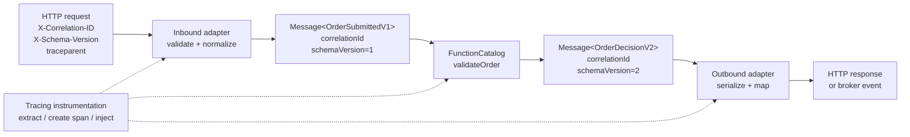
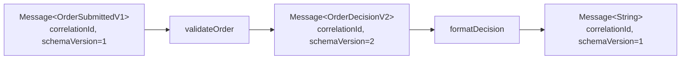

# Propagating Correlation IDs, Data Schema Versions, and Tracing Context

## 1. Why Must These Three Metadata Groups Travel with Data?

In **SPRING_CLOUD_FUNCTION (Spring Cloud Function)**, business logic is represented using `Supplier`, `Function`, and `Consumer`. Beans are registered via `FunctionCatalog`, optionally chained with *composition*, and exposed over HTTP, events, or serverless environments without rewriting core logic. Yet to process a request across multiple steps, passing only the payload is usually not enough.

Imagine an order confirmation workflow:

1. A gateway receives an order creation request from a client app.
2. A `Function` validates the order and produces a decision.
3. The result is sent to a notification step through a message broker.
4. Another function runs in a serverless environment to deliver the notification.

Across these hops, three questions regularly arise:

- **Which request does this result belong to?** You need a correlation ID, e.g., `correlationId=checkout-42`.
- **Which data contract does the payload follow?** You need the schema type and version, e.g., `schemaName=order-submitted`, `schemaVersion=1`.
- **Which distributed call flow does this processing step belong to?** You need *distributed tracing* context, e.g., trace ID, span ID, and context propagated via W3C Trace Context.

This information may travel via Spring Messaging's `MessageHeaders`, HTTP headers, event attributes, or broker metadata. **They are not fully equivalent, and they must never be copied blindly across every boundary.**

By the end of this lesson, you will know how to design a stable metadata contract, propagate `correlationId`, manage `schemaVersion` for inputs and outputs, distinguish trace context from business IDs, implement a `Function<Message<I>, Message<O>>`, and test how metadata flows across HTTP, brokers, and serverless.

## 2. Distinguishing Identifier and Version Types

Similar names easily lead to design mistakes. The following table is a starting point:

| Information | Role | Scope and lifetime | Example |
|---|---|---|---|
| `orderId` | Business entity identifier | A single order; may live long-term | `ORD-42` |
| `correlationId` | Links multiple requests/messages in one business workflow | Can span HTTP, brokers, multiple services, and retries | `checkout-42` |
| `MessageHeaders.ID` | Technical ID of one Spring `Message` | Belongs to one message instance, not a business ID | UUID managed by Spring Messaging |
| `eventId` | Identifier of one published event | Tied to one logical event; supports duplicate detection | `evt-1001` |
| Broker offset/delivery tag | Position or delivery state in the transport system | Tied to topic/partition/delivery attempt | Offset `518` |
| `schemaVersion` | Version of the data structure/contract | Per **payload type** and inbound/outbound direction | `1`, `2` |
| `traceId` | Identifies a distributed trace | Connects spans within the same trace | 32-char hex string in W3C Trace Context |
| `spanId` | Identifies a specific span | Changes per operation/span | 16-char hex string in W3C Trace Context |
| `traceparent` | Carries trace context between participants | Propagated and updated at each instrumentation boundary | `00-…-…-01` |

**Do not conflate these values:**

- One `orderId` can appear in multiple requests, each with a different `correlationId`.
- One `correlationId` can span multiple events that have distinct `eventId` values.
- One business request may cross multiple traces, or one trace may contain multiple operations. `correlationId` is application-defined; `traceId` belongs to the tracing system.
- `MessageHeaders.ID` is not a stable identifier for tracking retries, replays, or business flows across adapters.
- `schemaVersion` describes the **payload** contract; it is not CloudEvents' `specversion` or the HTTP API version.

## 3. How Metadata Flows Through Spring Cloud Function



The flow comprises **two related layers with distinct responsibilities**:

1. **Business message contract:** the `Function` reads the normalized `correlationId` and schema version, processes the payload, and returns a new `Message` with valid output metadata.
2. **Tracing and transport context:** HTTP adapters, binders, runtimes, and observability libraries extract/inject trace context, manage spans, and encode metadata per protocol.

Do not force business beans to handle every HTTP header, Kafka offset, or Lambda event detail themselves. A protocol-independent `Function` only needs to know **what matches its contract**.

## 4. Designing the Contract for `correlationId`

### 4.1. Who generates and who preserves the correlation ID?

A common policy:

- **At a trusted ingress:** the gateway or adapter reads `X-Correlation-ID` if valid and compliant with the contract; if missing, it generates a new ID.
- **Inside processing functions:** preserve the same `correlationId` when creating result messages within the same workflow.
- **When publishing events:** the adapter maps the internal ID to the header/attribute name agreed upon by both sides.
- **On the receiving side:** read the ID per contract to correlate audit/logs or link a response to an earlier request.

Example application contract:

| Property | Illustrative convention |
|---|---|
| Internal name | `correlationId` |
| Java type | `String` |
| Required at business layer? | Yes, after passing through the example's adapter |
| Format | 1–64 characters from `A–Z`, `a–z`, `0–9`, dot, underscore, hyphen |
| When HTTP request omits it | Gateway/controller generates a UUID |
| When multi-valued or invalid | Reject or handle according to a published policy |
| When producing results in the same workflow | Forward intentionally |

The conventions above are **choices for this example**, not mandatory limits imposed by Spring Cloud Function. A real application may use another format, though it should follow one consistent contract.

### 4.2. Why must externally supplied IDs be validated?

A header can be spoofed, excessively long, or contain characters that disrupt logging/observability. Never use `correlationId` as an authentication token, never let it substitute for access control, and never assume a client-chosen value is trustworthy by default.

If a gateway always generates a fresh ID, you can keep the client-provided ID in a separate field to aid correlation, provided ownership is clearly defined and tracking is not muddied. In environments with retries, the correlation ID can **stay the same across attempts**, whereas `eventId` or a redelivered message ID may change depending on publishing strategy.

## 5. Data Versioning: Input Does Not Equal Output

A schema version describes **payload shape and semantics**. For example:

```json
{
  "orderId": "ORD-42",
  "amount": 150000
}
```

This is the `OrderSubmittedV1` data shape. After processing, the output may have a different structure:

```json
{
  "orderId": "ORD-42",
  "status": "ACCEPTED",
  "reason": "Valid order"
}
```

We call this result contract `OrderDecisionV2`. In this lesson, two schema types are defined:

| Payload | `schemaName` | `schemaVersion` |
|---|---|---|
| `OrderSubmittedV1` | `order-submitted` | `1` |
| `OrderDecisionV2` | `order-decision` | `2` |

**Do not copy `schemaVersion=1` verbatim from input to output** when the output has changed to a different schema type and version. The output version must describe **the payload being sent**, not the message that triggered it.

### Where should the version live?

There are several valid options depending on the system:

| Representation | Pros | Notes |
|---|---|---|
| Internal `schemaName` / `schemaVersion` headers | Convenient for routing, converters, and `Message` tests | Adapters must preserve/map headers across transport |
| `schemaVersion` field in an event envelope | Travels alongside data when serialized | Requires defining and validating the envelope |
| CloudEvents `dataschema` URI | Can point to a schema descriptor | The URI may contain a version, though it is not automatically equivalent to a `schemaVersion` header |
| Schema Registry ID or schema fingerprint | Supports Avro/Protobuf/Kafka ecosystems | Format and schema lookup depend on serializer/registry |
| Version in media type or API contract | Can fit HTTP APIs well | Does not automatically solve event versioning over brokers |

**Choose one primary source of truth** for each data type's version and explicitly specify any mappings to other places. Avoid a mismatch where the body is v2 while the header says v1.

### When encountering an unsupported version

The conversion layer or bean must handle it deliberately:

- If supporting v1 and v2, normalize them into a suitable internal model before processing.
- If supporting only v1, reject v2 with a clear error rather than silently decoding it as v1.
- For older messages in a broker, plan backward compatibility or migration; merely adding a version header does not turn a v1 payload into v2.
- When publishing output, emit the schema version of **the actual output**, rather than deriving it from the input version.

## 6. Java 17+ Example: A `Function` Preserving Correlation While Changing Schema

The following example uses only Spring Cloud Function and Spring Messaging to define an order-processing bean. It assumes the adapter has already converted the input to `OrderSubmittedV1` and normalized metadata.

```java
package com.example.orders;

import java.util.function.Function;

import org.springframework.context.annotation.Bean;
import org.springframework.context.annotation.Configuration;
import org.springframework.messaging.Message;
import org.springframework.messaging.support.MessageBuilder;

@Configuration
public class OrderFunctions {

    public record OrderSubmittedV1(String orderId, long amount) {}

    public record OrderDecisionV2(
            String orderId,
            String status,
            String reason
    ) {}

    @Bean
    public Function<Message<OrderSubmittedV1>, Message<OrderDecisionV2>>
            validateOrder() {
        return input -> {
            String correlationId = requiredHeader(input, "correlationId");
            String schemaName = requiredHeader(input, "schemaName");
            String schemaVersion = requiredHeader(input, "schemaVersion");

            if (!"order-submitted".equals(schemaName)
                    || !"1".equals(schemaVersion)) {
                throw new IllegalArgumentException(
                        "Unsupported input schema");
            }

            OrderSubmittedV1 order = input.getPayload();
            if (order.orderId() == null || order.orderId().isBlank()) {
                throw new IllegalArgumentException("orderId is required");
            }

            boolean accepted = order.amount() > 0;
            OrderDecisionV2 decision = new OrderDecisionV2(
                    order.orderId(),
                    accepted ? "ACCEPTED" : "REJECTED",
                    accepted ? "Valid order" : "Amount must be positive"
            );

            return MessageBuilder.withPayload(decision)
                    .setHeader("correlationId", correlationId)
                    .setHeader("schemaName", "order-decision")
                    .setHeader("schemaVersion", "2")
                    .setHeader("processedBy", "validateOrder")
                    .build();
        };
    }

    private static String requiredHeader(Message<?> input, String name) {
        Object raw = input.getHeaders().get(name);
        if (!(raw instanceof String value) || value.isBlank()) {
            throw new IllegalArgumentException(
                    "Missing or invalid header: " + name);
        }

        if ("correlationId".equals(name)
                && !value.matches("[A-Za-z0-9._-]{1,64}")) {
            throw new IllegalArgumentException(
                    "Invalid correlationId");
        }
        return value;
    }
}
```

Key design decisions:

1. The function accepts `Message<OrderSubmittedV1>` to **read input metadata**.
2. `correlationId` must be present and valid. The function carries that value to the result because it remains part of the same workflow.
3. `schemaName=order-submitted` and `schemaVersion=1` are validated **before business processing**; only the v1 input contract is supported in this example. Adapters/converters must still validate the JSON structure before instantiating the DTO.
4. The output is a different DTO type: `OrderDecisionV2`. The function sets **`schemaName=order-decision` and `schemaVersion=2`**, rather than copying the input version.
5. `processedBy` is set by the current step; it does not trust a same-named header sent by the caller.
6. The function does not manually copy `traceparent`, `Authorization`, `contentType`, or broker metadata. Those are handled according to adapter contracts and tracing instrumentation.

If a real system truly needs to support multiple input versions, use an explicit converter/schema validation layer before binding a DTO to the `Function`; this example intentionally focuses on **one input version** to avoid mis-parsing structures.

### Calling the function directly

```java
import java.util.function.Function;

import org.springframework.messaging.Message;
import org.springframework.messaging.support.MessageBuilder;

import com.example.orders.OrderFunctions;
import com.example.orders.OrderFunctions.OrderSubmittedV1;
import com.example.orders.OrderFunctions.OrderDecisionV2;

Function<Message<OrderSubmittedV1>, Message<OrderDecisionV2>> fn =
        new OrderFunctions().validateOrder();

Message<OrderSubmittedV1> input = MessageBuilder
        .withPayload(new OrderSubmittedV1("ORD-42", 150_000))
        .setHeader("correlationId", "checkout-42")
        .setHeader("schemaName", "order-submitted")
        .setHeader("schemaVersion", "1")
        .setHeader("source", "web-client")
        .build();

Message<OrderDecisionV2> result = fn.apply(input);

System.out.println(result.getPayload().status()); // ACCEPTED
System.out.println(result.getHeaders().get("correlationId")); // checkout-42
System.out.println(result.getHeaders().get("schemaName"));    // order-decision
System.out.println(result.getHeaders().get("schemaVersion")); // 2
System.out.println(result.getHeaders().get("source"));        // null
```

This tests **the bean's direct behavior**. When looked up via `FunctionCatalog` or exposed through an adapter, the framework may wrap `Message`, convert payloads, or apply enrichment configuration; test the application's actual invocation path.

## 7. Distributed Tracing: `traceId`, `spanId`, and `traceparent`

A business correlation ID does not replace distributed tracing. Tracing models operations as **spans**, grouping related spans into a **trace**. In a properly instrumented system, an HTTP request can create a gateway span, a function-processing span, and event-publish/consume spans.

```text
Trace ID: 4bf92f3577b34da6a3ce929d0e0e4736
  |
  +-- Gateway HTTP receive span
  |       spanId = 00f067aa0ba902b7
  |
  +-- Order-processing application span
  |       spanId = 8a4cf7d9c0be12ab
  |
  +-- Event publish span
  |       spanId = f4e11a320b90c7d5
  |
  +-- Consumer receive event span
          spanId = 12d4e8f109b6c3aa
```

The spans in this example can share a **trace ID**, while each span has its **own span ID**. A business request carrying `correlationId=checkout-42` can be linked to this trace without turning `correlationId` into `traceId`.

### 7.1. W3C Trace Context format

W3C Trace Context defines common headers:

| Header | Purpose | Example |
|---|---|---|
| `traceparent` | Carries trace ID, parent span ID, trace flags, and format version | `00-4bf92f3577b34da6a3ce929d0e0e4736-00f067aa0ba902b7-01` |
| `tracestate` | Vendor/system-coordinated tracing state | Vendor-specific values within spec limits |

A version `00` `traceparent` looks like:

```text
version-trace-id-parent-id-trace-flags

00-4bf92f3577b34da6a3ce929d0e0e4736-00f067aa0ba902b7-01
|  |                                |                |
|  |                                |                +-- flags
|  |                                +------------------- parent-id
|  +---------------------------------------------------- trace-id
+------------------------------------------------------- version
```

In this version, trace ID is 16 bytes (32 hex chars) and parent ID is 8 bytes (16 hex chars); all-zero values are invalid identifiers. `01` in the example indicates the sampled flag. Parsing and validation rules have more details, so **let the tracing library handle them** instead of calling `split("-")` on this string inside business functions.

### 7.2. Why shouldn't you copy `traceparent` verbatim by hand?

At each hop, instrumentation needs to **extract the parent context**, potentially create a new span, and **inject the appropriate context** into the outgoing call. If a function simply takes the inbound `traceparent` and places it verbatim onto every output `Message`, parent span info may fail to reflect the span actually executing.

Therefore:

- Use an observability system like **Micrometer Observation/Tracing** with the appropriate exporter and propagator for your Spring environment.
- Ensure HTTP servers/clients, binders/message clients, and serverless adapters are configured to support tracing at the required boundaries.
- When building a custom event-sending step, use your chosen library's propagation/extraction APIs rather than hand-crafting `traceparent`.
- In reactive applications, account for propagation over Reactor context; do not assume `ThreadLocal` preserves context across every scheduler hop.
- `tracestate`, sampling flags, and baggage belong to tracing context, not an arbitrary bucket for sensitive business data.

**Spring Cloud Function does not guarantee that every trace context will automatically stitch across HTTP, brokers, and serverless merely from a `Message<T>` signature.** That depends on instrumentation, adapters, protocols, and application configuration.

## 8. Observing the Current Trace Without Manually Handling Propagation

When an application has Micrometer Tracing and an active tracing context, code can read the current trace ID **for observability purposes**:

```java
import io.micrometer.tracing.Span;
import io.micrometer.tracing.Tracer;

static String currentTraceId(Tracer tracer) {
    Span current = tracer.currentSpan();
    return current == null ? null : current.context().traceId();
}
```

This snippet assumes the application has a configured `Tracer` bean and instrumentation creating spans at call boundaries. If there is no active span, `currentSpan()` can return `null`; **do not treat trace ID as mandatory data for approving orders**.

A clean approach is adding the trace ID to logs via framework-provided instrumentation/MDC. When investigating incidents, logs can record the business `correlationId` alongside the tracing-managed `traceId`, **without requiring the two values to be identical**.

Conceptual log example:

```text
correlationId=checkout-42 traceId=4bf92f3577b34da6a3ce929d0e0e4736
operation=validateOrder status=ACCEPTED
```

Do not log full authentication tokens, customer details, sensitive payloads, or all HTTP headers just to stitch traces. Trace context is not an authorization system; if using `baggage`, restrict fields according to security policy and transport constraints.

## 9. HTTP Boundary: Normalizing Correlation and Schema Version

When exposing a function via Spring Cloud Function Web, the adapter can decode requests and construct inputs matching the function signature. **Do not assume** that an HTTP header named `X-Correlation-ID` is automatically renamed to `MessageHeaders["correlationId"]`, or that every output header is emitted back under the exact HTTP name you expect.

If an API requires a strict mapping contract, place a **thin Spring MVC controller** at the boundary. The business bean `validateOrder` stays untouched and unaware of HTTP:

```java
package com.example.orders;

import java.util.List;
import java.util.UUID;
import java.util.function.Function;

import org.springframework.beans.factory.annotation.Qualifier;
import org.springframework.http.HttpHeaders;
import org.springframework.http.HttpStatus;
import org.springframework.http.MediaType;
import org.springframework.http.ResponseEntity;
import org.springframework.messaging.Message;
import org.springframework.messaging.support.MessageBuilder;
import org.springframework.web.bind.annotation.PostMapping;
import org.springframework.web.bind.annotation.RequestBody;
import org.springframework.web.bind.annotation.RequestHeader;
import org.springframework.web.bind.annotation.RestController;
import org.springframework.web.server.ResponseStatusException;

import com.example.orders.OrderFunctions.OrderSubmittedV1;
import com.example.orders.OrderFunctions.OrderDecisionV2;

@RestController
public class OrderHttpController {

    private final Function<Message<OrderSubmittedV1>,
                           Message<OrderDecisionV2>> validateOrder;

    public OrderHttpController(
            @Qualifier("validateOrder")
            Function<Message<OrderSubmittedV1>, Message<OrderDecisionV2>>
                    validateOrder) {
        this.validateOrder = validateOrder;
    }

    @PostMapping(
            path = "/api/orders/validate",
            consumes = MediaType.APPLICATION_JSON_VALUE,
            produces = MediaType.APPLICATION_JSON_VALUE
    )
    public ResponseEntity<OrderDecisionV2> validate(
            @RequestBody OrderSubmittedV1 body,
            @RequestHeader HttpHeaders requestHeaders) {

        String correlationId = correlationIdFrom(requestHeaders);
        String version = oneRequiredHeader(
                requestHeaders, "X-Schema-Version");
        if (!"1".equals(version)) {
            throw new ResponseStatusException(
                    HttpStatus.BAD_REQUEST, "Unsupported input schema");
        }

        Message<OrderSubmittedV1> input = MessageBuilder
                .withPayload(body)
                .setHeader("correlationId", correlationId)
                .setHeader("schemaName", "order-submitted")
                .setHeader("schemaVersion", version)
                .build();

        Message<OrderDecisionV2> output = validateOrder.apply(input);

        HttpHeaders responseHeaders = new HttpHeaders();
        responseHeaders.set("X-Correlation-ID",
                output.getHeaders().get("correlationId", String.class));
        responseHeaders.set("X-Schema-Version",
                output.getHeaders().get("schemaVersion", String.class));

        return new ResponseEntity<>(
                output.getPayload(), responseHeaders, HttpStatus.OK);
    }

    private static String oneRequiredHeader(HttpHeaders headers, String key) {
        List<String> values = headers.get(key);
        if (values == null || values.size() != 1
                || values.get(0).isBlank()) {
            throw new ResponseStatusException(
                    HttpStatus.BAD_REQUEST, "Missing or ambiguous " + key);
        }
        return values.get(0);
    }

    private static String correlationIdFrom(HttpHeaders headers) {
        List<String> values = headers.get("X-Correlation-ID");
        if (values == null || values.isEmpty()) {
            return UUID.randomUUID().toString();
        }
        if (values.size() != 1
                || !values.get(0).matches("[A-Za-z0-9._-]{1,64}")) {
            throw new ResponseStatusException(
                    HttpStatus.BAD_REQUEST, "Invalid X-Correlation-ID");
        }
        return values.get(0);
    }
}
```

In this illustrative controller:

1. HTTP `Content-Type` lets Spring MVC pick a converter to deserialize the JSON body into `OrderSubmittedV1`.
2. `X-Schema-Version` is an HTTP header **defined by this API's convention**, not a mandatory standard header. The API requires a single value `"1"`.
3. `X-Correlation-ID` is validated; if missing, the controller generates a UUID. HTTP headers are queried via `HttpHeaders`, which supports case-insensitive names.
4. The controller builds `Message` with **internal header names** `correlationId` and `schemaVersion`.
5. The business bean returns schema version `2` of `OrderDecisionV2`; the controller maps it to the `X-Schema-Version` response header.
6. HTTP tracing should be managed by instrumentation. The controller **does not manually copy `traceparent` verbatim** into the output `Message` or HTTP response.

Note: `X-Schema-Version` here reflects **the business payload version** per this example's contract. A production API might advertise versions in media types or URLs; stay consistent with your chosen API specification. The snippet intentionally returns HTTP `200 OK` for both `ACCEPTED` and `REJECTED` as two business outcomes; changing HTTP status requires explicit rules in the controller.

Sample HTTP request:

```bash
curl -i -X POST http://localhost:8080/api/orders/validate \
  -H "Content-Type: application/json" \
  -H "X-Schema-Version: 1" \
  -H "X-Correlation-ID: checkout-42" \
  -d '{"orderId":"ORD-42","amount":150000}'
```

Expected response from **this controller**:

```http
HTTP/1.1 200 OK
Content-Type: application/json
X-Correlation-ID: checkout-42
X-Schema-Version: 2

{"orderId":"ORD-42","status":"ACCEPTED","reason":"Valid order"}
```

This is not a promise about automatic HTTP headers from the Spring Cloud Function Web adapter; when removing the controller and using the Web adapter directly, test the adapter's own mapping behavior.

## 10. Through a Message Broker: Which Metadata Should Follow the New Message?

When using **Spring Cloud Stream** with Kafka, RabbitMQ, or another binder, the same `validateOrder` bean can process an input `Message<OrderSubmittedV1>`. However, metadata names/types on the broker depend on the binder and serializer.

```text
Inbound record
  payload: OrderSubmittedV1
  app headers:
    correlation-id = "checkout-42"
    schema-version = "1"
  broker metadata:
    topic, partition, offset, delivery info
                      |
                 binder/adapter
                      v
Message<OrderSubmittedV1>
  correlationId = "checkout-42"
  schemaVersion = "1"
                      |
                 validateOrder
                      v
Message<OrderDecisionV2>
  correlationId = "checkout-42"
  schemaName    = "order-decision"
  schemaVersion = "2"
                      |
             output binder + serializer
                      v
Outbound record (if configured to publish)
  payload: OrderDecisionV2 per v2 serializer/schema
  app metadata mapped per output contract
```

The keys `correlation-id` and `schema-version` on the record are **illustrative conventions**, not names auto-generated by every binder. The receiving layer must map them to `correlationId` and `schemaVersion` when the internal contract requires them.

Specifically:

- **Do not copy Kafka offsets, partitions, RabbitMQ delivery tags, or SQS receipt handles** as if they were business headers to preserve on a new message.
- If using a schema registry, the serializer may attach a schema ID or its own metadata; the string `schemaVersion` in this example does not replace schema registry mechanics.
- Output binding, serialization, and publishing configuration must exist; a function returning `Message<O>` does not by itself guarantee the event was successfully published.
- During retries/replays, distinguish `eventId` for deduplication from `correlationId` for workflow tracing. Binder-generated message IDs may vary across delivery attempts.
- Tracing over a broker requires compatible instrumentation and propagators; do not assume `traceparent` was propagated properly just because `correlationId` survived.

## 11. Serverless and CloudEvents: Distinguishing `specversion`, `dataschema`, and Correlation

With serverless runtimes, data typically arrives in an **event envelope**. An adapter may extract payload, request ID, message attributes, or trace context from the envelope. Field names depend on the platform; they do not automatically become `MessageHeaders` with your desired names.

A common standard for describing events is **CloudEvents**. Example of a structured-content JSON CloudEvent:

```json
{
  "specversion": "1.0",
  "id": "evt-1001",
  "source": "/checkout",
  "type": "com.example.order.submitted",
  "datacontenttype": "application/json",
  "dataschema": "https://schemas.example.test/order-submitted/v1",
  "correlationid": "checkout-42",
  "data": {
    "orderId": "ORD-42",
    "amount": 150000
  }
}
```

Field mapping comparison:

| Attribute | Meaning | Suggested mapping |
|---|---|---|
| `specversion=1.0` | Version of **the CloudEvents envelope spec** | Do not treat as `schemaVersion=1` of `OrderSubmittedV1` |
| `id=evt-1001` | Event identifier | Can map to `eventId` for deduplication |
| `source=/checkout` | Declared producer | Can map to `eventSource`; does not prove authenticated source |
| `type` | Event type | Used for routing if the contract permits |
| `dataschema` | URI identifying the data schema | Can map to schema/version identifiers per convention |
| `correlationid` | Application-defined illustrative extension attribute | Can normalize to `correlationId` |
| `data` | Business payload | Decode into `OrderSubmittedV1` when schema is compatible |

**`correlationid` is an extension attribute defined by this example**, not a mandatory CloudEvents context attribute. The `dataschema` URI may include `v1`, but code should not blindly extract `1` from arbitrary URIs without a defined contract/schema registry.

In CloudEvents HTTP binary content mode, context attributes appear as `ce-*` HTTP headers; in structured content mode they reside inside the event body. Adapters must handle the right mode, validate schemas, and map metadata per source.

Trace context in a CloudEvent also requires dedicated propagation suitable for HTTP/broker/runtime. Do not manually stuff `traceparent` into the `data` payload when the system uses standard instrumentation and no contract requires it.

## 12. `FunctionCatalog`, Composition, and Places Where Metadata Easily Drops

Suppose we have the `validateOrder` bean and another bean:

```java
@Bean
public Function<Message<OrderDecisionV2>, Message<String>>
        formatDecision() {
    return incoming -> {
        String label = incoming.getPayload().status()
                + ":" + incoming.getPayload().orderId();

        Object rawCorrelation = incoming.getHeaders()
                .get("correlationId");
        if (!(rawCorrelation instanceof String correlationId)) {
            throw new IllegalArgumentException("Missing correlationId");
        }

        return MessageBuilder.withPayload(label)
                .setHeader("correlationId", correlationId)
                .setHeader("schemaName", "order-decision-text")
                .setHeader("schemaVersion", "1")
                .build();
    };
}
```

Here `formatDecision` turns the v2 DTO into a **string result under its own output contract**, so it sets `schemaName=order-decision-text` and `schemaVersion=1` instead of keeping `schemaVersion=2` from the input DTO.

When both beans are registered and signatures are compatible, you can define the chain:

```properties
spring.cloud.function.definition=validateOrder|formatDecision
```



**One step's output headers become the next step's input headers** in flows passing `Message`. However, `FunctionCatalog`'s wrapping/unwrapping and conversion rules also depend on function types, converters, and definitions. Do not assume `schemaVersion` or `correlationId` is unconditionally preserved across a step returning a plain POJO.

If a pipeline changes payload types, each step must declare the schema version of **the output produced by that step itself**. Tracing should be propagated via instrumentation-managed context, not a SpEL expression copying every `MessageHeaders` entry.

## 13. `MessageBuilder`, `copy-input-headers`, and Enrichment: How to Choose?

The same metadata can be manipulated by several mechanisms:

| Mechanism | Purpose | How well it fits correlation/schema/tracing |
|---|---|---|
| `MessageBuilder.setHeader(...)` | Explicitly set headers when building output `Message` | Ideal for `correlationId` and **output schema** with explicit validation |
| `MessageBuilder.copyHeaders(...)` | Copy multiple headers | Requires careful filtering; avoid blindly copying `schemaVersion`, `contentType`, tokens, trace context |
| `copy-input-headers=true` | `FunctionCatalog` wrapper propagates headers broadly in supported cases | Does not guarantee a valid output schema and is not a security allowlist |
| `input-header-mapping-expression` | SpEL enriches metadata before the bean | Useful for simple normalization; does not replace schema/auth validation |
| `output-header-mapping-expression` | SpEL enriches metadata after the bean | Can label results; does not replace tracing propagators or output schema validation |
| Tracing instrumentation | Extract, create, link spans, and inject trace context | Preferred choice for `traceparent`, `tracestate` |

Example of building an appropriate output:

```java
Message<OrderDecisionV2> output = MessageBuilder
        .withPayload(new OrderDecisionV2(
                "ORD-42", "ACCEPTED", "Valid order"))
        .setHeader("correlationId", "checkout-42")
        .setHeader("schemaName", "order-decision")
        .setHeader("schemaVersion", "2")
        .build();
```

Do not use `copyHeaders(input.getHeaders())` by default: it can drag along the input's schema, a stale `contentType`, broker-specific metadata, and even self-asserted values from untrusted callers.

If SpEL enrichment is used to compute a mandatory header and evaluation fails, the framework may log WARN and still invoke the function. For mandatory `correlationId` or `schemaVersion`, **validate the contract inside the bean/adapter** to prevent invalid data from propagating deeper into the system.

## 14. Testing the Bean Contract with JUnit 5

A unit test can call `validateOrder` directly without an HTTP server, binder, or tracer:

```java
package com.example.orders;

import static org.junit.jupiter.api.Assertions.assertEquals;
import static org.junit.jupiter.api.Assertions.assertNull;
import static org.junit.jupiter.api.Assertions.assertThrows;

import java.util.function.Function;

import org.junit.jupiter.api.Test;
import org.springframework.messaging.Message;
import org.springframework.messaging.support.MessageBuilder;

import com.example.orders.OrderFunctions.OrderSubmittedV1;
import com.example.orders.OrderFunctions.OrderDecisionV2;

class OrderFunctionsTest {

    private final Function<Message<OrderSubmittedV1>, Message<OrderDecisionV2>>
            fn = new OrderFunctions().validateOrder();

    @Test
    void keepsCorrelationAndPublishesOutputSchemaVersion() {
        Message<OrderSubmittedV1> input = MessageBuilder
                .withPayload(new OrderSubmittedV1("ORD-42", 150_000))
                .setHeader("correlationId", "checkout-42")
                .setHeader("schemaName", "order-submitted")
                .setHeader("schemaVersion", "1")
                .setHeader("source", "http-api")
                .build();

        Message<OrderDecisionV2> output = fn.apply(input);

        assertEquals("ACCEPTED", output.getPayload().status());
        assertEquals("checkout-42",
                output.getHeaders().get("correlationId"));
        assertEquals("order-decision",
                output.getHeaders().get("schemaName"));
        assertEquals("2", output.getHeaders().get("schemaVersion"));
        assertNull(output.getHeaders().get("source"));

        // Input metadata is not mutated by the new result.
        assertEquals("1", input.getHeaders().get("schemaVersion"));
    }

    @Test
    void rejectsUnsupportedSchema() {
        Message<OrderSubmittedV1> input = MessageBuilder
                .withPayload(new OrderSubmittedV1("ORD-43", 100))
                .setHeader("correlationId", "checkout-43")
                .setHeader("schemaName", "order-submitted")
                .setHeader("schemaVersion", "99")
                .build();

        assertThrows(IllegalArgumentException.class, () -> fn.apply(input));
    }

    @Test
    void rejectsMissingCorrelationId() {
        Message<OrderSubmittedV1> input = MessageBuilder
                .withPayload(new OrderSubmittedV1("ORD-44", 100))
                .setHeader("schemaName", "order-submitted")
                .setHeader("schemaVersion", "1")
                .build();

        assertThrows(IllegalArgumentException.class, () -> fn.apply(input));
    }
}
```

These tests verify behavior produced by **the bean itself**: preserving correlation, transitioning input schema v1 to output schema v2, and rejecting invalid mandatory metadata.

They do **not** prove that an HTTP response carries `X-Correlation-ID` or `X-Schema-Version`, that a broker transmitted message attributes in the right format, or that trace context stitched across spans. Those require integration tests on actual adapters and instrumentation.

## 15. Integration Tests for HTTP and Tracing: Testing the Right Boundaries

For the controller in section 9, a Spring MVC test suite can verify bidirectional header mapping:

```java
package com.example.orders;

import static org.springframework.test.web.servlet.request.MockMvcRequestBuilders.post;
import static org.springframework.test.web.servlet.result.MockMvcResultMatchers.*;

import org.junit.jupiter.api.Test;
import org.springframework.beans.factory.annotation.Autowired;
import org.springframework.boot.test.autoconfigure.web.servlet.WebMvcTest;
import org.springframework.context.annotation.Import;
import org.springframework.http.MediaType;
import org.springframework.test.web.servlet.MockMvc;

@WebMvcTest(OrderHttpController.class)
@Import(OrderFunctions.class)
class OrderHttpControllerTest {

    @Autowired
    private MockMvc mvc;

    @Test
    void mapsCorrelationAndSchemaInBothDirections() throws Exception {
        mvc.perform(post("/api/orders/validate")
                .contentType(MediaType.APPLICATION_JSON)
                .header("X-Correlation-ID", "checkout-42")
                .header("X-Schema-Version", "1")
                .content("{\"orderId\":\"ORD-42\",\"amount\":150000}"))
            .andExpect(status().isOk())
            .andExpect(header().string("X-Correlation-ID", "checkout-42"))
            .andExpect(header().string("X-Schema-Version", "2"))
            .andExpect(jsonPath("$.status").value("ACCEPTED"));
    }

    @Test
    void rejectsWrongInputSchemaVersion() throws Exception {
        mvc.perform(post("/api/orders/validate")
                .contentType(MediaType.APPLICATION_JSON)
                .header("X-Correlation-ID", "checkout-42")
                .header("X-Schema-Version", "99")
                .content("{\"orderId\":\"ORD-42\",\"amount\":150000}"))
            .andExpect(status().isBadRequest());
    }
}
```

In applications with Spring Security enabled, tests may need appropriate authentication and CSRF setup. This tests **the illustrative controller**, not a guarantee of the Spring Cloud Function Web adapter's default header mapping.

### Testing tracing must differ from testing correlation

You cannot prove distributed tracing simply with:

```java
assertEquals("checkout-42",
        output.getHeaders().get("correlationId"));
```

Instead, in an environment with tracing instrumentation and an exporter/test span handler:

1. Send an HTTP request with a valid `traceparent` or let the server start a new trace.
2. Verify the receiving side **extracted** the trace context and created/recorded spans per configuration.
3. Trigger broker publish/consume operations and inspect that the consumer's span has the proper trace relationship.
4. Verify the trace ID links the spans properly, and parent/span IDs form the right hierarchy rather than merely copying the same header.
5. Test missing `traceparent`, malformed `traceparent`, and varying sampling settings; do not assume every request exports spans.

If using `baggage`, check data size limits and ensure no sensitive data is propagated. If the system lacks tracing dependencies/instrumentation, pure Java tests will not generate traces or report trace context on their own.

## 16. Common Pitfalls and Resolutions

| Symptom | Possible Cause | Resolution |
|---|---|---|
| Result lacks `correlationId` | Function builds a new `Message` without forwarding it | Re-set header after validation, or normalize at the adapter |
| Output `schemaVersion` is still `1` even though payload changed | Copied all input headers | Determine and set **the output's schema version** |
| `traceId` changes after crossing a broker | Missing propagator/instrumentation at send/receive boundary | Check tracing SDK and binder/client instrumentation |
| `traceparent` copied verbatim across every hop | Manual handling without creating valid spans | Use tracer extract/inject APIs |
| Confusing `eventId` with `correlationId` | Not distinguishing individual events from workflows | Define both fields and retry/replay rules |
| Using `specversion=1.0` as `schemaVersion=1` | Confusing CloudEvents envelope with payload | Map `dataschema`/schema registry per contract |
| Bean reads wrong version header type | Broker supplies bytes/numbers instead of `String` | Normalize types at the adapter; validate before the bean |
| HTTP client sends `X-Schema-Version` yet bean doesn't see it | Adapter did not rename it to `schemaVersion` | Check mapping and write HTTP integration tests |
| No active span found | Missing instrumentation or context not propagated | Check dependencies, observation config, and async context |
| Logs leak tokens or user data | Copying/logging all headers or baggage | Log only permitted IDs; filter sensitive data |
| Binder emits event with wrong schema | Serializer/schema registry out of sync with version header | Align schema contract and test actual bytes/messages |
| `copy-input-headers` still does not preserve trace | Confusing header copying with trace propagation | Use tracing instrumentation and integration tests |

## 17. Practice Exercise: Propagating Metadata Across Three Channels

Design `Function<Message<PaymentRequestedV1>, Message<PaymentDecisionV2>>` for payment decisions. Input payload contains `paymentId` and `amount`; output contains `paymentId`, `status`, and `reason`.

1. Specify `correlationId` as a mandatory string after the adapter. At the HTTP gateway, read `X-Correlation-ID`, validate it, or generate a new ID if absent.
2. Specify input `schemaName=payment-requested`, `schemaVersion=1`; output `schemaName=payment-decision`, `schemaVersion=2`. Do not copy input version to output.
3. Write `MessageBuilder.withPayload(result)` to build the result, preserve correlation, and set the output schema. Do not manually copy tokens, stale `contentType`, broker offsets, or `traceparent`.
4. Write unit tests for missing correlation, wrong version, approved result, and declined result. Verify the input `Message` remains unchanged.
5. Write a Spring MVC controller or configure the HTTP adapter to convert `X-Schema-Version` and `X-Correlation-ID` into internal headers and map the response back.
6. Create a CloudEvents event with `id`, `dataschema`, and extension `correlationid`; distinguish these three fields from `specversion`.
7. Route the event through Spring Cloud Stream or a serverless adapter; identify which component serializes the payload, injects metadata into the broker/event, and propagates trace context.
8. If Micrometer Tracing is available, test trace spans across at least two hops instead of merely comparing `correlationId`.

### Self-Check Questions

1. Why is keeping the input `schemaVersion` verbatim potentially wrong even when `correlationId` should be preserved?
2. How do `MessageHeaders.ID`, `eventId`, `correlationId`, and `traceId` differ when an event is replayed?
3. An HTTP request has a valid `traceparent`: should you copy that exact value onto every output `Message`? Why or why not?
4. A CloudEvent has `specversion=1.0` and `dataschema=.../v3`. What is the payload version, and what should the application validate?
5. Why can a bean unit test not prove tracing propagation over Kafka or Lambda?

## 18. Summary

**Three types of information serve three distinct purposes:**

- **`correlationId`** links messages belonging to the same business workflow; it is validated and intentionally forwarded across necessary boundaries.
- **`schemaName` / `schemaVersion`** specifies the data contract of **the current payload**; when a function produces a different payload, publish **the output** schema instead of blindly copying the input version.
- **Distributed trace context** enables observing spans across distributed systems; `traceparent` and `tracestate` should be managed by instrumentation/propagators, not manual header copying inside business logic.

In Spring Cloud Function, `Message<T>` and `MessageBuilder` are the tools for keeping business metadata contracts protocol-independent. `FunctionCatalog` supports invocation and composition, while HTTP, broker, and serverless adapters determine how headers are received, normalized, encoded, and emitted. A reliable solution combines **validation, schema compatibility, observability, and integration tests** at every boundary.

**References:** [Spring Cloud Function – Programming model](https://docs.spring.io/spring-cloud-function/reference/spring-cloud-function/programming-model.html), [W3C Trace Context](https://www.w3.org/TR/trace-context/), [CloudEvents specification](https://github.com/cloudevents/spec).
