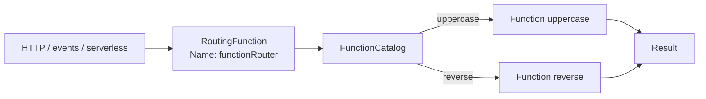

# RoutingFunction and the `functionRouter` Name

## Learning Objectives

After this lesson, you will be able to:

1. Explain the role of `RoutingFunction` in the Spring Cloud Function programming model.
2. Distinguish between the **`RoutingFunction` class**, the **registered name `functionRouter`**, and the **target business function**.
3. Invoke the router via `FunctionCatalog` or HTTP, then select a target using headers or configuration.
4. Use `spring.cloud.function.definition`, `spring.cloud.function.routing-expression`, and `MessageRoutingCallback` in the appropriate scenarios.
5. Recognize precedence order, limitations with reactive functions, and the risks of letting callers choose the target.

## 1. Why Is Function Routing Needed?

Spring Cloud Function allows you to write business logic as a `Supplier`, `Function`, or `Consumer` and look them up by name through `FunctionCatalog`. The logic can be exposed over HTTP, consume events, or run in a serverless environment depending on the adapter; the business function itself does not need to know the transport protocol.

Suppose a text-processing service has two operations:

- `uppercase`: converts a string to uppercase.
- `reverse`: reverses the character order.

If external callers had to invoke the target directly, they would need to know `/uppercase` or `/reverse`. In an environment where you only want to expose **a single entry point** (especially in certain Function-as-a-Service models), you can send all requests to a routing function. This function decides which business function to forward the input to.



The router **does not replace business logic**. It only answers the question *“for this request, which function definition should run?”*; the target functions remain independent, reusable, and separately testable.

## 2. How Do `RoutingFunction` and `functionRouter` Differ?

Spring Cloud Function provides the built-in class `org.springframework.cloud.function.context.config.RoutingFunction` with a conceptual signature like:

```java
public class RoutingFunction implements Function<Object, Object> {
    // The framework resolves the target function and delegates execution.
}
```

The framework automatically registers the router in `FunctionCatalog` under the name **`functionRouter`**. The constant `RoutingFunction.FUNCTION_NAME` represents that name, avoiding hardcoded string literals when looking it up in Java.

| Component | Meaning | Example |
| --- | --- | --- |
| `RoutingFunction` | Class implementing the mechanism to select and invoke the target function | Router provided by the framework |
| `functionRouter` | Logical name of the router in `FunctionCatalog` | `catalog.lookup("functionRouter")` |
| `RoutingFunction.FUNCTION_NAME` | Constant holding the default registered name | `catalog.lookup(RoutingFunction.FUNCTION_NAME)` |
| `uppercase`, `reverse` | Names of application-defined `@Bean Function`s | Routing instruction values |
| `FunctionCatalog` | Registry/lookup for functions, including composed definitions | Lookup `uppercase` or `uppercase|reverse` |

**You do not need to declare `@Bean("functionRouter")` yourself** in normal cases: the default router is already present. If you want a custom mechanism, you can register an additional router with a name **other than** `functionRouter`; that is an advanced scenario, not a required step.

A common point of confusion: `functionRouter` is the name **of the function invoked at the entry point**; `uppercase` or `reverse` is **the target selected afterward**. If you only define `uppercase` without calling through the router, you are calling the business function directly and not using routing yet.

## 3. Running Example Over HTTP

The following example illustrates two independent `Function<String, String>` beans and a single router entry point. Create a Spring Boot application using the `spring-cloud-starter-function-web` dependency with a Spring Cloud Function version compatible with your project's Spring Boot version (usually managed via a BOM):

```xml
<dependency>
    <groupId>org.springframework.cloud</groupId>
    <artifactId>spring-cloud-starter-function-web</artifactId>
</dependency>
```

```java
package com.example.routing;

import java.util.function.Function;

import org.springframework.boot.SpringApplication;
import org.springframework.boot.autoconfigure.SpringBootApplication;
import org.springframework.context.annotation.Bean;

@SpringBootApplication
public class RoutingApplication {

    public static void main(String[] args) {
        SpringApplication.run(RoutingApplication.class, args);
    }

    @Bean
    public Function<String, String> uppercase() {
        return value -> value.toUpperCase();
    }

    @Bean
    public Function<String, String> reverse() {
        return value -> new StringBuilder(value).reverse().toString();
    }
}
```

With the HTTP adapter, a function name can become a URL path. After starting the application on `localhost:8080`, call **the same `/functionRouter` endpoint** while changing the routing instruction:

```bash
# Select uppercase
curl -X POST http://localhost:8080/functionRouter \
  -H "Content-Type: text/plain" \
  -H "spring.cloud.function.definition: uppercase" \
  --data-raw "hello"
# Output: HELLO

# Select reverse
curl -X POST http://localhost:8080/functionRouter \
  -H "Content-Type: text/plain" \
  -H "spring.cloud.function.definition: reverse" \
  --data-raw "hello"
# Output: olleh
```

Here is what happens:

1. The HTTP adapter receives the request and converts relevant information into a `Message`.
2. The name in the URL selects `functionRouter` from `FunctionCatalog`.
3. The router reads the `spring.cloud.function.definition` header to determine the target function.
4. The router looks up the target function from the catalog, invokes it, and returns the result through the adapter.

To see the difference, `POST /uppercase` **directly invokes** `uppercase`, whereas `POST /functionRouter` goes through the router. Paths, mapping behavior, and response types can be affected by adapter configuration; the example above assumes a default web application without overriding `spring.cloud.function.web.path` or filtering exported functions.

### Looking Up the Router in Java

Inside a Spring application, you can retrieve the router using its default name:

```java
import org.springframework.cloud.function.context.FunctionCatalog;
import org.springframework.cloud.function.context.config.RoutingFunction;

// functionCatalog is injected from the ApplicationContext.
Function<?, ?> router = functionCatalog.lookup(RoutingFunction.FUNCTION_NAME);
```

This is a **router lookup**. Selecting a target still requires valid routing information when the router is executed. Do not confuse this with `functionCatalog.lookup("uppercase")`, because the latter retrieves the business function directly.

## 4. Three Ways to Provide Routing Instructions

### 4.1. The `spring.cloud.function.definition` Header: Direct Name Selection

When the input is a `Message<?>`, the `spring.cloud.function.definition` header contains **the target function name** or **a composed function definition**:

```text
spring.cloud.function.definition: uppercase
spring.cloud.function.definition: reverse
spring.cloud.function.definition: uppercase|reverse
```

With the payload `hello`, the definition `uppercase|reverse` executes two steps in order: `hello → HELLO → OLLEH`. The `|` syntax here means **function composition**: the output of the previous function is passed to the next function. The functions must have compatible input/output types.

Use this approach when the target is already clearly determined and no decision expression is needed.

### 4.2. The `spring.cloud.function.routing-expression` Header or Property: Selection via SpEL

`routing-expression` is a **Spring Expression Language (SpEL)** expression. The evaluated result must identify a function name or function definition in the catalog.

For example, if a request carries a business header `operation: reverse`, the router can receive the expression:

```text
spring.cloud.function.routing-expression: headers['operation'] == 'reverse' ? 'reverse' : 'uppercase'
```

The root object when evaluating SpEL for a `Message<?>` is the `Message` itself. Therefore, the expression can access `headers` and `payload`. If `operation` equals `reverse`, the result is the name `reverse`; all other cases select `uppercase`.

When you want to keep the rule on the application side instead of requiring each client to send an expression, you can configure it in `application.yml`:

```yaml
spring:
  cloud:
    function:
      routing-expression: "headers['operation'] == 'reverse' ? 'reverse' : 'uppercase'"
```

Now, messages arriving at the router only need to carry the business header `operation` if they want to select the `reverse` branch; the expression is managed centrally in configuration. Make sure the adapter actually forwards the business header into the `Message`, and still invokes `functionRouter` at the entry point.

For a fixed target that does not depend on per-message decisions, you can set the expression to return a constant string such as `"'uppercase'"` in the `spring.cloud.function.routing-expression` property. The **inner** pair of quotes is part of the SpEL syntax so that the expression evaluates to a string function name.

### 4.3. `MessageRoutingCallback`: Selection via Java Code

When you have business rules that need programmatic control, register a bean implementing `MessageRoutingCallback`. For example, accepting only two fixed targets:

```java
import org.springframework.cloud.function.context.MessageRoutingCallback;
import org.springframework.context.annotation.Bean;
import org.springframework.messaging.Message;

@Bean
public MessageRoutingCallback operationRouter() {
    return new MessageRoutingCallback() {
        @Override
        public String routingResult(Message<?> message) {
            String operation = (String) message.getHeaders().get("operation");
            return "reverse".equals(operation) ? "reverse" : "uppercase";
        }
    };
}
```

In this example, the callback translates business data into a valid function name without forcing the client to know `Function` names in the catalog. **Note:** this extends the target selection logic of `RoutingFunction`; it is not a new business `Function`.

## 5. Precedence Order When Multiple Routing Sources Exist

For **imperative functions** (such as `Function<String, String>`), Spring Cloud Function applies the following precedence order:

| Precedence | Instruction Source | Usage |
| --- | --- | --- |
| 1 — highest | `MessageRoutingCallback` bean | Select target in Java based on `Message` |
| 2 | Message headers `spring.cloud.function.definition` / `spring.cloud.function.routing-expression` | Per-message decision |
| 3 | Corresponding application/system property | Application-level configuration rule |

For example, if `application.yml` sets a default expression pointing to `uppercase`, but a request includes a header routing to `reverse`, **the header takes precedence** when no callback is present. If a `MessageRoutingCallback` is registered, the callback determines the target before all other sources.

**Distinguishing the two roles of `spring.cloud.function.definition`:**

- At the adapter/deployment configuration layer, this property can specify the function **exported at the entry point** (for example, when running a single function or a composition).
- Once `functionRouter` has been invoked, `spring.cloud.function.definition` in the **Message header** can specify **the target function inside the router**.

These two roles belong to different stages. Setting `spring.cloud.function.definition=functionRouter` to select the router at the deployment layer **does not mean** a business target has been provided for each request; you must still supply a valid route via a header, appropriate routing property, or callback. Avoid accidentally selecting `functionRouter` as its own target.

## 6. Routing Rules Across Protocols

`RoutingFunction` belongs to Spring Cloud Function core; adapters handle receiving/sending data, while `FunctionCatalog` manages the functions. The same set of `@Bean Function`s can be reused across different contexts:

| Environment | Typical Entry Point | Instruction Source |
| --- | --- | --- |
| Spring Cloud Function Web | HTTP endpoint selecting `functionRouter` | HTTP headers converted to Message headers by the adapter; or app properties |
| Spring Cloud Stream | Input binding to the router | Message headers from events, application configuration, or callback |
| Serverless (e.g., AWS Lambda) | Adapter/handler invoking the router | Headers/metadata forwarded by the adapter, environment variables, or configuration |
| Java invocation | `FunctionCatalog.lookup(RoutingFunction.FUNCTION_NAME)` | Message with routing headers or router configuration |

In Spring Cloud Stream, event routing has its own configuration, typically `spring.cloud.stream.function.routing.enabled=true`, and the default input binding name for the router follows the convention `functionRouter-in-0`. This **binding name** is not a class name, business bean name, or HTTP URL. Specific binder/destination configuration depends on Kafka, RabbitMQ, or whichever binder is in use.

## 7. Limitations and Caveats

### Imperative and Reactive Functions Do Not Route at the Same Granularity

- With imperative `Function<String, String>` or `Function<Message<T>, ...>`, you can route **per Message** via headers or a callback.
- With a reactive function accepting `Flux<T>`/`Publisher<T>`, the function is typically invoked **once for the entire stream**. Spring Cloud Function does not support applying per-item routing headers to switch target functions within the same stream in that manner. Configure the route in **application properties** to route the whole stream.

This does not mean all streaming systems lose the ability to route individual events: Spring Cloud Stream can route individual imperative events through the router. The limitation above applies to **a single reactive function taking a `Publisher` as its processing unit**.

### Missing Target and Fallback Strategy

If an expression returns a name not found in `FunctionCatalog`, the router normally throws an exception. When a workflow needs custom handling for unroutable messages, Spring Cloud Function provides the `DefaultMessageRoutingHandler` extension point to register a fallback handler. The default handler for this strategy may log and drop the message; only use the drop behavior if it genuinely fits your business requirements, as data may be lost. For critical transactional flows, consider error handling, logging, retries, or adapter error channels.

### Data Types and Composition

The router does not automatically make every function compatible. A `Function<String, String>` can accept a string as in the example; functions handling JSON/POJOs require appropriate data and `contentType` for the adapter/framework to convert properly. When composing `uppercase|reverse`, the output of the preceding step must be accepted by the next step. Type conversion errors can occur **after** the target name has been routed accurately.

### Security When Accepting External Instructions

The `spring.cloud.function.definition` header allows callers to request a function definition; if exposed directly, you must control which functions are permitted to be invoked. With SpEL, expressions taken from Message headers are evaluated by Spring Cloud Function in a restricted `SimpleEvaluationContext`, whereas expressions from application/system properties use a more flexible `StandardEvaluationContext`. These are two different capability levels, and arbitrary input should never be treated as trusted.

In production systems, you should fix the expression in configuration or use a `MessageRoutingCallback` to map **allowed business values** (e.g., `operation=reverse`) to **an allowlist of target functions**. If an HTTP endpoint is public, apply appropriate authentication, authorization, and access controls. Avoid allowing clients to freely specify internal function names or supply arbitrary executable expressions.

## 8. Diagnosing Routing Failures

| Symptom | Common Cause | How to Check |
| --- | --- | --- |
| Request always runs a fixed function | Calling `/uppercase` directly or adapter selects another function | Confirm the entry point actually invokes `functionRouter` |
| `No function` / target name lookup fails | Misspelled route value or unregistered function | Compare against bean names in `FunctionCatalog`, checking case sensitivity |
| Property configuration seems "ignored" | Header or callback has higher precedence | Check all three instruction sources and precedence order |
| SpEL returns the wrong target | Expression does not return a function name string or header key is wrong | Check `headers['operation']`, string literal quotes, and actual header value |
| Routed correctly but wrong output or conversion error | Input/output incompatibility, `Content-Type`, or composition mismatch | Verify function signatures, payload, and composition order |
| Unable to switch branches per `Flux` item | Confusing imperative message routing with reactive routing | Configure route for the whole stream via properties or adjust event-processing architecture |

## 9. Hands-On Practice

1. Run the web example with the two beans `uppercase` and `reverse`. Send two requests to the same `/functionRouter` endpoint with two different `spring.cloud.function.definition` header values; explain why the URL stays the same while the result changes.
2. Try `spring.cloud.function.definition: uppercase|reverse` and verify the output `OLLEH` for payload `hello`. Explain the difference between *routing to a single function* and *routing to a composition*.
3. Add the header `operation: reverse` and use `spring.cloud.function.routing-expression` to choose the target. Then move the expression into `application.yml`, send only `operation`, and observe the difference between client-side decision and application-side decision.
4. Register a `MessageRoutingCallback` as in the example, then send a request with a header pointing to `reverse` while `operation` is not `reverse`. Use the precedence order to explain the outcome.
5. Send a nonexistent function name, record the error, and propose an appropriate handling strategy if the input is a payment event that must not be lost.

## Key Takeaways

- **`RoutingFunction`** is the dispatching mechanism, while **`functionRouter`** is the default name for looking up and invoking the router in `FunctionCatalog`.
- The router selects the **target function definition** via a callback, Message headers, or properties; a target can be a composition such as `uppercase|reverse`.
- **Callback → Message headers → application properties** is the precedence order for imperative routing.
- For reactive `Publisher`s, routing occurs at the **stream** level via configuration, not per-item headers.
- Separating business logic into independent `Function`s lets you reuse the same logic across HTTP, events, and serverless; route selection must still be controlled and error-checked.

### Official References

- [Spring Cloud Function — Programming model: Function Routing and Filtering](https://docs.spring.io/spring-cloud-function/reference/spring-cloud-function/programming-model.html)
- [Spring Cloud Function — Standalone Web Applications](https://docs.spring.io/spring-cloud-function/reference/spring-cloud-function/standalone-web-applications.html)
- [Spring Cloud Stream — Event Routing](https://docs.spring.io/spring-cloud-stream/reference/spring-cloud-stream/event-routing.html)
