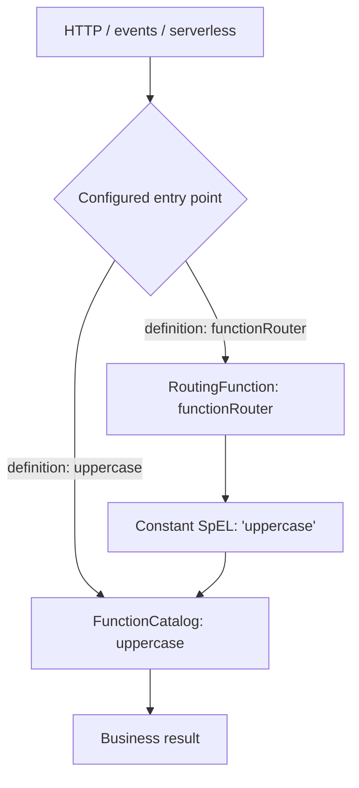

# Selecting a Fixed Function via Configuration Properties

## Lesson Objectives

After this lesson, you will be able to:

1. Explain why Spring Cloud Function allows selecting a `Supplier`, `Function`, or `Consumer` through configuration without modifying business logic.
2. Configure `spring.cloud.function.definition` to choose **the function used at the entry point** of an adapter.
3. Configure `spring.cloud.function.routing-expression` with a **SpEL expression returning a string literal** so that `functionRouter` always routes to a fixed target function.
4. Distinguish between the two configuration approaches, understand precedence when message headers and `MessageRoutingCallback` are present, and verify the result over HTTP.
5. Troubleshoot common issues involving bean names, quotation marks, composition, and differences across deployment environments.

## 1. Context: Fix the Selection, Keep Business Code Unchanged

In Spring Cloud Function, every `Supplier<T>`, `Function<T, R>`, and `Consumer<T>` can be registered in `FunctionCatalog` by name. The catalog lets adapters such as HTTP, Spring Cloud Stream, or serverless runtimes look up and invoke functions based on configuration. This enables the same logic to run across multiple protocols without coupling directly to an HTTP controller or message broker.

Consider an application with two text-processing capabilities:

- `uppercase`: converts text to uppercase.
- `reverse`: reverses character order.

The application is packaged once, yet environment A only wants to process with `uppercase` while environment B only wants to process with `reverse`. Instead of writing `if/else` logic inside business code to pick a function or maintaining two separate builds, you can select a function name at application configuration time.

**"Fixed selection" means the same selection applies to invocations within a deployment instance**, as long as the configuration and higher-precedence sources remain unchanged. Two mechanisms should be distinguished:

1. **Direct execution selection:** `spring.cloud.function.definition=uppercase` so the adapter knows which function or function chain to use.
2. **Fixed target selection via router:** route invocations through `functionRouter` and set `spring.cloud.function.routing-expression` to a constant expression returning `uppercase`.

Both mechanisms produce similar business outcomes in a simple example, but their execution paths differ.

## 2. Distinguishing the Two Configuration Properties

| Property | Question the Property Answers | Examples |
| --- | --- | --- |
| `spring.cloud.function.definition` | Which **function definition** should the adapter select from `FunctionCatalog`? | `uppercase`, `reverse`, `uppercase|reverse`, or `functionRouter` |
| `spring.cloud.function.routing-expression` | Once **`RoutingFunction` is invoked**, which function definition should the router route to? | `'uppercase'`, `'reverse'`, or message-dependent SpEL |

`spring.cloud.function.definition` accepts a bean name or composition syntax. For example, `uppercase|reverse` specifies invoking `uppercase` followed by `reverse`. Setting `definition=uppercase` directly is usually sufficient when an adapter only needs to use that single function.

`spring.cloud.function.routing-expression` is **SpEL**. It is evaluated by `RoutingFunction` to return the target function name. If you always want to select one function, use a **SpEL string literal**:

```yaml
spring:
  cloud:
    function:
      routing-expression: "'uppercase'"
```

After YAML parsing, the value is `'uppercase'` (keeping the single quotes). This is a SpEL expression that evaluates to the string `uppercase`.

**Do not write** `routing-expression: uppercase` when targeting a fixed function name. In SpEL, `uppercase` without string quotes is interpreted as a property/variable reference in the evaluation context, not as a function name string.

### Execution Flow



In the first branch, `RoutingFunction` is not called. In the second branch, the router still performs lookup and delegates to the target function, even though the routing decision is fixed in configuration.

## 3. Creating a Sample Application

The example uses Spring Boot, Java, and `spring-cloud-starter-function-web`. Manage the Spring Cloud Function version compatible with Spring Boot using your project's BOM/dependencies; the dependency below only illustrates the module needed for the HTTP adapter:

```xml
<dependency>
    <groupId>org.springframework.cloud</groupId>
    <artifactId>spring-cloud-starter-function-web</artifactId>
</dependency>
```

```java
package com.example.fixedroute;

import java.util.function.Function;

import org.springframework.boot.SpringApplication;
import org.springframework.boot.autoconfigure.SpringBootApplication;
import org.springframework.context.annotation.Bean;

@SpringBootApplication
public class FixedRouteApplication {
    public static void main(String[] args) {
        SpringApplication.run(FixedRouteApplication.class, args);
    }

    @Bean
    public Function<String, String> uppercase() {
        return value -> value.toUpperCase(java.util.Locale.ROOT);
    }

    @Bean
    public Function<String, String> reverse() {
        return value -> new StringBuilder(value).reverse().toString();
    }
}
```

The two beans are registered under the names `uppercase` and `reverse`, matching the `@Bean` method names. Both use `Function<String, String>`, making it easy to observe results with `text/plain` requests.

Note: at the model level, `FunctionCatalog` can hold independent functions and composed definitions; the adapter determines how functions bind to requests, events, or invocations.

## 4. Approach A — Selecting a Fixed Function with `spring.cloud.function.definition`

The most common case: choose `uppercase` as the default function for the adapter. Configuration:

```yaml
# application.yml
spring:
  cloud:
    function:
      definition: uppercase
```

With Spring Cloud Function Web, when multiple functions exist in the catalog, the `spring.cloud.function.definition` property maps the chosen definition to the root path `/`. Start the application and send:

```bash
curl -X POST http://localhost:8080/ \
  -H "Content-Type: text/plain" \
  --data-raw "hello"
# HELLO
```

Change only the configuration value to:

```yaml
spring:
  cloud:
    function:
      definition: reverse
```

After restarting the application with the new configuration, sending the same request returns:

```text
olleh
```

No changes to the two `Function` beans are needed. **The adapter executes the definition chosen at application setup time**, rather than requiring a header on every request.

### Selecting a Fixed Composition

The `definition` property can specify a fixed pipeline:

```yaml
spring:
  cloud:
    function:
      definition: uppercase|reverse
```

Then input `hello` passes through `uppercase` to become `HELLO`, and then through `reverse` to become `OLLEH`. This is **direct composition** in `FunctionCatalog`, not routing via `RoutingFunction`.

### Do Not Confuse Function Selection with Endpoint Access Control

In the HTTP adapter, multiple functions may still be exposed under URLs matching their function names. The `definition` property selects the definition for the default binding/path, but **a function-selection property should not be treated as a security mechanism to block all other functions**. If you need to restrict which HTTP functions are exported, check the adapter's function filtering rules and apply proper access controls. For example, Spring Cloud Function Web documentation supports declaring exported definitions as a `;`-separated list; that behaves differently from selecting a single default definition.

## 5. Approach B — Going Through `functionRouter` with a Fixed Target

When a deployment environment exposes only a single router entry point, or when you want to keep a stable endpoint/router so routing rules can change later, you can configure fixed routing at the `RoutingFunction` level.

The router provided by Spring Cloud Function is registered in `FunctionCatalog` under the name **`functionRouter`**, corresponding to the constant `RoutingFunction.FUNCTION_NAME`.

Example `application.yml`:

```yaml
spring:
  cloud:
    function:
      definition: functionRouter
      routing-expression: "'uppercase'"
```

The two lines have **two responsibilities**:

1. `definition: functionRouter`: at the adapter layer, selects the router as the entry-point function.
2. `routing-expression: "'uppercase'"`: inside the router, the expression returns the target name `uppercase`.

For the sample web application, send a request to the root path mapped to the selected definition:

```bash
curl -X POST http://localhost:8080/ \
  -H "Content-Type: text/plain" \
  --data-raw "hello"
# HELLO
```

To switch the fixed target, change `routing-expression: "'reverse'"` and restart the application with the new configuration; the payload `hello` yields `olleh`. The adapter's entry point remains `functionRouter`, while the executed function is determined by the SpEL value.

Another way to demonstrate this when the router is exposed under its own name is calling HTTP `/functionRouter` (if the adapter permits name-based mapping). Routing instructions in properties do not require sending the `spring.cloud.function.definition` header on every request.

### Why Are Two Sets of Quotes Needed?

Compare the following:

| YAML Configuration | Value Received by Router | Evaluation |
| --- | --- | --- |
| `routing-expression: "'uppercase'"` | `'uppercase'` | **Correct:** SpEL literal returning the string `uppercase` |
| `routing-expression: uppercase` | `uppercase` | **Wrong target:** SpEL looks up property/variable `uppercase` |
| `definition: uppercase` | `uppercase` | **Correct:** this is a definition name, not SpEL |
| `routing-expression: "'uppercase|reverse'"` | `'uppercase|reverse'` | **Correct if needed:** literal returning a composition name |

YAML uses the outer double quotes to preserve the single quotes of the **SpEL string literal**. Equivalent in `application.properties`:

```properties
# When the router is invoked, always route to uppercase:
spring.cloud.function.routing-expression='uppercase'
```

Do not wrap the entire value in an extra pair of double quotes in `application.properties`, because double quotes can be interpreted as literal characters of the value itself.

## 6. Switching Configuration by Environment Without Changing Code

In practice, function selection can vary by profile, environment variable, or startup argument:

| Configuration Source | Directly Select `uppercase` | Invoke Router Then Select `uppercase` |
| --- | --- | --- |
| `application.yml` | `definition: uppercase` | `definition: functionRouter` and `routing-expression: "'uppercase'"` |
| JVM/Spring Boot arguments | `--spring.cloud.function.definition=uppercase` | `--spring.cloud.function.definition=functionRouter` plus `--spring.cloud.function.routing-expression='uppercase'` (keep single quotes in the value) |
| Spring Boot environment variables | `SPRING_CLOUD_FUNCTION_DEFINITION=uppercase` | `SPRING_CLOUD_FUNCTION_DEFINITION=functionRouter` and `SPRING_CLOUD_FUNCTION_ROUTING_EXPRESSION` set to `'uppercase'` |

For example, in Bash:

```bash
export SPRING_CLOUD_FUNCTION_DEFINITION=functionRouter
export SPRING_CLOUD_FUNCTION_ROUTING_EXPRESSION="'uppercase'"
```

Note that escaping layers across shells, configuration files, Docker/Kubernetes, and CI/CD may differ: what ultimately matters is **the property value the application receives**, such as `'uppercase'` including the single quotes. On some serverless platforms, environment variable names must follow provider conventions; check the specific adapter documentation.

A Spring Boot application can also separate profiles:

```yaml
# application-dev.yml
spring:
  cloud:
    function:
      definition: uppercase
```

```yaml
# application-prod.yml
spring:
  cloud:
    function:
      definition: reverse
```

Activating the appropriate profile selects a different definition for **the exact same compiled business beans**. Do not assume editing a configuration file after the application has started will automatically update bindings or the router: the simple, reliable approach is to redeploy or restart with the new property, unless a compatible refresh mechanism has been designed.

## 7. When Can Configuration Selection Be Overridden?

The concept of "fixed" in this lesson applies to **default configuration**. With imperative message routing, `RoutingFunction` can still receive different instructions on a per-message basis.

The typical precedence order of the router is:

| Precedence | Target Decision Source | Example |
| --- | --- | --- |
| 1 | `MessageRoutingCallback` bean | Java logic reads a business header and returns `reverse` |
| 2 | `spring.cloud.function.definition` or `spring.cloud.function.routing-expression` header in `Message` | Request sends header `spring.cloud.function.definition: reverse` |
| 3 | Application/system property | `spring.cloud.function.routing-expression: "'uppercase'"` |

For instance, if the router is configured with `routing-expression: "'uppercase'"`, but the web adapter receives an HTTP request containing the header:

```text
spring.cloud.function.definition: reverse
```

If the request is converted into a `Message` carrying this header and no higher-precedence callback exists, the router may choose `reverse` instead of the constant `'uppercase'` property. Therefore, **a property setting a default target does not guarantee every request is forced into that target**.

When the requirement is **a business or policy invariant** (only one function may ever be invoked), control the endpoints, strip or reject client-supplied routing headers at the protocol layer, or apply a callback enforcing an allowlist of targets. Treat routing config purely as a framework selection rule; access permissions must be designed separately.

Another situation is calling `/reverse` directly on the HTTP adapter if that endpoint is still exported. That is not overriding the router: the request entered a different function from the start. Distinguish **selecting the entry point** from **rules inside the entry point** when diagnosing behavior.

## 8. Connection to HTTP, Spring Cloud Stream, and Serverless

`Function` logic does not know who calls it; adapters and bindings determine the data source and entry point:

| Environment | How to Select a Fixed Function | Key Considerations |
| --- | --- | --- |
| HTTP via `spring-cloud-starter-function-web` | `spring.cloud.function.definition=uppercase` to map the default definition, or select `functionRouter` and configure a constant route | Paths depend on web adapter mapping and function filtering |
| Spring Cloud Stream | `spring.cloud.function.definition=uppercase` selects functional binding, or enable event routing and configure a route to one target | Stream routing has its own binding and property conventions; `functionRouter-in-0` is the router input binding name |
| AWS Lambda/serverless adapters | Choose definition via property/environment variable or configure adapter to invoke the router | Handler selection mechanism and env var names depend on the platform |
| Internal Java | Call `FunctionCatalog.lookup("uppercase")` or `lookup("functionRouter")` | Choose the direct function or router intentionally; when invoking the router, provide valid routing instructions |

In Spring Cloud Stream, to make the router the input consumer, event routing configuration may use `spring.cloud.stream.function.routing.enabled=true` or the `spring.cloud.function.routing-expression` property according to your version's guide. The conventional input binding name is `functionRouter-in-0`. By contrast, `spring.cloud.function.definition=uppercase` alone binds `uppercase` directly without creating a router in the data flow.

### Imperative vs. Reactive

The `Function<String, String>` functions in the example are imperative: their unit of processing is each individual message/invocation. Thus headers on each `Message` can influence target function selection.

For functions taking a `Publisher` or `Flux`, the processing unit is **the entire stream**; you cannot rely on per-item routing headers to switch target functions within the same reactive call. In that case, provide the routing instruction via **application properties** for the stream. This is why configuration-based selection is especially well suited when an entire stream is handled by one fixed function.

### `Supplier` and `Consumer` Are Also Selectable by Name

Selection rules using `spring.cloud.function.definition` apply to `Supplier`, `Function`, and `Consumer` definitions in the catalog. However, triggering differs: a `Supplier` produces data, a `Function` takes input and returns output, and a `Consumer` receives data without returning a business value. Do not mechanically apply the HTTP `POST` string-in/string-out example to `Supplier` or `Consumer`; examine the specific adapter being used.

## 9. Common Errors and Troubleshooting Checks

| Symptom | Possible Cause | How to Check |
| --- | --- | --- |
| Router cannot find function `uppercase` | Wrong bean name or bean not registered | Check `@Bean` name in `FunctionCatalog`, verifying case sensitivity |
| SpEL reports property `uppercase` not found | Used `routing-expression: uppercase` instead of literal `'uppercase'` | Fix to `routing-expression: "'uppercase'"` |
| Calling `/functionRouter` fails with no target | Selected router at adapter without setting a route | Configure `routing-expression` or provide routing header/callback |
| Configured `definition: uppercase` but testing router headers | Confusing direct invocation with routed invocation | Verify whether requests hit `uppercase` or `functionRouter` |
| Property is always `uppercase` yet request runs `reverse` | Header or `MessageRoutingCallback` has higher precedence | Inspect all routing instruction sources and headers from the adapter |
| `curl` to unexpected URL returns 404 | Endpoint mapping, adapter, or filter mismatch | Check `/`, `/<functionName>`, and web configurations |
| Route finds target but data conversion fails | Incompatible content type or input/output signature | Check payload, `Content-Type`, type structure, and composition |
| Updated config file but result did not change | Application has not loaded new configuration | Check active profile, higher-priority property sources, and restart process |

To pinpoint the root cause, check three values in order: **the function name selected by the adapter**, **the configuration or header read by the router (if used)**, and **the target function name looked up from the catalog**.

## 10. Practice Exercises

1. With the two beans `uppercase` and `reverse`, set `spring.cloud.function.definition=uppercase`. Send `hello` to the default endpoint of Spring Cloud Function Web and record the result. Switch to `reverse` and compare without editing Java code.
2. Set `spring.cloud.function.definition=functionRouter` and `spring.cloud.function.routing-expression="'uppercase'"` (in `application.properties` syntax). Run the same payload again. Explain why the output is still `HELLO` even though the entry point changed.
3. In `application.yml`, intentionally write `routing-expression: uppercase`; observe the error, then fix it to `routing-expression: "'uppercase'"`. Describe the two layers of quotes (YAML and SpEL).
4. Test `spring.cloud.function.definition=uppercase|reverse` and then `definition: functionRouter` with `routing-expression: "'uppercase|reverse'"`. Both can output `OLLEH`; state the difference in the execution path.
5. With the router having a default route `'uppercase'`, try adding the HTTP header `spring.cloud.function.definition: reverse`. Explain the override behavior and propose how to enforce that the application only accepts permitted functions.
6. Pick a real deployment environment (Web, Stream, or serverless), describe which configuration belongs to the **adapter**, which belongs to the **router**, and how to switch fixed targets between staging and production.

## Knowledge Summary

- `spring.cloud.function.definition=uppercase` directly selects a function definition (or composition) for the adapter to use; no router is required.
- `spring.cloud.function.definition=functionRouter` selects the router as the entry point; `spring.cloud.function.routing-expression: "'uppercase'"` makes the router route to `uppercase` by default.
- `routing-expression` uses SpEL, so a fixed function name must be a **SpEL string literal**. Write `'uppercase'` inside the value; YAML typically requires `"'uppercase'"`.
- For imperative routing, callbacks and message headers can override properties. To strictly enforce which functions may be invoked, control both the adapter and routing sources.
- Externalized configuration lets you reuse one set of `Supplier`, `Function`, and `Consumer` beans across HTTP, events, or serverless while switching the selected function per environment.

### References

- [Spring Cloud Function — Function Routing and Filtering](https://docs.spring.io/spring-cloud-function/reference/spring-cloud-function/programming-model.html)
- [Spring Cloud Function — Standalone Web Applications](https://docs.spring.io/spring-cloud-function/reference/spring-cloud-function/standalone-web-applications.html)
- [Spring Cloud Function — AWS Lambda Adapter](https://docs.spring.io/spring-cloud-function/reference/adapters/aws-intro.html)
- [Spring Cloud Stream — Event Routing](https://docs.spring.io/spring-cloud-stream/reference/spring-cloud-stream/event-routing.html)
