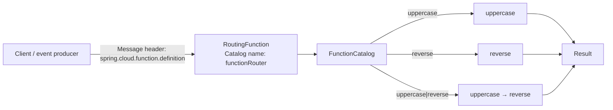

# Routing via the `spring.cloud.function.definition` Header

## Learning Objectives

After this lesson, you will be able to:

1. Explain the meaning of the `spring.cloud.function.definition` header in Spring Cloud Function's routing mechanism.
2. Distinguish between **the entry-point name `functionRouter`** and **the target function name** sent in the header.
3. Create multiple independent `Function`s, then route each message to a single function or a composition without modifying business logic.
4. Test routing over HTTP and construct `Message`s directly in Java; understand the role of the HTTP adapter, `FunctionCatalog`, and payload types.
5. Evaluate the precedence order among headers, application properties, and `MessageRoutingCallback`; identify limitations with reactive functions and practical deployment considerations.

## 1. Why Use a Header to Select a Function?

**Spring Cloud Function** encourages packaging business logic as `Supplier`, `Function`, or `Consumer` beans and looking them up via `FunctionCatalog`. As a result, the same logic can serve HTTP requests, message-broker events, or serverless environments through appropriate adapters; business code does not need to depend on the calling protocol.

In an application with multiple functions, you sometimes want **a single stable entry point** while varying how each message is processed. For example:

- Text A needs to be uppercased with `uppercase`.
- Text B needs its characters reversed with `reverse`.
- Text C needs to run both functions in sequence: `uppercase|reverse`.

Instead of exposing a separate endpoint for every choice or adding conditionals inside business functions, the caller sends the target function name in the `spring.cloud.function.definition` header. The framework's `RoutingFunction` receives the request, looks up the specified definition in `FunctionCatalog`, and forwards the payload to the matching function.



Key point: the header tells the router **which function to invoke**, rather than acting as an ordinary business parameter. It is control-flow data governing execution and must be controlled if it originates outside the system.

## 2. Mechanism: `functionRouter` Reads the `Message` Header

Spring Cloud Function registers the default `RoutingFunction` in `FunctionCatalog` under the name **`functionRouter`**. You can reference this name via the constant `RoutingFunction.FUNCTION_NAME`.

For an input of type `Message<?>`, the router understands two common types of instructions:

| Header in `Message` | Value | Interpretation |
| --- | --- | --- |
| `spring.cloud.function.definition` | `uppercase` | Select a single function named `uppercase` |
| `spring.cloud.function.definition` | `uppercase|reverse` | Select a composition, running `uppercase` then `reverse` |
| `spring.cloud.function.routing-expression` | `headers['operation'] == 'reverse' ? 'reverse' : 'uppercase'` | Evaluate SpEL to compute the function name |

This lesson focuses on **the `spring.cloud.function.definition` header**. When the caller already knows the target, sending the definition name directly reduces the need to configure SpEL expressions. If you need to compute the target from multiple message fields, you can use `routing-expression` or `MessageRoutingCallback`.

Conceptually, the flow proceeds as follows:

1. **The adapter** (HTTP, Stream, serverless, etc.) receives external data and initiates a call through `functionRouter`.
2. **The `Message`** carries a `payload` (data) and `headers` (metadata), including the key `spring.cloud.function.definition`.
3. **The router** reads the header to obtain the target function definition name, such as `reverse`.
4. **The `FunctionCatalog`** looks up that definition and provides the framework-adapted function (including data conversion and composition support in the appropriate context).
5. **The target function** processes the payload; the adapter converts the result back to the external protocol.

**Prerequisite:** the request must actually enter `functionRouter`. If you invoke a specific function directly—such as the `/uppercase` endpoint—the routing header plays no role in redirecting the request to another function inside `RoutingFunction`.

### Same-Named Routing Header vs. Property in Different Locations

The key `spring.cloud.function.definition` can appear in **two places**:

| Location | Typical Role | Example |
| --- | --- | --- |
| Application property `spring.cloud.function.definition` | Selects the function/definition used by the adapter as **the entry point** | `functionRouter`, or `uppercase` for direct invocation |
| `Message` header `spring.cloud.function.definition` sent to the router | Selects **the target function for each message** | `uppercase`, `reverse`, `uppercase|reverse` |

For example: the adapter is configured with `functionRouter`, while the request header is `reverse`. That means **enter the router, then dispatch to `reverse`**—not two conflicting settings at the same step. Always clarify whether you are referring to the **deployment-time property** or the **per-message header**.

## 3. Sample Application: Three Processing Paths Behind One Entry Point

The example below uses Spring Boot with the `spring-cloud-starter-function-web` HTTP adapter. When creating the project, declare a dependency version compatible with your Spring Boot version, typically managed by the Spring Cloud Function BOM:

```xml
<dependency>
    <groupId>org.springframework.cloud</groupId>
    <artifactId>spring-cloud-starter-function-web</artifactId>
</dependency>
```

Create an application with two `Function<String, String>` beans:

```java
package com.example.headerroute;

import java.util.Locale;
import java.util.function.Function;

import org.springframework.boot.SpringApplication;
import org.springframework.boot.autoconfigure.SpringBootApplication;
import org.springframework.context.annotation.Bean;

@SpringBootApplication
public class HeaderRoutingApplication {

    public static void main(String[] args) {
        SpringApplication.run(HeaderRoutingApplication.class, args);
    }

    @Bean
    public Function<String, String> uppercase() {
        return text -> text.toUpperCase(Locale.ROOT);
    }

    @Bean
    public Function<String, String> reverse() {
        return text -> new StringBuilder(text).reverse().toString();
    }
}
```

By default, the registered names in `FunctionCatalog` match the `@Bean` method names: `uppercase` and `reverse`. Both beans simply accept a string, return a string, and have no knowledge of HTTP headers or message brokers.

In this example, we call the router endpoint directly by name at `/functionRouter`. Under the default web configuration, Spring Cloud Function Web supports mapping functions by name:

```bash
# Request 1: select uppercase
curl -X POST http://localhost:8080/functionRouter \
  -H "Content-Type: text/plain" \
  -H "spring.cloud.function.definition: uppercase" \
  --data-raw "hello"
# Expected result: HELLO

# Request 2: select reverse
curl -X POST http://localhost:8080/functionRouter \
  -H "Content-Type: text/plain" \
  -H "spring.cloud.function.definition: reverse" \
  --data-raw "hello"
# Expected result: olleh
```

**Observation:** both requests hit the same URL, with the same `POST` body and the same `Content-Type` header. Only **the value of `spring.cloud.function.definition`** changes, and the output changes according to the target function.

For Spring Cloud Function Web, the adapter can propagate this HTTP header into a `Message` header for `RoutingFunction` to read. In other environments, metadata propagation depends on the adapter and must be verified against its mechanism.

### Selecting the Router as the Default Function

In an environment that exposes only a single entry point, you can instruct the adapter to select `functionRouter`:

```yaml
# application.yml
spring:
  cloud:
    function:
      definition: functionRouter
```

With Spring Cloud Function Web, a single selected default definition can be mapped to the root path `/`. You can then send requests to the configured entry point while still passing **the target header**:

```bash
curl -X POST http://localhost:8080/ \
  -H "Content-Type: text/plain" \
  -H "spring.cloud.function.definition: reverse" \
  --data-raw "hello"
# Expected result: olleh
```

These are two separate configuration layers: **`definition=functionRouter` in application properties** selects the adapter's entry point, whereas **`definition=reverse` in the HTTP/Message header** selects the target inside the router. The actual URL may differ if the application overrides `spring.cloud.function.web.path`, uses function filtering, or has other web configurations.

## 4. The Header Can Also Select a Function Composition

The name `definition` covers more than a single bean name. Spring Cloud Function accepts function composition expressions using `|` or `,`, provided the output of each preceding function is compatible with the input of the next function.

```bash
curl -X POST http://localhost:8080/functionRouter \
  -H "Content-Type: text/plain" \
  -H "spring.cloud.function.definition: uppercase|reverse" \
  --data-raw "hello"
# Expected result: OLLEH
```

The pipeline runs sequentially:

```text
Input             "hello"
  │
  ├── uppercase → "HELLO"
  │
  └── reverse   → "OLLEH"
```

This does **not run two functions concurrently** or broadcast the output to both branches. It is **a sequential composition** that `FunctionCatalog` parses and builds for the router to invoke. For instance, `reverse|uppercase` is also type-compatible, though it can yield a different result when two transformations do not commute.

You do not need single quotes like `'uppercase'` inside the `spring.cloud.function.definition` header. This header holds a **direct definition**, not SpEL. By contrast, if you use `spring.cloud.function.routing-expression` and want to return a fixed string, the expression must be a SpEL string literal such as `'uppercase'`.

## 5. Building a `Message` with Routing Headers in Java

HTTP headers are just one transport for metadata. Inside a Spring application, you can construct a `Message` directly using `MessageBuilder` and invoke the router from `FunctionCatalog`, as long as data types and adapters are compatible.

```java
import java.util.function.Function;

import org.springframework.cloud.function.context.FunctionCatalog;
import org.springframework.cloud.function.context.config.RoutingFunction;
import org.springframework.messaging.Message;
import org.springframework.messaging.support.MessageBuilder;

// Example snippet inside a bean with FunctionCatalog injected.
Function<Message<String>, Object> router =
        functionCatalog.lookup(RoutingFunction.FUNCTION_NAME);

Message<String> request = MessageBuilder.withPayload("hello")
        .setHeader("spring.cloud.function.definition", "reverse")
        .build();

Object result = router.apply(request);
System.out.println(result); // Expected business value: olleh
```

Notes:

- `functionCatalog.lookup("reverse")` returns the business function and **bypasses route selection**; `lookup(RoutingFunction.FUNCTION_NAME)` retrieves the router.
- `setHeader(...)` places the target name into **message metadata**, rather than adding a field to the `payload`.
- Whether you receive a plain value or a wrapped `Message` as the return type depends on the function signature and how the framework/adapter adapts it. In this example, the key behavior to verify is that the `reverse` branch processed the string `hello`.
- If you invoke the router directly with only a plain `String` and no `Message`, you cannot assume the router has a routing header to read; another routing source such as an application property is required.

### Distinguishing Business Data from Metadata

```text
Message
  payload = "hello"
  headers:
    spring.cloud.function.definition = "reverse"
    contentType = "text/plain"   (may be supplied by the adapter)
```

In this example, `reverse` receives the content `hello` to reverse its characters. The `reverse` function itself does not need to read the header; `RoutingFunction` already read it and chose the target before passing the input along.

If a business function needs metadata (such as `requestId` or `tenant`), you can declare `Function<Message<T>, R>` instead of `Function<T, R>`. That is a choice of **business function signature**, independent of the routing header's target-selection role.

## 6. Per-Message Routing in Event-Driven Systems

In an event-driven architecture, multiple messages can arrive at the same destination while needing different handler functions:

```text
Event A: payload="hello", header definition="uppercase"
Event B: payload="spring", header definition="reverse"
Event C: payload="demo", header definition="uppercase|reverse"
```

If the adapter/binder maps these headers onto a Spring `Message` and **the input actually connects to the router**, a single application can apply the following routes:

| Event | `spring.cloud.function.definition` Header | Target Function | Result |
| --- | --- | --- | --- |
| A | `uppercase` | `uppercase` | `HELLO` |
| B | `reverse` | `reverse` | `gnirps` |
| C | `uppercase|reverse` | Composition | `OMED` |

In Spring Cloud Stream, event routing has its own configuration, typically via `spring.cloud.stream.function.routing.enabled=true`, and uses the conventional router input binding `functionRouter-in-0`. Distinguish the **binding** name `functionRouter-in-0` from the **function** name `functionRouter`. How headers are mapped from Kafka, RabbitMQ, or other platforms—and how destinations are configured—depends on the respective binder.

More broadly, the same two beans `uppercase` and `reverse` can also be used when a serverless adapter invokes the router. However, not every adapter propagates headers in the exact same way HTTP does; always verify the event format and metadata conversion rules of your actual adapter.

## 7. Precedence Order and Conflict Scenarios

When the router has multiple instruction sources, Spring Cloud Function's precedence order for imperative functions is:

| Priority Level | Routing Source | Illustration |
| --- | --- | --- |
| **1 (highest)** | Registered `MessageRoutingCallback` bean | Java code programmatically returns the target name |
| **2** | `Message` header `spring.cloud.function.definition` or `spring.cloud.function.routing-expression` | Request carries the header `reverse` |
| **3** | Application/system property used for routing | Property `spring.cloud.function.routing-expression` sets the default target |

Suppose the router has a default property:

```yaml
spring:
  cloud:
    function:
      routing-expression: "'uppercase'"
```

A message sending `spring.cloud.function.definition: reverse` will route to **`reverse`** if no higher-priority `MessageRoutingCallback` is present. The header overrides the default decision on a per-message basis.

If the application provides a `MessageRoutingCallback` bean, the callback can determine the target regardless of what headers the message sends. When you need to enforce routes according to application policy, a callback is a suitable extension point to map business values to an allowed set of function names.

**Do not send both** `spring.cloud.function.definition` and `spring.cloud.function.routing-expression` headers in the same request pointing to two different targets. Both are routing instructions, and conflicting signals make runtime behavior hard to predict; choose one clear mechanism per message.

### How Does the Routing Header Differ from `spring.cloud.function.definition` in Application Config?

A common mistake is reading:

```properties
spring.cloud.function.definition=functionRouter
```

and assuming every message will somehow route to `functionRouter` again. In reality, this is a deployment/adapter-layer instruction to **select the router as the entry point**. Once a message enters the router, the header `spring.cloud.function.definition: reverse` supplies **the target business function definition**. Do not use `functionRouter` as the router's own target value, as it risks recursive self-routing and fails to express the intended business logic.

## 8. Limitations to Understand Accurately

### 8.1. Header-Based Routing Suits Imperative Functions

Spring Cloud Function supports **per-Message** routing for imperative functions, such as `Function<String, String>` or `Function<Message<Order>, Receipt>`. Each invocation is an independent unit of work, so the router can inspect the headers for that call individually.

For reactive functions taking a `Publisher<T>` (e.g., `Function<Flux<T>, Flux<R>>`), the function is invoked at **the whole-stream** level. The router does not apply per-item routing headers within the stream in the same way; you must supply routing via **application properties** to select a single target for that stream.

Do not equate "events coming from Kafka/Stream" with "reactive function". A binding that processes individual events using an imperative `Function<T,R>` can still route by per-event headers; the limitation above applies to a function taking a `Flux`/`Publisher` as its input.

### 8.2. Payload Types and Composition Must Still Match

Headers help the router **pick a function name**, not prove that the data is valid. For example, `uppercase` requires a `String`; with HTTP `text/plain`, payload conversion is straightforward. If routing to `Function<Order, Invoice>`, the adapter must supply properly structured JSON and an appropriate `Content-Type`, and steps in any composition must have matching output/input types.

With `Supplier` or `Consumer`, the invocation and return model differs from `Function`. The catalog mechanism supports these bean types, but do not assume the string-in/string-out HTTP `POST` example applies verbatim to all signatures.

### 8.3. Missing Target Function

If a header points to a name that is not registered or cannot be resolved in `FunctionCatalog`, the default router may throw an exception. Spring Cloud Function provides the `DefaultMessageRoutingHandler` extension point for strategies handling unroutable messages; the default implementation may log and drop the message when activated. Consider this very carefully because "dropping" can lose events.

In critical systems, design error handling, logging, retries, or dead-letter channels at the adapter/binder level where needed, and define explicit behavior for invalid route names.

### 8.4. Security: Never Blindly Trust External Headers

`spring.cloud.function.definition` is an **execution instruction**, so if public callers can set arbitrary function names, they may attempt to invoke internal functions present in the catalog. Do not assume that exposing only one URL `/functionRouter` restricts which functions can be called.

Practical safeguards include:

1. Authenticate and authorize callers before allowing endpoint calls or event submissions.
2. Define an allowlist of valid business targets; map a business header such as `operation` to function names via `MessageRoutingCallback`, or validate at the gateway/consumer.
3. For untrusted external sources, do not forward arbitrary client-supplied routing headers straight into the router when the system must only run specific functions.
4. Log the chosen target name, correlation ID, and outcome/exception, while avoiding logging sensitive payloads.

The `spring.cloud.function.routing-expression` header carries a SpEL expression and has different evaluation rules; that is a separate mechanism. When you only need to select among known names, the `definition` header is simpler, yet **still requires authorization boundaries**.

## 9. Layer-by-Layer Troubleshooting

| Symptom | Common Cause | How to Verify |
| --- | --- | --- |
| Changing the header always produces the same result | Request hits `/uppercase` directly, bypassing the router | Check the entry-point function name; test `/functionRouter` |
| Router fails to select a target | HTTP/message header is not propagated to `Message`, or header is missing | Check adapter mapping and received metadata |
| Error saying `Function` not found | Misspelled header name or bean not registered | Check `@Bean`, name in `FunctionCatalog`, and case sensitivity |
| `spring.cloud.function.definition: 'uppercase'` does not work | Confusing definition header syntax with a SpEL string literal | Send `uppercase` without single quotes |
| Header `reverse` does not override property `uppercase` | A `MessageRoutingCallback` exists or router is not being invoked | Check precedence order and invocation path |
| Composition throws a type error | Previous step outputs data incompatible with next step | Check `Function<T,R>` signatures, `Content-Type`, and `|` order |
| Individual events in `Flux` do not switch branches | Reactive function processes at whole-stream level | Configure route via application properties |
| Unintended internal functions can be invoked | Client-supplied headers are unchecked | Restrict endpoints and enforce an allowlist of targets |

When debugging, verify in order: **(1) whether the adapter is calling `functionRouter` or a direct function, (2) whether the header reaches the router, (3) which definition name the router picks, (4) whether the catalog contains that definition, and (5) whether the data types are compatible**. Splitting checks this way separates routing issues from business logic or message-conversion errors.

## 10. Practice Exercises

1. Build an application with `uppercase` and `reverse`. Send two identical requests to `/functionRouter`, changing only the `spring.cloud.function.definition` header. Record the outputs and explain why the endpoint does not need to change.
2. Send the header `spring.cloud.function.definition: uppercase|reverse` with payload `hello`. Explain the steps producing `OLLEH`; try reversing the order of the two functions.
3. Call `/uppercase` directly with the header `spring.cloud.function.definition: reverse`. Compare with `/functionRouter` and explain how **entry point** differs from **post-routing target**.
4. Configure `spring.cloud.function.routing-expression: "'uppercase'"` in YAML, then send a message with header `spring.cloud.function.definition: reverse`. Analyze which source takes precedence if no callback is declared.
5. Create `MessageBuilder.withPayload(...)` and `setHeader("spring.cloud.function.definition", "reverse")` in Java. Look up the router from `FunctionCatalog`, invoke `apply`, and observe the output.
6. Send a nonexistent function name. List what details should be logged and propose how to handle it if the message belongs to a payment workflow where data loss is unacceptable.
7. Design a service accepting `operation=uppercase|reverse` from an external source. Propose how to validate against allowed operations and map to internal functions without trusting client-supplied bean names directly.

## Key Takeaways

- `functionRouter` is the name of `RoutingFunction` in `FunctionCatalog`; **the `spring.cloud.function.definition` header selects the target function** once the message enters the router.
- The header accepts a **function name** like `reverse` or a **composed definition** like `uppercase|reverse`, without requiring SpEL syntax.
- Spring Cloud Function Web can translate HTTP headers into `Message` headers; in Stream and serverless, metadata propagation depends on the adapter/binder.
- For imperative functions, **`MessageRoutingCallback` → Message header → application property** is the routing precedence order.
- Header-based routing is **per-message**, not a mechanism to select functions for individual items of a reactive `Publisher`.
- Control the source of routing headers, allowed target names, and error-handling strategies so you keep business-logic reusability while staying secure.

### Official References

- [Spring Cloud Function — Programming model: Function Routing and Filtering](https://docs.spring.io/spring-cloud-function/reference/spring-cloud-function/programming-model.html)
- [Spring Cloud Function — Standalone Web Applications](https://docs.spring.io/spring-cloud-function/reference/spring-cloud-function/standalone-web-applications.html)
- [Spring Cloud Stream — Event Routing](https://docs.spring.io/spring-cloud-stream/reference/spring-cloud-stream/event-routing.html)
