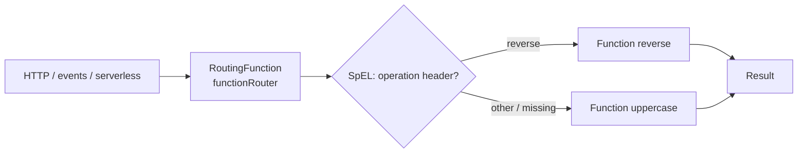

# Dynamic Routing with `spring.cloud.function.routing-expression`

## Learning Objectives

After this lesson, you will be able to:

1. Explain how `RoutingFunction` uses Spring Expression Language (SpEL) to **compute the target function name from the contents of each `Message`**.
2. Write `spring.cloud.function.routing-expression` in `application.yml`, `application.properties`, or a Message header.
3. Route multiple requests to different `Function` beans through a single `functionRouter` entry point.
4. Distinguish **expression-based** routing, **direct function-name** routing (`spring.cloud.function.definition`), and function composition.
5. Explain instruction-source precedence, reactive routing limitations, error handling, testing, and guarding against untrusted input.

## 1. Problem: Same Entry Point, Function Selected by Data

Spring Cloud Function separates business logic into `Supplier`, `Function`, and `Consumer` beans registered via `FunctionCatalog`. Functions can be invoked by an HTTP adapter, an event platform, or a serverless environment without needing to know how requests are transported externally.

Suppose an application has two text transformations:

- `uppercase`: converts a string to uppercase.
- `reverse`: reverses character order.

In some environments, administrators can choose **a fixed function** at deployment time. But if request A needs `uppercase` while request B needs `reverse`, the decision must be made **per message**. In that case, `RoutingFunction` reads metadata/payload and uses a SpEL expression to return the target function name.

Example business rule:

> If the `operation` header equals `reverse`, choose the `reverse` function; otherwise, choose `uppercase`.

This rule can be written in one line:

```text
headers['operation'] == 'reverse' ? 'reverse' : 'uppercase'
```

This is a **dynamic routing expression**: the same expression is reused, yet the outcome can vary based on each message's headers.



**Benefit:** the routing decision lives in the orchestration layer, while the `Function`s focus solely on data processing. A function can be invoked directly, composed with another function, or selected dynamically depending on the adapter and configuration.

## 2. How Does `RoutingFunction` Evaluate `routing-expression`?

Spring Cloud Function provides `org.springframework.cloud.function.context.config.RoutingFunction`, registered in `FunctionCatalog` under the default name **`functionRouter`** (constant `RoutingFunction.FUNCTION_NAME`).

For a `Message<?>` input, the router can evaluate an expression from:

- **Application/system property** `spring.cloud.function.routing-expression`: establishes a **rule** for the application. The rule can select different targets based on each message's headers/payload.
- **Message header** `spring.cloud.function.routing-expression`: lets each message supply its own **expression**, provided the adapter propagates that header.

When evaluating SpEL against a `Message`, the expression can use these elements:

| SpEL Element | Represents | Example |
| --- | --- | --- |
| `headers` | Header map of the `Message` | `headers['operation']` |
| `payload` | Content of the `Message` | `payload == 'hello'` for a string payload |
| `?:` ternary conditional syntax | Chooses a result based on a condition | `headers['operation'] == 'reverse' ? 'reverse' : 'uppercase'` |
| String literal `'reverse'` | Function name returned as a string | `'reverse'` |

The expression result must resolve to **the name of a function definition resolvable in `FunctionCatalog`**, such as `reverse` or `uppercase|reverse`.

```text
Message(payload="hello", headers={operation="reverse"})
  -> RoutingFunction
  -> SpEL evaluates to "reverse"
  -> FunctionCatalog looks up "reverse"
  -> reverse.apply("hello")
  -> "olleh"
```

If the expression fails to produce a valid name, the name does not exist, or the target function cannot handle the payload, the invocation can fail. The router **does not automatically create** a function just because the expression returns its name.

### Similar-Looking Properties with Different Roles

| Name | Where Used | Purpose |
| --- | --- | --- |
| `spring.cloud.function.definition` in adapter config | Application/adapter | Selects the function at **the entry point**, e.g., `functionRouter` or `uppercase` |
| `spring.cloud.function.definition` in a Message header | Router | Selects **the target function name directly**, without SpEL |
| `spring.cloud.function.routing-expression` in a property or header | Router | **Evaluates SpEL** to compute the target function name |

Thus, `definition=functionRouter` works together with `routing-expression`: the first sends the request to the router; the second tells the router **how to choose the business function**.

## 3. Creating Two Business Functions to Test

The example uses Spring Boot with the `spring-cloud-starter-function-web` HTTP adapter dependency. When building your project, use a Spring Cloud Function version compatible with Spring Boot, typically managed via a BOM:

```xml
<dependency>
    <groupId>org.springframework.cloud</groupId>
    <artifactId>spring-cloud-starter-function-web</artifactId>
</dependency>
```

Create two beans of the same type `Function<String, String>`:

```java
package com.example.dynamicrouting;

import java.util.Locale;
import java.util.function.Function;

import org.springframework.boot.SpringApplication;
import org.springframework.boot.autoconfigure.SpringBootApplication;
import org.springframework.context.annotation.Bean;

@SpringBootApplication
public class DynamicRoutingApplication {

    public static void main(String[] args) {
        SpringApplication.run(DynamicRoutingApplication.class, args);
    }

    @Bean
    public Function<String, String> uppercase() {
        return value -> value.toUpperCase(Locale.ROOT);
    }

    @Bean
    public Function<String, String> reverse() {
        return value -> new StringBuilder(value).reverse().toString();
    }
}
```

The framework registers the beans as `uppercase` and `reverse` in `FunctionCatalog`. Neither depends on HTTP, Spring Messaging, or `RoutingFunction`. If you switch to Spring Cloud Stream or serverless, you can reuse these handlers and swap out the adapter and input configuration.

## 4. Approach A — Configuring the Expression in the Application, Varying Data per Request

This approach is useful when **the application owns the routing rule** and clients only send business information, such as `operation`.

```yaml
# application.yml
spring:
  cloud:
    function:
      definition: functionRouter
      routing-expression: "headers['operation'] == 'reverse' ? 'reverse' : 'uppercase'"
```

Explanation:

1. `definition: functionRouter` selects `RoutingFunction` as the adapter's entry-point function.
2. `routing-expression` holds **a SpEL expression**, evaluated on each `Message`.
3. The `operation` header is business metadata sent by the client; it **contains no framework property names**.
4. If `operation=reverse`, the router calls `reverse`; any other value, including a missing header, goes to `uppercase`.

With standard Spring Cloud Function Web, the selected definition can be mapped to the root URL `/`:

```bash
# Message 1: select reverse
curl -X POST http://localhost:8080/ \
  -H "Content-Type: text/plain" \
  -H "operation: reverse" \
  --data-raw "hello"
# Expected result: olleh

# Message 2: select uppercase
curl -X POST http://localhost:8080/ \
  -H "Content-Type: text/plain" \
  -H "operation: uppercase" \
  --data-raw "hello"
# Expected result: HELLO

# Message 3: missing operation, takes default branch
curl -X POST http://localhost:8080/ \
  -H "Content-Type: text/plain" \
  --data-raw "hello"
# Expected result: HELLO
```

**Observation:** all three requests hit the same URL without sending a SpEL expression. The router gets **the expression from the application property**, while the final decision depends on each request's header.

If the web adapter exposes the router by name, you can call `/functionRouter` instead of `/`. The actual URL depends on `spring.cloud.function.web.path`, function export settings, and how the adapter maps functions.

### Writing It with `application.properties` or Environment Variables

```properties
spring.cloud.function.definition=functionRouter
spring.cloud.function.routing-expression=headers['operation'] == 'reverse' ? 'reverse' : 'uppercase'
```

In Bash, if deploying via environment variables:

```bash
export SPRING_CLOUD_FUNCTION_DEFINITION=functionRouter
export SPRING_CLOUD_FUNCTION_ROUTING_EXPRESSION="headers['operation'] == 'reverse' ? 'reverse' : 'uppercase'"
```

In `application.yml`, the outermost double quotes are **YAML syntax** and do not become part of the expression. The single quotes around `reverse`/`uppercase` are **SpEL literal syntax** and must remain intact when the application reads the property.

## 5. Approach B — Supplying the Expression Directly via Message Header

If an integration flow allows the sender to supply **per-message routing rules**, you can place `spring.cloud.function.routing-expression` in a header.

For example, the application only selects the router as the entry point:

```yaml
spring:
  cloud:
    function:
      definition: functionRouter
```

Then send a request:

```bash
curl -X POST http://localhost:8080/ \
  -H "Content-Type: text/plain" \
  -H "operation: reverse" \
  -H "spring.cloud.function.routing-expression: headers['operation'] == 'reverse' ? 'reverse' : 'uppercase'" \
  --data-raw "hello"
# Expected result: olleh
```

With Spring Cloud Function Web, the adapter can convert HTTP headers into Spring `Message` headers so the router reads the expression in `spring.cloud.function.routing-expression`. In event-driven or serverless systems, header/metadata propagation follows the actual binder and adapter; do not assume all HTTP metadata is preserved automatically.

**Key difference:**

- When the expression is in **an application property**, the application controls *the rule*; requests only supply data inputs to that rule.
- When the expression is in **a Message header**, the sender can supply both *the rule* and the data. This is flexible, but you must control who can originate the header.

### Routing Based on Payload

When the payload has already been converted to a `String`, the expression can inspect `payload`:

```yaml
spring:
  cloud:
    function:
      definition: functionRouter
      routing-expression: "payload == 'hello' ? 'uppercase' : 'reverse'"
```

Payload `hello` selects `uppercase`; payload `spring` selects `reverse`. For JSON or complex types, property access and comparisons depend on **the payload type after conversion**. Do not assume a JSON body is automatically converted to the Java type you expect just because the expression names that field.

## 6. Selecting a Composition with a Dynamic Expression

The router's target can also be a **composed definition** from `FunctionCatalog`, such as `uppercase|reverse`:

```yaml
spring:
  cloud:
    function:
      definition: functionRouter
      routing-expression: "headers['operation'] == 'combo' ? 'uppercase|reverse' : 'uppercase'"
```

With `operation: combo` and payload `hello`, the result is `OLLEH`:

```text
"hello" -> uppercase -> "HELLO" -> reverse -> "OLLEH"
```

In the result string `'uppercase|reverse'`, the `|` character is part of **the composition definition name**, not a SpEL logical operator, because it sits inside a string literal. The composition executes **sequentially**, and the output of each step must be compatible with the input of the next step.

Compare the three options:

| Syntax | Meaning |
| --- | --- |
| `spring.cloud.function.definition=uppercase|reverse` in application property | Adapter selects the composition **directly** as the entry point |
| `spring.cloud.function.definition: uppercase|reverse` in Message header | Router selects the target composition **by name** |
| `routing-expression: "headers['operation'] == 'combo' ? 'uppercase|reverse' : 'uppercase'"` | Router **computes** whether to select a composition or a single function per message |

In every case, Spring Cloud Function resolves composition through `FunctionCatalog`. The router does not need custom code to invoke each function step by step.

## 7. SpEL Evaluation Contexts: Application Properties and Headers Differ

Spring Cloud Function distinguishes where `routing-expression` comes from:

| Expression Source | SpEL Evaluation Context | Practical Implication |
| --- | --- | --- |
| **Message header** `spring.cloud.function.routing-expression` | `SimpleEvaluationContext` | Evaluation capabilities are **restricted** to reduce risk when the expression arrives in a message |
| **Application/system property** `spring.cloud.function.routing-expression` | `StandardEvaluationContext` | Supports a **broader** set of SpEL features for application-managed expressions |

Simple expressions accessing `headers['operation']`, string comparisons, and the ternary operator work in the example under both contexts. However, do not assume a complex SpEL expression from an application property will necessarily work verbatim if moved into a Message header. `SimpleEvaluationContext` intentionally disallows features such as Java type references and constructor invocations.

**Design principle:** keep rules in trusted application configuration whenever possible; let senders pass a simple business header, then use a controlled expression to map it to an allowlist of functions. Forwarding arbitrary expressions from public requests straight to the router is discouraged.

## 8. Precedence Order When Multiple Routing Sources Exist

For **imperative functions**, `RoutingFunction` has common sources for determining the target:

| Priority Level | Source | Example |
| --- | --- | --- |
| 1 — highest | `MessageRoutingCallback` bean | Java code returns `reverse` based on metadata |
| 2 | Message header `spring.cloud.function.definition` or `spring.cloud.function.routing-expression` | Request carries direct instruction or SpEL |
| 3 | Routing application/system property | `spring.cloud.function.routing-expression` declares default rule |

Suppose a default configuration is:

```yaml
spring:
  cloud:
    function:
      definition: functionRouter
      routing-expression: "headers['operation'] == 'reverse' ? 'reverse' : 'uppercase'"
```

If a request passes the header `spring.cloud.function.definition: uppercase`, the direct instruction header can take precedence over the expression in the property. If the application registers a `MessageRoutingCallback`, the callback takes precedence even over message headers when determining the target.

To avoid unpredictable results, **do not send both** `spring.cloud.function.definition` and `spring.cloud.function.routing-expression` in the same message with conflicting instructions. Choose one clear routing mechanism per message and document your adapter's header-forwarding policy.

When using `MessageRoutingCallback`, you can enforce a business mapping table (e.g., only `operation=reverse` is allowed to invoke `reverse`) so function selection never depends directly on raw client-supplied strings.

## 9. Real-World Deployment Scenarios

### 9.1. HTTP

The web entry point can be `/functionRouter` or the root path when the adapter selects `functionRouter` as the default definition. HTTP headers are processed by the adapter and mapped into `Message` metadata. Therefore, the same `headers['operation']` expression can evaluate differently across requests.

Verify **the URL path being called**, **actual headers reaching the router**, **payload type after conversion**, and **the final function name**. A syntactically valid routing expression still has no effect if requests hit a direct business-function endpoint instead.

### 9.2. Event Routing with Spring Cloud Stream

A consumer receiving events from the same destination can select different handlers based on headers. For event routing, Spring Cloud Stream typically uses `spring.cloud.stream.function.routing.enabled=true` and the conventional input binding `functionRouter-in-0`.

```text
Event A: operation=reverse, payload="hello" -> reverse -> "olleh"
Event B: operation=uppercase, payload="hello" -> uppercase -> "HELLO"
```

Depending on the binder (Kafka, RabbitMQ, etc.), verify that the business header `operation` is propagated as a Spring Message header, how destination and output bindings are declared, and how errors are handled. **The binding name** `functionRouter-in-0` is distinct from the router name `functionRouter` in `FunctionCatalog`.

### 9.3. Serverless

A serverless adapter can invoke `functionRouter` and pass event payload/metadata into the framework. Routing expressions only work against headers actually supplied by the adapter; an arbitrary JSON event does not automatically have an HTTP-like `Message` structure.

Because business `Function`s are decoupled from the adapter, you can keep `uppercase` and `reverse` intact, though you must verify event mapping, handler naming, and configuration loading for your specific serverless platform.

### 9.4. Reactive Routing Is a Special Case

With `Function<String, String>`, the router can route **per `Message`**. By contrast, a reactive function taking `Flux<T>` or `Publisher<T>` processes an entire stream in a single invocation. Spring Cloud Function **does not support switching targets based on per-item routing headers within the same reactive stream** in the imperative manner.

Therefore, with reactive functions, select the route at **the stream level** using an appropriate application property, typically a static target name (such as `routing-expression: "'processStream'"`) rather than an expression reading per-event headers. A Stream binder can still route individual events if the target handlers themselves are structured as imperative functions.

## 10. Designing Safe and Maintainable Expressions

A short expression can be handy in a small system, but clear rules are still essential:

1. **Include an explicit fallback branch.** For example, `headers['operation'] == 'reverse' ? 'reverse' : 'uppercase'` handles missing headers too. Choose a fallback that matches business semantics; do not silently treat unknown operations as valid if the workflow requires rejection.
2. **Return only registered function names.** Typos like `'reversee'` are not auto-corrected by the router; check the catalog and runtime errors.
3. **Control where expressions come from.** Do not expose an API letting clients submit arbitrary SpEL unless genuinely required. Expressions in application config are easier to review and version-control.
4. **Restrict the set of callable functions.** If clients send `operation` or routing headers from public networks, apply authentication, authorization, and allowlist mapping to permitted functions. A router endpoint does not replace access-control policies.
5. **Avoid stuffing complex business logic into SpEL.** If routing requires multiple lookups, state, or branching conditions, use a `MessageRoutingCallback` or dedicated service for better testability and observability.
6. **Log errors and chosen targets.** Record correlation IDs, `operation`, target function names, and errors at appropriate levels while avoiding logging sensitive payload contents.

In particular, if the router cannot find the target function, the call may throw an exception. Spring Cloud Function provides the `DefaultMessageRoutingHandler` extension point for unroutable messages; avoid configuring a handler that silently drops messages when data is important and needs retries, dead-letter channels, or alerts.

## 11. Diagnostic Checklist

| Symptom | Possible Cause | How to Check |
| --- | --- | --- |
| Changing `operation` always yields the same output | Requests bypass `functionRouter`, or headers never reach `Message` | Inspect adapter entry-point function and actual metadata |
| SpEL reports property not found | Wrong key accessed or payload/header mismatch | Check `headers['operation']`, payload type, and header key |
| Evaluates to `null` or nonexistent function name | Missing default branch or misspelled bean name | Use explicit ternary logic and verify against `FunctionCatalog` |
| Works in property but fails when moved to Message header | The two sources use different evaluation contexts | Simplify the expression for `SimpleEvaluationContext` |
| Routing property is not applied | Callback or message routing header takes higher precedence | Verify precedence order and configuration sources |
| Routed correctly but type conversion fails | `Content-Type`/payload mismatches function signature | Check Java types, adapter conversion, and composition |
| `spring.cloud.function.definition` header overrides SpEL | Message carries another routing instruction | Standardize on a single routing instruction per message |
| Trying to switch functions per `Flux` element fails | Using stream-level reactive routing | Configure route for the whole stream or switch to imperative processing |
| Client can invoke unintended function | Target name/expression comes from untrusted source | Enforce allowlists, authentication, and access control |

When debugging, split the path into four questions: **Which function is the adapter calling? What `Message` does the router receive? Which definition does SpEL return? Does the looked-up function receive the expected payload type?** This separates protocol, orchestration, catalog, and business-logic issues.

## 12. Reinforcement Exercises

1. Create the two beans `uppercase` and `reverse` as shown. Configure `definition=functionRouter` and `routing-expression` in `application.yml`, then send three HTTP requests with `operation=uppercase`, `operation=reverse`, and no `operation`. Explain all three outputs.
2. Remove the `routing-expression` property and pass the expression in the HTTP header `spring.cloud.function.routing-expression`. Compare who controls *the rule* in each approach.
3. Replace the expression with `headers['operation'] == 'combo' ? 'uppercase|reverse' : 'uppercase'`. Send `hello` with `operation=combo`; trace each step of the composition.
4. Create a route based on `payload == 'hello'`. With a JSON payload, explain why you must verify conversion before accessing complex fields.
5. Set a default routing property and then also send the header `spring.cloud.function.definition: reverse`. Based on precedence order, explain the actual outcome.
6. Design a rule where `operation` only accepts `uppercase` and `reverse`, and any other value must be rejected. Compare using a simple SpEL expression versus a `MessageRoutingCallback` with validation.
7. Adapt the concept to an event-driven system using Spring Cloud Stream. Clearly identify the input binding, header source, message payload, and error handling when the router cannot find a function.

## Key Takeaways

- `spring.cloud.function.routing-expression` holds **a SpEL expression** evaluated by `RoutingFunction` to look up the target function in `FunctionCatalog`.
- The expression can live in **an application property** (application owns the rule) or **a Message header** (sender supplies the rule); the two sources use different evaluation contexts.
- `headers['operation'] == 'reverse' ? 'reverse' : 'uppercase'` performs **dynamic per-message** routing, whereas `'uppercase'` is SpEL returning a **fixed** target.
- `spring.cloud.function.definition=functionRouter` selects the router as the entry point; `spring.cloud.function.definition` in a Message header selects the target directly. A routing expression can also return a composition such as `uppercase|reverse`.
- For imperative routing, the basic precedence is **`MessageRoutingCallback` → message routing headers → application properties**.
- Write clear expressions, guard external headers, plan error handling, and remember that reactive routing is selected at **the stream level**, not per element via headers.

### Official References

- [Spring Cloud Function Reference — Function Routing and Filtering](https://docs.spring.io/spring-cloud-function/reference/spring-cloud-function/programming-model.html)
- [Spring Cloud Function Reference — Standalone Web Applications](https://docs.spring.io/spring-cloud-function/reference/spring-cloud-function/standalone-web-applications.html)
- [Spring Cloud Stream Reference — Event Routing](https://docs.spring.io/spring-cloud-stream/reference/spring-cloud-stream/event-routing.html)
