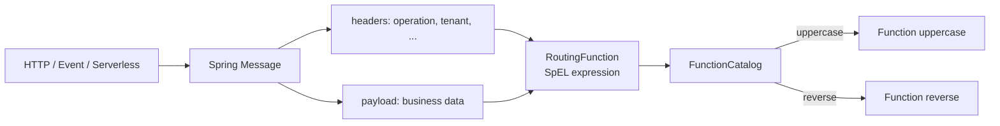

# Accessing `payload` and `headers` in SpEL Expressions

## Learning Objectives

After this lesson, you will be able to:

1. Explain why `RoutingFunction` evaluates SpEL expressions against a `Message`, and distinguish `payload` from `headers`.
2. Write expressions that access `headers['key']`, `payload`, object properties, or `Map` entries matching the actual data type.
3. Combine conditions on headers and payload to return a business function name in `FunctionCatalog`.
4. Test routing with `MessageBuilder`, the HTTP adapter, and edge cases such as missing headers, type mismatches, and conversion errors.
5. Distinguish `SimpleEvaluationContext` from `StandardEvaluationContext`, while mitigating risks when expressions or data come from untrusted sources.

## 1. Context: Data and Metadata Jointly Drive Routing Decisions

In **Spring Cloud Function**, business logic is organized as `Supplier`, `Function`, or `Consumer` beans looked up via `FunctionCatalog`. The same function can connect to HTTP, event streams, or serverless environments through adapters; the business function does not need to know where the request originated.

When a system needs to decide **which function processes each message**, Spring Cloud Function provides `RoutingFunction`, registered by default under **`functionRouter`**. You can select a target via:

- A target function name in the `Message` header `spring.cloud.function.definition`.
- A SpEL expression in `spring.cloud.function.routing-expression`, allowing you to inspect data and compute the target name.
- A `MessageRoutingCallback` when rules need to be written in Java.

For instance, an application has two functions: `uppercase` (to uppercase) and `reverse` (reverse characters). A request might send a header `operation=reverse` or carry information inside the payload that determines which function should run. Instead of embedding routing conditionals inside `uppercase` or `reverse`, you keep the business functions simple and place the decision in the router.



**Key idea:** `headers` hold metadata, while `payload` holds business data. SpEL can read both to compute **the function definition name** that the router looks up. Looking up and invoking the function is handled by the framework; the expression does not invoke the business function itself.

## 2. `Message` Is the Expression Context

For **imperative message routing**, the router's input is a Spring `Message<?>`. A message typically has the form:

```text
Message
├── payload: "hello"
└── headers:
    ├── operation: "reverse"
    ├── requestId: "req-42"
    └── contentType: "text/plain"
```

In `RoutingFunction`'s SpEL expression, **the root object is `Message`**. You access properties of the root object by name:

| Expression | What It Reads | Example Output |
| --- | --- | --- |
| `payload` | Entire payload of the message | `hello` |
| `headers` | `MessageHeaders` collection | Key/value pairs |
| `headers['operation']` | Value of the header with key `operation` | `reverse` |
| `headers['requestId']` | Tracing metadata | `req-42` |
| `headers['missing']` | Header not provided | Typically returns `null` |

Example expression:

```spel
headers['operation'] == 'reverse' ? 'reverse' : 'uppercase'
```

Assuming the message has `headers['operation'] = 'reverse'`, the expression returns **the string** `reverse`. The router uses that string to select the `reverse` bean from `FunctionCatalog`.

### SpEL Syntax Notes

1. `headers['operation']` performs a key lookup on the map-like `MessageHeaders` object; key names are case-sensitive according to metadata supplied by the adapter.
2. `'reverse'` and `'uppercase'` are **SpEL string literals**. Writing `reverse` without single quotes in the return position may cause SpEL to try reading a property named `reverse` instead of returning the bean name.
3. `==`, `!=`, `and`/`or` (or `&&`/`||`), and `condition ? a : b` are commonly used selection operators.
4. The expression must return **a valid function definition name**, not `true`/`false` or a payload object.

For example, writing `headers['operation'] == 'reverse'` only produces a boolean value. The router expects a target name like `reverse`, so you must map the boolean condition to a name using the ternary operator.

## 3. Preparing Two Business `Function`s

The example uses Spring Boot and Spring Cloud Function's `spring-cloud-starter-function-web` dependency. Choose a version compatible with Spring Boot via your project's BOM or dependency management configuration:

```xml
<dependency>
    <groupId>org.springframework.cloud</groupId>
    <artifactId>spring-cloud-starter-function-web</artifactId>
</dependency>
```

Create two plain Java functions:

```java
package com.example.spelrouting;

import java.util.Locale;
import java.util.function.Function;
import org.springframework.boot.SpringApplication;
import org.springframework.boot.autoconfigure.SpringBootApplication;
import org.springframework.context.annotation.Bean;

@SpringBootApplication
public class SpelRoutingApplication {
    public static void main(String[] args) {
        SpringApplication.run(SpelRoutingApplication.class, args);
    }

    @Bean
    public Function<String, String> uppercase() {
        return value -> value.toUpperCase(Locale.ROOT);
    }

    @Bean
    public Function<String, String> reverse() {
        return value -> new StringBuilder(value).reverse().toString();
    }
}
```

`FunctionCatalog` registers the two beans under `uppercase` and `reverse`. They simply transform strings; they **do not need to read routing metadata**.

## 4. Reading `headers` in an Expression

First, use only a header to determine the route. Configure `application.yml`:

```yaml
spring:
  cloud:
    function:
      definition: functionRouter
      routing-expression: "headers['operation'] == 'reverse' ? 'reverse' : 'uppercase'"
```

The two properties have distinct roles:

- `definition: functionRouter` selects the router as the adapter's entry-point function.
- `routing-expression: ...` defines **how the router determines the target function** from the `Message`.

When the web application uses default settings and this entry point is mapped at `/`, try:

```bash
# operation=reverse -> reverse
curl -X POST http://localhost:8080/ \
  -H "Content-Type: text/plain" \
  -H "operation: reverse" \
  --data-raw "hello"
# olleh

# operation=uppercase -> uppercase
curl -X POST http://localhost:8080/ \
  -H "Content-Type: text/plain" \
  -H "operation: uppercase" \
  --data-raw "hello"
# HELLO

# Missing operation -> default branch uppercase
curl -X POST http://localhost:8080/ \
  -H "Content-Type: text/plain" \
  --data-raw "hello"
# HELLO
```

If `functionRouter` is exposed by name, `/functionRouter` can be used. The actual URL depends on web adapter settings and function filtering.

Across all three requests, **the payload is identical** while the `operation` header varies, causing the router to dispatch requests to different targets. When `operation` is absent, the expression compares `null` against `'reverse'`, evaluates to false, and picks the `uppercase` branch.

### Accessing Multiple Headers

Suppose `reverse` is only permitted for requests belonging to the preview channel:

```spel
(headers['operation'] == 'reverse' and headers['channel'] == 'preview')
    ? 'reverse' : 'uppercase'
```

The expression can be placed on **a single line** in YAML:

```yaml
spring:
  cloud:
    function:
      routing-expression: "(headers['operation'] == 'reverse' and headers['channel'] == 'preview') ? 'reverse' : 'uppercase'"
```

This example only illustrates a routing condition. Sender-supplied headers can be forged, so **do not use `channel` or `tenant` taken directly from a request in place of authentication/authorization**. If a branch provides privileged functionality, execution permissions must be verified server-side.

## 5. Reading `payload` When the Payload Has an Appropriate Type

When the payload is genuinely a `String`, you can inspect the string directly:

```yaml
spring:
  cloud:
    function:
      definition: functionRouter
      routing-expression: "payload == 'hello' ? 'uppercase' : 'reverse'"
```

| Actual Payload Received | SpEL Evaluation | Target Function |
| --- | --- | --- |
| String `hello` | `payload == 'hello'` is `true` | `uppercase` |
| String `spring` | `payload == 'hello'` is `false` | `reverse` |
| Empty string `""` | Condition is `false` | `reverse` |

**Important condition:** the example above assumes the payload is a Java `String` at the moment the router evaluates the expression. In practice, adapters/binders may deliver payloads as `byte[]`, `String`, `Map`, POJOs, or other types depending on `Content-Type` and conversion pipelines. If the payload is `byte[]`, comparing it with `'hello'` will not behave the same way. Always check **the runtime type at routing time**, not just the raw HTTP request body.

### Payload as a `Map`

If the adapter has already converted the payload into a `Map<String, Object>`, for example data like:

```json
{
  "action": "reverse",
  "text": "hello"
}
```

You can read a key in the map:

```spel
payload['action'] == 'reverse' ? 'reverse' : 'uppercase'
```

If the actual input is still a raw JSON string or byte array, `payload['action']` **does not automatically parse JSON**. You must identify and configure data conversion before expression evaluation, or promote `action` into a clearly handled business header.

### Payload as a Java Bean / POJO

Suppose the payload has already been converted into:

```java
public class TextCommand {
    private String action;
    private String text;

    public String getAction() { return action; }
    public void setAction(String action) { this.action = action; }
    public String getText() { return text; }
    public void setText(String text) { this.text = text; }
}
```

With an actual `TextCommand` instance, SpEL can read the JavaBean property:

```spel
payload.action == 'reverse' ? 'reverse' : 'uppercase'
```

However, if the payload is a `Map`, the syntax `payload['action']` is clearer. If a property does not exist on the POJO or lacks access permission in the evaluation context, the expression can fail. Your syntax must match **the type available when the router runs**.

### Handling Missing Payload Properties

When a field is optional, define a fallback at the business level. With a `Map`, a missing key usually yields `null`, whereas accessing a nonexistent property on a POJO can cause SpEL to throw an exception. In some cases you can use SpEL's null-safe navigation operator such as `payload?.action` when the object is valid but `null`; this operator **does not replace type checking or verifying that a property exists**.

## 6. Combining `headers` and `payload` in the Same Expression

This is a major strength of `routing-expression`: metadata provides context while payload provides business data.

Suppose the text-processing system follows this rule:

- If header `operation=reverse` **or** payload equals `mirror`, select `reverse`.
- Otherwise, select `uppercase`.

```yaml
spring:
  cloud:
    function:
      definition: functionRouter
      routing-expression: "(headers['operation'] == 'reverse' or payload == 'mirror') ? 'reverse' : 'uppercase'"
```

Assuming the payload is already a `String`, the results are:

| `operation` Header | Payload | Selected Target | Result |
| --- | --- | --- | --- |
| `reverse` | `hello` | `reverse` | `olleh` |
| `uppercase` | `mirror` | `reverse` | `rorrim` |
| `uppercase` | `hello` | `uppercase` | `HELLO` |
| Absent | `spring` | `uppercase` | `SPRING` |

Parentheses around conditions prevent operator-precedence mistakes as expressions grow. The expression only **returns a route name**; text transformation remains the responsibility of the selected `Function`.

An operational tip is to keep expressions short and define clear behavior for missing headers, missing data fields, or unexpected payload types. If function selection requires multiple branches, external lookups, or validation, consider `MessageRoutingCallback` so you can write and unit-test it in Java.

## 7. Testing SpEL with `MessageBuilder`

To isolate HTTP header propagation issues from expression issues, you can build a message in Java:

```java
import org.springframework.messaging.Message;
import org.springframework.messaging.support.MessageBuilder;

Message<String> message = MessageBuilder.withPayload("mirror")
        .setHeader("operation", "uppercase")
        .setHeader("requestId", "req-42")
        .build();
```

With the expression from section 6, this message selects `reverse` **due to the payload-based condition**, even though the `operation` header is `uppercase`. When testing, verify the expected target name returned by the expression before checking the final transformed output.

One way to look up the router in an application with `FunctionCatalog` injected:

```java
import java.util.function.Function;
import org.springframework.cloud.function.context.FunctionCatalog;
import org.springframework.cloud.function.context.config.RoutingFunction;
import org.springframework.messaging.Message;

// functionCatalog is injected by Spring.
Function<Message<?>, ?> router =
        functionCatalog.lookup(RoutingFunction.FUNCTION_NAME);

// Routing rule is configured in application properties.
Object result = router.apply(message);
```

This snippet uses the constructed `Message<String>` and assumes the router has a valid `routing-expression`. The actual `result` type may be a raw payload or a framework-adapted `Message` depending on the function and adapter. When verifying, check the payload, return type, and invoked branch.

If you want to test a custom expression **inside a header** instead of from application properties:

```java
Message<String> request = MessageBuilder.withPayload("hello")
        .setHeader("operation", "reverse")
        .setHeader(
                "spring.cloud.function.routing-expression",
                "headers['operation'] == 'reverse' ? 'reverse' : 'uppercase'")
        .build();
```

The header expression will be evaluated when the message passes through `RoutingFunction`. This approach is useful for demonstrating metadata, though in systems with public clients, expressions should generally be **managed in server-side configuration**.

## 8. Expression Sources and Evaluation Contexts

`routing-expression` can live in an application/system property or in a Message header. Spring Cloud Function uses **two different SpEL contexts**:

| Expression Source | Context | Consequence |
| --- | --- | --- |
| Message header `spring.cloud.function.routing-expression` | `SimpleEvaluationContext` | Restricts SpEL capabilities because the expression may originate from a sender |
| Application/system property `spring.cloud.function.routing-expression` | `StandardEvaluationContext` | Provides broader SpEL capabilities for application-controlled configuration |

Basic expressions using `headers['operation']`, string comparisons, and the ternary operator work well for lesson examples in both contexts. More powerful SpEL features—such as Java type references, constructor calls, or method invocations—may not be permitted in `SimpleEvaluationContext`. Therefore, do not assume a complex expression from application config can be copied verbatim into a message header and work identically.

**Two distinct layers of data:**

1. **The expression being evaluated:** SpEL code supplied by configuration or header.
2. **The data the expression reads:** the current `Message` with its actual payload and headers.

For example, an application fixes the expression in a property while `headers['operation']` varies per message. That is still **dynamic routing**, even though **the expression string never changes**.

### Precedence Order When Multiple Instructions Exist

For imperative message routing, the general precedence order is:

1. `MessageRoutingCallback` bean if present.
2. Routing instruction in Message headers (`spring.cloud.function.definition` or `spring.cloud.function.routing-expression`).
3. Applicable routing application/system property.

For example, a property defines `headers['operation'] == 'reverse' ? 'reverse' : 'uppercase'`, while a Message carries the header `spring.cloud.function.definition: uppercase`. Without a higher-precedence callback, the direct instruction in the Message header can take precedence over the property expression.

Avoid sending **two different routing headers simultaneously** with conflicting targets. Distinguish `spring.cloud.function.definition=functionRouter` at the entry-point selection layer from `spring.cloud.function.definition=reverse` **inside a Message header** choosing the target function.

## 9. Data Conversion Is a Prerequisite for Accessing `payload`

`RoutingFunction` picks a function name using an expression, but the expression **does not guarantee** the payload has already been converted to the type you expect. Adapters determine how a message is constructed from a body/event, and conversion happens at different stages depending on the environment.

| External Input | Payload Type Possible at Router | Appropriate SpEL After Verifying Type |
| --- | --- | --- |
| HTTP `text/plain` | `String` or `byte[]` depending on pipeline | `payload == 'hello'` only when truly a `String` |
| JSON object | JSON string, `byte[]`, `Map`, or POJO | `payload['action']` for `Map`; `payload.action` for POJO |
| Kafka/RabbitMQ event | Depends on binder, content type, converter | Inspect `headers` and payload type before writing expression |
| Serverless event | Depends on adapter and serializer | Inspect how the adapter maps the event into a `Message` |

A notable pitfall: routing to `Function<Order, Receipt>` succeeds, yet the payload at the router is still raw bytes. If an expression tries to read `payload.customer.tier` before a converter constructs `Order`, SpEL may throw an error. Place routing criteria in **trusted headers**, or normalize/convert the payload prior to the router via appropriate adapter design.

Conversely, once the route selects the right function, the framework may still need to convert the payload to match the target function's input type. **Routing expression errors** and **target function input conversion errors** are two separate classes of failures.

## 10. Limitations with Reactive Functions

In the `Function<String, String>` example, each message can be an independent processing unit: the router evaluates `headers`/`payload` and selects a target for that invocation.

For reactive functions taking `Flux<T>` or `Publisher<T>`, the unit of processing is **a stream**. Spring Cloud Function does not re-route individual elements inside a single reactive publisher based on per-item routing headers in the imperative message routing style.

When you need to route **the entire stream** to a reactive function, specify the target via application properties and do not assume each element's `payload` acts as a per-item root message. On the other hand, Spring Cloud Stream can still process individual events through the router if the target functions are imperative.

## 11. Security, Stability, and Governance

Accessing `headers` and `payload` is very flexible, yet keep in mind these inputs may come from clients or broker producers:

- **Do not trust client-chosen function names or expressions.** The `spring.cloud.function.definition` header can request any function in the catalog; `spring.cloud.function.routing-expression` can carry SpEL. Enforce authorization, authentication, and an allowlist of permitted functions.
- **Keep expressions on the application side whenever possible.** Clients send only a business value like `operation=reverse`; the server decides how to map that value to an internal bean. This avoids exposing internal function names or letting clients pick them freely.
- **Validate invalid values.** An expression falling back to `uppercase` when `operation` is wrong may suit a demo, but is inappropriate for transactions that should reject unrecognized operations.
- **Never treat self-declared headers as authorization proof.** Fields such as `tenant`, `role`, `userId`, or `admin` must be verified server-side, not merely compared in SpEL.
- **Have an explicit error-handling path.** Missing target functions, invalid SpEL syntax, or conversion failures can fail requests/events. Design logging, retries, dead-letter queues, or adapter error handling according to data criticality.
- **Instrument routing decisions.** Attach correlation IDs, log selected targets and failure reasons when needed, while avoiding logging sensitive payloads or headers.

When routing rules become complex, `MessageRoutingCallback` lets you write testable Java logic, validate inputs, and enforce allowlists more clearly than long SpEL expressions.

## 12. Common Troubleshooting Scenarios

| Symptom | Possible Cause | Investigation Direction |
| --- | --- | --- |
| Changing `operation` header does not change target | Request does not hit `functionRouter`, key is not propagated, or callback takes precedence | Check adapter, Message headers, and routing source precedence |
| `payload == 'hello'` fails to match despite body `hello` | Payload at router is `byte[]` or another type | Verify actual Java runtime type before comparing |
| `payload['action']` throws an error | Payload is not a `Map` or JSON is unparsed | Check converter/serializer and use syntax matching the type |
| `payload.action` throws an error | Payload is a `Map`, field is missing, or JavaBean lacks matching getter | Inspect runtime type/properties of evaluated object |
| Missing header triggers unexpected branch | Header evaluates to `null`, fallback branch is unclear | Write ternary with explicit fallback and test missing-header cases |
| Expression works in property but fails in header | `StandardEvaluationContext` vs. `SimpleEvaluationContext` differ in capabilities | Simplify SpEL and review allowed features per context |
| SpEL returns `true`/`false` and router finds no target | Expression only evaluates a comparison without returning a function name | Use `? 'reverse' : 'uppercase'` |
| Router selects function but function fails on input | Payload incompatible with target function signature | Check `Content-Type`, conversion, and composition order |
| Cannot route individual `Flux` elements | Reactive function processes the whole stream | Route at stream level or use imperative event routing |

When debugging, trace in order: **adapter entry point → actual `Message` → payload type and headers → SpEL result → target name in catalog → function input conversion**. This prevents confusing expression bugs with HTTP/binder issues or business-logic errors.

## 13. Practice Exercises

1. With the two beans `uppercase` and `reverse`, configure the router with `headers['operation'] == 'reverse' ? 'reverse' : 'uppercase'`. Send three HTTP requests: `operation=reverse`, `operation=uppercase`, and no header. Record the outputs and explain the default branch.
2. Write `MessageBuilder.withPayload("mirror")` with header `operation=uppercase`. Apply the combined `headers` and `payload` expression from section 6, determine the selected function, and observe the final output.
3. Replace the header condition with `payload == 'hello'`. Test with a `String` payload, then consider a `byte[]` payload; explain why identical displayed text can yield different comparison results.
4. Given a `Map` payload containing `action` and `text`, write an expression returning `reverse` when `action=reverse`. State the prerequisite required for `payload['action']` to succeed.
5. Test routing using two headers: `operation` and `channel`. Design a clear fallback when `channel` is absent; explain why client-supplied headers are insufficient for authorization decisions.
6. Compare placing the expression in an application property versus in a Message header. Explain the differences in who controls the routing rule and which evaluation context is used.
7. Outline debugging steps if a router receives a JSON event, `payload.action` throws an error, yet switching to `headers['operation']` works.
8. Design a policy that only accepts `uppercase` or `reverse`, rejects all other operations, and prevents clients from specifying function names directly. Explain when you would choose `MessageRoutingCallback` over SpEL.

## Key Takeaways

- In imperative message routing, **the SpEL root object is `Message`**: `payload` is the content, and `headers['key']` accesses metadata.
- `spring.cloud.function.routing-expression` must **return a function definition name**, such as `'reverse'` or `'uppercase|reverse'`; a plain boolean comparison is not enough.
- Headers and payload can be combined in conditions, provided you know **the actual payload type at the router**, especially with JSON, `byte[]`, `Map`, or POJO payloads.
- Expressions in Message headers use `SimpleEvaluationContext`; expressions from application/system properties use `StandardEvaluationContext`.
- `functionRouter` is selected at the entry point; the expression determines the **target** function in `FunctionCatalog`. The same business beans can be reused across HTTP, events, and serverless when adapters preserve required metadata.
- Never trust external headers for authorization; for critical data, restrict the allowed function set and ensure proper error handling, observability, and testing.

### Official References

- [Spring Cloud Function — Programming model: Function Routing and Filtering](https://docs.spring.io/spring-cloud-function/reference/spring-cloud-function/programming-model.html)
- [Spring Cloud Function — Standalone Web Applications](https://docs.spring.io/spring-cloud-function/reference/spring-cloud-function/standalone-web-applications.html)
- [Spring Framework — Spring Expression Language (SpEL)](https://docs.spring.io/spring-framework/reference/core/expressions.html)
- [Spring Framework — Integration: Message](https://docs.spring.io/spring-integration/reference/message.html)
