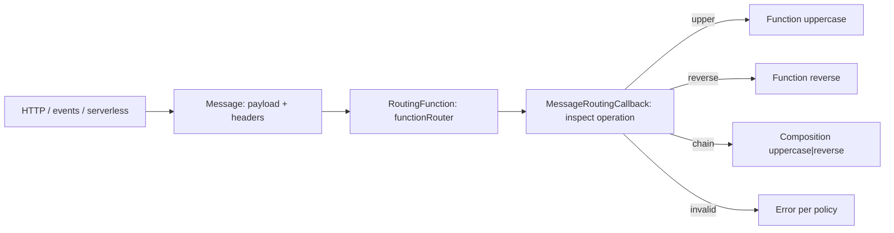

# Customizing Function Selection with `MessageRoutingCallback`

## Learning Objectives

After this lesson, you will be able to:

1. Explain the role of `MessageRoutingCallback` within Spring Cloud Function's `RoutingFunction` mechanism.
2. Write a `MessageRoutingCallback` bean to map business metadata to a `Function` name or composition in `FunctionCatalog`.
3. Distinguish a routing callback from a business `Function`, the `spring.cloud.function.definition` Message header, and `spring.cloud.function.routing-expression`.
4. Handle invalid route values, default branch selection, and target function compatibility checks.
5. Test target selection rules using `MessageBuilder`, observe behavior over HTTP, and explain applicability in event-driven/serverless systems.

## 1. Why Do We Need a Function-Selection Callback?

**Spring Cloud Function** supports declaring business logic as `Supplier`, `Function`, and `Consumer` beans, then registering, looking up, and composing them via `FunctionCatalog`. A function can be reused over HTTP, event streams, or serverless runtimes via adapters without coupling business logic to a specific transport protocol.

When an entry point must decide which function to execute for each message, Spring Cloud Function provides `RoutingFunction` (named **`functionRouter`** in the catalog). You can specify a route via headers or a SpEL expression. However, those approaches are not always suitable:

- The application must evaluate multiple rules and enforce clear error branches.
- Clients should only send a business value like `operation=upper`, without specifying internal bean names like `uppercase`.
- The list of valid routes should be managed centrally in Java code.
- Rules should be unit-testable without starting an HTTP server.

In these scenarios, `MessageRoutingCallback` lets **the application decide the target name in Java**, based on the current `Message<?>`.



The callback **does not execute business logic in place of `Function`**. It returns a definition name so `RoutingFunction` can look it up and invoke it through `FunctionCatalog`.

## 2. What Is `MessageRoutingCallback`?

The interface is provided by Spring Cloud Function in the package:

```java
import org.springframework.cloud.function.context.MessageRoutingCallback;
```

Conceptually, the callback defines a method accepting `Message<?>` and returning a route name:

```java
// Core signature of the interface:
String routingResult(Message<?> message);
```

Where:

| Component | Meaning |
| --- | --- |
| `Message<?>` | The current message, containing `payload` and `headers` |
| `routingResult(...)` | Method that computes and returns the target definition name |
| Return string `"uppercase"` | Looks up function `uppercase` in `FunctionCatalog` |
| Return string `"uppercase|reverse"` | Looks up composition running `uppercase` then `reverse` |
| `RoutingFunction` | Component using the callback result to transfer control |

Register your implementation as a **Spring `MessageRoutingCallback` bean** so the router discovers and uses it. This is a framework-provided hook; normally you do not create a `RoutingFunction` bean yourself, nor do you call `FunctionCatalog.lookup(...)` manually inside the callback.

A minimal example:

```java
@Bean
public MessageRoutingCallback routeByOperation() {
    return message -> {
        Object operation = message.getHeaders().get("operation");
        return "reverse".equals(operation) ? "reverse" : "uppercase";
    };
}
```

With header `operation=reverse`, the callback returns `reverse`; otherwise it returns `uppercase`. This is an **explicit fallback**, not an automatic framework behavior. For workflows requiring strict control, an invalid operation should be rejected rather than sent to a default function.

## 3. Preparing a Sample Application with Two Business Functions

The example uses Spring Boot and the `spring-cloud-starter-function-web` HTTP adapter. Manage a Spring Cloud Function version compatible with your project's Spring Boot version, typically via a BOM or dependency management:

```xml
<dependency>
    <groupId>org.springframework.cloud</groupId>
    <artifactId>spring-cloud-starter-function-web</artifactId>
</dependency>
```

Create an application with two `Function<String, String>` beans and a callback:

```java
package com.example.callbackrouting;

import java.util.Locale;
import java.util.function.Function;

import org.springframework.boot.SpringApplication;
import org.springframework.boot.autoconfigure.SpringBootApplication;
import org.springframework.cloud.function.context.MessageRoutingCallback;
import org.springframework.context.annotation.Bean;

@SpringBootApplication
public class CallbackRoutingApplication {

    public static void main(String[] args) {
        SpringApplication.run(CallbackRoutingApplication.class, args);
    }

    @Bean
    public Function<String, String> uppercase() {
        return value -> value.toUpperCase(Locale.ROOT);
    }

    @Bean
    public Function<String, String> reverse() {
        return value -> new StringBuilder(value).reverse().toString();
    }

    @Bean
    public MessageRoutingCallback routeByOperation() {
        return message -> {
            Object raw = message.getHeaders().get("operation");
            String operation = raw instanceof String
                    ? ((String) raw).trim().toLowerCase(Locale.ROOT)
                    : "";

            switch (operation) {
                case "upper":
                    return "uppercase";
                case "reverse":
                    return "reverse";
                case "chain":
                    return "uppercase|reverse";
                default:
                    throw new IllegalArgumentException(
                            "Unsupported operation: " + operation);
            }
        };
    }
}
```

The application intentionally accepts protocol/business terms `upper`, `reverse`, and `chain` as input, while the callback returns only permitted definitions. The sender **does not need to know** that the bean is named `uppercase` or how composition syntax works.

Separation of responsibilities:

| Component | Responsibility | Depends on Routing Info? |
| --- | --- | --- |
| `uppercase` | Converts string to uppercase | No |
| `reverse` | Reverses characters | No |
| `routeByOperation` | Validates `operation` and chooses definition name | Yes |
| `functionRouter` | Calls callback, looks up and delegates to target definition | Yes |
| HTTP/Stream/serverless adapter | Receives data and maps it into the framework | Depends on adapter |

The callback returns a string understood by the framework as a **definition**, so `"uppercase|reverse"` is a valid choice if both functions have compatible data types. `FunctionCatalog` resolves the composition; the callback does not manually invoke `uppercase` and then `reverse`.

## 4. Selecting `functionRouter` as the Entry Point

At the deployment layer, the adapter must actually invoke `RoutingFunction` for the callback to participate in routing. For the HTTP example, you can select the router as the default definition:

```yaml
# application.yml
spring:
  cloud:
    function:
      definition: functionRouter
```

The `spring.cloud.function.definition` property in the configuration file tells the adapter: **invoke `functionRouter` at the defined entry point**. The callback then decides the target route.

With typical Spring Cloud Function Web settings, the default definition can be mapped to the root endpoint `/`. Send three requests:

```bash
# operation=upper -> uppercase
curl -X POST http://localhost:8080/ \
  -H "Content-Type: text/plain" \
  -H "operation: upper" \
  --data-raw "hello"
# Expected result: HELLO

# operation=reverse -> reverse
curl -X POST http://localhost:8080/ \
  -H "Content-Type: text/plain" \
  -H "operation: reverse" \
  --data-raw "hello"
# Expected result: olleh

# operation=chain -> uppercase|reverse
curl -X POST http://localhost:8080/ \
  -H "Content-Type: text/plain" \
  -H "operation: chain" \
  --data-raw "hello"
# Expected result: OLLEH
```

All three requests enter **the same entry point** yet select different definitions. The HTTP adapter converts the `operation` header into Spring `Message` metadata, and `MessageRoutingCallback` reads that header and returns the target name.

If the adapter exposes the router by name, `/functionRouter` can also be called; the exact URL depends on web mapping behavior and settings like `spring.cloud.function.web.path`. In non-HTTP environments there is no `curl`, yet how the callback decides the target follows the same principle as long as the adapter supplies a `Message`.

### Request with an Invalid Operation

The following example **intentionally fails**:

```bash
curl -X POST http://localhost:8080/ \
  -H "Content-Type: text/plain" \
  -H "operation: delete-all" \
  --data-raw "hello"
```

The callback throws `IllegalArgumentException` because `delete-all` is not in the allowlist. How the HTTP adapter translates that exception into a status code—or how a message binder handles it via retries/error channels—depends on how the application configures exception handling. If you need to return HTTP 400 with a clear body, you must configure corresponding error mapping at the web layer; **do not assume** every `IllegalArgumentException` automatically becomes HTTP 400.

## 5. Java Rules Can Inspect Both `headers` and `payload`

`MessageRoutingCallback.routingResult(Message<?> message)` receives the entire Spring Message, so beyond `operation`, the callback can read:

```java
Object payload = message.getPayload();
Object tenant = message.getHeaders().get("tenant");
Object contentType = message.getHeaders().get("contentType");
```

Example of a policy selecting based on **both a header and a string payload**:

```java
@Bean
public MessageRoutingCallback routeUsingHeaderAndPayload() {
    return message -> {
        Object raw = message.getHeaders().get("operation");
        Object payload = message.getPayload();

        if ("reverse".equals(raw)) {
            return "reverse";
        }
        if ("upper".equals(raw) && payload instanceof String) {
            return "uppercase";
        }
        throw new IllegalArgumentException("Message not accepted");
    };
}
```

**Register only one active callback bean for the same router configuration in the example.** The `routeUsingHeaderAndPayload` snippet is an **alternative** to `routeByOperation`, not an extra bean to declare alongside it in the same application.

Checking `payload instanceof String` highlights the difference between visible HTTP content and **the actual Java type provided by the adapter at routing time**. With JSON, the payload may be `byte[]`, `String`, `Map`, or a POJO depending on conversion. If a decision depends on a JSON field, the callback must check the exact type or rely on previously normalized data.

### Practical Example: Routing Business Events

An application receives messages categorized by event type:

| `eventType` Header | Target Definition | Purpose |
| --- | --- | --- |
| `CUSTOMER_CREATED` | `createCustomerProjection` | Update customer read model |
| `CUSTOMER_UPDATED` | `updateCustomerProjection` | Update customer data |
| `CUSTOMER_DELETED` | `deleteCustomerProjection` | Mark/handle deletion per policy |
| Any other value | Reject or route to error per policy | Avoid silently accepting unknown events |

A callback can map `eventType → function name`. All three event-handling beans should accept compatible input types or have proper conversion configured. When an event is invalid, align error handling with your message broker/binder to prevent lost events or infinite retry loops.

## 6. Precedence Order: Callback vs. Headers and SpEL

When a `Message` reaches `RoutingFunction`, Spring Cloud Function may have instructions from multiple sources. For **imperative routing**, the general precedence order is:

| Priority | Selection Source | Example |
| --- | --- | --- |
| **1 — highest** | `MessageRoutingCallback` bean | Callback returns `reverse` |
| 2 | `Message` header `spring.cloud.function.definition` or `spring.cloud.function.routing-expression` | Client requests `uppercase` |
| 3 | Applicable routing application/system property | `routing-expression: "'uppercase'"` |

Suppose the callback in section 3 receives `operation=reverse`, while the request includes headers:

```text
operation: reverse
spring.cloud.function.definition: uppercase
```

Because **the callback has higher precedence than routing instructions in Message headers**, the router selects `reverse` if the callback returns `reverse` as in the sample code. This enables the server to centralize routing policy instead of trusting function names supplied by clients.

However, this precedence only matters **when the call actually enters `RoutingFunction`**. If the adapter allows clients to invoke `/uppercase` directly, that request bypasses the router callback. To enforce a "only permitted functions may be chosen" policy, you must also govern which entry points the adapter exposes and their access permissions.

### Comparing Function Selection Mechanisms

| Mechanism | Who Decides the Target Function? | Strengths | Caveats |
| --- | --- | --- | --- |
| `spring.cloud.function.definition` at adapter layer | Deployment configuration | Simple way to fix entry-point function | Direct invocation, does not go through router |
| `spring.cloud.function.definition` header | Message sender | Easy per-message routing by name | Must restrict which target names clients may request |
| `spring.cloud.function.routing-expression` | SpEL expression from config/header | Concise conditions on `headers` and `payload` | Distinguish evaluation contexts; avoid complex expressions |
| `MessageRoutingCallback` | Application-provided Java code | Validation, allowlists, unit testing, clear branching | Manage errors properly and avoid heavy business logic in callback |

When there is only one short condition, SpEL can be simpler. When multiple validation steps, mappings, logging, allowlists, or business tests are needed, a Java callback is usually clearer.

## 7. Unit-Testing the Callback Without HTTP

A practical benefit is that `MessageRoutingCallback` accepts `Message<?>` and returns a `String`. You can construct messages and test **the target-selection rule** independently.

Example with JUnit Jupiter:

```java
import static org.junit.jupiter.api.Assertions.assertEquals;
import static org.junit.jupiter.api.Assertions.assertThrows;

import org.junit.jupiter.api.Test;
import org.springframework.cloud.function.context.MessageRoutingCallback;
import org.springframework.messaging.Message;
import org.springframework.messaging.support.MessageBuilder;

class CallbackPolicyTest {

    private final MessageRoutingCallback routing =
            new CallbackRoutingApplication().routeByOperation();

    @Test
    void routesToReverse() {
        Message<String> message = MessageBuilder.withPayload("hello")
                .setHeader("operation", "reverse")
                .build();

        assertEquals("reverse", routing.routingResult(message));
    }

    @Test
    void routesToComposition() {
        Message<String> message = MessageBuilder.withPayload("hello")
                .setHeader("operation", "chain")
                .build();

        assertEquals("uppercase|reverse", routing.routingResult(message));
    }

    @Test
    void rejectsUnknownOperation() {
        Message<String> message = MessageBuilder.withPayload("hello")
                .setHeader("operation", "unknown")
                .build();

        assertThrows(IllegalArgumentException.class,
                () -> routing.routingResult(message));
    }
}
```

This is a **unit test of the callback**, verifying the exact target name returned and the error branch. It does not prove that `FunctionCatalog` resolves the function, that the payload converts cleanly, or that HTTP/binder responses work. To verify those layers, add an integration test involving the actual adapter and functions.

### Testing Directly Against `FunctionCatalog`

In a Spring component with `FunctionCatalog` injected, you can look up the router:

```java
import java.util.function.Function;
import org.springframework.cloud.function.context.FunctionCatalog;
import org.springframework.cloud.function.context.config.RoutingFunction;
import org.springframework.messaging.Message;
import org.springframework.messaging.support.MessageBuilder;

// functionCatalog is injected from the ApplicationContext.
Function<Message<?>, ?> router =
        functionCatalog.lookup(RoutingFunction.FUNCTION_NAME);

Message<String> request = MessageBuilder.withPayload("hello")
        .setHeader("operation", "reverse")
        .build();

Object result = router.apply(request);
```

When using the router at the framework level, `routingResult` selects the function, and `RoutingFunction` uses `FunctionCatalog` to invoke the target. The runtime type of `result` depends on the function and message adaptation; therefore, integration tests should verify **the selected function, result payload, return type, and exceptions**.

## 8. Defining Policy for Edge Cases

A production callback needs deterministic behavior for common scenarios:

| Situation | Possible Handling | Note |
| --- | --- | --- |
| Missing `operation` header | Reject or use a **clearly defined** default | Never silently route to the wrong capability |
| Header has whitespace/uppercase | Normalize with `trim()` and `toLowerCase(Locale.ROOT)` if protocol permits | Define the exact valid value set |
| `operation` value is not a string | Reject or convert under strict checks | Do not cast unconditionally |
| Returned definition name does not exist | Throws error; catch early via tests/startup | `FunctionCatalog` does not auto-create beans |
| Composition has incompatible types | Fails when building/executing pipeline | Verify input/output types across functions |
| Invalid payload/`Content-Type` | Target function or converter may fail | Separate routing errors from data errors |
| Callback needs network I/O or slow queries | Consider moving data enrichment into a pre-router normalization step | Avoid slow/blocking operations on the routing path |

In particular, never let a callback return an arbitrary name supplied by the client without validation. That merely **moves the unvalidated function name** from a header into a callback without establishing real protection.

### What If the Callback Fails?

If the callback throws an exception, the outcome depends on the adapter and error-handling setup. Over HTTP, explicitly configure error mapping if you want specific status codes; in event systems, verify retries, dead-letter topics/queues, or the binder's error channel.

If the callback returns a definition absent from the catalog, the router cannot resolve the target function. The framework provides a `DefaultMessageRoutingHandler` extension point for certain unroutable cases; do not default to dropping important events when routing fails. For transactional data, log the reason and send the message to an appropriate error flow.

## 9. `MessageRoutingCallback` in HTTP, Stream, and Serverless

The callback's strength is being **transport-agnostic**, yet the data it receives is shaped by the adapter.

| Environment | Entry Point | What to Verify |
| --- | --- | --- |
| Spring Cloud Function Web | `/functionRouter` or adapter's default route | HTTP header `operation` is converted into a Spring Message header |
| Spring Cloud Stream | Router input binding, typically `functionRouter-in-0` | Binder propagates event metadata into headers and destination config |
| Serverless adapter | Handler/adapter feeding events to `functionRouter` | How events/metadata map to `Message`; each platform has its own conventions |
| Internal Java | `FunctionCatalog.lookup(RoutingFunction.FUNCTION_NAME)` | Caller passes a `Message` with the required business headers |

In Spring Cloud Stream, event routing typically uses `spring.cloud.stream.function.routing.enabled=true`. Writing a `MessageRoutingCallback` bean alone does not mean every event stream is wired to the router: you still need matching bindings and input routing configuration.

### Limitations with Reactive Functions

The `Function<String, String>` example is **imperative**; each `Message` is processed independently, so the callback can pick a target from each message's headers/payload.

For reactive functions accepting `Flux<T>` or `Publisher<T>`, the processing unit is **the entire stream**, not an individual message. Do not use a callback/header as above to switch functions for individual elements of a reactive stream. When you need to route an entire stream to a reactive function, configure the target in **application properties** according to reactive routing rules; if you need per-event routing, consider an imperative event-routing design.

## 10. Production System Considerations

**Access control.** A callback can act as a mapping layer from external operations to internal functions. However, it does not replace authentication/authorization. If the adapter still exposes function endpoints directly, clients could reach another path, so enforce entry-point restrictions and execution permissions at the right layer.

**Do not treat client headers as trusted claims.** Fields like `role`, `tenant`, or `isAdmin` declared by a sender must be verified. A callback should never treat arbitrary headers as proof to invoke sensitive functions.

**Keep callbacks small.** A callback should focus on **determining the definition name**. Transformations, deep business validations, database writes, or external calls belong in dedicated components with clear responsibilities. This makes testing, tracing, and latency predictable.

**Make decisions observable.** Logging the normalized operation, selected route name, correlation ID, and error category (if any) helps operations. Avoid logging full payloads or sensitive headers.

**Maintainability.** With many route branches, consider extracting the policy into a dedicated class, using an enum set or explicit mapping table, and testing every operation. Be careful when returning compositions whose input/output types might drift.

## 11. Troubleshooting Common Issues

| Symptom | Possible Cause | How to Check |
| --- | --- | --- |
| Callback is never invoked | Request hits a function directly, bypassing `functionRouter` | Check the adapter's selected function and endpoint |
| `operation` header reads as `null` | Adapter does not forward the header or key name mismatches | Inspect actual `Message` headers and adapter/binder behavior |
| Callback returns `reverse` but output is wrong | Target function fails or payload/signature mismatches | Check catalog, data types, and converter |
| `spring.cloud.function.definition` header is ignored in favor of callback | Callback has higher precedence | Inspect `routingResult` rules and precedence order |
| Unknown operation runs a default function | Callback fallback is too broad | Enforce an allowlist / explicit rejection per business rules |
| Works over HTTP but not in Stream | Binding is not wired to router or binder lacks the same headers | Check `functionRouter-in-0`, metadata, and destination |
| Routing to composition fails | Invalid definition name or incompatible types between functions | Test composition directly from `FunctionCatalog` |
| Reactive stream does not switch functions per event | Reactive routing operates at stream level | Move routing to whole-stream level or adopt imperative design |

When debugging, verify in order: **Is the adapter invoking the router? Is the callback registered as a Spring bean? Does the `Message` contain the expected header? What name does the callback return? Does `FunctionCatalog` find the definition and can the function handle the payload?**

## 12. Practice Exercises

1. Create two beans `uppercase`, `reverse` and a `MessageRoutingCallback` as in section 3. Send `operation=upper` and `operation=reverse` to the same router endpoint; explain why the URL stays unchanged while outputs differ.
2. Add `operation=chain` returning `uppercase|reverse`. With payload `hello`, explain the execution order and the `OLLEH` output.
3. Send a message with `operation=reverse` alongside the header `spring.cloud.function.definition: uppercase`. State the precedence order and predict which function runs.
4. Test missing `operation`, invalid values, and a non-string header. Compare the **fallback** strategy against the **reject** strategy, and choose the right one for a payment transaction.
5. Write unit tests with `MessageBuilder` for routes `upper`, `reverse`, `chain`, and `unknown`. Identify what is verified inside the callback versus what still requires an integration test.
6. Try calling `/uppercase` directly while the router is also registered. Explain why the callback alone cannot block calls that do not pass through the router.
7. Sketch a `MessageRoutingCallback` for events `CUSTOMER_CREATED`, `CUSTOMER_UPDATED`, and `CUSTOMER_DELETED`. Define how to handle unknown events and message-broker failures.
8. Compare the three routing approaches: `spring.cloud.function.definition` header, SpEL property `spring.cloud.function.routing-expression`, and Java callback. Give a concrete scenario where you would pick each one.

## Key Takeaways

- `MessageRoutingCallback` is a **Java extension point** letting `RoutingFunction` decide the function definition name based on the current `Message`.
- The callback receives `Message<?>` and returns a string like `uppercase`, `reverse`, or `uppercase|reverse`; `FunctionCatalog` handles lookup and composition.
- For imperative routing, **the callback takes precedence over message routing headers and application properties**.
- The callback only runs when the entry point is actually `functionRouter`; adapters and access policies must be configured accordingly.
- Validate operations, enforce allowlists, handle missing/mistyped data, and define failure behavior on unroutable messages. Never use client-declared metadata in place of authentication/authorization.
- Java rules can be unit-tested independently while business `Function`s remain reusable over HTTP, events, or serverless; always verify each adapter's `Message` mapping.

### Official References

- [Spring Cloud Function — Function Routing and Filtering](https://docs.spring.io/spring-cloud-function/reference/spring-cloud-function/programming-model.html)
- [Spring Cloud Function — Standalone Web Applications](https://docs.spring.io/spring-cloud-function/reference/spring-cloud-function/standalone-web-applications.html)
- [Spring Cloud Stream — Event Routing](https://docs.spring.io/spring-cloud-stream/reference/spring-cloud-stream/event-routing.html)
