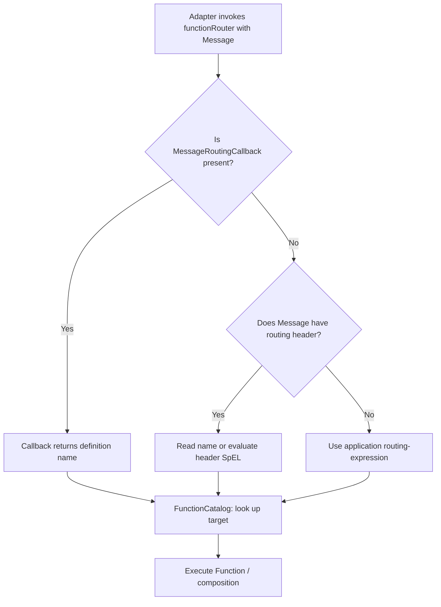

# Precedence Order of Callbacks, Headers, and Application Properties

## Learning Objectives

After this lesson, you will be able to:

1. Describe the precedence order `RoutingFunction` uses when a single `Message` has multiple sources of function-selection instructions.
2. Distinguish `MessageRoutingCallback`, routing headers, and application properties; explain why `spring.cloud.function.definition` has two roles at two layers.
3. Predict the target function in conflict scenarios between a callback, Message headers, and `spring.cloud.function.routing-expression`.
4. Build a Spring Cloud Function application that toggles a callback via profile, and observe precedence over HTTP and `FunctionCatalog`.
5. Handle missing routes, invalid routes, error responses, and untrusted header sources; understand the limitations of reactive routing.

## 1. Context: Multiple Sources Competing to Pick a Function

In **Spring Cloud Function**, business logic can be written as protocol-independent `Supplier`, `Function`, and `Consumer` beans. `FunctionCatalog` registers these beans by name and supports composition; adapters connect the same logic to HTTP, events, or serverless platforms.

When you want **a single entry point with multiple processing paths**, the application invokes `RoutingFunction` — registered under **`functionRouter`**. The router needs to know the target function, such as `uppercase` or `reverse`.

Target selection information can come from **three sources**:

1. A Java `MessageRoutingCallback` bean that programmatically computes the function name.
2. A `spring.cloud.function.definition` or `spring.cloud.function.routing-expression` Message header supplied by the sender/adapter.
3. The application configuration property `spring.cloud.function.routing-expression`.

These three sources can **appear simultaneously and conflict**. For instance:

- The application configures a default route of `uppercase`.
- The request sends a header requesting `reverse`.
- The Java callback inspects the business header `operation=upper` and returns `uppercase`.

The router must not pick arbitrarily among these values. Spring Cloud Function establishes a clear precedence order for **imperative message routing**, making target selection predictable.

## 2. Official Precedence Order

For `RoutingFunction` handling **imperative functions**, the order from highest to lowest is:

| Precedence | Instruction Source | Example | Result When Lower-Priority Sources Exist |
| --- | --- | --- | --- |
| **1 — highest** | `MessageRoutingCallback` bean | `routingResult(message)` returns `reverse` | Callback determines the target |
| **2** | Routing `Message` header | `spring.cloud.function.definition: uppercase` or `spring.cloud.function.routing-expression: ...` | Header is evaluated before properties |
| **3 — lowest** | Routing application/system property | `spring.cloud.function.routing-expression: "'uppercase'"` | Used when no higher-precedence instruction exists |

Mnemonic rule:

```text
MessageRoutingCallback
          ↓ if not applicable
Message routing headers
          ↓ if absent
Application routing properties
```

**Note on reading this table:** this is **the target-decision order inside `RoutingFunction`**, not the order in which Spring Boot loads config files, profiles, environment variables, or command-line arguments. Those configuration sources are resolved by Spring `Environment` into a single property value before the router uses it.



If the callback **throws an exception** or a higher-precedence source returns **a nonexistent function name**, that is an error to handle. Do not assume the router will swallow the error and fall back to lower-priority sources. If fallback behavior is desired, design rules that explicitly return a valid target or define an explicit error-handling policy.

## 3. Distinguishing the Two Roles of `spring.cloud.function.definition`

This is a very common source of confusion when analyzing precedence.

| Same Name `spring.cloud.function.definition`, Where? | Which Layer? | Meaning |
| --- | --- | --- |
| In `application.yml`, `application.properties`, or environment variables | **Adapter/deployment** | Selects the definition exposed at the entry point, e.g., `functionRouter` |
| In a **Message header** sent to `functionRouter` | **Routing inside the router** | Selects the target for that message, e.g., `reverse` |

For example:

```yaml
spring:
  cloud:
    function:
      definition: functionRouter
      routing-expression: "'uppercase'"
```

When a request enters the router with the Message header:

```text
spring.cloud.function.definition: reverse
```

then:

- The property `definition: functionRouter` **selects the router as the entry point**.
- The Message header `definition: reverse` **selects the target business function**.
- The property `routing-expression: "'uppercase'"` is **the default routing rule** and has lower precedence than the Message header.

Without a callback, this request routes to `reverse`. Having the same property/header key **does not mean** the two layers are directly overriding one another.

Conversely, if the application property is `spring.cloud.function.definition=uppercase` and the adapter invokes `uppercase` directly, the call **does not go through `functionRouter`**, so the routing precedence order in this lesson does not apply.

## 4. Two Types of Routing Headers at the Same Precedence Level

The router can receive either of two instruction headers in a `Message`:

| Header | Sample Value | Meaning |
| --- | --- | --- |
| `spring.cloud.function.definition` | `reverse` | Selects a function definition directly |
| `spring.cloud.function.definition` | `uppercase|reverse` | Selects a composition from `FunctionCatalog` |
| `spring.cloud.function.routing-expression` | `headers['operation'] == 'reverse' ? 'reverse' : 'uppercase'` | Evaluates SpEL to compute the definition name |

Both headers sit at **the Message headers tier** in the precedence table. The callback → header → property table **is not a guarantee** of resolution order when **both routing headers** are present simultaneously pointing to different targets.

Therefore, standardize on **one router instruction mechanism per message**. If clients might send both headers at once, normalize or strip one at the gateway or adapter according to policy instead of relying on conflict behavior.

Expressions in `spring.cloud.function.routing-expression` are evaluated via SpEL; `spring.cloud.function.definition` contains **a definition name**, not a SpEL expression. Hence:

```text
spring.cloud.function.definition: uppercase
spring.cloud.function.routing-expression: 'uppercase'
```

Both can lead to `uppercase`, yet **their syntax differs**: the second includes single quotes for a SpEL string literal.

## 5. Sample Application to Observe Precedence

The application below registers two `Function<String, String>` beans and a callback that can be **toggled with a Spring profile**. We will use the exact same code to observe all three precedence levels.

HTTP adapter dependency:

```xml
<dependency>
    <groupId>org.springframework.cloud</groupId>
    <artifactId>spring-cloud-starter-function-web</artifactId>
</dependency>
```

Choose a Spring Cloud Function version compatible with your project's Spring Boot version; manage it via a BOM or dependency management.

```java
package com.example.routingpriority;

import java.util.Locale;
import java.util.function.Function;

import org.springframework.boot.SpringApplication;
import org.springframework.boot.autoconfigure.SpringBootApplication;
import org.springframework.cloud.function.context.MessageRoutingCallback;
import org.springframework.context.annotation.Bean;
import org.springframework.context.annotation.Profile;

@SpringBootApplication
public class RoutingPriorityApplication {

    public static void main(String[] args) {
        SpringApplication.run(RoutingPriorityApplication.class, args);
    }

    @Bean
    public Function<String, String> uppercase() {
        return text -> text.toUpperCase(Locale.ROOT);
    }

    @Bean
    public Function<String, String> reverse() {
        return text -> new StringBuilder(text).reverse().toString();
    }

    // Only present when the "with-callback" profile is active.
    @Bean
    @Profile("with-callback")
    public MessageRoutingCallback routeByOperation() {
        return message -> {
            Object raw = message.getHeaders().get("operation");

            if ("upper".equals(raw)) {
                return "uppercase";
            }
            if ("reverse".equals(raw)) {
                return "reverse";
            }

            throw new IllegalArgumentException(
                    "operation must be upper or reverse");
        };
    }
}
```

Three characteristics to note:

1. Both `uppercase` and `reverse` are standalone Java logic and do not read routing headers.
2. `MessageRoutingCallback` takes `Message<?>`, reads **the business header** `operation`, and returns **the bean/definition name** for the router to invoke.
3. The `with-callback` profile lets us test **with** or **without** the callback bean. To keep outputs easy to verify, the example uses the string `hello` with `Content-Type: text/plain`.

### Default Application Property Configuration

```yaml
# application.yml
spring:
  cloud:
    function:
      definition: functionRouter
      routing-expression: "'uppercase'"
```

The SpEL expression `'uppercase'` returns the fixed string `uppercase`. The outermost double quotes in YAML preserve **the single quotes** of the SpEL literal.

If neither a callback nor a routing header is present, the router picks `uppercase`. In this example, `spring.cloud.function.definition=functionRouter` specifies **the entry point** of the HTTP adapter.

## 6. Testing Each Precedence Level Over HTTP

With Spring Cloud Function Web in default configuration, when the adapter selects one primary definition, it can be called at the root path `/`. If your application configures a different path or filter, use the actual URL exposed by the adapter.

### Scenario A: Application Property Only

Start the app **without** enabling the `with-callback` profile, and send a request **with no routing header**:

```bash
curl -X POST http://localhost:8080/ \
  -H "Content-Type: text/plain" \
  --data-raw "hello"
# Expected result: HELLO
```

The router finds no callback and the message supplies no routing header, so it uses `spring.cloud.function.routing-expression="'uppercase'"` from configuration.

### Scenario B: Message Header Overrides Application Property

Still **without** enabling the callback profile, add a routing header:

```bash
curl -X POST http://localhost:8080/ \
  -H "Content-Type: text/plain" \
  -H "spring.cloud.function.definition: reverse" \
  --data-raw "hello"
# Expected result: olleh
```

Even though the default configuration points to `uppercase`, the Message header at precedence level **2** outranks the application property at level **3**, so the target function is `reverse`.

### Scenario C: Callback Overrides Header and Property

Activate the `with-callback` profile (for instance, pass `--spring.profiles.active=with-callback` at startup), then run:

```bash
curl -X POST http://localhost:8080/ \
  -H "Content-Type: text/plain" \
  -H "operation: upper" \
  -H "spring.cloud.function.definition: reverse" \
  --data-raw "hello"
# Expected result: HELLO
```

Here, three sources propose the following choices:

| Source | Selection |
| --- | --- |
| Callback (reads `operation: upper`) | `uppercase` |
| Message routing header | `reverse` |
| Application routing expression | `uppercase` |

The callback has the highest precedence, so the route resolves to `uppercase` even though the Message header requests `reverse`.

Test one more case to distinguish the callback from the property:

```bash
curl -X POST http://localhost:8080/ \
  -H "Content-Type: text/plain" \
  -H "operation: reverse" \
  -H "spring.cloud.function.definition: uppercase" \
  --data-raw "hello"
# Expected result: olleh
```

Here the callback returns `reverse`, while both the header and the property indicate `uppercase`. The router still invokes `reverse` thanks to precedence level **1**.

### Scenario D: Callback Throws an Exception

With the `with-callback` profile active, send a request without `operation`:

```bash
curl -X POST http://localhost:8080/ \
  -H "Content-Type: text/plain" \
  -H "spring.cloud.function.definition: reverse" \
  --data-raw "hello"
```

The callback in the example rejects an empty `operation` and throws `IllegalArgumentException`. **Do not expect the router to fall back to `reverse` from the header or `uppercase` from the property.** The application must have an error-handling policy; HTTP status codes or binder retry mechanics depend on the actual adapter and configuration.

## 7. Scenario Table for Predicting the Target Function

In the table below, the default application routing expression is `'uppercase'`, and the callback (when active) uses the `routeByOperation` logic from section 5:

| Callback Active? | `operation` Header | Routing Header in Message | Result |
| --- | --- | --- | --- |
| No | — | None | `uppercase` from property |
| No | — | `definition: reverse` | `reverse` from header |
| No | `reverse` | None | `uppercase` from property: a business header alone has no routing authority |
| Yes | `upper` | None | `uppercase` from callback |
| Yes | `upper` | `definition: reverse` | `uppercase` from callback |
| Yes | `reverse` | `definition: uppercase` | `reverse` from callback |
| Yes | Missing | `definition: reverse` | Callback throws exception; does not fall back to header |
| No | — | `definition: uppercase|reverse` | Composition `uppercase|reverse` |

One especially important point: the business header `operation` **has no intrinsic routing priority of its own**. It only has an effect when a **configured callback or routing expression** reads it and maps it to a function name. Thus, when no callback is active and the property returns only the constant string `'uppercase'`, sending `operation: reverse` does not change the route.

## 8. Message Headers vs. Routing Expression in Properties

When no callback exists, the router evaluates Message routing headers before application properties. A property does not have to hold a static name; it can also be **a dynamic expression**:

```yaml
spring:
  cloud:
    function:
      definition: functionRouter
      routing-expression: "headers['operation'] == 'reverse' ? 'reverse' : 'uppercase'"
```

Now, even though **the expression string in the config file never changes**, two messages with different headers can route to different target functions. In terms of precedence, this is still **an application property** because the expression lives in configuration.

If a Message sends the header `spring.cloud.function.definition: reverse`, that header is at level **2**, taking precedence over the level **3** SpEL property unless a level **1** callback is registered.

### When the Expression Is in a Message Header

For example:

```text
spring.cloud.function.routing-expression: headers['operation'] == 'reverse' ? 'reverse' : 'uppercase'
```

When sent to the router, the expression can be evaluated against the `Message` to compute the target name. This instruction is also at precedence level **2**, because its source is a **Message header**, not an application property.

Spring Cloud Function uses `SimpleEvaluationContext` for routing expressions from Message headers and `StandardEvaluationContext` for expressions from application/system properties. `SimpleEvaluationContext` restricts certain SpEL capabilities because messages may arrive from external systems. Therefore, a complex expression that works in an application property may not work verbatim if placed in a header.

For public clients, let **the application own the expression** while clients send simple business data such as `operation=reverse`. This keeps routing rules reviewable in code and limits external callers from dictating execution rules.

## 9. Executing via `FunctionCatalog`: Entry Point and Target Are Two Steps

In Spring Cloud Function, `FunctionCatalog` can look up the router by its default name:

```java
import java.util.function.Function;
import org.springframework.cloud.function.context.FunctionCatalog;
import org.springframework.cloud.function.context.config.RoutingFunction;
import org.springframework.messaging.Message;
import org.springframework.messaging.support.MessageBuilder;

// functionCatalog is injected into a Spring component.
Function<Message<?>, ?> router =
        functionCatalog.lookup(RoutingFunction.FUNCTION_NAME);

Message<String> request = MessageBuilder.withPayload("hello")
        .setHeader("operation", "upper")
        .setHeader("spring.cloud.function.definition", "reverse")
        .build();

Object result = router.apply(request);
```

If the `routeByOperation` callback is enabled, the router picks `uppercase` due to `operation=upper`. Without the callback, the `spring.cloud.function.definition=reverse` routing header takes precedence over the default expression.

**Note:** the example invokes the router at the Java level; the exact return type after message adaptation may differ from `String` depending on function signatures and adapters. In integration tests, check both the result payload and the actual target function rather than assuming the wrapper type.

If instead you call `functionCatalog.lookup("uppercase")`, you invoke `uppercase` **directly**, bypassing the callback, routing headers, and properties meant for `RoutingFunction`. That is a different execution path.

### When the Router Selects a Composition

The `spring.cloud.function.definition: uppercase|reverse` header or a callback returning `"uppercase|reverse"` can both point to a composition when the functions are compatible. With payload `hello`:

```text
hello -> uppercase -> HELLO -> reverse -> OLLEH
```

Composition does not change the precedence order among the three sources; it only changes **the target definition** returned by whichever source wins.

## 10. Distinguishing Routing Precedence from Spring Boot Configuration Precedence

An application can load properties from multiple places:

- `application.yml` / `application.properties`.
- Profile-specific files such as `application-prod.yml`.
- Environment variables.
- Command-line startup arguments.

Spring Boot resolves priority across property sources using `Environment` rules. Once the application determines **the effective value of `spring.cloud.function.routing-expression`**, that value is used by the router at precedence level **3**.

For example, if an environment variable changes `SPRING_CLOUD_FUNCTION_ROUTING_EXPRESSION` from `'uppercase'` to `'reverse'`, that is still **level 3**. Message routing headers at level 2 and callbacks at level 1 are still evaluated before the property expression.

Do not mistakenly think that because environment variables outrank YAML files in Spring Boot, they will also override routing headers or callbacks. Those two precedence mechanisms operate at **two different layers**.

## 11. Limitations by Function Type and Adapter

### Imperative vs. Reactive Routing

The precedence above applies to **imperative message routing**, such as the `Function<String, String>` beans in the sample app. The router can pick a target function **per message** using callbacks and headers.

For reactive functions taking `Flux<T>` or `Publisher<T>`, the framework invokes one function for **the entire stream**, rather than re-routing per element based on individual item headers in the same manner. For reactive routing, select the target for the whole stream using the appropriate application property. Do not treat the imperative precedence table as a guarantee that callbacks/headers will be evaluated per `Flux` item.

### HTTP, Events, and Serverless

| Adapter | Requirement to Observe Precedence Order |
| --- | --- |
| Spring Cloud Function Web | HTTP endpoint actually invokes `functionRouter`; HTTP headers are converted into `Message` headers |
| Spring Cloud Stream | Input binding is wired to the router, typically via `spring.cloud.stream.function.routing.enabled=true` and binding `functionRouter-in-0`; binder preserves required metadata |
| Serverless adapter | Handler/adapter converts events and metadata into a form the router processes; function/route naming depends on adapter configuration |
| Direct Java call | `FunctionCatalog.lookup(RoutingFunction.FUNCTION_NAME)` and a `Message` carrying the right headers |

**The entry point matters more than precedence:** a callback cannot block an endpoint that directly invokes `/uppercase` or an adapter configured to select `uppercase` directly. To centralize routing policy, ensure traffic enters through the router and control which functions are exported externally.

## 12. Handling Conflicts, Errors, and Reliability

| Situation | Correct Interpretation | Recommended Handling |
| --- | --- | --- |
| Callback returns `reverse`, header points to `uppercase` | Callback wins at level 1 | Verify callback logic and test with `MessageBuilder` |
| Header points to `reverse`, property points to `uppercase` | Header wins at level 2 | Strip unwanted headers at gateway if default target must be preserved |
| Missing callback/header, property has valid route | Level 3 applies | Write explicit fallback and test |
| Callback throws exception | Does not fall back to lower-priority sources | Handle errors at web/binder layer; decide retry vs. error response |
| Header names nonexistent function | Router cannot resolve definition | Validate against allowed names and `FunctionCatalog` |
| Both `definition` and `routing-expression` in same message | Both at level 2; may conflict | Normalize so only one routing header type remains |
| Client calls business endpoint directly | Bypasses routing mechanism | Enforce adapter exposure limits, authentication, and authorization |
| Correct route chosen but invalid data | Conversion or business error, not a routing error | Check `Content-Type`, payload type, and function signature |

In applications with security requirements, **do not allow clients to freely choose internal functions** via `spring.cloud.function.definition` or submit arbitrary SpEL expressions. Even though a callback has higher precedence, it only operates on paths going through the router. It is better for clients to send a validated business operation while the server maps it to an allowlist of permitted definition names.

For critical events, plan how to handle invalid routes: logging with correlation IDs, appropriate retry policies, error channels, or binder dead-letter queues/topics. Avoid silent fallbacks if they could execute the wrong business action or lose events.

## 13. Testing and Diagnostics

To prove precedence order, test **across multiple competing sources**, not just a single happy-path route:

1. Run without a callback and without routing headers to verify the default property.
2. Run without a callback but with a routing header opposing the property to verify level 2 overrides level 3.
3. Enable the callback and send an `operation` opposing the routing header to verify level 1 overrides level 2.
4. Enable the callback and send a missing/invalid operation; verify the exception and adapter error handling.
5. Call `/uppercase` directly (if exposed by the adapter) to verify that path **bypasses the router**.

An effective debugging sequence is to check in order:

```text
1. Which entry-point function does the adapter select?
2. Is a MessageRoutingCallback bean active?
3. What routing headers are actually on the Message?
4. What is the effective value of routing-expression in Environment?
5. Which source wins and which definition name does it return?
6. Does FunctionCatalog find the target and is the payload compatible?
```

Separating these checks prevents confusing **a route that was never consulted** with **a route that was chosen but failed during function execution**.

## 14. Practice Exercises

1. Using the sample application with `with-callback` disabled, send `hello` with no routing header, then send it again with `spring.cloud.function.definition: reverse`. Record the outputs and identify the winning source.
2. Enable the `with-callback` profile. Send `operation: upper` and `spring.cloud.function.definition: reverse`. Predict the output before running `curl`, then explain it using the precedence table.
3. Keep the callback enabled and send `operation: reverse` alongside routing header `uppercase`. Change the default property to `'uppercase'` or `'reverse'`; analyze why the callback still wins.
4. Disable the callback and change the default routing property to `headers['operation'] == 'reverse' ? 'reverse' : 'uppercase'`. Show that the property remains at level 3 yet still produces dynamic per-message routing.
5. Send a request containing both `spring.cloud.function.definition` and `spring.cloud.function.routing-expression` headers pointing to two different targets. Design a gateway policy removing one header type; explain why the three-tier table alone cannot resolve this case.
6. In the callback, change invalid-operation handling from `throw` to falling back to `uppercase`. Compare the safety of both options for a payment-processing system.
7. Build a checklist for a deployment having `application.yml`, `application-prod.yml`, and environment variables. Identify which source determines **the final property value**, and distinguish that from which source wins **inside the router**.
8. Adapt the same logic to Spring Cloud Stream: identify the router input binding name, the source of Message headers, how to verify each event, and how to handle unroutable events.

## Key Takeaways

- For **imperative `RoutingFunction`**, the precedence order is **`MessageRoutingCallback` → Message routing headers → application routing properties**.
- The **adapter** layer picks `functionRouter` as the entry point; **Message headers** or callbacks select the target definition. Never confuse the two layers.
- `spring.cloud.function.definition` in a Message header supplies **a definition name**; `spring.cloud.function.routing-expression` supplies **SpEL returning a definition name**.
- Business headers such as `operation` affect routing only when a callback or expression explicitly reads them.
- Invalid callbacks/routes can cause errors; never assume the framework automatically falls back to lower-precedence sources.
- In production systems, restrict exposed function endpoints, validate routing header sources, and design adapter error handling. Business `Function`s remain reusable across HTTP, events, and serverless.

### Official References

- [Spring Cloud Function — Programming model: Function Routing and Filtering](https://docs.spring.io/spring-cloud-function/reference/spring-cloud-function/programming-model.html)
- [Spring Cloud Function — Standalone Web Applications](https://docs.spring.io/spring-cloud-function/reference/spring-cloud-function/standalone-web-applications.html)
- [Spring Cloud Stream — Event Routing](https://docs.spring.io/spring-cloud-stream/reference/spring-cloud-stream/event-routing.html)
- [Spring Boot — Externalized Configuration](https://docs.spring.io/spring-boot/reference/features/external-config.html)
