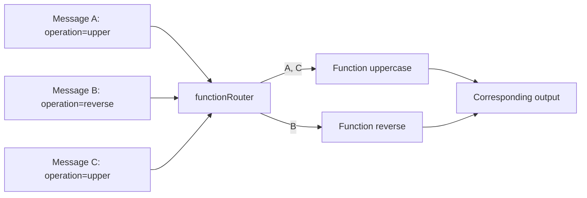
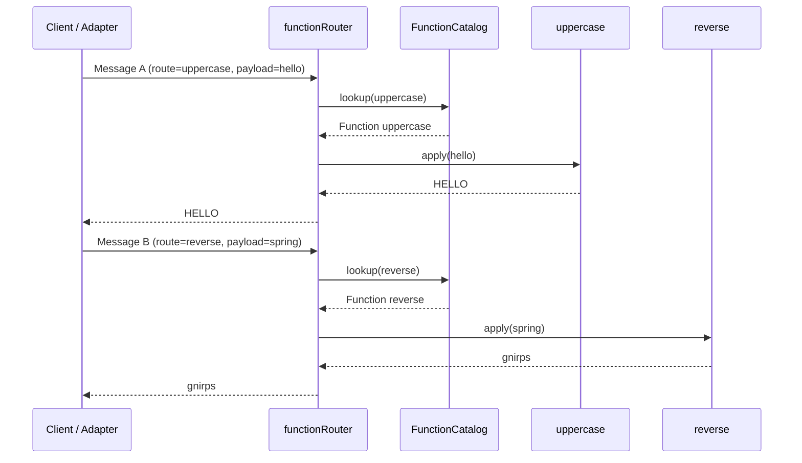

# Per-Message Routing with Imperative Functions

## Learning Objectives

After this lesson, you will be able to:

1. Explain Spring Cloud Function's **per-`Message` routing** mechanism when target functions follow the imperative (synchronous) model.
2. Distinguish **a single message**, **a payload containing multiple items**, and **a reactive stream** to pick the right routing granularity.
3. Build `Function<String, String>` beans, invoke the same `functionRouter` multiple times, and select different targets using Message headers.
4. Use `spring.cloud.function.routing-expression` or `MessageRoutingCallback` to decide the target function from business metadata.
5. Verify behavior via HTTP, `FunctionCatalog`, and Spring Cloud Stream; recognize issues related to processing order, type conversion, errors, and security.

## 1. Problem: Each Event Needs Different Handling

Spring Cloud Function lets you write reusable business logic as `Supplier`, `Function`, and `Consumer` beans registered in `FunctionCatalog` and consumed via HTTP, event, or serverless adapters. Business functions do not need to know which protocol delivered the request.

Suppose a service receives multiple text messages:

| Message | Payload | `operation` Header | Desired Output |
| --- | --- | --- | --- |
| A | `hello` | `upper` | `HELLO` |
| B | `spring` | `reverse` | `gnirps` |
| C | `function` | `upper` | `FUNCTION` |

We want all three messages to enter through **a single entry point** and be dispatched to **the function suited to each message**. Spring Cloud Function provides `RoutingFunction`, registered in the catalog under `functionRouter`, to satisfy this requirement.



**Per-message routing** means the router makes a decision **for each incoming `Message`**, based on headers, payload, or configured policy. Two consecutive messages can go to two different target functions even while sharing the same router.

## 2. What Does "Imperative (Synchronous) Function" Mean in Spring Cloud Function?

In Spring Cloud Function, we commonly distinguish:

- **Imperative function:** a single invocation takes one value `T` and returns one value `R`, such as `Function<String, String>` or `Function<Message<Order>, Receipt>`. An imperative `Consumer<Order>` accepts a value and performs a side effect; a `Supplier<Order>` produces data when invoked.
- **Reactive function:** a single invocation processes a `Publisher<T>`/`Flux<T>` stream, such as `Function<Flux<Order>, Flux<Receipt>>`.

This lesson uses **imperative/synchronous `Function<T,R>` functions** as targets. Each call completes with a value or throws an error, allowing the router to choose a distinct target per incoming message. Here, "synchronous" describes **the programming interface style**; it does not mean all requests must execute sequentially on a single thread.

| Handler Signature | Unit Received | Router Decision Granularity | Example |
| --- | --- | --- | --- |
| `Function<String, String>` | One invocation containing one string | Per message/invocation | Message A goes to `uppercase`, B goes to `reverse` |
| `Function<Message<Order>, Receipt>` | One message containing one order | Per message/invocation | Header `orderType` picks target function |
| `Function<List<Order>, List<Receipt>>` | One message containing the entire list | Once for **the whole message** | Does not automatically split the list into separate routes |
| `Function<Flux<Order>, Flux<Receipt>>` | One publisher containing many items | At **the stream** level, via matching config | Does not route by per-item headers in the imperative manner |

**Common misconception:** "per message" does not mean "per item inside a payload." If one message contains a list of 100 orders, the default router **does not** re-evaluate routes 100 times; it picks a target for **that single message holding the list**. If you want per-order decisions, the system must emit each order as its own message or handle splitting/routing inside business code.

## 3. Execution Flow of `functionRouter`

One imperative routing cycle follows these steps:

1. An adapter or Java code invokes `functionRouter` with a `Message<?>` containing payload and headers.
2. The router determines the function definition name from `MessageRoutingCallback`, routing headers, or routing properties according to precedence order.
3. `FunctionCatalog` looks up the chosen definition, such as `uppercase`, `reverse`, or the composition `uppercase|reverse`.
4. The target function processes the data; the result or exception returns to the caller/adapter.
5. **The next message** goes through the same flow using its own routing metadata.



The diagram shows two sequential calls for clarity. In an HTTP server or message binder with concurrent processing, **messages can run on multiple threads simultaneously**; routing itself does not guarantee delivery order or completion order across independent requests.

## 4. Creating a Sample Application with Two Imperative Functions

The example uses Spring Boot and the `spring-cloud-starter-function-web` HTTP adapter, with compatible Spring Cloud Function/Spring Boot versions managed via a BOM or dependency management:

```xml
<dependency>
    <groupId>org.springframework.cloud</groupId>
    <artifactId>spring-cloud-starter-function-web</artifactId>
</dependency>
```

Define two Java beans:

```java
package com.example.permessagerouting;

import java.util.Locale;
import java.util.function.Function;

import org.springframework.boot.SpringApplication;
import org.springframework.boot.autoconfigure.SpringBootApplication;
import org.springframework.context.annotation.Bean;

@SpringBootApplication
public class PerMessageRoutingApplication {

    public static void main(String[] args) {
        SpringApplication.run(PerMessageRoutingApplication.class, args);
    }

    @Bean
    public Function<String, String> uppercase() {
        return text -> text.toUpperCase(Locale.ROOT);
    }

    @Bean
    public Function<String, String> reverse() {
        return text -> new StringBuilder(text).reverse().toString();
    }
}
```

In `FunctionCatalog`, the two functions have default names `uppercase` and `reverse`. Both are imperative functions: each takes one `String` and returns one `String`. They contain no route-selection `if/else`, do not inspect HTTP headers, and can be unit-tested independently.

The framework also provides the default router named `functionRouter`; normally you do not need to write a custom `RoutingFunction` bean.

## 5. Approach 1: Selecting a Function per Message via Routing Header

This is the easiest way to observe behavior when the sender already knows **the target function name**. Set the following property so the web adapter chooses the router as its entry point:

```yaml
# application.yml
spring:
  cloud:
    function:
      definition: functionRouter
```

With the default HTTP adapter, the selected function can be mapped to the root path `/`. Each request carries a routing header:

```bash
# Message A
curl -X POST http://localhost:8080/ \
  -H "Content-Type: text/plain" \
  -H "spring.cloud.function.definition: uppercase" \
  --data-raw "hello"
# Expected result: HELLO

# Message B
curl -X POST http://localhost:8080/ \
  -H "Content-Type: text/plain" \
  -H "spring.cloud.function.definition: reverse" \
  --data-raw "spring"
# Expected result: gnirps

# Message C
curl -X POST http://localhost:8080/ \
  -H "Content-Type: text/plain" \
  -H "spring.cloud.function.definition: uppercase" \
  --data-raw "function"
# Expected result: FUNCTION
```

**Why do the three requests not interfere with one another?** Because the `spring.cloud.function.definition` instruction lives in **each request's Message header**. The router reads each message's metadata rather than mutating a global property for subsequent requests.

Distinguish the two uses of the same key:

| Source | Example | Effect |
| --- | --- | --- |
| **Application property** `spring.cloud.function.definition` | `functionRouter` | Selects the router as the adapter's **entry point** |
| **Message header** `spring.cloud.function.definition` | `reverse` | Router selects **the target function** for the current message |

If you call `/uppercase` directly on a web adapter exposing that endpoint, the request goes straight to `uppercase` and **bypasses the router**. The header instruction is only processed by `RoutingFunction` when the invocation actually passes through the router. Actual URLs can vary depending on `spring.cloud.function.web.path` and function export options.

### Selecting a Composition for a Single Message

The header can also carry a composed definition:

```bash
curl -X POST http://localhost:8080/ \
  -H "Content-Type: text/plain" \
  -H "spring.cloud.function.definition: uppercase|reverse" \
  --data-raw "hello"
# Expected result: OLLEH
```

Then **this message alone** runs through the pipeline:

```text
"hello" -> uppercase -> "HELLO" -> reverse -> "OLLEH"
```

Other messages can still specify `uppercase` or `reverse`. The composition must be type-compatible: the output of each step becomes the input of the next step.

## 6. Approach 2: Keeping the Rule in the Application, Reading a Business Header

Not every system should let clients send **internal bean names**. Another option is using `spring.cloud.function.routing-expression` as an application-controlled rule:

```yaml
spring:
  cloud:
    function:
      definition: functionRouter
      routing-expression: "headers['operation'] == 'reverse' ? 'reverse' : 'uppercase'"
```

Here, `routing-expression` is a **Spring Expression Language (SpEL)** expression. When evaluated on a Spring `Message`, the root object exposes `payload` and `headers` properties. The expression reads `headers['operation']` and returns **a function name string**.

```bash
# Message A: business operation is reverse
curl -X POST http://localhost:8080/ \
  -H "Content-Type: text/plain" \
  -H "operation: reverse" \
  --data-raw "hello"
# Expected result: olleh

# Message B: business operation is upper
curl -X POST http://localhost:8080/ \
  -H "Content-Type: text/plain" \
  -H "operation: upper" \
  --data-raw "hello"
# Expected result: HELLO
```

The expression **stays identical across both invocations**; the `operation` value on each message changes the target. This is still **per-message** routing, even though the rule resides in an application property.

The example treats any `operation` other than `reverse` as `uppercase`. In a real application, if an invalid operation must be rejected, write an explicit validation policy instead of defaulting into an allowed branch.

### Routing by Payload

An expression can also inspect the payload:

```yaml
spring:
  cloud:
    function:
      definition: functionRouter
      routing-expression: "payload == 'mirror' ? 'reverse' : 'uppercase'"
```

This condition only behaves as expected if **the payload at the moment the router evaluates it is actually a Java `String`**. With JSON, binary events, or broker binders, the payload might still be `byte[]`, `Map`, or a POJO. When routing on a field inside JSON, verify the converted data type at the routing stage.

## 7. Approach 3: Controlling Every Route with `MessageRoutingCallback`

When the rule must validate data or reject invalid operations, use a Java callback:

```java
import org.springframework.cloud.function.context.MessageRoutingCallback;
import org.springframework.context.annotation.Bean;

@Bean
public MessageRoutingCallback routeByOperation() {
    return message -> {
        Object operation = message.getHeaders().get("operation");

        if ("upper".equals(operation)) {
            return "uppercase";
        }
        if ("reverse".equals(operation)) {
            return "reverse";
        }
        throw new IllegalArgumentException("Invalid operation");
    };
}
```

Place this `@Bean` method inside a `@Configuration` or `@SpringBootApplication` class. This is an **alternative** to the routing property in section 6: do not combine multiple conflicting instruction sources when your goal is demonstrating one policy.

Each time the router receives a message, the callback reads that message's `operation` and returns a function name. If `operation` is invalid, the callback throws an error; do not assume Spring Cloud Function silently ignores the error and routes to another branch.

The advantage of a callback is that you can normalize inputs, check an allowlist of routes, and unit-test with `MessageBuilder`. Keep actual business processing inside target `Function`s, while the callback solely makes the dispatch decision.

## 8. Precedence Order When Multiple Instructions Exist

For **imperative message routing**, instruction sources are prioritized in this order:

| Order | Target Instruction Source | Example |
| --- | --- | --- |
| 1 — highest | `MessageRoutingCallback` | Code returns `reverse` |
| 2 | Routing Message header | `spring.cloud.function.definition: uppercase` |
| 3 | Routing application/system property | `spring.cloud.function.routing-expression: "'reverse'"` |

For example, if the routing property defaults to `reverse` while a Message header requests `uppercase`, the router selects `uppercase` when **no callback exists**. If a callback is present and returns `reverse`, the callback wins even if the message carries a header pointing to `uppercase`.

Notes:

- `spring.cloud.function.definition=functionRouter` in **adapter config** picks the entry point; it is not a competing routing source in the table above.
- The `spring.cloud.function.definition` header supplies a direct definition name; the `spring.cloud.function.routing-expression` header supplies SpEL. Both live at the Message header tier. Do not send both headers simultaneously with conflicting instructions.
- If a higher-priority source throws an error, do not assume the router quietly retries lower-priority sources. Design explicit error handling.

## 9. Invoking Multiple Messages Directly via `FunctionCatalog`

HTTP is only one adapter. Inside a Spring application, you can look up the router and pass multiple Spring `Message`s with different headers:

```java
import java.util.function.Function;

import org.springframework.cloud.function.context.FunctionCatalog;
import org.springframework.cloud.function.context.config.RoutingFunction;
import org.springframework.messaging.Message;
import org.springframework.messaging.support.MessageBuilder;

// Code placed in a component where functionCatalog is injected.
Function<Message<String>, Object> router =
        functionCatalog.lookup(RoutingFunction.FUNCTION_NAME);

Message<String> first = MessageBuilder.withPayload("hello")
        .setHeader("spring.cloud.function.definition", "uppercase")
        .build();

Message<String> second = MessageBuilder.withPayload("spring")
        .setHeader("spring.cloud.function.definition", "reverse")
        .build();

Object firstResult = router.apply(first);
Object secondResult = router.apply(second);
```

In an example without callbacks or overriding routing expressions, the expected business outputs are `HELLO` and `gnirps`, respectively. The returned object type may be a raw payload or a Spring `Message` depending on how the framework adapts signatures, so tests should inspect **the result payload** instead of blindly casting the result to `String`.

### Integration Testing Two Routes with JUnit

Example test using the Spring context and the two beans from section 4:

```java
import static org.junit.jupiter.api.Assertions.assertEquals;

import java.util.function.Function;
import org.junit.jupiter.api.Test;
import org.springframework.beans.factory.annotation.Autowired;
import org.springframework.boot.test.context.SpringBootTest;
import org.springframework.cloud.function.context.FunctionCatalog;
import org.springframework.cloud.function.context.config.RoutingFunction;
import org.springframework.messaging.Message;
import org.springframework.messaging.support.MessageBuilder;

@SpringBootTest
class PerMessageRoutingTest {
    @Autowired
    FunctionCatalog catalog;

    @Test
    void choosesDifferentFunctionsForDifferentMessages() {
        Function<Message<String>, Object> router =
                catalog.lookup(RoutingFunction.FUNCTION_NAME);

        Message<String> first = MessageBuilder.withPayload("hello")
                .setHeader("spring.cloud.function.definition", "uppercase")
                .build();
        Message<String> second = MessageBuilder.withPayload("spring")
                .setHeader("spring.cloud.function.definition", "reverse")
                .build();

        assertEquals("HELLO", payloadOf(router.apply(first)));
        assertEquals("gnirps", payloadOf(router.apply(second)));
    }

    private static Object payloadOf(Object result) {
        return result instanceof Message<?>
                ? ((Message<?>) result).getPayload()
                : result;
    }
}
```

This test assumes the application has `spring-boot-starter-test` and **does not register a callback** altering the routing rules for those two messages. It verifies router behavior within the Spring context, though it does not replace testing HTTP mappings, message binders, serializers, or real-world adapter error policies.

## 10. Applying to Spring Cloud Stream: Each Event Is a Message

In an event-driven architecture, many events can arrive on the same topic/queue:

```text
Event #101: headers={operation=upper},   payload="hello"
Event #102: headers={operation=reverse}, payload="spring"
Event #103: headers={operation=upper},   payload="function"
```

If Spring Cloud Stream turns **each event into an imperative Spring `Message`** and delivers it to `functionRouter`, the application can pick different target functions based on each event's headers. A typical routing configuration at the Stream layer is:

```yaml
spring:
  cloud:
    stream:
      function:
        routing:
          enabled: true
      bindings:
        functionRouter-in-0:
          destination: text-requests
    function:
      routing-expression: "headers['operation'] == 'reverse' ? 'reverse' : 'uppercase'"
```

This illustrates **the input flow and routing expression**; to run in a real project, you also need a binder starter (Kafka/RabbitMQ, etc.), broker addresses, an output binding if returning results, and appropriate retry/error policies. `functionRouter-in-0` is **the input binding name** by Stream convention, whereas `functionRouter` is **the function name** in `FunctionCatalog`.

Important: message brokers can dispatch events concurrently across partitions/consumers. Having the router pick a separate target per event **does not automatically guarantee** completion order, exactly-once semantics, or automatic retries. Those guarantees are handled by the binder, broker, and business design.

### In Serverless

A serverless adapter can also invoke the same functions through `FunctionCatalog`. Per-invocation routing depends on whether the adapter maps event metadata into a `Message` and calls `functionRouter`. For example, an HTTP header like `operation` does not automatically exist in every JSON event; design event mapping accordingly.

## 11. Important Limitation: Reactive Routing

A `Function<String, String>` processes one value per call; with **imperative routing**, each `Message` can carry different instructions. By contrast:

```java
@Bean
public Function<reactor.core.publisher.Flux<String>,
                reactor.core.publisher.Flux<String>> reactiveUppercase() {
    return values -> values.map(String::toUpperCase);
}
```

This reactive function receives **one `Flux<String>`** for a single call, potentially containing many elements. Spring Cloud Function does not apply the same per-item routing header mechanism across elements of a `Flux` to switch target functions mid-stream. When targeting a reactive function, configure the route at **the stream level** via appropriate application properties.

| Requirement | Approach |
| --- | --- |
| Each event needs a different function | Use imperative event routing, one `Message` per event |
| An entire reactive stream needs one fixed function | Select the function/reactive route via application config |
| One message holds a list needing per-item handling | Split into separate messages or handle inside business logic |
| Want to chain two steps for one message | Use composition like `uppercase|reverse`, if types match |

The difference lies in **the boundary of an invocation**, not simply whether the app uses HTTP, Kafka, or Reactor.

## 12. Error Handling, Data Conversion, and Security

### Invalid Target Function Name

If a message specifies `spring.cloud.function.definition: unknown`, and `FunctionCatalog` has no such definition, the invocation can fail with an error. Do not assume the router falls back to `uppercase` or drops the message. For HTTP, define error responses; for brokers, configure retries, error channels, or dead-letter queues/topics as required.

### Incompatible Data Types

The router might resolve `reverse` accurately, yet the function still fails if the adapter passes a payload incompatible with `String`. Use proper `Content-Type` headers and check conversion at **two stages**: what data the routing expression sees, and what data reaches the target function. JSON, `byte[]`, `Map`, and POJOs can behave differently across adapters.

### Latency and Concurrency

A synchronous imperative function may perform blocking I/O, limiting throughput if each message waits. When multiple requests or events are processed concurrently, `Function` beans can execute simultaneously across threads. Avoid unprotected shared mutable state; routing does not introduce locking or transactions on its own.

### External Headers

The `spring.cloud.function.definition` header is an **execution instruction**, so public clients should not be allowed to invoke arbitrary catalog beans. For untrusted sources:

1. Accept only business values like `operation=upper` or `operation=reverse`.
2. Map those values to an allowed set of definitions using server-managed SpEL properties or a `MessageRoutingCallback`.
3. Restrict exported HTTP function endpoints and apply authentication/authorization at the adapter/gateway layer; callbacks do not protect requests calling functions directly outside the router.
4. Log correlation IDs, route names, and errors when appropriate, avoiding sensitive payloads or headers.

Per-message routing provides **flexibility in choosing functions**, not automatic guarantees of security, ordering, or business idempotency.

## 13. Troubleshooting Table

| Symptom | Possible Cause | How to Check |
| --- | --- | --- |
| Two requests with different headers always run one function | Requests bypass `functionRouter` or headers never reach `Message` | Verify entry-point function and metadata at router |
| Business header `operation` does not change route | Missing `routing-expression` or callback reading `operation` | Configure rule mapping `operation` to function names |
| Header is ignored when callback is present | Callback has higher precedence than routing headers | Check `routingResult` and active callback bean |
| One message with many items picks only one target | Router routes per `Message`, does not split payload | Split into multiple messages if per-item routing is required |
| Events arrive out of expected order | Concurrent binder/broker or consumer execution | Check partitions, concurrency, and broker ordering guarantees |
| Correct route name but wrong output/error | Conversion, `Content-Type`, or target function issue | Check input type, composition, and exceptions |
| Specifying `unknown` fails | Function definition does not exist | Check `FunctionCatalog` and error-handling policy |
| Routing per `Flux` item fails | Reactive function runs for entire stream | Route at stream level or switch to imperative event routing |

When debugging, trace the chain: **adapter → specific `Message` → winning routing source → target name → `FunctionCatalog` → payload conversion → result or exception**. This separates routing-decision errors from business-logic errors inside functions.

## 14. Practice Exercises and Self-Check Questions

1. Run the two beans `uppercase` and `reverse`. Send three HTTP requests as in section 5 with three routing headers, record the outputs, and explain why each message picks its target independently.
2. Send `spring.cloud.function.definition: uppercase|reverse` with payload `hello`. Compare **routing one message to a composition** versus **routing two messages to two functions**.
3. Use `routing-expression` reading `headers['operation']` instead of sending bean names directly; send `operation=upper`, `operation=reverse`, and no `operation`. Identify the default branch.
4. Add `MessageRoutingCallback` from section 7, then send `operation=reverse` alongside routing header `uppercase`. Predict the target and explain via precedence order.
5. Use `MessageBuilder` to build two messages and invoke `FunctionCatalog.lookup(RoutingFunction.FUNCTION_NAME)` for both. Verify each output and add a test case with a nonexistent function name.
6. Suppose one `Message` carries `List<Order>` with 100 orders. Explain why routing does not re-evaluate per `Order`, and design a way to emit multiple messages if per-order routing is required.
7. Sketch a Spring Cloud Stream configuration consuming events from a destination. State the requirements for each event's routing header to reach `functionRouter`, and explain who is responsible for ordering, retries, and dead-letter queues.
8. Compare `Function<String, String>` with `Function<Flux<String>, Flux<String>>`: how do invocation boundaries differ, and why is per-message routing not equivalent to per-item `Flux` routing?

## Key Takeaways

- With **imperative `Function<T,R>`**, `RoutingFunction` can select **one target function per Spring `Message`**. Different messages can pass through the same router and be handled by different functions.
- `functionRouter` is the router entry point in `FunctionCatalog`; the `spring.cloud.function.definition` header, `spring.cloud.function.routing-expression` property, or `MessageRoutingCallback` supplies target selection instructions.
- For imperative routing, the core precedence order is **callback → Message routing headers → application routing properties**.
- **A message containing a list** is still one message. **A reactive `Publisher`** is a stream; you cannot use per-item routing headers to switch functions in the imperative manner.
- HTTP, Stream, and serverless can all reuse the same `Function` logic provided adapters, message mapping, data conversion, and error handling are configured properly.
- Per-message routing does not by itself guarantee ordering, retries, transactions, or authorization; address those at the transport and application-design layers.

### Official References

- [Spring Cloud Function — Function Routing and Filtering](https://docs.spring.io/spring-cloud-function/reference/spring-cloud-function/programming-model.html)
- [Spring Cloud Function — Standalone Web Applications](https://docs.spring.io/spring-cloud-function/reference/spring-cloud-function/standalone-web-applications.html)
- [Spring Cloud Stream — Event Routing](https://docs.spring.io/spring-cloud-stream/reference/spring-cloud-stream/event-routing.html)
- [Spring Framework — Messaging](https://docs.spring.io/spring-framework/reference/integration.html)
