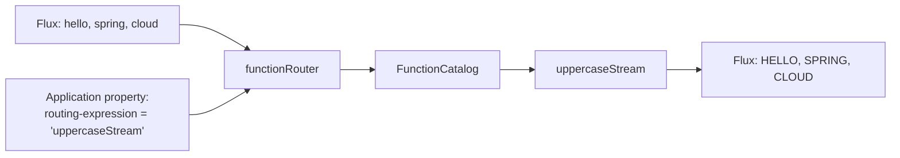
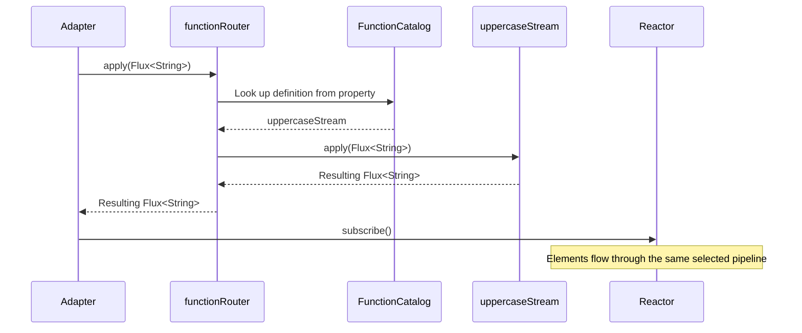

# Whole-Stream Routing with Reactive Functions

## Learning Objectives

After this lesson, you will be able to:

1. Distinguish the routing granularity of **imperative** functions (`Function<T, R>`) from **reactive** functions (`Function<Flux<T>, Flux<R>>`).
2. Explain why `RoutingFunction` selects **one function definition for the entire stream** when the input is a `Publisher`, instead of reading per-item routing headers.
3. Write reactive `Function<Flux<String>, Flux<String>>` beans and configure routes using **application properties**.
4. Distinguish directly selecting a function, selecting a composition, and routing through `functionRouter` with `spring.cloud.function.routing-expression`.
5. Test behavior with Reactor `StepVerifier`, spot design mistakes when attempting per-event routing inside a `Flux`, and choose suitable solutions for HTTP, events, or serverless.

## 1. Problem: One Data Stream Handled by One Function

Spring Cloud Function encourages packaging business logic as `Supplier`, `Function`, and `Consumer` beans registered in `FunctionCatalog`. The catalog lets HTTP adapters, Spring Cloud Stream, or serverless runtimes reuse logic without forcing business code to depend on transport protocols.

For example, a system receives a continuous stream of text strings and offers two ways to process them:

- `uppercaseStream`: converts every string in the stream to uppercase.
- `reverseStream`: reverses the characters of every string in the stream.

The *staging* environment needs to run `uppercaseStream`, while another testing environment needs to run `reverseStream`. Function selection can be made through application configuration, while **all elements of a stream** flow through the selected function.



A defining characteristic of this example is that **the route is decided at the `Flux` level**, after which the chosen reactive function processes every element of that `Flux`. The router does not repeatedly re-select a target function for each string while the stream is running.

## 2. Processing Unit Determines Routing Scope

Spring Cloud Function supports two primary function models:

| Aspect | Imperative (Synchronous) Function | Reactive Function |
| --- | --- | --- |
| Typical signature | `Function<String, String>` | `Function<Flux<String>, Flux<String>>` |
| Input per invocation | A single value or a single `Message` | A `Publisher`, which may emit many values |
| Routing unit of `RoutingFunction` | **Per Message** | **The entire stream** passed in |
| Headers on each Message | Can pick a distinct target for that message | Not used as instructions to re-route individual items |
| Route instruction source | Callback, routing header, or application property | **Application properties** |
| Example | Message A goes to `uppercase`, B goes to `reverse` | `Flux(A, B, C)` all flow through `uppercaseStream` |

An imperative `Function<T, R>` accepts one value and returns one result. For each incoming Message, the framework can inspect metadata, decide which function to call, and invoke it.

By contrast, `Function<Flux<T>, Flux<R>>` receives **one `Publisher` object for one invocation** and returns a resulting Publisher. The framework wires the pipeline at that invocation boundary; elements are emitted and processed by Reactor **after the function has already been selected**. This leads to the rule:

> For reactive functions, Spring Cloud Function applies routing instructions only from **application properties** for **the whole stream**, rather than re-routing via per-item `Message` headers.

This limitation is explicitly documented in the Spring Cloud Function documentation on Function Routing. <https://docs.spring.io/spring-cloud-function/reference/spring-cloud-function/programming-model.html>

### "One Invocation" Does Not Mean the Whole Application Runs Once

An adapter can create multiple Publishers at different times; each connection of a Publisher to a reactive function sets up a processing pipeline. Once a stream is subscribed to, Reactor can execute operators over time, process thousands of events, and run across multiple threads depending on schedulers and operators.

What to remember is: **there is no new `functionRouter` routing decision for each individual element inside that Publisher**. If you must switch targets for items 1, 2, and 3 within the same stream, choose a different event-processing architecture.

## 3. Preparing Reactive Functions

The example below uses Spring Boot, Spring Cloud Function, and Project Reactor. When building the application, select a Spring Cloud Function version compatible with Spring Boot via a BOM/dependency management. For HTTP testing you can use `spring-cloud-starter-function-web`; for Spring Cloud Stream you will also need an appropriate binder.

```xml
<dependency>
    <groupId>org.springframework.cloud</groupId>
    <artifactId>spring-cloud-starter-function-web</artifactId>
</dependency>
```

The functions below use Reactor's `Flux`:

```java
package com.example.reactivestreamrouting;

import java.util.Locale;
import java.util.function.Function;

import org.springframework.boot.SpringApplication;
import org.springframework.boot.autoconfigure.SpringBootApplication;
import org.springframework.context.annotation.Bean;
import reactor.core.publisher.Flux;

@SpringBootApplication
public class ReactiveRoutingApplication {

    public static void main(String[] args) {
        SpringApplication.run(ReactiveRoutingApplication.class, args);
    }

    @Bean
    public Function<Flux<String>, Flux<String>> uppercaseStream() {
        return values -> values.map(value -> value.toUpperCase(Locale.ROOT));
    }

    @Bean
    public Function<Flux<String>, Flux<String>> reverseStream() {
        return values -> values.map(
                value -> new StringBuilder(value).reverse().toString());
    }
}
```

`uppercaseStream` and `reverseStream` are **`Function` beans with reactive signatures**, registered in `FunctionCatalog` under their `@Bean` method names. Neither knows whether data comes from HTTP, a message broker, or serverless.

When a function receives `Flux.just("hello", "spring", "cloud")`:

| Function | Resulting Publisher When Subscribed |
| --- | --- |
| `uppercaseStream` | `HELLO`, `SPRING`, `CLOUD` |
| `reverseStream` | `olleh`, `gnirps`, `duolc` |

Transformations only execute when the Publisher is **subscribed to**. Calling `Function.apply(flux)` typically assembles a new pipeline; do not assume every element has already been processed right at the `apply` line.

### Backpressure and Streams

With a reactive Publisher, the consumer can request data according to its processing capacity (backpressure). Reactor's `map` operator preserves the `onNext`, `onError`, and `onComplete` signal model without buffering the entire stream in memory. The router chooses **one functional pipeline**, while Reactor coordinates how elements flow through that pipeline.

Backpressure characteristics depend on the Publisher sources and operators across the entire chain; merely using `Flux` does not automatically ensure every external component supports backpressure.

## 4. Simplest Approach: Selecting a Reactive Function Directly via Configuration

If you only need to deploy **one** reactive function for the entire stream, you may not need `RoutingFunction` at all. Select the definition directly:

```yaml
# application.yml
spring:
  cloud:
    function:
      definition: uppercaseStream
```

The adapter/binding uses the function named `uppercaseStream` as the configured entry point. When another environment needs to run `reverseStream`, change it to:

```yaml
spring:
  cloud:
    function:
      definition: reverseStream
```

Key point: this is **selecting a function at the adapter layer**, without passing through `functionRouter`. It is usually the cleanest option when deploying a single known processing pipeline.

Changing properties between environments requires no code edits to `uppercaseStream` or `reverseStream`. However, do not assume editing a YAML file while the application is already running will immediately switch an active Publisher to another function; configuration is resolved during initialization/deployment unless the application implements a dedicated refresh mechanism.

## 5. Routing the Whole Stream Through `functionRouter`

When an environment must keep a router entry point (such as certain FaaS models) while routing **a Publisher to a reactive function**, Spring Cloud Function supports placing the instruction in **application properties**.

The default router name in `FunctionCatalog` is `functionRouter`, matching the constant `RoutingFunction.FUNCTION_NAME`.

Example:

```yaml
# application.yml
spring:
  cloud:
    function:
      definition: functionRouter
      routing-expression: "'uppercaseStream'"
```

Note the distinction:

1. `definition: functionRouter` instructs the adapter to call **the router** at the configured entry point.
2. `routing-expression: "'uppercaseStream'"` is **a SpEL expression returning the string literal** `uppercaseStream`. The router uses this name to look up the target function in `FunctionCatalog`.
3. When the input is a `Publisher`, **the entire Publisher** flows through `uppercaseStream`; emitted items do not trigger the router to re-evaluate routing headers.



The diagram depicts the routing boundary conceptually. When the adapter subscribes, how data is converted, and the exact resulting Publisher type depend on the adapter/binding in use.

### Why Must You Write `"'uppercaseStream'"`?

`spring.cloud.function.routing-expression` holds SpEL, so a fixed function name must be a SpEL **string literal**:

| Config Snippet | Meaning |
| --- | --- |
| `definition: uppercaseStream` | Directly selects the definition at the adapter layer; no SpEL used |
| `definition: functionRouter` | Selects the router as the entry point |
| `routing-expression: "'uppercaseStream'"` | SpEL returns the target name `uppercaseStream` |
| `routing-expression: uppercaseStream` | Not a string literal; SpEL may try to read a property named `uppercaseStream` |

The outer double quotes are YAML syntax, while the inner single quotes are SpEL syntax. In `application.properties`, you can write:

```properties
spring.cloud.function.definition=functionRouter
spring.cloud.function.routing-expression='uppercaseStream'
```

When moving to another environment, switching the whole stream to `reverseStream` only requires changing the fixed expression to `'reverseStream'` in the deployed configuration.

## 6. Why Not Use Per-Item Headers to Route a Reactive Stream?

Consider a `Flux<Message<String>>` with three items:

```text
Flux<Message<String>>
  Message(payload="hello",  header definition="uppercaseStream")
  Message(payload="spring", header definition="reverseStream")
  Message(payload="cloud",  header definition="uppercaseStream")
```

**Do not expect** `functionRouter` to split these three messages and invoke three different reactive functions according to each element's `spring.cloud.function.definition` header. Even though each element inside the Publisher is a `Message`, the router receives a single Publisher at **the invocation level**; `MessageRoutingCallback` and routing headers are intended for per-message routing of **imperative functions**.

Spring Cloud Function documentation clearly states that these mechanisms:

- The `spring.cloud.function.definition` header.
- The `spring.cloud.function.routing-expression` header.
- A `MessageRoutingCallback` bean.

are not used to **route individual elements** of a reactive stream. For reactive functions, configure the route in **application properties** and treat the whole stream as one processing unit.

### Be Careful with SpEL Reading `headers` and `payload`

An expression like:

```text
headers['operation'] == 'reverse' ? 'reverseStream' : 'uppercaseStream'
```

fits when the router evaluates **one Spring `Message`** under the imperative model. In the reactive case, the invocation-level object is a Publisher; you cannot assume the expression evaluates independently for each `Message` inside the Publisher with per-item `headers`/`payload`. For whole-stream route selection, using **a static target name via application properties** is the predictable choice.

## 7. Composition Also Applies to the Entire Stream

The two functions `uppercaseStream` and `reverseStream` have compatible signatures `Flux<String> → Flux<String>`, so they can be composed:

```yaml
spring:
  cloud:
    function:
      definition: uppercaseStream|reverseStream
```

Then the adapter selects **a direct reactive composition**:

```text
Flux("hello", "spring")
  -> uppercaseStream -> Flux("HELLO", "SPRING")
  -> reverseStream   -> Flux("OLLEH", "GNIRPS")
```

If the environment needs to go through `functionRouter`, you can use a constant expression returning the composition name:

```yaml
spring:
  cloud:
    function:
      definition: functionRouter
      routing-expression: "'uppercaseStream|reverseStream'"
```

In the SpEL string literal `'uppercaseStream|reverseStream'`, the `|` character belongs to **Spring Cloud Function composition syntax**, not a SpEL operator. The pipeline connects both functions sequentially; it **does not route individual elements** to separate functions.

The Publisher output of the preceding function must match the Publisher input expected by the next function. When mixing `Flux<String>` with functions typed as `Flux<Order>` or `Mono<Receipt>`, check compatibility and conversion rules; not every composition is valid merely because both functions are reactive.

## 8. Testing with Reactor `StepVerifier`

Because a reactive function returns a Publisher, calling `assertEquals` on the `Flux` object itself does not verify the emitted contents. You must subscribe and assert the emitted signals.

Example using `reactor-test` and JUnit Jupiter to test business functions directly:

```java
import static org.junit.jupiter.api.Assertions.assertNotNull;

import java.util.function.Function;
import org.junit.jupiter.api.Test;
import org.springframework.beans.factory.annotation.Autowired;
import org.springframework.boot.test.context.SpringBootTest;
import org.springframework.cloud.function.context.FunctionCatalog;
import reactor.core.publisher.Flux;
import reactor.test.StepVerifier;

@SpringBootTest
class ReactiveFunctionTest {

    @Autowired
    private FunctionCatalog catalog;

    @Test
    void uppercaseStreamTransformsEveryElement() {
        Function<Flux<String>, Flux<String>> uppercaseStream =
                catalog.lookup("uppercaseStream");
        assertNotNull(uppercaseStream);

        Flux<String> result =
                uppercaseStream.apply(Flux.just("hello", "spring", "cloud"));

        StepVerifier.create(result)
                .expectNext("HELLO", "SPRING", "CLOUD")
                .verifyComplete();
    }

    @Test
    void reverseStreamTransformsEveryElement() {
        Function<Flux<String>, Flux<String>> reverseStream =
                catalog.lookup("reverseStream");
        assertNotNull(reverseStream);

        StepVerifier.create(
                reverseStream.apply(Flux.just("hello", "spring")))
                .expectNext("olleh", "gnirps")
                .verifyComplete();
    }
}
```

This test assumes the project already includes the necessary test dependencies (such as `spring-boot-starter-test` and `reactor-test`) and the two beans from section 3. The two tests verify **the behavior of each reactive function looked up via `FunctionCatalog`**. They do not verify whether the adapter picks `functionRouter` or whether the routing property value is correct.

### Integration Testing Whole-Stream Routing

To prove the router chooses the expected target, add an integration test tailored to your application's adapter:

1. Start an application context with `spring.cloud.function.definition=functionRouter` and `spring.cloud.function.routing-expression='uppercaseStream'`.
2. Send a multi-element Publisher to **the actual entry point** exposed by the adapter, rather than calling the `uppercaseStream` bean directly.
3. Subscribe to the resulting Publisher and assert that every item reflects `uppercaseStream`.
4. Start **a second configured context** with route `'reverseStream'` and verify all items pass through `reverseStream`.
5. Check errors, completion, conversion, and subscription timing as well. Do not rely on testing a single standalone function to conclude the router was invoked.

How the entry point is triggered, the result type, and message conversion vary across Spring Cloud Function Web, Spring Cloud Stream, or serverless adapters. Always test against your project's real adapter.

## 9. Spring Cloud Stream: Whole-Stream Routing vs. Per-Message Event Routing

A broker can emit thousands of events, yet how **the function is declared** determines the unit of work:

| Spring Cloud Stream Function Type | Required Routing Option | Interpretation |
| --- | --- | --- |
| `Function<String, String>` | Per-Message event routing (when router is enabled) | Each event can go to a different function via routing header/callback |
| `Function<Flux<String>, Flux<String>>` | Select **reactive function for the whole Publisher** via application property | All events in the Publisher pass through the chosen function |

For example, in an application that only needs to process one stream with `uppercaseStream`, you can declare direct bindings:

```yaml
spring:
  cloud:
    function:
      definition: uppercaseStream
    stream:
      bindings:
        uppercaseStream-in-0:
          destination: text-requests
        uppercaseStream-out-0:
          destination: text-results
```

This **illustrates** conventional Spring Cloud Stream binding names; you also need the corresponding binder, broker connection settings, and error handling. In this setup, all data flowing through that reactive pipeline instance is processed by `uppercaseStream`.

Avoid mechanically mixing **per-message event routing** (`spring.cloud.stream.function.routing.enabled=true`) with the goal of routing **an entire reactive Publisher**. Event routing targets imperative Message-level dispatch; selecting a single reactive function for a stream is usually clearer when managed via `spring.cloud.function.definition` or an appropriate framework/adapter route property.

### Ordering and Backpressure

The router does not enforce delivery order, completion order, or exactly-once semantics. The broker, binder, partitions, concurrency, Reactor operators, and function implementation all influence those properties.

For instance, `map` preserves emission order for a sequential source, whereas `flatMap` running concurrent asynchronous operations can emit results out of input order. If ordering is a business requirement, pick operators like `concatMap` or an order-preserving processing setup. Routing properties cannot substitute for a proper event-processing design.

## 10. HTTP and Serverless: Distinguish a Request from a Stream

Spring Cloud Function Web can expose functions as HTTP endpoints; when using a reactive function, how the adapter constructs the input Publisher and streams the response depends on the HTTP module, content type, and method used.

**A series of separate HTTP requests does not automatically merge into one shared `Flux`.** Each request may be passed through the function independently by the adapter. Therefore, do not use `curl` commands sending separate requests with different routing headers and conclude that they demonstrate per-item routing within **the same reactive Publisher**.

Similarly for serverless: each invocation may carry one event, a batch, or a Publisher depending on the adapter and platform. When the target function accepts a Publisher, the framework's Publisher-level routing decision must come from application configuration; having an `operation` field in a JSON event does not make the router pick a different reactive function per element.

By separating business logic into `Function`s, `uppercaseStream`/`reverseStream` can be reused across adapters. Always verify input/output mapping, serialization, and subscription management for your specific adapter.

## 11. What If You Genuinely Need Per-Event Function Selection?

Do not try to force reactive routing configuration into per-item routing. There are two clean design options:

### Option A — Use Imperative Event Routing

If each event must select **a target function in `FunctionCatalog`** based on headers:

```java
@Bean
public Function<String, String> uppercase() {
    return value -> value.toUpperCase();
}

@Bean
public Function<String, String> reverse() {
    return value -> new StringBuilder(value).reverse().toString();
}
```

When the adapter turns **each event into an imperative `Message`**, `functionRouter` can read `spring.cloud.function.definition` or use a routing expression/callback to pick `uppercase` or `reverse` individually for each event. This is the per-message routing model.

### Option B — Branch Inside the Reactive Function

If you must keep **a single reactive stream** while varying processing based on each element's content, handle the conditional logic directly inside one reactive function:

```java
record TextCommand(String operation, String text) {}

@Bean
public Function<Flux<TextCommand>, Flux<String>> processCommands() {
    return commands -> commands.map(command -> {
        if ("reverse".equals(command.operation())) {
            return new StringBuilder(command.text()).reverse().toString();
        }
        if ("upper".equals(command.operation())) {
            return command.text().toUpperCase(Locale.ROOT);
        }
        throw new IllegalArgumentException("Unsupported operation");
    });
}
```

In Option B, **one reactive function** processes the entire Publisher and chooses the logic per item itself. This is **in-function business branching**, **not `RoutingFunction` routing each event to a separate bean in the catalog**.

If per-item processing requires calling an asynchronous service, you can use `flatMap` or `concatMap` with the corresponding Publishers; account for concurrency, ordering, and backpressure across the system.

### Choosing the Right Approach

| Requirement | Suitable Approach |
| --- | --- |
| An entire Publisher runs through one pipeline selected per environment | Reactive function + application property |
| Want to keep `functionRouter` as the entry point while fixing the Publisher's target | `functionRouter` + constant routing expression in application property |
| Each Message needs to call a different bean based on headers | Imperative message routing |
| Each element in a `Flux` needs a different processing branch | Conditional logic/operators inside a reactive function, or split into separate Messages |
| Need two sequential reactive processing steps | Function composition if types are compatible |

## 12. Common Errors and Diagnostics

| Symptom | Possible Cause | How to Check |
| --- | --- | --- |
| `Flux` items have different headers yet all go to one function | Router selects at **whole-Publisher** level | Switch to imperative routing if per-message selection is required |
| Sending `spring.cloud.function.definition` header per event does not change reactive route | Per-message routing headers do not apply to reactive per-element routing | Place routing instruction in application properties |
| `routing-expression: uppercaseStream` fails to find target | Missing SpEL string literal quotes | Use `routing-expression: "'uppercaseStream'"` |
| Changing config leaves a running Publisher unchanged | Pipeline was already wired to the previous function; no hot-swap | Start a new stream/context following deployment procedures |
| No data emitted when calling `apply(Flux)` | Publisher has no subscriber or source has not emitted | Use `StepVerifier` or subscribe properly |
| Routed correctly but conversion fails | Element type or `Content-Type` mismatches target function | Check `Flux<T>` signature, `MessageConverter`, and adapter |
| Composition routes successfully but output is unexpected | Composition order or data types between steps mismatch | Check `A|B` and test each function separately |
| Events arrive out of order | Concurrent operators, binder/partitions, or schedulers | Check `flatMap`, concurrency, and ordering requirements |
| `functionRouter` is never invoked | Adapter selects `uppercaseStream` directly | Distinguish `definition=uppercaseStream` from `definition=functionRouter` |

When inspecting issues, verify in order: **which function the adapter calls → whether the input unit is a Message or Publisher → what routing property is active → which target `FunctionCatalog` resolves → whether the Publisher is subscribed → whether items have valid types and signals**.

## 13. Stability and Security Considerations

- **Do not treat external metadata as execution authorization.** If a system lets clients choose routes by function name or expression, enforce authentication, authorization, and an allowlist of permitted functions; for reactive routing specifically, manage instructions via application configuration.
- **Be careful with SpEL.** Expressions from application/system properties use `StandardEvaluationContext`, which is more powerful than expressions in Message headers (`SimpleEvaluationContext`). Restrict who can modify configuration—especially management endpoints capable of mutating the environment.
- **Handle Publisher errors explicitly.** An error in one element can turn into an `onError` signal and terminate the pipeline depending on operators. Design error catching, retries, dead-letter handling, or per-item isolation to match business needs.
- **Support observability.** Attach correlation IDs and monitor the selected pipeline name, latency, error rates, and subscription health. Avoid logging sensitive payloads or header tokens.
- **Do not confuse routing behavior with transport guarantees.** Reactive routing does not automatically provide transactions, exactly-once delivery, ordering, or retries. Address those at the binder, broker, and business-logic layers.

## 14. Practice Exercises

1. Write the two beans `uppercaseStream` and `reverseStream` as in section 3. Use `StepVerifier` to verify the output of `Flux.just("hello", "spring", "cloud")` for both functions.
2. Configure `spring.cloud.function.definition=uppercaseStream` and then change it to `reverseStream`. Explain why this is a direct selection at the adapter layer.
3. Configure `definition=functionRouter` and `routing-expression: "'uppercaseStream'"`. Trace the path from adapter → router → catalog → reactive function → output Publisher.
4. Try the literal `'uppercaseStream|reverseStream'` as the router target. Explain why all elements pass through **two sequential steps** rather than splitting into two branches.
5. Build a `Flux<Message<String>>` with different routing headers on each item. Explain why reactive routing **does not** pick different functions from those per-item headers.
6. Redesign the example using imperative `Function<String, String>` when the requirement is **a separate route per event**. Specify where headers, callbacks, or routing expressions are sourced.
7. Write a `Function<Flux<TextCommand>, Flux<String>>` branching on `operation`. Clearly explain why this is in-function processing logic rather than `functionRouter` performing per-element routing.
8. Pick a Spring Cloud Stream system consuming continuous events. Design a binding/reactive pipeline diagram and identify what owns ordering, backpressure, retries, and errors.
9. Design an integration test using two application contexts with different route properties. Explain why testing the `uppercaseStream` bean directly is insufficient to prove the adapter invoked `functionRouter`.

## Key Takeaways

- For **reactive functions**, Spring Cloud Function's processing unit is **the entire `Publisher`**, so `RoutingFunction` selects **one definition for the whole stream**.
- Reactive routing through `RoutingFunction` must use **application properties**, such as `spring.cloud.function.routing-expression: "'uppercaseStream'"`; per-message routing headers and callbacks belong to **imperative routing**.
- Selecting `spring.cloud.function.definition=uppercaseStream` directly avoids the router; selecting `definition=functionRouter` with a constant route property uses the router entry point.
- A reactive composition like `uppercaseStream|reverseStream` applies a sequential pipeline to the Publisher, not two independent per-item routes.
- Reactor manages subscriptions and stream signals; `StepVerifier` helps verify emitted items, completion, and errors once the Publisher is subscribed.
- If you genuinely need to pick a different bean **for each event**, use **imperative message routing**; if you want to vary processing **inside one `Flux`**, place that logic explicitly inside the reactive function.

### Official References

- [Spring Cloud Function — Programming model: Function Routing and Filtering](https://docs.spring.io/spring-cloud-function/reference/spring-cloud-function/programming-model.html)
- [Spring Cloud Function — Function Composition](https://docs.spring.io/spring-cloud-function/reference/spring-cloud-function/programming-model.html)
- [Spring Cloud Stream — Reference](https://docs.spring.io/spring-cloud-stream/reference/)
- [Project Reactor — Reference Guide](https://projectreactor.io/docs/core/release/reference/)
- [Reactor Test — Testing](https://projectreactor.io/docs/core/release/reference/testing.html)
