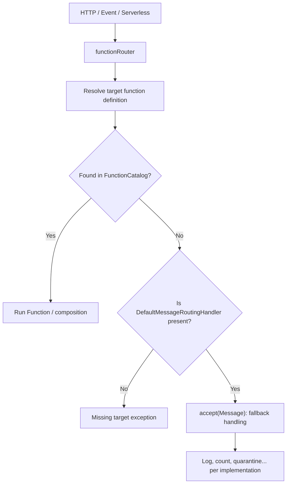

# Handling Missing Functions with `DefaultMessageRoutingHandler`

## Learning Objectives

After this lesson, you will be able to:

1. Explain when `RoutingFunction` encounters an **unroutable** message because the function definition cannot be found in `FunctionCatalog`.
2. Distinguish the default exception-throwing behavior from the `DefaultMessageRoutingHandler` extension mechanism.
3. Register a `DefaultMessageRoutingHandler` bean, record unroutable messages, and choose an appropriate handling policy.
4. Distinguish a fallback routing handler from `MessageRoutingCallback`, a `Consumer` function acting as an intentional drop branch, and adapter retry/dead-letter mechanisms.
5. Test valid routes, nonexistent target names, misconfigurations, or errors inside business functions without making wrong assumptions about HTTP status codes or message replayability.

## 1. Why Handle Unroutable Messages?

In **Spring Cloud Function**, business logic is packaged as `Supplier`, `Function`, and `Consumer` beans and registered, looked up, and composed through `FunctionCatalog`. The same logic can be invoked by adapters over HTTP, broker events, or serverless runtimes without rewriting business code per protocol.

When a system wants a single entry point with multiple processing capabilities, Spring Cloud Function provides `RoutingFunction` under the default name **`functionRouter`**. The router takes routing instructions from headers, SpEL, or callbacks and looks up the target function definition.

Suppose there are two valid functions:

- `uppercase`: converts a string to uppercase.
- `reverse`: reverses a string.

A message sending `spring.cloud.function.definition: uppercase` is processed normally. However, another message sending `spring.cloud.function.definition: normalize` when the application **has not registered** a `normalize` function leaves the router with no target to delegate execution to.

By default, when **the target function is absent from the catalog**, a lookup exception can be thrown. In an HTTP system, the caller needs to know the request failed; in an event-driven system, you might want to record the event, divert it to a quarantine channel, or apply another business strategy. Spring Cloud Function provides **`DefaultMessageRoutingHandler`** for this handling.



Key takeaway: **the fallback handler receives messages lacking a valid route**, rather than automatically finding another similarly named function, and it does not resolve errors occurring after a target function has already been selected.

## 2. API and Behavior of `DefaultMessageRoutingHandler`

Spring Cloud Function defines the strategy in package:

```java
import org.springframework.cloud.function.context.DefaultMessageRoutingHandler;
```

The core API method is `accept`:

```java
// Concise API usage pattern:
@Bean
public DefaultMessageRoutingHandler defaultRoutingHandler() {
    return new DefaultMessageRoutingHandler() {
        @Override
        public void accept(Message<?> message) {
            // Handle unroutable message.
        }
    };
}
```

| Component | Responsibility |
| --- | --- |
| `RoutingFunction` (`functionRouter`) | Reads instructions and finds the target function |
| `FunctionCatalog` | Looks up function definitions or compositions by name |
| `DefaultMessageRoutingHandler` | Receives `Message<?>` when the router cannot find a target via supported mechanisms |
| `accept(Message<?> message)` | Extension point to log, collect metrics, or apply application-defined fallback handling |
| Adapter/binder | Translates results or errors to HTTP, brokers, serverless and enforces transport policies |

According to the [official documentation on *Unroutable Messages*](https://docs.spring.io/spring-cloud-function/reference/spring-cloud-function/programming-model.html), simply registering `DefaultMessageRoutingHandler` as a Spring bean enables the framework to use it. The handler's default implementation **logs the unroutable message and lets processing continue without throwing a lookup exception**, effectively **dropping the message**.

If more sophisticated behavior is required, **override `accept`** in the bean. This is a message-handling strategy whose method returns `void`: do not expect the handler to synthesize a business output on behalf of the target function.

### Do Not Confuse "Dropped" with "Successfully Processed"

If the handler merely logs and returns:

- No business function has processed that payload.
- There is no proof the message was saved to a fallback store.
- The adapter may treat the framework call as completed without error, though **HTTP status, response body, acknowledgment, and retries** depend on each adapter/binder.
- A critical message such as a payment command or order update could be lost from a business standpoint if the pipeline marks it complete.

Therefore, choosing whether to **drop**, **reject**, **quarantine**, or **compensate** must be driven by the message's business criticality, not merely a desire to avoid stack traces.

## 3. Spring Boot Example: Counting and Logging Nonexistent Routes

To illustrate usage clearly, let's create two business functions, a counter, and a custom handler. The example uses Spring Boot with the `spring-cloud-starter-function-web` HTTP adapter; select compatible Spring Cloud Function and Spring Boot versions via dependency management/BOM.

```xml
<dependency>
    <groupId>org.springframework.cloud</groupId>
    <artifactId>spring-cloud-starter-function-web</artifactId>
</dependency>
```

```java
package com.example.unroutable;

import java.util.Locale;
import java.util.concurrent.atomic.AtomicLong;
import java.util.function.Function;

import org.slf4j.Logger;
import org.slf4j.LoggerFactory;
import org.springframework.boot.SpringApplication;
import org.springframework.boot.autoconfigure.SpringBootApplication;
import org.springframework.cloud.function.context.DefaultMessageRoutingHandler;
import org.springframework.context.annotation.Bean;
import org.springframework.messaging.Message;

@SpringBootApplication
public class UnroutableApplication {

    private static final Logger log =
            LoggerFactory.getLogger(UnroutableApplication.class);

    public static void main(String[] args) {
        SpringApplication.run(UnroutableApplication.class, args);
    }

    @Bean
    public Function<String, String> uppercase() {
        return text -> text.toUpperCase(Locale.ROOT);
    }

    @Bean
    public Function<String, String> reverse() {
        return text -> new StringBuilder(text).reverse().toString();
    }

    @Bean
    public AtomicLong unroutableTotal() {
        return new AtomicLong();
    }

    @Bean
    public DefaultMessageRoutingHandler defaultRoutingHandler(
            AtomicLong unroutableTotal) {
        return new DefaultMessageRoutingHandler() {
            @Override
            public void accept(Message<?> message) {
                unroutableTotal.incrementAndGet();
                log.warn(
                        "Target function not found, messageId={}, definition={}",
                        message.getHeaders().getId(),
                        message.getHeaders().get("spring.cloud.function.definition"));
            }
        };
    }
}
```

In this sample:

1. `uppercase` and `reverse` are business beans, both registered in `FunctionCatalog`.
2. `AtomicLong` is a thread-safe counter when concurrent requests or events update it. This is a demonstration aid; production systems typically export metrics through Micrometer/Actuator and monitoring systems.
3. `defaultRoutingHandler` is the bean implementing the `DefaultMessageRoutingHandler` strategy. When the target route does not exist and the handler is invoked, it increments the counter and logs minimal metadata.
4. The handler **does not** return a business payload and **does not** persist the message for reprocessing. For workflows requiring zero data loss, this handler alone is insufficient.

The sample log intentionally avoids dumping full payloads or headers. With sensitive data, even `definition` or correlation metadata should be evaluated before logging.

### Why Declare Two Functions?

In some Spring Cloud Function configurations, **single-function fallback** is active: when the catalog has only one valid function, looking up any name may pick that sole function. That prevents a nonexistent-name test from demonstrating a missing-target failure.

The example declares two functions and **disables single-function fallback** in the next section so invalid-route testing is explicit and repeatable. Do not equate every wrong function name with a lookup failure if your application still allows that fallback behavior.

## 4. Selecting the Router as Entry Point and Testing Over HTTP

Example configuration:

```yaml
# application.yml
spring:
  cloud:
    function:
      definition: functionRouter
      single-function-fallback-enabled: false
```

`spring.cloud.function.definition=functionRouter` in application configuration **selects the router as the entry-point function**. The header of the same name sent on each request, such as `spring.cloud.function.definition: reverse`, supplies **the target instruction inside the router**.

When Spring Cloud Function Web maps the chosen definition to the root path `/`, you can test:

```bash
# Valid route: invoke uppercase
curl -i -X POST http://localhost:8080/ \
  -H "Content-Type: text/plain" \
  -H "spring.cloud.function.definition: uppercase" \
  --data-raw "hello"
# Expected business payload: HELLO

# Valid route: invoke reverse
curl -i -X POST http://localhost:8080/ \
  -H "Content-Type: text/plain" \
  -H "spring.cloud.function.definition: reverse" \
  --data-raw "hello"
# Expected business payload: olleh

# Nonexistent route: triggers fallback handler
curl -i -X POST http://localhost:8080/ \
  -H "Content-Type: text/plain" \
  -H "spring.cloud.function.definition: normalize" \
  --data-raw "hello"
# Inspect logs/counter rather than assuming a specific response body.
```

For the final request, `normalize` is not among the two registered functions, so the fallback handler receives the message. Watch for the `"Target function not found"` log entry and the counter value.

Do not pre-assert a specific HTTP status or response body for unroutable requests: because `accept` returns `void` and web adapter result/error conversion varies across versions and configs, behavior can differ. If your application requires specific HTTP 4xx/5xx conventions, implement and test explicit error mapping at the HTTP layer.

**URL note:** `/` illustrates when the adapter maps the selected function to the default path. With a different web path or function-export setup, you may need `/functionRouter` or your application's corresponding endpoint.

### Testing Without Registering the Handler

For comparison:

1. Run the application **without a `DefaultMessageRoutingHandler` bean**.
2. Send a request with the nonexistent route `normalize`.
3. Observe the exception caused by the missing definition at the router and how the adapter represents the failure.
4. Restart with the handler bean registered and send the same message.
5. Verify the handler is invoked and decide whether this is acceptable business behavior.

Perform comparisons using **the same function catalog, the same data, and the same entry path into the router**, avoiding comparing a direct function endpoint against the router endpoint.

## 5. Testing the Handler with `FunctionCatalog`

To verify routing and the handler separately from HTTP serialization, build a Spring `Message` using `MessageBuilder`.

```java
import static org.junit.jupiter.api.Assertions.assertEquals;
import static org.junit.jupiter.api.Assertions.assertNotNull;

import java.util.concurrent.atomic.AtomicLong;
import java.util.function.Function;
import org.junit.jupiter.api.Test;
import org.springframework.beans.factory.annotation.Autowired;
import org.springframework.boot.test.context.SpringBootTest;
import org.springframework.cloud.function.context.FunctionCatalog;
import org.springframework.cloud.function.context.config.RoutingFunction;
import org.springframework.messaging.Message;
import org.springframework.messaging.support.MessageBuilder;

@SpringBootTest
class UnroutableHandlerTest {

    @Autowired
    private FunctionCatalog catalog;

    @Autowired
    private AtomicLong unroutableTotal;

    @Test
    void unknownFunctionIsDeliveredToHandler() {
        Function<Message<String>, ?> router =
                catalog.lookup(RoutingFunction.FUNCTION_NAME);
        assertNotNull(router);

        long before = unroutableTotal.get();
        Message<String> request = MessageBuilder.withPayload("hello")
                .setHeader("spring.cloud.function.definition", "normalize")
                .build();

        router.apply(request);

        assertEquals(before + 1, unroutableTotal.get());
    }
}
```

This is a minimal **integration test against the Spring context and FunctionCatalog**. The test relies on the handler bean and two functions defined in the sample app. It verifies the handler is invoked once for a nonexistent name; it does not verify HTTP responses, retries, or durable message persistence.

If multiple tests run concurrently sharing `AtomicLong`, isolate the context/state or design appropriate assertions so external messages do not skew test results.

### Verifying Valid Routes Bypass the Handler

You can add a test invoking the `uppercase` route and verifying the counter does not increment:

```java
Message<String> valid = MessageBuilder.withPayload("hello")
        .setHeader("spring.cloud.function.definition", "uppercase")
        .build();

long before = unroutableTotal.get();
router.apply(valid);
assertEquals(before, unroutableTotal.get());
```

This snippet assumes the test already has `router` and `unroutableTotal` as above. This check only proves **the missing-target path was not taken** for a valid message; verifying the output payload requires a separate assertion.

## 6. Boundaries: Which Errors Does the Handler Handle?

The name `DefaultMessageRoutingHandler` can easily mislead people into thinking it is a **global exception handler** for all Spring Cloud Function errors. Classify cases carefully:

| Scenario | Example | Primary Purpose of `DefaultMessageRoutingHandler`? |
| --- | --- | --- |
| Target function name not found in `FunctionCatalog` | Header `definition: normalize` when no such function exists | **Yes** — the *unroutable message* case described in the docs |
| Composition contains nonexistent function | `uppercase|normalize` | Can result in an unresolvable definition; verify per version's lookup/composition path |
| No routing instruction supplied | Message lacks headers and route property | Depends on default function-selection rules; **do not assume** the handler will run |
| Invalid SpEL syntax or evaluation failure | Invalid `routing-expression` | Expression error; **not automatically caught by the handler** |
| Function found but throws exception | `reverse` throws `IllegalArgumentException` | **No** — that is a business execution error |
| Wrong payload type or conversion error | JSON incompatible with `Function<Order, ...>` signature | **No** — that is a data conversion error |
| HTTP calls nonexistent path | `POST /no-such-endpoint` | **No** — typically a web adapter path-mapping error |
| Broker connection failure or timeout | Kafka/RabbitMQ unavailable | **No** — transport/binder error |

**Rule of thumb:** before deciding fallback handling, determine whether the failure occurred in **route name selection**, **catalog lookup**, **data conversion**, **function execution**, or **the transport layer**. This handler only supports messages that cannot be routed by the router mechanism; it does not replace error handlers at other layers.

## 7. Choosing a Handling Policy: Drop, Reject, Quarantine, or Fallback

An application can choose from several strategies, each with distinct consequences:

| Strategy | When Appropriate | Risks to Manage |
| --- | --- | --- |
| **Log and drop** | Telemetry/reference data allowed to be discarded by policy | Data loss if critical messages are dropped |
| **Count metrics and alert** | Tracking invalid-route rates | Metrics do not replace persistence or recovery |
| **Reject with exception** | Caller must see the error and fix the route; broker has proper retries | Unbounded retries can cause poison-message loops |
| **Quarantine to queue/store** | Need investigation or replay after config fixes | Must ensure durable writes, retries, deduplication, and data governance |
| **Route to an explicit fallback function** | Well-defined business logic exists for unknown routes | Can corrupt business outcomes if fallback is overly broad |

### A. Logging and Metrics: Easy to Implement, Does Not Preserve Data

The bean in section 3 logs and increments a counter. This fits when **policy explicitly permits dropping** unroutable messages. In a system consuming critical transactional events, having the handler return normally can cause the transport layer to acknowledge the message as processed, depending on the binder and acknowledgment mode.

Never interpret "the framework did not throw an exception" as "the event was processed successfully in business terms."

### B. Quarantining for Review and Replay

If messages must be retained for later processing, an `accept(Message<?> message)` implementation can invoke an application component to forward them to a **quarantine queue/topic** or durable store:

```java
@Bean
public DefaultMessageRoutingHandler defaultRoutingHandler(
        UnroutableMessageStore store) {
    return new DefaultMessageRoutingHandler() {
        @Override
        public void accept(Message<?> message) {
            // The UnroutableMessageStore interface is an application-designed component.
            // The method must have a clear error/durability contract.
            store.persist(message);
        }
    };
}
```

This is an **architectural sketch**, not standalone runnable code: `UnroutableMessageStore` must be implemented, registered as a bean, and tested for durability. Clarify:

- Is the message acknowledged by the binder **before or after** persistence succeeds?
- If persistence fails, does the handler throw an exception to trigger retry policies?
- Is deduplication in place if the broker redelivers the same message?
- Must sensitive fields be masked or encrypted when storing failed messages?
- How do operators fix the route and which entry point receives replayed messages?

Simply logging, firing-and-forgetting asynchronously, and returning from `accept` provides no durability guarantee.

### C. Explicitly Rejecting and Letting the Adapter Handle Errors

If an invalid route must be treated as a hard failure, the application can choose **not to register the handler** so lookup exceptions propagate, or write a strategy that intentionally throws an exception matching the application contract. The HTTP adapter must map errors to appropriate status codes/bodies; Stream binders must configure retries/dead-letter handling. Never design logic around an assumed HTTP status code without testing the actual adapter.

## 8. Distinguishing from `MessageRoutingCallback` and a `devNull` Function

Three mechanisms are frequently confused when reading the same Function Routing and Filtering documentation:

| Mechanism | When Does It Run? | Responsibility |
| --- | --- | --- |
| `MessageRoutingCallback` | **Before looking up** the function name | Computes target definition for the message in Java |
| `DefaultMessageRoutingHandler` | **When lookup fails** for the routed target via supported mechanisms | Handles unroutable messages |
| `Consumer<?> devNull` function | **After the router selects a valid branch** | Intentionally receives and discards messages per filtering policy |

Example of an intentional filtering function:

```java
@Bean
public java.util.function.Consumer<Object> devNull() {
    return ignored -> {
        // This case is explicitly permitted to be dropped by policy.
    };
}
```

```yaml
spring:
  cloud:
    function:
      definition: functionRouter
      routing-expression: "headers['enabled'] == true ? 'uppercase' : 'devNull'"
```

In this filtering example, `devNull` is **a registered target function in the catalog**, and the discard branch is **an anticipated outcome**, not a missing-function failure. Keep in mind that input types for `uppercase` vs. `devNull`, as well as how adapters handle a `Consumer`'s void return, may differ. The `enabled` example also assumes the header actually carries a boolean `true`, not the string `"true"`.

If you want business fallback logic returning a useful output, design a **valid target function** (and a routing expression/callback selecting it) rather than expecting `DefaultMessageRoutingHandler.accept` to return a replacement payload.

## 9. Role of Precedence Order When a Route Fails

For **imperative message routing**, target selection precedence is typically:

1. `MessageRoutingCallback` bean.
2. `Message` headers `spring.cloud.function.definition` or `spring.cloud.function.routing-expression`.
3. Routing application/system properties.

Suppose an application sets a default route:

```yaml
spring:
  cloud:
    function:
      definition: functionRouter
      routing-expression: "'uppercase'"
```

Yet a Message sends header `spring.cloud.function.definition: normalize`. Without a callback, the header takes precedence, and the nonexistent target instruction leads to `DefaultMessageRoutingHandler`.

**Do not assume that if `normalize` is missing, the framework will automatically try `uppercase` from the property.** Precedence order **selects the winning instruction source**; it is not a fallback chain trying multiple sources until one succeeds.

If a `MessageRoutingCallback` is registered, the callback can pick a route name from business data—for example permitting only `upper` and `reverse`. The callback takes precedence over routing headers. However, if the callback itself returns a nonexistent name, the result is still **a missing target in the catalog**, not an automatic safeguard.

## 10. Applying Across HTTP, Events, and Serverless

| Environment | Behavior on Nonexistent Route | Decisions Required |
| --- | --- | --- |
| Spring Cloud Function Web | Adapter invokes `functionRouter`, maps HTTP headers into Spring Message | Return HTTP error or handle softly? Define body/status at web layer |
| Spring Cloud Stream | Binder turns event into Spring Message, routable via header or SpEL | Retries, acknowledgment, dead-lettering, idempotency, replay ordering |
| Serverless adapter | Each invocation/batch is passed into framework by adapter | Should errors propagate for platform retries, and how are metadata/responses mapped? |
| Internal Java | Invoke router looked up via `FunctionCatalog` | How caller checks outcomes, observes handler, and handles exceptions |

In Spring Cloud Stream, event routing commonly uses `spring.cloud.stream.function.routing.enabled=true` and input binding `functionRouter-in-0`. When the binder reports an event as processed, whether that guarantees the application persisted it into a quarantine store depends on **synchronous/asynchronous contracts, acknowledgments, and actual error propagation**.

### Reactive Functions Are a Different Case

With imperative `Function<T,R>`, the router can select a target per `Message`. With `Function<Flux<T>, Flux<R>>` or `Publisher`, the framework routes at **the stream level** via application properties rather than reading routing headers per `Flux` element.

Do not assume `DefaultMessageRoutingHandler` will be invoked individually for each element of a reactive stream carrying invalid route metadata. If you must capture individual invalid events, process events individually in the imperative model or design explicit validation/error-capture branches inside the reactive stream.

## 11. Diagnosing Failures at the Right Layer

| Symptom | Possible Cause | How to Check |
| --- | --- | --- |
| Header `definition: normalize` does not trigger handler | Adapter does not invoke `functionRouter`; callback selects another route; or single-function fallback is active | Check entry point, highest-priority routing source, and catalog |
| Handler runs yet produces no business output | `accept` returns no value and message never reaches a target function | Verify drop/quarantine policy; do not assume success |
| Valid route name still fails | Function found, but conversion error or business exception occurred | Check function signature, `Content-Type`, stack trace |
| SpEL error occurs without invoking handler | Failure happened while evaluating expression, before normal lookup | Check syntax/payload type and expression evaluation logs |
| Message redelivered repeatedly after handler throws | Binder or platform retry policy active | Inspect retry config, poison-message handling, and DLQ |
| No exception yet events disappear | Handler only logs/counts and returns normally | Add durable quarantine storage or explicit rejection policy |
| `POST /unknown` returns 404 | No HTTP mapping; never entered router | Call the router endpoint before testing invalid route names |
| Invalid route cannot be reproduced with single function in catalog | Single-function fallback active | Disable fallback or register multiple functions in test environment |

When debugging, trace the sequence: **adapter selects entry point → winning routing source → resolved definition name → catalog lookup → handler (if target missing) or business function → adapter handles result/error**.

## 12. Practice Exercises

1. Use the two beans `uppercase` and `reverse`. Without registering `DefaultMessageRoutingHandler`, send header `spring.cloud.function.definition: normalize`. Record the behavior when the catalog lacks the target.
2. Register the handler from section 3. Resend the invalid message, check the counter and logs, and explain why no business output from `normalize` appears.
3. Send two valid messages to `uppercase` and `reverse`, followed by one invalid message. Verify the handler only runs for the message lacking a valid route.
4. Set `spring.cloud.function.single-function-fallback-enabled=false`, then vary the number of function beans in the context. Explain why this setting is helpful when testing nonexistent names.
5. Set `routing-expression: "'uppercase'"` as default while sending header `spring.cloud.function.definition: normalize`. Predict which routing source takes precedence without assuming the framework falls back to the lower-priority property.
6. Modify the handler to call a mock `UnroutableMessageStore`. Write a test simulating persistence failure, specifying when an exception should be thrown and how the broker should retry.
7. Write a `Consumer<Object> devNull` and a routing expression with an intentional discard branch. Compare **filtering** with **nonexistent route**, stating when each should be used.
8. Pick a critical event such as `OrderPaid`. Specify the metadata, quarantine persistence mechanism, idempotency key, retries, and replay process if the target function has not been deployed yet.
9. Give an example of a business `Function` error or JSON conversion error that `DefaultMessageRoutingHandler` does not handle. Propose where the error handler belongs in the architecture.

## Key Takeaways

- **`DefaultMessageRoutingHandler`** is Spring Cloud Function's extension point for unroutable messages **whose target function is missing from `FunctionCatalog`**.
- Register the strategy bean and override **`accept(Message<?> message)`** to control logging, metrics, quarantining, or custom handling.
- The default handler behavior **logs and lets processing continue**, which effectively drops the message; never treat it as proof of successful business processing.
- This handler **differs from** `MessageRoutingCallback` (picks target before lookup) and a `devNull` `Consumer` (intentional filtering branch with a valid definition).
- Missing routes, SpEL errors, conversion errors, business logic exceptions, and HTTP/binder errors are distinct failure classes requiring appropriate error handlers.
- Always verify **HTTP status codes, acknowledgments, retries, and storage durability** on your real adapter, especially when messages must never be lost.

### Official References

- [Spring Cloud Function — Programming model: Unroutable Messages, Function Routing and Filtering](https://docs.spring.io/spring-cloud-function/reference/spring-cloud-function/programming-model.html)
- [Spring Cloud Function — Standalone Web Applications](https://docs.spring.io/spring-cloud-function/reference/spring-cloud-function/standalone-web-applications.html)
- [Spring Cloud Stream — Event Routing](https://docs.spring.io/spring-cloud-stream/reference/spring-cloud-stream/event-routing.html)
- [Spring Boot — Externalized Configuration](https://docs.spring.io/spring-boot/reference/features/external-config.html)
