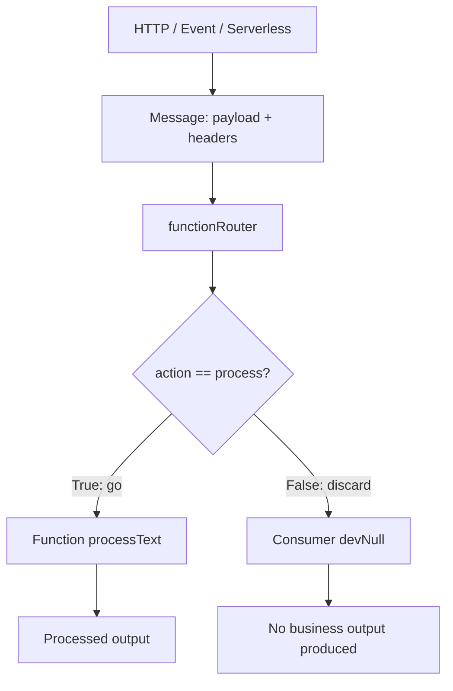

# Filtering Data with a Processing Branch and a Discard Branch

## Lesson Objectives

After this lesson, you will be able to:

1. Explain why **filtering** in Spring Cloud Function is a form of routing with two choices: **process** (*go*) or **intentionally discard** (*discard*).
2. Create a processing `Function` and a discard `Consumer`, then use `functionRouter` with `spring.cloud.function.routing-expression` to select a branch per `Message`.
3. Distinguish messages **intentionally routed to a discard branch** from messages **lacking a matching target function**; understand why `DefaultMessageRoutingHandler` does not replace a filtering branch.
4. Test both branches via HTTP and `FunctionCatalog`, while understanding limitations around return types, message conversion, and reactive routing.
5. Design safe filtering policies for events, business data, or serverless environments: tracking discard counts, guarding against data loss, and handling invalid conditions.

## 1. Problem: Not Every Message Should Be Processed

Spring Cloud Function organizes business logic as `Supplier`, `Function`, and `Consumer` beans. `FunctionCatalog` registers and resolves functions, supports composition, and lets adapters expose the same logic to HTTP, events, or serverless without rewriting business code per protocol.

Suppose an application receives text messages. Only messages with header `action=process` should be uppercased; messages marked `action=discard` represent test data slated for removal that **need no transformation**.

| Message | Payload | `action` Header | Decision |
| --- | --- | --- | --- |
| A | `hello` | `process` | Call `processText`, output `HELLO` |
| B | `noise` | `discard` | Call `devNull`, record as skipped |
| C | `spring` | `process` | Call `processText`, output `SPRING` |

If you put an `if/else` inside `processText`, the business function must also know the discard policy. Instead, **`RoutingFunction`** (default name `functionRouter`) can pick between two function definitions:



This is **orchestration-layer filtering**. Both `processText` and `devNull` are real beans registered in `FunctionCatalog`; the router picks a valid target rather than intentionally triggering a lookup failure to drop data.

## 2. How Does Function Filtering Work?

According to Spring Cloud Function documentation, *function filtering* is a special case of *function routing*: instead of choosing among multiple business handlers, you only need two paths:

- **Go:** messages meeting the condition are routed to the processing function.
- **Discard:** messages failing the condition are routed to an application-defined `Consumer` to ignore, log, count, or take equivalent action.

The framework does not impose a single universal "drop" configuration for all apps, because "discarding" can mean very different things: dropping silently, counting occurrences, logging a reason, or forwarding to an audit stream. The recommended pattern is **defining a `Consumer` representing the discard branch**.

```java
@Bean
public Consumer<Object> devNull() {
    return ignored -> {
        // Perform no business processing.
    };
}
```

In the example above, the bean name `devNull` is an **application naming convention**, not a special framework keyword. You could name it `discardMessage` or `skipTelemetry`, as long as the routing expression returns the matching function name in the catalog.

The `Consumer<Object>` signature keeps the discard branch independent of any specific payload schema. Spring Cloud Function documentation also illustrates `Consumer<?>` and highlights the benefit of avoiding unnecessary conversion into a narrow business payload type; note that external adapters may still perform certain conversion/decoding steps before the message reaches the router.

### A `Consumer` Returns No Business Payload

The signature difference is critical:

| Function Kind | Java Signature | Business Output |
| --- | --- | --- |
| Processing branch via `Function` | `Function<String, String>` | Yes, e.g., `HELLO` |
| Discard branch via `Consumer` | `Consumer<Object>` | No, the `accept` method returns `void` |
| Processing branch via `Consumer` | `Consumer<Order>` | No, may write to DB / send commands |

If an adapter expects a return value for an HTTP response or broker output, a discard `Consumer` **cannot inherently produce a substitute value**. How the adapter represents this case (status code, response body, acknowledgment, output binding) depends on the implementation and must be tested.

## 3. Spring Boot Application: Processing Branch and Discard Branch

The example uses Spring Boot, Spring Cloud Function Web, and two counters to verify which branch was invoked. Manage compatible Spring Cloud Function/Spring Boot versions via your project's BOM or dependency management.

```xml
<dependency>
    <groupId>org.springframework.cloud</groupId>
    <artifactId>spring-cloud-starter-function-web</artifactId>
</dependency>
```

Create the application:

```java
package com.example.filterrouting;

import java.util.Locale;
import java.util.concurrent.atomic.AtomicLong;
import java.util.function.Consumer;
import java.util.function.Function;

import org.springframework.boot.SpringApplication;
import org.springframework.boot.autoconfigure.SpringBootApplication;
import org.springframework.context.annotation.Bean;

@SpringBootApplication
public class FilteringApplication {

    public static void main(String[] args) {
        SpringApplication.run(FilteringApplication.class, args);
    }

    // Demo counters only; production can use Micrometer.
    public static final class FilterCounters {
        public final AtomicLong processed = new AtomicLong();
        public final AtomicLong discarded = new AtomicLong();
    }

    @Bean
    public FilterCounters filterCounters() {
        return new FilterCounters();
    }

    @Bean
    public Function<String, String> processText(FilterCounters counters) {
        return text -> {
            counters.processed.incrementAndGet();
            return text.toUpperCase(Locale.ROOT);
        };
    }

    @Bean
    public Consumer<Object> devNull(FilterCounters counters) {
        return ignored -> counters.discarded.incrementAndGet();
    }
}
```

The three beans have distinct responsibilities:

1. `processText` handles business data using a `Function<String, String>`.
2. `devNull` **intentionally consumes** any payload routed to the discard branch and only increments a counter. In this example, it neither stores payloads nor returns a value.
3. `filterCounters` measures invocations of both branches separately; `AtomicLong` provides thread-safe increments under concurrent requests.

**Note:** in-memory counters reset on restart and are not aggregated across multiple instances. For production monitoring, export centralized counters/metrics (e.g., via Micrometer) tagged with safe filter reasons.

## 4. Configuring Both Branches with a Routing Expression

Create `application.yml`:

```yaml
spring:
  cloud:
    function:
      definition: functionRouter
      routing-expression: "headers['action'] == 'process' ? 'processText' : 'devNull'"
```

Explanation:

- `definition: functionRouter`: tells the adapter to use `RoutingFunction` as **the entry point**.
- `routing-expression`: **Spring Expression Language (SpEL)** expression evaluated when the router receives a `Message`.
- `headers['action']`: reads the business header `action` from the `Message`.
- `? 'processText' : 'devNull'`: returns **the function definition name** registered in `FunctionCatalog`.

```text
Message(action=process, payload="hello")
    → SpEL = "processText"
    → FunctionCatalog.lookup("processText")
    → Function.apply("hello")
    → "HELLO"

Message(action=discard, payload="noise")
    → SpEL = "devNull"
    → FunctionCatalog.lookup("devNull")
    → Consumer.accept(payload)
    → no business output
```

If `action` is missing or anything other than `process`, the expression above **defaults to `devNull`**. This illustrates an *allow process, otherwise discard* pattern, which is not always appropriate for real applications. In systems carrying critical data, even a typo like `proccess` would be discarded—potentially causing unintended data loss.

### Preserving Other Filtering Criteria

Following examples in Spring Cloud Function documentation, you can route by content type:

```properties
spring.cloud.function.routing-expression=headers.contentType.toString().equals('text/plain') ? 'processText' : 'devNull'
```

However, ensure `contentType` is actually present. If that header is missing, calling `toString()` can throw an error before a route is chosen. Moreover, HTTP `Content-Type` may be converted by the adapter into a MIME type object rather than a plain string; `text/plain;charset=UTF-8` might also fail an exact string equality check against `text/plain`.

For learning purposes and clear business policy, a normalized business header like `action` is usually easier to verify. When filtering on content type, inspect **the actual Java type and normalized header value** before writing the expression.

## 5. Testing Both Branches Over HTTP

With standard Spring Cloud Function Web, once `spring.cloud.function.definition=functionRouter` selects the router as the entry point, the chosen definition can be mapped to the root path `/`. Send:

```bash
# GO branch: process
curl -i -X POST http://localhost:8080/ \
  -H "Content-Type: text/plain" \
  -H "action: process" \
  --data-raw "hello"
# Expected business result payload: HELLO

# DISCARD branch: intentional drop
curl -i -X POST http://localhost:8080/ \
  -H "Content-Type: text/plain" \
  -H "action: discard" \
  --data-raw "noise"
# No business payload expected from devNull.
```

After the first request, the `processed` counter increments; after the second request, the `discarded` counter increments. The function chosen by the router differs, while **the input URL remains unchanged**.

Do not assume a specific **HTTP status, empty body, or null response** for the `Consumer` branch, because response representation depends on the adapter, version, and configuration. Verify the exact behavior in your target application. If a custom web path or name-based mapping is configured, the endpoint might be `/functionRouter` instead of `/`.

### Testing with a Missing Header

```bash
curl -i -X POST http://localhost:8080/ \
  -H "Content-Type: text/plain" \
  --data-raw "hello"
```

Because `headers['action']` does not equal `'process'`, the message goes to `devNull`. This is a good test case to verify **intentional fallback** before adopting a configuration in production.

If your policy requires **rejecting requests when the header is missing**, add validation at the gateway, adapter, or in a `MessageRoutingCallback` instead of letting `devNull` quietly absorb them.

## 6. Testing with `FunctionCatalog` and `MessageBuilder`

HTTP is just one invocation protocol. To prove `RoutingFunction` itself picks both branches accurately, construct Messages in Java and look up the router by its default name:

```java
import java.util.function.Function;

import org.springframework.cloud.function.context.FunctionCatalog;
import org.springframework.cloud.function.context.config.RoutingFunction;
import org.springframework.messaging.Message;
import org.springframework.messaging.support.MessageBuilder;

// functionCatalog is injected inside a Spring component.
Function<Message<String>, Object> router =
        functionCatalog.lookup(RoutingFunction.FUNCTION_NAME);

Message<String> keep = MessageBuilder.withPayload("hello")
        .setHeader("action", "process")
        .build();

Message<String> drop = MessageBuilder.withPayload("noise")
        .setHeader("action", "discard")
        .build();

Object keepResult = router.apply(keep);
Object dropResult = router.apply(drop);
```

In this code, the router evaluates the configured expression to select `processText` or `devNull`. `keepResult` reflects processing the string `hello`; `dropResult` **has no business value returned by the Consumer**. Do not forcibly cast both branch outputs to `String`.

### Integration Testing with Counters

Example test when the project includes `spring-boot-starter-test`:

```java
import static org.junit.jupiter.api.Assertions.assertEquals;
import static org.junit.jupiter.api.Assertions.assertNotNull;

import java.util.function.Function;
import org.junit.jupiter.api.Test;
import org.springframework.beans.factory.annotation.Autowired;
import org.springframework.boot.test.context.SpringBootTest;
import org.springframework.cloud.function.context.FunctionCatalog;
import org.springframework.cloud.function.context.config.RoutingFunction;
import org.springframework.messaging.Message;
import org.springframework.messaging.support.MessageBuilder;

@SpringBootTest
class FilteringIntegrationTest {

    @Autowired
    FunctionCatalog functionCatalog;

    @Autowired
    FilteringApplication.FilterCounters counters;

    @Test
    void routesToProcessAndDiscard() {
        Function<Message<String>, Object> router =
                functionCatalog.lookup(RoutingFunction.FUNCTION_NAME);
        assertNotNull(router);

        long processedBefore = counters.processed.get();
        long discardedBefore = counters.discarded.get();

        Message<String> keep = MessageBuilder.withPayload("hello")
                .setHeader("action", "process")
                .build();
        Message<String> drop = MessageBuilder.withPayload("noise")
                .setHeader("action", "discard")
                .build();

        router.apply(keep);
        router.apply(drop);

        assertEquals(processedBefore + 1, counters.processed.get());
        assertEquals(discardedBefore + 1, counters.discarded.get());
    }
}
```

The test above verifies that both **branches were invoked** without relying on an unspecified HTTP response convention. If multiple tests share a Spring context or run in parallel, isolate the counters or structure tests so `before + 1` assertions are unaffected by other requests.

A more thorough test should also verify the output payload of the `processText` branch, especially since the framework may wrap outputs in a `Message`. Distinguish **testing router dispatch paths** from **testing the business logic of each function**.

## 7. How Does a Discard Branch Differ from a Nonexistent Route?

This is the single most important distinction when filtering data:

| Characteristic | Intentional Filtering via `devNull` | Route Target Not Found |
| --- | --- | --- |
| Does the target definition exist? | **Yes**, `devNull` is a `Consumer` bean | **No**, the looked-up function name is invalid |
| Can the router resolve the function? | Yes | No |
| Which application code receives the message? | `Consumer.accept(payload)` | Potentially `DefaultMessageRoutingHandler.accept(Message<?>)` if registered |
| Is this a routing error? | No, if discarding is an expected policy | Yes, target name cannot be found |
| Business outcome | No return value from Consumer; may count/log | Depends on invalid-route handling policy |
| When to use? | Clearly known the message needs no processing | Specified function cannot be resolved/invoked |

`DefaultMessageRoutingHandler` is Spring Cloud Function's **handler for unroutable messages**, not an intentionally selected discard branch. While the handler can log and skip messages when lookup fails, intentionally returning a nonexistent function name to "filter" mixes configuration errors with normal business behavior.

**Recommendation:** when a filter condition legitimately decides to "skip," return `devNull` (or another discard Consumer) present in the catalog. Reserve `DefaultMessageRoutingHandler` for situations where **no target function can be found**.

### Why Not Use `null` as a Route Name?

`routing-expression` must return **a function definition name** resolvable in the catalog, not a generic "skip calling a function" signal. Returning `null` or a dummy name does not guarantee safe filtering; it can raise errors, trigger fallbacks, or produce version-dependent behavior. A registered `Consumer` is the explicit way to model **a discard branch**.

## 8. Ensuring Safe Conditions: Allowlists, Denylists, and Invalid Values

A short expression:

```spel
headers['action'] == 'process' ? 'processText' : 'devNull'
```

means **only one value enters the processing branch; all other values are discarded**. That acts as an allowlist for the *go* branch, though not necessarily a sound error-management strategy.

For example, if `action` has only three valid business states:

| `action` | Desired Behavior |
| --- | --- |
| `process` | Process |
| `discard` | Intentionally discard |
| Missing/invalid value | Reject or route to an audit flow, **do not auto-discard** |

You can write a `MessageRoutingCallback` to separate these states explicitly:

```java
import org.springframework.cloud.function.context.MessageRoutingCallback;
import org.springframework.context.annotation.Bean;

@Bean
public MessageRoutingCallback filterPolicy() {
    return message -> {
        Object action = message.getHeaders().get("action");

        if ("process".equals(action)) {
            return "processText";
        }
        if ("discard".equals(action)) {
            return "devNull";
        }
        throw new IllegalArgumentException("Invalid action");
    };
}
```

**Note:** this is an **alternative** to the simple SpEL policy in section 4; if you add this callback to the same application, the callback takes **higher precedence** than the property routing expression. Document a single policy owner rather than expecting both mechanisms to co-decide routes.

When a callback throws an exception, which HTTP status code is returned or how a broker retries depends on the adapter and error-handling setup. Do not assume every `IllegalArgumentException` automatically becomes HTTP 400 or enters a dead-letter queue.

## 9. Precedence Order of Routing Instructions

For imperative message routing, the router prioritizes in this order:

1. `MessageRoutingCallback` bean if present.
2. `Message` headers `spring.cloud.function.definition` or `spring.cloud.function.routing-expression`.
3. Routing application/system property such as `spring.cloud.function.routing-expression`.

Suppose the application property selects `processText` when `action=process`, while a message includes headers:

```text
action: process
spring.cloud.function.definition: devNull
```

Without a callback, **the routing header on the message can override the property expression**, sending the message straight to the discard branch. Therefore, an application's `routing-expression` cannot be treated as **unoverridable** in all circumstances.

To prevent external systems from altering branch selection:

- Prevent clients from sending arbitrary framework-control headers when unnecessary.
- Strip or normalize them at the gateway/adapter, or use a callback enforcing **an allowlist of permitted routes**.
- Control directly exported function endpoints. If clients can call `/processText` bypassing the router, the router's filtering policy **is never enforced**.

**Routing is not an authorization mechanism.** Client-supplied headers like `action`, `tenant`, or `role` cannot substitute for server-side authentication and authorization.

## 10. Bringing Filtering into Spring Cloud Stream

In an event-driven system, producers can emit messages such as:

```text
Event #1: action=process, payload="hello"   -> processText
Event #2: action=discard, payload="noise"   -> devNull
Event #3: action=process, payload="spring"  -> processText
```

With Spring Cloud Stream, event routing can be enabled via `spring.cloud.stream.function.routing.enabled=true`; the router's default input binding name is typically `functionRouter-in-0`.

```yaml
spring:
  cloud:
    stream:
      function:
        routing:
          enabled: true
      bindings:
        functionRouter-in-0:
          destination: incoming-text
    function:
      routing-expression: "headers['action'] == 'process' ? 'processText' : 'devNull'"
```

This configuration illustrates only **the router's input**. To run in practice, add a binder starter (Kafka/RabbitMQ, etc.), broker connection config, content-type conventions, consumer group, and **how the processing branch emits its output** if needed. Because the processing branch here is a `Function<String, String>` while the discard branch is a `Consumer<Object>`, do not assume every message yields an output or that a shared output binding behaves identically for both branches.

In an application that only performs side effects, both branches can be `Consumer`s: one `Consumer` persists accepted data, while the other records discarded data. Then neither branch returns a business payload, which can make event-consumer design cleaner.

### Consequences of Discarding Events

A message entering `devNull` may be considered processed by the binder depending on acknowledgment settings. If so, that data may **never be replayed** even if someone later discovers the filter condition was wrong.

For critical events:

1. Define an explicit discard policy: which event types may be dropped and why.
2. Measure discard counts/rates, monitor spikes, and set alerts.
3. When retention for auditing is needed, route messages to a durable quarantine sink rather than a counter-only `devNull`.
4. Test retries, dead-lettering, acknowledgments, and idempotency with your actual binder; do not assume a synchronous `Consumer` alone guarantees transactional safety.

## 11. HTTP, Serverless, and Output Differences

A `Function` returns `R`, whereas a `Consumer` returns `void`. When the same router can choose either:

| Adapter | Processing Branch | Discard Branch | What to Check |
| --- | --- | --- | --- |
| Spring Cloud Function Web | Can build response from Function output | No business payload from Consumer | Exact HTTP status/body when Consumer runs |
| Spring Cloud Stream | May forward output to destination | No output data from Consumer | Binding, serialization, ack, retry, and DLQ |
| Serverless adapter | Handler maps Function result to platform response | May return no business output | Platform response/error contract |
| Internal Java | `router.apply(message)` may return value or adapted Message | `Consumer.accept(...)` returns no payload | Return type and counters/side effects |

Test every adapter with both **accepted messages** and **discarded messages**, especially when the protocol expects responses with a fixed structure.

## 12. Per-Message Filtering vs. Per-Element Filtering in a Reactive Stream

The `Function<String, String>` and `Consumer<Object>` examples above are **imperative**. Each Spring `Message` is evaluated individually by the router; hence one message can go to `processText` and the next to `devNull`.

With `Function<Flux<T>, Flux<R>>`, **the routing unit is the entire Publisher**, not individual elements. Spring Cloud Function does not use per-element routing headers inside a Publisher to switch target beans in the imperative manner.

If the goal is **filtering elements inside a reactive stream**, use Reactor operators:

```java
import java.util.function.Function;
import reactor.core.publisher.Flux;

@Bean
public Function<Flux<String>, Flux<String>> filterThenUppercase() {
    return values -> values
            .filter(value -> !value.startsWith("#"))
            .map(value -> value.toUpperCase(java.util.Locale.ROOT));
}
```

With `Flux.just("hello", "#ignore", "spring")`, the resulting Publisher emits `HELLO` and `SPRING` when subscribed. This is **element filtering using Reactor inside a single function**, **not `RoutingFunction` picking `processText` or `devNull` per element**.

Both models are valid and serve different needs:

| Goal | Mechanism to Use |
| --- | --- |
| Each broker event needs an independent go/discard decision | Imperative message routing to two branches |
| A single Publisher has elements to `filter` | A reactive function using `Flux.filter` |
| An entire Publisher runs one pipeline selected per environment | Select reactive function via application property |
| Messages need quarantining for later review | A `Consumer` branch **persisting durably** / application-designed error stream |

## 13. Diagnosing Common Issues

| Symptom | Possible Cause | Resolution |
| --- | --- | --- |
| Every message is discarded | Missing `action` header, wrong value, or overly broad default branch | Inspect actual Message headers; test with `action=process` |
| Request has `process` header yet still gets discarded | `spring.cloud.function.definition` header or callback overrides property | Check precedence order and all instruction sources |
| Router cannot find `devNull` | Bean unregistered or name mismatch in expression | Check `@Bean` and `FunctionCatalog` |
| `devNull` fails trying to convert payload to wrong type | Narrow Consumer type or adapter conversion happens before router | Use a broad type for discard; inspect conversion pipeline |
| Discard branch HTTP response differs from expectations | `Consumer` returns no data and adapter has its own contract | Test actual status/body instead of guessing |
| Critical events vanish without errors | Discard branch ran and completed normally | Add metrics, alerts, and durable quarantine when needed |
| `unknown` route enters a different handler than `devNull` | Target function does not exist | Distinguish `DefaultMessageRoutingHandler` from a valid discard branch |
| Unable to filter JSON content by field | Payload at router is not yet the expected POJO/Map | Check conversion and SpEL conditions on runtime type |
| Per-element headers in `Flux` do not switch branches | Reactive routing operates on whole stream | Use `Flux.filter` or imperative message routing |

When debugging, verify in order: **does the adapter invoke `functionRouter` → what headers/payload reach the router → which instruction source wins → does the expression return `processText` or `devNull` → is the target in the catalog → are side effects/outputs as expected**.

## 14. Practice Exercises

1. Build an app with `processText` and `devNull`. Send two Messages via `MessageBuilder` with `action=process` and `action=discard`; confirm both counters increment independently.
2. Call HTTP `/functionRouter` or the configured router endpoint while varying the `action` header. Compare the process branch's payload with the Consumer branch's response status on your adapter.
3. Test sending a missing `action` and a misspelled `action=proccess`. Explain why the current binary expression discards both and the consequence if these were critical events.
4. Write a `MessageRoutingCallback` accepting only `process` and `discard`, throwing an exception for other values. Compare its behavior with an expression defaulting to discard.
5. Send a Message containing `spring.cloud.function.definition: devNull` while header `action=process`. Explain the precedence order without a callback, and propose how to prevent clients from bypassing policy.
6. Remove the `devNull` bean **in a separate test branch** and send a discard action. Analyze why this becomes a missing-target error rather than valid filtering.
7. Port the example to Spring Cloud Stream consuming events from `incoming-text`. Design the output if the process branch must emit results, and explain how to monitor discards and acknowledgments.
8. Replace `devNull` with a Consumer writing messages to a tested quarantine store. Describe failure handling on write errors, retries, idempotency, and replay.
9. Write a `Function<Flux<String>, Flux<String>>` using `filter` to drop elements starting with `#`. Explain why this is not per-element routing via `functionRouter`.

## Key Takeaways

- **Function filtering** is a special case of routing: a condition chooses between **a processing branch** and **a discard branch**.
- Spring Cloud Function recommends modeling the discard branch as **an explicitly named `Consumer`**, such as `devNull`, with `routing-expression` returning `processText` or `devNull`.
- The `devNull` branch is a **valid function definition**, not a catalog error; `DefaultMessageRoutingHandler` is meant for cases where **no target function is found**.
- A `Consumer` returns no business payload, so HTTP/broker/serverless adapters must be tested to confirm response, output binding, and acknowledgment behavior.
- Expressions defaulting to discard can cause data loss on missing or misspelled headers. Define explicit rejection rules, monitoring, quarantine storage, and metadata trust boundaries.
- With imperative functions, the router picks a branch **per `Message`**; for filtering **individual items inside a `Flux`**, use Reactor operators or split into separate messages rather than relying on per-element routing headers.

### Official References

- [Spring Cloud Function — Programming model: Function Routing and Filtering](https://docs.spring.io/spring-cloud-function/reference/spring-cloud-function/programming-model.html)
- [Spring Cloud Function — Standalone Web Applications](https://docs.spring.io/spring-cloud-function/reference/spring-cloud-function/standalone-web-applications.html)
- [Spring Cloud Stream — Event Routing](https://docs.spring.io/spring-cloud-stream/reference/spring-cloud-stream/event-routing.html)
- [Project Reactor — Reference Guide](https://projectreactor.io/docs/core/release/reference/)
