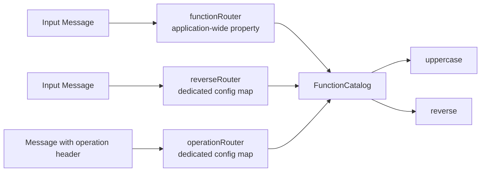

# Creating Multiple Routers with Custom Names and Configurations

## Learning Objectives

After this lesson, you will be able to:

1. Explain why a Spring Cloud Function application might need **multiple `RoutingFunction`s** instead of only the default `functionRouter`.
2. Declare additional `RoutingFunction` beans with **unique names**, passing custom configurations via `Map<String, String>` in the constructor.
3. Distinguish configuring **which router acts as the entry point** from configuring **which target function runs inside each router**.
4. Look up the default router and custom routers by name in `FunctionCatalog`, and test static routes as well as header-driven routes.
5. Identify the effects of `MessageRoutingCallback`, routing headers, application properties, function composition, and reactive routing limitations in a multi-router setup.
6. Design tests, security boundaries, and error handling when serving multiple business groups through multiple routers.

## 1. Why Create Multiple Routers?

**Spring Cloud Function** organizes business logic as `Supplier`, `Function`, and `Consumer` beans looked up through `FunctionCatalog`. This enables the same logic to serve HTTP, event brokers, or serverless platforms via adapters without depending on the calling protocol.

Spring Cloud Function auto-creates **one default router** named `functionRouter`. That router reads instructions, finds the target function in `FunctionCatalog`, and delegates execution.

A single router suffices for simple apps. However, when multiple entry points need **separate routing policies**, sharing a single `spring.cloud.function.routing-expression` property may not express intent clearly.

For example:

- **Default entry point:** all messages go to `uppercase`.
- **String-reversal entry point:** always routes to `reverse`.
- **Operation-based entry point:** reads the `operation` header; `reverse` reverses the string, otherwise uppercase.

You can structure it like this:



All three routers share the same catalog and business beans, yet **each router has its own name** and can hold **its own routing instructions**. This is the *Multiple Routers* pattern officially supported by Spring Cloud Function.

## 2. Default Router vs. Application-Registered Routers

According to the **Multiple Routers** section of the Spring Cloud Function docs, the framework always provides the default router and lets you **create additional `RoutingFunction` beans** as long as each new bean has **a name other than `functionRouter`**.

| Component | Name in Catalog | Where Created? | Routing Instructions |
| --- | --- | --- | --- |
| Default router | `functionRouter` | Spring Cloud Function auto-configuration | Application/system property, Message header, or callback |
| First custom router | `reverseRouter` | `@Bean RoutingFunction` bean | Map belonging to this router instance |
| Second custom router | `operationRouter` | `@Bean RoutingFunction` bean | Another map belonging to this instance |
| Business functions | `uppercase`, `reverse` | `Function<String, String>` beans | Unaware of which router selected them |

The name `functionRouter` can also be referenced via the constant:

```java
RoutingFunction.FUNCTION_NAME
```

**Naming rule:** do not declare another router named `functionRouter` if your intent is **keeping the default router and adding extra routers**. Doing so can trigger bean definition conflicts or alter auto-configuration behavior depending on Spring Boot settings. Use clear names such as `reverseRouter` and `operationRouter`.

Routers are **functions lookable in `FunctionCatalog`**, not separate isolated catalogs. Therefore, distinguish **selection configuration** from **authorization to invoke functions**; separate routers do not automatically isolate or restrict the set of internal beans.

## 3. `RoutingFunction` Constructor and Configuration Map

The official documentation illustrates constructing a `RoutingFunction` with:

```java
new RoutingFunction(
        functionCatalog,
        propertiesMap,
        new BeanFactoryResolver(beanFactory),
        routingCallback);
```

Meaning of each argument:

| Argument | Role |
| --- | --- |
| `FunctionCatalog functionCatalog` | Where the router looks up target function definitions |
| `Map<String, String> propertiesMap` | Routing instructions dedicated to this router instance |
| `BeanFactoryResolver(beanFactory)` | Resolves bean references in expression contexts when needed by the framework |
| `MessageRoutingCallback routingCallback` | Java routing strategy, may be absent; note callback precedence |

Two keys officially supported in the map:

```properties
spring.cloud.function.routing-expression='reverse'
spring.cloud.function.definition=reverse
```

These are **two ways of expressing target selection**, and you do not need both for the same router. With `routing-expression`, the value must be a Spring Expression Language (SpEL) expression evaluating to **a function name**, so a static string needs single quotes: `'reverse'`. With `definition`, the value is directly `reverse`, **without** SpEL single quotes.

Example map:

```java
Map<String, String> routing = new HashMap<>();
routing.put("spring.cloud.function.routing-expression", "'reverse'");
```

This is **a map passed directly into a specific `RoutingFunction` instance**, not a YAML key automatically split by router name. Do not assume a property like `spring.cloud.function.routing-expression.reverseRouter` creates a separate router automatically; the documented approach is **declaring a bean and passing a map**.

## 4. Sample Application with Three Routers

The example uses Spring Boot and Spring Cloud Function. If you want to test directly over HTTP, add the `spring-cloud-starter-function-web` dependency matching your Spring Boot BOM/version:

```xml
<dependency>
    <groupId>org.springframework.cloud</groupId>
    <artifactId>spring-cloud-starter-function-web</artifactId>
</dependency>
```

The application registers two business functions and **two custom routers**; the default `functionRouter` continues to be supplied by the framework:

```java
package com.example.multiplerouters;

import java.util.HashMap;
import java.util.Locale;
import java.util.Map;
import java.util.function.Function;

import org.springframework.beans.factory.BeanFactory;
import org.springframework.boot.SpringApplication;
import org.springframework.boot.autoconfigure.SpringBootApplication;
import org.springframework.cloud.function.context.FunctionCatalog;
import org.springframework.cloud.function.context.MessageRoutingCallback;
import org.springframework.cloud.function.context.config.RoutingFunction;
import org.springframework.context.annotation.Bean;
import org.springframework.context.expression.BeanFactoryResolver;
import org.springframework.lang.Nullable;

@SpringBootApplication
public class MultipleRoutersApplication {

    public static void main(String[] args) {
        SpringApplication.run(MultipleRoutersApplication.class, args);
    }

    // Business logic independent of HTTP, brokers, and routers.
    @Bean
    public Function<String, String> uppercase() {
        return text -> text.toUpperCase(Locale.ROOT);
    }

    @Bean
    public Function<String, String> reverse() {
        return text -> new StringBuilder(text).reverse().toString();
    }

    // Router #2: always routes to reverse, using its own map.
    @Bean
    public RoutingFunction reverseRouter(
            FunctionCatalog catalog,
            BeanFactory beanFactory,
            @Nullable MessageRoutingCallback callback) {
        Map<String, String> properties = new HashMap<>();
        properties.put(
                "spring.cloud.function.routing-expression",
                "'reverse'");

        return new RoutingFunction(
                catalog, properties, new BeanFactoryResolver(beanFactory),
                callback);
    }

    // Router #3: selects target based on the business header operation.
    @Bean
    public RoutingFunction operationRouter(
            FunctionCatalog catalog,
            BeanFactory beanFactory,
            @Nullable MessageRoutingCallback callback) {
        Map<String, String> properties = new HashMap<>();
        properties.put(
                "spring.cloud.function.routing-expression",
                "headers['operation'] == 'reverse' ? 'reverse' : 'uppercase'");

        return new RoutingFunction(
                catalog, properties, new BeanFactoryResolver(beanFactory),
                callback);
    }
}
```

In the sample application:

- `uppercase` converts strings to uppercase.
- `reverse` reverses character order.
- `reverseRouter` has a fixed map pointing to `reverse`.
- `operationRouter` has a map using SpEL to choose between `reverse` and `uppercase`.
- `functionRouter` remains **the default** router, requiring no third `@Bean` method.

The `@Nullable MessageRoutingCallback callback` parameter following the official documentation sample allows Spring to inject a callback if the application defines one, or `null` otherwise. **The predicted results below assume no `MessageRoutingCallback` bean is registered** and no framework routing header overrides the maps. If you add a callback, review the section on precedence and global impact.

## 5. Configuring the Default Router Without Affecting Custom Maps

To make the default router select `uppercase`, set:

```yaml
# application.yml
spring:
  cloud:
    function:
      routing-expression: "'uppercase'"
```

This value belongs to **application properties** used by the default router. It does not alter the maps passed directly to `reverseRouter` and `operationRouter`.

With the same input `Message(payload="hello")`, expected results are:

| Invoked Router | Typical Instruction Source | Selected Target | Output |
| --- | --- | --- | --- |
| `functionRouter` | Application property `'uppercase'` | `uppercase` | `HELLO` |
| `reverseRouter` | Bean's `'reverse'` map | `reverse` | `olleh` |
| `operationRouter` | SpEL map; missing `operation` header | `uppercase` | `HELLO` |
| `operationRouter` | SpEL map; `operation=reverse` | `reverse` | `olleh` |

This is an important demonstration of **one shared `FunctionCatalog`, multiple dedicated dispatch points**. Configuring additional routers requires no edits to business logic inside `uppercase` or `reverse`.

### Application Property `definition` Can Pick Any Router as the Entry Point

If an adapter should expose only the default router, add:

```yaml
spring:
  cloud:
    function:
      definition: functionRouter
      routing-expression: "'uppercase'"
```

Here, `definition=functionRouter` at **the adapter layer** picks the default router as the entry point, while `routing-expression` selects the target business function inside it.

To make an adapter use `reverseRouter` as its entry point instead of the default router, you can configure `spring.cloud.function.definition=reverseRouter` **if your specific adapter supports exporting/selecting that function**. This does not alter the routing expression inside `reverseRouter`, nor does it mean all three routers automatically become three endpoints on every platform.

## 6. Testing All Three Routers via `FunctionCatalog`

This is the clearest way to test without depending on HTTP endpoint mapping or binders. Look up each router by exact name, build a `Message`, and call `apply`:

```java
import java.util.function.Function;

import org.springframework.cloud.function.context.FunctionCatalog;
import org.springframework.cloud.function.context.config.RoutingFunction;
import org.springframework.messaging.Message;
import org.springframework.messaging.support.MessageBuilder;

// Example inside a bean/service with FunctionCatalog injected.
Function<Object, Object> defaultRouter =
        functionCatalog.lookup(RoutingFunction.FUNCTION_NAME);
Function<Object, Object> reverseRouter =
        functionCatalog.lookup("reverseRouter");
Function<Object, Object> operationRouter =
        functionCatalog.lookup("operationRouter");

Message<String> simple = MessageBuilder.withPayload("hello").build();
Message<String> reverseOperation = MessageBuilder.withPayload("hello")
        .setHeader("operation", "reverse")
        .build();

Object a = defaultRouter.apply(simple);          // HELLO
Object b = reverseRouter.apply(simple);          // olleh
Object c = operationRouter.apply(simple);        // HELLO
Object d = operationRouter.apply(reverseOperation); // olleh
```

Here, `FunctionCatalog.lookup(...)` gives you the framework-adapted function, including metadata handling and type conversion when needed. Depending on signatures and adapters, the output may be a plain payload or a wrapped `Message`. In test assertions, normalize to extract the payload instead of always casting the return value to `String`.

### Integration Testing with JUnit Jupiter

The following test uses the sample application's context and declares the default route directly via test properties:

```java
import static org.junit.jupiter.api.Assertions.assertEquals;
import static org.junit.jupiter.api.Assertions.assertNotNull;

import java.util.function.Function;
import org.junit.jupiter.api.Test;
import org.springframework.beans.factory.annotation.Autowired;
import org.springframework.boot.test.context.SpringBootTest;
import org.springframework.cloud.function.context.FunctionCatalog;
import org.springframework.cloud.function.context.config.RoutingFunction;
import org.springframework.messaging.Message;
import org.springframework.messaging.support.MessageBuilder;

@SpringBootTest(
        classes = MultipleRoutersApplication.class,
        properties = "spring.cloud.function.routing-expression='uppercase'")
class MultipleRoutersTest {

    @Autowired
    FunctionCatalog catalog;

    @Test
    void routersHaveDifferentConfiguredTargets() {
        Function<Object, Object> basic =
                catalog.lookup(RoutingFunction.FUNCTION_NAME);
        Function<Object, Object> special =
                catalog.lookup("reverseRouter");
        Function<Object, Object> conditional =
                catalog.lookup("operationRouter");

        assertNotNull(basic);
        assertNotNull(special);
        assertNotNull(conditional);

        Message<String> message =
                MessageBuilder.withPayload("hello").build();
        Message<String> reverseMessage =
                MessageBuilder.withPayload("hello")
                        .setHeader("operation", "reverse")
                        .build();

        assertEquals("HELLO", payloadOf(basic.apply(message)));
        assertEquals("olleh", payloadOf(special.apply(message)));
        assertEquals("HELLO", payloadOf(conditional.apply(message)));
        assertEquals("olleh", payloadOf(conditional.apply(reverseMessage)));
    }

    private static Object payloadOf(Object value) {
        return value instanceof Message<?>
                ? ((Message<?>) value).getPayload()
                : value;
    }
}
```

This example requires standard test dependencies (such as `spring-boot-starter-test`) and an environment free of conflicting callbacks or routing headers. Calling only `catalog.lookup("reverse")` tests **the business function**, without proving that `reverseRouter` is registered and its map works.

### Testing Routing with `definition` Instead of SpEL

In `reverseRouter`, you can change the map to:

```java
Map<String, String> properties = new HashMap<>();
properties.put("spring.cloud.function.definition", "reverse");
```

This is the alternative **static target** configuration highlighted in the Multiple Routers docs. There are no single quotes around `reverse`, because `definition` is not a SpEL expression. Pick **one** mechanism per router to keep policy clear, avoiding conflicting `definition` and `routing-expression` keys in the same map.

## 7. Usage with HTTP, Stream, and Serverless

Having multiple `RoutingFunction` beans **does not mean every adapter automatically exposes every router**.

### HTTP

Spring Cloud Function Web can expose named functions as HTTP endpoints. Under appropriate configuration, `reverseRouter` and `operationRouter` can map to corresponding paths; for instance:

```bash
# Depends on web adapter config and exported functions.
curl -X POST http://localhost:8080/reverseRouter \
  -H "Content-Type: text/plain" \
  --data-raw "hello"
# Expected business output: olleh

curl -X POST http://localhost:8080/operationRouter \
  -H "Content-Type: text/plain" \
  -H "operation: reverse" \
  --data-raw "hello"
# Expected business output: olleh
```

If the application sets a default definition via `spring.cloud.function.definition`, sets `spring.cloud.function.web.path`, restricts exported functions, or uses security filters, actual URLs can differ. **Verify the mapping behavior of your deployed web adapter version.** Testing via `FunctionCatalog` as in section 6 does not depend on those mappings.

### Spring Cloud Stream

Each function/router chosen as an event stream entry point must be wired to **an appropriate binding**. For example, Spring Cloud Stream commonly uses `functionRouter-in-0` for default event routing, yet that **does not automatically generate bindings for every custom router**.

To use `reverseRouter` or `operationRouter` in Stream, verify which definitions the adapter/binder accepts, binding naming conventions, output compatibility, content types, and retry/dead-letter policies. Do not assume three routers automatically receive three input topics just because three beans of the same type exist.

### Serverless

Some serverless environments have one handler/entrypoint per deployment or cloud function. In that setup, you can:

- Select a single router by name via handler/adapter configuration.
- Keep shared business functions in the catalog.
- Use the router's map to define internal routing for the chosen entry point.

Whether a platform can simultaneously publish multiple routers as multiple cloud functions/URLs depends on the specific adapter. Never turn a Java example with three beans into an assumption that a serverless platform will auto-create three endpoints.

## 8. Precedence Order: Custom Configuration Is Not Unoverridable

In **imperative message routing**, Spring Cloud Function's typical instruction order is:

1. `MessageRoutingCallback`.
2. `Message` routing headers (`spring.cloud.function.definition` or `spring.cloud.function.routing-expression`).
3. Routing properties used by the router.

This is especially important when creating **multiple routers**. Constructor `properties` maps establish **default targets / instance-specific policies**; they do not mean external headers cannot influence target selection.

For example, `reverseRouter` is configured with `'reverse'`, yet a message arrives at the router carrying:

```text
spring.cloud.function.definition: uppercase
```

In the imperative model **without a callback**, the instruction header can take precedence over the router's expression, causing `reverseRouter` to invoke `uppercase`. Thus, the name `reverseRouter` and its own map **are not a security mechanism forcing execution to stay on `reverse`**.

### A Single `MessageRoutingCallback` Can Affect Multiple Routers

In the sample code, both `reverseRouter` and `operationRouter` receive **the same callback bean** if one exists in the Spring context. By precedence rules, each instance's callback can dictate the route and cause outputs to differ from its initial map.

If you want each router to follow a distinct Java policy, **design per-instance callbacks**, manage injection/wiring explicitly, and test actual behavior. Avoid accidentally wiring a single application-wide callback and concluding that the routers' maps "don't work."

In this lesson's sample, **no custom callback is declared** so we can focus on independent map configuration.

### Reactive Functions

For `Function<Flux<T>, Flux<R>>`, the processing unit is **the entire Publisher**. Routing functions do not select targets from per-item headers as imperative functions do. When using a custom router for a reactive function, routing instructions must come from **function/application properties appropriate for the whole stream**; do not use an `operationRouter` reading per-message headers expecting to switch functions mid-`Flux`.

## 9. When Are Multiple Routers a Good Choice?

| Requirement | Recommendation |
| --- | --- |
| Need a single fixed function for the whole app | Use `spring.cloud.function.definition=uppercase` directly; router usually unnecessary |
| One entry point picking a function per Message | Use default `functionRouter` + headers/properties/callback |
| Multiple entry points needing independent routing rules | Declare `RoutingFunction` beans **with separate names and maps** |
| Want two sequential processing steps | Use composition `uppercase|reverse`; no need for a second router just to chain functions |
| Need to restrict callable functions by user role | Use authorization/gateway and explicit server policies; multiple routers **do not create security boundaries** |
| Separating critical event flows with distinct error/retry rules | Combine routing with binder config, error channels, DLQs, idempotency, and observability |

Each custom router should have a clear business rationale and configuration owner. If you create extra routers merely because each function has a different name, calling functions or compositions directly is simpler.

## 10. Common Errors and How to Diagnose Them

| Symptom | Possible Cause | How to Check |
| --- | --- | --- |
| Startup fails due to duplicate `functionRouter` name | New bean collides with default router name | Rename the custom bean; do not overwrite the default router |
| `catalog.lookup("reverseRouter")` returns nothing | Bean not scanned/registered or excluded by catalog filter | Check `@Bean`, component scan, and catalog filtering |
| Custom router always uses app-wide default route | Map not passed properly, wrong key, or higher-priority callback/header | Check constructor, map keys, and winning instruction source |
| Expression `reverse` fails SpEL evaluation | Missing single quotes for string literal | Use `"'reverse'"` in YAML or `"'reverse'"` as a Java string containing single quotes |
| Two routers seem to share one expression | Shared mutable map, shared callback, or wrong lookup name | Give each bean its own map; test both distinct names |
| `operationRouter` cannot read header | Adapter does not propagate header into Spring `Message` | Use `MessageBuilder` to separate adapter issues from router issues |
| Calling `/reverseRouter` returns 404 | Web adapter does not expose that route or path changed | Check web-layer mapping/definition; test catalog directly |
| Router picks right target but function fails | Conversion or business function failure | Check payload type, `Content-Type`, stack trace |
| Trying to route per `Flux` item keeps the same target | Reactive routing selects for the whole stream | Switch to imperative message routing if per-event routing is required |

Short debugging sequence:

```text
1. Which router name is the adapter/caller invoking?
2. Is a RoutingFunction bean with that name in the catalog?
3. What keys/values are in that instance's config map?
4. Is a higher-precedence MessageRoutingCallback or routing header present?
5. Does the target definition exist, and are input types compatible?
6. How does the adapter translate results/errors into HTTP/event/responses?
```

## 11. Security and Operations

**Separating configuration does not mean separating permissions.** All sample routers share one `FunctionCatalog`. If you expose router endpoints publicly and allow callers to send arbitrary `spring.cloud.function.definition` or SpEL routing headers, they may attempt to invoke other functions in the catalog. Enforce authentication, authorization, endpoint exposure controls, and server-side allowlists of permitted operations/routes.

**Avoid mutating maps while serving requests.** Build maps at startup and treat them as immutable over the router's lifecycle. If runtime policy changes are required, use tested, observable, access-controlled configuration workflows rather than assuming editing a live YAML file automatically updates already-constructed routers.

**Monitor by both router name and target function name.** Record invocation counts for `functionRouter`, `reverseRouter`, and `operationRouter`, along with error rates and latency. With message brokers, include retry counts, dead-letter metrics, and correlation IDs while avoiding logging sensitive data.

**Do not treat a router as a global error handler.** When a target function name is missing from the catalog, the framework may throw an error or invoke `DefaultMessageRoutingHandler` if registered. SpEL errors, conversion failures, and business exceptions belong to other stages; handle them appropriately for your adapter and business flow.

## 12. Practice Exercises

1. Run the sample app and configure the default router with expression `'uppercase'`. Use `FunctionCatalog` to invoke `functionRouter` and `reverseRouter` with payload `hello`; explain why the results are `HELLO` and `olleh`, respectively.
2. Call `operationRouter` with two `Message`s: one carrying `operation=reverse` and one without the header. Predict the outcomes and point out **which router's map** owns the expression.
3. Rename `reverseRouter` to `mySpecialRouter` in `@Bean`. Find two places that must change in test code and invocations, and explain why the `reverse` bean needs no changes.
4. Replace the map key `spring.cloud.function.routing-expression` with `spring.cloud.function.definition` and value `reverse`. Contrast a direct definition name with a SpEL literal.
5. Send header `spring.cloud.function.definition: uppercase` to `reverseRouter` even though its map selects `reverse`. With imperative routing and no callback, predict which instruction source wins.
6. Register one `MessageRoutingCallback` and pass it to both custom routers. Observe the behavior and explain why callbacks and maps must be designed consistently to avoid conflicting rules.
7. Test `/reverseRouter` via the web adapter; if it returns 404 while `FunctionCatalog.lookup("reverseRouter")` succeeds, diagnose the cause at **the adapter mapping layer** instead of editing the map.
8. Sketch an application using two routers to serve two event groups. Outline bindings, access controls, retries/DLQ, and required tests before deployment.
9. Add a composition `uppercase|reverse` as the target for a third router. Explain the difference between **multiple routers** and **multiple processing steps in a composition**.

## Key Takeaways

- Spring Cloud Function creates **the default `functionRouter`** and allows declaring **additional `RoutingFunction` beans under different names**.
- Each custom router accepts **`FunctionCatalog`**, **its own config map**, **`BeanFactoryResolver`**, and an optional callback in the framework-supported constructor.
- The map can contain `spring.cloud.function.routing-expression` (SpEL returning a target name) or `spring.cloud.function.definition` (direct definition).
- Creating multiple routers **does not create multiple `FunctionCatalog`s**; routers can reuse shared business `Function`s and compositions.
- **Selecting a router at the adapter layer** and **selecting a target function inside the router** are two separate steps. Never assume every router auto-exports as an endpoint/binding on every adapter.
- Custom configuration maps do not prevent higher-priority callbacks or routing headers from taking precedence; production systems still need authorization, invalid-route handling, and data conversion checks.

### Official References

- [Spring Cloud Function — Programming model, Multiple Routers](https://docs.spring.io/spring-cloud-function/reference/spring-cloud-function/programming-model.html)
- [Spring Cloud Function — Function Catalog and Function Composition](https://docs.spring.io/spring-cloud-function/reference/spring-cloud-function/programming-model.html)
- [Spring Cloud Function — Standalone Web Applications](https://docs.spring.io/spring-cloud-function/reference/spring-cloud-function/standalone-web-applications.html)
- [Spring Cloud Stream — Reference](https://docs.spring.io/spring-cloud-stream/reference/)
