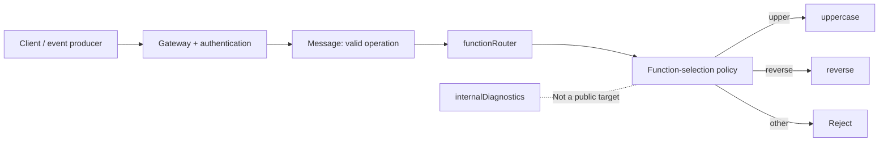

# Restricting Target Functions and Expression Sources

## Learning Objectives

After this lesson, you will be able to:

1. Identify where Spring Cloud Function obtains **target function names** and **SpEL expressions** to drive `RoutingFunction`.
2. Distinguish `spring.cloud.function.definition` in application configuration from the same key appearing in a `Message` header.
3. Explain why expressions from a `Message` header are evaluated using `SimpleEvaluationContext`, whereas expressions from application/system properties use `StandardEvaluationContext`.
4. Restrict functions registered in `FunctionCatalog` using `spring.cloud.function.ineligible-definitions` and restrict allowed targets by policy using `MessageRoutingCallback`.
5. Distinguish **catalog restrictions**, **adapter-exposed function restrictions**, and **authentication/authorization**.
6. Test tampered headers, requests for internal function names, invalid expressions, disallowed compositions, and reactive routing.

## 1. Why Does Controlling Routing Sources Matter?

Spring Cloud Function organizes business logic as `Supplier`, `Function`, and `Consumer` beans looked up and composed through `FunctionCatalog`. HTTP, event broker, or serverless adapters can invoke the same logic without coupling business functions to transport protocols.

To let a single entry point dispatch to multiple functions, the framework provides `RoutingFunction` under the name **`functionRouter`**. The router receives instructions, resolves a function definition name, and looks up the target in `FunctionCatalog`.

For example, an application has:

- `uppercase`: converts text to uppercase, permitted via public API.
- `reverse`: reverses strings, also permitted.
- `internalDiagnostics`: auxiliary capability for internal environments, **not intended to be callable through the public catalog**.

A legitimate client should only be allowed to request operations `upper` or `reverse`. If clients can freely attach a `spring.cloud.function.definition: internalDiagnostics` header or inject arbitrary SpEL, merely exposing a single `/functionRouter` URL **does not guarantee** callers cannot reach unintended capabilities.



The core challenge of this lesson is governing **both sides**: which functions can be looked up, and which data/expression sources are trusted to determine routes.

## 2. Three Easily Confused Concepts

| Concept | Question It Answers | Example |
| --- | --- | --- |
| **`FunctionCatalog` candidates** | Which beans are registered so they can be looked up as functions? | `uppercase`, `reverse`; exclude `internalDiagnostics` via `ineligible-definitions` |
| **Adapter-exposed entry points** | Which functions/routes may be invoked via HTTP, Stream, or serverless? | Export only `functionRouter` or only explicitly listed endpoints |
| **Routing and authorization policy** | For this message, which target is the caller permitted to request? | Header `operation=upper` maps to `uppercase` |

These are distinct layers. Restricting HTTP endpoints does not necessarily remove a bean from the catalog. Having a function in the catalog does not necessarily give it a dedicated HTTP endpoint. And even when a route sits behind a gateway, you must still verify the caller is authorized to perform that business action.

> Design principle: **never treat function names, endpoint paths, or SpEL expressions as authorization proof**. Authentication and authorization must be enforced at the proper layer, independently of function selection.

## 3. Sources Supplying Routing Instructions

Spring Cloud Function supports three primary sources for **imperative message routing**:

| Precedence | Source | Provided Data | Control Level |
| --- | --- | --- | --- |
| **1** | `MessageRoutingCallback` bean | Function definition name returned by Java code | Application owns the routing rule |
| **2** | `Message` headers | `spring.cloud.function.definition` or `spring.cloud.function.routing-expression` | Depends on who can create/modify messages |
| **3** | Application/system properties | Typically `spring.cloud.function.routing-expression` | Deployment config and administrative privileges |

Example of the same key name at two layers:

```yaml
# application.yml: select router as the adapter's entry point
spring:
  cloud:
    function:
      definition: functionRouter
      routing-expression: "'uppercase'"
```

```text
# Message header sent TO the router:
spring.cloud.function.definition: reverse
```

The property `definition: functionRouter` picks **the entry point**; the header `definition: reverse` picks **the target inside the router**. Without a `MessageRoutingCallback`, the header generally beats the `routing-expression` property even though the property evaluates to `uppercase`.

A higher-precedence source **is not a "try first" hint** that falls back to lower-priority config on failure. If a header selects a name absent from the catalog, the router can fail with a function-not-found error; do not assume it will automatically fall back to the default route.

### Target Names and Expressions Are Different Instruction Types

| Instruction | Example | Meaning |
| --- | --- | --- |
| `spring.cloud.function.definition` header | `uppercase` | Directly selects a definition |
| `spring.cloud.function.definition` header | `uppercase|reverse` | Selects a composition |
| `spring.cloud.function.routing-expression` header | `headers['operation'] == 'upper' ? 'uppercase' : 'reverse'` | Evaluates SpEL against the message and chooses a definition |
| `spring.cloud.function.routing-expression` app property | `'uppercase'` | SpEL returning a fixed target name |

You do not wrap `spring.cloud.function.definition` header values in SpEL single quotes. Conversely, to make `routing-expression` return the constant string `uppercase`, the expression requires the literal `'uppercase'`.

## 4. SpEL Sources: `SimpleEvaluationContext` vs. `StandardEvaluationContext`

Spring Cloud Function distinguishes **expression sources**, because SpEL is an expression language capable of accessing Java object properties and methods.

| Where `routing-expression` Comes From | Evaluation Context | Feature Scope |
| --- | --- | --- |
| `Message` header | **`SimpleEvaluationContext`** | Restricted subset of SpEL aimed at evaluating message data |
| Application/system property or environment variable | **`StandardEvaluationContext`** | Broader SpEL capabilities for managed application configuration |

Example of a simple expression owned by **the application**:

```yaml
spring:
  cloud:
    function:
      definition: functionRouter
      routing-expression: "headers['operation'] == 'reverse' ? 'reverse' : 'uppercase'"
```

The SpEL root object for imperative messages is the `Message` itself, so `headers['operation']` reads metadata supplied by the adapter. You can inspect `payload` similarly, **provided you know the exact payload type at evaluation time**.

Spring Framework documentation notes that `SimpleEvaluationContext` omits capabilities such as Java type references, constructor calls, and bean references. Still, **a restricted context is no guarantee that arbitrary expressions from untrusted sources are safe**. Therefore, avoid accepting client-authored SpEL whenever a simple business header plus server-side rules meet the requirement.

On the flip side, `StandardEvaluationContext` is more powerful and **must never evaluate expressions supplied by untrusted external sources**. When expressions come from environment variables or application properties, restrict which people and systems can modify that configuration.

### Be Careful with Configuration Management Endpoints

Normally end users cannot edit `application.yml` or environment variables directly. However, a deployment might expose Actuator endpoints, dynamic config tools, or custom admin APIs. If those allow altering expressions, an attacker could turn **external input** into **an application property evaluated in the more privileged context**.

Spring Cloud Function does not expose an admin API to mutate these expressions on its own. Securing management endpoints is the responsibility of your deployment setup and application security configuration.

## 5. Restricting `FunctionCatalog` Candidates

A Spring `ApplicationContext` may contain beans implementing `Function`, `Consumer`, or `Supplier` that **should not become registration candidates in `FunctionCatalog`**. Spring Cloud Function supports the property:

```properties
spring.cloud.function.ineligible-definitions=internalDiagnostics
```

You can supply a comma-separated list of bean names:

```properties
spring.cloud.function.ineligible-definitions=internalDiagnostics,legacyMaintenance
```

The goal is excluding those beans from **catalog registration candidates**, not removing the beans from the Spring `ApplicationContext` or preventing Java code with injected bean references from calling them.

Notes:

- Values are **bean definition names**, not packages, class names, or URLs.
- This property affects catalog discovery/registration; it is not an RBAC system.
- Other functions can still be invoked by name or composition if they remain in the catalog.
- Only test `lookup` with nonexistent names once you understand your version's *single-function fallback* behavior. With a single-function catalog, an arbitrary name may resolve to that lone function; inspect the full list of names registered in the catalog too.

### Comparing with HTTP Endpoint Restrictions

In Spring Cloud Function Web, `spring.cloud.function.definition` can be used to **list functions exported as HTTP endpoints**, separated by semicolons. For example, in a deployment without a router:

```properties
spring.cloud.function.definition=uppercase;reverse
```

This setting aims to expose only `uppercase` and `reverse` in the HTTP adapter; it is **not** syntax for declaring two target routes for `functionRouter`, nor does it **remove** other functions from the catalog.

If a deployment primarily uses a router:

```properties
spring.cloud.function.definition=functionRouter
```

understand clearly which endpoints the adapter exposes and whether direct invocation paths still exist. **Do not treat selecting a router as the entry point as an internal firewall around all functions.**

## 6. Sample Application: Two Public Functions and One Internal Bean

The example uses Spring Boot with `spring-cloud-starter-function-web`. Select compatible Spring Cloud Function and Spring Boot versions via your project's BOM/dependency management.

```xml
<dependency>
    <groupId>org.springframework.cloud</groupId>
    <artifactId>spring-cloud-starter-function-web</artifactId>
</dependency>
```

Three simple functions illustrate catalog scope:

```java
package com.example.routepolicy;

import java.util.Locale;
import java.util.function.Function;

import org.springframework.boot.SpringApplication;
import org.springframework.boot.autoconfigure.SpringBootApplication;
import org.springframework.context.annotation.Bean;

@SpringBootApplication
public class RoutePolicyApplication {

    public static void main(String[] args) {
        SpringApplication.run(RoutePolicyApplication.class, args);
    }

    @Bean
    public Function<String, String> uppercase() {
        return text -> text.toUpperCase(Locale.ROOT);
    }

    @Bean
    public Function<String, String> reverse() {
        return text -> new StringBuilder(text).reverse().toString();
    }

    // Example auxiliary bean: not intended as a public endpoint.
    @Bean
    public Function<String, String> internalDiagnostics() {
        return text -> "[INTERNAL] " + text;
    }
}
```

Here `internalDiagnostics` simply returns a string to verify call paths; it **contains no secrets**. In a real system, excluding it from the catalog reduces exposure surface, yet **must not be treated as the sole safeguard** for sensitive internal operations.

Configuration:

```yaml
# application.yml
spring:
  cloud:
    function:
      definition: functionRouter
      ineligible-definitions: internalDiagnostics
      routing-expression: "headers['operation'] == 'reverse' ? 'reverse' : 'uppercase'"
```

The application establishes:

1. The adapter chooses `functionRouter` as the entry point.
2. Bean `internalDiagnostics` is ineligible for catalog registration.
3. The application property supplies a default SpEL rule: business header `operation=reverse` selects `reverse`, and other values select `uppercase`.

**Intentional teaching weakness:** the SpEL rule in the application property sits at lower precedence than a Message routing header. Hence, **configuring a server-side expression alone is insufficient** to prevent a client from requesting another catalog function via `spring.cloud.function.definition` if the adapter forwards that header.

## 7. Verifying Catalog Contents and Routing Header Behavior

Inside a Spring component with `FunctionCatalog` injected, you can inspect:

```java
import java.util.Set;
import org.springframework.cloud.function.context.FunctionCatalog;

// functionCatalog is injected from the Spring context.
Set<String> names = functionCatalog.getNames(null);
System.out.println(names);
```

Verify that the catalog names include business functions `uppercase` and `reverse` and omit `internalDiagnostics` per the configuration above. Depending on the version, the set may also list `functionRouter` or framework-provided functions; do not assume the catalog holds literally only two names.

With Spring Cloud Function Web configured to invoke the router at root `/`, test:

```bash
# Business header: uses the SpEL rule in application properties.
curl -X POST http://localhost:8080/ \
  -H "Content-Type: text/plain" \
  -H "operation: reverse" \
  --data-raw "hello"
# Expected business output: olleh

# Framework routing header: direct instruction takes precedence over property.
curl -X POST http://localhost:8080/ \
  -H "Content-Type: text/plain" \
  -H "operation: reverse" \
  -H "spring.cloud.function.definition: uppercase" \
  --data-raw "hello"
# Without a callback: expected output HELLO.
```

In the second request, the client supplies two **conflicting** instruction sources. The SpEL property wants `reverse`, yet the `spring.cloud.function.definition` header directly requests `uppercase` and takes higher precedence.

Next, test a name absent from the catalog:

```bash
curl -i -X POST http://localhost:8080/ \
  -H "Content-Type: text/plain" \
  -H "spring.cloud.function.definition: internalDiagnostics" \
  --data-raw "hello"
```

With the catalog excluding this function and no special fallback logic, the router cannot resolve the target and can raise an error. **Do not assume a specific HTTP status/body**, since error rendering depends on the web adapter and exception handling config. If the application registers `DefaultMessageRoutingHandler`, the handler can receive the unroutable message and apply custom handling; avoid letting the handler silently drop critical events.

## 8. Restricting Target Functions with `MessageRoutingCallback`

A direct way to constrain the router to choose from **permitted** targets is registering a `MessageRoutingCallback` that only returns definition names matching **valid business operations**.

For example, add the method below to `RoutePolicyApplication`:

```java
import org.springframework.cloud.function.context.MessageRoutingCallback;
import org.springframework.context.annotation.Bean;
import org.springframework.context.annotation.Profile;

@Bean
@Profile("strict-routing")
public MessageRoutingCallback allowedOperationRouter() {
    return message -> {
        Object operation = message.getHeaders().get("operation");

        if ("upper".equals(operation)) {
            return "uppercase";
        }
        if ("reverse".equals(operation)) {
            return "reverse";
        }

        throw new IllegalArgumentException("Unsupported operation");
    };
}
```

This is **a hardened option enabled by the `strict-routing` profile**. You can place this code in a separate configuration class in multi-module apps; the requirement is that Spring sees one active `MessageRoutingCallback` bean.

Because the callback holds the highest precedence in **imperative routing**, it determines the target even if the message carries framework headers pointing to another function. With the callback above, only the exact business values `upper` and `reverse` are valid. Invalid or missing `operation` values are rejected rather than defaulting to a fallback branch.

```text
Message(operation=upper, header definition=reverse)
    -> callback returns uppercase
    -> router calls uppercase

Message(operation=delete, header definition=uppercase)
    -> callback throws exception
    -> adapter applies error handling mechanism
```

This implements an **operation-name allowlist policy**, preventing clients from submitting arbitrary bean names or compositions. Still, the callback only governs **calls that actually enter the router**; if the adapter still exposes direct endpoints for individual functions, callers can take another path.

### Why Must Composition Also Be Controlled?

The `spring.cloud.function.definition` header can carry `uppercase|reverse` or more complex compositions when functions are type-compatible. If clients can enter definitions freely, checking only "starts with uppercase" or "contains reverse" **is insufficient** to constrain the whole pipeline.

Instead of trying to parse arbitrary client syntax, map approved `operation` values such as `upper`, `reverse`, and `chain` to **exact definitions** in server-side code:

```java
// Example adding a branch to the callback, if business rules permit:
if ("chain".equals(operation)) {
    return "uppercase|reverse";
}
```

This remains a finite, reviewable, testable set of targets rather than letting clients assemble arbitrary composition strings.

## 9. Testing Policy with `MessageBuilder` and JUnit

To verify the policy independently of HTTP, unit-test the callback:

```java
import static org.junit.jupiter.api.Assertions.assertEquals;
import static org.junit.jupiter.api.Assertions.assertThrows;

import org.junit.jupiter.api.Test;
import org.springframework.cloud.function.context.MessageRoutingCallback;
import org.springframework.messaging.Message;
import org.springframework.messaging.support.MessageBuilder;

class AllowedOperationRouterTest {

    private final MessageRoutingCallback callback =
            new RoutePolicyApplication().allowedOperationRouter();

    @Test
    void allowlistedOperationChoosesUppercase() {
        Message<String> message = MessageBuilder.withPayload("hello")
                .setHeader("operation", "upper")
                .setHeader("spring.cloud.function.definition", "reverse")
                .build();

        assertEquals("uppercase", callback.routingResult(message));
    }

    @Test
    void invalidOperationIsRejected() {
        Message<String> message = MessageBuilder.withPayload("hello")
                .setHeader("operation", "internalDiagnostics")
                .build();

        assertThrows(IllegalArgumentException.class,
                () -> callback.routingResult(message));
    }
}
```

This is **a unit test of the target-selection policy**: it proves the callback ignores the `spring.cloud.function.definition` header and never turns an unknown operation into a bean name. It does not prove public endpoints are restricted, that the catalog excluded `internalDiagnostics`, or that HTTP/binder error handling matches contract.

Integration tests should additionally:

1. Boot the context with the `strict-routing` profile.
2. Assert the catalog omits `internalDiagnostics` in `getNames(null)`.
3. Send a request with `operation: upper` alongside framework header `spring.cloud.function.definition: reverse`; confirm the router still invokes `uppercase`.
4. Send an invalid operation; confirm the adapter returns an error matching **the defined API contract**.
5. Test any call paths **not going through the router** (if exposed) against their own authentication/authorization rules.

Never infer from a standalone callback unit test alone that no internal capability can be invoked.

## 10. Defense-in-Depth Layers to Combine

| Layer | Mechanism | Limitation It Addresses | What It Does **Not** Solve |
| --- | --- | --- | --- |
| Catalog | `spring.cloud.function.ineligible-definitions` | Prevents specific beans from becoming catalog candidates | Does not remove beans from context or replace authorization |
| HTTP adapter | Expose only needed functions/routes | Narrows callable URLs/entrypoints | Router can still look up multiple targets inside the catalog |
| Routing rules | `MessageRoutingCallback` + operation allowlist | Blocks arbitrary function/composition names via router | Does not block call paths that bypass the router |
| Configuration | Keep SpEL in restricted-access properties | Controls who can modify **rules** | Does not make business headers inherently trustworthy |
| Gateway/security | Authentication, authorization, rate limits, header scrubbing | Caller identity and input trustworthiness | Does not replace validation inside business functions |
| Operations | Metrics, audit, error handling, DLQ | Observability, forensics, error recovery | Does not make an unauthorized route valid |

### Sample Policy for a Public API

A practical design could be:

1. **Gateway** allows only `POST` to approved endpoints, authenticates callers, and strips client-sent router control headers except permitted ones.
2. **Adapter** forwards `operation` (a pre-validated business value) as a Spring Message header.
3. **Server-side callback** checks the `upper`/`reverse` allowlist, picks the target definition, or throws an exception.
4. **Catalog** excludes functions that must not be looked up; business beans still perform appropriate permission checks where needed.
5. **Observability** tracks rejected requests, chosen target functions, anomalies, and adapter/binder failures.

In this architecture, **no single layer** carries security alone. Even when clients cannot supply routing expressions, missing authorization on sensitive endpoints still creates vulnerabilities.

## 11. Event Routing, Serverless, and Reactive Routing

### HTTP

Spring Cloud Function Web can translate HTTP headers `spring.cloud.function.definition` and `spring.cloud.function.routing-expression` into Spring `Message` headers. Therefore, treat these headers as **control-flow inputs** whenever an endpoint accepts external requests.

Blocking one direct function URL is not enough to conclude the router is safe; also inspect every header reaching the router.

### Spring Cloud Stream

In Spring Cloud Stream, each event is typically represented by the binder as a Spring `Message`. When configuring event routing via `functionRouter`, routing metadata can originate from producers, broker headers, or intermediate processors.

For events arriving from untrusted sources, verify exactly which headers the binder forwards, where they can be overridden, and who has publish permissions. Allowlists and catalog exclusions remain helpful, yet **acknowledgments, retries, dead-letter queues, and idempotency** must be designed around the binder and message criticality.

### Serverless

A FaaS environment may expose a single handler and rely on `functionRouter` to pick targets. Routing instructions here may reside in event metadata or deployment configuration, depending on the adapter. Having one handler **does not mean** only one business function can be invoked.

### Reactive Functions

With imperative `Function<T, R>`, routes can be chosen **per Message** from callbacks, headers, or properties. With reactive `Function<Flux<T>, Flux<R>>`, the processing unit is **the entire Publisher**; Spring Cloud Function reads instructions from **application properties**, rather than re-routing per element from item headers within the same stream.

Therefore, experiments using per-Message HTTP routing headers are **not the right model** for per-element routing policies in reactive streams. When per-event decisions are required, choose an imperative event-routing design or let a single reactive function branch internally based on item data.

## 12. When Errors Occur or Invalid Routes Are Sent Intentionally

| Symptom | What to Check | Resolution |
| --- | --- | --- |
| Client requests `internalDiagnostics` and target is not found | Bean excluded from `FunctionCatalog` or missing | Verify `getNames(null)` and routing policy |
| `definition` header beats SpEL property | No callback; Message header outranks property | Use an allowlist callback or strip headers at gateway |
| Callback rejects unknown operation | Server-side policy is working | Map error to HTTP/broker response per contract |
| Expression runs in property yet fails in Message header | `StandardEvaluationContext` vs. `SimpleEvaluationContext` differ in capabilities | Do not move complex expressions between sources without re-evaluating |
| Internal function without endpoint still invoked by router | Target remains in catalog | Review catalog eligibility, callback, and authorization |
| Invalid route fails to throw expected exception | `DefaultMessageRoutingHandler` or single-function fallback active | Inspect handler, eligible function count, and business results |
| HTTP returns error while events keep retrying | Adapter/binder contracts differ | Review retries, DLQ, acknowledgments, and exception handling |
| Blocking router endpoint leaves direct function accessible | Adapter still exposes other paths | Inventory all endpoints and secure every path |

Note: `DefaultMessageRoutingHandler` is meant for when the router **cannot find the target function**. The handler is not an authorization tool and should never silently drop critical transactions that need explicit rejection detection.

### Systematic Diagnostic Workflow

```text
1. Is the caller authorized for this endpoint/binding?
2. Is the adapter calling functionRouter or a direct function?
3. Which routing headers exist on the actual Message?
4. Is a MessageRoutingCallback registered?
5. Does the expression come from a Message header or application property?
6. Is the chosen definition within the allowed set?
7. Does the definition exist in FunctionCatalog?
8. Are function signatures, payload conversion, and error handling aligned?
```

This checklist order separates **route selection bugs**, **missing catalog functions**, **business execution errors**, and **authorization issues**.

## 13. Practice Exercises

1. Declare `uppercase`, `reverse`, and `internalDiagnostics`, then set `spring.cloud.function.ineligible-definitions=internalDiagnostics`. Inspect `FunctionCatalog.getNames(null)` and explain why the bean can still exist in the Spring context.
2. Disable the callback. Configure a property expression choosing `reverse` when `operation=reverse`; send a Message adding `spring.cloud.function.definition: uppercase`. Predict which source wins and why.
3. Enable the `strict-routing` profile with the `upper`/`reverse` callback. Send `operation=upper` alongside framework header `definition: reverse`. Identify which function runs and prove it with a test.
4. Send a missing operation or `internalDiagnostics` while the callback is active. Propose an appropriate HTTP status/response body and an integration test confirming that API contract.
5. Explain the difference between `spring.cloud.function.ineligible-definitions=internalDiagnostics` and `spring.cloud.function.definition=uppercase;reverse` in Spring Cloud Function Web.
6. Design a policy allowing the `uppercase|reverse` composition via an operation `chain` without letting clients construct arbitrary definition strings. Show how the callback returns only approved names.
7. Suppose a system exposes an admin endpoint able to modify `routing-expression` configuration. List the authentication, authorization, audit, and change-approval controls needed.
8. Distinguish `SimpleEvaluationContext` from `StandardEvaluationContext`. Why does using a restricted context not make client-supplied expressions completely safe?
9. Port the architecture to Spring Cloud Stream. List where producers could tamper with routing metadata, mechanisms ensuring only valid events are processed, and retry/DLQ requirements.
10. Explain why per-Message header routing policies cannot switch functions per element inside a reactive function's `Flux`.

## Key Takeaways

- `functionRouter` resolves targets in **`FunctionCatalog`**; **target names**, **SpEL expressions**, and **invocation authorization** are three separate concerns.
- For imperative routing, precedence is **`MessageRoutingCallback` → Message routing headers → application routing properties**.
- Expressions from Message headers use **`SimpleEvaluationContext`**; those from application/system properties use **`StandardEvaluationContext`**. Restricted contexts do not replace input validation.
- `spring.cloud.function.ineligible-definitions` removes unsuitable beans from **catalog candidates**; adapter endpoint exports and authorization are separate layers.
- Use **a callback with an allowlist** to map business operations to approved function/composition names, while also securing any direct invocation paths outside the router.
- Never grant users permission to modify SpEL in application properties, and never treat route fallbacks or `DefaultMessageRoutingHandler` as a security mechanism.

### Official References

- [Spring Cloud Function — Programming Model: Function Routing and Filtering, Filtering Ineligible Functions](https://docs.spring.io/spring-cloud-function/reference/spring-cloud-function/programming-model.html)
- [Spring Cloud Function — Standalone Web Applications](https://docs.spring.io/spring-cloud-function/reference/spring-cloud-function/standalone-web-applications.html)
- [Spring Framework — SpEL Evaluation Context and Security Considerations](https://docs.spring.io/spring-framework/reference/core/expressions/evaluation.html)
- [Spring Cloud Stream — Event Routing](https://docs.spring.io/spring-cloud-stream/reference/spring-cloud-stream/event-routing.html)
