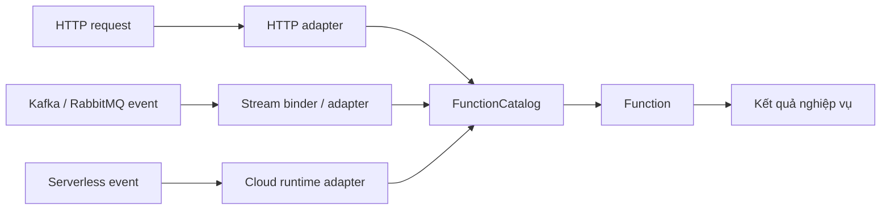

# Spring Cloud Function là gì và bài toán triển khai nghiệp vụ bằng hàm

## 1. Từ bài toán thực tế đến ý tưởng «nghiệp vụ là một hàm»

Giả sử hệ thống bán hàng cần áp dụng cùng một quy tắc: đơn hàng có tổng tiền lớn hơn 0 và không vượt quá 1.000.000 đồng thì được duyệt sơ bộ. Quy tắc này có thể được gọi từ nhiều nơi:

- API HTTP nhận yêu cầu kiểm tra đơn hàng từ ứng dụng web.
- Sự kiện đơn hàng từ Kafka hoặc RabbitMQ.
- Một tác vụ chạy trên nền tảng serverless khi có sự kiện mới.
- Một luồng xử lý khác trong cùng ứng dụng Java.

Nếu đặt quy tắc trực tiếp trong `@RestController`, listener Kafka hoặc handler của nền tảng cloud, ta dễ phải sao chép logic, kiểm thử trùng lặp và chỉnh sửa nhiều chỗ khi chính sách thay đổi. Cũng có thể tự tách logic thành một service Java thuần, nhưng khi muốn đóng gói và công bố service đó qua các kiểu đầu vào khác nhau, mỗi adapter vẫn phải tự lo tìm hàm, gọi hàm và chuyển đổi dữ liệu.

**Spring Cloud Function** (module `SPRING_CLOUD_FUNCTION`) cung cấp một mô hình nhất quán để định nghĩa logic bằng các giao diện hàm Java, đăng ký chúng trong Spring và đưa chúng đến những môi trường gọi khác nhau. Đích đến là **viết quy tắc nghiệp vụ một lần, sau đó kết nối với HTTP, luồng sự kiện hoặc môi trường serverless bằng adapter thích hợp**.



Sơ đồ thể hiện **sự tái sử dụng logic**. Việc kết nối Kafka, RabbitMQ hay một nền tảng serverless vẫn cần dependency, cấu hình, quy ước thông điệp và cách triển khai riêng; Spring Cloud Function không tự biến một ứng dụng thành mọi loại dịch vụ chỉ bằng việc khai báo một bean.

## 2. Spring Cloud Function là gì?

Spring Cloud Function là một dự án trong hệ sinh thái Spring Cloud, xây dựng quanh các giao diện thuộc gói `java.util.function`: `Supplier<T>`, `Function<T, R>` và `Consumer<T>`. Ta có thể tạo các bean kiểu này với `@Bean`, sau đó để framework phát hiện, đăng ký, tìm kiếm, ghép và chuyển đổi dữ liệu khi gọi hàm.

Ba thành phần nên phân biệt rõ:

| Thành phần | Trách nhiệm | Ví dụ |
| --- | --- | --- |
| **Hàm nghiệp vụ** | Nhận dữ liệu, áp dụng quy tắc, tạo kết quả hoặc tác dụng phụ; không phụ thuộc cách lời gọi được truyền đến. | `Function<OrderRequest, OrderDecision>` |
| **`FunctionCatalog`** | Danh mục để tra cứu hàm đã đăng ký theo tên hoặc biểu thức ghép hàm; cung cấp lớp gọi thống nhất của framework. | `catalog.lookup("decideOrder")` |
| **Adapter** | Nối một giao thức hoặc runtime cụ thể với hàm: tiếp nhận dữ liệu, gọi hàm, xử lý kết quả theo môi trường đó. | HTTP adapter, Spring Cloud Stream, adapter của nền tảng serverless |

Spring Cloud Function **không thay thế Spring Boot**: một ứng dụng thường vẫn dùng Spring Boot để khởi tạo context và cấu hình dependency. Nó cũng **không đồng nghĩa với một dịch vụ FaaS**: `Function` chỉ là mô hình lập trình; triển khai trên AWS Lambda hoặc nền tảng tương tự là một khả năng tích hợp.

Điểm then chốt của mô hình là ranh giới rõ ràng giữa **quy tắc cần làm gì** và **ai gọi quy tắc, gọi bằng giao thức nào**.

## 3. Ba kiểu hàm cốt lõi

| Kiểu | Chữ ký ý tưởng | Vai trò | Ví dụ nghiệp vụ |
| --- | --- | --- | --- |
| `Supplier<T>` | `() -> T` | Tạo dữ liệu mà không cần payload đầu vào. | Cung cấp snapshot cấu hình, tạo bản ghi cho một lần polling. |
| `Function<T, R>` | `T -> R` | Biến đổi đầu vào thành kết quả. | Kiểm tra đơn hàng, tính điểm ưu tiên, chuẩn hóa dữ liệu. |
| `Consumer<T>` | `T -> void` | Nhận dữ liệu để thực hiện tác dụng phụ, không trả về giá trị nghiệp vụ. | Ghi audit, gửi thông báo, lưu dữ liệu. |

Ví dụ Java thuần:

```java
Supplier<String> version = () -> "policy-v1";
Function<String, String> normalize = value -> value.trim().toLowerCase();
Consumer<String> audit = value -> System.out.println("Received: " + value);

String currentVersion = version.get();
String normalized = normalize.apply("  ORDER-A17  ");
audit.accept(normalized);
```

Đây là các giao diện thuộc JDK, chưa cần Spring Cloud Function. Framework phát huy tác dụng khi các hàm được khai báo thành bean và cần được tìm/gọi thông qua adapter.

Lưu ý: `Supplier` không có nghĩa tự động chạy theo lịch. Thời điểm kích hoạt phụ thuộc môi trường: một HTTP request có thể gọi `get()`, còn một luồng message có thể polling theo cấu hình. `Consumer` có thể tạo side effect nhưng bản thân chữ ký `void` không bảo đảm dữ liệu đã được lưu hoặc một thông điệp đã được gửi thành công.

## 4. Ví dụ: triển khai quy tắc duyệt đơn hàng

### 4.1. Định nghĩa hàm Spring

Trong ứng dụng Spring Boot dùng Java 17 trở lên và các phiên bản Spring Boot/Spring Cloud tương thích, ta có thể đặt các bean sau trong một lớp ứng dụng:

```java
import java.math.BigDecimal;
import java.util.function.Consumer;
import java.util.function.Function;
import java.util.function.Supplier;

import org.slf4j.Logger;
import org.slf4j.LoggerFactory;
import org.springframework.boot.SpringApplication;
import org.springframework.boot.autoconfigure.SpringBootApplication;
import org.springframework.context.annotation.Bean;

@SpringBootApplication
public class OrderFunctionApplication {
    private static final Logger log =
            LoggerFactory.getLogger(OrderFunctionApplication.class);

    public static void main(String[] args) {
        SpringApplication.run(OrderFunctionApplication.class, args);
    }

    public record OrderRequest(String orderId, BigDecimal amount) {}
    public record OrderDecision(
            String orderId, boolean approved, String reason) {}

    @Bean
    Function<OrderRequest, OrderDecision> decideOrder() {
        return request -> {
            boolean approved = request.amount() != null
                    && request.amount().compareTo(BigDecimal.ZERO) > 0
                    && request.amount().compareTo(
                            new BigDecimal("1000000")) <= 0;

            String reason = approved ? "APPROVED" : "INVALID_AMOUNT";
            return new OrderDecision(request.orderId(), approved, reason);
        };
    }

    @Bean
    Consumer<OrderDecision> auditDecision() {
        return decision -> log.info(
                "orderId={}, approved={}, reason={}",
                decision.orderId(), decision.approved(), decision.reason());
    }

    @Bean
    Supplier<String> policyVersion() {
        return () -> "order-policy-v1";
    }
}
```

Trong ví dụ:

1. `decideOrder` là `Function` nhận yêu cầu và trả về quyết định; nó không biết dữ liệu đến từ HTTP hay message broker.
2. `auditDecision` là `Consumer` minh họa một tác dụng phụ (ghi log).
3. `policyVersion` là `Supplier` không cần payload đầu vào.
4. Tên phương thức `@Bean` mặc định là tên hàm đăng ký để framework hoặc adapter tìm được.

Đây là ví dụ quy tắc tối giản. Trong hệ thống thực, cần kiểm tra `orderId`, dữ liệu thiếu, quy tắc phức tạp và thiết kế mã lỗi phù hợp. Với khoản tiền, dùng `BigDecimal` giúp tránh sai số của số thực nhị phân trong tính toán tiền tệ.

### 4.2. Gọi cùng hàm qua HTTP

Để công bố hàm qua HTTP trong một ứng dụng Spring Boot, thêm starter `org.springframework.cloud:spring-cloud-starter-function-web` và quản lý phiên bản bằng BOM Spring Cloud tương thích với Spring Boot. Ví dụ dependency Maven:

```xml
<dependency>
    <groupId>org.springframework.cloud</groupId>
    <artifactId>spring-cloud-starter-function-web</artifactId>
</dependency>
```

Sau khi ứng dụng chạy trên cổng 8080, HTTP adapter có thể ánh xạ tên hàm thành đường dẫn. Lời gọi minh họa:

```bash
curl -X POST http://localhost:8080/decideOrder \
  -H "Content-Type: application/json" \
  -d '{"orderId":"A-17","amount":750000}'
```

Kết quả nghiệp vụ mong đợi:

```json
{
  "orderId": "A-17",
  "approved": true,
  "reason": "APPROVED"
}
```

Ví dụ khác:

```bash
curl http://localhost:8080/policyVersion
```

Với `policyVersion`, adapter gọi `Supplier.get()` để lấy giá trị hiện tại. Với `auditDecision`, adapter có thể nhận POST và gọi `Consumer.accept()`; do `Consumer` không có giá trị trả về, không nên thiết kế client phụ thuộc vào một JSON kết quả nghiệp vụ từ hàm này.

**Điều gì được tái sử dụng?** Chính lambda `decideOrder`. HTTP adapter đảm nhận phần nhận request, chuyển JSON sang `OrderRequest` và chuyển `OrderDecision` sang response. Nếu sau này nguồn gọi đổi sang message broker, quy tắc so sánh số tiền có thể giữ nguyên.

## 5. `FunctionCatalog`: tìm hàm theo tên

Khi các bean hàm đã được đăng ký, `FunctionCatalog` là điểm truy cập để lựa chọn và gọi chúng. Minh họa khi đã có đối tượng `catalog` được Spring inject:

```java
import org.springframework.cloud.function.context.FunctionCatalog;

// catalog được inject từ Spring ApplicationContext.
Function<OrderFunctionApplication.OrderRequest,
         OrderFunctionApplication.OrderDecision> function =
        catalog.lookup("decideOrder");

var decision = function.apply(
        new OrderFunctionApplication.OrderRequest(
                "A-18", new BigDecimal("250000")));
```

`catalog.lookup("decideOrder")` tra cứu hàm theo tên; ứng dụng không cần tự viết chuỗi `if/else` hoặc `switch` để ánh xạ tên sang một đoạn nghiệp vụ. Trên thực tế, catalog còn quản lý các dạng hàm mà framework có thể thích ứng với việc chuyển đổi kiểu dữ liệu và thông điệp.

Tên hàm là một phần của cấu hình tích hợp: đổi tên bean có thể làm hỏng HTTP endpoint hoặc binding message đang tham chiếu đến tên đó. Vì vậy, hãy coi tên hàm đã công bố như một hợp đồng cần quản lý khi nâng cấp.

## 6. Function composition: ghép các bước xử lý

Thay vì viết một hàm khổng lồ, có thể tạo nhiều bước nhỏ và ghép chúng theo thứ tự. Ví dụ:

```java
@Bean
Function<String, String> normalizeCustomer() {
    return input -> input.trim().toLowerCase(java.util.Locale.ROOT);
}

@Bean
Function<String, String> addCustomerPrefix() {
    return input -> "customer:" + input;
}
```

Biểu thức ghép của Spring Cloud Function dùng dấu `|`:

```text
normalizeCustomer|addCustomerPrefix
```

Luồng xử lý là:

```text
"  Alice  "
     |
     v
normalizeCustomer  ->  "alice"
     |
     v
addCustomerPrefix  ->  "customer:alice"
```

Có thể yêu cầu catalog lấy hàm tổng hợp:

```java
Function<String, String> pipeline =
        catalog.lookup("normalizeCustomer|addCustomerPrefix");

String result = pipeline.apply("  Alice  ");
// result = "customer:alice"
```

Với adapter sử dụng cơ chế chọn function bằng cấu hình, một cách khai báo là:

```yaml
spring:
  cloud:
    function:
      definition: "normalizeCustomer|addCustomerPrefix"
```

Property `spring.cloud.function.definition` chỉ định hàm hoặc biểu thức hàm được chọn cho adapter/binding phù hợp; nó **không tự cấu hình endpoint, topic hay trigger của mọi nền tảng**. Các bước composition chạy **từ trái sang phải** và phải tương thích kiểu: nếu bước đầu là `Function<A, B>` thì bước kế tiếp cần nhận được `B` (hoặc dữ liệu có thể chuyển đổi theo cơ chế của framework). Kết quả ghép từ `Function` sang `Consumer` thường không có payload đầu ra để gửi tiếp.

Composition có ích cho pipeline chuẩn hóa, kiểm tra, làm giàu dữ liệu. Khi các bước có tác dụng phụ hoặc cần transaction, phải xác định rõ điểm retry và lỗi; một chuỗi hàm không tự mang đến bảo đảm xử lý chính xác một lần.

## 7. Payload, `Message` và chuyển đổi kiểu

Trong ví dụ HTTP, input là `OrderRequest`, output là `OrderDecision`, không phải `HttpServletRequest` hay `ResponseEntity`. Đây là lựa chọn có chủ ý: nghiệp vụ chỉ biết cấu trúc dữ liệu của chính nó. Adapter/framework chịu trách nhiệm chuyển payload bên ngoài thành kiểu Java phù hợp khi được cấu hình và có bộ chuyển đổi hỗ trợ.

Có hai cách phổ biến để thiết kế kiểu dữ liệu:

| Cách khai báo | Phù hợp khi | Điều cần chú ý |
| --- | --- | --- |
| `Function<OrderRequest, OrderDecision>` | Chỉ cần nội dung nghiệp vụ; muốn dễ kiểm thử và tái dùng. | Thông tin HTTP header, message key hoặc trace không có trong tham số hàm. |
| `Function<Message<OrderRequest>, Message<OrderDecision>>` | Cần đọc/ghi metadata của thông điệp, ví dụ correlation ID hoặc header nghiệp vụ. | Cần quyết định header nào giữ, tạo mới hoặc bỏ; tránh để metadata transport chi phối quy tắc chính. |

`Message<T>` ở đây là `org.springframework.messaging.Message<T>`, có **payload** và **headers**. Framework có thể hỗ trợ chuyển đổi thông điệp, nhưng chuyển đổi phụ thuộc kiểu dữ liệu, content type, dependency và cấu hình adapter. Không nên giả định mọi JSON, Avro, header hay sự kiện bất kỳ đều tự được map đúng.

Khi thiết kế hợp đồng dữ liệu, hãy nêu rõ tên trường, kiểu, đơn vị (ví dụ số tiền theo đồng), quy tắc giá trị rỗng và cách xử lý phiên bản schema. Một hàm tách khỏi giao thức vẫn có thể phụ thuộc chặt vào **hợp đồng payload**.

## 8. Một logic, nhiều cách triển khai

| Môi trường gọi | Cách kết nối điển hình | Điều cần cấu hình thêm |
| --- | --- | --- |
| **HTTP** | `spring-cloud-starter-function-web` tạo adapter cho hàm đã đăng ký. | Đường dẫn, HTTP method, JSON mapping, xác thực, timeout, mã lỗi. |
| **Kafka / RabbitMQ** | Spring Cloud Stream kết hợp binder tương ứng gọi function qua message channel. | Broker, destination/topic, consumer group, serializer, retry, acknowledgment, dead-letter policy. |
| **Serverless** | Adapter dành cho runtime tương ứng đóng gói/gọi function. | Handler/entry point, trigger, quyền truy cập, đóng gói, runtime, timeout và giới hạn tài nguyên. |
| **Ứng dụng Spring khác** | Inject bean hoặc tra cứu qua `FunctionCatalog`. | Hợp đồng Java, transaction boundary, luồng xử lý và quản lý lỗi tại nơi gọi. |

Ví dụ hệ thống nhận yêu cầu bằng HTTP ở giai đoạn đầu. Sau đó doanh nghiệp muốn xử lý đơn hàng theo sự kiện: adapter của Spring Cloud Stream nhận sự kiện, chuyển payload thành `OrderRequest`, gọi `decideOrder`, rồi chuyển `OrderDecision` sang kênh đầu ra. Phần xử lý điều kiện số tiền vẫn là hàm đã viết ở mục 4, nếu hợp đồng dữ liệu và quy tắc không đổi.

Điểm cần nhớ: **độc lập với giao thức ở lõi nghiệp vụ không đồng nghĩa mọi môi trường có ngữ nghĩa như nhau**. HTTP là mô hình request/response; hệ thống message thường giao hàng bất đồng bộ, có thể phát lại; serverless có cold start, timeout và định dạng sự kiện riêng. Chọn adapter đúng mới hoàn thiện được triển khai.

## 9. Đặt ranh giới nghiệp vụ ở đâu?

Một cách chia trách nhiệm thực dụng:

```text
[HTTP / Kafka / Serverless]
            |
            v
   [Transport adapter]
    - Nhận/gửi dữ liệu
    - Chuyển định dạng
    - Bảo mật, retry theo môi trường
            |
            v
   [Function nghiệp vụ]
    - Kiểm tra điều kiện
    - Tính toán
    - Trả kết quả miền
            |
            v
   [Cổng tích hợp khi cần]
    - Repository / API / event publisher
```

- Ưu tiên hàm `Function` có đầu vào và đầu ra rõ ràng, càng ít tác dụng phụ càng dễ test và composition.
- Dùng `Consumer` khi cần ghi nhận hoặc thực hiện hành động; với tác dụng phụ, cần cân nhắc idempotency (cùng sự kiện xử lý lại không gây kết quả sai).
- Dùng `Supplier` cho nguồn dữ liệu được kích hoạt theo yêu cầu hoặc polling; tránh cho rằng nó là scheduler độc lập.
- Đưa chi tiết REST status, Kafka offset, header đặc thù cloud và cơ chế xác thực vào lớp tích hợp, trừ khi chúng thật sự thuộc hợp đồng nghiệp vụ.
- Với nghiệp vụ cần database, transaction hoặc gọi dịch vụ khác, có thể inject dependency vào bean function; điều đó không làm tự động biến thao tác I/O thành một hàm thuần.

Ví dụ test đơn vị `decideOrder` có thể khởi tạo và gọi `apply()`, kiểm tra `approved` và `reason` mà không khởi động HTTP server hay Kafka. Sau đó test tích hợp adapter riêng để bảo đảm JSON mapping, routing và các tình huống lỗi đúng hợp đồng. Hai lớp kiểm thử trả lời hai câu hỏi khác nhau: **quy tắc đúng không** và **môi trường có truyền/nhận đúng không**.

## 10. Những hiểu lầm thường gặp

| Nhận định dễ nhầm | Cách hiểu đúng |
| --- | --- |
| «Có bean `Function` là tự có Kafka consumer.» | Cần Spring Cloud Stream, binder, binding và cấu hình broker tương ứng. |
| «Dùng Spring Cloud Function là bắt buộc chạy serverless.» | Có thể chạy như ứng dụng Spring Boot thông thường, công bố qua HTTP hoặc message. |
| «Composition ghép được mọi kiểu hàm.» | Kiểu đầu ra/đầu vào phải tương thích; lỗi và side effect vẫn cần thiết kế. |
| «Function không có state ở mọi trường hợp.» | Lambda có thể truy cập bean và dữ liệu có trạng thái; thread safety và lifecycle vẫn do người phát triển quản lý. |
| «Framework bảo đảm không xử lý sự kiện trùng.» | Bảo đảm giao nhận tùy broker, binding, transaction và cơ chế retry; nghiệp vụ cần thiết kế idempotency khi phù hợp. |
| «Tách hàm khỏi HTTP là đủ để triển khai ở mọi cloud.» | Cần adapter đúng runtime, quy trình đóng gói, cấu hình trigger và kiểm tra tương thích dữ liệu. |

## 11. Khi nào nên chọn Spring Cloud Function?

**Phù hợp** nếu có nhiều xử lý độc lập dạng dữ liệu vào → dữ liệu ra; muốn dùng chung logic trên HTTP, message hoặc serverless; muốn cấu hình composition; hoặc muốn tiêu chuẩn hóa cách tìm và kích hoạt các hàm trong ứng dụng Spring.

**Không nhất thiết cần** nếu ứng dụng chỉ có một vài endpoint CRUD thông thường, không có nhu cầu composition hay nhiều adapter. Một Spring service với controller rõ ràng có thể đơn giản hơn. Dù chọn mô hình nào, vẫn phải thiết kế hợp đồng dữ liệu, lỗi, bảo mật và giám sát vận hành.

Khi bắt đầu một tính năng, có thể tự kiểm tra ba câu: **(1)** Quy tắc nghiệp vụ có thể biểu diễn thành `Supplier`, `Function` hay `Consumer` nào? **(2)** Payload và kết quả là những kiểu dữ liệu gì? **(3)** Adapter nào sẽ kích hoạt hàm, và môi trường đó yêu cầu gì về timeout, retry, schema và side effect? Trả lời được ba câu này giúp chọn đúng ranh giới giữa **logic tái sử dụng** và **cách triển khai**.
