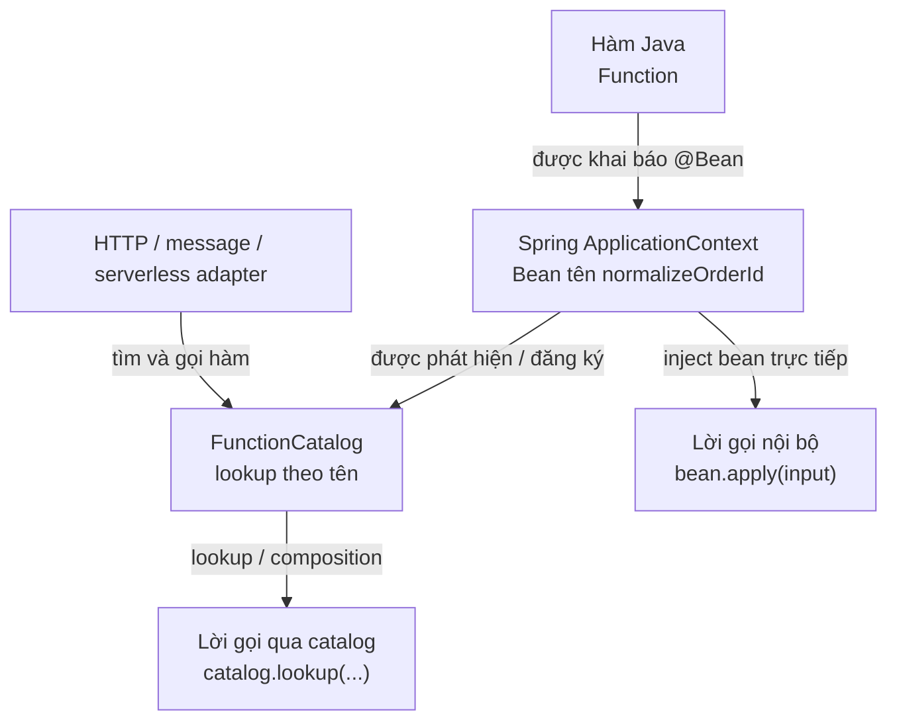

# Quan hệ giữa hàm Java, Spring bean và hàm trong FunctionCatalog

## 1. Cùng một logic nhưng có ba góc nhìn

Khi xây dựng ứng dụng với **Spring Cloud Function** (`SPRING_CLOUD_FUNCTION`), người học thường gặp ba cách nói:

1. “Tôi viết một **hàm Java** kiểu `Function<String, String>`.”
2. “Tôi đăng ký hàm đó thành **Spring bean** bằng `@Bean`.”
3. “Tôi lấy hàm từ **`FunctionCatalog`** để gọi qua tên.”

Ba cách nói mô tả **ba vai trò liên quan đến nhau**, không phải ba bản cài đặt nghiệp vụ tách biệt. Lõi xử lý vẫn có thể là cùng một lambda, nhưng cách quản lý và cách truy cập khác nhau.

Giả sử quy tắc nghiệp vụ yêu cầu chuẩn hóa mã đơn hàng: bỏ khoảng trắng ở hai đầu và đổi chữ cái thành chữ thường. Quy tắc này có thể được dùng khi nhận một HTTP request, một sự kiện đơn hàng hoặc một lời gọi trực tiếp trong Java. Để tái sử dụng cùng quy tắc mà không buộc nó biết về HTTP, Kafka hay runtime serverless, cần hiểu nơi nào định nghĩa logic và nơi nào “đưa” logic cho bộ phận gọi.



**Điểm cốt lõi:** `FunctionCatalog` không phải một kiểu dữ liệu nghiệp vụ mới. Nó là **cơ chế đăng ký và tra cứu các hàm**, đồng thời hỗ trợ những khả năng như composition và thích ứng kiểu dữ liệu tùy ngữ cảnh.

## 2. Lớp thứ nhất: hàm Java thuần

Java cung cấp các giao diện hàm trong `java.util.function`:

| Giao diện | Cách gọi | Kết quả | Ví dụ |
| --- | --- | --- | --- |
| `Supplier<T>` | `get()` | Tạo ra một giá trị `T`, không nhận tham số. | Lấy phiên bản chính sách hiện hành. |
| `Function<T, R>` | `apply(T)` | Trả về giá trị `R` từ dữ liệu `T`. | Chuẩn hóa mã đơn hàng. |
| `Consumer<T>` | `accept(T)` | Không trả về giá trị; thường thực hiện side effect. | Ghi log quyết định xử lý. |

Ví dụ Java, chưa dùng Spring:

```java
import java.util.Locale;
import java.util.function.Function;

Function<String, String> normalizeOrderId =
        input -> input.trim().toLowerCase(Locale.ROOT);

String result = normalizeOrderId.apply("  ORDER-42  ");
System.out.println(result); // order-42
```

Ở đây:

- `normalizeOrderId` chỉ là một đối tượng triển khai giao diện `Function`, được tạo từ lambda.
- `apply()` thực thi logic ngay trong ứng dụng Java.
- Không tồn tại tên hàm trong `FunctionCatalog`, Spring bean, HTTP endpoint hay message binding chỉ nhờ đoạn code trên.
- Ta có thể truyền `normalizeOrderId` cho phương thức khác hoặc kiểm thử nó mà không khởi động Spring.

Một `Function` **không mặc nhiên là hàm thuần** theo nghĩa toán học: lambda vẫn có thể đọc trạng thái chung, truy vấn database hay gọi API. Sự độc lập với giao thức đến từ **cách thiết kế đầu vào/đầu ra và các dependency**, không chỉ từ việc chọn giao diện `Function`.

## 3. Lớp thứ hai: đăng ký hàm Java thành Spring bean

Spring bean là đối tượng được **Spring ApplicationContext** quản lý. Khi khai báo phương thức `@Bean` trả về một `Function`, Spring tạo bean và đặt nó vào container. Hàm Java vẫn dùng `apply()`, nhưng nay có tên và tham gia cơ chế dependency injection, cấu hình, scope và vòng đời của Spring.

Ví dụ tối giản:

```java
import java.util.Locale;
import java.util.function.Function;
import org.springframework.context.annotation.Bean;
import org.springframework.context.annotation.Configuration;

@Configuration
public class OrderFunctionConfig {
    @Bean
    Function<String, String> normalizeOrderId() {
        return input -> input.trim().toLowerCase(Locale.ROOT);
    }
}
```

Sau khi ứng dụng tạo ApplicationContext, bean thường có tên `normalizeOrderId` — trùng tên phương thức `@Bean`. Một thành phần Spring khác có thể inject:

```java
import java.util.function.Function;
import org.springframework.beans.factory.annotation.Qualifier;
import org.springframework.stereotype.Service;

@Service
public class OrderService {
    private final Function<String, String> normalize;

    public OrderService(
            @Qualifier("normalizeOrderId")
            Function<String, String> normalize) {
        this.normalize = normalize;
    }

    public String acceptOrderId(String rawId) {
        return normalize.apply(rawId);
    }
}
```

Lúc này, lời gọi `normalize.apply(rawId)` vẫn là **gọi phương thức Java bình thường**. Spring giúp định vị và cung cấp đối tượng `Function`, chứ không đổi nội dung quy tắc chuẩn hóa.

Nếu có nhiều bean kiểu `Function<String, String>`, việc inject chỉ theo kiểu có thể bị mơ hồ. `@Qualifier("normalizeOrderId")` chỉ rõ bean cần lấy. Có thể đặt tên riêng bằng `@Bean("publicFunctionName")`; khi đó cấu hình tích hợp và lookup cần sử dụng đúng tên đã đăng ký.

**Phân biệt quan trọng:** Spring có thể quản lý rất nhiều bean thông thường, chẳng hạn repository, service hay controller. Không phải mọi bean đều xuất hiện như một hàm nghiệp vụ trong `FunctionCatalog`; việc đăng ký qua catalog tập trung vào những định nghĩa hàm được framework nhận diện hoặc đăng ký tường minh.

## 4. Lớp thứ ba: FunctionCatalog cung cấp tên gọi và điểm truy cập chung

`FunctionCatalog` nằm trong gói `org.springframework.cloud.function.context.FunctionCatalog`. Với các bean hàm Spring Cloud Function nhận diện, catalog cho phép:

- **Tra cứu theo tên:** `catalog.lookup("normalizeOrderId")`.
- **Tra cứu biểu thức composition:** `catalog.lookup("normalizeOrderId|addOrderPrefix")`.
- **Thích ứng lời gọi trong ngữ cảnh Spring Cloud Function:** các hàm được trả về có thể được framework bao bọc để hỗ trợ xử lý kiểu dữ liệu, message và composition.
- **Cung cấp điểm kết nối cho adapter:** một HTTP adapter, Spring Cloud Stream hay adapter của runtime serverless có thể chọn hàm theo tên/cấu hình rồi gọi nó.

Ví dụ khi đã được inject `FunctionCatalog catalog`:

```java
Function<String, String> function =
        catalog.lookup("normalizeOrderId");

if (function == null) {
    throw new IllegalStateException("Function not registered");
}

String result = function.apply("  ORDER-42  ");
// result = "order-42"
```

Cần hiểu đúng kết quả của `lookup()`:

- Về **nghiệp vụ**, đây là logic của hàm đã đăng ký.
- Về **đối tượng Java**, kết quả tra cứu **không được giả định là cùng instance** với bean gốc; framework có thể trả một wrapper đã được chuẩn bị để chuyển đổi dữ liệu và composition.
- Về **kiểu dữ liệu**, kiểu generic trong ví dụ giúp trình biên dịch diễn đạt điều người viết mong đợi; nó không tự xác thực nội dung payload lúc chạy.
- Nếu sai tên hàm hoặc định nghĩa không thể giải quyết được, không nên tiếp tục gọi `apply()`; cần xử lý trường hợp không tìm thấy/lỗi tra cứu.

Có thể hình dung:

| Câu hỏi | Spring bean | FunctionCatalog |
| --- | --- | --- |
| Hàm này được container quản lý như thế nào? | ApplicationContext quản lý vòng đời và dependency. | Dựa trên các hàm được đăng ký; không thay container. |
| Tôi lấy hàm bằng cách nào? | Inject theo tên/kiểu hoặc `ApplicationContext.getBean(...)`. | `lookup("tênHàm")` hoặc tên composition. |
| Tôi gọi nghiệp vụ bằng gì? | `bean.apply(input)`. | `catalog.lookup(...).apply(input)` sau khi tra cứu. |
| Tôi có thể ghép hàm theo tên không? | Có thể viết `andThen()` hoặc `compose()` trong Java. | Có thể dùng biểu thức `hàmA|hàmB`. |
| Tôi có hỗ trợ giao thức HTTP/Kafka không? | Không tự động chỉ vì là bean. | Là điểm truy cập mà adapter dùng; vẫn phải cài và cấu hình adapter. |

## 5. Ví dụ hoàn chỉnh: đối chiếu hai cách gọi trên cùng ứng dụng

Ví dụ dưới đây dùng Spring Boot, Spring Cloud Function và Java 17 trở lên. Với Maven, một lựa chọn cho ứng dụng có HTTP adapter là:

```xml
<dependency>
    <groupId>org.springframework.cloud</groupId>
    <artifactId>spring-cloud-starter-function-web</artifactId>
</dependency>
```

Ứng dụng cần quản lý phiên bản Spring Cloud bằng BOM **tương thích với phiên bản Spring Boot** đang sử dụng. Starter trên đưa vào các thành phần cần cho FunctionCatalog và HTTP adapter; nếu ứng dụng chỉ cần tra cứu hàm nội bộ, có thể chọn dependency Spring Cloud Function phù hợp mà không cần web starter.

Một tệp `FunctionCatalogDemoApplication.java` minh họa:

```java
import java.util.Locale;
import java.util.function.Consumer;
import java.util.function.Function;
import java.util.function.Supplier;

import org.springframework.beans.factory.annotation.Qualifier;
import org.springframework.boot.ApplicationRunner;
import org.springframework.boot.SpringApplication;
import org.springframework.boot.autoconfigure.SpringBootApplication;
import org.springframework.cloud.function.context.FunctionCatalog;
import org.springframework.context.annotation.Bean;

@SpringBootApplication
public class FunctionCatalogDemoApplication {

    public static void main(String[] args) {
        SpringApplication.run(
                FunctionCatalogDemoApplication.class, args);
    }

    @Bean
    Function<String, String> normalizeOrderId() {
        return input -> input.trim().toLowerCase(Locale.ROOT);
    }

    @Bean
    Function<String, String> addOrderPrefix() {
        return id -> "order:" + id;
    }

    @Bean
    Supplier<String> policyVersion() {
        return () -> "order-policy-v1";
    }

    @Bean
    Consumer<String> auditOrderId() {
        return id -> System.out.println("AUDIT: " + id);
    }

    @Bean
    ApplicationRunner compareWaysToInvoke(
            @Qualifier("normalizeOrderId")
            Function<String, String> bean,
            FunctionCatalog catalog) {

        return arguments -> {
            String input = "  ORDER-42  ";

            // Cách 1: inject và gọi trực tiếp Spring bean.
            String directResult = bean.apply(input);

            // Cách 2: tra cứu theo tên rồi gọi qua catalog.
            Function<String, String> registered =
                    catalog.lookup("normalizeOrderId");
            if (registered == null) {
                throw new IllegalStateException(
                        "Missing function: normalizeOrderId");
            }
            String catalogResult = registered.apply(input);

            // Cách 3: lấy một hàm ghép từ hai bean.
            Function<String, String> pipeline =
                    catalog.lookup(
                            "normalizeOrderId|addOrderPrefix");
            if (pipeline == null) {
                throw new IllegalStateException(
                        "Missing composed function");
            }
            String composedResult = pipeline.apply(input);

            System.out.println("Direct : " + directResult);
            System.out.println("Catalog: " + catalogResult);
            System.out.println("Compose: " + composedResult);
        };
    }
}
```

Khi ApplicationContext khởi tạo thành công, phần log của `ApplicationRunner` minh họa kết quả:

```text
Direct : order-42
Catalog: order-42
Compose: order:order-42
```

Kết quả cho thấy **cùng quy tắc chuẩn hóa** được gọi trực tiếp và qua catalog. Chỉ lần thứ ba mới thêm bước `addOrderPrefix`, vì catalog tra cứu biểu thức ghép. Đây là cách sử dụng composition; không có nghĩa Spring đã tạo một bản sao logic chuẩn hóa.

Với `Supplier` và `Consumer`, cách tra cứu tương tự nhưng phương thức gọi là `get()` và `accept()`:

```java
Supplier<String> version = catalog.lookup("policyVersion");
Consumer<String> audit = catalog.lookup("auditOrderId");

if (version != null && audit != null) {
    System.out.println(version.get());
    audit.accept("order-42");
}
```

Như vậy, `FunctionCatalog` là điểm truy cập chung cho cả ba kiểu `Supplier`, `Function`, `Consumer`.

## 6. Tại sao cần giữ thông tin kiểu generic?

`Function<String, String>` cho biết kiểu đầu vào và đầu ra của hàm. Với object phức tạp, ví dụ:

```java
public record OrderRequest(String orderId, long amount) {}
public record OrderDecision(String orderId, boolean approved) {}

@Bean
Function<OrderRequest, OrderDecision> decideOrder() {
    return request -> new OrderDecision(
            request.orderId(), request.amount() > 0);
}
```

Khai báo này nói rõ **kiểu payload nghiệp vụ**. Khi gọi trực tiếp, người gọi phải cung cấp `OrderRequest`:

```java
OrderDecision decision = decideOrder().apply(
        new OrderRequest("ORDER-42", 500_000L));
```

Khi một adapter HTTP hoặc message nhận dữ liệu như JSON, framework có thể dùng thông tin kiểu đã đăng ký và các bộ chuyển đổi phù hợp để tạo `OrderRequest` trước khi gọi hàm. Từng chuyển đổi còn phụ thuộc content type, cấu hình, thư viện hỗ trợ và dạng thông điệp được cung cấp.

Điều này **không đồng nghĩa** có thể đưa bất kỳ chuỗi JSON nào trực tiếp vào `FunctionCatalog.lookup(...).apply(...)` và chắc chắn được chuyển đổi đúng. Lời gọi Java trực tiếp, wrapper của catalog và adapter HTTP/message có điểm vào dữ liệu khác nhau.

Không nên khai báo bean dưới kiểu quá tổng quát, ví dụ:

```java
// Tránh khi cần framework suy ra kiểu payload cụ thể:
@Bean
Function rawFunction() {
    return value -> value;
}
```

Một kiểu trả về `Function` thô làm mất thông tin generic quan trọng cho việc suy luận input/output. Nên ưu tiên kiểu đầy đủ như `Function<OrderRequest, OrderDecision>`. Với đăng ký hàm động hoặc các kiểu khó suy luận, Spring Cloud Function còn có cơ chế đăng ký tường minh để cung cấp metadata kiểu; lựa chọn API cụ thể tùy phiên bản đang dùng.

## 7. Composition kết nối tên hàm với luồng dữ liệu

Java có `Function.andThen()` để nối hai `Function`:

```java
Function<String, String> normalize =
        value -> value.trim().toLowerCase(Locale.ROOT);
Function<String, String> prefix =
        value -> "order:" + value;

Function<String, String> javaPipeline =
        normalize.andThen(prefix);

String result = javaPipeline.apply("  ORDER-42  ");
// "order:order-42"
```

Trong Spring Cloud Function, có thể biểu diễn cùng thứ tự **bằng tên bean đã đăng ký**:

```text
normalizeOrderId|addOrderPrefix
```

Lúc này, `catalog.lookup("normalizeOrderId|addOrderPrefix")` tạo điểm gọi cho chuỗi xử lý tương ứng. Biểu thức đọc **từ trái sang phải**: output hàm đầu trở thành input hàm sau. Các kiểu cần tương thích, ví dụ `Function<A, B>` ghép tiếp `Function<B, C>` thành luồng `A → B → C`.

Với những adapter hỗ trợ chọn hàm qua cấu hình, có thể khai báo:

```yaml
spring:
  cloud:
    function:
      definition: "normalizeOrderId|addOrderPrefix"
```

Property `spring.cloud.function.definition` xác định tên hàm hoặc biểu thức mà adapter/binding nên sử dụng. Nó **không tự biến** các bean thành Kafka listener, HTTP server hay serverless trigger. Việc gắn với giao thức vẫn yêu cầu dependency và cấu hình môi trường riêng.

Ngoài ra, cấu hình chọn hàm không có nghĩa mọi bean khác bị xóa khỏi Spring context; catalog và ứng dụng vẫn có thể sở hữu nhiều hàm phục vụ các mục đích khác nhau.

## 8. Vai trò của Message và chuyển đổi dữ liệu

Mô hình **Spring Cloud Function** hướng tới tái sử dụng logic bằng `Supplier`, `Function` và `Consumer` trên nhiều môi trường gọi. Sự tái sử dụng này liên quan đến việc tách *payload nghiệp vụ* khỏi *thông tin giao vận*.

Ví dụ một hàm:

```java
Function<OrderRequest, OrderDecision>
```

chỉ quan tâm cấu trúc đơn hàng. Nếu cần xử lý headers, correlation ID hoặc metadata message, một cách viết khác là:

```java
Function<Message<OrderRequest>, Message<OrderDecision>>
```

`Message<T>` là kiểu của `org.springframework.messaging`, chứa payload và headers. Khi adapter có đủ thông tin kiểu và converter phù hợp, nó có thể giúp tạo dữ liệu theo hợp đồng mà hàm khai báo. Khi dùng `Message`, người viết hàm phải quyết định header nào cần được giữ, sao chép hoặc tạo mới; đừng giả định mọi metadata của HTTP hay broker tự tồn tại ở nơi gọi khác.

Phân chia trách nhiệm thực tế:

| Công việc | Nơi thực hiện điển hình |
| --- | --- |
| Chuẩn hóa `orderId`, kiểm tra hạn mức | Hàm nghiệp vụ. |
| Quản lý bean, inject dependency | Spring ApplicationContext. |
| Tìm hàm theo tên, composition, chuẩn bị wrapper | Spring Cloud Function và `FunctionCatalog`. |
| Nhận HTTP request, mapping body, trả HTTP response | HTTP adapter. |
| Subscribe/publish Kafka hoặc RabbitMQ | Spring Cloud Stream và binder/binding. |
| Nhận event do nền tảng serverless gửi | Adapter và cấu hình runtime cụ thể. |

## 9. Chọn gọi bean trực tiếp hay qua FunctionCatalog?

**Gọi Spring bean trực tiếp** phù hợp khi một thành phần Java đã biết chính xác dependency cần dùng, muốn compiler kiểm tra kiểu và đơn giản hóa luồng gọi nội bộ. Ví dụ `OrderService` chỉ cần inject `normalizeOrderId` rồi gọi `apply()`; không cần động thái tra cứu theo tên mỗi lần xử lý.

**Gọi qua `FunctionCatalog`** phù hợp khi thành phần gọi nhận *tên hàm* từ cấu hình, muốn ghép pipeline bằng biểu thức, hoặc đang xây adapter gắn HTTP, hệ thống sự kiện hay serverless với những hàm đã đăng ký. Catalog giúp tránh viết cơ chế tự quản lý `Map<String, Function<?, ?>>`, nhưng các dependency giao vận vẫn phải được cấu hình.

| Tình huống | Cách thường phù hợp | Lý do |
| --- | --- | --- |
| Một service Java cần dùng cố định quy tắc chuẩn hóa | Inject bean `Function` | Quan hệ phụ thuộc rõ, ít cấu hình. |
| Adapter chọn hành vi theo tên từ cấu hình | `FunctionCatalog.lookup(name)` | Quyết định hàm được gọi tại lúc chạy. |
| Cần nối hai bước nghiệp vụ theo tên | Catalog composition | Thay đổi chuỗi xử lý qua biểu thức có kiểm soát. |
| Code Java muốn ghép hai `Function` đã có sẵn | `andThen()` | Không cần phụ thuộc catalog nếu chỉ cần lời gọi cục bộ. |
| Muốn xử lý sự kiện Kafka | Hàm + catalog + Spring Cloud Stream binder | Catalog cung cấp hàm; binder đảm nhận hệ thống message. |

Khi gọi catalog theo tên động, chỉ cho phép những tên hoặc pipeline được tin cậy và kiểm soát; không nên lấy tên hàm bất kỳ do client nhập rồi thực thi tùy ý. Một function có side effect có thể tác động dữ liệu nếu bị gọi sai ngữ cảnh.

## 10. Những lỗi tư duy và lỗi kỹ thuật hay gặp

1. **Nhầm “đã khai báo lambda” với “đã đăng ký Spring bean”:** lambda tạo trong phương thức Java cục bộ chưa thể được catalog tìm bằng tên.
2. **Nhầm “đã có Spring bean” với “đã công bố qua HTTP”:** phải có adapter, dependency và cấu hình tương ứng; không phải mọi bean đều là HTTP endpoint.
3. **Đổi tên `@Bean` nhưng quên sửa cấu hình:** lookup và composition tham chiếu tên đăng ký nên có thể không tìm thấy hàm.
4. **Dùng kiểu `Function` thô:** làm mất thông tin generic, khiến chuyển đổi input/output khó xác định hoặc thất bại.
5. **Giả định bean và kết quả lookup là cùng object:** catalog có thể trả wrapper; hãy kiểm tra hành vi thay vì dùng so sánh tham chiếu bằng `==`.
6. **Ghép hàm có kiểu không tương thích:** output bước trước không phù hợp input bước sau, cần thiết kế lại hợp đồng.
7. **Nhầm cấu hình chọn hàm với bảo đảm xử lý sự kiện:** broker có thể gửi lại thông điệp; transaction, retry, idempotency và lỗi cần được xử lý ở lớp tích hợp/ứng dụng.
8. **Giả định bean function không có state:** bean thường có scope singleton; lambda giữ mutable state có thể gặp lỗi khi nhiều request cùng gọi. Hãy ưu tiên hàm stateless và thiết kế đồng thời khi cần lưu state.
9. **Đặt `@Transactional` lên phương thức factory `@Bean` rồi nghĩ mọi lần `apply()` được bao transaction:** metadata của phương thức tạo bean không tự bảo đảm transaction cho lambda khi thực thi; hãy đặt transaction ở service/proxy thực sự thực hiện nghiệp vụ và kiểm chứng hành vi.

## 11. Kiểm thử đúng từng ranh giới

Nên kiểm tra hai vấn đề riêng:

**Logic Java có đúng không?** Tạo `Function` và gọi `apply()`, không cần HTTP server hoặc broker:

```java
Function<String, String> function =
        new FunctionCatalogDemoApplication().normalizeOrderId();

String actual = function.apply("  ORDER-42  ");
// assertEquals("order-42", actual);
```

**Spring có đăng ký và giải quyết đúng tên hàm không?** Trong integration test có khởi tạo Spring context, inject `FunctionCatalog`, `lookup("normalizeOrderId")` rồi so sánh output. Kiểm tra thêm composition `normalizeOrderId|addOrderPrefix`. Nếu tích hợp HTTP hoặc Stream, cần test riêng việc chuyển JSON/message, chọn function, cấu hình binding và xử lý lỗi.

Một cách rà soát thiết kế cho mỗi hàm:

- **Java:** chữ ký đầu vào/đầu ra là gì, logic hoạt động đúng với dữ liệu biên chưa?
- **Spring:** bean tên gì, dependency nào được inject và bean có state không?
- **Catalog:** tên nào được tra cứu, có composition không, metadata kiểu có đủ không?
- **Adapter:** dữ liệu được nhận/chuyển đổi/đáp ứng thế nào, việc retry hoặc lỗi vận hành do ai quản lý?

Khi phân biệt được bốn câu hỏi này, ta có thể viết **một logic nghiệp vụ tái sử dụng** bằng Java, để Spring quản lý như bean, rồi đưa chính logic đó vào `FunctionCatalog` cho việc gọi qua HTTP, sự kiện hoặc serverless mà không trộn cách giao tiếp vào quy tắc nghiệp vụ.
