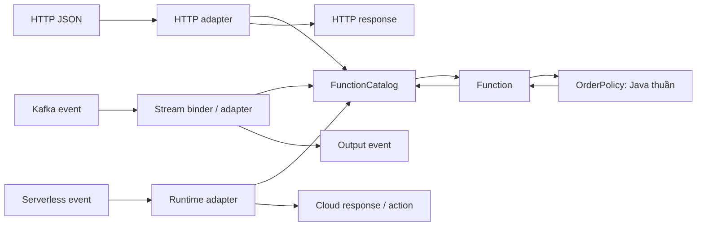

# Tách nghiệp vụ khỏi giao thức truyền dữ liệu và nền tảng thực thi

## 1. Vấn đề: một quy tắc, nhiều nơi kích hoạt

Một hệ thống xử lý đơn hàng có quy tắc: chỉ duyệt sơ bộ đơn có mã hợp lệ, số tiền lớn hơn 0 và không vượt quá 1.000.000 VND. Ban đầu ứng dụng nhận đơn qua HTTP. Khi lưu lượng tăng, một hệ thống khác gửi sự kiện qua Kafka. Sau đó đội vận hành muốn chạy cùng quy tắc trong một môi trường serverless.

Nếu quy tắc được viết ngay trong `@RestController`:

```java
@PostMapping("/orders/validate")
public ResponseEntity<?> validate(@RequestBody OrderRequest request) {
    // Kiểm tra mã đơn hàng, số tiền và ra quyết định ngay tại đây.
    // Quy tắc phụ thuộc controller, HTTP response và cách nhận request.
    ...
}
```

thì khi cần tiêu thụ sự kiện, lập trình viên dễ sao chép phần `if/else` sang một Kafka listener. Khi chính sách duyệt đơn đổi, hai đường xử lý có nguy cơ cho kết quả khác nhau. Lỗi nằm ở **vị trí đặt quy tắc**: logic nghiệp vụ bị trộn với mã tiếp nhận và trả dữ liệu qua giao thức cụ thể.

Trong module **Spring Cloud Function** (`SPRING_CLOUD_FUNCTION`), mục tiêu là phát triển logic tái sử dụng bằng `Supplier`, `Function` và `Consumer`, độc lập với giao thức gọi; dùng `FunctionCatalog` và composition khi cần; đồng thời triển khai cùng một hàm qua HTTP, sự kiện hoặc môi trường serverless. Để đạt được điều đó, ta cần phân định ba câu hỏi:

1. **Nghiệp vụ:** “Với một đơn hàng, kết quả duyệt sơ bộ là gì?”
2. **Truyền dữ liệu:** “Dữ liệu đi vào bằng HTTP body, Kafka message hay cloud event?”
3. **Thực thi:** “Ai khởi động ứng dụng, kích hoạt hàm, quản lý thời gian chạy và xử lý lỗi?”

Quy tắc nên trả lời câu hỏi thứ nhất; adapter và runtime phụ trách hai câu hỏi sau.

## 2. Phân biệt nghiệp vụ, giao thức và nền tảng thực thi

| Lớp | Trách nhiệm chính | Ví dụ | Độ ổn định mong muốn |
| --- | --- | --- | --- |
| **Nghiệp vụ (domain / use case)** | Xác định quyết định và quy tắc trên dữ liệu có ý nghĩa với doanh nghiệp. | Kiểm tra số tiền, phân loại đơn hàng, tính điểm rủi ro. | Giữ nguyên khi chỉ thay cách nhận/gửi dữ liệu. |
| **Hợp đồng dữ liệu** | Biểu diễn đầu vào và kết quả nghiệp vụ bằng kiểu rõ ràng. | `OrderRequest`, `OrderDecision`. | Thay đổi có kiểm soát khi nghiệp vụ hoặc schema thay đổi. |
| **Adapter giao thức** | Đọc dữ liệu bên ngoài, chuyển đổi kiểu, chọn hàm, tạo kết quả cho giao thức. | HTTP adapter, Spring Cloud Stream + Kafka binder. | Thay riêng theo giao thức. |
| **Runtime / nền tảng thực thi** | Khởi động, cấp tài nguyên, gọi handler, điều phối thời gian và giới hạn thực thi. | Spring Boot process, container, AWS Lambda hoặc runtime serverless khác. | Thay mà không sửa thuật toán nghiệp vụ, nếu hợp đồng vẫn phù hợp. |

**Tách khỏi giao thức không có nghĩa ứng dụng không dùng giao thức.** Vẫn phải có phần nhận request hoặc sự kiện. Cái được tách là **điều kiện ra quyết định** không phụ thuộc trực tiếp `HttpServletRequest`, `ResponseEntity`, Kafka offset hay kiểu event dành riêng cho một nhà cung cấp cloud.

**Tách khỏi runtime cũng không có nghĩa không có ràng buộc vận hành.** Serverless có giới hạn thời gian chạy và tài nguyên; luồng sự kiện có retry và khả năng xử lý lại; HTTP có timeout và mã trạng thái. Ta giữ logic ổn định, đồng thời thiết kế lớp kết nối sao cho các khác biệt này được xử lý đúng chỗ.

## 3. Kiến trúc đề xuất: lõi nghiệp vụ và các adapter



Mũi tên nối adapter với `FunctionCatalog` diễn tả **lựa chọn và gọi hàm**; mũi tên giữa `Function` và `OrderPolicy` diễn tả thực thi quy tắc. Luồng kết quả được adapter biến thành response hoặc thông điệp phù hợp. Sơ đồ mô tả các cách triển khai **thay thế nhau** hoặc cùng tồn tại khi ứng dụng được cấu hình phù hợp; không khẳng định HTTP, Kafka và serverless tự được bật chỉ nhờ một bean.

Cách tổ chức có thể là:

```text
Mô hình nghiệp vụ:
    OrderRequest  ──>  OrderPolicy  ──>  OrderDecision

Lớp Spring:
    @Bean Function<OrderRequest, OrderDecision> evaluateOrder

Rìa ứng dụng:
    HTTP adapter | Stream binder | Serverless adapter
```

Lõi nghiệp vụ được dùng thông qua kiểu dữ liệu và phương thức Java; lớp Spring biến lõi đó thành hàm có tên để các adapter tra cứu nhất quán.

## 4. Bước 1: định nghĩa hợp đồng nghiệp vụ không phụ thuộc giao thức

Hãy đặt vào lõi Java một kiểu dữ liệu đầu vào, kiểu kết quả và bộ quy tắc. Ví dụ một tệp `OrderPolicy.java`:

```java
package example.orders;

import java.math.BigDecimal;
import java.util.Objects;

public final class OrderPolicy {

    public record OrderRequest(
            String orderId,
            BigDecimal totalVnd) {}

    public record OrderDecision(
            String orderId,
            boolean approved,
            String reason) {}

    private static final BigDecimal MAX_TOTAL =
            new BigDecimal("1000000");

    public OrderDecision evaluate(OrderRequest request) {
        Objects.requireNonNull(request, "request");

        if (request.orderId() == null ||
                request.orderId().isBlank()) {
            return new OrderDecision(
                    request.orderId(), false, "MISSING_ORDER_ID");
        }

        BigDecimal total = request.totalVnd();
        if (total == null || total.signum() <= 0) {
            return new OrderDecision(
                    request.orderId(), false, "INVALID_AMOUNT");
        }

        if (total.compareTo(MAX_TOTAL) > 0) {
            return new OrderDecision(
                    request.orderId(), false, "LIMIT_EXCEEDED");
        }

        return new OrderDecision(
                request.orderId(), true, "APPROVED");
    }
}
```

Với quy tắc này:

- `OrderRequest` và `OrderDecision` chứa những thông tin có ý nghĩa với nghiệp vụ: mã đơn, tổng tiền, kết quả và lý do.
- Không có tham số kiểu HTTP request, header Kafka hay đối tượng context của cloud.
- `OrderPolicy.evaluate()` không truy cập mạng, cơ sở dữ liệu hoặc trạng thái dùng chung; với cùng đầu vào, nó trả cùng kết quả. Cách viết này giúp kiểm thử và xử lý lại thông điệp đơn giản hơn.
- `BigDecimal` phù hợp với so sánh tiền tệ hơn số thực nhị phân. Ví dụ giả định giá trị `totalVnd` được biểu diễn theo đơn vị VND và đã thỏa thuận cách làm tròn ở phía phát dữ liệu.
- `reason` là mã quyết định nghiệp vụ ổn định; từng adapter có thể ánh xạ mã này sang thông tin chi tiết phù hợp giao thức.

Gọi trực tiếp Java để kiểm tra:

```java
import java.math.BigDecimal;
import example.orders.OrderPolicy;

var policy = new OrderPolicy();
var request = new OrderPolicy.OrderRequest(
        "OD-42", new BigDecimal("850000"));

OrderPolicy.OrderDecision result = policy.evaluate(request);
// result = OrderDecision("OD-42", true, "APPROVED")
```

Không cần Spring, HTTP server hay Kafka để xác nhận quy tắc trên. Đây là lợi ích đầu tiên của việc tách phần nghiệp vụ.

## 5. Bước 2: đăng ký lõi Java thành Spring Cloud Function

Spring Cloud Function xây dựng trên các giao diện thuộc `java.util.function`. Với trường hợp “có yêu cầu → tính quyết định”, `Function<T, R>` là lựa chọn tự nhiên.

Thêm tệp `OrderFunctions.java`:

```java
package example.orders;

import java.util.function.Function;

import org.springframework.context.annotation.Bean;
import org.springframework.context.annotation.Configuration;

import example.orders.OrderPolicy.OrderRequest;
import example.orders.OrderPolicy.OrderDecision;

@Configuration
public class OrderFunctions {

    @Bean
    OrderPolicy orderPolicy() {
        return new OrderPolicy();
    }

    @Bean
    Function<OrderRequest, OrderDecision> evaluateOrder(
            OrderPolicy policy) {
        return policy::evaluate;
    }
}
```

Ứng dụng Spring Boot thông thường có thể khởi động với:

```java
package example.orders;

import org.springframework.boot.SpringApplication;
import org.springframework.boot.autoconfigure.SpringBootApplication;

@SpringBootApplication
public class OrderApplication {
    public static void main(String[] args) {
        SpringApplication.run(OrderApplication.class, args);
    }
}
```

Điểm đáng chú ý: bean `evaluateOrder` chỉ **ủy quyền** việc tính toán cho `OrderPolicy`. Tên bean mặc định là `evaluateOrder`, có thể được `FunctionCatalog` và adapter dùng để định vị hàm:

```java
import java.util.function.Function;
import org.springframework.cloud.function.context.FunctionCatalog;

// catalog do Spring inject; đoạn code minh họa lời gọi nội bộ.
Function<OrderPolicy.OrderRequest, OrderPolicy.OrderDecision> fn =
        catalog.lookup("evaluateOrder");

if (fn == null) {
    throw new IllegalStateException("evaluateOrder not registered");
}

var decision = fn.apply(
        new OrderPolicy.OrderRequest(
                "OD-42", new BigDecimal("850000")));
```

`FunctionCatalog` giúp các adapter hoặc thành phần ứng dụng tìm hàm theo tên và hỗ trợ những khả năng như composition, xử lý thông điệp và chuyển đổi kiểu trong ngữ cảnh phù hợp. Catalog có thể trả wrapper của hàm; không nên dựa vào giả định đối tượng tra cứu chính là instance bean ban đầu.

Lớp nghiệp vụ `OrderPolicy` không cần import thư viện Spring Cloud Function. Nếu thay cách phân phối, ta chỉ thay dependency, cấu hình hoặc adapter ở rìa ứng dụng.

## 6. Bước 3A: công bố hàm qua HTTP

Khi cần HTTP, thêm dependency Maven:

```xml
<dependency>
    <groupId>org.springframework.cloud</groupId>
    <artifactId>spring-cloud-starter-function-web</artifactId>
</dependency>
```

Ứng dụng cần sử dụng bộ phiên bản Spring Boot và Spring Cloud tương thích với nhau, quản lý dependency qua BOM phù hợp. Khi HTTP adapter chạy trên cổng 8080, tên hàm có thể được dùng làm đường dẫn. Ví dụ:

```bash
curl -X POST http://localhost:8080/evaluateOrder \
  -H "Content-Type: application/json" \
  -d '{"orderId":"OD-42","totalVnd":850000}'
```

Kết quả nghiệp vụ mong đợi:

```json
{
  "orderId": "OD-42",
  "approved": true,
  "reason": "APPROVED"
}
```

Ở đường HTTP, adapter xử lý các phần như URL, HTTP method, content type, đọc JSON và ghi response. Nó chuyển payload sang `OrderRequest`, gọi `evaluateOrder`, rồi chuyển `OrderDecision` thành dữ liệu phản hồi. `OrderPolicy` hoàn toàn không quyết định mã HTTP 200, 400 hay 500.

**Phân biệt lỗi nghiệp vụ và lỗi giao thức:** Một đơn có số tiền vượt giới hạn được quy tắc trả về `approved=false` với `reason=LIMIT_EXCEEDED`; đó là một **kết quả hợp lệ của nghiệp vụ**. Một JSON sai cú pháp lại là lỗi đầu vào HTTP, cần được adapter xử lý theo quy ước API. Tùy yêu cầu sản phẩm, ứng dụng có thể cần lớp HTTP tùy chỉnh để ánh xạ quyết định sang mã trạng thái khác, nhưng quy tắc xét duyệt vẫn có thể giữ nguyên.

## 7. Bước 3B: xử lý cùng hàm bằng sự kiện

Giả sử một service khác phát sự kiện đơn hàng vào topic Kafka `orders-submitted`. Ta muốn áp dụng đúng quy tắc `evaluateOrder` và phát kết quả sang topic `orders-decided`.

Với **Spring Cloud Stream**, cần dependency binder tương ứng, ví dụ `org.springframework.cloud:spring-cloud-stream-binder-kafka` (và các dependency Spring Cloud Stream được cấu hình tương thích). Khi sử dụng mô hình functional binding, một cấu hình minh họa là:

```yaml
spring:
  cloud:
    function:
      definition: evaluateOrder
    stream:
      bindings:
        evaluateOrder-in-0:
          destination: orders-submitted
          group: order-policy
          content-type: application/json
        evaluateOrder-out-0:
          destination: orders-decided
          content-type: application/json
      kafka:
        binder:
          brokers: localhost:9092
```

Ý nghĩa:

- `spring.cloud.function.definition` chọn hàm `evaluateOrder` để binding sử dụng.
- `evaluateOrder-in-0` là binding đầu vào đầu tiên của hàm; consumer đọc sự kiện từ `orders-submitted`.
- `evaluateOrder-out-0` là binding đầu ra đầu tiên; kết quả `OrderDecision` được đưa tới `orders-decided`.
- `group` thiết lập consumer group cho phía nhận để phối hợp việc tiêu thụ thông điệp.
- Binder Kafka phụ trách kết nối broker, deserialization/message conversion và việc chuyển tiếp đầu ra theo cấu hình.

Sự kiện đầu vào có thể mang payload JSON tương tự:

```json
{
  "orderId": "OD-42",
  "totalVnd": 850000
}
```

Khi converter phù hợp được dùng, payload thành `OrderRequest`, hàm tính `OrderDecision` rồi dữ liệu kết quả được gửi sang topic đầu ra. **Không cần viết lại quy tắc xét duyệt trong Kafka listener**.

Tuy nhiên, một topic message không có ngữ nghĩa giống HTTP:

- Nhà sản xuất sự kiện không nhất thiết chờ phản hồi đồng bộ.
- Khi xử lý lỗi, binder/broker có thể retry hoặc chuyển thông điệp sang dead-letter destination tùy cấu hình.
- Một sự kiện có thể được giao lại. Nếu nghiệp vụ có side effect như trừ kho hoặc ghi thanh toán, phải xử lý **idempotency** và ranh giới transaction tại nơi thích hợp.
- Thứ tự sự kiện có thể phụ thuộc partition, key và cách triển khai consumer; không được coi thứ tự toàn cục là bảo đảm mặc định.

Những trách nhiệm này thuộc lớp tích hợp và vận hành của stream. Một `Function` không tự cung cấp cam kết “exactly once” chỉ vì nó được đăng ký trong catalog.

## 8. Bước 3C: triển khai ở môi trường serverless

Một nền tảng serverless thường kích hoạt handler khi có sự kiện. Runtime có định dạng event và cách trả response riêng. Spring Cloud Function có các adapter phù hợp với những môi trường cụ thể; cần chọn dependency, handler và cách đóng gói tương ứng với nền tảng thực tế.

Cốt lõi của một adapter có thể hình dung bằng **mã giả** sau (các hàm `decode` và `encode` đại diện cho cách chuyển đổi dữ liệu riêng của runtime, không phải API Java cụ thể):

```text
handle(platformEvent):
    request = decode(platformEvent) -> OrderRequest
    function = FunctionCatalog.lookup("evaluateOrder")
    decision = function.apply(request)
    return encode(decision) -> platformResponse
```

Adapter làm rõ điểm bắt đầu của lời gọi và xử lý định dạng của cloud event. `OrderPolicy` tiếp tục nhận `OrderRequest` và trả `OrderDecision` như trong HTTP và Kafka.

Những thứ vẫn phải chuẩn bị riêng cho serverless gồm runtime Java tương thích, dependency adapter, handler entry point, packaging, quyền truy cập tài nguyên, cấu hình trigger, cấu hình bộ nhớ, timeout và quan sát lỗi. Nếu một phiên bản dùng AWS Lambda, các phần này phải theo hợp đồng của AWS; nếu dùng runtime khác, cách đóng gói và contract handler có thể khác.

Một quy tắc nghiệp vụ không phụ thuộc giao thức **có thể tái sử dụng** trên serverless; điều đó không có nghĩa file JAR có thể tự chạy trên mọi nhà cung cấp cloud mà không cần cấu hình.

## 9. Supplier, Function và Consumer ảnh hưởng gì đến ranh giới?

| Kiểu Java | Hình dạng logic | Nơi kích hoạt điển hình | Điều cần chú ý khi đổi môi trường |
| --- | --- | --- | --- |
| `Supplier<T>` | Không nhận payload, trả dữ liệu. | Endpoint đọc, poller hoặc source event. | `Supplier` không tự lên lịch; adapter/runtime quyết định lúc gọi. |
| `Function<T, R>` | Nhận yêu cầu, trả kết quả. | HTTP request/response hoặc message input/output. | HTTP trả kết quả đồng bộ; event thường có output message bất đồng bộ. |
| `Consumer<T>` | Nhận dữ liệu, trả `void`. | Message sink, ghi log hoặc cập nhật trạng thái. | Tác dụng phụ cần idempotency và xử lý lỗi; không có payload kết quả để gửi tiếp. |

Nếu một use case tự nhiên mang dạng “input → quyết định”, hãy ưu tiên `Function`. Nếu use case chủ yếu ghi dữ liệu hoặc phát lệnh, có thể dùng `Consumer` nhưng cần thận trọng với transaction và sự kiện được xử lý lại. Đối với nguồn dữ liệu không yêu cầu input, `Supplier` phù hợp hơn. Composition có thể ghép những hàm có kiểu tương thích, ví dụ:

```text
normalizeOrder | evaluateOrder
```

Điều kiện là output của `normalizeOrder` phải tương thích với input của `evaluateOrder`. Dấu `|` chỉ định composition theo thứ tự trái sang phải trong Spring Cloud Function; nó không tự tạo broker, endpoint hay scheduler.

## 10. Giữ hợp đồng nghiệp vụ độc lập nhưng không bỏ qua metadata

Để tách giao thức hiệu quả, dữ liệu truyền vào phải là một **hợp đồng miền rõ ràng**, không phải “đối tượng bất kỳ”. Những câu hỏi cần giải quyết:

| Câu hỏi | Thiết kế minh họa |
| --- | --- |
| Số tiền có đơn vị gì? | `totalVnd` được định nghĩa theo VND, thống nhất cách làm tròn. |
| Mã đơn có được rỗng không? | `MISSING_ORDER_ID` là kết quả từ quy tắc. |
| Lý do từ chối biểu diễn thế nào? | Mã `reason` ổn định để HTTP client và event consumer cùng hiểu. |
| Schema thay đổi thì sao? | Quản lý version của payload và quy tắc chuyển đổi ở rìa hệ thống. |
| Cần correlation ID hay trace ID? | Đọc/ghi metadata ở adapter hoặc truyền tường minh vào hợp đồng khi nghiệp vụ thật sự cần. |
| Cần broker key, Kafka offset hay HTTP header? | Giữ ở lớp transport trừ khi chúng là thông tin nghiệp vụ thực sự. |

Nếu một hàm cần xử lý headers của message, Spring cung cấp `org.springframework.messaging.Message<T>`, có payload và headers:

```java
Function<Message<OrderRequest>, Message<OrderDecision>>
```

Cách khai báo đó hữu ích trong luồng message, nhưng có thể làm logic phụ thuộc vào khái niệm Spring Messaging. Khi bài toán chỉ cần dữ liệu nghiệp vụ, `Function<OrderRequest, OrderDecision>` thường dễ dùng lại hơn. Thông tin kiểu generic nên được giữ đầy đủ để framework biết kiểu payload đầu vào/đầu ra khi có converter phù hợp.

**Không phải mọi chuyển đổi đều tự động thành công.** Content type, thư viện chuyển đổi, message headers, cấu hình binder và kiểu dữ liệu Java quyết định cách adapter chuyển một JSON hoặc event thành `OrderRequest`. Đừng kỳ vọng có thể truyền tùy ý một chuỗi JSON vào `apply()` và luôn nhận được object đúng kiểu.

## 11. Cùng quy tắc, khác ngữ nghĩa vận hành

| Khía cạnh | HTTP | Hệ thống sự kiện | Serverless |
| --- | --- | --- | --- |
| **Kích hoạt** | Client gửi request. | Broker cung cấp message theo subscription. | Nền tảng gọi handler theo trigger. |
| **Nhận kết quả** | Phản hồi ngay trong request, khi xử lý thành công. | Thường là message đầu ra hoặc side effect. | Response/action theo contract runtime. |
| **Timeout** | Client, server, proxy và gateway. | Consumer/binder, xử lý và broker. | Giới hạn của runtime và trigger. |
| **Retry** | Client/API gateway có thể gọi lại. | Có thể redelivery/retry theo chính sách. | Tùy nền tảng và loại trigger, có thể gọi lại. |
| **Lỗi dữ liệu** | Có thể trả lỗi 4xx theo API contract. | Có thể đưa sang luồng lỗi, retry hoặc dead-letter. | Có thể trả response lỗi hoặc kích hoạt retry theo runtime. |
| **Quan sát** | Request ID, HTTP tracing, status code. | Message key, correlation ID, consumer lag, retry. | Invocation ID, log/tracing, cold start, timeout. |

Mỗi adapter phải bảo vệ đúng **ngữ nghĩa của môi trường**, thay vì ép mọi lời gọi trở thành “một HTTP request giả”. Ví dụ: kết quả `approved=false` không nên bị nhầm với exception khiến broker retry liên tục. Với dữ liệu không thể giải mã, lỗi có thể được xử lý ở rìa và đưa vào hàng đợi lỗi, thay vì biến lỗi parse thành một quyết định nghiệp vụ giả.

## 12. Thiết kế lỗi và tác dụng phụ ở đúng nơi

Có thể phân loại tình huống thành ba nhóm:

1. **Kết quả nghiệp vụ hợp lệ:** số tiền vượt hạn mức → `OrderDecision(approved=false, reason=LIMIT_EXCEEDED)`. HTTP nhận phản hồi nghiệp vụ; Stream có thể phát event từ chối; serverless tạo kết quả theo contract trigger.
2. **Đầu vào sai định dạng:** JSON bị hỏng, không thể chuyển sang `OrderRequest` hoặc không có trường dữ liệu quan trọng mà adapter yêu cầu. Cần quy tắc xác thực và xử lý lỗi đầu vào tại lớp kết nối; chỉ đưa vào domain khi đã có dữ liệu có thể hiểu được.
3. **Lỗi hệ thống:** database không khả dụng, timeout API phụ thuộc, lỗi gửi message. Đây là lỗi cần cơ chế retry, circuit breaker, transaction hoặc theo dõi vận hành phù hợp.

Đối với hàm **đọc dữ liệu → trả quyết định**, việc xử lý lại thường an toàn hơn nếu hàm stateless. Khi cần trừ kho hoặc thanh toán:

- Dùng idempotency key gắn với nghiệp vụ (ví dụ mã giao dịch) để tránh ghi trùng khi có retry.
- Xác định một ranh giới transaction hợp lệ cho database; lưu ý Kafka và database có bảo đảm riêng, không tự tạo transaction phân tán.
- Tách việc tính quyết định và việc thực hiện side effect khi nó giúp kiểm soát lỗi tốt hơn.
- Đừng giữ trạng thái thay đổi được trong bean `Function` singleton nếu chưa quản lý đồng thời.

Việc tách lớp **không loại bỏ** nhu cầu xác thực, phân quyền, kiểm tra schema, bảo mật secret hoặc logging. Nó giúp đặt các trách nhiệm đó đúng lớp để nâng cấp độc lập.

## 13. Kiểm thử theo tầng để xác nhận thật sự tách biệt

### 13.1. Unit test cho nghiệp vụ

Kiểm thử `OrderPolicy` không khởi động Spring Boot. Ví dụ với JUnit Jupiter:

```java
package example.orders;

import static org.junit.jupiter.api.Assertions.assertEquals;
import static org.junit.jupiter.api.Assertions.assertFalse;
import static org.junit.jupiter.api.Assertions.assertTrue;

import java.math.BigDecimal;
import org.junit.jupiter.api.Test;

class OrderPolicyTest {
    private final OrderPolicy policy = new OrderPolicy();

    @Test
    void approvesValidOrder() {
        var decision = policy.evaluate(
                new OrderPolicy.OrderRequest(
                        "OD-42", new BigDecimal("850000")));

        assertTrue(decision.approved());
        assertEquals("APPROVED", decision.reason());
    }

    @Test
    void rejectsOrderAboveLimit() {
        var decision = policy.evaluate(
                new OrderPolicy.OrderRequest(
                        "OD-43", new BigDecimal("1000001")));

        assertFalse(decision.approved());
        assertEquals("LIMIT_EXCEEDED", decision.reason());
    }
}
```

Nên bổ sung các trường hợp biên: đúng 1.000.000 VND, tiền bằng 0, giá trị âm, tổng tiền null, mã đơn rỗng và request null. Unit test chỉ đánh giá **quy tắc nghiệp vụ**.

### 13.2. Integration test cho Spring và catalog

Khởi động Spring test context, inject `FunctionCatalog` và kiểm tra có thể `lookup("evaluateOrder")`, gọi đúng kiểu `OrderRequest`, nhận `OrderDecision` như mong đợi. Điều này xác minh hàm được Spring đăng ký và tra cứu đúng tên; nó khác với việc test Java thuần.

### 13.3. Contract test cho từng adapter

- **HTTP:** JSON body được chuyển đúng kiểu; response giữ đúng schema; xử lý bad request, content type và mã lỗi theo API contract.
- **Kafka:** message được giải mã, binding đầu vào/đầu ra đúng destination; quan sát retry, dead-letter policy và tình huống sự kiện trùng.
- **Serverless:** handler nhận đúng định dạng event, kích hoạt đúng function, trả response đúng contract runtime; kiểm tra cấu hình timeout và lỗi do nền tảng xử lý.

Nếu chỉ sửa code adapter, unit test của `OrderPolicy` không cần thay đổi. Nếu đổi quy tắc hạn mức, unit test phải thể hiện chính sách mới, còn các contract test xác nhận môi trường vẫn truyền/nhận đúng dữ liệu. Đây là dấu hiệu kiến trúc đã tách trách nhiệm tương đối tốt.

## 14. Khi nào cần bổ sung lớp ứng dụng hoặc port?

Không phải nghiệp vụ nào cũng là một phép tính không có side effect. Khi use case cần truy vấn hạn mức từ database hoặc gọi dịch vụ định giá, có thể đưa **interface (port)** vào phần nghiệp vụ/ứng dụng và để adapter cung cấp phần triển khai:

```java
public interface LimitProvider {
    BigDecimal maxAmountFor(String customerId);
}

public final class ApprovalService {
    private final LimitProvider limits;

    public ApprovalService(LimitProvider limits) {
        this.limits = limits;
    }

    // Logic xét duyệt phụ thuộc giao diện LimitProvider,
    // không phụ thuộc JDBC, HTTP client hay cloud SDK.
}
```

Trường hợp này, Spring có thể inject implementation của `LimitProvider` vào service, rồi đăng ký một `Function` gọi service. Điều quan trọng là dependency hướng **từ adapter tới hợp đồng nghiệp vụ**, tránh đưa các API cụ thể của HTTP/broker vào lớp quy tắc. Nếu thời gian, ngẫu nhiên hoặc cấu hình ảnh hưởng quyết định, hãy truyền qua dependency có thể kiểm soát (ví dụ `Clock`) để test dự đoán được.

Tuy vậy, đừng biến mọi hàm nhỏ thành nhiều tầng abstract chỉ vì framework cho phép. Với một phép biến đổi đơn giản và không có I/O, một bean `Function` thuần đã đủ. Tách thêm port khi nó giải quyết dependency thực sự.

## 15. Quy trình áp dụng cho một use case mới

1. **Viết mô tả nghiệp vụ:** “Đầu vào là gì, điều kiện nào tạo đầu ra gì?” Loại khỏi mô tả các từ như HTTP, topic, Lambda nếu không phải quy tắc miền.
2. **Chốt kiểu đầu vào/đầu ra:** xác định tên trường, kiểu, đơn vị, giá trị thiếu, lý do từ chối và phiên bản schema.
3. **Cài logic Java và unit test:** bắt đầu bằng `OrderPolicy.evaluate()`; kiểm tra các trường hợp biên.
4. **Đăng ký `Supplier`, `Function` hoặc `Consumer` phù hợp:** đặt tên bean ổn định; dùng `FunctionCatalog` và composition nếu cần định tuyến hoặc ghép hàm theo tên.
5. **Chọn adapter theo môi trường:** thêm HTTP starter, Spring Cloud Stream binder hoặc adapter serverless, rồi cấu hình endpoint/topic/trigger tương ứng.
6. **Thiết kế ngữ nghĩa vận hành:** xử lý validation, retry, idempotency, timeout, transaction, xác thực và quan sát ở ranh giới thích hợp.
7. **Kiểm thử tích hợp:** xác nhận cùng payload nghiệp vụ tạo cùng quyết định trên từng đường gọi, đồng thời kiểm tra lỗi giao thức và runtime.

**Tiêu chí kiểm tra cuối cùng:** Nếu thay HTTP bằng Kafka mà phải sao chép đoạn tính hạn mức hoặc đưa `KafkaHeaders` vào `OrderPolicy`, ranh giới chưa đủ rõ. Nếu có thể dùng lại `OrderPolicy` và `evaluateOrder`, chỉ cần bổ sung adapter, hợp đồng và cấu hình triển khai phù hợp, mục tiêu **tách nghiệp vụ khỏi giao thức truyền dữ liệu và nền tảng thực thi** đã được hiện thực hóa.
