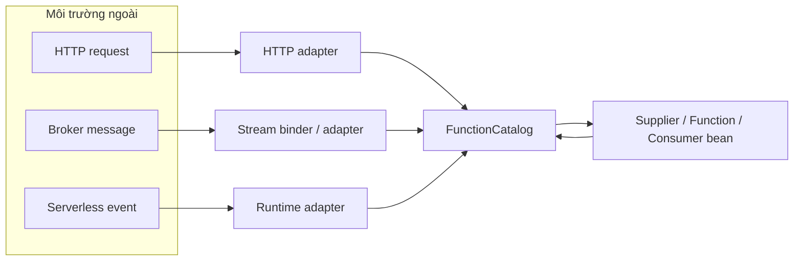

# Vai trò của Supplier, Function, Consumer và bộ điều hợp

## 1. Một nghiệp vụ có thể được kích hoạt theo nhiều cách

Giả sử hệ thống bán hàng thực hiện ba công việc:

1. Cung cấp phiên bản chính sách xét duyệt đơn hàng hiện hành.
2. Nhận thông tin đơn hàng và trả về kết quả duyệt sơ bộ.
3. Ghi nhận quyết định xét duyệt để theo dõi hoạt động.

Ba công việc này có hình dạng đầu vào và đầu ra khác nhau. Công việc đầu **tạo dữ liệu**, công việc thứ hai **biến đổi dữ liệu**, công việc thứ ba **tiêu thụ dữ liệu để thực hiện một hành động**. Chúng có thể được gọi từ HTTP, hệ thống sự kiện hoặc môi trường serverless nhưng bản thân quy tắc nghiệp vụ không cần phải biết giao thức nào đã kích hoạt mình.

Trong module **Spring Cloud Function** (`SPRING_CLOUD_FUNCTION`), ba vai trò đó được biểu diễn bằng các giao diện chuẩn Java: `Supplier<T>`, `Function<T, R>` và `Consumer<T>`. Spring Cloud Function đăng ký và tra cứu các hàm qua `FunctionCatalog`, hỗ trợ composition, xử lý/chuyển đổi thông điệp và kết nối với **bộ điều hợp (adapter)**. Bộ điều hợp nhận dữ liệu từ môi trường bên ngoài, kích hoạt đúng hàm, rồi chuyển kết quả về nơi cần đến.

Để hiểu mô hình này, cần phân biệt **hình dạng lời gọi của hàm** với **cách môi trường kích hoạt và vận chuyển dữ liệu**.

## 2. Ba giao diện Java biểu đạt ba trách nhiệm

Các giao diện đều nằm trong gói `java.util.function` của JDK:

| Giao diện | Phương thức | Đầu vào | Đầu ra | Vai trò phổ biến |
| --- | --- | --- | --- | --- |
| `Supplier<T>` | `T get()` | Không có tham số payload. | Một giá trị kiểu `T`. | Nguồn cung cấp dữ liệu, đọc snapshot, phát bản ghi định kỳ khi có poller. |
| `Function<T, R>` | `R apply(T input)` | Một giá trị kiểu `T`. | Một giá trị kiểu `R`. | Biến đổi, chuẩn hóa, kiểm tra, tính toán và đưa ra quyết định. |
| `Consumer<T>` | `void accept(T input)` | Một giá trị kiểu `T`. | Không có giá trị trả về. | Ghi log, lưu dữ liệu, gửi lệnh/thông báo hoặc tạo side effect. |

Có thể hình dung các luồng dữ liệu như sau:

```text
Supplier<T>             Function<T, R>             Consumer<T>
     ┌─────────┐          ┌───────────┐            ┌───────────┐
     │  get()  │          │ apply(T)  │            │ accept(T) │
     └────┬────┘          └───────────┘            └───────────┘
          │               T ───▶ │ ───▶ R          T ───▶ │
          ▼
          T                                         (không có R)
```

Các phương thức `get()`, `apply()` và `accept()` là **lời gọi Java thông thường**. Chúng không tự gửi HTTP request, đăng ký Kafka consumer hoặc tạo serverless trigger.

Ví dụ Java thuần:

```java
import java.util.Locale;
import java.util.function.Consumer;
import java.util.function.Function;
import java.util.function.Supplier;

Supplier<String> getPolicyVersion = () -> "policy-2026-11";

Function<String, String> normalizeOrderId =
        value -> value.trim().toLowerCase(Locale.ROOT);

Consumer<String> auditOrderId =
        value -> System.out.println("AUDIT: " + value);

String version = getPolicyVersion.get();
String orderId = normalizeOrderId.apply("  ORDER-42  ");
auditOrderId.accept(orderId);
```

Đoạn mã này dùng hoàn toàn các giao diện của Java. Khi muốn Spring quản lý và bộ điều hợp tìm thấy chúng, ta đăng ký thành bean.

## 3. Supplier: hàm đóng vai trò nguồn dữ liệu

`Supplier<T>` hữu ích khi ứng dụng cần **tạo hoặc đọc một giá trị mà không cần tham số đầu vào cho lần gọi hiện tại**.

Ví dụ nguồn cung cấp phiên bản chính sách:

```java
@Bean
Supplier<String> policyVersion() {
    return () -> "order-policy-v1";
}
```

Mỗi lần có người hoặc bộ điều hợp gọi `get()`, hàm trả về chuỗi `order-policy-v1`. Supplier cũng có thể đọc dữ liệu từ service, repository hoặc API được inject; khi đó cần tính đến lỗi I/O, tốc độ trả về và khả năng gọi đồng thời.

**Điểm dễ nhầm:** `Supplier` không phải một bộ lập lịch. Hàm chỉ định nghĩa *lấy gì khi được gọi*; adapter hoặc thành phần gọi mới quyết định *khi nào gọi*.

| Ngữ cảnh | Cách một `Supplier` có thể được kích hoạt |
| --- | --- |
| Java nội bộ | Một service gọi `supplier.get()` tại thời điểm cần dữ liệu. |
| HTTP | Client gửi request đến endpoint ánh xạ với supplier; web adapter gọi `get()`. |
| Spring Cloud Stream | Poller phù hợp gọi supplier rồi phát kết quả đến binding đầu ra. |
| Serverless | Runtime kích hoạt handler theo sự kiện; adapter có thể gọi supplier nếu đó là contract của handler. |

Nếu một supplier gửi dữ liệu ra message broker, phải chọn tần suất polling và số lần phát có chủ đích. Một supplier tạo giao dịch mới mỗi lần `get()` có thể tạo dữ liệu lặp khi adapter kích hoạt lại. Nếu mục tiêu là đọc snapshot, cần xác định snapshot có mới ở mỗi lần gọi hay được cache.

## 4. Function: hàm biến đổi và ra quyết định

`Function<T, R>` thích hợp cho tình huống có một đầu vào nghiệp vụ rõ ràng và cần một đầu ra xác định. Đây là dạng dễ tái sử dụng trên nhiều môi trường:

```java
@Bean
Function<String, String> normalizeOrderId() {
    return value -> value.trim()
            .toLowerCase(java.util.Locale.ROOT);
}
```

Với nghiệp vụ thực tế, ta thường dùng kiểu dữ liệu miền:

```java
public record OrderRequest(String orderId, BigDecimal totalVnd) {}
public record OrderDecision(
        String orderId, boolean approved, String reason) {}

@Bean
Function<OrderRequest, OrderDecision> decideOrder() {
    return request -> {
        boolean validId = request.orderId() != null
                && !request.orderId().isBlank();
        boolean validAmount = request.totalVnd() != null
                && request.totalVnd().signum() > 0
                && request.totalVnd().compareTo(
                        new BigDecimal("1000000")) <= 0;

        boolean approved = validId && validAmount;
        return new OrderDecision(
                request.orderId(),
                approved,
                approved ? "APPROVED" : "REJECTED");
    };
}
```

Khi được gọi trực tiếp, `decideOrder.apply(request)` nhận một `OrderRequest` và trả một `OrderDecision`. Nếu gọi từ HTTP, adapter nhận JSON trước rồi chuyển thành `OrderRequest`. Nếu gọi từ Kafka, binder nhận message, giải mã payload rồi gọi cùng hàm; kết quả có thể được phát ra một topic. Lõi `Function` vẫn dùng cùng chữ ký.

**Function không nhất thiết là hàm thuần.** Nó có thể gọi database, sửa trạng thái hoặc phát sự kiện. Tuy vậy, một `Function` chỉ tính toán và trả kết quả thường dễ kiểm thử, ghép hàm và xử lý lại khi message bị giao trùng hơn hàm có nhiều side effect.

## 5. Consumer: hàm tiêu thụ dữ liệu và thực hiện hành động

`Consumer<T>` phù hợp khi đầu ra nghiệp vụ của thao tác là **tác dụng phụ**, chẳng hạn ghi log kiểm toán, lưu bản ghi hoặc gửi thông báo:

```java
@Bean
Consumer<OrderDecision> auditDecision() {
    return decision -> System.out.printf(
            "AUDIT order=%s approved=%s reason=%s%n",
            decision.orderId(),
            decision.approved(),
            decision.reason());
}
```

Thành phần gọi thực thi `auditDecision.accept(decision)` và không nhận object kết quả. Điều này **không đồng nghĩa hành động luôn thành công**: hàm vẫn có thể ném exception, ghi thất bại hoặc bị gọi lại. Giao thức và adapter sẽ có cách biểu diễn việc hoàn tất hay thất bại riêng.

Một số lưu ý vận hành:

- Với Kafka hoặc broker khác, một message có thể được phát lại sau lỗi hoặc khi consumer restart; side effect cần được thiết kế **idempotent** nếu không được phép ghi hoặc trừ tiền hai lần.
- Khi HTTP gọi consumer, client không nên mong chờ một JSON quyết định từ `accept()`. Nếu nghiệp vụ cần trả kết quả, cân nhắc `Function<Request, Result>` hoặc một API contract phù hợp.
- Nếu consumer gửi email hoặc gọi dịch vụ ngoài, cơ chế timeout, retry và theo dõi thất bại phải được xác định; kiểu `void` không thay thế các chính sách này.
- Ghi log chỉ minh họa side effect. Với audit cần đảm bảo lưu trữ, phải dùng cơ chế lưu bền vững và kiểm tra lỗi tương ứng.

## 6. Bộ điều hợp (adapter) làm gì?

Trong Spring Cloud Function, **adapter** là thành phần nối một hàm với một cách kích hoạt hoặc một nền tảng bên ngoài. Ta có thể chia trách nhiệm thành ba phần:

1. **Nhận và diễn giải đầu vào:** HTTP body, message payload, cloud event hoặc metadata liên quan.
2. **Tìm và gọi hàm:** chọn bean đã đăng ký, thường thông qua `FunctionCatalog`, rồi dùng `get()`, `apply()` hoặc `accept()` theo kiểu hàm.
3. **Đưa kết quả về đúng môi trường:** trả HTTP response, phát message đầu ra, hoặc tạo response/action theo contract của runtime.



Sơ đồ chỉ mô tả quan hệ lựa chọn và gọi hàm; cách trả response, thông điệp và tác dụng phụ được quy định bởi từng adapter. **FunctionCatalog không phải là HTTP server hay Kafka broker**. Nó là điểm đăng ký/tra cứu hàm, còn các adapter đảm nhận kết nối giao thức.

So sánh vai trò cụ thể:

| Thành phần | Biết và quản lý điều gì? | Không tự đảm nhận điều gì? |
| --- | --- | --- |
| `Supplier` | Cách lấy hoặc tạo giá trị. | Lịch polling, endpoint, địa chỉ topic. |
| `Function` | Quy tắc chuyển từ `T` sang `R`. | HTTP status, broker offset, quyền cloud. |
| `Consumer` | Hành động cần làm với `T`. | Cam kết giao message đúng một lần, transaction phân tán. |
| `FunctionCatalog` | Danh sách/tên hàm, tra cứu, composition và khả năng thích ứng của framework. | Tự khởi động broker hoặc phát sinh trigger cho runtime bất kỳ. |
| **Adapter** | Chuyển dữ liệu và kích hoạt hàm theo một giao thức/runtime. | Tự quyết định quy tắc miền đúng/sai nếu lõi nghiệp vụ đã định nghĩa. |

Trong những mô tả tài liệu, từ *adapter* đôi khi còn dùng cho wrapper nội bộ của framework, ví dụ wrapper hỗ trợ chuyển đổi `Message`. Ở bài này, “bộ điều hợp giao thức/runtime” chỉ những thành phần kết nối với HTTP, Stream và môi trường serverless.

## 7. Ví dụ Spring Boot: ba hàm có tên rõ ràng

Trong ứng dụng Spring Boot với Java 17 trở lên và phiên bản Spring Cloud tương thích, có thể khai báo cả ba hàm:

```java
package example.functions;

import java.math.BigDecimal;
import java.util.function.Consumer;
import java.util.function.Function;
import java.util.function.Supplier;

import org.slf4j.Logger;
import org.slf4j.LoggerFactory;
import org.springframework.boot.SpringApplication;
import org.springframework.boot.autoconfigure.SpringBootApplication;
import org.springframework.context.annotation.Bean;

@SpringBootApplication
public class OrderFunctionsApplication {
    private static final Logger log =
            LoggerFactory.getLogger(OrderFunctionsApplication.class);
    private static final BigDecimal LIMIT =
            new BigDecimal("1000000");

    public static void main(String[] args) {
        SpringApplication.run(OrderFunctionsApplication.class, args);
    }

    public record PolicyInfo(String version, BigDecimal maxTotalVnd) {}
    public record OrderRequest(String orderId, BigDecimal totalVnd) {}
    public record OrderDecision(
            String orderId, boolean approved, String reason) {}

    @Bean
    Supplier<PolicyInfo> policyInfo() {
        return () -> new PolicyInfo("v1", LIMIT);
    }

    @Bean
    Function<OrderRequest, OrderDecision> decideOrder() {
        return request -> {
            boolean validId = request != null
                    && request.orderId() != null
                    && !request.orderId().isBlank();
            BigDecimal amount = request == null
                    ? null : request.totalVnd();
            boolean validAmount = amount != null
                    && amount.signum() > 0
                    && amount.compareTo(LIMIT) <= 0;
            boolean approved = validId && validAmount;
            return new OrderDecision(
                    request == null ? null : request.orderId(),
                    approved,
                    approved ? "APPROVED" : "REJECTED");
        };
    }

    @Bean
    Consumer<OrderDecision> auditDecision() {
        return decision -> log.info(
                "AUDIT orderId={}, approved={}, reason={}",
                decision.orderId(),
                decision.approved(),
                decision.reason());
    }
}
```

Mỗi phương thức `@Bean` tạo một Spring bean hàm với tên mặc định tương ứng là `policyInfo`, `decideOrder` và `auditDecision`. Spring Cloud Function có thể phát hiện và đăng ký các bean hàm trong `FunctionCatalog`. **Chữ ký hàm vẫn là của JDK**; việc đăng ký vào Spring không biến body của hàm thành code phụ thuộc HTTP hay Kafka.

Ví dụ rút gọn trên đặt toàn bộ code trong một lớp để dễ quan sát. Với ứng dụng lớn, nên tách model nghiệp vụ, policy/service và lớp cấu hình bean. Đặc biệt, nếu quyết định xét duyệt cần I/O hoặc transaction, logic có thể nằm ở service được inject vào `@Bean Function`.

## 8. Tra cứu và gọi thông qua FunctionCatalog

Khi ứng dụng đã cấu hình Spring Cloud Function, một thành phần Spring có thể inject `org.springframework.cloud.function.context.FunctionCatalog` để chọn hàm theo tên.

```java
// catalog đã được inject bởi Spring; mã minh họa trong bean/service.
Supplier<OrderFunctionsApplication.PolicyInfo> supply =
        catalog.lookup("policyInfo");

Function<OrderFunctionsApplication.OrderRequest,
         OrderFunctionsApplication.OrderDecision> decide =
        catalog.lookup("decideOrder");

Consumer<OrderFunctionsApplication.OrderDecision> audit =
        catalog.lookup("auditDecision");

if (supply == null || decide == null || audit == null) {
    throw new IllegalStateException("Missing registered function");
}

var policy = supply.get();
var decision = decide.apply(
        new OrderFunctionsApplication.OrderRequest(
                "OD-42", new BigDecimal("800000")));
audit.accept(decision);
```

Đoạn này cho thấy catalog không xóa bỏ sự khác nhau giữa ba kiểu hàm: `get()` vẫn không nhận tham số, `apply()` vẫn trả kết quả, `accept()` vẫn không trả một giá trị nghiệp vụ.

Kết quả `lookup()` có thể là hàm được framework bao bọc, không nhất thiết là cùng instance với Spring bean ban đầu. Kiểu generic trong code thể hiện kỳ vọng của người gọi; vẫn cần khai báo đúng kiểu hàm, cấu hình converter và kiểm tra payload thực tế. Nếu tra cứu bằng tên không tồn tại, phải xử lý trường hợp không tìm thấy thay vì gọi tiếp trên `null`.

## 9. Adapter HTTP kích hoạt từng kiểu hàm thế nào?

Với Spring Boot, một cách cung cấp HTTP adapter là thêm dependency Maven `spring-cloud-starter-function-web` và BOM Spring Cloud phù hợp:

```xml
<dependency>
    <groupId>org.springframework.cloud</groupId>
    <artifactId>spring-cloud-starter-function-web</artifactId>
</dependency>
```

Với ứng dụng chạy trên cổng 8080 và HTTP adapter ánh xạ theo tên hàm, các lời gọi minh họa:

### 9.1. Supplier qua HTTP

```bash
curl http://localhost:8080/policyInfo
```

Kết quả dữ liệu mong đợi:

```json
{
  "version": "v1",
  "maxTotalVnd": 1000000
}
```

HTTP adapter không nhận payload nghiệp vụ cho `Supplier.get()`. Nó kích hoạt hàm và chuyển `PolicyInfo` thành HTTP response theo cấu hình chuyển đổi dữ liệu.

### 9.2. Function qua HTTP

```bash
curl -X POST http://localhost:8080/decideOrder \
  -H "Content-Type: application/json" \
  -d '{"orderId":"OD-42","totalVnd":800000}'
```

Kết quả nghiệp vụ mong đợi:

```json
{
  "orderId": "OD-42",
  "approved": true,
  "reason": "APPROVED"
}
```

HTTP adapter chuyển JSON thành `OrderRequest`, gọi `decideOrder.apply(request)` và chuyển `OrderDecision` thành response. Logic không cần nhận `HttpServletRequest` hoặc tạo `ResponseEntity`.

### 9.3. Consumer qua HTTP

```bash
curl -i -X POST http://localhost:8080/auditDecision \
  -H "Content-Type: application/json" \
  -d '{"orderId":"OD-42","approved":true,"reason":"APPROVED"}'
```

Adapter chuyển JSON thành `OrderDecision` và kích hoạt `auditDecision.accept(decision)`. Vì `Consumer` trả `void`, không có body `OrderDecision` mới từ nghiệp vụ; mã trạng thái và body HTTP cụ thể cần được xác nhận với adapter, cấu hình và phiên bản sử dụng.

**Chú ý về API:** Một kết quả `approved=false` là kết quả nghiệp vụ hợp lệ, không tự đồng nghĩa HTTP 4xx. Ngược lại, JSON sai cú pháp hoặc content type không hỗ trợ là lỗi ở lớp nhận dữ liệu. Khi cần quy ước status và error body chặt chẽ, có thể thêm lớp HTTP phù hợp, vẫn dùng lại bean `Function`.

## 10. Adapter thông điệp và Spring Cloud Stream

Đối với Kafka hoặc RabbitMQ, **Spring Cloud Stream** và binder tương ứng kết nối các bean functional với luồng message. Spring Cloud Function cung cấp mô hình hàm; Spring Cloud Stream/binder cung cấp binding và cơ chế giao tiếp với broker.

### 10.1. Function: đầu vào và đầu ra

Ví dụ dùng Kafka binder và chọn `decideOrder` bằng cấu hình:

```yaml
spring:
  cloud:
    function:
      definition: decideOrder
    stream:
      bindings:
        decideOrder-in-0:
          destination: orders-submitted
          group: order-policy
          content-type: application/json
        decideOrder-out-0:
          destination: orders-decided
          content-type: application/json
      kafka:
        binder:
          brokers: localhost:9092
```

Ứng dụng còn cần dependency Kafka binder tương thích, ví dụ `org.springframework.cloud:spring-cloud-stream-binder-kafka`. Cấu hình diễn giải:

- `decideOrder-in-0` là binding đầu vào đầu tiên; broker nhận sự kiện ở `orders-submitted`.
- `decideOrder-out-0` là binding đầu ra đầu tiên; kết quả hàm được gửi sang `orders-decided`.
- `group` là consumer group của phía nhận, giúp điều phối việc tiêu thụ dữ liệu.
- Content type và converter hỗ trợ chuyển payload giữa JSON và các kiểu Java khi cấu hình đúng.

Khi message có payload `{"orderId":"OD-42","totalVnd":800000}` đến, binder/adapter chuyển dữ liệu thành `OrderRequest` rồi gọi `Function.apply()`. Sau đó output `OrderDecision` được chuyển thành message đầu ra.

### 10.2. Supplier: nguồn được poll để phát thông điệp

Nếu chọn riêng `policyInfo` làm nguồn:

```yaml
spring:
  cloud:
    function:
      definition: policyInfo
    stream:
      bindings:
        policyInfo-out-0:
          destination: policy-version-events
          content-type: application/json
      poller:
        fixed-delay: 5000
```

Đây là ví dụ cấu hình **riêng cho ứng dụng nguồn**, không dùng đồng thời với cấu hình chọn `decideOrder` ở mục trên. Poller của Spring Cloud Stream có thể kích hoạt supplier theo chu kỳ; giá trị `fixed-delay` là cấu hình khoảng cách giữa các lần polling (mili giây). Với mỗi lần gọi `get()`, nếu adapter chuyển tiếp kết quả, topic có thể nhận một thông điệp mới. Chính sách polling cần được chọn theo nhu cầu và phiên bản Spring Cloud Stream thực tế.

Vì `policyInfo` trong ví dụ luôn trả cùng dữ liệu, mỗi lần poll sẽ có khả năng phát giá trị trùng nhau. Với nguồn phát sự kiện thực tế, phải xác định khi nào có sự kiện mới, sử dụng cơ chế kiểm soát duplicate và tránh tạo giao dịch không mong muốn chỉ bởi supplier được gọi lại.

### 10.3. Consumer: điểm kết thúc của luồng

Nếu chọn riêng `auditDecision`:

```yaml
spring:
  cloud:
    function:
      definition: auditDecision
    stream:
      bindings:
        auditDecision-in-0:
          destination: orders-decided
          group: audit-service
          content-type: application/json
```

Binding đầu vào đưa message thành `OrderDecision`, rồi gọi `Consumer.accept()`. Vì consumer không trả giá trị, không có binding đầu ra `auditDecision-out-0` theo chữ ký này. Kết quả là side effect (ghi audit), không phải một output message tự động.

**Với một ứng dụng có nhiều bean hàm**, `spring.cloud.function.definition` chọn hàm hoặc biểu thức mà adapter cần bind. Có thể dùng nhiều định nghĩa theo khả năng và cấu hình framework nhưng cần làm rõ từng binding; ba đoạn YAML ở đây cố ý minh họa **ba chế độ chạy riêng**.

## 11. Môi trường serverless sử dụng bộ điều hợp riêng

Trong mô hình serverless, nền tảng gọi một handler theo trigger: request gateway, sự kiện object storage, hàng đợi hoặc một nguồn khác. Adapter cho runtime tương ứng chịu trách nhiệm đọc event, khởi tạo hoặc dùng lại Spring context, tìm hàm và tạo kết quả theo hợp đồng nền tảng.

Mã giả mô tả quy trình khi runtime muốn dùng `decideOrder`:

```text
handle(platformEvent):
    payload = decode(platformEvent) -> OrderRequest
    fn = functionCatalog.lookup("decideOrder")
    result = fn.apply(payload)
    return encode(result) -> platformResponse
```

`decode` và `encode` chỉ biểu diễn nhiệm vụ của adapter, **không phải tên API cố định** của Spring Cloud Function. Với từng nền tảng, cần dependency adapter, handler entry point, loại event, đóng gói, quyền, cấu hình trigger, timeout và bộ nhớ phù hợp.

Ba kiểu hàm có thể có cách dùng khác nhau trên serverless:

- `Supplier`: runtime kích hoạt để lấy một giá trị, nếu handler/trigger hỗ trợ lời gọi không có payload nghiệp vụ.
- `Function`: nhận payload đã chuyển đổi và trả kết quả có thể được runtime mã hóa thành response hoặc dữ liệu đầu ra.
- `Consumer`: xử lý event tạo side effect, không tạo giá trị trả về của nghiệp vụ; runtime quyết định xác nhận thành công/thất bại theo contract.

Serverless không mặc nhiên bảo đảm một event chỉ được gọi một lần. Các trigger bất đồng bộ hoặc hàng đợi có thể retry; một consumer có tác dụng phụ cần thiết kế idempotency và theo dõi lỗi. Sự tái sử dụng nằm ở **logic của hàm**, không ở việc dùng chung mọi chi tiết triển khai cloud.

## 12. Message, chuyển đổi payload và metadata

Khi làm việc với giao thức, input bên ngoài thường không phải object Java đúng kiểu ngay từ đầu. Ví dụ JSON request hoặc JSON message phải được chuyển thành `OrderRequest` dựa trên kiểu generic, content type và converter tương thích.

Có hai cách khai báo hàm:

| Hình dạng hàm | Khi nên dùng | Hệ quả |
| --- | --- | --- |
| `Function<OrderRequest, OrderDecision>` | Logic chỉ quan tâm dữ liệu miền. | Giữ hàm độc lập với message headers, dễ dùng qua HTTP/event/serverless. |
| `Function<Message<OrderRequest>, Message<OrderDecision>>` | Cần đọc hoặc tạo metadata như correlation ID, header nghiệp vụ. | Hàm thấy abstraction `org.springframework.messaging.Message` và phải quản lý headers. |

`Message<T>` chứa payload và headers. Ví dụ một hàm xử lý message:

```java
import java.util.function.Function;
import org.springframework.messaging.Message;
import org.springframework.messaging.support.MessageBuilder;

@Bean
Function<Message<String>, Message<String>> tagOrderMessage() {
    return input -> MessageBuilder
            .withPayload("processed:" + input.getPayload())
            .copyHeaders(input.getHeaders())
            .setHeader("processedBy", "order-service")
            .build();
}
```

Lời gọi có `Message` không đồng nghĩa mọi header của Kafka, HTTP và một nền tảng cloud sẽ giống nhau. Một số header có thể được ánh xạ, thay đổi hoặc không còn tồn tại tùy adapter/binder. Chỉ phụ thuộc header thực sự cần cho nghiệp vụ; dữ liệu miền cốt lõi nên nằm trong payload có hợp đồng rõ ràng.

**Giữ thông tin kiểu:** khai báo `Function<OrderRequest, OrderDecision>` thay vì kiểu thô `Function` giúp framework nhận diện input/output cho việc chuyển đổi. Dù vậy, không nên giả định đưa chuỗi JSON tùy ý vào `catalog.lookup(...).apply(...)` sẽ luôn được tự động đổi thành đúng object: kết quả còn phụ thuộc wrapper, bộ chuyển đổi và đường gọi cụ thể.

## 13. Composition: kết hợp vai trò của các hàm

Spring Cloud Function có thể ghép những bean hàm được đăng ký bằng biểu thức tên hàm, ví dụ:

```text
normalizeOrderId|addPrefix
```

Khi cả hai bean có kiểu `Function<String, String>`, thứ tự tính là từ trái sang phải. Đầu ra của hàm thứ nhất đi vào hàm thứ hai.

Một pipeline xử lý đơn hàng có thể được thiết kế:

```text
Function<OrderRequest, OrderRequest> normalizeOrder
                     |
                     v
Function<OrderRequest, OrderDecision> decideOrder
                     |
                     v
Consumer<OrderDecision> auditDecision
```

Biểu thức `normalizeOrder|decideOrder|auditDecision` (với các bean thực sự được khai báo và kiểu tương thích) kết thúc ở consumer, nên không tạo một payload quyết định để gửi tiếp sau `auditDecision`. Nếu mục tiêu là **phát kết quả ra Kafka**, thông thường dùng pipeline kết thúc ở `Function`, ví dụ `normalizeOrder|decideOrder`, rồi đưa consumer audit vào luồng nhận kết quả riêng.

Khi ghép hàm cần xác định:

1. **Tương thích kiểu:** output bước trước phải là input hợp lệ của bước sau.
2. **Ngữ nghĩa đầu ra:** kết thúc ở `Consumer` không có giá trị trả về; kết thúc ở `Function` có thể có output.
3. **Xử lý lỗi:** lỗi một bước có thể khiến cả pipeline thất bại; adapter quyết định hành vi retry.
4. **Side effect:** nếu pipeline bị gọi lại, tác dụng phụ có thể lặp.

Một `Supplier` có thể khởi đầu pipeline do không cần payload đầu vào, nhưng **thời điểm kích hoạt vẫn do adapter/poller quyết định**. Composition tổ chức logic, không tự tạo lịch chạy hoặc hạ tầng vận chuyển.

## 14. Lỗi, retry và xử lý song song: ai chịu trách nhiệm?

Kiểu hàm cho biết hình dạng lời gọi, chưa nói đủ về hành vi khi thất bại.

| Tình huống | Trách nhiệm của hàm | Trách nhiệm điển hình của adapter/hệ thống |
| --- | --- | --- |
| Dữ liệu không hợp lệ về nghiệp vụ | Trả quyết định từ chối hoặc lỗi domain theo contract. | Chuyển kết quả sang HTTP response hay message. |
| JSON sai cú pháp | Chưa có payload domain hợp lệ để tính. | Xử lý lỗi parse/chuyển đổi, trả lỗi hoặc đưa vào luồng xử lý lỗi. |
| Hàm ném exception | Diễn đạt lỗi không xử lý được hoặc lỗi phụ thuộc hệ thống. | Retry, xác nhận message, dead-letter, mã HTTP hoặc cơ chế lỗi cloud. |
| Supplier tạo giá trị lặp | Bảo đảm ngữ nghĩa của dữ liệu sinh ra khi được gọi lại. | Chọn polling và phát dữ liệu với tốc độ thích hợp. |
| Consumer bị gọi nhiều lần với cùng event | Thực hiện side effect an toàn hoặc idempotent khi cần. | Điều phối giao nhận, retry và giám sát. |
| Nhiều request/event đến đồng thời | Tránh mutable state không kiểm soát trong bean singleton. | Quản lý concurrency, tài nguyên, backpressure theo adapter. |

Đặc biệt, **`Consumer.accept()` trả về `void` không phải là acknowledgment của broker**. Broker/binder có chính sách xác nhận riêng. Tương tự, `Function.apply()` trả về object không nói rằng output message đã được gửi thành công; quá trình gửi thuộc lớp vận chuyển.

## 15. Kiểm thử ba kiểu hàm và bộ điều hợp

Nên tách kiểm thử theo từng trách nhiệm để khi đổi giao thức không phải kiểm thử lại toàn bộ quy tắc từ đầu.

**Kiểm thử logic Java**: gọi trực tiếp `get()`, `apply()` và `accept()`. Với consumer có side effect, dùng fake hoặc mock của dependency để xác nhận hành động mong muốn.

```java
var application = new OrderFunctionsApplication();

var info = application.policyInfo().get();
// assertEquals("v1", info.version());

var decision = application.decideOrder().apply(
        new OrderFunctionsApplication.OrderRequest(
                "OD-42", new BigDecimal("800000")));
// assertTrue(decision.approved());
```

Đoạn test ở trên minh họa gọi trực tiếp phương thức tạo bean; nó không kiểm tra Spring context. Với trường hợp kiểm thử quy tắc phức tạp, nên tách logic ra một service Java độc lập để unit test gọn hơn.

**Kiểm thử đăng ký hàm:** khởi động Spring test context, inject `FunctionCatalog`, tra cứu từng tên `policyInfo`, `decideOrder`, `auditDecision` và xác nhận kiểu gọi/kết quả. Kiểm tra thêm composition khi có cấu hình ghép hàm.

**Kiểm thử adapter:** với HTTP, kiểm tra route và JSON mapping; với Stream, kiểm tra binding, converter, retry và destination; với serverless, kiểm tra event/handler/response theo runtime cụ thể. Đó là những hợp đồng khác nhau, dù đều dùng chung logic `decideOrder`.

## 16. Chọn kiểu hàm và bộ điều hợp phù hợp

Khi phân tích một use case, có thể bắt đầu từ kết quả mà người gọi cần:

| Câu hỏi thiết kế | Lựa chọn thường hợp lý |
| --- | --- |
| “Tôi muốn lấy một giá trị mà không cần payload?” | `Supplier<T>`. |
| “Tôi cần biến một yêu cầu thành quyết định/kết quả?” | `Function<T, R>`. |
| “Tôi chỉ cần thực hiện hành động với dữ liệu nhận được?” | `Consumer<T>`; thiết kế idempotency khi cần. |
| “Tôi muốn API request/response?” | HTTP adapter, phối hợp kiểu hàm và HTTP contract. |
| “Tôi muốn đọc/phát sự kiện trên broker?” | Spring Cloud Stream với binder tương ứng. |
| “Tôi muốn chạy theo trigger của một nền tảng cloud?” | Adapter serverless tương thích runtime và cấu hình handler/trigger. |
| “Tôi muốn chọn hàm theo tên hoặc ghép chuỗi xử lý?” | `FunctionCatalog` và composition; kiểm tra tương thích kiểu. |

Tiêu chí kiểm tra cuối cùng là **cùng một quy tắc có thể được gọi từ nhiều môi trường mà không phải đưa chi tiết HTTP, broker hoặc runtime vào lõi nghiệp vụ**. `Supplier`, `Function` và `Consumer` mô tả việc hàm nhận/trả dữ liệu thế nào; `FunctionCatalog` làm rõ cách đăng ký và tra cứu; **bộ điều hợp** quyết định cách thế giới bên ngoài kích hoạt hàm và nhận kết quả. Khi giữ đúng ranh giới này, một hàm có thể được tái sử dụng qua HTTP, sự kiện hoặc serverless với cấu hình triển khai phù hợp.
