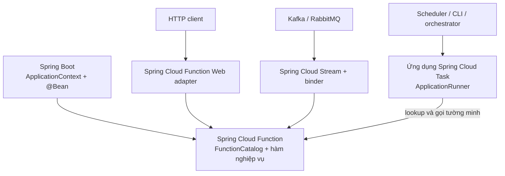
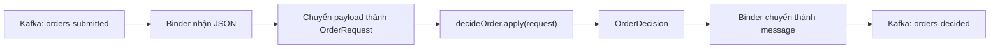

# Quan hệ với Spring Boot, Spring Cloud Stream và Spring Cloud Task

## 1. Vì sao cùng một hàm có thể xuất hiện trong nhiều loại ứng dụng Spring?

Giả sử một hệ thống thương mại điện tử có quy tắc xét duyệt sơ bộ: đơn hàng phải có mã, tổng tiền lớn hơn 0 và không vượt quá 1.000.000 VND. Quy tắc được dùng trong ba tình huống:

- Khách hàng gửi yêu cầu đến API HTTP và muốn nhận quyết định ngay.
- Một dịch vụ khác phát sự kiện đơn hàng lên Kafka; hệ thống cần trả kết quả qua sự kiện mới.
- Cuối ngày, một tác vụ chạy một lần xử lý danh sách đơn cần đối soát rồi kết thúc.

Nếu chép ba lần cùng một khối `if/else` vào controller, consumer và job, mỗi thay đổi chính sách sẽ phải sửa nhiều nơi. **Spring Cloud Function** (module `SPRING_CLOUD_FUNCTION`) cho phép biểu diễn quy tắc bằng `Supplier`, `Function` hoặc `Consumer`, đăng ký với `FunctionCatalog`, rồi để các thành phần tích hợp kích hoạt hàm trong những môi trường khác nhau.

Trong bức tranh đó, **Spring Boot**, **Spring Cloud Stream** và **Spring Cloud Task** không có cùng vai trò. Hiểu sự phân công của chúng giúp chọn đúng kiểu triển khai cho cùng một logic nghiệp vụ.

## 2. Phân biệt nhiệm vụ của bốn thành phần

| Thành phần | Câu hỏi chính mà nó trả lời | Năng lực liên quan | Điều nó không tự làm |
| --- | --- | --- | --- |
| **Spring Boot** | Làm sao khởi động và cấu hình một ứng dụng Spring? | ApplicationContext, tự động cấu hình, quản lý bean, dependency và vòng đời ứng dụng. | Không tự đăng ký topic Kafka hay biến mọi bean thành HTTP function. |
| **Spring Cloud Function** | Định nghĩa, tìm và ghép logic dưới dạng hàm thế nào? | `Supplier`, `Function`, `Consumer`, `FunctionCatalog`, composition và hỗ trợ chuyển đổi payload/message. | Không tự quyết định hệ thống nào sẽ kích hoạt hàm và ở thời điểm nào. |
| **Spring Cloud Stream** | Làm sao nối hàm với hệ thống thông điệp? | Functional bindings, binder Kafka/RabbitMQ, kết nối destination, chuyển đổi thông điệp. | Không thay thế nghiệp vụ trong `Function.apply()`; không phải trình chạy job một lần. |
| **Spring Cloud Task** | Làm sao theo dõi vòng đời một ứng dụng chạy ngắn rồi kết thúc? | Ghi nhận việc bắt đầu/kết thúc và metadata của task execution, tích hợp môi trường chạy batch/CLI. | Không phải message binder, bộ lập lịch hoặc bộ điều hợp tự động cho `FunctionCatalog`. |

**Spring Boot thường là nền tảng khởi động chung** của cả ba mô hình ứng dụng. Spring Cloud Function cung cấp cách biểu diễn logic; Spring Cloud Stream là một cách kết nối logic đó với luồng message; Spring Cloud Task quản lý vòng đời của một **lần chạy ứng dụng** và có thể gọi cùng logic khi lập trình viên chủ động tích hợp.



Sơ đồ mô tả **các cách chạy có thể lựa chọn**, không phải một ứng dụng phải bật tất cả thành phần cùng lúc. Adapter HTTP và Stream có cơ chế tích hợp với mô hình hàm; với Task, ứng dụng thường viết một điểm vào như `ApplicationRunner` để chọn và gọi hàm.

## 3. Trước tiên: xây một hợp đồng nghiệp vụ dùng chung

Để cùng một quy tắc chạy qua API, message hoặc task, lõi xử lý không nên nhận `HttpServletRequest`, Kafka `ConsumerRecord` hay đối tượng runtime của một nền tảng cloud. Hãy bắt đầu bằng kiểu dữ liệu của chính nghiệp vụ.

Ví dụ tệp `OrderModels.java`, sử dụng Java 17 trở lên:

```java
package demo.orders;

import java.math.BigDecimal;

public final class OrderModels {
    private OrderModels() {}

    public record OrderRequest(
            String orderId, BigDecimal amountVnd) {}

    public record OrderDecision(
            String orderId, boolean approved, String reason) {}
}
```

Tiếp theo, định nghĩa bean hàm trong `OrderFunctionConfig.java`:

```java
package demo.orders;

import java.math.BigDecimal;
import java.util.function.Function;

import org.springframework.context.annotation.Bean;
import org.springframework.context.annotation.Configuration;

import demo.orders.OrderModels.OrderDecision;
import demo.orders.OrderModels.OrderRequest;

@Configuration
public class OrderFunctionConfig {
    private static final BigDecimal MAX_AMOUNT =
            new BigDecimal("1000000");

    @Bean
    public Function<OrderRequest, OrderDecision> decideOrder() {
        return request -> {
            if (request == null) {
                throw new IllegalArgumentException(
                        "OrderRequest must not be null");
            }

            boolean validId = request.orderId() != null
                    && !request.orderId().isBlank();
            BigDecimal amount = request.amountVnd();
            boolean validAmount = amount != null
                    && amount.signum() > 0
                    && amount.compareTo(MAX_AMOUNT) <= 0;

            boolean approved = validId && validAmount;
            return new OrderDecision(
                    request.orderId(),
                    approved,
                    approved ? "APPROVED" : "REJECTED");
        };
    }
}
```

Hàm có tên Spring bean mặc định là `decideOrder`. Nó nhận `OrderRequest`, tạo `OrderDecision` và không phụ thuộc cách dữ liệu đi vào. Cấu trúc của `OrderRequest` chính là **hợp đồng dùng chung**: các bộ điều hợp phải chuyển dữ liệu nguồn thành kiểu này trước khi gọi hàm.

Một lời gọi Java thông thường:

```java
import java.math.BigDecimal;
import demo.orders.OrderFunctionConfig;
import demo.orders.OrderModels.OrderRequest;

var function = new OrderFunctionConfig().decideOrder();
var decision = function.apply(
        new OrderRequest("ORD-101", new BigDecimal("850000")));
// decision.approved() == true
```

Đến đây chưa cần HTTP hay Kafka. Đây là ranh giới quan trọng nhất: **cùng logic được kiểm thử bằng Java thuần trước khi chọn cách triển khai**.

## 4. Spring Boot: môi trường quản lý bean và khởi động ứng dụng

Spring Boot cung cấp `SpringApplication` và cơ chế tự động cấu hình để ứng dụng Spring chạy với những dependency đã chọn. Ví dụ một entry point:

```java
package demo.orders;

import org.springframework.boot.SpringApplication;
import org.springframework.boot.autoconfigure.SpringBootApplication;

@SpringBootApplication
public class OrderHttpApplication {
    public static void main(String[] args) {
        SpringApplication.run(OrderHttpApplication.class, args);
    }
}
```

Vì `OrderFunctionConfig` cùng package `demo.orders`, nó được phát hiện bởi cơ chế component scanning thông thường. Spring quản lý bean `decideOrder`; khi có thư viện Spring Cloud Function phù hợp, framework đăng ký các bean hàm được nhận diện vào `FunctionCatalog`.

Từ một thành phần Spring đã được inject `FunctionCatalog catalog`, có thể tra cứu:

```java
import java.util.function.Function;
import org.springframework.cloud.function.context.FunctionCatalog;
import demo.orders.OrderModels.OrderRequest;
import demo.orders.OrderModels.OrderDecision;

Function<OrderRequest, OrderDecision> function =
        catalog.lookup("decideOrder");

if (function == null) {
    throw new IllegalStateException(
            "Function decideOrder is not registered");
}

OrderDecision result = function.apply(
        new OrderRequest("ORD-101", new BigDecimal("850000")));
```

Đoạn mã giả định `catalog` đã được inject; nếu đưa vào ví dụ biên dịch hoàn chỉnh, cần đặt lời gọi trong service hoặc `ApplicationRunner` và import `BigDecimal`. Catalog có thể trả một wrapper hỗ trợ chuyển đổi dữ liệu/composition; không nên giả định nó là cùng instance với bean gốc.

**Spring Boot không tự công bố endpoint chỉ vì có `@Bean Function`.** Để hàm được gọi qua HTTP theo cơ chế Spring Cloud Function, cần web adapter; để nhận sự kiện từ broker cần Spring Cloud Stream với binder; để chạy thành một tác vụ ngắn cần entry point và lifecycle phù hợp.

## 5. Spring Boot + Spring Cloud Function Web: gọi qua HTTP

Một ứng dụng có nhu cầu request/response có thể bổ sung dependency Maven:

```xml
<dependency>
    <groupId>org.springframework.cloud</groupId>
    <artifactId>spring-cloud-starter-function-web</artifactId>
</dependency>
```

Dependency phải đi cùng phiên bản Spring Boot và Spring Cloud tương thích, thông thường được quản lý qua BOM. Spring Cloud Function Web cung cấp cơ chế điều hợp HTTP để chuyển request thành lời gọi hàm và chuyển kết quả thành response.

Sau khi ứng dụng chạy trên `localhost:8080` với cấu hình web phù hợp, ví dụ:

```bash
curl -X POST http://localhost:8080/decideOrder \
  -H "Content-Type: application/json" \
  -d '{"orderId":"ORD-101","amountVnd":850000}'
```

Kết quả nghiệp vụ mong đợi:

```json
{
  "orderId": "ORD-101",
  "approved": true,
  "reason": "APPROVED"
}
```

Ở luồng này, HTTP adapter đảm nhận đường dẫn, HTTP method, content type và việc ánh xạ JSON ↔ Java. Nó dùng `FunctionCatalog` để tìm hàm đã đăng ký và gọi `apply()`. Mã nghiệp vụ `decideOrder` không cần biết mã trạng thái HTTP hoặc các header của client.

Một request sai cú pháp là lỗi tiếp nhận dữ liệu; một đơn có số tiền không hợp lệ nhưng JSON đúng cấu trúc có thể tạo `OrderDecision(approved=false)`. Hai tình huống cần được xử lý theo contract API đã chọn, tránh coi mọi quyết định từ chối là lỗi giao thức.

## 6. Spring Cloud Stream: từ Function thành bộ xử lý sự kiện

Spring Cloud Stream tổ chức giao tiếp với hệ thống thông điệp qua **binding** và **binder**. Binder là thành phần tích hợp với broker cụ thể; ví dụ Kafka binder kết nối Kafka, RabbitMQ binder kết nối RabbitMQ. Với mô hình functional, Stream dùng định nghĩa hàm từ Spring Cloud Function để biết cần gọi xử lý nào.

Để sử dụng Kafka, ứng dụng có thể thêm dependency Maven phù hợp:

```xml
<dependency>
    <groupId>org.springframework.cloud</groupId>
    <artifactId>spring-cloud-stream-binder-kafka</artifactId>
</dependency>
```

Trong một dự án có quản lý dependency phù hợp, `spring-cloud-stream` và binder cần tương thích với phiên bản Spring Cloud của ứng dụng. Với bean `decideOrder` ở trên, ví dụ cấu hình:

```yaml
spring:
  cloud:
    function:
      definition: decideOrder
    stream:
      bindings:
        decideOrder-in-0:
          destination: orders-submitted
          group: order-policy
          content-type: application/json
        decideOrder-out-0:
          destination: orders-decided
          content-type: application/json
      kafka:
        binder:
          brokers: localhost:9092
```

Diễn giải cụ thể:

| Thành phần cấu hình | Ý nghĩa |
| --- | --- |
| `spring.cloud.function.definition` | Chọn hàm `decideOrder` mà Stream sẽ bind. |
| `decideOrder-in-0` | Binding đầu vào đầu tiên của hàm; nhận dữ liệu từ `orders-submitted`. |
| `decideOrder-out-0` | Binding đầu ra đầu tiên; gửi `OrderDecision` đến `orders-decided`. |
| `group: order-policy` | Consumer group cho ứng dụng nhận message. |
| `content-type: application/json` | Chỉ dẫn dạng payload cho cơ chế chuyển đổi tương ứng. |
| `spring.cloud.stream.kafka.binder.brokers` | Danh sách broker Kafka mà binder kết nối. |

Với input:

```json
{"orderId":"ORD-101","amountVnd":850000}
```

luồng xử lý điển hình là:



**Điều được dùng lại** là bean `decideOrder` và hợp đồng dữ liệu. **Điều thay đổi** là nơi nhận payload, nơi gửi kết quả, cách quản lý consumer, retry, acknowledgment và cấu hình broker.

Tính bất đồng bộ đem lại những đặc tính phải xem xét riêng:

- Một producer gửi sự kiện không nhất thiết chờ quyết định được tạo ngay trong cùng kết nối như HTTP.
- Broker/binder có thể giao lại sự kiện khi có lỗi hoặc restart; logic có side effect phải quản lý idempotency.
- Thứ tự toàn cục của sự kiện không phải bảo đảm mặc định; Kafka thường chỉ giữ thứ tự theo partition.
- Việc `Function.apply()` trả về `OrderDecision` không đồng nghĩa output chắc chắn đã được gửi; binder và broker còn thực hiện quá trình chuyển thông điệp.

Spring Cloud Stream **dùng** Spring Cloud Function làm mô hình xử lý, nhưng **không đồng nghĩa** Spring Cloud Function tự tạo kết nối đến broker khi thiếu binder và bindings.

## 7. Điểm chung và điểm khác giữa API HTTP với Stream

| Thuộc tính | Spring Cloud Function Web | Spring Cloud Stream |
| --- | --- | --- |
| Nguồn gọi | HTTP client. | Broker message. |
| Đầu vào hàm `Function<T, R>` | Payload sau khi chuyển từ request. | Payload sau khi converter xử lý message. |
| Đầu ra | HTTP response theo adapter và API contract. | Message gửi đến output destination. |
| Cách chọn hàm | Route/tên hàm và cấu hình adapter. | `spring.cloud.function.definition` và functional binding. |
| Thành phần kết nối | Web adapter. | Binder và message binding. |
| Những lỗi cần quản lý | HTTP status, timeout, body, bảo mật API. | Retry, dead-letter, consumer group, offset/acknowledgment. |
| Vòng đời phổ biến | Server chờ request liên tục. | Consumer chạy lâu dài để nhận sự kiện. |

Vì hợp đồng thời gian khác nhau, **không nên ép một event thành HTTP response giả** trong logic lõi. Trả về `OrderDecision` là một sự kiện nghiệp vụ đúng nghĩa; từng adapter mới quyết định khi nào và bằng cách nào công bố kết quả.

## 8. Spring Cloud Task: theo dõi một ứng dụng chạy ngắn rồi kết thúc

**Spring Cloud Task** phục vụ những chương trình có **vòng đời hữu hạn**: khởi động, thực hiện công việc, kết thúc. Nó cung cấp cơ chế theo dõi metadata của lần thực thi như thời điểm bắt đầu, kết thúc và thông tin trạng thái; việc lưu trữ bền vững metadata phụ thuộc vào cấu hình TaskRepository và cơ sở dữ liệu.

Một số kịch bản điển hình:

- Đối soát các đơn hàng còn chờ vào cuối ngày.
- Nhập một file CSV rồi chạy quy tắc phân loại đơn.
- Đồng bộ dữ liệu một lần khi có lệnh vận hành.
- Chạy một chương trình bảo trì do scheduler hoặc orchestrator bên ngoài kích hoạt.

Điểm cần phân biệt:

- **Task không phải scheduler:** Spring Cloud Task không tự quyết định chạy vào 23:00 mỗi ngày. Một cron job, Kubernetes CronJob, scheduler hoặc tác nhân bên ngoài phải khởi động chương trình.
- **Task không phải binder:** nó không tự nhận Kafka message hoặc ánh xạ một `Function` thành consumer.
- **Task không phải Spring Batch:** Task theo dõi một lần chạy ứng dụng; Spring Batch bổ sung mô hình `Job`, `Step`, đọc/ghi theo chunk, restart và checkpoint khi bài toán yêu cầu. Hai dự án có thể phối hợp, nhưng không bắt buộc.
- **Task không đồng nghĩa serverless:** một tác vụ có thể chạy trong JVM/container thông thường. Serverless có cơ chế handler và trigger riêng; muốn dùng mô hình hàm vẫn cần adapter phù hợp.

Spring Cloud Task có thể **tái sử dụng** cùng `decideOrder`, nhưng ứng dụng phải chủ động gọi hàm, ví dụ từ `ApplicationRunner`.

## 9. Ví dụ: gọi FunctionCatalog trong một Spring Cloud Task

Hãy giả sử có **một ứng dụng triển khai riêng** với entry point cho tác vụ. Dự án dùng Spring Boot, Spring Cloud Function context và Spring Cloud Task. Các dependency Maven chính:

```xml
<dependencies>
    <dependency>
        <groupId>org.springframework.cloud</groupId>
        <artifactId>spring-cloud-function-context</artifactId>
    </dependency>
    <dependency>
        <groupId>org.springframework.cloud</groupId>
        <artifactId>spring-cloud-starter-task</artifactId>
    </dependency>
</dependencies>
```

Cần chọn phiên bản tương thích qua hệ thống quản lý dependency của dự án. Giả sử `OrderModels` và `OrderFunctionConfig` được đưa vào ứng dụng Task qua một module thư viện dùng chung hoặc bằng source code cùng package.

Ví dụ `OrderTaskApplication.java`:

```java
package demo.orders;

import java.math.BigDecimal;
import java.util.List;
import java.util.function.Function;

import org.springframework.boot.ApplicationArguments;
import org.springframework.boot.ApplicationRunner;
import org.springframework.boot.SpringApplication;
import org.springframework.boot.autoconfigure.SpringBootApplication;
import org.springframework.cloud.function.context.FunctionCatalog;
import org.springframework.cloud.task.configuration.EnableTask;
import org.springframework.context.annotation.Bean;

import demo.orders.OrderModels.OrderDecision;
import demo.orders.OrderModels.OrderRequest;

@SpringBootApplication
@EnableTask
public class OrderTaskApplication {

    public static void main(String[] args) {
        SpringApplication.run(OrderTaskApplication.class, args);
    }

    @Bean
    ApplicationRunner runOrderCheck(FunctionCatalog catalog) {
        return args -> {
            String id = requireSingle(args, "orderId");
            BigDecimal amount = new BigDecimal(
                    requireSingle(args, "amountVnd"));

            Function<OrderRequest, OrderDecision> function =
                    catalog.lookup("decideOrder");
            if (function == null) {
                throw new IllegalStateException(
                        "Missing function: decideOrder");
            }

            OrderDecision decision = function.apply(
                    new OrderRequest(id, amount));
            System.out.printf(
                    "order=%s approved=%s reason=%s%n",
                    decision.orderId(),
                    decision.approved(),
                    decision.reason());
        };
    }

    private static String requireSingle(
            ApplicationArguments args, String option) {
        List<String> values = args.getOptionValues(option);
        if (values == null || values.size() != 1) {
            throw new IllegalArgumentException(
                    "Expected exactly one --" + option + " argument");
        }
        return values.get(0);
    }
}
```

Ở ví dụ này, `ApplicationRunner` dùng thông tin dòng lệnh để tạo `OrderRequest`, chủ động `lookup("decideOrder")` rồi gọi `apply()`. **Spring Cloud Task không tự phát hiện `decideOrder` như một bước job cần chạy**: chính code `ApplicationRunner` đã quy định công việc của một lần thực thi.

Cấu hình để ứng dụng không khởi động web server:

```yaml
spring:
  main:
    web-application-type: none
```

Chạy một lần, với JAR Task được đóng gói và cấu hình phù hợp:

```bash
java -jar order-task.jar --orderId=ORD-101 --amountVnd=850000
```

Output minh họa:

```text
order=ORD-101 approved=true reason=APPROVED
```

Sau khi runner và các thao tác cần thiết hoàn tất, ứng dụng không có thành phần chạy nền giữ JVM sống thì có thể kết thúc. Spring Cloud Task quản lý thông tin vòng đời của lần chạy theo cấu hình. Để lịch sử task có thể được truy vấn lâu dài, cần cấu hình `TaskRepository` với nguồn dữ liệu bền vững và schema tương ứng; không nên mặc nhiên giả định metadata được lưu lâu dài nếu ứng dụng chỉ dùng cơ chế lưu tạm.

Ví dụ cố tình chỉ in quyết định ra stdout để tập trung vào lời gọi hàm. Tác vụ đối soát thực tế có thể đọc file/danh sách từ database, gọi cùng hàm cho từng bản ghi, ghi kết quả, quản lý lỗi theo bản ghi và tạo báo cáo tổng hợp. **TaskRepository theo dõi việc chạy task**, còn kết quả nghiệp vụ phải được ghi ở kho dữ liệu hoặc hệ thống phù hợp nếu muốn lưu bền vững.

## 10. Một use case, ba cách triển khai thực tế

Ta có thể tổ chức code như sau:

```text
Shared business library (đóng gói độc lập với giao thức)
  ├── OrderModels
  └── OrderFunctionConfig
              |
      +-------+----------+
      |                  |
  API application    Stream application      Task application
  Spring Boot        Spring Boot             Spring Boot
  Function Web       Cloud Stream + binder   Cloud Task + runner
      |                  |                       |
   HTTP POST         Kafka events             CLI / scheduler
      |                  |                       |
      +------------------+-----------------------+
                         |
              decideOrder.apply(OrderRequest)
                         |
                    OrderDecision
```

Đây là **sơ đồ tái sử dụng mã nguồn**. Trong triển khai, mỗi ứng dụng có Spring ApplicationContext và instance bean của riêng nó; không có một instance Java duy nhất được chia sẻ qua mạng. Code/hợp đồng nghiệp vụ được tái sử dụng qua dependency hoặc module dùng chung.

| Tình huống | Lựa chọn thường phù hợp | Lý do |
| --- | --- | --- |
| Người dùng phải thấy quyết định ngay | Spring Boot + Function Web hoặc controller gọi bean. | Request/response và HTTP contract rõ ràng. |
| Một dịch vụ phát sự kiện, cần xử lý liên tục | Spring Boot + Spring Cloud Stream. | Binder nhận/phát thông điệp và quản lý consumer. |
| Xử lý dữ liệu định kỳ theo đợt rồi thoát | Spring Boot + Spring Cloud Task. | Phù hợp ứng dụng hữu hạn, theo dõi từng lần chạy. |
| Xử lý nhiều bản ghi với checkpoint/restart | Spring Cloud Task phối hợp Spring Batch nếu cần. | Batch cung cấp Job/Step, checkpoint, retry/skip theo thiết kế. |
| Trigger nằm trên nền tảng FaaS cụ thể | Spring Cloud Function + adapter serverless tương ứng. | Handler và cách đóng gói theo runtime của nhà cung cấp. |

Không có yêu cầu phải thêm cả Web, Stream và Task vào cùng một JAR. Tách thành các ứng dụng triển khai riêng giúp vòng đời và tài nguyên mỗi đường chạy phù hợp với mục tiêu. Nếu tổ chức nhiều entry point trong cùng repository, phải cẩn thận về component scanning và những auto-configuration được đưa vào từng artifact.

## 11. FunctionCatalog và composition liên quan đến các môi trường ra sao?

`FunctionCatalog` cho phép lookup theo tên hoặc biểu thức ghép hàm:

```java
Function<OrderRequest, OrderDecision> function =
        catalog.lookup("decideOrder");
```

Nếu thêm một bean `Function<OrderRequest, OrderRequest> normalizeOrder`, có thể tra cứu pipeline:

```java
Function<OrderRequest, OrderDecision> pipeline =
        catalog.lookup("normalizeOrder|decideOrder");
```

Luồng `normalizeOrder|decideOrder` thực thi từ trái sang phải. Output của bước trước phải tương thích với input bước sau. Tùy adapter:

- **HTTP:** có thể chọn một function/pipeline để cung cấp kết quả cho request.
- **Stream:** `spring.cloud.function.definition` có thể chọn pipeline để gắn với bindings. Với composition, tên binding mặc định cần được xác định theo tên định nghĩa/hàm mà Stream thực tế sử dụng và phiên bản đang chạy.
- **Task:** `ApplicationRunner` có thể tự tra cứu pipeline, sau đó gọi `apply()` cho dữ liệu đọc được.

Điểm chung là khả năng chọn hàm hoặc composition theo tên. Điều khác nhau là **ai kích hoạt** pipeline và **kết quả được đưa đi đâu**. Property `spring.cloud.function.definition` chỉ định định nghĩa hàm cho adapter thích hợp; nó không thay cấu hình endpoint, topic, lịch chạy hoặc task entry point.

## 12. Supplier và Consumer cũng chịu ảnh hưởng của loại ứng dụng

Không phải use case nào cũng là `Function<T, R>`:

| Kiểu hàm | Trên HTTP/Boot | Với Spring Cloud Stream | Trong Spring Cloud Task |
| --- | --- | --- | --- |
| `Supplier<T>` | Web adapter có thể gọi `get()` khi có request. | Poller có thể gọi `get()` và phát kết quả thành output message. | Runner chủ động gọi `get()` một hoặc nhiều lần theo logic của task. |
| `Function<T, R>` | Nhận payload, trả dữ liệu qua HTTP. | Nhận input message, tạo output message khi binding phù hợp. | Runner chủ động gọi `apply()` trên từng dữ liệu cần xử lý. |
| `Consumer<T>` | Nhận payload và thực hiện side effect; không có output nghiệp vụ. | Sink xử lý thông điệp đầu vào, thường không có output binding. | Runner chủ động gọi `accept()` để thực hiện hành động. |

Đặc biệt, **`Supplier` không phải scheduler**: Stream poller có thể tạo nhịp cho supplier; Task cần chương trình bên ngoài khởi động; HTTP chỉ kích hoạt khi có request. Tương tự, **`Consumer` trả `void` không có nghĩa broker đã acknowledgment hoặc tác dụng phụ đã được commit**. Việc hoàn tất phải dựa vào cơ chế I/O, transaction và vận hành phù hợp.

## 13. Hợp đồng dữ liệu và message conversion: phần không thể bỏ qua

Tách nghiệp vụ khỏi giao thức chỉ hiệu quả nếu hợp đồng đầu vào/đầu ra đủ rõ. Trong ví dụ:

```text
OrderRequest(orderId: String, amountVnd: BigDecimal)
            |
            v
       decideOrder
            |
            v
OrderDecision(orderId: String, approved: boolean, reason: String)
```

- **HTTP adapter** đọc JSON body và ánh xạ vào `OrderRequest`.
- **Stream binder** giải mã message với content type/converter phù hợp thành `OrderRequest`.
- **Task runner** tạo object `OrderRequest` từ argument, file hoặc database.

Ba con đường có thể tạo cùng một đối tượng Java nhưng không tự có cùng mức xác thực. Ví dụ `amountVnd` có thể bị thiếu, sai kiểu hoặc khác đơn vị ở dữ liệu nguồn. Cần chuẩn hóa và kiểm tra ở ranh giới thích hợp; các quyết định nghiệp vụ vẫn phải xử lý giá trị hợp lệ/không hợp lệ theo chính sách.

Khi cần metadata thông điệp, Spring Cloud Function có thể dùng `org.springframework.messaging.Message<T>`:

```java
Function<Message<OrderRequest>, Message<OrderDecision>>
```

Đổi từ payload thuần sang `Message<T>` giúp xử lý headers/correlation ID, nhưng có thể làm hàm phụ thuộc vào abstraction messaging. Nếu nghiệp vụ không cần headers, nên ưu tiên kiểu `Function<OrderRequest, OrderDecision>` để dễ dùng lại trong Task và HTTP.

Chuyển đổi JSON → object Java còn phụ thuộc nội dung message, generic type, thư viện converter và cấu hình binder/adapter. Không nên dựa vào giả định mọi chuỗi JSON được truyền thẳng vào `Function.apply()` sẽ tự biến thành `OrderRequest`.

## 14. Ngữ nghĩa xử lý lỗi thay đổi theo môi trường

**Cùng một hàm không có nghĩa cùng một chính sách thất bại.** Giả sử `decideOrder` ném exception do một dependency quan trọng không khả dụng:

| Môi trường | Hậu quả và hướng xử lý điển hình |
| --- | --- |
| HTTP | Adapter/API có thể trả 5xx theo error contract; client có thể retry theo chính sách. |
| Stream | Consumer/binder có thể retry, redelivery hoặc đẩy message đến dead-letter destination tùy cấu hình. |
| Task | Lần chạy có thể thất bại, được ghi nhận bằng metadata/exit status và được orchestrator kích hoạt lại. |

Nếu hàm chỉ đưa ra quyết định từ chối, ví dụ `approved=false`, đó **không phải exception** cần broker retry vô hạn hoặc Task đánh dấu thất bại. Trái lại, nếu xử lý một bản ghi có tác dụng phụ như cập nhật kho, cần thiết kế idempotency theo khóa nghiệp vụ, kể cả khi cùng tác vụ được chạy lại hoặc sự kiện được giao lại.

Một số nguyên tắc vận hành quan trọng:

1. Tách **kết quả nghiệp vụ** khỏi **lỗi không xử lý được**.
2. Xác định chính sách retry ở HTTP client, Stream binder hoặc orchestrator cho Task.
3. Không giữ trạng thái mutable không kiểm soát trong bean singleton khi có nhiều request/consumer thread.
4. Dùng transaction và idempotency cho thao tác ghi; Spring Cloud Function và Task không tự bảo đảm giao dịch phân tán với Kafka/database.
5. Theo dõi riêng request logs, consumer lag/retry, TaskExecution và kết quả nghiệp vụ.

## 15. Kiểm thử nào cho từng lớp?

Một chiến lược kiểm thử nên phản ánh đúng trách nhiệm của mỗi thành phần:

| Phạm vi | Điều cần kiểm tra | Có cần broker/web/task runtime không? |
| --- | --- | --- |
| Hàm Java | `decideOrder.apply()` cho kết quả đúng với dữ liệu thường và biên. | Không. |
| Spring Boot và FunctionCatalog | Bean được scan, lookup đúng tên, composition hợp lệ. | Cần Spring test context; không nhất thiết cần broker. |
| Web adapter | Route, chuyển JSON, response và error contract đúng. | Cần môi trường kiểm thử HTTP. |
| Stream binder | Binding names, destination, conversion, retry và publish output đúng. | Cần binder test hoặc broker tích hợp tùy phạm vi. |
| Spring Cloud Task | Runner chọn đúng hàm, nhận tham số, hoàn tất/fail đúng và ghi metadata phù hợp. | Cần test ứng dụng Task và repository nếu xác minh metadata bền vững. |

Ví dụ unit test cho logic thuần không cần chạy ứng dụng:

```java
import static org.junit.jupiter.api.Assertions.assertTrue;

import java.math.BigDecimal;
import org.junit.jupiter.api.Test;

import demo.orders.OrderFunctionConfig;
import demo.orders.OrderModels.OrderRequest;

class OrderFunctionTest {
    @Test
    void approvesOrderWithinLimit() {
        var function = new OrderFunctionConfig().decideOrder();
        var result = function.apply(
                new OrderRequest("ORD-101", new BigDecimal("850000")));

        assertTrue(result.approved());
    }
}
```

Nên bổ sung các trường hợp số tiền bằng 0, âm, đúng/ngang ngưỡng, vượt ngưỡng, mã đơn null/rỗng và request null. Với Task, cần thêm test thiếu tham số, giá trị `BigDecimal` không hợp lệ và việc exit khi runner thất bại; với Stream, kiểm tra đặc biệt tình huống phát lại cùng message.

## 16. Những nhầm lẫn cần tránh

| Nhận định dễ sai | Cách hiểu chính xác |
| --- | --- |
| “Có Spring Boot là tự gọi được function bằng HTTP.” | Cần web adapter hoặc tự xây controller; Boot chỉ quản lý ứng dụng và dependency. |
| “Spring Cloud Stream thay thế Spring Cloud Function.” | Stream dùng mô hình functional để gắn hàm với message broker; logic và binder có trách nhiệm khác nhau. |
| “Chỉ cần `@Bean Function` là tự có Kafka consumer.” | Phải chọn function, cài binder và cấu hình bindings/destination. |
| “Spring Cloud Task tự gọi mọi Function trong catalog.” | Task theo dõi vòng đời; runner/job phải chủ động tìm và gọi hàm. |
| “Spring Cloud Task là cron scheduler.” | Scheduler bên ngoài kích hoạt chương trình; Task theo dõi lần thực thi. |
| “Task và Stream luôn phải chạy cùng nhau.” | Chúng giải quyết hai kiểu vòng đời khác nhau và thường được triển khai riêng. |
| “Task đã hỗ trợ retry từng dòng như Spring Batch.” | Khi cần job/step, checkpoint và restart theo bước, nên cân nhắc Spring Batch. |
| “Hàm độc lập với giao thức nên không cần message conversion.” | Adapter vẫn cần biết kiểu payload, content type, schema và converter. |
| “Triển khai serverless là dùng Spring Cloud Task.” | Serverless sử dụng adapter/handler theo runtime; Task không tự biến thành FaaS handler. |

## 17. Cách lựa chọn khi bắt đầu một dự án

Với mỗi use case, hãy trả lời theo thứ tự:

1. **Hình dạng nghiệp vụ:** Có đầu vào không? Có kết quả trả về không? Chọn `Supplier`, `Function` hoặc `Consumer` và xác định payload.
2. **Thời điểm kích hoạt:** Cần phản hồi theo request, lắng nghe sự kiện liên tục hay chạy hữu hạn theo một lệnh?
3. **Cách kết nối:** Dùng web adapter, Stream binder hay runner trong ứng dụng Task? Nếu là FaaS, chọn adapter runtime tương ứng.
4. **Hợp đồng dữ liệu:** JSON/schema, message headers, tham số dòng lệnh và mapping sang object Java có nhất quán không?
5. **Vận hành:** Ai chịu trách nhiệm timeout, retry, idempotency, transaction, observability và lịch chạy?

**Kết luận:** Spring Boot cung cấp môi trường để bean và ứng dụng Spring chạy; Spring Cloud Function định nghĩa và tổ chức logic có thể gọi qua `FunctionCatalog`; Spring Cloud Stream kết nối logic đó với luồng sự kiện; Spring Cloud Task theo dõi chương trình chạy ngắn và cho phép runner gọi lại chính logic ấy. Khi ranh giới này rõ ràng, nhóm phát triển có thể giữ nguyên `decideOrder` và hợp đồng `OrderRequest → OrderDecision`, đồng thời triển khai qua HTTP, broker, tác vụ theo đợt hoặc adapter serverless theo nhu cầu thực tế.
