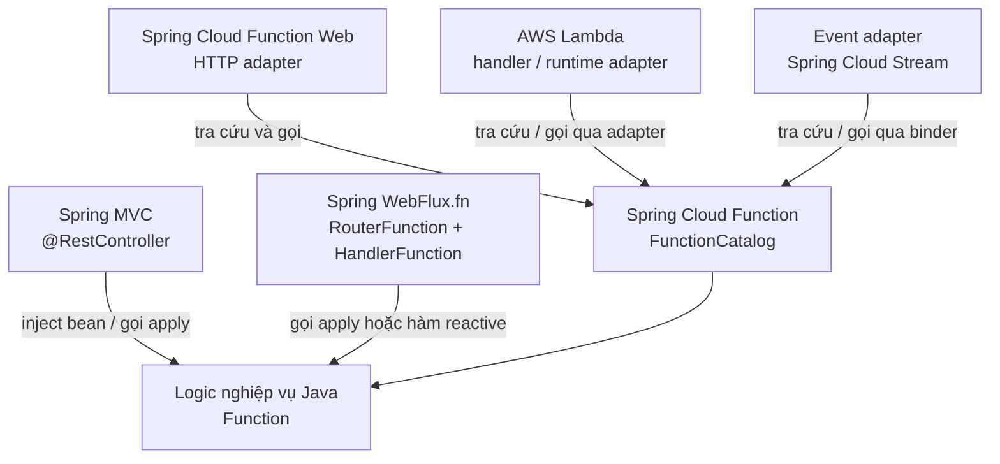
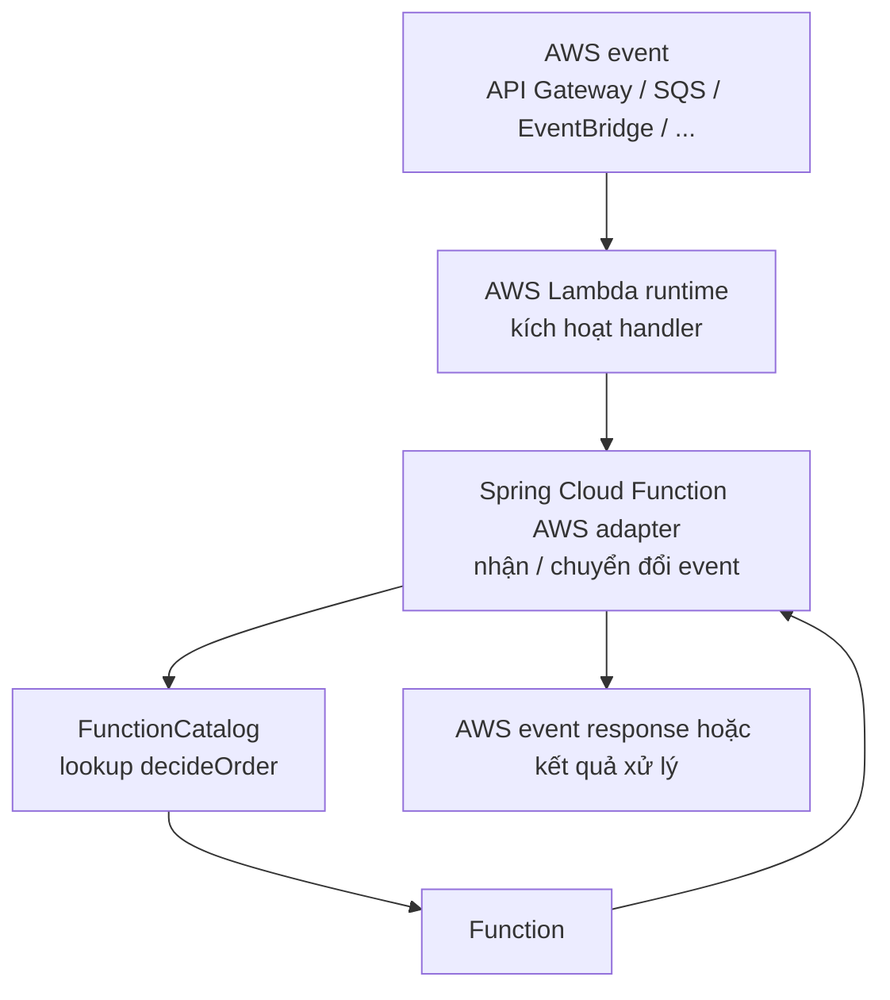

# Phân biệt hàm nghiệp vụ với controller, WebFlux.fn và AWS Lambda

## 1. Một quy tắc có thể xuất hiện dưới nhiều hình thức triển khai

Giả sử hệ thống thương mại điện tử có quy tắc xét duyệt đơn hàng: chỉ duyệt sơ bộ khi mã đơn hợp lệ và tổng tiền nằm trong khoảng từ trên 0 đến 1.000.000 VND. Ban đầu, ứng dụng cung cấp API HTTP; tiếp theo hệ thống cần tiếp nhận sự kiện, và cuối cùng muốn triển khai quy tắc trên AWS Lambda.

Có ít nhất bốn khái niệm thường xuất hiện trong yêu cầu:

- **Hàm nghiệp vụ** nhận dữ liệu đơn hàng và trả quyết định xét duyệt.
- **Spring MVC controller** nhận HTTP request và tạo HTTP response bằng annotation.
- **WebFlux.fn** dùng router và handler để xử lý HTTP theo phong cách functional.
- **AWS Lambda** là dịch vụ thực thi serverless; nền tảng gọi một handler khi có sự kiện.

Các khái niệm trên **không cùng một cấp độ**. Trong module **Spring Cloud Function** (`SPRING_CLOUD_FUNCTION`), mục tiêu là diễn đạt logic bằng `Supplier`, `Function` và `Consumer` của Java, đăng ký và tìm qua `FunctionCatalog`, composition khi cần, rồi kết nối với HTTP, sự kiện hoặc serverless. Controller, WebFlux.fn và Lambda là những cách **đưa lời gọi từ bên ngoài đến logic**, không nhất thiết là nơi nên cài quy tắc kinh doanh.

## 2. Bốn khái niệm trả lời bốn câu hỏi khác nhau

| Khái niệm | Câu hỏi nó trả lời | API/kiểu thường gặp | Phạm vi chính |
| --- | --- | --- | --- |
| **Hàm nghiệp vụ Java** | Dữ liệu đầu vào tạo ra quyết định nào? | `Function<OrderRequest, OrderDecision>`, `apply()` | Quy tắc và hợp đồng dữ liệu miền. |
| **Spring MVC controller** | HTTP URL/method/body được nhận và phản hồi thế nào? | `@RestController`, `@PostMapping`, `ResponseEntity` | HTTP request/response trong Spring MVC. |
| **WebFlux.fn** | HTTP route được ánh xạ sang một handler reactive ra sao? | `RouterFunction<ServerResponse>`, `ServerRequest`, `Mono<ServerResponse>` | HTTP routing/handling trong Spring WebFlux. |
| **AWS Lambda** | Mã nào được gọi khi nền tảng có event, chạy ở đâu và bị giới hạn thế nào? | Lambda handler, runtime, trigger, event/response contract | Nền tảng thực thi serverless của AWS. |

Spring Cloud Function đứng giữa **hàm Java được Spring quản lý** và **các bộ điều hợp**. `FunctionCatalog` giúp tìm hàm theo tên, hỗ trợ ghép hàm và chuyển đổi dữ liệu trong những ngữ cảnh được framework hỗ trợ. Dù vậy, chỉ khai báo `@Bean Function` không tự tạo controller, WebFlux route, Kafka consumer hoặc Lambda trigger.



Sơ đồ mô tả các **đường gọi lựa chọn hoặc phối hợp theo thiết kế**. MVC và WebFlux.fn có thể gọi trực tiếp một bean nghiệp vụ; adapter Spring Cloud Function Web và adapter Lambda có thể đi qua `FunctionCatalog`. Điều được tái sử dụng là code và hợp đồng của nghiệp vụ. Mỗi ứng dụng triển khai có thể tạo instance bean riêng trong Spring ApplicationContext riêng.

## 3. Viết lõi nghiệp vụ trước khi chọn giao thức

Hãy tách kiểu dữ liệu và quy tắc xét duyệt ra khỏi HTTP và AWS.

Tệp `OrderDomain.java`:

```java
package demo.orders;

import java.math.BigDecimal;
import java.util.Objects;

public final class OrderDomain {
    private OrderDomain() {}

    public record OrderRequest(
            String orderId, BigDecimal totalVnd) {}

    public record OrderDecision(
            String orderId, boolean approved, String reason) {}

    public static final class OrderPolicy {
        private static final BigDecimal MAX_TOTAL =
                new BigDecimal("1000000");

        public OrderDecision decide(OrderRequest request) {
            Objects.requireNonNull(request, "request");

            if (request.orderId() == null
                    || request.orderId().isBlank()) {
                return new OrderDecision(
                        request.orderId(), false, "MISSING_ORDER_ID");
            }

            BigDecimal amount = request.totalVnd();
            if (amount == null || amount.signum() <= 0) {
                return new OrderDecision(
                        request.orderId(), false, "INVALID_AMOUNT");
            }
            if (amount.compareTo(MAX_TOTAL) > 0) {
                return new OrderDecision(
                        request.orderId(), false, "LIMIT_EXCEEDED");
            }

            return new OrderDecision(
                    request.orderId(), true, "APPROVED");
        }
    }
}
```

Hàm này chỉ nhận `OrderRequest` và trả `OrderDecision`. Không có `HttpServletRequest`, `ServerRequest`, `APIGatewayProxyRequestEvent` hay interface AWS trong chữ ký. Một lần kiểm thử Java thuần:

```java
import java.math.BigDecimal;
import demo.orders.OrderDomain.OrderPolicy;
import demo.orders.OrderDomain.OrderRequest;

var policy = new OrderPolicy();
var output = policy.decide(
        new OrderRequest("ORD-42", new BigDecimal("850000")));

// output.approved() == true
// output.reason().equals("APPROVED")
```

**Điểm quan trọng:** “Hàm nghiệp vụ” là khái niệm thiết kế; nó không bắt buộc phải là Java lambda. Ở đây `OrderPolicy.decide()` là một phương thức Java thường. Khi muốn Spring Cloud Function quản lý, ta có thể dùng method reference để biến nó thành một `Function`.

## 4. Đăng ký cùng quy tắc thành Spring Cloud Function

Với ứng dụng Spring Boot và các phiên bản Spring Boot/Spring Cloud tương thích, cấu hình bean:

```java
package demo.orders;

import java.util.function.Function;

import org.springframework.context.annotation.Bean;
import org.springframework.context.annotation.Configuration;

import demo.orders.OrderDomain.OrderDecision;
import demo.orders.OrderDomain.OrderPolicy;
import demo.orders.OrderDomain.OrderRequest;

@Configuration
public class OrderFunctionConfig {

    @Bean
    OrderPolicy orderPolicy() {
        return new OrderPolicy();
    }

    @Bean
    Function<OrderRequest, OrderDecision> decideOrder(
            OrderPolicy policy) {
        return policy::decide;
    }
}
```

Spring tạo bean có tên mặc định `decideOrder`. Với dependency Spring Cloud Function phù hợp, các bean dạng functional được framework nhận diện và đưa vào `FunctionCatalog`; một thành phần đã được Spring inject catalog có thể gọi:

```java
import java.util.function.Function;
import org.springframework.cloud.function.context.FunctionCatalog;
import demo.orders.OrderDomain.OrderDecision;
import demo.orders.OrderDomain.OrderRequest;

// Ví dụ bên trong một service/runner đã inject FunctionCatalog catalog.
Function<OrderRequest, OrderDecision> function =
        catalog.lookup("decideOrder");

if (function == null) {
    throw new IllegalStateException("Missing function: decideOrder");
}

OrderDecision result = function.apply(
        new OrderRequest("ORD-42", new BigDecimal("850000")));
```

Điểm này không tạo endpoint hay Lambda handler. Nó tạo **đầu mối tra cứu một hàm được đặt tên**, thuận tiện cho bộ điều hợp chọn theo cấu hình. Catalog có thể trả wrapper đã được framework chuẩn bị, do đó không nên dựa vào giả định wrapper và bean gốc là cùng một đối tượng Java.

## 5. Trường hợp 1: dùng Spring MVC controller

Spring MVC thường dùng annotation như `@RestController`, `@PostMapping` và `@RequestBody`. Controller chịu trách nhiệm tiếp nhận HTTP request; hàm nghiệp vụ chịu trách nhiệm xét duyệt.

Ví dụ trong một **ứng dụng Spring MVC** đã có bean `decideOrder`:

```java
package demo.orders;

import java.util.function.Function;

import org.springframework.beans.factory.annotation.Qualifier;
import org.springframework.http.MediaType;
import org.springframework.http.ResponseEntity;
import org.springframework.web.bind.annotation.PostMapping;
import org.springframework.web.bind.annotation.RequestBody;
import org.springframework.web.bind.annotation.RestController;

import demo.orders.OrderDomain.OrderDecision;
import demo.orders.OrderDomain.OrderRequest;

@RestController
public class OrderController {
    private final Function<OrderRequest, OrderDecision> decide;

    public OrderController(
            @Qualifier("decideOrder")
            Function<OrderRequest, OrderDecision> decide) {
        this.decide = decide;
    }

    @PostMapping(
            path = "/api/orders/decision",
            consumes = MediaType.APPLICATION_JSON_VALUE,
            produces = MediaType.APPLICATION_JSON_VALUE)
    public ResponseEntity<OrderDecision> decide(
            @RequestBody OrderRequest request) {
        return ResponseEntity.ok(decide.apply(request));
    }
}
```

Một HTTP request:

```bash
curl -X POST http://localhost:8080/api/orders/decision \
  -H "Content-Type: application/json" \
  -d '{"orderId":"ORD-42","totalVnd":850000}'
```

Payload kết quả mong đợi:

```json
{
  "orderId": "ORD-42",
  "approved": true,
  "reason": "APPROVED"
}
```

Trong ví dụ đơn giản này, controller chọn trả `200 OK` cho một kết quả nghiệp vụ đã được tính, kể cả khi `approved=false`. Nếu API yêu cầu status khác, xác thực request hoặc error body theo chuẩn riêng, controller (hay lớp xử lý HTTP của ứng dụng) có thể thực hiện phần ánh xạ đó **mà không sửa `OrderPolicy`**.

**Controller không đồng nghĩa Spring Cloud Function:** controller có thể gọi bất kỳ service Java nào, kể cả không dùng `java.util.function.Function` hoặc `FunctionCatalog`. Ngược lại, Spring Cloud Function có thể chạy mà không có controller do người dùng viết.

## 6. Trường hợp 2: dùng WebFlux.fn

**Spring WebFlux.fn** là mô hình HTTP functional routing của **Spring WebFlux**, dựa vào các interface như `RouterFunction<ServerResponse>` và `HandlerFunction<ServerResponse>`. Một handler thường có chữ ký ý tưởng:

```java
ServerRequest -> Mono<ServerResponse>
```

Đây là **API HTTP của WebFlux**, không phải `Function<T, R>` của Spring Cloud Function. Dù cả hai dùng phong cách functional, chúng có trách nhiệm khác nhau:

- `RouterFunction` chọn handler dựa trên đường dẫn, HTTP method và những điều kiện request khác.
- `ServerRequest` chứa thông tin HTTP request; `ServerResponse` mô tả HTTP response.
- `Mono` hoặc `Flux` biểu diễn xử lý reactive và completion bất đồng bộ.
- Một handler có thể **ủy quyền** cho bean `Function<OrderRequest, OrderDecision>` để tái sử dụng logic nghiệp vụ.

### 6.1. Handler sử dụng lại bean `decideOrder`

Trong một ứng dụng Spring WebFlux, ví dụ:

```java
package demo.orders;

import java.util.function.Function;

import org.springframework.beans.factory.annotation.Qualifier;
import org.springframework.http.MediaType;
import org.springframework.stereotype.Component;
import org.springframework.web.reactive.function.server.ServerRequest;
import org.springframework.web.reactive.function.server.ServerResponse;

import reactor.core.publisher.Mono;

import demo.orders.OrderDomain.OrderDecision;
import demo.orders.OrderDomain.OrderRequest;

@Component
public class OrderHandler {
    private final Function<OrderRequest, OrderDecision> decide;

    public OrderHandler(
            @Qualifier("decideOrder")
            Function<OrderRequest, OrderDecision> decide) {
        this.decide = decide;
    }

    public Mono<ServerResponse> decide(ServerRequest request) {
        return request.bodyToMono(OrderRequest.class)
                .map(decide::apply)
                .flatMap(decision -> ServerResponse.ok()
                        .contentType(MediaType.APPLICATION_JSON)
                        .bodyValue(decision));
    }
}
```

### 6.2. Router ánh xạ HTTP request đến handler

```java
package demo.orders;

import org.springframework.context.annotation.Bean;
import org.springframework.context.annotation.Configuration;
import org.springframework.http.MediaType;
import org.springframework.web.reactive.function.server.RouterFunction;
import org.springframework.web.reactive.function.server.RouterFunctions;
import org.springframework.web.reactive.function.server.ServerResponse;

import static org.springframework.web.reactive.function.server.RequestPredicates.POST;
import static org.springframework.web.reactive.function.server.RequestPredicates.accept;

@Configuration
public class OrderRoutes {
    @Bean
    RouterFunction<ServerResponse> routes(OrderHandler handler) {
        return RouterFunctions.route(
                POST("/api/orders/decision")
                        .and(accept(MediaType.APPLICATION_JSON)),
                handler::decide);
    }
}
```

Hai ví dụ ở mục 5 (Spring MVC controller) và mục 6 (WebFlux.fn) là **hai cách viết tầng HTTP thay thế nhau** cho cùng một endpoint minh họa; khi triển khai nên chọn một cách hoặc phân chia route để tránh trùng đường dẫn. Bean `decideOrder` có thể được tái sử dụng trong cả hai ứng dụng.

**Lưu ý về thread trong WebFlux:** ví dụ `OrderPolicy` chỉ tính toán ngắn trong bộ nhớ, nên `map(decide::apply)` phù hợp cho minh họa. Nếu `decideOrder` gọi JDBC, API đồng bộ hoặc thao tác chặn lâu, gọi trực tiếp như vậy có thể chiếm event-loop thread của WebFlux. Khi đó nên dùng dependency reactive thực sự hoặc chuyển phần blocking sang scheduler thích hợp (chẳng hạn `Schedulers.boundedElastic()`) và kiểm tra chiến lược tải, timeout. Việc dùng WebFlux.fn **không tự khiến một hàm Java blocking trở thành non-blocking**.

## 7. Trường hợp 3: dùng Spring Cloud Function Web adapter

Spring Cloud Function có **web adapter** cho phép công bố các bean dạng hàm qua HTTP mà không phải viết controller hay router thủ công cho từng hàm. Một ứng dụng Spring Boot có thể thêm dependency Maven:

```xml
<dependency>
    <groupId>org.springframework.cloud</groupId>
    <artifactId>spring-cloud-starter-function-web</artifactId>
</dependency>
```

Với bean `decideOrder`, endpoint mặc định có thể ánh xạ theo tên hàm (tùy adapter và cấu hình):

```bash
curl -X POST http://localhost:8080/decideOrder \
  -H "Content-Type: application/json" \
  -d '{"orderId":"ORD-42","totalVnd":850000}'
```

Luồng xử lý điển hình là **HTTP request → web adapter → FunctionCatalog → bean decideOrder → HTTP response**. Web adapter thực hiện mapping và chuyển đổi payload theo khả năng của framework.

So với controller:

| Tiêu chí | Controller do ứng dụng viết | Spring Cloud Function Web adapter |
| --- | --- | --- |
| Đường dẫn và phương thức HTTP | Chủ động khai báo trong annotation. | Dựa trên cơ chế routing/configuration của adapter. |
| HTTP response và error contract đặc thù | Dễ viết ánh xạ riêng trong code controller. | Cần kiểm tra phạm vi tùy chỉnh được adapter hỗ trợ. |
| Gọi hàm nghiệp vụ | Inject bean, gọi `apply()` hoặc dùng service. | Thường tra cứu qua `FunctionCatalog`. |
| Số lượng code HTTP | Nhiều hơn khi có nhiều endpoint đặc thù. | Có thể ít hơn cho endpoint xử lý trực tiếp hàm. |

**Không nên bật đồng thời các endpoint trùng route** từ controller và web adapter rồi kỳ vọng framework tự biết ưu tiên lời gọi nào. Hãy chủ động cấu hình đường dẫn, thành phần được chọn và kiểm tra route thực tế.

## 8. Trường hợp 4: triển khai trên AWS Lambda

**AWS Lambda** là một nền tảng Function-as-a-Service (FaaS): AWS khởi tạo môi trường thực thi theo nhu cầu và kích hoạt **Lambda handler** khi nhận sự kiện từ nguồn đã cấu hình. Lambda có thể nhận event từ API Gateway, SQS, EventBridge và nhiều dịch vụ khác. Vì thế:

1. **Lambda không phải một giao diện Java `Function<T, R>`.** Nó là dịch vụ chạy code và cung cấp contract sự kiện/handler.
2. **Lambda handler không phải Spring MVC controller hoặc WebFlux.fn handler.** Nó phải đáp ứng contract của runtime Lambda và nguồn event cụ thể.
3. **Spring Cloud Function có adapter cho AWS Lambda** để nối những bean hàm được đăng ký với handler/runtime phù hợp, giúp tái sử dụng `decideOrder`.

### 8.1. Luồng xử lý của một Lambda adapter



Mã giả dưới đây **chỉ giải thích trách nhiệm**, không phải tên các method thật của Spring hoặc AWS:

```text
onAwsEvent(event, context):
    businessInput = decodeForEventType(event)  # OrderRequest
    fn = functionCatalog.lookup("decideOrder")
    decision = fn.apply(businessInput)           # OrderDecision
    return encodeForEventType(decision)
```

Ở nhiều phiên bản hỗ trợ AWS của Spring Cloud Function, adapter có lớp invoker như `org.springframework.cloud.function.adapter.aws.FunctionInvoker`. Khi triển khai thực tế phải đối chiếu **tên handler, dependency, yêu cầu bootstrap, hình thức đóng gói và phiên bản được hỗ trợ**; không có một cấu hình Lambda duy nhất bảo đảm đúng cho mọi runtime/event source.

Ví dụ cấu hình Spring Cloud Function để chọn hàm khi ứng dụng chứa nhiều bean:

```yaml
spring:
  cloud:
    function:
      definition: decideOrder
```

Property trên giúp chọn hàm được gọi trong ngữ cảnh adapter hỗ trợ; **không tự tạo Lambda function, IAM role, API Gateway route hay event source mapping**.

### 8.2. Vì sao cùng hàm mà payload bên ngoài có thể khác?

Giả sử nguồn kích hoạt là một **direct invocation** có payload JSON do người gọi quy định:

```json
{
  "orderId": "ORD-42",
  "totalVnd": 850000
}
```

Trong một cách đóng gói/adapter hỗ trợ mapping phù hợp, payload này có thể được chuyển thành `OrderRequest`. Nhưng event từ **API Gateway** thường gồm thêm HTTP method, headers, body và metadata; event từ **SQS** thường chứa danh sách record, mỗi record có body và metadata hàng đợi. Những event đó **không tự đồng nghĩa với object `OrderRequest`**.

Trước khi gọi lõi nghiệp vụ, adapter hoặc mã kết nối phải xác định rõ:

- Nhận dạng event source và cách lấy payload/record nghiệp vụ.
- Giải mã body (nếu cần) rồi chuyển vào `OrderRequest` theo hợp đồng.
- Gọi một lần cho mỗi request hay cho nhiều record trong một batch.
- Tạo response hoặc xử lý lỗi theo contract tương ứng; với SQS cần quan tâm retry/partial batch failure nếu được áp dụng.
- Quy tắc timeout, giới hạn memory, cold start, mức đồng thời, IAM và các dependency bên ngoài.

**Tính độc lập với giao thức** nằm ở việc `OrderPolicy.decide()` không thay đổi. Mọi event đều phải được chuyển về cùng **hợp đồng dữ liệu nghiệp vụ**, không phải chỉ trỏ tên hàm là AWS tự giải mã mọi event thành đúng kiểu.

## 9. WebFlux.fn và AWS Lambda có phải hai kiểu “function” tương đương?

Không. Chúng dùng từ *function* trong những ngữ cảnh khác nhau:

| Tiêu chí | Hàm nghiệp vụ Spring Cloud Function | WebFlux.fn handler | AWS Lambda handler |
| --- | --- | --- | --- |
| Chữ ký ý tưởng | `T → R`, `() → T`, `T → void` | `ServerRequest → Mono<ServerResponse>` | Event/context → response hoặc completion theo runtime. |
| Biết HTTP? | Không bắt buộc. | Có, vì `ServerRequest` và `ServerResponse` là abstraction HTTP. | Có hoặc không; phụ thuộc nguồn trigger và adapter. |
| Ai gọi? | Java code, catalog hoặc adapter. | WebFlux HTTP router. | AWS Lambda runtime. |
| Nơi quản lý lifecycle | Theo ứng dụng/bean/container chứa hàm. | Spring WebFlux runtime/application. | AWS quyết định invocation và môi trường thực thi. |
| Chuyển đổi dữ liệu | Dựa vào caller hoặc adapter. | Handler/framework đọc request và tạo response. | Handler/adapter giải mã event và tạo kết quả phù hợp. |
| Có bắt buộc dùng Spring Cloud Function? | Có, nếu muốn các tính năng framework như catalog. | Không; có thể gọi service thông thường. | Không; Lambda chạy được code Java khác, Spring chỉ là một lựa chọn. |
| Có thể tái sử dụng `OrderPolicy`? | Có. | Có, bằng cách handler gọi bean. | Có, bằng handler/adapter. |

**WebFlux.fn là cách lập trình HTTP functional**, còn **AWS Lambda là một nền tảng thực thi**. Có thể thiết kế hệ thống dùng WebFlux.fn trong một ứng dụng server chạy dài hạn và một Lambda function khác, cả hai cùng dùng thư viện `OrderPolicy`. Việc đưa cả WebFlux HTTP server vào Lambda không phải con đường bắt buộc để chạy `decideOrder` trên Lambda.

## 10. Khi nào sử dụng FunctionCatalog thay vì inject bean trực tiếp?

Trong controller và WebFlux.fn ví dụ, bean `Function<OrderRequest, OrderDecision>` được inject trực tiếp vì handler **đã biết chính xác** logic cần gọi. Khi adapter phải chọn một trong nhiều hàm hoặc dùng composition bằng cấu hình, `FunctionCatalog` phù hợp hơn:

```java
Function<OrderRequest, OrderDecision> fn =
        catalog.lookup("decideOrder");
```

Nếu có thêm một bean `Function<OrderRequest, OrderRequest> normalizeOrder`, có thể tra cứu:

```java
Function<OrderRequest, OrderDecision> pipeline =
        catalog.lookup("normalizeOrder|decideOrder");
```

Điều kiện là đầu ra của `normalizeOrder` tương thích đầu vào `decideOrder`; dấu `|` diễn tả composition **từ trái sang phải**. Một HTTP adapter, Stream binder hoặc Lambda adapter có thể chọn hàm/pipeline theo cấu hình hỗ trợ. Hai hàm được ghép vẫn là logic nghiệp vụ Java; composition **không tự tạo** HTTP route, Kafka subscription hay Lambda trigger.

Spring Cloud Function cũng hỗ trợ trường hợp dùng `Supplier<T>` hoặc `Consumer<T>`:

- `Supplier<T>` không cần payload đầu vào; ví dụ cung cấp phiên bản chính sách. Thời điểm gọi do HTTP client, poller hoặc runtime quyết định.
- `Function<T, R>` nhận request và trả kết quả; phù hợp quy tắc xét duyệt.
- `Consumer<T>` nhận dữ liệu để tạo side effect như audit; không có giá trị kết quả nghiệp vụ, và việc thành công hay retry do môi trường gọi cùng thiết kế I/O quyết định.

Nếu một client bên ngoài tự cung cấp tên hàm muốn thực thi, ứng dụng cần **giới hạn tập tên được phép gọi**; không nên mở khả năng lookup tùy ý đến những consumer có side effect.

## 11. Bốn vấn đề về chuyển đổi dữ liệu mà kiến trúc phải giải quyết

Một `Function<OrderRequest, OrderDecision>` có hợp đồng Java rõ ràng nhưng vẫn phải nhận payload đến từ thế giới bên ngoài. Những tầng rìa cần trả lời:

1. **Serialization:** JSON body, message bytes, event object hay định dạng nào? Có converter và content type tương thích không?
2. **Schema:** trường `orderId`, `totalVnd` là gì; thiếu hoặc sai kiểu xử lý ra sao? Có versioning khi schema đổi không?
3. **Metadata:** HTTP headers, correlation ID, Kafka key hoặc AWS request ID có cần cho nghiệp vụ không? Nếu có, chuyển chúng bằng abstraction phù hợp; nếu không, giữ ở adapter.
4. **Kết quả và lỗi:** một `approved=false` có ý nghĩa khác exception, bad JSON hoặc timeout. Mỗi giao thức/runtime phải ánh xạ thành response hay failure riêng.

Ví dụ hàm muốn nhận thông điệp kèm headers:

```java
Function<Message<OrderRequest>, Message<OrderDecision>>
```

`Message<T>` là kiểu của `org.springframework.messaging`. Nó hữu ích khi luồng xử lý thật sự cần header nghiệp vụ, nhưng làm chữ ký phụ thuộc abstraction messaging. Với một quy tắc xét duyệt chỉ cần đơn hàng, `Function<OrderRequest, OrderDecision>` dễ chia sẻ hơn giữa controller, WebFlux.fn và Lambda.

Đừng giả định mọi chuỗi JSON đưa thẳng vào `catalog.lookup(...).apply(...)` sẽ tự được chuyển thành `OrderRequest`. Kết quả còn tùy wrapper, cách gọi, metadata kiểu generic và cơ chế chuyển đổi được cài.

## 12. Một quyết định nghiệp vụ, nhiều ngữ nghĩa lỗi

Cùng một kết quả `OrderDecision(approved=false)` có thể được đưa tới môi trường gọi theo cách khác nhau:

| Tình huống | Spring MVC controller | WebFlux.fn | AWS Lambda |
| --- | --- | --- | --- |
| Đơn hợp lệ, được duyệt | Chuyển kết quả thành HTTP response. | Mono chứa ServerResponse với body kết quả. | Adapter mã hóa kết quả theo loại invocation. |
| Đơn bị từ chối theo chính sách | Vẫn là kết quả nghiệp vụ; controller ánh xạ status theo API contract. | Handler tạo ServerResponse theo API contract. | Handler/adapter tạo kết quả nghiệp vụ; không nhất thiết coi là function failure. |
| JSON sai cú pháp | Framework/controller xử lý lỗi đọc request. | WebFlux decoder/handler xử lý lỗi body. | Adapter/handler xử lý lỗi decode event; contract phụ thuộc trigger. |
| Phụ thuộc bên ngoài bị timeout | HTTP timeout/5xx hoặc error contract. | Chuỗi reactive phát lỗi; cần chính sách error handler. | Invocation lỗi hoặc hết thời gian; retry tùy loại trigger. |
| Cùng yêu cầu/event gửi lại | Có thể xử lý lại theo request. | Có thể xử lý lại theo request. | Async/queue trigger có thể retry; xử lý idempotency khi có side effect. |

Đối với nghiệp vụ có trạng thái như thanh toán hoặc trừ kho, cần thiết kế **idempotency**, transaction và xử lý retry. Đừng suy ra rằng AWS Lambda sẽ chỉ chạy một lần, rằng WebFlux bảo đảm không có lời gọi đồng thời, hoặc rằng một HTTP response `200` tự đồng nghĩa giao dịch liên hệ với hệ thống ngoài đã commit.

## 13. Lựa chọn giải pháp cho từng tình huống

| Nhu cầu | Hướng triển khai thường phù hợp | Lý do |
| --- | --- | --- |
| API có nhiều quy tắc HTTP, bảo mật/error response đặc thù | Spring MVC controller gọi bean hoặc service nghiệp vụ. | Chủ động kiểm soát HTTP contract. |
| API reactive, cần phối hợp publisher bất đồng bộ | WebFlux.fn handler gọi logic hoặc service phù hợp. | Routing functional và chuỗi `Mono`/`Flux`. |
| Muốn expose nhanh bean `Function` qua HTTP với ít code adapter | Spring Cloud Function Web. | Có sẵn cơ chế ánh xạ từ HTTP sang `FunctionCatalog`. |
| Nhận và phát sự kiện Kafka/RabbitMQ | Spring Cloud Stream + binder tương ứng. | Functional bindings xử lý message; không cần nhét broker vào hàm nghiệp vụ. |
| Chạy theo sự kiện trên hạ tầng FaaS của AWS | Spring Cloud Function AWS adapter hoặc Lambda handler gọi lõi Java. | Đáp ứng contract runtime và tái sử dụng logic. |
| Chạy tác vụ ngắn theo lệnh hoặc lịch ngoài | Spring Boot runner, có thể phối hợp Spring Cloud Task. | Quản lý một lần chạy; không cần HTTP server hoặc message consumer thường trú. |

Những lựa chọn này không hoàn toàn loại trừ nhau: một hệ thống có thể có API MVC và xử lý sự kiện Stream dùng chung thư viện nghiệp vụ; một Lambda riêng cũng có thể nhập thư viện đó. Quyết định dựa vào **giao thức cần hỗ trợ, mô hình đồng thời, hợp đồng lỗi, chi phí vận hành và đội ngũ triển khai**, không chỉ dựa vào chữ “Function” trong tên công nghệ.

## 14. Kiểm thử từng lớp để bảo đảm thật sự tái sử dụng logic

### 14.1. Unit test chỉ kiểm tra quy tắc

Không cần HTTP server hay AWS runtime để kiểm tra `OrderPolicy`:

```java
package demo.orders;

import static org.junit.jupiter.api.Assertions.assertEquals;
import static org.junit.jupiter.api.Assertions.assertFalse;
import static org.junit.jupiter.api.Assertions.assertTrue;

import java.math.BigDecimal;
import org.junit.jupiter.api.Test;
import demo.orders.OrderDomain.OrderPolicy;
import demo.orders.OrderDomain.OrderRequest;

class OrderPolicyTest {
    private final OrderPolicy policy = new OrderPolicy();

    @Test
    void approvesValidOrder() {
        var decision = policy.decide(
                new OrderRequest(
                        "ORD-42", new BigDecimal("850000")));
        assertTrue(decision.approved());
        assertEquals("APPROVED", decision.reason());
    }

    @Test
    void rejectsAmountOverLimit() {
        var decision = policy.decide(
                new OrderRequest(
                        "ORD-43", new BigDecimal("1000001")));
        assertFalse(decision.approved());
        assertEquals("LIMIT_EXCEEDED", decision.reason());
    }
}
```

Nên bổ sung trường hợp đúng 1.000.000 VND, âm, bằng 0, giá trị null, mã đơn rỗng và request null. Đây là **kiểm thử nghiệp vụ**, không kiểm tra router hay Lambda adapter.

### 14.2. Integration test cho từng đường gọi

- **Spring Cloud Function:** khởi động Spring test context, inject `FunctionCatalog`, lookup `decideOrder` hoặc composition và so sánh kết quả với lời gọi trực tiếp.
- **Spring MVC:** dùng công cụ phù hợp như `MockMvc` để kiểm tra URL, JSON body, HTTP status và error mapping.
- **WebFlux.fn:** dùng `WebTestClient` để kiểm tra router, handler, body và trạng thái reactive/error.
- **AWS Lambda:** kiểm thử handler với event JSON thực của nguồn trigger (direct invocation, API Gateway, SQS...) và xác minh cách decode, call function, response và retry/failure contract của nguồn đó.

Nếu chỉ đổi URL hoặc loại trigger, **unit test nghiệp vụ không phải đổi**. Nếu chính sách hạn mức thay đổi, unit test nghiệp vụ mới là nơi phản ánh thay đổi đó; các integration test tiếp tục bảo đảm việc truyền nhận dữ liệu đúng hợp đồng.

## 15. Những nhầm lẫn thường gặp

1. **“`@Bean Function` tương đương `@RestController`.”** Sai: bean hàm thể hiện logic, controller thể hiện HTTP mapping. Cần lớp kết nối để cung cấp endpoint.
2. **“WebFlux.fn là Spring Cloud Function chạy reactive.”** Sai: WebFlux.fn là API routing/handling HTTP của Spring WebFlux; nó có thể gọi Spring Cloud Function nhưng không phụ thuộc bắt buộc vào framework đó.
3. **“Có `Mono` nghĩa mọi logic phía trong không blocking.”** Sai: gọi JDBC hoặc I/O đồng bộ trong `map()` vẫn có thể chặn event-loop.
4. **“AWS Lambda handler cũng là `Function<OrderRequest, OrderDecision>`.”** Không nhất thiết: handler cần đáp ứng contract AWS runtime/event; adapter có thể nối nó với bean `Function`.
5. **“Cùng JSON nghĩa có thể dùng chung mọi mapping.”** Chưa đủ: API Gateway, SQS và direct invocation có event envelope và cơ chế xử lý lỗi khác nhau.
6. **“Chọn `spring.cloud.function.definition` là đã deploy Lambda.”** Property chỉ xác định hàm/pipeline; deployment, IAM, trigger, packaging và handler còn là những bước riêng.
7. **“Bật MVC controller và Function Web adapter sẽ tự hợp nhất các route trùng nhau.”** Cần thiết kế route, cơ chế chọn hàm và kiểm tra cấu hình để tránh xung đột.
8. **“FunctionCatalog là nơi lưu trữ kết quả nghiệp vụ.”** Catalog quản lý tra cứu/composition; kết quả được tạo khi hàm chạy, việc lưu trữ thuộc dependency và ứng dụng.
9. **“Serverless thì chắc chắn chạy đúng một lần.”** Trigger bất đồng bộ hoặc queue có thể retry; khi có side effect cần bảo vệ khỏi xử lý lặp.

## 16. Bài tập áp dụng

Để tự kiểm tra đã phân biệt đúng các khái niệm, hãy triển khai cùng `OrderPolicy` trong hai ứng dụng hoặc hai cấu hình riêng:

1. Dùng Spring MVC controller ở `POST /api/orders/decision`, inject `Function<OrderRequest, OrderDecision>` và trả JSON.
2. Thay lớp HTTP bằng WebFlux.fn router và handler cùng URL, giữ nguyên `OrderPolicy` và `OrderFunctionConfig`.
3. Kiểm tra các trường hợp tiền bằng 0, tiền hợp lệ và vượt ngưỡng; so sánh output nghiệp vụ giữa hai đường.
4. Viết một bản mô tả AWS Lambda deployment dùng `FunctionCatalog` hoặc Lambda handler gọi lõi; xác định event source, trường payload, response contract, timeout và retry.
5. Tự đánh dấu dòng code nào là **nghiệp vụ**, dòng nào là **HTTP adapter**, và bước nào là **AWS runtime configuration**.

Tiêu chí đạt: thay controller bằng WebFlux.fn hoặc dùng AWS Lambda mà **không phải chép lại các điều kiện xét duyệt**. `FunctionCatalog` giúp gọi hàm đã đặt tên và composition khi cần; các bộ điều hợp chịu trách nhiệm chuyển dữ liệu và gọi hàm theo giao thức, còn **Spring MVC, WebFlux.fn và AWS Lambda giữ đúng trách nhiệm của từng tầng**.
