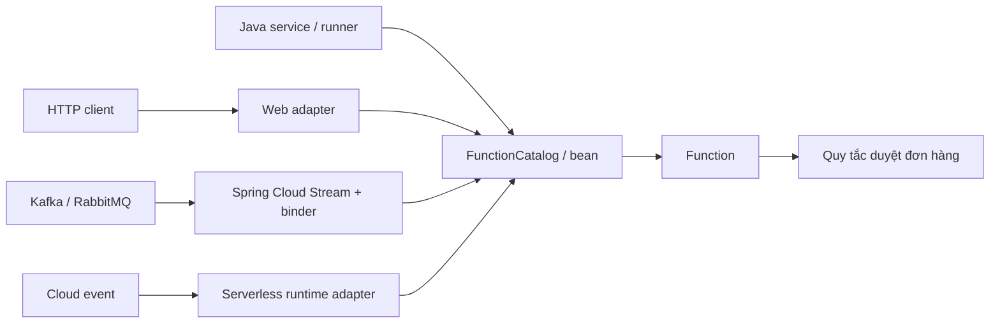
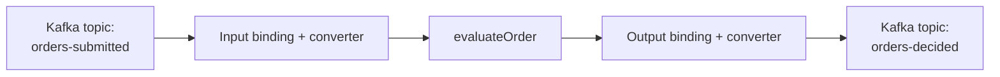

# Các cách chạy: trong ứng dụng, HTTP, messaging và serverless

## 1. Một hàm nghiệp vụ có thể chạy ở bốn môi trường

Giả sử một dịch vụ đơn hàng cần áp dụng quy tắc: mã đơn không được rỗng, số tiền phải lớn hơn 0 và không vượt quá 1.000.000 VND. Dịch vụ có thể cần trả quyết định ngay cho một màn hình quản trị, xử lý một sự kiện từ Kafka hoặc phản hồi khi nền tảng serverless kích hoạt. Thay vì viết lại quy tắc tại mỗi điểm vào, ta định nghĩa **một hàm nghiệp vụ có hợp đồng dữ liệu rõ ràng**, rồi chọn cách kích hoạt phù hợp.

Trong module **Spring Cloud Function** (`SPRING_CLOUD_FUNCTION`), logic được biểu diễn bằng các giao diện Java `Supplier<T>`, `Function<T, R>` và `Consumer<T>`. Spring Cloud Function quản lý khả năng tra cứu bằng `FunctionCatalog`, composition và chuyển đổi thông điệp trong những ngữ cảnh có adapter hỗ trợ. Một hàm có thể được dùng trong ứng dụng Java, công bố qua HTTP, nối vào hệ thống messaging hoặc đóng gói cho môi trường serverless.

**“Chạy cùng một hàm” nghĩa là tái sử dụng code và hợp đồng nghiệp vụ**. Mỗi tiến trình hoặc môi trường triển khai vẫn có Spring ApplicationContext, bean, cấu hình, dependency và vòng đời riêng. Không có một object Java duy nhất được chia sẻ giữa nhiều tiến trình chỉ vì chúng cùng khai báo tên hàm.



Sơ đồ biểu diễn **các lựa chọn điểm vào**. Tùy kiểu lời gọi, kết quả sau `Function.apply()` sẽ được caller dùng trực tiếp, chuyển thành HTTP response, phát thành output message hoặc mã hóa theo contract của runtime.

## 2. Bảng định hướng bốn cách chạy

| Cách chạy | Ai kích hoạt? | Thành phần kết nối | Hình thức trả kết quả | Dùng khi |
| --- | --- | --- | --- | --- |
| **Trong ứng dụng** | Java service, runner, tác vụ nội bộ. | Inject bean hoặc `FunctionCatalog.lookup()`. | Trả object Java cho nơi gọi. | Logic dùng trong cùng tiến trình, kiểm thử, tác vụ cục bộ. |
| **HTTP** | Client gửi request. | Spring Cloud Function Web adapter hoặc controller tự viết. | HTTP response sau chuyển đổi payload. | API cần request/response. |
| **Messaging** | Broker đưa message đến consumer hoặc poller kích hoạt nguồn. | Spring Cloud Stream và binder Kafka/RabbitMQ tương ứng. | Output message hoặc side effect; thường bất đồng bộ. | Xử lý sự kiện, ghép các dịch vụ qua broker. |
| **Serverless** | Nền tảng kích hoạt handler theo event/trigger. | Adapter phù hợp với runtime cloud. | Response hoặc tác dụng phụ theo contract của event source. | Tác vụ theo sự kiện, vận hành dựa trên invocation. |

Điểm cố định là **chữ ký nghiệp vụ**; điểm thay đổi là **adapter, ngữ nghĩa kích hoạt và chính sách vận hành**. Một API HTTP có timeout của client/gateway; message có thể bị phát lại; serverless thường có timeout và cơ chế khởi tạo môi trường riêng.

## 3. Tạo lõi nghiệp vụ dùng chung

Hãy bắt đầu bằng kiểu Java chỉ chứa dữ liệu miền. Ví dụ dùng Java 17 trở lên.

Tệp `OrderDomain.java`:

```java
package demo.orders;

import java.math.BigDecimal;
import java.util.Objects;

public final class OrderDomain {
    private OrderDomain() {}

    public record OrderRequest(
            String orderId,
            BigDecimal amountVnd) {}

    public record OrderDecision(
            String orderId,
            boolean approved,
            String reason) {}

    public static final class OrderPolicy {
        private static final BigDecimal MAX_AMOUNT =
                new BigDecimal("1000000");

        public OrderDecision evaluate(OrderRequest input) {
            Objects.requireNonNull(input, "input");

            String id = input.orderId();
            if (id == null || id.isBlank()) {
                return new OrderDecision(id, false, "MISSING_ORDER_ID");
            }

            BigDecimal amount = input.amountVnd();
            if (amount == null || amount.signum() <= 0) {
                return new OrderDecision(id, false, "INVALID_AMOUNT");
            }
            if (amount.compareTo(MAX_AMOUNT) > 0) {
                return new OrderDecision(id, false, "LIMIT_EXCEEDED");
            }

            return new OrderDecision(id, true, "APPROVED");
        }
    }
}
```

**Đặc tính đáng chú ý** của `OrderPolicy.evaluate()`:

- Nhận `OrderRequest` và trả `OrderDecision`, không dùng `HttpServletRequest`, Kafka record hoặc cloud event.
- Quy tắc được diễn tả bằng dữ liệu miền, có thể unit test như phương thức Java thông thường.
- Với cùng đầu vào, kết quả ổn định vì ví dụ không dùng trạng thái mutable hay I/O.
- `BigDecimal` giúp so sánh số tiền chính xác hơn số thực nhị phân; hợp đồng phải quy định đơn vị VND và cách làm tròn tại nguồn.
- Mã `reason` là kết quả nghiệp vụ; adapter quyết định biểu diễn nó như JSON, message hoặc response event.

Tiếp theo, đăng ký quy tắc thành Spring bean dạng hàm trong `OrderFunctionConfig.java`:

```java
package demo.orders;

import java.util.function.Function;
import org.springframework.context.annotation.Bean;
import org.springframework.context.annotation.Configuration;

import demo.orders.OrderDomain.OrderDecision;
import demo.orders.OrderDomain.OrderPolicy;
import demo.orders.OrderDomain.OrderRequest;

@Configuration
public class OrderFunctionConfig {

    @Bean
    OrderPolicy orderPolicy() {
        return new OrderPolicy();
    }

    @Bean
    Function<OrderRequest, OrderDecision> evaluateOrder(
            OrderPolicy policy) {
        return policy::evaluate;
    }
}
```

Bean `evaluateOrder` có chữ ký `Function<OrderRequest, OrderDecision>` và tên mặc định `evaluateOrder`. Đây là **hợp đồng Spring Cloud Function** mà các môi trường sẽ dùng. Cùng quy tắc này còn có thể được cung cấp như thư viện dùng chung trong nhiều ứng dụng triển khai.

Để Spring Boot khởi tạo ứng dụng thông thường:

```java
package demo.orders;

import org.springframework.boot.SpringApplication;
import org.springframework.boot.autoconfigure.SpringBootApplication;

@SpringBootApplication
public class OrderApplication {
    public static void main(String[] args) {
        SpringApplication.run(OrderApplication.class, args);
    }
}
```

Trong những ví dụ tiếp theo, ứng dụng dùng Spring Boot, các dependency Spring Cloud phù hợp và BOM Spring Cloud **tương thích với phiên bản Spring Boot**. Dependency cụ thể sẽ thay đổi theo đường triển khai, nhưng các kiểu `OrderRequest`, `OrderDecision` và bean `evaluateOrder` giữ nguyên.

## 4. Cách chạy thứ nhất: gọi hàm bên trong ứng dụng Java

Trường hợp đơn giản nhất không cần giao thức truyền thông: một service cùng Spring ApplicationContext muốn xét duyệt đơn hàng. Có hai lựa chọn thường gặp.

### 4.1. Inject bean và gọi trực tiếp

Một thành phần Spring có thể inject `Function`:

```java
package demo.orders;

import java.util.function.Function;
import org.springframework.beans.factory.annotation.Qualifier;
import org.springframework.stereotype.Service;
import demo.orders.OrderDomain.OrderDecision;
import demo.orders.OrderDomain.OrderRequest;

@Service
public class OrderPreviewService {
    private final Function<OrderRequest, OrderDecision> evaluate;

    public OrderPreviewService(
            @Qualifier("evaluateOrder")
            Function<OrderRequest, OrderDecision> evaluate) {
        this.evaluate = evaluate;
    }

    public OrderDecision preview(OrderRequest request) {
        return evaluate.apply(request);
    }
}
```

Ưu điểm là kiểu Java rõ ràng và quan hệ phụ thuộc thể hiện ngay trong constructor. Nếu hệ thống chỉ có một use case cố định, cách gọi trực tiếp này là đủ; không phải mỗi lời gọi nội bộ đều cần một lần lookup theo tên.

### 4.2. Tra cứu bằng FunctionCatalog

Khi cần chọn hàm theo tên hoặc ghép nhiều bước từ cấu hình, dùng `org.springframework.cloud.function.context.FunctionCatalog`:

```java
// Đoạn minh họa nằm trong service/runner đã inject FunctionCatalog catalog.
Function<OrderRequest, OrderDecision> fn =
        catalog.lookup("evaluateOrder");

if (fn == null) {
    throw new IllegalStateException(
            "Function evaluateOrder was not registered");
}

OrderDecision decision = fn.apply(
        new OrderRequest("ORD-101", new BigDecimal("750000")));
// OrderDecision("ORD-101", true, "APPROVED")
```

Một ứng dụng console có thể gọi đoạn này từ `ApplicationRunner`, đọc dữ liệu từ argument rồi kết thúc sau khi chạy xong nếu không có thành phần giữ JVM sống. Cần lựa chọn dependency Spring Cloud Function context phù hợp và không bật web server nếu chạy console:

```yaml
spring:
  main:
    web-application-type: none
```

Đây là cách chạy **trong cùng tiến trình**, không phải HTTP hay serverless. Nếu ứng dụng có task scheduler hoặc batch runner, các thành phần đó tự quyết định khi nào gọi hàm; `FunctionCatalog` chỉ giúp tìm hàm theo tên và cung cấp điểm gọi.

Kết quả lookup có thể là wrapper của bean được framework chuẩn bị cho composition/chuyển đổi dữ liệu. Vì vậy, không nên dùng `==` để kỳ vọng lookup trả đúng instance Spring bean ban đầu. Điều quan trọng là **hợp đồng và kết quả**.

## 5. Cách chạy thứ hai: công bố Function qua HTTP

Để Spring Cloud Function cung cấp HTTP adapter, thêm dependency Maven:

```xml
<dependency>
    <groupId>org.springframework.cloud</groupId>
    <artifactId>spring-cloud-starter-function-web</artifactId>
</dependency>
```

Khi ứng dụng chạy trên cổng 8080 với web adapter được cấu hình, có thể gọi hàm theo tên endpoint. Ví dụ:

```bash
curl -X POST http://localhost:8080/evaluateOrder \
  -H "Content-Type: application/json" \
  -d '{"orderId":"ORD-101","amountVnd":750000}'
```

Kết quả nghiệp vụ mong đợi:

```json
{
  "orderId": "ORD-101",
  "approved": true,
  "reason": "APPROVED"
}
```

Luồng xử lý:

```text
HTTP POST /evaluateOrder
    → HTTP adapter đọc body JSON
    → chuyển payload thành OrderRequest
    → tìm/gọi evaluateOrder.apply(request)
    → chuyển OrderDecision thành JSON response
```

Đây là **một cách tự động điều hợp HTTP**, không phải Spring tự biến mọi bean bất kỳ thành REST controller. Nếu cần API có đường dẫn, status code, validation hoặc error body đặc thù, có thể viết `@RestController` gọi cùng bean `evaluateOrder`:

```java
@RestController
class OrderController {
    private final Function<OrderRequest, OrderDecision> evaluate;

    OrderController(
            @Qualifier("evaluateOrder")
            Function<OrderRequest, OrderDecision> evaluate) {
        this.evaluate = evaluate;
    }

    @PostMapping("/api/orders/decision")
    OrderDecision decide(@RequestBody OrderRequest request) {
        return evaluate.apply(request);
    }
}
```

Đoạn controller là **phương án HTTP riêng**, cần dependency Spring Web tương ứng và import annotation. Không bật các endpoint trùng đường dẫn từ controller và adapter khi chưa kiểm tra cách Spring định tuyến.

**Phân biệt kết quả nghiệp vụ với lỗi HTTP:** đơn hàng vượt hạn mức có thể trả `approved=false`; đây là một quyết định hợp lệ. Ngược lại, JSON sai cú pháp hoặc thiếu content type có thể khiến HTTP adapter không thể tạo `OrderRequest`; lỗi này phải được ánh xạ thành HTTP error theo contract API. Hàm không nên tự tạo `ResponseEntity` khi mục tiêu là dùng lại cho Kafka hay serverless.

## 6. Cách chạy thứ ba: xử lý thông điệp với Spring Cloud Stream

Đối với Kafka hoặc RabbitMQ, ứng dụng thường dùng **Spring Cloud Stream** với binder tương ứng. Spring Cloud Stream kết nối một hàm với kênh vào/ra bằng *functional bindings*; binder lo việc trao đổi với broker và nhiều vấn đề vận hành của luồng message.

Ví dụ thêm Kafka binder:

```xml
<dependency>
    <groupId>org.springframework.cloud</groupId>
    <artifactId>spring-cloud-stream-binder-kafka</artifactId>
</dependency>
```

Cùng bean `evaluateOrder` từ mục 3, khai báo `application.yml`:

```yaml
spring:
  cloud:
    function:
      definition: evaluateOrder
    stream:
      bindings:
        evaluateOrder-in-0:
          destination: orders-submitted
          group: order-policy
          content-type: application/json
        evaluateOrder-out-0:
          destination: orders-decided
          content-type: application/json
      kafka:
        binder:
          brokers: localhost:9092
```

Khi ứng dụng chạy, với broker Kafka hoạt động và cấu hình binder phù hợp:

- Binding `evaluateOrder-in-0` nhận thông điệp từ `orders-submitted`.
- Binder và converter chuyển payload thành `OrderRequest` dựa trên kiểu generic và content type.
- Spring Cloud Function gọi `evaluateOrder.apply(request)`.
- Kết quả `OrderDecision` được chuyển thành message gửi qua `evaluateOrder-out-0` tới `orders-decided`.
- `group: order-policy` xác định consumer group cho phía nhận.

Ví dụ payload sự kiện đầu vào:

```json
{"orderId":"ORD-101","amountVnd":750000}
```

Payload sự kiện đầu ra về mặt nghiệp vụ:

```json
{"orderId":"ORD-101","approved":true,"reason":"APPROVED"}
```



Khác với HTTP, producer thường **không chờ trực tiếp kết quả qua cùng kết nối**. Một sự kiện có thể được broker giao lại; binder có thể áp dụng retry, dead-letter hoặc cơ chế acknowledgment theo cấu hình và phiên bản. Một function trả object thành công không tự chứng minh output đã được broker ghi nhận. Khi logic có side effect như cập nhật tồn kho hoặc thu tiền, cần ranh giới transaction và idempotency phù hợp.

### 6.1. Supplier và Consumer trong messaging

Với `Function<T, R>`, message đi vào và có output message. Hai kiểu hàm còn lại có vai trò riêng:

| Kiểu hàm | Binding điển hình | Cách kích hoạt |
| --- | --- | --- |
| `Supplier<T>` | Chỉ có output, ví dụ `policyVersion-out-0`. | Poller hoặc cơ chế kích hoạt nguồn được cấu hình. |
| `Function<T, R>` | Input và output, ví dụ `evaluateOrder-in-0` / `evaluateOrder-out-0`. | Có input message cần xử lý. |
| `Consumer<T>` | Chỉ có input, ví dụ `auditDecision-in-0`. | Có input message để thực hiện side effect. |

Ví dụ nguồn:

```java
@Bean
Supplier<String> policyVersion() {
    return () -> "policy-v1";
}
```

`Supplier` không tự định kỳ chạy; nếu cấu hình poller thì adapter sẽ gọi `get()` theo nhịp thích hợp. Một supplier luôn trả một giá trị giống nhau có thể phát nhiều thông điệp trùng nếu được poll lặp lại. Với `Consumer`, `accept()` trả `void` và không tự tạo output binding; việc acknowledgment message vẫn do broker/binder quyết định.

Ba cấu hình chức năng riêng nên được chọn theo mục tiêu ứng dụng. Không nên giả định mọi bean `Supplier`, `Function` và `Consumer` sẽ cùng được bind tự động theo ý người phát triển khi có nhiều bean. Hãy khai báo `spring.cloud.function.definition` phù hợp và kiểm tra tên binding của pipeline đang dùng.

## 7. Cách chạy thứ tư: serverless

Trong mô hình **serverless**, code được đóng gói để một nền tảng gọi khi có event/trigger. AWS Lambda là ví dụ phổ biến, nhưng contract handler, event envelope, đóng gói và cấu hình phụ thuộc **nền tảng cụ thể**.

Spring Cloud Function có các adapter tích hợp với một số runtime serverless. Mục tiêu là kết nối handler của runtime với hàm đã đăng ký mà không cần đưa SDK của nền tảng vào `OrderPolicy`.

Luồng xử lý khái niệm:

```text
Cloud trigger (HTTP gateway / queue / event bus / ...)
    → runtime khởi tạo hoặc tái sử dụng môi trường
    → adapter nhận event, chuyển định dạng
    → FunctionCatalog.lookup("evaluateOrder")
    → evaluateOrder.apply(OrderRequest)
    → adapter chuyển OrderDecision về contract của trigger
```

Ví dụ cấu hình chọn hàm:

```yaml
spring:
  cloud:
    function:
      definition: evaluateOrder
```

Property `spring.cloud.function.definition` chọn hàm hoặc composition khi adapter hỗ trợ; **nó không tự tạo** AWS Lambda function, IAM role, event source mapping hay deployment. Cần chọn artifact adapter và handler phù hợp phiên bản, build package theo hướng dẫn của runtime, khai báo quyền, biến môi trường, memory, timeout và trigger.

### 7.1. Event envelope quan trọng hơn tên hàm

Một **direct invocation** có thể gửi payload do bên gọi tự định nghĩa:

```json
{"orderId":"ORD-101","amountVnd":750000}
```

Nhưng sự kiện API Gateway thường bao gồm metadata HTTP và body; SQS event có thể chứa danh sách records, mỗi record có body. Adapter hoặc handler cần biết **cách lấy payload nghiệp vụ ra khỏi envelope**. Không nên cho rằng mọi event JSON của Lambda đều có thể đưa thẳng vào `Function<OrderRequest, OrderDecision>`.

Ví dụ mã giả (không phải tên API cố định của Spring/AWS):

```text
handle(platformEvent):
    orderRequest = decodeEvent(platformEvent)
    fn = functionCatalog.lookup("evaluateOrder")
    decision = fn.apply(orderRequest)
    return encodeForTrigger(decision)
```

Ở event source xử lý theo lô, handler cần quyết định xử lý từng record, lỗi một record có làm thất bại cả batch hay không và cơ chế thông báo partial failure nếu nền tảng hỗ trợ. Với trigger bất đồng bộ, một sự kiện có thể được retry, nên cần idempotency khi nghiệp vụ tạo side effect.

### 7.2. Các ràng buộc không có trong hợp đồng Function

Mặc dù logic được giữ nguyên, triển khai serverless phải xét đến cold start, thời gian khởi tạo Spring context, giới hạn thời gian chạy, memory, mạng và quyền truy cập tài nguyên. Nếu một function phải gọi database, HTTP client hoặc hệ thống secret, adapter/runtime cần cấu hình kết nối tương ứng. Những ràng buộc này không được giải quyết chỉ bằng việc chuyển `@RestController` sang `@Bean Function`.

## 8. So sánh chi tiết ngữ nghĩa của bốn môi trường

| Khía cạnh | Trong ứng dụng | HTTP | Messaging | Serverless |
| --- | --- | --- | --- | --- |
| **Bắt đầu lời gọi** | Java gọi `apply()`. | Client gửi request. | Broker giao message hoặc poller chạy. | Nền tảng gọi handler. |
| **Dữ liệu vào** | Object Java có sẵn. | Body, path, query, headers. | Payload và message headers. | Event envelope theo trigger. |
| **Kết quả** | Object cho caller. | HTTP response. | Output message hoặc side effect. | Response, ack hoặc side effect theo contract. |
| **Sự đồng bộ** | Tùy code gọi trực tiếp. | Thường request/response. | Thường bất đồng bộ theo broker. | Tùy trigger đồng bộ/bất đồng bộ. |
| **Lỗi** | Exception hoặc kết quả nghiệp vụ. | HTTP status/body hoặc timeout. | Retry, redelivery, dead-letter tùy binder. | Failure/retry theo runtime/event source. |
| **Quản lý vòng đời** | JVM và Spring context đang chạy. | Web server/gateway. | Consumer và broker. | Cloud runtime/invocation. |
| **Địa chỉ / định tuyến** | Tên bean hoặc code reference. | Endpoint và HTTP method. | Destination, binding, group. | Handler, trigger, event source. |

Ví dụ cùng một đơn `ORD-101` có số tiền 750.000 VND tạo cùng `OrderDecision`. Nhưng nó có thể xuất hiện như:

- Kết quả trả về của `OrderPreviewService.preview()`.
- JSON response của `POST /evaluateOrder`.
- JSON payload trên topic `orders-decided`.
- Dữ liệu được adapter Lambda trả theo hợp đồng của nguồn kích hoạt.

**Tính nhất quán nghiệp vụ** là thứ có thể kiểm thử ở lớp Java; **tính đúng đắn của giao vận** cần kiểm thử ở adapter riêng.

## 9. Message, kiểu dữ liệu và chuyển đổi payload

Spring Cloud Function hỗ trợ chuyển đổi thông điệp trong những bối cảnh thích hợp, nhưng không có nghĩa mọi payload bất kỳ đều có thể tự ánh xạ đúng. Để các môi trường dùng chung hàm, cần giữ contract rõ:

```text
OrderRequest {
  orderId: String
  amountVnd: BigDecimal
}
       |
       v
Function<OrderRequest, OrderDecision>
       |
       v
OrderDecision {
  orderId: String
  approved: boolean
  reason: String
}
```

Khác biệt thường gặp:

1. **Kiểu generic:** chữ ký `Function<OrderRequest, OrderDecision>` cho framework metadata cần thiết để suy ra input/output; nên tránh khai báo raw `Function`.
2. **Content type:** HTTP hoặc Stream phải có converter phù hợp để xử lý JSON; cấu hình `application/json` chưa tự bảo đảm schema đúng.
3. **Metadata:** HTTP headers, Kafka key, correlation ID hay Lambda request ID có semantics riêng. Chỉ đưa vào domain khi quy tắc thực sự cần.
4. **Schema version:** đổi tên `amountVnd`, đổi đơn vị tiền hoặc đổi cấu trúc event là thay đổi contract cần quản lý phiên bản.
5. **Dữ liệu lỗi:** JSON không thể parse là lỗi chuyển đổi, còn `amountVnd=0` có thể là input hợp lệ về cấu trúc nhưng bị từ chối theo quy tắc.

Khi cần headers của Spring Messaging, có thể định nghĩa:

```java
Function<Message<OrderRequest>, Message<OrderDecision>>
```

`Message<T>` thuộc `org.springframework.messaging`, gồm payload và headers. Kiểu này hữu ích khi metadata là một phần của công việc, nhưng khiến chữ ký phụ thuộc abstraction messaging. Nếu chỉ cần xét duyệt đơn, `Function<OrderRequest, OrderDecision>` đơn giản hơn và dễ gọi từ cả HTTP, Java nội bộ lẫn serverless.

## 10. FunctionCatalog và composition trong nhiều môi trường

Một ứng dụng có thể cần hai bước: chuẩn hóa mã đơn rồi xét duyệt. Ta khai báo thêm:

```java
@Bean
Function<OrderRequest, OrderRequest> normalizeOrder() {
    return request -> new OrderRequest(
            request.orderId() == null
                    ? null : request.orderId().strip(),
            request.amountVnd());
}
```

Với những bean có tên `normalizeOrder` và `evaluateOrder`, Spring Cloud Function cho phép tra cứu composition:

```java
Function<OrderRequest, OrderDecision> pipeline =
        catalog.lookup("normalizeOrder|evaluateOrder");
```

Thứ tự chạy từ trái sang phải; output `OrderRequest` của `normalizeOrder` là input của `evaluateOrder`. Nếu cần dùng pipeline trong adapter hỗ trợ cấu hình định nghĩa:

```yaml
spring:
  cloud:
    function:
      definition: "normalizeOrder|evaluateOrder"
```

Biểu thức này xác định **logic cần gọi**, còn việc công bố HTTP route, binding của Stream hoặc handler serverless vẫn do adapter quyết định. Với Stream, tên binding mặc định của composition có thể phụ thuộc định nghĩa pipeline và phiên bản; cần kiểm tra tên đã thực sự được tạo hoặc đặt binding name rõ ràng theo cơ chế tương ứng trước khi triển khai.

Lưu ý về lỗi khi composition: nếu `normalizeOrder` ném exception, `evaluateOrder` không có kết quả; adapter sẽ diễn giải thất bại theo cơ chế riêng. Composition không tự thêm transaction hoặc bảo đảm xử lý đúng một lần.

## 11. Supplier và Consumer chạy khác Function như thế nào?

Ví dụ chính dùng `Function<T, R>` vì có đầu vào và cần quyết định. Hai giao diện còn lại phù hợp các hình dạng công việc khác:

```java
@Bean
Supplier<String> policyVersion() {
    return () -> "order-policy-v1";
}

@Bean
Consumer<OrderDecision> auditDecision() {
    return decision -> System.out.println(
            "AUDIT " + decision.orderId()
                    + " -> " + decision.reason());
}
```

| Môi trường | Supplier | Consumer |
| --- | --- | --- |
| **Trong ứng dụng** | Caller gọi `get()` khi cần snapshot. | Caller gọi `accept()` khi cần tạo side effect. |
| **HTTP** | Adapter có thể expose endpoint đọc giá trị. | Adapter có thể nhận POST và gọi `accept()`; không có object kết quả nghiệp vụ. |
| **Messaging** | Poller/source đưa dữ liệu ra output binding. | Input binding nhận dữ liệu và xử lý side effect, thường không có output binding. |
| **Serverless** | Handler/adapter được kích hoạt để lấy giá trị nếu contract phù hợp. | Handler/adapter xử lý event và báo completion/lỗi theo runtime, không trả giá trị nghiệp vụ. |

`Supplier` không phải bộ lập lịch; `Consumer` trả `void` không phải xác nhận broker đã commit. Đặc biệt với consumer ghi database, cần idempotency khi HTTP request, message hoặc cloud event có thể được thực thi lại.

## 12. Kiểm thử theo ranh giới của từng kiểu triển khai

Một hệ thống tái sử dụng logic nên có **hai lớp kiểm thử khác mục đích**.

### 12.1. Unit test nghiệp vụ, không cần HTTP/Kafka/cloud

```java
package demo.orders;

import static org.junit.jupiter.api.Assertions.assertEquals;
import static org.junit.jupiter.api.Assertions.assertTrue;
import java.math.BigDecimal;
import org.junit.jupiter.api.Test;
import demo.orders.OrderDomain.OrderPolicy;
import demo.orders.OrderDomain.OrderRequest;

class OrderPolicyTest {
    private final OrderPolicy policy = new OrderPolicy();

    @Test
    void approvesOrderWithinLimit() {
        var decision = policy.evaluate(
                new OrderRequest(
                        "ORD-101", new BigDecimal("750000")));
        assertTrue(decision.approved());
        assertEquals("APPROVED", decision.reason());
    }
}
```

Nên bổ sung test mã đơn null/rỗng, số tiền null, bằng 0, âm, đúng 1.000.000 và vượt ngưỡng. Đây là những tình huống thuộc hợp đồng nghiệp vụ và không cần chạy broker.

### 12.2. Integration/contract test cho mỗi adapter

| Đường chạy | Nội dung kiểm tra |
| --- | --- |
| **Trong ứng dụng** | Bean được Spring tạo, `FunctionCatalog.lookup("evaluateOrder")` thành công, composition đúng thứ tự và dữ liệu. |
| **HTTP** | Endpoint, JSON mapping, status code, lỗi parse, xác thực và timeout theo API contract. |
| **Messaging** | Binding/destination, group, converter, output event, redelivery, retry và dead-letter khi cần. |
| **Serverless** | Event envelope thực, handler configuration, mapping record, response/failure theo trigger và timeout/cold start. |

Khi chỉ thay broker hoặc endpoint, unit test `OrderPolicy` giữ nguyên; khi thay quy tắc giới hạn tiền, unit test phải cập nhật theo chính sách mới. Thiết kế tốt giúp tách chi phí kiểm thử **nghiệp vụ** với chi phí kiểm thử **triển khai**.

## 13. Các lỗi triển khai hay gặp

| Hiểu nhầm | Cách hiểu đúng |
| --- | --- |
| “Có `@Bean Function` là tự chạy.” | Cần thành phần gọi, adapter hoặc trigger. Bean không tự lên lịch. |
| “Chạy HTTP được là Kafka tự nhận message.” | Cần Spring Cloud Stream, binder, binding và broker tương ứng. |
| “`FunctionCatalog` chính là HTTP server.” | Catalog đăng ký/tra cứu hàm; web adapter mới nối với HTTP. |
| “Supplier tự phát dữ liệu đúng một lần.” | Tần suất do caller/poller/runtime; có thể được kích hoạt lại. |
| “Function trả thành công nghĩa output event đã được ghi bền vững.” | Việc gửi/ack thuộc binder/broker, có thể thất bại sau khi hàm tạo kết quả. |
| “Consumer trả void tức là broker đã xác nhận message.” | Return type không quyết định acknowledgment hoặc transaction. |
| “JSON trong Kafka giống JSON của mọi cloud event.” | Event envelope/schema và converter khác nhau theo nguồn gọi. |
| “Serverless bảo đảm sự kiện chỉ được xử lý một lần.” | Một số trigger có retry hoặc redelivery, cần idempotency cho side effect. |
| “Composition cho phép ghép bất kỳ hai hàm.” | Kiểu output/input phải tương thích; tác dụng phụ và lỗi vẫn cần thiết kế. |
| “Có thể chạy Web adapter, Stream binder và Lambda mà không thay dependency.” | Mỗi môi trường có adapter, runtime và cách đóng gói/cấu hình riêng. |

## 14. Quy trình chọn cách chạy cho một chức năng mới

1. **Xác định nghiệp vụ**: input và output là gì? Nếu có kết quả, dùng `Function<T, R>`; nếu chỉ tạo dữ liệu cân nhắc `Supplier`; nếu chỉ thực hiện hành động cân nhắc `Consumer`.
2. **Viết và kiểm thử lõi Java**: loại bỏ các chi tiết HTTP/broker/cloud khỏi quy tắc; chốt schema và đơn vị dữ liệu.
3. **Đăng ký bean với tên ổn định**: ví dụ `evaluateOrder`; tra cứu qua `FunctionCatalog` khi cần chọn tên động hoặc composition.
4. **Chọn điểm vào**: inject trong ứng dụng, web adapter cho API, Stream binder cho event, hoặc adapter serverless cho cloud trigger.
5. **Cấu hình riêng cho môi trường**: endpoint, destination/group, handler/trigger, content type và dependency tương ứng.
6. **Thiết kế lỗi và vận hành**: phân biệt quyết định nghiệp vụ với lỗi parse/I/O; xử lý retry, idempotency, transaction, tracing, timeout.
7. **Kiểm thử contract và triển khai**: bảo đảm cùng dữ liệu miền tạo cùng quyết định, đồng thời mỗi adapter đọc/trả dữ liệu theo đúng hợp đồng của nó.

**Bài tập tự thực hành:** dùng `OrderPolicy` và `evaluateOrder` ở mục 3, gọi một lần từ `ApplicationRunner`, một lần bằng `curl` qua Spring Cloud Function Web và một lần bằng message trên Kafka đã cấu hình. Sau đó mô tả payload, adapter và handler cần thiết để dùng lại hàm trên một trigger AWS Lambda. Kết quả nghiệp vụ đối với `ORD-101` và 750.000 VND phải nhất quán; **đường truyền, thời điểm kích hoạt và cách ghi nhận kết quả** có thể khác nhau. Đó là mục tiêu của việc chạy cùng logic qua **trong ứng dụng, HTTP, messaging và serverless**.
