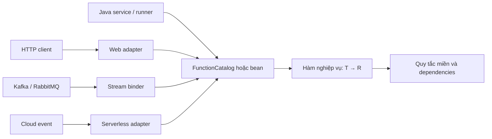

# Trường hợp phù hợp và giới hạn của mô hình hàm

## 1. Vì sao cần biết lúc nào nên và không nên dùng mô hình hàm?

Một hệ thống thương mại điện tử có thể cần tính phí giao hàng cho cùng một giỏ hàng qua ba con đường: màn hình thanh toán gửi HTTP request, một dịch vụ khác phát sự kiện sau khi tạo đơn, và một tác vụ serverless xử lý các yêu cầu phát sinh theo lịch. Nếu quy tắc tính phí được viết ba lần trong controller, message listener và cloud handler, thay đổi chính sách dễ gây ra kết quả không nhất quán.

**Spring Cloud Function** (module `SPRING_CLOUD_FUNCTION`) giải quyết phần quan trọng của bài toán này: biểu diễn logic nghiệp vụ bằng các giao diện `Supplier`, `Function`, `Consumer` chuẩn Java; đăng ký và tra cứu hàm qua `FunctionCatalog`; hỗ trợ composition và xử lý/chuyển đổi thông điệp trong ngữ cảnh phù hợp. Các bộ điều hợp có thể gọi cùng hàm qua HTTP, hệ thống sự kiện hoặc một runtime serverless.

Nhưng **viết code theo kiểu hàm không mặc nhiên làm hệ thống đơn giản hơn**. Một yêu cầu xử lý kéo dài hàng giờ, có nhiều transaction phân tán và cần checkpoint chưa chắc phù hợp với một chuỗi `Function`. Một API cần điều khiển HTTP status, authentication và streaming chuyên biệt có thể vẫn cần controller hoặc WebFlux handler. Học mô hình hàm cần đi đôi với việc hiểu **ranh giới** của nó.

Mục tiêu của bài là trả lời ba câu hỏi:

1. **Khi nào** một use case nên được biểu diễn thành `Supplier`, `Function` hoặc `Consumer`?
2. **Khi nào** nên dùng `FunctionCatalog`, composition và bộ điều hợp thay vì viết một service Java thông thường?
3. **Giới hạn nào** vẫn thuộc trách nhiệm của nghiệp vụ, giao thức, hệ thống lưu trữ và nền tảng triển khai?

## 2. Mô hình hàm là một cách tổ chức logic, không phải một kiến trúc hoàn chỉnh

Ba giao diện gốc đến từ `java.util.function`:

| Giao diện | Phương thức | Hình dạng | Ví dụ nghiệp vụ |
| --- | --- | --- | --- |
| `Supplier<T>` | `get()` | Không nhận dữ liệu, trả `T`. | Cung cấp phiên bản bảng phí hiện hành. |
| `Function<T, R>` | `apply(T)` | Nhận `T`, trả `R`. | Tính phí giao hàng dựa trên giỏ hàng và vùng giao. |
| `Consumer<T>` | `accept(T)` | Nhận `T`, không trả giá trị. | Ghi audit hoặc gửi một thông báo. |

Những giao diện này quy định **hình dạng lời gọi Java**, không quy định tự động thời điểm gọi, nơi dữ liệu đến, cách bảo mật hay cách xử lý lỗi. Spring Cloud Function bổ sung những khả năng để các hàm được quản lý như bean, tra cứu theo tên, composition và được adapter khai thác.



**Điều có thể giữ nguyên:** kiểu `T`, kiểu `R`, quy tắc tính phí và cách kiểm thử nghiệp vụ.

**Điều không thể bỏ qua:** HTTP mapping, message bindings, schema/versioning, quyền truy cập tài nguyên, transaction, retry, timeout và các yêu cầu của runtime. Bộ điều hợp giúp **kết nối** các phần, không thay thế toàn bộ hạ tầng đó.

## 3. Những trường hợp Spring Cloud Function đặc biệt phù hợp

### 3.1. Một phép biến đổi có đầu vào/đầu ra rõ ràng

Các thao tác chuẩn hóa, phân loại, tính phí, kiểm tra quy tắc, làm giàu dữ liệu hoặc tính điểm có hợp đồng `T → R` tự nhiên. Nếu phần lõi gần như **stateless** và kết quả dự đoán được, hàm dễ unit test và ít phụ thuộc môi trường.

Ví dụ: `ShippingRequest → ShippingQuote`. Dữ liệu yêu cầu không cần chứa HTTP headers, Kafka offset hoặc cloud context.

### 3.2. Cùng quy tắc được gọi qua nhiều giao thức

Một hàm có thể được gọi trực tiếp từ Java, công bố qua Spring Cloud Function Web, nối với broker nhờ Spring Cloud Stream binder hoặc được adapter serverless kích hoạt. **Khả năng tái sử dụng logic** là lợi ích; các đường gọi vẫn có dependency và cấu hình riêng.

Điều này hữu ích khi tổ chức muốn chuyển từ API đồng bộ sang xử lý sự kiện mà không nhân bản các điều kiện nghiệp vụ.

### 3.3. Nguồn và điểm nhận sự kiện có hình dạng đơn giản

`Supplier` hợp lý khi cần phát một giá trị theo nhịp mà **poller quyết định**; `Consumer` phù hợp với một sink thực hiện hành động. `Function` thích hợp khi cần chuyển input event thành output event.

Ví dụ: nhận `OrderCreated`, tính `ShippingQuote`, phát `ShippingQuoted`. Với những pipeline đơn giản và có schema rõ ràng, dạng functional binding của Spring Cloud Stream có thể làm phần code xử lý dễ theo dõi hơn.

### 3.4. Cần chọn hàm và ghép các bước theo tên

`FunctionCatalog.lookup("normalize|quote")` có thể biểu diễn pipeline gồm các hàm đã đăng ký. Composition giúp tổ chức những bước **tương thích kiểu** và thay đổi lựa chọn pipeline theo cấu hình mà không phải tự viết registry tên hàm.

Lợi ích rõ nhất khi pipeline là chuỗi biến đổi tương đối tuyến tính. Những workflow có nhiều nhánh, timer, trạng thái và compensation phức tạp không tự trở thành bài toán composition đơn giản.

### 3.5. Cần kiểm thử nghiệp vụ độc lập với hạ tầng

Lõi Java có thể được kiểm thử chỉ bằng `apply()`. Adapter HTTP, Kafka hay serverless có test contract riêng. Khi cập nhật công thức phí giao hàng, test của quy tắc cần thay đổi nhưng không phải viết lại logic ở tất cả điểm vào.

### 3.6. Muốn đóng gói một điểm xử lý theo kiểu serverless

Một `Function` có đầu vào/đầu ra tương đối nhỏ, thời gian chạy trong giới hạn runtime và dependency kiểm soát được có thể là ứng viên thích hợp cho FaaS. Spring Cloud Function cho phép tái sử dụng bean cùng adapter tương ứng, nhưng cold start và việc khởi tạo Spring context vẫn cần đo đạc.

## 4. Ví dụ hoàn chỉnh về một hàm phù hợp

Giả sử chính sách phí giao hàng:

- Yêu cầu có `orderId` và `region` không rỗng.
- Tổng tiền đơn không âm.
- Đơn có tổng tiền từ 500.000 VND được miễn phí giao hàng.
- Đơn khác có phí cơ bản 20.000 VND trong vùng `INNER`, 40.000 VND ở vùng `OUTER`.
- Giá trị vùng không nằm trong tập hỗ trợ được coi là input không hợp lệ, không tự suy thành `OUTER`.

### 4.1. Định nghĩa dữ liệu và logic Java thuần

```java
package example.shipping;

import java.math.BigDecimal;
import java.util.Locale;
import java.util.Objects;

public final class ShippingPolicy {
    private static final BigDecimal FREE_THRESHOLD =
            new BigDecimal("500000");
    private static final BigDecimal INNER_FEE =
            new BigDecimal("20000");
    private static final BigDecimal OUTER_FEE =
            new BigDecimal("40000");

    public record ShippingRequest(
            String orderId,
            String region,
            BigDecimal subtotalVnd) {}

    public record ShippingQuote(
            String orderId,
            BigDecimal feeVnd,
            String tariffCode) {}

    public ShippingQuote quote(ShippingRequest request) {
        Objects.requireNonNull(request, "request");
        if (request.orderId() == null || request.orderId().isBlank()) {
            throw new IllegalArgumentException("Missing orderId");
        }
        if (request.region() == null) {
            throw new IllegalArgumentException("Missing region");
        }
        BigDecimal subtotal = request.subtotalVnd();
        if (subtotal == null || subtotal.signum() < 0) {
            throw new IllegalArgumentException("Invalid subtotal");
        }

        String region = request.region().strip()
                .toUpperCase(Locale.ROOT);
        BigDecimal baseFee = switch (region) {
            case "INNER" -> INNER_FEE;
            case "OUTER" -> OUTER_FEE;
            default -> throw new IllegalArgumentException(
                    "Unsupported region: " + region);
        };

        if (subtotal.compareTo(FREE_THRESHOLD) >= 0) {
            return new ShippingQuote(
                    request.orderId(), BigDecimal.ZERO, "FREE");
        }
        return new ShippingQuote(
                request.orderId(), baseFee, region);
    }
}
```

Hợp đồng `ShippingRequest/ShippingQuote` thuộc miền giao hàng. `ShippingPolicy` không đọc HTTP request, không nhận `MessageHeaders` và không mở Kafka connection. Nếu chỉ thay cơ chế nhận dữ liệu, phương thức `quote()` không cần sửa.

Ví dụ gọi Java thuần:

```java
var policy = new ShippingPolicy();
var request = new ShippingPolicy.ShippingRequest(
        "ORD-204", "inner", new BigDecimal("450000"));

var quote = policy.quote(request);
// feeVnd = 20000, tariffCode = "INNER"
```

### 4.2. Đăng ký thành bean Spring Cloud Function

```java
package example.shipping;

import java.util.function.Function;
import org.springframework.context.annotation.Bean;
import org.springframework.context.annotation.Configuration;

import example.shipping.ShippingPolicy.ShippingRequest;
import example.shipping.ShippingPolicy.ShippingQuote;

@Configuration
public class ShippingFunctions {
    @Bean
    ShippingPolicy shippingPolicy() {
        return new ShippingPolicy();
    }

    @Bean
    Function<ShippingRequest, ShippingQuote> quoteShipping(
            ShippingPolicy policy) {
        return policy::quote;
    }
}
```

Bean có tên mặc định `quoteShipping`. Với dependency Spring Cloud Function phù hợp, framework phát hiện bean hàm và hỗ trợ tra cứu qua `FunctionCatalog`:

```java
// Đặt trong một Spring service/runner đã inject FunctionCatalog catalog.
Function<ShippingPolicy.ShippingRequest,
         ShippingPolicy.ShippingQuote> function =
        catalog.lookup("quoteShipping");

if (function == null) {
    throw new IllegalStateException("quoteShipping not registered");
}

var result = function.apply(
        new ShippingPolicy.ShippingRequest(
                "ORD-204", "INNER", new BigDecimal("450000")));
```

**Phân biệt:** Inject `Function<ShippingRequest, ShippingQuote>` trực tiếp cũng có thể gọi `apply()`. `FunctionCatalog` đặc biệt hữu ích khi cần lựa chọn theo tên, composition hoặc adapter tích hợp; không nhất thiết phải dùng lookup mỗi lần nếu phụ thuộc đã cố định.

### 4.3. Cùng hàm qua HTTP hoặc messaging

Khi cài `spring-cloud-starter-function-web` và dùng Spring Boot với BOM Spring Cloud tương thích, web adapter có thể ánh xạ tên hàm thành endpoint:

```bash
curl -X POST http://localhost:8080/quoteShipping \
  -H "Content-Type: application/json" \
  -d '{"orderId":"ORD-204","region":"INNER","subtotalVnd":450000}'
```

Kết quả nghiệp vụ dự kiến:

```json
{
  "orderId": "ORD-204",
  "feeVnd": 20000,
  "tariffCode": "INNER"
}
```

Nếu chạy trong ứng dụng Spring Cloud Stream với Kafka binder phù hợp, có thể chọn cùng bean:

```yaml
spring:
  cloud:
    function:
      definition: quoteShipping
    stream:
      bindings:
        quoteShipping-in-0:
          destination: shipping-requests
          group: shipping-calculator
          content-type: application/json
        quoteShipping-out-0:
          destination: shipping-quotes
          content-type: application/json
      kafka:
        binder:
          brokers: localhost:9092
```

Đoạn cấu hình Stream chỉ là ví dụ cho **triển khai messaging**: cần có `spring-cloud-stream-binder-kafka`, broker và phiên bản phụ thuộc tương thích. Cùng `ShippingRequest` có thể đến từ JSON message; binder và converter xử lý việc giao vận rồi gọi `quoteShipping`.

Với serverless, handler/adapter tương ứng có thể chuyển một event phù hợp thành `ShippingRequest` rồi gọi cùng bean. **Không có một cách đóng gói chung cho mọi runtime**: AWS Lambda, API Gateway, SQS hoặc một nền tảng khác có thể dùng event envelope và ngữ nghĩa retry khác nhau.

## 5. Tiêu chí đánh giá trước khi chọn mô hình hàm

Một use case có các đặc điểm dưới đây thường là **ứng viên tốt**:

| Tiêu chí | Tín hiệu thuận lợi | Tín hiệu cần cân nhắc |
| --- | --- | --- |
| **Hợp đồng dữ liệu** | Có kiểu request và result rõ ràng. | Input là trạng thái phiên dài hoặc phải truy cập nhiều phần của HTTP session. |
| **Phụ thuộc giao thức** | Quy tắc chỉ cần payload nghiệp vụ. | Quy tắc liên tục kiểm tra cookie, broker offset hay cloud event metadata. |
| **Tính cục bộ của xử lý** | Một phép biến đổi hoặc một bước logic có ranh giới rõ. | Workflow kéo dài, chờ con người phê duyệt, nhiều timer và compensation. |
| **Tính trạng thái** | Stateless hoặc state nằm trong dependency có ranh giới rõ. | Phụ thuộc mutable state của bean singleton hoặc state cục bộ giữa các invocation. |
| **Khả năng kiểm thử** | Có thể unit test bằng input/output. | Phải khởi động cả hệ thống để biết hàm đúng hay sai. |
| **Đa môi trường** | Một logic cần dùng qua API, event hoặc FaaS. | Chỉ có một endpoint HTTP phức tạp và không cần composition. |
| **Ngữ nghĩa lỗi** | Có thể tách quyết định miền với lỗi transport/I/O. | Cần giao dịch phân tán hoặc cam kết xử lý đúng một lần trên nhiều dịch vụ. |
| **Hiệu năng** | Latency, memory và cold start phù hợp môi trường. | Ràng buộc tài nguyên khiến việc khởi tạo runtime không khả thi. |

Đây là **bảng hỗ trợ quyết định**, không phải điều kiện bắt buộc tuyệt đối. Một `Function` có thể gọi database; nhưng nếu phụ thuộc side effect nhiều và khó kiểm soát retry, lợi ích của cách viết hàm có thể giảm đáng kể.

## 6. Giới hạn thứ nhất: kiểu hàm không bảo đảm tính thuần và không trạng thái

`java.util.function.Function<T, R>` chỉ là interface với phương thức `apply()`. Lambda vẫn có thể đọc/ghi database, gọi API bên ngoài hoặc giữ state:

```java
// Anti-pattern nếu bean singleton được nhiều thread cùng gọi.
AtomicInteger totalCalls = new AtomicInteger();
Function<String, Integer> countCalls =
        orderId -> totalCalls.incrementAndGet();
```

`AtomicInteger` tránh data race cho biến đếm nhưng không giải quyết **ngữ nghĩa nghiệp vụ**. Khi chạy nhiều instance, mỗi instance có một bộ đếm; khi restart hoặc serverless cold start, trạng thái có thể không tồn tại. Nếu cần tổng số toàn hệ thống, phải dùng nguồn dữ liệu phù hợp và chiến lược nhất quán.

Nếu hàm sử dụng thời gian hiện tại, số ngẫu nhiên hoặc một bảng phí thay đổi thường xuyên, kết quả cũng không còn là phép biến đổi cố định. Hãy đưa các dependency đó vào thiết kế tường minh (ví dụ `Clock`, repository hoặc bảng quy tắc được versioning) để kiểm thử được và hiểu tác động của việc xử lý lại.

**Khuyến nghị:** giữ các bước biến đổi dữ liệu càng đơn giản và ít side effect càng tốt; với công việc có ghi dữ liệu, đặt ranh giới transaction và idempotency ở service/adapter phù hợp.

## 7. Giới hạn thứ hai: composition không thay thế workflow engine

Spring Cloud Function hỗ trợ ghép những hàm có kiểu tương thích. Ví dụ:

```java
@Bean
Function<ShippingPolicy.ShippingRequest,
         ShippingPolicy.ShippingRequest> normalizeRegion() {
    return req -> new ShippingPolicy.ShippingRequest(
            req.orderId(),
            req.region() == null ? null : req.region().strip(),
            req.subtotalVnd());
}
```

Khi bean `normalizeRegion` và `quoteShipping` đều được đăng ký:

```java
Function<ShippingPolicy.ShippingRequest,
         ShippingPolicy.ShippingQuote> pipeline =
        catalog.lookup("normalizeRegion|quoteShipping");
```

Biểu thức `A|B` chạy từ trái sang phải. Output của `normalizeRegion` phải phù hợp input của `quoteShipping`.

Composition phù hợp với **chuỗi bước biến đổi**. Tuy nhiên, một luồng như “đặt giữ tồn kho → chờ thanh toán 30 phút → hoàn tiền khi thất bại → gửi cảnh báo sau 24 giờ” còn cần:

- Lưu trạng thái workflow bền vững giữa nhiều sự kiện và lần khởi động.
- Timer, timeout, retry có kiểm soát và bước bù (compensation).
- Điều phối nhiều dịch vụ có thể độc lập lỗi hoặc triển khai lại.
- Theo dõi từng execution và khả năng tiếp tục sau crash.

`FunctionCatalog` không tự cung cấp đầy đủ các khả năng này. Có thể cần **workflow orchestrator, saga, Spring Batch hoặc hệ thống trạng thái riêng**, tùy bài toán. Composition không tự biến các bước thành transaction nguyên tử hay một hệ thống job có checkpoint.

## 8. Giới hạn thứ ba: chuyển đổi thông điệp không đồng nghĩa mọi payload đều hợp lệ

Hàm khai báo:

```java
Function<ShippingRequest, ShippingQuote>
```

có metadata kiểu dữ liệu rõ ràng. Nhưng HTTP adapter, Spring Cloud Stream binder hay adapter serverless phải thực hiện chuyển đổi từ JSON/event/message thành object Java theo content type, converter và schema phù hợp.

Chẳng hạn payload:

```json
{"orderId":"ORD-204","region":"INNER","subtotalVnd":450000}
```

có thể tạo `ShippingRequest` khi được bộ điều hợp xử lý đúng. Payload từ AWS SQS thường nằm trong một event chứa nhiều records và body của từng record; nó **không mặc nhiên** là một `ShippingRequest`. Tương tự, một chuỗi JSON được truyền thẳng vào `Function.apply()` thông thường không tự trở thành object nghiệp vụ.

Cần phân biệt:

| Vấn đề | Nơi xử lý phù hợp |
| --- | --- |
| Không đọc được JSON hoặc sai content type | Adapter và message converter. |
| Thiếu field bắt buộc, kiểu trường không hợp lệ | Validation/contract ở ranh giới và trong nghiệp vụ theo chính sách. |
| `subtotalVnd` âm hoặc vùng giao không hỗ trợ | Quy tắc nghiệp vụ trả kết quả từ chối hoặc ném lỗi miền có kiểm soát. |
| HTTP header, Kafka key, correlation ID | Adapter hoặc message metadata; chỉ đưa vào hàm nếu cần. |
| Thay đổi schema giữa các phiên bản producer/consumer | Versioning, schema registry hoặc chiến lược tương thích dữ liệu. |

Nếu hàm thực sự cần headers, có thể khai báo `Function<Message<T>, Message<R>>` với `org.springframework.messaging.Message`. Cách này hữu ích nhưng làm hợp đồng phụ thuộc abstraction messaging, giảm mức độc lập so với một payload miền thuần.

Nên ưu tiên kiểu generic đầy đủ như `Function<ShippingRequest, ShippingQuote>`, tránh raw `Function` làm mất thông tin cần cho suy luận input/output. Catalog có thể trả wrapper để hỗ trợ composition và chuyển đổi, nhưng không nên giả định mọi kiểu dữ liệu tự được kiểm chứng tại runtime.

## 9. Giới hạn thứ tư: retry, idempotency và transaction không do FunctionCatalog bảo đảm

Xét một `Consumer<PaymentCaptured>` cập nhật trạng thái đơn. Nếu broker giao lại cùng event sau khi handler đã cập nhật database, side effect có thể được thực hiện lần nữa.

`Consumer.accept()` trả `void` **không có nghĩa** broker đã xác nhận message, database đã commit hoặc phía phát sẽ không retry. `Function.apply()` trả `ShippingQuote` cũng **không chứng minh** message đầu ra đã được broker lưu thành công.

Các môi trường khác nhau có đặc tính khác nhau:

| Ngữ cảnh | Rủi ro thường gặp | Hướng xử lý |
| --- | --- | --- |
| HTTP | Client/gateway gửi lại request khi timeout. | Idempotency key, API contract và kiểm tra trạng thái nghiệp vụ. |
| Messaging | Message bị redeliver, retry hoặc gửi vào dead-letter destination. | Ghi nhận event ID đã xử lý, transaction phù hợp, chính sách retry/DLQ. |
| Serverless | Invocation bất đồng bộ hoặc queue trigger gọi lại; batch có thể xử lý lại. | Xử lý trùng, quản lý partial failure và timeout theo runtime. |
| Gọi nội bộ Java | Exception xảy ra giữa nhiều bước I/O. | Xác định transaction boundary hoặc cơ chế rollback/bù. |

Đặc biệt, khi giao dịch trải qua database và broker, **không được mặc nhiên suy ra có một transaction nguyên tử xuyên hai hệ thống**. Có thể xem xét transactional outbox, idempotent consumer, choreography/saga hoặc cơ chế giao dịch được hạ tầng hỗ trợ và kiểm chứng cụ thể.

**Mô hình hàm không làm biến mất các lỗi phân tán**; nó giúp cô lập quy tắc khỏi cách giao vận để xử lý các lỗi ấy có hệ thống hơn.

## 10. Giới hạn thứ năm: hiệu năng và tính reactive không tự xuất hiện

Một `Function<T, R>` đồng bộ có thể thực hiện phép tính rất nhanh, nhưng cũng có thể gọi JDBC blocking hoặc HTTP client đồng bộ. Việc đặt hàm đó trong ứng dụng WebFlux, Stream hoặc serverless **không tự biến mã blocking thành non-blocking**.

Với WebFlux, nếu gọi hàm blocking trực tiếp trên event-loop thread, ứng dụng có thể giảm throughput và tăng latency. Khi cần mô hình reactive, phải thiết kế phù hợp với các kiểu `Mono`/`Flux` và nguồn dữ liệu non-blocking, hoặc cô lập thao tác blocking lên scheduler thích hợp sau khi đánh giá tải.

Với serverless, thời gian khởi tạo JVM và Spring ApplicationContext có thể đóng góp vào **cold start**; bộ nhớ, số kết nối database, concurrency và timeout là các giới hạn vận hành riêng của runtime. Cần đo thực tế trước khi quyết định Spring Cloud Function phù hợp mục tiêu độ trễ.

Với Stream, mức song song và thông lượng còn phụ thuộc partition, consumer concurrency, tốc độ broker và chính sách backpressure/error. Không nên đo khả năng xử lý chỉ bằng thời gian chạy `apply()` mà bỏ qua serialization, network và output publish.

Mô hình hàm là **cách tổ chức điểm xử lý**, không phải một bảo đảm hiệu năng.

## 11. Giới hạn thứ sáu: bảo mật và công bố hàm cần thiết kế riêng

Một function có tên rõ ràng trong catalog có thể được adapter chọn để công bố ra ngoài. Tuy nhiên, **đăng ký bean không tự bổ sung authentication, authorization, rate limiting hoặc input validation**.

Giả sử ứng dụng có hai hàm:

```java
Function<ShippingRequest, ShippingQuote> quoteShipping;
Consumer<String> cancelAllShipments;
```

Nếu cho phép client truyền tùy ý tên hàm để thực thi thì một consumer có side effect nguy hiểm có thể bị gọi sai mục đích. Tên hàm/pipeline được phép kích hoạt nên đến từ cấu hình hoặc danh sách cho phép do hệ thống kiểm soát, không từ chuỗi không tin cậy mà không kiểm tra.

Yêu cầu bảo mật cần được thực hiện tại adapter, gateway, application service và hạ tầng:

- Xác thực người dùng/service và phân quyền từng hành động.
- Giới hạn tên function hoặc composition có thể được kích hoạt.
- Kiểm tra dữ liệu, kích thước payload và content type.
- Không ghi secret hoặc dữ liệu nhạy cảm vào log.
- Áp dụng least privilege với IAM, broker và database.
- Bảo vệ endpoint trước request lặp, đột biến lưu lượng và truy cập không mong muốn.

Tái sử dụng cùng logic qua nhiều môi trường có thể **tăng** bề mặt tiếp xúc nếu không quản lý rõ function nào được phép công bố.

## 12. Những bài toán không nên cố ép thành một Function duy nhất

| Tình huống | Vì sao một `Function` đơn lẻ chưa đủ? | Hướng kiến trúc thường phù hợp |
| --- | --- | --- |
| Một REST API có nhiều semantics HTTP, upload/streaming, phân quyền theo route | Phần khó chủ yếu là hợp đồng HTTP. | MVC controller hoặc WebFlux.fn gọi service/hàm nghiệp vụ. |
| Nghiệp vụ kéo dài hàng giờ, có checkpoint, retry từng bản ghi | Cần theo dõi trạng thái và điều phối công việc. | Spring Batch, Spring Cloud Task và orchestrator theo yêu cầu. |
| Workflow có nhiều nhánh, chờ người dùng, timeout, bù trừ | Composition tuyến tính không lưu trạng thái lâu dài. | Workflow engine/saga hoặc state machine phù hợp. |
| Tác vụ cần giao dịch nhiều aggregate, lock và consistency mạnh | Chữ ký `T → R` không mô tả transaction boundary đầy đủ. | Application service và transaction manager phù hợp. |
| Tích hợp giao thức đặc thù, cần điều khiển offset/ack thủ công | Adapter mặc định có thể không thể hiện đủ điều khiển cần thiết. | Custom consumer/adapter hoặc cấu hình Stream nâng cao. |
| Ứng dụng chỉ có một service nội bộ đơn giản | Catalog, extra dependencies và config có thể là chi phí thừa. | Spring service/method Java thường; thêm SCF khi có lợi ích rõ. |
| Xử lý theo FaaS có cold start nghiêm ngặt và footprint giới hạn | Full Spring context có thể làm tăng độ trễ/tài nguyên. | Đo đạc rồi chọn runtime/đóng gói phù hợp hoặc handler nhẹ. |

Điều này không nói rằng Spring Cloud Function **không thể** tham gia các hệ thống trên. Nó có thể biểu diễn **một bước nghiệp vụ** bên trong workflow, batch hoặc API lớn. Nhưng không nên nhầm chức năng “định nghĩa một bước xử lý” với “quản lý toàn bộ vòng đời và trạng thái của hệ thống”.

## 13. So sánh với service Java, controller và Spring Cloud Stream

Một tiêu chí lựa chọn hữu ích là xác định phần nào thực sự gây phức tạp:

| Công cụ/cách tiếp cận | Phù hợp nhất khi | Mối quan hệ với Spring Cloud Function |
| --- | --- | --- |
| **Java method / Spring `@Service`** | Logic chỉ dùng trong một ứng dụng, dependency đã biết và không cần registry. | Có thể giữ nguyên; không bắt buộc bọc thành `Function`. |
| **Spring Cloud Function** | Cần mô hình functional, catalog, composition hoặc nhiều adapter. | Cung cấp hợp đồng và cơ chế gọi hàm. |
| **Spring MVC `@RestController`** | Muốn làm chủ HTTP method, route, status và error schema. | Controller có thể inject và gọi `Function`. |
| **WebFlux.fn** | HTTP routing functional với luồng xử lý reactive. | Handler có thể gọi hàm nghiệp vụ, nhưng WebFlux.fn là API HTTP riêng. |
| **Spring Cloud Stream** | Nối nguồn/đích xử lý với Kafka, RabbitMQ và broker khác. | Functional binding sử dụng mô hình hàm, nhưng vẫn cần binder/config. |
| **Spring Cloud Task / Spring Batch** | Chạy công việc hữu hạn, batch, restart/checkpoint. | Có thể gọi cùng hàm từ runner/job, nhưng Task/Batch đảm nhiệm vòng đời. |
| **Serverless runtime adapter** | Gọi logic từ event source của một cloud runtime. | Chuyển event/response đến và từ hàm đã đăng ký. |

**Không có lý do kiến trúc nào buộc mọi phương thức trong dự án trở thành `Function`**. Chỉ những ranh giới nghiệp vụ hưởng lợi từ việc gọi như một hàm độc lập mới cần được mô hình hóa theo cách đó.

## 14. Chi phí của việc tách quá nhiều hàm nhỏ

Tư duy chức năng thường khuyến khích tạo các bước `normalize → validate → enrich → decide`. Cách làm này có thể tốt khi mỗi bước có hợp đồng rõ và được tái sử dụng. Tuy nhiên, tách quá mức có thể tạo ra:

- Nhiều tên bean và cấu hình composition khó quản lý.
- Hợp đồng kiểu trung gian phức tạp; thay đổi nhỏ ở một bước làm hỏng pipeline.
- Khó xác định bước nào chịu trách nhiệm validation, lỗi và logging.
- Tracing và debug xuyên các wrapper/adapter khó hơn một lời gọi service rõ ràng.
- Nhiều lần chuyển đổi payload hoặc thao tác I/O không cần thiết.

Một pipeline tốt có **ranh giới nghiệp vụ tự nhiên**, ví dụ chuẩn hóa địa chỉ rồi tính phí. Không cần chia phép so sánh `subtotal >= threshold` thành riêng một Spring bean chỉ để tạo thêm “hàm”.

Mặt khác, một hàm quá lớn tích hợp validation, tính phí, gọi thanh toán, gửi email, cập nhật kho cũng khó kiểm thử và retry. Nên tách theo trách nhiệm và ngữ nghĩa của tác vụ, không dựa đơn thuần vào độ dài code.

## 15. Kiểm thử đúng các giới hạn

### 15.1. Unit test cho nghiệp vụ

`ShippingPolicy` là Java thuần, có thể kiểm thử không cần Spring context:

```java
package example.shipping;

import static org.junit.jupiter.api.Assertions.assertEquals;
import static org.junit.jupiter.api.Assertions.assertThrows;

import java.math.BigDecimal;
import org.junit.jupiter.api.Test;

class ShippingPolicyTest {
    private final ShippingPolicy policy = new ShippingPolicy();

    @Test
    void chargesInnerFeeBelowThreshold() {
        var quote = policy.quote(
                new ShippingPolicy.ShippingRequest(
                        "ORD-204", "INNER",
                        new BigDecimal("450000")));

        assertEquals(new BigDecimal("20000"), quote.feeVnd());
        assertEquals("INNER", quote.tariffCode());
    }

    @Test
    void offersFreeShippingAtThreshold() {
        var quote = policy.quote(
                new ShippingPolicy.ShippingRequest(
                        "ORD-205", "OUTER",
                        new BigDecimal("500000")));

        assertEquals(BigDecimal.ZERO, quote.feeVnd());
        assertEquals("FREE", quote.tariffCode());
    }

    @Test
    void rejectsUnsupportedRegion() {
        assertThrows(IllegalArgumentException.class,
                () -> policy.quote(
                        new ShippingPolicy.ShippingRequest(
                                "ORD-206", "UNKNOWN",
                                new BigDecimal("100000"))));
    }
}
```

Nên bổ sung các trường hợp null, mã đơn rỗng, subtotal âm, ranh giới 499.999/500.000 VND, vùng được chuẩn hóa và dữ liệu trùng. Những test này xác nhận **quy tắc**, không xác nhận HTTP route hay broker.

### 15.2. Integration test cho catalog và adapter

| Lớp kiểm thử | Câu hỏi cần trả lời |
| --- | --- |
| **Spring context** | `quoteShipping` được đăng ký đúng tên và metadata kiểu? |
| **FunctionCatalog** | Lookup và composition có trả kết quả phù hợp? Có xử lý tên sai không? |
| **HTTP** | JSON body được chuyển sang `ShippingRequest` đúng? Error code/body có theo API contract? |
| **Stream** | Binding nhận/phát đúng topic? Converter, retry và DLQ có đúng cấu hình? |
| **Serverless** | Event envelope, handler, timeout và response/failure theo đúng nguồn trigger? |
| **Side effect** | Xử lý lại cùng event có an toàn và bảo đảm idempotency theo nhu cầu? |

Chỉ khi kiểm thử cả hợp đồng nghiệp vụ **và** các ranh giới tích hợp ta mới biết mô hình hàm được dùng đúng. Việc `apply()` chạy đúng ở unit test không chứng minh HTTP serialization, Kafka acknowledgment hoặc serverless deployment đúng.

## 16. Bài toán quyết định: nên chọn hướng nào?

Xét ba tình huống:

**A. Dịch vụ tính phí giao hàng** nhận một request, trả một quote và muốn dùng ở HTTP lẫn xử lý sự kiện. Logic tương đối stateless, có kiểu đầu vào/đầu ra ổn định. Đây là ứng viên tốt cho `Function<ShippingRequest, ShippingQuote>` và có thể công bố qua các adapter khác nhau.

**B. API quản lý tài khoản** có upload file lớn, session phức tạp, nhiều route, quyền theo tài nguyên và HTTP status đặc thù. Controller hoặc WebFlux.fn có thể là điểm vào tốt hơn. Những phép tính như đánh giá chính sách quyền vẫn có thể là hàm nghiệp vụ riêng, nhưng không cần ép toàn bộ API thành `FunctionCatalog`.

**C. Quy trình thanh toán** phải chờ xác nhận ngân hàng, giữ tồn kho, gửi thông báo và hoàn tác sau timeout. Một vài bước có thể biểu diễn bằng `Function` hoặc `Consumer`. Tuy vậy, **trạng thái workflow, retry có kiểm soát, idempotency và compensation** cần các thành phần khác; composition đơn giản không thay thế chúng.

Để quyết định, hãy tự hỏi:

1. Đầu vào/đầu ra có diễn đạt thành hợp đồng miền dễ hiểu không?
2. Có lợi ích thực tế từ việc tái sử dụng cùng quy tắc qua nhiều môi trường hoặc composition không?
3. Hàm có ít state và side effect, hoặc dependency tạo state đã được quản lý rõ ràng chưa?
4. Giao thức, authentication, timeout, retry và transaction thuộc trách nhiệm của lớp nào?
5. Nếu thay HTTP bằng broker hoặc serverless, có phải sửa các điều kiện nghiệp vụ không?
6. Chi phí runtime, test, debug và vận hành có tương xứng với lợi ích không?

## 17. Kết luận và nguyên tắc áp dụng

**Spring Cloud Function phù hợp nhất khi cần một ranh giới nghiệp vụ kiểu hàm rõ ràng, có thể kiểm thử độc lập và tái sử dụng qua những điểm kích hoạt khác nhau.** `Supplier` tạo dữ liệu, `Function` chuyển dữ liệu thành kết quả, `Consumer` xử lý đầu vào và thường thực hiện side effect. `FunctionCatalog` và composition hỗ trợ đăng ký/tra cứu/ghép hàm; web adapter, Spring Cloud Stream binder và serverless adapter nối chúng với các môi trường chạy cụ thể.

Giới hạn quan trọng nằm ở chỗ **chữ ký hàm không tự cung cấp trạng thái bền vững, transaction phân tán, workflow orchestration, bảo mật, bảo đảm exactly-once hay hiệu năng tốt trong mọi runtime**. Những yêu cầu đó phải được thiết kế và kiểm thử tại các lớp thích hợp.

Một lựa chọn tốt không phải “biến mọi thứ thành hàm”, mà là **dùng hàm cho phần thực sự là logic nghiệp vụ có hợp đồng rõ ràng, và dùng controller, message binder, service, workflow engine hoặc runtime adapter cho trách nhiệm mà chúng được tạo ra để giải quyết**.
