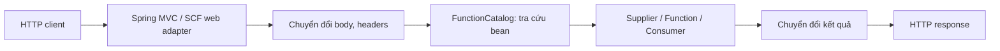

# Xuất functional bean thành HTTP endpoint trong Spring Cloud Function

## 1. Bài toán và mục tiêu

Trong một ứng dụng Spring Boot thông thường, lập trình viên thường dùng `@RestController` và `@PostMapping` để mở một API. Với **Spring Cloud Function (SCF)**, có thể đặt logic nghiệp vụ vào các bean Java chuẩn `Supplier`, `Function`, `Consumer` rồi dùng **HTTP adapter** để công bố chúng thành endpoint. Cùng một bean tiếp tục có thể được dùng trong luồng sự kiện hoặc môi trường serverless thông qua adapter tương ứng mà không cần viết lại logic cốt lõi.

Ví dụ: nghiệp vụ tính tiền từ mã hàng và số lượng có thể được biểu diễn bằng `Function<QuoteRequest, QuoteResponse>`. Khi thêm tích hợp web, client gửi JSON đến `POST /quote`; SCF chuyển body thành `QuoteRequest`, gọi hàm và tuần tự hóa `QuoteResponse` ra JSON.

Sau bài này, người học có thể:

- Phân biệt **functional bean**, `FunctionCatalog` và HTTP adapter.
- Xuất `Supplier`, `Function`, `Consumer` thành endpoint mà không cần tự viết controller cho từng bean.
- Gọi endpoint với dữ liệu `text/plain` và `application/json`, hiểu method và status code thường gặp.
- Điều chỉnh đường dẫn, chọn hàm được xuất và gọi chuỗi hàm (*composition*).
- Nhận biết giới hạn khi dùng SCF thay cho một API REST đầy đủ.

## 2. SCF biến bean thành endpoint như thế nào?

Trong mô hình lập trình của SCF, ba kiểu hàm có ý nghĩa khác nhau:

| Kiểu bean | Hợp đồng Java | Ý nghĩa | Cách gọi HTTP điển hình |
| --- | --- | --- | --- |
| `Supplier<O>` | `O get()` | Sinh dữ liệu, không nhận đầu vào | `GET /tenSupplier` |
| `Function<I, O>` | `O apply(I input)` | Nhận dữ liệu và trả kết quả | `POST /tenFunction` |
| `Consumer<I>` | `void accept(I input)` | Nhận dữ liệu để thực hiện hành động, không có kết quả nghiệp vụ | `POST /tenConsumer` |

SCF phát hiện và đăng ký những bean phù hợp vào **`FunctionCatalog`**. Khi ứng dụng có `spring-cloud-function-web` cùng môi trường Spring MVC, cấu hình tự động của adapter tạo ánh xạ HTTP đến các hàm. Tên bean trở thành tên đường dẫn mặc định.



**Điểm cần nhớ:** `@Bean Function<...>` chỉ khai báo một hàm trong ứng dụng. Việc hàm có thể nhận HTTP request là nhờ dependency và cấu hình của adapter web. Không cần thêm `@RequestMapping` vào hàm.

## 3. Chuẩn bị dự án Spring Boot

Ví dụ dưới đây giả định một dự án Spring Boot chạy được, sử dụng Java 17 trở lên để khai báo DTO bằng `record`. Với Maven, cần Spring MVC và HTTP adapter của SCF:

```xml
<dependencies>
    <dependency>
        <groupId>org.springframework.boot</groupId>
        <artifactId>spring-boot-starter-web</artifactId>
    </dependency>
    <dependency>
        <groupId>org.springframework.cloud</groupId>
        <artifactId>spring-cloud-function-web</artifactId>
    </dependency>
</dependencies>
```

Trong dự án thực tế, quản lý phiên bản Spring Boot và Spring Cloud Function bằng bộ BOM tương thích với nhau. Không tự gắn một phiên bản SCF bất kỳ vào dự án đã có Spring Boot. Có thể dùng `spring-cloud-starter-function-web` như lựa chọn starter thuận tiện khi tạo dự án mới. Với Spring Boot 4.x, tên starter MVC được khuyến nghị là `spring-boot-starter-webmvc`; ví dụ dependency ở trên cũng phù hợp với các dự án Spring Boot 3.x.

Chưa cần cấu hình riêng để xuất các hàm có tên; adapter web sử dụng tiền tố đường dẫn `/` theo mặc định. Ví dụ dưới đây chạy ở `http://localhost:8080`.

## 4. Ví dụ hoàn chỉnh: năm functional bean trong một ứng dụng

Tạo lớp `FunctionHttpApplication.java`:

```java
package demo.scf;

import java.math.BigDecimal;
import java.util.Locale;
import java.util.function.Consumer;
import java.util.function.Function;
import java.util.function.Supplier;

import org.springframework.boot.SpringApplication;
import org.springframework.boot.autoconfigure.SpringBootApplication;
import org.springframework.context.annotation.Bean;

@SpringBootApplication
public class FunctionHttpApplication {

    public static void main(String[] args) {
        SpringApplication.run(FunctionHttpApplication.class, args);
    }

    // Function: làm sạch đầu vào, có thể ghép với hàm khác.
    @Bean
    public Function<String, String> normalize() {
        return String::trim;
    }

    // Function: ví dụ xử lý văn bản qua text/plain.
    @Bean
    public Function<String, String> uppercase() {
        return text -> text.toUpperCase(Locale.ROOT);
    }

    // Function: nhận JSON, thực hiện nghiệp vụ và trả JSON.
    @Bean
    public Function<QuoteRequest, QuoteResponse> quote() {
        return request -> {
            if (request == null
                    || request.sku() == null
                    || request.sku().isBlank()
                    || request.quantity() <= 0) {
                throw new IllegalArgumentException(
                        "sku phai co gia tri va quantity phai > 0");
            }

            BigDecimal unitPrice = new BigDecimal("120000");
            BigDecimal totalPrice = unitPrice.multiply(
                    BigDecimal.valueOf(request.quantity()));
            return new QuoteResponse(
                    request.sku(), request.quantity(), totalPrice);
        };
    }

    // Supplier: tạo dữ liệu khi client gọi GET.
    @Bean
    public Supplier<ServiceStatus> serviceStatus() {
        return () -> new ServiceStatus("SPRING_CLOUD_FUNCTION", "READY");
    }

    // Consumer: xử lý đầu vào; ví dụ chỉ ghi độ dài để tránh log dữ liệu thô.
    @Bean
    public Consumer<String> auditEvent() {
        return payload -> System.out.println(
                "Received event with length: " + payload.length());
    }

    public record QuoteRequest(String sku, int quantity) {}

    public record QuoteResponse(
            String sku, int quantity, BigDecimal totalPrice) {}

    public record ServiceStatus(String service, String state) {}
}
```

Các bean `normalize`, `uppercase`, `quote`, `serviceStatus` và `auditEvent` được đặt tên theo phương thức `@Bean`. SCF dùng các tên đó khi tra cứu trong catalog và ánh xạ URL. Giá 120.000 trong ví dụ chỉ là giá mẫu cố định; một ứng dụng thực tế sẽ lấy giá từ nguồn dữ liệu được kiểm soát.

Khởi động bằng:

```bash
./mvnw spring-boot:run
```

Trên Windows có thể chạy `.\mvnw.cmd spring-boot:run`; nếu dự án không có Maven Wrapper, sử dụng `mvn spring-boot:run`. Các lệnh `curl` bên dưới dùng cú pháp shell kiểu Bash; trong Windows PowerShell nên gọi `curl.exe` để tránh alias cũ của PowerShell.

## 5. Gọi từng endpoint qua HTTP

### 5.1. Function nhận và trả văn bản

```bash
curl -i -X POST http://localhost:8080/uppercase \
  -H 'Content-Type: text/plain' \
  -H 'Accept: text/plain' \
  --data 'spring cloud function'
```

Kết quả nghiệp vụ là `SPRING CLOUD FUNCTION`, HTTP status thông thường là **200 OK**. Adapter đọc chuỗi đầu vào, gọi `uppercase.apply(...)` rồi viết kết quả vào body.

SCF cũng hỗ trợ cách truyền giá trị bằng path cho `Function`:

```bash
curl -i http://localhost:8080/uppercase/hello
```

Ví dụ này đưa `hello` làm đối số và nhận `HELLO`. Truyền đầu vào trong path phù hợp với giá trị đơn giản; với DTO hoặc cấu trúc phức tạp, dùng request body JSON sẽ rõ ràng hơn.

### 5.2. Function nhận và trả JSON

```bash
curl -i -X POST http://localhost:8080/quote \
  -H 'Content-Type: application/json' \
  -H 'Accept: application/json' \
  --data '{"sku":"BOOK-001","quantity":2}'
```

Body phản hồi điển hình:

```json
{
  "sku": "BOOK-001",
  "quantity": 2,
  "totalPrice": 240000
}
```

Không cần viết `@RequestBody` hay `@ResponseBody` vì adapter thực hiện chuyển đổi HTTP payload theo kiểu tham số/kiểu trả về. Để chuyển đổi ổn định, cần công bố kiểu generic cụ thể của hàm và khai báo đúng `Content-Type`, `Accept`.

### 5.3. Supplier: GET không cần body

```bash
curl -i -H 'Accept: application/json' \
  http://localhost:8080/serviceStatus
```

Kết quả điển hình (200 OK):

```json
{
  "service": "SPRING_CLOUD_FUNCTION",
  "state": "READY"
}
```

Mỗi request gọi `serviceStatus.get()`. Đây là dữ liệu trạng thái **minh họa** do bean trả về, không phải kết quả health check của Spring Boot Actuator.

### 5.4. Consumer: nhận dữ liệu, không trả giá trị nghiệp vụ

```bash
curl -i -X POST http://localhost:8080/auditEvent \
  -H 'Content-Type: text/plain' \
  --data 'order-created'
```

Adapter gọi `auditEvent.accept("order-created")`. Với request POST hợp lệ, mapping Consumer thường trả **202 Accepted** và có thể phản chiếu dữ liệu đầu vào theo hợp đồng HTTP của SCF. Điều này **không có nghĩa** ứng dụng đã ghi bền vững vào database, hoàn thành một tác vụ bất đồng bộ hay bảo đảm xử lý đúng một lần. Trong ví dụ, Consumer chỉ in một dòng ra console khi được gọi.

### 5.5. Bảng đối chiếu method và phản hồi

| HTTP method | Đường dẫn mẫu | Bean | Kết quả thông thường |
| --- | --- | --- | --- |
| `GET` | `/serviceStatus` | `Supplier` | `200 OK`, body do Supplier tạo |
| `POST` hoặc `PUT` | `/uppercase` | `Function` | `200 OK`, body là kết quả hàm |
| `GET` | `/uppercase/hello` | `Function` | `200 OK`, xử lý giá trị trong path |
| `POST` hoặc `PUT` | `/auditEvent` | `Consumer` | `202 Accepted` |
| `DELETE` | `/auditEvent` | `Consumer` | `204 No Content` theo mapping mặc định |

Đây là **quy tắc mapping của SCF web adapter**, không phải hợp đồng REST tùy biến theo tài nguyên. Các lỗi chuyển đổi, lỗi logic nghiệp vụ và cấu hình security có thể làm thay đổi status code thực tế.

## 6. Cấu hình đường dẫn và chọn hàm xuất ra ngoài

### 6.1. Đổi tiền tố URL

Thiết lập trong `application.properties`:

```properties
spring.cloud.function.web.path=/api/functions
```

Khi khởi động lại, đường dẫn gọi bean `uppercase` thành `POST /api/functions/uppercase`, và `serviceStatus` thành `GET /api/functions/serviceStatus`. Hãy nhớ cập nhật URL của client khi thay đổi tiền tố.

### 6.2. Chỉ xuất một tập hàm

Nếu ứng dụng có nhiều bean nhưng chỉ muốn công bố các hàm định trước, dùng dấu chấm phẩy để liệt kê:

```properties
spring.cloud.function.definition=uppercase;quote;serviceStatus
```

Theo quy tắc **function filtering**, chỉ các hàm được liệt kê được xuất qua HTTP. Trong trường hợp liệt kê nhiều hàm bằng dấu `;`, adapter không tự ánh xạ một hàm vào path gốc `/`. Đây cũng là một cách giảm số endpoint công khai, nhưng **không thay thế xác thực và phân quyền**.

### 6.3. Ánh xạ một composition vào đường dẫn gốc

Hai bean `normalize` và `uppercase` đều có kiểu `Function<String, String>`, nên có thể được ghép tuần tự: dữ liệu đi qua `normalize` trước rồi qua `uppercase`.

Khi **không cấu hình filtering** như mục 6.2, có thể gọi composition trực tiếp bằng dấu phẩy trong URL:

```bash
curl -i -X POST http://localhost:8080/normalize,uppercase \
  -H 'Content-Type: text/plain' \
  --data '  spring cloud function  '
```

Đầu ra là `SPRING CLOUD FUNCTION`. Tên composition trong cấu hình SCF thường viết bằng dấu `|`:

```properties
# Cấu hình thay thế cho ví dụ filtering ở mục 6.2
spring.cloud.function.definition=normalize|uppercase
```

Khi chỉ chọn một composition như trên, SCF có thể ánh xạ composition đó vào đường dẫn gốc `/` (hoặc đường dẫn gốc dưới `spring.cloud.function.web.path` nếu đã đổi prefix). Trong PowerShell hay shell khác, nhớ đặt giá trị có ký tự `|` trong dấu nháy khi truyền qua tham số dòng lệnh, vì ký tự này có ý nghĩa đặc biệt với shell.

**Phân biệt dấu phân cách:** `|` ghép các hàm theo thứ tự; `;` liệt kê nhiều hàm hoặc nhiều composition được xuất. Khi chỉ có một hàm trong catalog, SCF cho phép gọi trực tiếp path gốc `/`; khi có nhiều hàm, nên gọi bằng tên rõ ràng hoặc cấu hình `definition`.

### 6.4. Ánh xạ theo HTTP method khi cần

SCF hỗ trợ property dạng `spring.cloud.function.http.<METHOD>` để chỉ định các hàm cho từng method, ví dụ:

```properties
spring.cloud.function.http.GET=serviceStatus
spring.cloud.function.http.POST=uppercase;quote;auditEvent
```

Khi cần thiết kế hợp đồng REST phức tạp, nhiều response code tùy chỉnh, phân trang, versioning API hay validation/exception handling ở cấp HTTP, nên sử dụng thêm cơ chế của Spring MVC/WebFlux thay vì kỳ vọng functional HTTP adapter thay thế toàn bộ web framework.

## 7. Body, header và chuyển đổi thông điệp

**Body và content negotiation.** `text/plain` phù hợp với `Function<String, String>`, còn `application/json` phù hợp với DTO như `QuoteRequest`. `Content-Type` mô tả định dạng request; `Accept` mô tả định dạng response mong muốn. Nếu truyền JSON nhưng khai báo `text/plain` hoặc generic type của hàm quá mơ hồ, SCF có thể không chuyển đổi đúng payload.

**Header và `Message<T>`.** Khi cần truy cập metadata HTTP trong logic, có thể khai báo một hàm nhận `org.springframework.messaging.Message<String>`:

```java
@Bean
public Function<org.springframework.messaging.Message<String>, String> inspect() {
    return message -> "Length=" + message.getPayload().length();
}
```

Trong trường hợp này, adapter đưa các HTTP header vào `MessageHeaders`. Với response kiểu `Message<?>`, header của message có thể được chuyển sang HTTP response header. HTTP query parameters được biểu diễn trong message header `http_request_param`, nên chúng **không tự động trở thành tham số Java riêng** của `Function.apply()`. Cần kiểm tra và giới hạn metadata do client cung cấp trước khi dùng cho xử lý nhạy cảm.

**Dữ liệu nhiều phần tử.** Với các hàm nhận/trả collection hoặc kiểu reactive, cách xử lý nhiều item và streaming khác với ví dụ đơn giá trị ở trên. SCF web adapter hỗ trợ một số biểu diễn streaming, bao gồm `Accept: text/event-stream` cho phản hồi nhiều giá trị; cần kiểm tra hợp đồng payload và client tương ứng thay vì giả định mọi hàm đều trả một JSON object duy nhất.

## 8. Kiểm thử endpoint và những lỗi thường gặp

Có thể kiểm thử HTTP adapter ở mức tích hợp với `@SpringBootTest` và `TestRestTemplate` (thêm `spring-boot-starter-test` trong phạm vi test của dự án). **Đoạn test sau sử dụng API của Spring Boot 3.x**:

```java
package demo.scf;

import org.junit.jupiter.api.Test;
import org.springframework.beans.factory.annotation.Autowired;
import org.springframework.boot.test.context.SpringBootTest;
import org.springframework.boot.test.web.client.TestRestTemplate;
import org.springframework.http.HttpEntity;
import org.springframework.http.HttpHeaders;
import org.springframework.http.HttpStatus;
import org.springframework.http.MediaType;
import org.springframework.http.ResponseEntity;

import static org.assertj.core.api.Assertions.assertThat;

@SpringBootTest(webEnvironment = SpringBootTest.WebEnvironment.RANDOM_PORT)
class FunctionHttpIntegrationTest {

    @Autowired
    private TestRestTemplate http;

    @Test
    void uppercaseIsAvailableThroughHttp() {
        HttpHeaders headers = new HttpHeaders();
        headers.setContentType(MediaType.TEXT_PLAIN);

        ResponseEntity<String> response = http.postForEntity(
                "/uppercase",
                new HttpEntity<>("hello", headers),
                String.class);

        assertThat(response.getStatusCode()).isEqualTo(HttpStatus.OK);
        assertThat(response.getBody()).contains("HELLO");
    }
}
```

Ở **Spring Boot 4.x**, `TestRestTemplate` nằm trong package `org.springframework.boot.resttestclient`; cách tự động cấu hình và các module phụ thuộc cho test cũng thay đổi. Khi dùng Spring Boot 4.x, cập nhật import và test dependency theo phiên bản đang sử dụng (hoặc dùng `RestTestClient`); không sao chép nguyên mẫu test Boot 3.x vào Boot 4.x.

| Hiện tượng | Nguyên nhân cần kiểm tra | Hướng xử lý |
| --- | --- | --- |
| `404 Not Found` khi gọi tên bean | Thiếu adapter web, sai prefix, sai tên bean hoặc bean bị lọc bởi `definition` | Kiểm tra dependencies, URL, tên `@Bean` và cấu hình xuất |
| `405 Method Not Allowed` hoặc method không như mong đợi | Gọi method không được mapping, hoặc đã đặt `spring.cloud.function.http.<METHOD>` | So lại method theo kiểu bean và cấu hình |
| `400/415` hoặc lỗi giải mã payload | Sai `Content-Type`, JSON không phù hợp kiểu DTO | Gửi body đúng định dạng, khai báo kiểu đầu vào rõ ràng |
| `500` khi dữ liệu nghiệp vụ không hợp lệ | Hàm ném exception chưa được ánh xạ thành lỗi HTTP phù hợp | Tách validation và quy ước xử lý lỗi; không mặc định `IllegalArgumentException` sẽ cho `400` |
| Gọi `/` chạy hàm khác dự kiến | Nhiều function trong catalog hoặc `definition` đang chỉ đến composition | Gọi endpoint có tên cụ thể; kiểm tra cấu hình route |
| Consumer trả `202` nhưng không thấy kết quả | `Consumer.accept()` không trả giá trị; ví dụ demo chỉ ghi console | Kiểm tra hiệu ứng phụ mà Consumer thực hiện, thiết kế theo nhu cầu phản hồi thực tế |

Ngoài HTTP integration test, có thể kiểm thử trực tiếp logic qua `FunctionCatalog` để xác nhận hàm vẫn chạy độc lập với transport. Với ứng dụng thật, test thêm input sai, quyền truy cập và trường hợp lỗi dependency ngoài.

## 9. Khi nào dùng cách xuất tự động?

**Phù hợp** khi cần đưa nhanh một xử lý ít trạng thái, một bộ chuyển đổi dữ liệu, hoặc một hàm nghiệp vụ tái sử dụng ra HTTP; đặc biệt hữu ích khi cùng logic còn được gọi từ Spring Cloud Stream, event adapter hoặc serverless platform.

**Cần cân nhắc** khi API yêu cầu hợp đồng REST rất cụ thể: URL theo tài nguyên, nhiều status code, validation phong phú, bảo mật nhiều tầng, nghiệp vụ transaction phức tạp hoặc tài liệu OpenAPI chi tiết. SCF cung cấp lối gọi hàm qua HTTP, còn Spring MVC/WebFlux đảm nhiệm nhiều nhu cầu thiết kế API chuyên sâu.

Khi triển khai thực tế:

1. Giữ bean tập trung vào **logic nghiệp vụ**, tránh phụ thuộc vào `HttpServletRequest` hoặc response type của web adapter nếu mục tiêu là tái sử dụng qua HTTP, event và serverless.
2. Chỉ xuất các hàm thật sự cần dùng; dùng `spring.cloud.function.definition` nếu có nhiều bean nội bộ.
3. Áp dụng xác thực, phân quyền, TLS, giới hạn kích thước payload và kiểm tra đầu vào tại ranh giới HTTP; không tin tên function hoặc routing header do client tự quyết định.
4. Định nghĩa rõ hợp đồng đồng bộ/bất đồng bộ và idempotency đối với Consumer có side effect. Status `202` của adapter không tự đảm bảo xử lý hàng đợi hay giao dịch thành công.
5. Gắn log/metrics/tracing và kiểm thử end-to-end cho endpoint trước khi công bố.

## 10. Tự luyện tập

1. Thêm bean `Function<String, Integer> countCharacters`; gọi bằng `POST /countCharacters` với `text/plain`. Kết quả nhận được ở HTTP là gì?
2. Ghép `normalize|uppercase` và so sánh kết quả với việc chỉ gọi `uppercase` bằng chuỗi có khoảng trắng hai đầu.
3. Đổi tiền tố thành `/v1/functions` rồi xác minh endpoint JSON `quote` vẫn hoạt động.
4. Chỉ xuất `quote` và `serviceStatus` bằng `spring.cloud.function.definition`, thử gọi lại `/auditEvent` và giải thích kết quả.
5. Thảo luận cách trả lỗi `400 Bad Request` khi `quantity <= 0`: phần nào là kiểm tra nghiệp vụ, phần nào thuộc hợp đồng HTTP?

## Tài liệu tham khảo

- [Spring Cloud Function — Standalone Web Applications](https://docs.spring.io/spring-cloud-function/reference/spring-cloud-function/standalone-web-applications.html): cách xuất bean, HTTP methods, path, function filtering và composition.
- [Spring Cloud Function — Programming Model](https://docs.spring.io/spring-cloud-function/reference/spring-cloud-function/programming-model.html): cách tổ chức `Supplier`, `Function`, `Consumer`, routing và message.
- [Spring Cloud Function — Functional Bean Definitions](https://docs.spring.io/spring-cloud-function/reference/functional.html): khai báo và kiểm thử functional beans, tra cứu `FunctionCatalog`.
