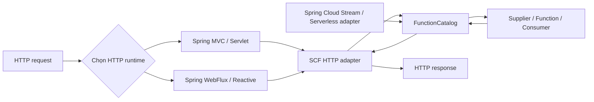

# Chọn web module và đối chiếu hỗ trợ MVC/WebFlux theo phiên bản trong Spring Cloud Function

## 1. Vì sao cần chọn đúng web module?

**Spring Cloud Function (SCF)** tập trung vào logic nghiệp vụ có thể tái sử dụng dưới dạng `Supplier<T>`, `Function<I, O>` và `Consumer<T>`, được đăng ký và tra cứu qua `FunctionCatalog`. Hàm có thể được gọi từ HTTP, sự kiện trong Spring Cloud Stream hoặc adapter của môi trường serverless. Để sử dụng **HTTP**, ứng dụng cần thêm một lớp kết nối (*web adapter*) giữa giao thức HTTP và catalog.

Khi xây dựng ứng dụng HTTP, có **ba quyết định độc lập nhưng liên quan nhau**:

1. **HTTP runtime:** dùng Spring MVC (Servlet) hay Spring WebFlux (reactive)?
2. **SCF web module:** thêm starter phù hợp để tự động xuất functional bean thành endpoint, hay chỉ dùng lõi SCF rồi tự xây dựng controller/handler?
3. **Phiên bản:** ghép đúng Spring Boot, Spring Cloud release train và phiên bản Spring Cloud Function. Sự tồn tại của một artifact trên Maven Central chưa đủ để kết luận tổ hợp phiên bản được hỗ trợ.

Nếu chọn sai, ứng dụng có thể chạy bằng stack ngoài dự kiến, không có HTTP endpoint, hoặc gặp lỗi do dependency không tương thích.

### Mục tiêu học tập

- Phân biệt các artifact `spring-cloud-function-context`, `spring-cloud-function-web`, `spring-cloud-starter-function-web` và `spring-cloud-starter-function-webflux`.
- Quyết định khi nào chọn Spring MVC, WebFlux hoặc **không cần web adapter**.
- Tra cứu đúng tổ hợp phiên bản Spring Boot ↔ Spring Cloud ↔ SCF và nhận biết thay đổi ở Spring Boot 4.
- Tạo hai ứng dụng HTTP có cùng functional bean nhưng chọn starter khác nhau.
- Kiểm tra runtime thực tế, xử lý xung đột khi cả MVC và WebFlux cùng xuất hiện.

## 2. Các module có vai trò gì?

| Artifact | Vai trò | Có tự cung cấp HTTP endpoint cho SCF? | Khi nào dùng |
| --- | --- | --- | --- |
| `org.springframework.cloud:spring-cloud-function-context` | Chứa cơ chế quản lý/tra cứu functional bean, `FunctionCatalog`, composition và chuyển đổi ở tầng SCF | **Không**, nếu chỉ có module này | Thư viện nghiệp vụ, xử lý event, ứng dụng không có HTTP server |
| `org.springframework.cloud:spring-cloud-function-web` | Thành phần adapter HTTP cho SCF; cần môi trường web thích hợp | **Có**, khi kết hợp đúng runtime và autoconfiguration | Đã có sẵn Spring Boot web starter và muốn thêm SCF HTTP adapter theo cách thủ công |
| `org.springframework.cloud:spring-cloud-starter-function-web` | Starter tiện dụng ghép SCF web adapter và Spring MVC runtime | **Có**, trong ứng dụng MVC được cấu hình đúng | Xuất nhanh các bean qua HTTP với Servlet/MVC |
| `org.springframework.cloud:spring-cloud-starter-function-webflux` | Starter tiện dụng ghép SCF web adapter và Spring WebFlux runtime | **Có**, trong ứng dụng WebFlux được cấu hình đúng | Xuất nhanh hàm qua HTTP theo mô hình reactive |
| `org.springframework.boot:spring-boot-starter-web` / `spring-boot-starter-webmvc` | Thành phần web **của Spring Boot** cho MVC | **Không**, nếu thiếu adapter hoặc controller riêng | Xây dựng ứng dụng web MVC nói chung |
| `org.springframework.boot:spring-boot-starter-webflux` | Thành phần web **của Spring Boot** cho reactive HTTP | **Không**, nếu thiếu adapter hoặc handler riêng | Xây dựng ứng dụng WebFlux nói chung |

**Hai quy tắc tránh nhầm lẫn:**

- `spring-cloud-function-web` là một artifact **của SCF**; `spring-boot-starter-web` và `spring-boot-starter-webflux` là các starter **của Boot**. Chỉ thêm web starter của Boot không có nghĩa là tất cả bean `Function` tự trở thành endpoint.
- `spring-cloud-starter-function-webflux` là tên starter SCF cho WebFlux. Đừng tự suy ra một artifact tên `spring-cloud-function-webflux` hoặc tự pha các dependency cùng vai trò khi starter đã cung cấp chúng.

Mô hình kết nối:



Phần **`Supplier`, `Function`, `Consumer`** nên càng độc lập với web framework càng tốt. Có thể tái sử dụng logic cũ khi chuyển transport, đồng thời không phải chuyển cả ứng dụng sang WebFlux chỉ vì muốn dùng `Flux` hoặc `WebClient` trong một thành phần riêng.

## 3. Chọn MVC hay WebFlux?

| Tiêu chí | Spring MVC | Spring WebFlux |
| --- | --- | --- |
| Mô hình web | Servlet API; thường xử lý request theo mô hình request/thread | Reactive Streams; hỗ trợ xử lý bất đồng bộ, non-blocking |
| Web server thường gặp | Tomcat, Jetty hoặc Servlet container tương thích | Reactor Netty mặc định; cũng có thể vận hành trên servlet container được hỗ trợ |
| Phù hợp khi | Hệ thống MVC có sẵn, API đồng bộ, dependency chủ yếu là JDBC/JPA hoặc SDK blocking | Chuỗi I/O reactive từ đầu đến cuối, streaming, số lượng kết nối đồng thời lớn hoặc ứng dụng đã dùng WebFlux |
| Starter SCF | `spring-cloud-starter-function-web` | `spring-cloud-starter-function-webflux` |
| Kiểu logic cơ bản | `Function<String, String>` hoạt động như thông thường | Cùng bean `Function<String, String>` có thể tái dùng; reactive pipeline là lựa chọn riêng |
| Điều cần tránh | Giả định Servlet là bất đồng bộ mặc định | Đưa JDBC, `Thread.sleep()` hoặc I/O blocking lên event-loop và kỳ vọng tự được non-blocking |

**Gợi ý lựa chọn theo tình huống:**

1. Đã có ứng dụng MVC với JPA và REST controller: ưu tiên **MVC starter** để giữ cấu trúc triển khai; không cần đổi framework chỉ để công bố một vài hàm.
2. Đã có ứng dụng WebFlux, dùng reactive driver và cần streaming: ưu tiên **WebFlux starter**, rồi kiểm thử đầy đủ hợp đồng reactive ở adapter.
3. Viết thư viện tính phí, chuẩn hóa dữ liệu hoặc xác thực nghiệp vụ phục vụ **HTTP + event + serverless**: đặt bean ở module riêng với lõi SCF; chỉ thêm adapter tại ứng dụng chạy thực tế.
4. API yêu cầu tài nguyên REST phức tạp, nhiều route, validation, phân quyền và response code tùy biến: dùng Spring MVC/WebFlux controller hoặc WebFlux functional router để kiểm soát HTTP; vẫn có thể tra cứu logic qua `FunctionCatalog`.

**WebFlux không tự làm hàm chạy nhanh hơn.** Nếu `Function.apply()` gọi một kho dữ liệu blocking rồi chặn luồng, chọn WebFlux chưa tạo ra luồng xử lý non-blocking. Hiệu quả phụ thuộc toàn bộ đường đi của request và loại workload.

## 4. Bảng đối chiếu hỗ trợ theo phiên bản

Phiên bản SCF thường được quản lý **thông qua Spring Cloud release train**. Bảng dưới dùng các mốc GA và dòng phiên bản; thông tin được đối chiếu theo tài liệu chính thức tại **24/11/2026**. Các dòng cũ có thể không còn được hỗ trợ bảo trì mã nguồn mở dù vẫn tương thích theo lịch sử.

| Spring Boot | Spring Cloud release train | Spring Cloud Function | HTTP MVC | HTTP WebFlux | Ghi chú |
| --- | --- | --- | --- | --- | --- |
| **4.2.x** | **2026.0.x** (Paddington) | **5.1.x** | Có | Có | Spring Cloud 2026.0.0 và Boot 4.2.0 phát hành tháng 11/2026 |
| **4.0.x / 4.1.x** | **2025.1.x** (Oakwood) | **5.0.x** | Có | Có | Hỗ trợ Boot 4.1 bắt đầu từ release train 2025.1.2 |
| **3.5.x** | **2025.0.x** (Northfields) | **4.3.x** | Có | Có | Dùng release train dành cho Boot 3.5 |
| **3.4.x** | **2024.0.x** (Moorgate) | **4.2.x** | Có | Có | Dòng tương thích lịch sử |
| **3.2.x / 3.3.x** | **2023.0.x** (Leyton) | **4.1.x** | Có | Có | Hỗ trợ Boot 3.3 bắt đầu từ 2023.0.2 |
| **3.0.x / 3.1.x** | **2022.0.x** (Kilburn) | **4.0.x** | Có | Có | Hỗ trợ Boot 3.1 bắt đầu từ 2022.0.3 |

**Điểm chính:** các ô “Có” nói rằng **dòng SCF tương ứng có starter MVC và WebFlux**. Không có nghĩa là mọi tính năng, codec, media type, reactive response và hành vi HTTP đều giống nhau ở từng patch version. Hãy kiểm thử những chức năng bạn dùng và kiểm tra thời hạn hỗ trợ của release train khi xây dựng hệ thống production.

### Bối cảnh lịch sử trước Spring Boot 3

| SCF | MVC | WebFlux | Điều cần biết |
| --- | --- | --- | --- |
| **1.x** | Có | Không có lựa chọn WebFlux starter tương đương | Web adapter ban đầu dựa trên Spring MVC/Servlet |
| **Từ 2.0** | Có | Có | SCF bổ sung `spring-cloud-starter-function-webflux`, thường chạy với Reactor Netty mặc định |
| **3.x trở đi** | Có | Có | Thay đổi cụ thể phụ thuộc Spring Boot/Spring Cloud release train tương thích |

Không nên dùng các ví dụ dependency của SCF 1.x/2.x trực tiếp trong dự án Boot 3/4. Tài liệu cũ có thể dùng tên starter khác, API cũ hoặc cơ chế khởi tạo functional application khác.

### Thay đổi đáng chú ý ở Spring Boot 4

- Với Spring Boot 3.x, starter MVC quen thuộc là `spring-boot-starter-web`.
- Với Spring Boot 4.x, starter rõ nghĩa cho MVC là **`spring-boot-starter-webmvc`**; `spring-boot-starter-web` được đánh dấu deprecated để chuyển sang starter này. WebFlux vẫn dùng `spring-boot-starter-webflux`.
- Starter **SCF** vẫn có tên `spring-cloud-starter-function-web` hoặc `spring-cloud-starter-function-webflux`. Không đổi tên SCF starter chỉ vì Boot đổi tên starter MVC.
- Các thay đổi nền tảng ở Spring Framework 7/Boot 4, bao gồm một số API và phụ thuộc JSON/test, là lý do cần giữ BOM đúng dòng phiên bản.

### Cách đọc bảng để chọn phiên bản

**Ví dụ A:** ứng dụng đang chạy Boot 3.5.x → chọn Spring Cloud 2025.0.x → SCF 4.3.x. Sau đó quyết định MVC hoặc WebFlux theo runtime đang dùng.

**Ví dụ B:** ứng dụng Boot 4.1.x → chọn Spring Cloud 2025.1.x phiên bản đủ mới → SCF 5.0.x.

**Ví dụ C:** xây dựng ứng dụng mới trên Boot 4.2.0 tại thời điểm 24/11/2026 → chọn Spring Cloud **2026.0.0** → SCF **5.1.0**. Đây là một bộ phiên bản GA cùng release train; không lấy phiên bản 5.1.0 của SCF rồi đặt vào Boot 3.5.

Nên lấy bộ BOM từ [Spring Initializr](https://start.spring.io/) hoặc [Spring Cloud compatibility table](https://spring.io/projects/spring-cloud/) và đối chiếu [release note](https://spring.io/blog/2026/11/20/spring-cloud-2026-0-0-has-been-released/) trước khi nâng cấp.

## 5. Ví dụ Maven: cùng hàm, chọn một trong hai web starter

Ví dụ này dùng **Spring Boot 4.2.0 + Spring Cloud 2026.0.0**, tương ứng Spring Cloud Function 5.1.0. Với Spring Boot 3.x, thay parent và BOM theo bảng mục 4.

Tạo `pom.xml` cho ứng dụng Spring MVC:

```xml
<?xml version="1.0" encoding="UTF-8"?>
<project xmlns="http://maven.apache.org/POM/4.0.0"
         xmlns:xsi="http://www.w3.org/2001/XMLSchema-instance"
         xsi:schemaLocation="http://maven.apache.org/POM/4.0.0
         https://maven.apache.org/xsd/maven-4.0.0.xsd">
    <modelVersion>4.0.0</modelVersion>

    <parent>
        <groupId>org.springframework.boot</groupId>
        <artifactId>spring-boot-starter-parent</artifactId>
        <version>4.2.0</version>
        <relativePath/>
    </parent>

    <groupId>demo</groupId>
    <artifactId>scf-web-choice</artifactId>
    <version>0.0.1-SNAPSHOT</version>
    <properties>
        <java.version>17</java.version>
    </properties>

    <dependencyManagement>
        <dependencies>
            <dependency>
                <groupId>org.springframework.cloud</groupId>
                <artifactId>spring-cloud-dependencies</artifactId>
                <version>2026.0.0</version>
                <type>pom</type>
                <scope>import</scope>
            </dependency>
        </dependencies>
    </dependencyManagement>

    <dependencies>
        <!-- SCF HTTP adapter + Spring MVC runtime -->
        <dependency>
            <groupId>org.springframework.cloud</groupId>
            <artifactId>spring-cloud-starter-function-web</artifactId>
        </dependency>
    </dependencies>

    <build>
        <plugins>
            <plugin>
                <groupId>org.springframework.boot</groupId>
                <artifactId>spring-boot-maven-plugin</artifactId>
            </plugin>
        </plugins>
    </build>
</project>
```

**Muốn dùng WebFlux?** Giữ nguyên POM, **chỉ đổi** dependency trong `<dependencies>` thành:

```xml
<dependency>
    <groupId>org.springframework.cloud</groupId>
    <artifactId>spring-cloud-starter-function-webflux</artifactId>
</dependency>
```

Starter WebFlux sẽ kéo theo web adapter của SCF cùng các thành phần WebFlux cần thiết. Hãy giữ **một starter SCF web** làm lựa chọn chính, tránh đồng thời đưa cả hai vào ứng dụng.

### Trường hợp đã có web starter của Spring Boot

Nếu ứng dụng đã có MVC hay WebFlux framework được cấu hình sẵn và chỉ cần SCF adapter, có thể thêm trực tiếp:

```xml
<dependency>
    <groupId>org.springframework.cloud</groupId>
    <artifactId>spring-cloud-function-web</artifactId>
</dependency>
```

Khi đó runtime web vẫn đến từ web starter có sẵn của Boot (chẳng hạn `spring-boot-starter-webmvc` trên Boot 4 hay `spring-boot-starter-webflux`). Đây là phương án cấu hình thủ công; cần xác minh cơ chế auto-configuration, lớp web application và các phụ thuộc runtime đúng theo release đã chọn. Với một ứng dụng mẫu đơn giản, dùng starter SCF thường dễ kiểm soát hơn.

**Không thêm số phiên bản SCF trực tiếp vào dependency** khi BOM đang quản lý phiên bản tương thích. Nếu bỏ BOM, Maven có thể không tìm thấy version hoặc bạn phải quản lý thủ công và có nguy cơ sai cặp phụ thuộc.

## 6. Chạy cùng một functional bean trên MVC và WebFlux

Đặt file `src/main/java/demo/WebChoiceApplication.java`:

```java
package demo;

import java.util.Locale;
import java.util.function.Consumer;
import java.util.function.Function;
import java.util.function.Supplier;

import org.springframework.boot.SpringApplication;
import org.springframework.boot.autoconfigure.SpringBootApplication;
import org.springframework.context.annotation.Bean;

@SpringBootApplication
public class WebChoiceApplication {

    public static void main(String[] args) {
        SpringApplication.run(WebChoiceApplication.class, args);
    }

    @Bean
    public Function<String, String> uppercase() {
        return text -> text.toUpperCase(Locale.ROOT);
    }

    @Bean
    public Function<String, String> trim() {
        return String::trim;
    }

    @Bean
    public Supplier<String> greeting() {
        return () -> "Hello from SCF";
    }

    @Bean
    public Consumer<String> receive() {
        return text -> System.out.println(
                "Received text length = " + text.length());
    }
}
```

Bean `uppercase` và `trim` có thể được tra cứu qua `FunctionCatalog` hoặc ghép composition. Chúng không phụ thuộc vào Servlet request, `ServerRequest`, `Mono` hay `Flux`, nên cùng source Java hoạt động trên cả hai HTTP runtime.

Chạy bằng Maven:

```bash
mvn spring-boot:run
```

Kiểm tra endpoint. Với cả MVC lẫn WebFlux starter, các lệnh sau có cùng **kết quả nghiệp vụ**:

```bash
curl -i -X POST http://localhost:8080/uppercase \
  -H 'Content-Type: text/plain' \
  -H 'Accept: text/plain' \
  --data 'hello function'
# Response body: HELLO FUNCTION

curl -i -H 'Accept: text/plain' \
  http://localhost:8080/greeting
# Response body: Hello from SCF

curl -i -X POST http://localhost:8080/receive \
  -H 'Content-Type: text/plain' \
  --data 'sample event'
# Kiểm tra log console: Received text length = 12
```

Các command trên dùng cú pháp Bash; trên PowerShell dùng `curl.exe` và viết lệnh theo cú pháp PowerShell. Khi thay starter phải khởi động lại ứng dụng.

### FunctionCatalog và composition không phụ thuộc HTTP runtime

Có thể ghép hai `Function<String, String>` đã khai báo bằng cấu hình:

```properties
spring.cloud.function.definition=trim|uppercase
```

Khi chỉ chọn composition này, SCF có thể ánh xạ nó tại đường dẫn gốc `/`. Hoặc gọi composition trực tiếp bằng URL nếu không áp dụng filtering:

```bash
curl -i -X POST 'http://localhost:8080/trim,uppercase' \
  -H 'Content-Type: text/plain' \
  --data '  hello cloud  '
# Response body: HELLO CLOUD
```

Trong cấu hình SCF, `|` có nghĩa là **ghép hàm theo thứ tự**; `;` có nghĩa là **liệt kê nhiều hàm/composition** cần xuất. Một hàm thuộc catalog có thể được dùng để xử lý sự kiện bằng adapter khác mà không cần sao chép logic nghiệp vụ từ web layer.

Nếu cần đổi tiền tố URL, dùng:

```properties
spring.cloud.function.web.path=/api/functions
```

Lúc đó, khi không dùng mapping composition ở path gốc, `POST /uppercase` thành `POST /api/functions/uppercase`. Tiền tố này áp dụng cho adapter SCF, không tự chuyển đường dẫn của các controller do bạn viết riêng.

## 7. Khi ứng dụng vô tình có cả MVC và WebFlux

Spring Boot chọn loại web application theo những class có trên **runtime classpath**. Nếu cả MVC và WebFlux cùng có mặt, **MVC thường được ưu tiên theo mặc định**. Việc import `Mono`, thêm `WebClient` hoặc cài `spring-boot-starter-webflux` trong dự án đã có MVC **không chứng minh rằng HTTP server đang chạy WebFlux**.

Ví dụ dễ gây nhầm lẫn:

```xml
<dependencies>
    <dependency>
        <groupId>org.springframework.cloud</groupId>
        <artifactId>spring-cloud-starter-function-web</artifactId>
    </dependency>
    <dependency>
        <groupId>org.springframework.cloud</groupId>
        <artifactId>spring-cloud-starter-function-webflux</artifactId>
    </dependency>
</dependencies>
```

Đây là cấu hình **không nên dùng để chọn ngẫu nhiên**. Hai starter mang theo các web framework khác nhau; cách Boot phát hiện classpath có thể khiến ứng dụng chạy servlet/MVC dù người viết mong chờ reactive.

Nếu cần ép loại ứng dụng phục vụ thử nghiệm:

```properties
spring.main.web-application-type=reactive
```

Tuy nhiên, thiết lập property **không thể thay thế việc kiểm tra dependency**; một bộ auto-configuration vốn yêu cầu Servlet có thể không hoạt động khi chạy reactive, hoặc ngược lại. Giải pháp bền vững là dùng đúng starter và chỉ giữ các dependency thực sự cần.

### Cách xác nhận runtime đang chạy

1. Xem **cây phụ thuộc** và tìm các web starter được kéo vào transitively:

   ```bash
   mvn dependency:tree
   ```

2. Kiểm tra log khởi động của Boot: tên web server như Tomcat hay Netty và các bean web context gợi ý loại stack. Để chắc chắn, kiểm tra `ApplicationContext` thực tế:

   ```java
   import org.springframework.boot.ApplicationRunner;
   import org.springframework.context.ApplicationContext;
   import org.springframework.context.annotation.Bean;

   @Bean
   ApplicationRunner printWebContext(ApplicationContext context) {
       return args -> System.out.println(
               "Web context = " + context.getClass().getName());
   }
   ```

   MVC thường dùng `AnnotationConfigServletWebServerApplicationContext`; WebFlux thường dùng `AnnotationConfigReactiveWebServerApplicationContext`. Dòng log là cách xác nhận hành vi tại runtime, không phải cơ sở để suy kết luận từ tên starter duy nhất.

3. Gửi một request HTTP thật đến `POST /uppercase` và kiểm tra cả status, `Content-Type` và body. Khi kiểm thử WebFlux, dùng `WebTestClient`; với MVC có thể dùng `MockMvc` hoặc một HTTP client tích hợp. Chọn test dependency phù hợp với **phiên bản Spring Boot** vì Boot 4 đã tách/đổi tên một số starter và công cụ test.

## 8. Phân biệt WebFlux HTTP adapter với reactive business logic

Hai quyết định sau không đồng nghĩa:

- **Chọn WebFlux server:** HTTP được điều phối bằng reactive web stack.
- **Viết hàm reactive:** logic của bean dùng `Mono<T>`, `Flux<T>` hoặc các nguồn phát dữ liệu không chặn.

Một bean `Function<String, String>` có thể chạy trên MVC hoặc WebFlux; việc chọn WebFlux không tự đổi chữ ký thành `Function<Mono<String>, Mono<String>>`. Ngược lại, việc một module sử dụng Reactor không có nghĩa toàn bộ HTTP server bắt buộc là WebFlux.

Nếu cần streaming nhiều phần tử, WebFlux thường phù hợp hơn. Nhưng phải kiểm thử dữ liệu đầu vào, kiểu return, header `Accept: text/event-stream`, codec/serialization và việc client đóng kết nối. Adapter SCF có các quy tắc chuyển đổi payload, nên không nên suy luận từ kiểu generic của Java rằng mọi endpoint đều được streaming giống nhau.

Khi cần nhận HTTP metadata trong function, có thể chọn kiểu `Message<T>` của Spring Messaging. Web adapter có thể đưa request header vào `MessageHeaders` rồi chuyển header của output message sang HTTP response. Đây vẫn là abstraction của messaging, khác với việc đưa trực tiếp `HttpServletRequest` vào nghiệp vụ.

## 9. Các lỗi chọn module/phiên bản thường gặp

| Triệu chứng | Cần kiểm tra | Cách sửa |
| --- | --- | --- |
| Ứng dụng chạy nhưng `/uppercase` trả `404` | Chỉ có Boot web starter, chưa có SCF web adapter; hoặc bean bị lọc bởi `spring.cloud.function.definition` | Thêm đúng SCF starter hoặc `spring-cloud-function-web`, kiểm tra URL và cấu hình |
| Spring Cloud từ chối khởi động hoặc xuất hiện `NoSuchMethodError` / `ClassNotFoundException` | Tổ hợp Boot–Cloud–SCF lệch release train, override transitive version | Dùng BOM khớp bảng tương thích; bỏ version override không cần thiết |
| Muốn dùng Netty/WebFlux nhưng ứng dụng khởi động Servlet/Tomcat | Cả MVC và WebFlux cùng có trên classpath | Kiểm tra dependency tree; bỏ starter MVC không cần; xác nhận context |
| Có `FunctionCatalog` nhưng không có HTTP endpoint | Chỉ khai báo SCF core; không có web adapter hoặc web runtime | Xác định HTTP có thực sự cần không; nếu có, thêm đúng web module |
| WebFlux hoạt động nhưng request chậm khi tải cao | Bên trong function có blocking I/O, gọi JDBC/JPA đồng bộ hoặc chặn event-loop | Phân tích đường đi I/O, chuyển sang reactive driver hoặc cô lập tác vụ blocking đúng cách |
| `415 Unsupported Media Type`, `406 Not Acceptable` hoặc không đọc đúng DTO | Sai `Content-Type`, `Accept`, generic type hoặc codec JSON | Kiểm tra định dạng payload và conversion của adapter với phiên bản hiện hành |
| Migrate Boot 3 → Boot 4 nhưng dependency/test fail | Starter web MVC và API test thay đổi, BOM Cloud vẫn ở dòng Boot 3 | Đổi sang release train Cloud tương thích Boot 4, dùng starter/test artifact tương ứng |
| `POST /receive` trả `202` nhưng không có JSON kết quả | `Consumer` không có kiểu kết quả | Kiểm tra side effect; nếu cần trả JSON nghiệp vụ thì chọn `Function` |

## 10. Vai trò của Spring Cloud Gateway trong các phiên bản mới

Trong thông báo **Spring Cloud 2025.0.0-RC1**, nhóm dự án mô tả **Spring Cloud Function Web về cơ bản đang được định hướng thay thế** bằng khả năng tích hợp Spring Cloud Function trong Spring Cloud Gateway. Điều này cần được đọc đúng:

- Các artifact web starter vẫn tồn tại ở các dòng SCF mới và hữu ích cho bài học, thử nghiệm hoặc ứng dụng đang dùng.
- Khi thiết kế hệ thống production mới cần routing, security policy, gateway filters và kiểm soát HTTP tập trung, hãy **đánh giá Spring Cloud Gateway kết hợp Spring Cloud Function** trên release train tương ứng.
- Việc có một Gateway không bắt buộc mọi ứng dụng phải dùng WebFlux: Spring Cloud Gateway hiện có biến thể MVC và WebFlux, chọn theo kiến trúc và phiên bản.
- Không coi web adapter như bản thay thế toàn bộ `@RestController` / `RouterFunction`; adapter chủ yếu phục vụ việc gọi hàm qua HTTP, đặc biệt trong mô hình stateless và serverless.

Định hướng này là lý do nên kiểm tra [release notes](https://spring.io/blog/2025/05/01/spring-cloud-2025-0-0-rc1-released/) khi làm dự án mới, thay vì tự suy từ tên artifact rằng hỗ trợ trong tương lai không đổi.

## 11. Bài tập thực hành

1. Cho ứng dụng Boot 3.5.x sử dụng MVC và repository JDBC, hãy chọn Spring Cloud release train, SCF line và starter cụ thể. Giải thích vì sao không tự chọn SCF 5.1.
2. Từ POM MVC trong mục 5, đổi sang WebFlux starter nhưng **không sửa** `WebChoiceApplication`. Kiểm tra output của `POST /uppercase` và tên web context.
3. Thêm cả hai SCF starter vào POM trên môi trường thử nghiệm. Dựa vào dependency tree và runtime log, giải thích vì sao loại HTTP server khác với điều bạn kỳ vọng.
4. Chỉ giữ `spring-cloud-function-context` trong một mô-đun thuần xử lý nghiệp vụ. Giải thích vì sao `FunctionCatalog` vẫn hữu dụng dù `/uppercase` không có endpoint.
5. Tìm lộ trình nâng từ Boot 3.4.x/Cloud 2024.0.x lên Boot 4.2.x/Cloud 2026.0.x. Các chỗ cần kiểm tra là BOM, starter MVC, test stack, JSON conversion và HTTP contract nào?
6. Với nghiệp vụ cần xử lý 50.000 kết nối HTTP đồng thời nhưng dữ liệu lấy từ JDBC blocking, hãy đánh giá điều kiện nào cần thay đổi để WebFlux mang lại lợi ích thực tế.

## Tài liệu tham khảo chính thức

- [Spring Cloud — Ma trận tương thích release train và Spring Boot](https://spring.io/projects/spring-cloud/).
- [Spring Cloud 2026.0.0 phát hành ngày 20/11/2026](https://spring.io/blog/2026/11/20/spring-cloud-2026-0-0-has-been-released/): xác nhận Boot 4.2.0, SCF 5.1.0.
- [Spring Cloud Function — Standalone Web Applications](https://docs.spring.io/spring-cloud-function/reference/spring-cloud-function/standalone-web-applications.html): HTTP adapter, mapping, conversion, composition và function filtering.
- [Spring Cloud Function — Functional Bean Definitions](https://docs.spring.io/spring-cloud-function/reference/functional.html): khai báo bean và `FunctionCatalog`.
- [Spring Boot — Build Systems](https://docs.spring.io/spring-boot/reference/using/build-systems.html): danh sách starter, đổi tên starter MVC trên Boot 4.
- [Spring Boot — Reactive Web Applications](https://docs.spring.io/spring-boot/reference/web/reactive.html): cơ chế WebFlux và lựa chọn MVC khi cả hai web stack cùng có mặt.
- [Spring Cloud Function WebFlux starter trên Maven Central](https://central.sonatype.com/artifact/org.springframework.cloud/spring-cloud-starter-function-webflux): kiểm chứng artifact và các transitive dependency.
- [Spring Cloud 2025.0.0-RC1 release notes](https://spring.io/blog/2025/05/01/spring-cloud-2025-0-0-rc1-released/): ghi nhận định hướng tích hợp SCF với Spring Cloud Gateway.
