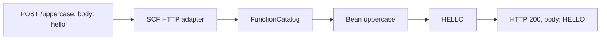
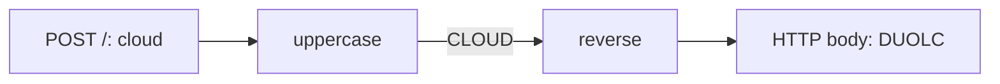

# Quy tắc đường dẫn theo tên hàm và đường dẫn gốc trong Spring Cloud Function

## 1. Từ functional bean đến địa chỉ HTTP

**Spring Cloud Function (SCF)** cho phép đặt logic nghiệp vụ trong các bean Java theo hợp đồng `Supplier<T>`, `Function<I, O>` hoặc `Consumer<T>`. Các bean này được đăng ký và tra cứu qua `FunctionCatalog`, nên cùng một logic có thể được gọi qua HTTP, sự kiện hoặc môi trường serverless mà không phụ thuộc trực tiếp vào giao thức.

Khi ứng dụng Spring Boot bật **SCF HTTP adapter**, một phần của hợp đồng gọi hàm được biểu diễn thành URL:

- **Đường dẫn có tên hàm:** `/{functionName}` (ví dụ `/uppercase`).
- **Đường dẫn gốc:** `/`, có thể đại diện cho hàm duy nhất trong catalog hoặc một hàm/composition được chọn bằng cấu hình.
- **Tiền tố do ứng dụng cấu hình:** `spring.cloud.function.web.path` (ví dụ `/api/functions`), đặt phía trước các đường dẫn ở trên.

Chủ đề quan trọng không chỉ là nhớ URL. Cần biết SCF **chọn hàm nào** khi có một bean, nhiều bean, composition hoặc cấu hình lọc hàm. Nếu nhầm lẫn, client có thể gặp `404 Not Found`, gọi nhầm hàm hoặc công bố nhiều endpoint hơn dự kiến.

### Mục tiêu bài học

Sau khi học, bạn có thể:

1. Xác định URL mặc định theo tên bean trong `FunctionCatalog`.
2. Giải thích khi nào `/` gọi được mà không có tên hàm.
3. Chọn một hàm hoặc một composition làm hàm mặc định qua `spring.cloud.function.definition`.
4. Phân biệt dấu `|` dùng để **ghép hàm** và dấu `;` dùng để **liệt kê/lọc hàm**.
5. Áp dụng tiền tố URL, HTTP method và tham số trong path; kiểm tra routing khi triển khai thực tế.

## 2. Phân biệt tên bean, tên hàm trong catalog và HTTP path

Xét một bean:

```java
@Bean
public Function<String, String> uppercase() {
    return text -> text.toUpperCase(java.util.Locale.ROOT);
}
```

Theo mặc định, tên bean là `uppercase`. SCF đăng ký nó trong catalog, rồi HTTP adapter sử dụng tên đó làm phần tử đường dẫn. Một request `POST /uppercase` được chuyển thành lệnh gọi tương đương với:

```java
Function<String, String> function = catalog.lookup("uppercase");
String result = function.apply("hello"); // "HELLO"
```

Đoạn mã trên chỉ minh họa cách tra cứu `FunctionCatalog`: trong thực tế, catalog sử dụng generic phù hợp và adapter có trách nhiệm chuyển đổi request/response. Bản thân `Function` **không lưu URL** và không cần `@PostMapping`.



Nếu muốn đặt tên bean khác với tên phương thức, có thể khai báo:

```java
@Bean("makeUpper")
public Function<String, String> uppercase() {
    return text -> text.toUpperCase(java.util.Locale.ROOT);
}
```

Khi đó tên được công bố là `makeUpper`: URL theo tên là `/makeUpper`, còn `/uppercase` **không còn là URL mặc định chỉ vì phương thức Java có tên `uppercase`**. Tên URL được suy từ tên hàm đã đăng ký, không phải tên class, package hay tên endpoint REST mà lập trình viên tự tưởng tượng.

**Giả định xuyên suốt ví dụ:** ứng dụng chạy tại `http://localhost:8080`, dùng tiền tố mặc định `/`, không có `server.servlet.context-path` tùy chỉnh và chưa đặt thêm controller hoặc gateway route trùng đường dẫn.

## 3. Trường hợp A: chỉ có một hàm trong FunctionCatalog

Đây là quy tắc đơn giản nhất: **nếu chỉ có một Supplier, Function hoặc Consumer trong catalog thì phần tên ở URL là tùy chọn**. Với bean `uppercase` là hàm duy nhất, hai lời gọi sau tương đương:

```bash
# Có tên hàm
curl -i -X POST 'http://localhost:8080/uppercase' \
  -H 'Content-Type: text/plain' \
  -H 'Accept: text/plain' \
  --data 'hello'

# Không có tên hàm: đường dẫn gốc
curl -i -X POST 'http://localhost:8080/' \
  -H 'Content-Type: text/plain' \
  -H 'Accept: text/plain' \
  --data 'hello'
```

Cả hai request đều chạy `uppercase.apply("hello")` và cho kết quả nghiệp vụ `HELLO`, thường với HTTP `200 OK`.

Quy tắc tương tự được áp dụng theo hợp đồng HTTP của loại bean:

| Bean duy nhất trong catalog | Có tên hàm | Đường dẫn gốc | HTTP method điển hình |
| --- | --- | --- | --- |
| `Supplier<String> greeting` | `GET /greeting` | `GET /` | `GET` |
| `Function<String, String> uppercase` | `POST /uppercase` | `POST /` | `POST` hoặc `PUT` |
| `Consumer<String> audit` | `POST /audit` | `POST /` | `POST`, `PUT` hoặc `DELETE` |

Đối với `Consumer`, `POST`/`PUT` thường trả `202 Accepted`; `DELETE` thường trả `204 No Content`. Đó là status theo HTTP adapter, không phải cam kết đã lưu sự kiện bền vững.

Điều kiện then chốt là **chỉ một hàm khả dụng trong catalog**, không phải “source code chỉ có một class” hoặc “mình chỉ định dùng một endpoint”. Một dependency khác có thể góp thêm bean chức năng vào application context. Khi thêm bean thứ hai, hành vi ở path gốc có thể thay đổi.

## 4. Ví dụ runnable tối thiểu

Tạo dự án Spring Boot có starter Spring Cloud Function HTTP phù hợp với Spring MVC:

```xml
<dependency>
    <groupId>org.springframework.cloud</groupId>
    <artifactId>spring-cloud-starter-function-web</artifactId>
</dependency>
```

Dependency này giả định project đã dùng **Spring Boot parent/BOM** và **Spring Cloud dependencies BOM** tương thích với nhau. Không tự gán phiên bản SCF độc lập với release train. Nếu dự án dùng WebFlux, chọn starter SCF dành cho WebFlux tương ứng; quy tắc tên hàm và path dưới đây thuộc HTTP adapter của SCF.

Tạo `src/main/java/demo/PathDemoApplication.java`:

```java
package demo;

import java.util.Locale;
import java.util.function.Function;
import org.springframework.boot.SpringApplication;
import org.springframework.boot.autoconfigure.SpringBootApplication;
import org.springframework.context.annotation.Bean;

@SpringBootApplication
public class PathDemoApplication {
    public static void main(String[] args) {
        SpringApplication.run(PathDemoApplication.class, args);
    }

    @Bean
    public Function<String, String> uppercase() {
        return text -> text.toUpperCase(Locale.ROOT);
    }
}
```

Sau khi chạy ứng dụng qua `mvn spring-boot:run` (hoặc Maven Wrapper của dự án), hãy gửi request đến **cả** `/uppercase` và `/`. Bài tập này giúp xác nhận routing gốc thực tế thay vì chỉ nhìn thấy bean đã đăng ký.

## 5. Trường hợp B: nhiều hàm trong catalog

Giữ bean `uppercase` và thêm một bean khác **trong cùng class ứng dụng**:

```java
@Bean
public Function<String, String> reverse() {
    return text -> new StringBuilder(text).reverse().toString();
}
```

Lúc này catalog có ít nhất hai hàm, `uppercase` và `reverse`. Với cấu hình mặc định, SCF công bố endpoint **theo tên**:

```bash
curl -i -X POST 'http://localhost:8080/uppercase' \
  -H 'Content-Type: text/plain' --data 'abc'
# Body: ABC

curl -i -X POST 'http://localhost:8080/reverse' \
  -H 'Content-Type: text/plain' --data 'abc'
# Body: cba
```

**Đường dẫn gốc `/` không còn tự chọn một hàm bất kỳ.** Nếu không có cấu hình khác, không nên dựa vào `POST /` để gọi `uppercase`; nó không có đủ thông tin chọn hàm.

| Số hàm khả dụng | URL `/uppercase` | URL `/reverse` | URL gốc `/` |
| --- | --- | --- | --- |
| Chỉ có `uppercase` | Gọi `uppercase` | Không có bean `reverse` để gọi | Gọi `uppercase` |
| Có `uppercase` và `reverse` | Gọi `uppercase` | Gọi `reverse` | Không tự suy ra hàm mặc định |
| Có nhiều hàm nhưng chọn một hàm/composition với `definition` | Vẫn phải xét quy tắc tên và cấu hình | Vẫn phải xét quy tắc tên và cấu hình | Có thể được ánh xạ đến hàm/composition đã chọn |

Để tránh thay đổi hành vi ngoài ý muốn khi nhóm thêm bean mới, client production nên dùng đường dẫn có tên hoặc cấu hình **rõ ràng** hàm mặc định.

## 6. Chọn một hàm hoặc composition cho đường dẫn gốc

Khi có nhiều hàm, SCF cho phép chỉ định một hàm hoặc một composition mặc định bằng property:

```properties
spring.cloud.function.definition=uppercase
```

Với lựa chọn một hàm, `POST /` có thể được ánh xạ đến `uppercase`. Điều này giúp xây dựng một endpoint HTTP gốc như kiểu function-as-a-service.

Ví dụ thứ hai: ghép hai hàm `uppercase` và `reverse`. Dòng dưới có nghĩa **thực hiện `uppercase` rồi chuyển kết quả cho `reverse`**:

```properties
spring.cloud.function.definition=uppercase|reverse
```

Request:

```bash
curl -i -X POST 'http://localhost:8080/' \
  -H 'Content-Type: text/plain' \
  --data 'cloud'
# Kết quả nghiệp vụ: DUOLC
```

Giải thích thứ tự: `cloud` → `uppercase` → `CLOUD` → `reverse` → `DUOLC`.



### Điều thường bị bỏ qua: fallback khi đã đặt definition

Theo quy tắc *Function Mapping* của SCF, `spring.cloud.function.definition` còn được dùng trong tình huống URL **không giải quyết được thành tên hàm**. Ví dụ catalog có `uppercase` và `reverse`, định nghĩa mặc định là `uppercase|reverse`, nhưng client gửi `POST /some-name`. Trong trường hợp fallback được áp dụng, adapter vẫn có thể thực thi composition mặc định.

Vì vậy, **đừng xem việc một path không khớp tên bean là cơ chế từ chối truy cập đáng tin cậy**. Khi API chỉ cần một URL công khai, cần đặt quy tắc bảo mật, kiểm soát endpoint và kiểm thử hành vi fallback ở đúng phiên bản đang chạy. Với yêu cầu URL chính xác và lỗi `404` cho mọi path lạ, cân nhắc một controller hoặc router tự định nghĩa.

Lưu ý: `definition` chỉ định hàm được chọn; **không có nghĩa là đổi tên bean** từ `uppercase` thành `some-name`.

## 7. Gọi composition trực tiếp bằng tên trên URL

Khi không cấu hình lọc hạn chế, SCF cho phép client gọi một chuỗi hàm tương thích bằng cách nối tên bằng **dấu phẩy** hoặc **dấu ống** trong path:

```bash
curl -i -X POST 'http://localhost:8080/uppercase,reverse' \
  -H 'Content-Type: text/plain' \
  --data 'cloud'
# Body: DUOLC
```

Về ý nghĩa, đường dẫn `/uppercase,reverse` và định nghĩa `uppercase|reverse` đều biểu diễn composition theo thứ tự. Trong URL, dấu phẩy thường thuận tiện hơn vì ký tự `|` có ý nghĩa đặc biệt đối với shell và có thể cần mã hóa URL thành `%7C`.

Ví dụ gọi chuỗi nhiều hàm:

```text
POST /uppercase,reverse
Body: abc

uppercase("abc") -> "ABC"
reverse("ABC")   -> "CBA"
Response body    -> CBA
```

**Điều kiện:** output của hàm trước phải tương thích với input của hàm sau. `Function<String, String>` ghép được với `Function<String, String>`; với các kiểu DTO khác nhau, cần xét quy tắc conversion của `FunctionCatalog` và viết test. Không thể ghép tùy tiện một `Consumer<T>` không có output với một hàm đòi hỏi input có giá trị rồi kỳ vọng thu được response nghiệp vụ.

## 8. Khác nhau giữa dấu | và dấu ;

Hai ký hiệu có mục đích hoàn toàn khác nhau:

| Property | Ý nghĩa | Đường dẫn gốc | Các hàm xuất qua HTTP |
| --- | --- | --- | --- |
| Không đặt `definition`, chỉ có một bean `uppercase` | Chỉ có một đích trong catalog | Có: `/` | `/uppercase` và `/` |
| Không đặt `definition`, có hai bean `uppercase`, `reverse` | Mỗi hàm có tên đường dẫn | Không có hàm gốc tự động | `/uppercase`, `/reverse`; có thể composition |
| `definition=uppercase|reverse` | Một **composition** được chọn | **Có**, trỏ đến composition | Kiểm tra URL theo tên và fallback thực tế |
| `definition=uppercase;reverse` | **Lọc**, chỉ xuất hai hàm liệt kê | **Không** | `/uppercase`, `/reverse` |
| `definition=uppercase|reverse;greeting` | Lọc, xuất một composition và một hàm | **Không** | `/uppercase,reverse` và `/greeting` |

Các property trên được đặt **thay thế nhau** trong từng tình huống, không đặt nhiều dòng cùng tên để mong Spring tự gộp. Dấu `|` ghép hàm; dấu `;` liệt kê các hàm/composition cần xuất; khi có danh sách lọc bằng dấu chấm phẩy, không có ánh xạ gốc tự động.

Ví dụ muốn một API chỉ công bố hai hàm, không công bố các hàm nội bộ còn lại:

```properties
spring.cloud.function.definition=uppercase;reverse
```

Với danh sách này, yêu cầu đến `/uppercase` và `/reverse` có đích hợp lệ, nhưng `/` không được tự gán và composition `/uppercase,reverse` **không được xuất** trừ khi chính composition đó được liệt kê. Đây là **lọc endpoint**, không thay thế cơ chế xác thực và phân quyền.

Muốn xuất composition nhưng không xuất từng thành phần như endpoint riêng:

```properties
spring.cloud.function.definition=uppercase|reverse;greeting
```

Trong trường hợp này giả định có thêm bean `greeting` (ví dụ `Supplier<String>`). Hai đầu ra muốn công bố là `/uppercase,reverse` và `/greeting`; đường dẫn gốc không được tự gán.

## 9. Đổi tiền tố URL mà không đổi tên hàm

Tiền tố mặc định của HTTP adapter là `/`. Có thể cấu hình:

```properties
spring.cloud.function.web.path=/api/functions
```

Với các bean `uppercase` và `reverse`, mapping theo tên được chuyển sang:

```text
POST /api/functions/uppercase
POST /api/functions/reverse
POST /api/functions/uppercase,reverse
```

Khi chọn một hàm hoặc composition mặc định, **đường dẫn gốc của SCF** cũng dịch dưới tiền tố mới. Ví dụ:

```properties
spring.cloud.function.web.path=/api/functions
spring.cloud.function.definition=uppercase|reverse
```

Bạn có thể thử:

```bash
curl -i -X POST 'http://localhost:8080/api/functions/' \
  -H 'Content-Type: text/plain' \
  --data 'cloud'
# Body: DUOLC
```

**Phân biệt các lớp path:**

| Cấu hình/khái niệm | Tác động |
| --- | --- |
| `spring.cloud.function.web.path` | Đổi **tiền tố HTTP adapter của SCF**, ví dụ `/api/functions` |
| Tên bean trong `FunctionCatalog` | Quyết định phần `/uppercase` sau tiền tố |
| `spring.cloud.function.definition` | Chọn một hàm/composition mặc định hoặc lọc tập hàm xuất |
| `server.servlet.context-path` (MVC/Servlet) | Đặt **context path** chung của Servlet application, không phải tên của function |
| Reverse proxy hoặc Spring Cloud Gateway | Có thể viết lại đường dẫn bên ngoài trước khi chuyển request vào ứng dụng |

Trên một số phiên bản/runtime, `/api/functions` và `/api/functions/` có thể chịu quy tắc matching dấu gạch chéo cuối khác nhau. Nên dùng đường dẫn thử nghiệm thực tế, đặc biệt sau khi nâng cấp Spring Framework hoặc khi proxy có rewrite path. Không mặc định mọi biến thể trailing slash luôn tương đương.

## 10. HTTP method và tham số đi kèm đường dẫn

**Tên hàm quyết định đích gọi, còn HTTP method và kiểu bean quyết định cách gọi.** Ví dụ:

| Phương thức | Pattern | Kiểu bean | Mục đích | Status thường gặp |
| --- | --- | --- | --- | --- |
| `GET` | `/{supplier}` | `Supplier<T>` | Sinh dữ liệu | `200 OK` |
| `POST`, `PUT` | `/{function}` | `Function<I, O>` | Đọc body và trả kết quả | `200 OK` |
| `GET` | `/{function}/{item}` | `Function<I, O>` | Chuyển `item` thành input của hàm | `200 OK` |
| `POST`, `PUT` | `/{consumer}` | `Consumer<I>` | Đưa body vào consumer | `202 Accepted` |
| `DELETE` | `/{consumer}` | `Consumer<I>` | Gọi consumer theo mapping DELETE | `204 No Content` |

Ví dụ gọi `Function<String, String> uppercase` bằng GET với dữ liệu trong path:

```bash
curl -i 'http://localhost:8080/uppercase/hello'
# Body: HELLO
```

**Không suy ra** rằng `GET /uppercase` (không có `/{item}`) sẽ hoạt động giống `POST /uppercase` chỉ vì tên đúng. Mỗi kiểu bean có quy tắc HTTP method riêng; ngoài ra ứng dụng có thể dùng property `spring.cloud.function.http.GET`, `spring.cloud.function.http.POST`... để tùy biến mapping.

Query parameters như `?name=An` không phải cách lựa chọn bean trong catalog. Với input kiểu `Message<?>`, adapter có thể đưa request parameter vào message header `http_request_param`. Khi thiết kế HTTP API, cần phân biệt rõ path chọn **hàm** với path/query chứa **dữ liệu đầu vào**.

Đừng nhầm `/uppercase/hello` với composition `/uppercase,reverse`: dấu `/` sau tên hàm dùng để truyền một *item* trong trường hợp GET, còn dấu phẩy ghép **nhiều tên hàm**.

## 11. Tình huống thực tế: một xử lý dùng cho HTTP, event và serverless

Giả sử logic nghiệp vụ chuẩn hóa mã đơn hàng được viết một lần:

```java
@Bean
public Function<String, String> normalizeOrderId() {
    return id -> id.trim().toUpperCase(java.util.Locale.ROOT);
}
```

Trong ứng dụng HTTP, lời gọi có thể là `POST /normalizeOrderId` hoặc `POST /` nếu đó là bean duy nhất. Trong ứng dụng lắng nghe sự kiện, cùng `Function<String, String>` có thể được một binding/adapter gọi theo tên được cấu hình. Trong serverless, function invoker do môi trường triển khai lựa chọn cách ánh xạ event đến `FunctionCatalog`.

**Đường dẫn HTTP không phải hợp đồng bắt buộc của function.** Đổi `spring.cloud.function.web.path` chỉ ảnh hưởng HTTP adapter, không đổi bản thân logic `normalizeOrderId` hoặc tên binding sự kiện. Ngược lại, đổi tên bean có thể ảnh hưởng cả HTTP path và các cấu hình chọn hàm trong các transport khác.

Với một hệ thống triển khai qua nhiều kênh, nên thống nhất tên function ổn định (ví dụ `normalizeOrderId`), quản lý prefix HTTP ngoài bean và viết test riêng cho từng adapter.

## 12. Chẩn đoán lỗi routing

Khi client gọi sai đường dẫn, hãy kiểm tra theo thứ tự:

1. **HTTP adapter có hoạt động không?** Ứng dụng phải có starter/adapter SCF web phù hợp với runtime Spring MVC hoặc WebFlux. Chỉ có `FunctionCatalog` không có nghĩa là endpoint HTTP đã được xuất.
2. **Bean có trong catalog không?** Kiểm tra tên `@Bean`, kiểu functional bean, và có vô tình thay tên bean qua `@Bean("...")` không.
3. **Có bao nhiêu hàm?** Path gốc chỉ tự chọn khi một hàm; nhiều hàm cần gọi theo tên hoặc chỉ định `definition`.
4. **Có filtering không?** Nếu `definition` liệt kê bằng `;`, chỉ các hàm/composition trong danh sách được công bố và không có root mapping tự động.
5. **Có thay prefix hoặc context path không?** Tách biệt SCF prefix, Servlet context path và gateway rewrite; tránh ghép thừa hoặc thiếu đoạn path.
6. **Method có đúng không?** `GET` thường gọi Supplier hoặc Function có `/{item}`; `POST` gọi Function/Consumer.
7. **Body/headers có đúng không?** Với chuỗi gửi `text/plain`; với DTO gửi `application/json` và header phù hợp.

| Hiện tượng | Cách hiểu có thể đúng | Cách xác minh |
| --- | --- | --- |
| `POST /` trả `404` sau khi thêm bean mới | Không còn một hàm duy nhất; root không có đích | Gọi `/uppercase`; kiểm tra catalog và `definition` |
| `POST /uppercase` trả `404` | Bean đổi tên, bị lọc hoặc prefix đã thay đổi | Kiểm tra `@Bean`, `definition`, `web.path` |
| `POST /unknown` vẫn chạy được | Có thể có hàm/composition mặc định theo `definition` | Kiểm tra fallback mapping, thử request có dấu hiệu nhận biết và kiểm soát quyền |
| `POST /uppercase,reverse` không được xuất | Có thể đã bật filtering chỉ liệt kê hàm riêng | Thêm composition vào danh sách `definition` nếu cần |
| `GET /uppercase` không giống POST | Thiếu `/{item}` hoặc dùng method sai cho Function | Gửi `POST /uppercase` hoặc `GET /uppercase/hello` |
| URL có dấu `|` bị shell xử lý | Shell coi `|` là pipe | Dùng dấu phẩy, quote URL, hoặc URL-encode `%7C` |
| `/api/functions/` hoạt động, `/api/functions` không | Phân biệt trailing slash ở runtime/proxy | Kiểm tra mapping thực tế và URL do client phát sinh |

### Kiểm thử hồi quy khi thay đổi số lượng hàm

Một test HTTP đơn giản nên kiểm tra **cả đường dẫn có tên và đường dẫn gốc** khi ứng dụng chủ đích công bố root. Mẫu kiểm thử thủ công:

```bash
# 1. Kiểm tra hàm được gọi theo tên.
curl -i -X POST 'http://localhost:8080/uppercase' \
  -H 'Content-Type: text/plain' --data 'hello'

# 2. Chỉ kỳ vọng thành công nếu có root mapping thực sự.
curl -i -X POST 'http://localhost:8080/' \
  -H 'Content-Type: text/plain' --data 'hello'

# 3. Kiểm tra composition nếu đã cho phép xuất.
curl -i -X POST 'http://localhost:8080/uppercase,reverse' \
  -H 'Content-Type: text/plain' --data 'hello'

# 4. Kiểm tra path không có trong hợp đồng.
curl -i -X POST 'http://localhost:8080/not-a-function' \
  -H 'Content-Type: text/plain' --data 'hello'
```

So sánh **status code, response body và function thực sự được gọi**. Ở bước 4, không nên mặc định server phải trả `404` nếu đã cấu hình default definition, vì adapter có thể fallback đến hàm mặc định.

## 13. Luyện tập

1. Chỉ khai báo bean `Function<String, String> trim`. Liệt kê hai URL POST cùng gọi được bean đó. Vì sao?
2. Thêm `Function<String, String> uppercase` cùng bean `trim`. Giải thích điều gì thay đổi tại `POST /` và cách gọi riêng từng hàm.
3. Đặt `spring.cloud.function.definition=trim|uppercase`. Với body `"  hello  "`, dự đoán đầu ra khi gọi root và trình bày thứ tự xử lý.
4. Thay cấu hình bằng `spring.cloud.function.definition=trim;uppercase`. Có còn ánh xạ tự động tại `/` không? Composition có được công bố không?
5. Đổi prefix thành `/v1/func`. Viết URL cho bean `trim` và URL gốc của composition `trim|uppercase`.
6. Trong một dự án, `POST /anything` vẫn gọi logic mặc dù không có bean tên `anything`. Phân tích cấu hình nào có thể gây ra hiện tượng này và điều cần kiểm thử trước khi triển khai.
7. Đối chiếu `GET /uppercase/hello`, `POST /uppercase` và `POST /uppercase,reverse`. Trong mỗi URL, thành phần nào là tên hàm, đầu vào hoặc chuỗi composition?

## Tài liệu tham khảo

- [Spring Cloud Function Reference — Standalone Web Applications](https://docs.spring.io/spring-cloud-function/reference/spring-cloud-function/standalone-web-applications.html), đặc biệt các mục *Function Mapping rules*, *Function Filtering rules* và bảng HTTP method.
- [Spring Cloud Function Reference — Programming Model](https://docs.spring.io/spring-cloud-function/reference/spring-cloud-function/programming-model.html): cách đăng ký hàm, FunctionCatalog và composition.
- [Spring Cloud Function Reference — Functional Bean Definitions](https://docs.spring.io/spring-cloud-function/reference/functional.html): định nghĩa bean và cách sử dụng catalog.

> **Ghi nhớ:** Với **một hàm**, tên trong đường dẫn là tùy chọn. Với **nhiều hàm**, đường dẫn theo tên là quy tắc mặc định. `spring.cloud.function.definition` có thể chọn **một đích cho root** hoặc **lọc danh sách đích được xuất**; hành vi hai chế độ này cần được phân biệt.
