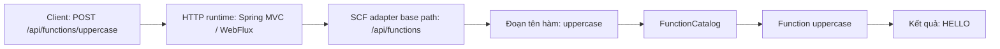
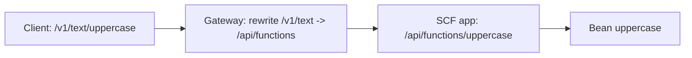

# Tùy chỉnh đường dẫn bằng `spring.cloud.function.web.path` trong Spring Cloud Function

## 1. Bài toán: đổi URL mà không sửa logic nghiệp vụ

Trong **Spring Cloud Function (SCF)**, ta viết nghiệp vụ bằng các bean Java như `Supplier<T>`, `Function<I, O>` và `Consumer<T>`. SCF đưa các bean này vào `FunctionCatalog`, nơi adapter HTTP, adapter sự kiện hoặc môi trường serverless có thể tra cứu và thực thi chúng. Nhờ vậy, một hàm chuẩn hóa mã đơn hàng có thể phục vụ nhiều giao thức mà không cần phụ thuộc trực tiếp vào `HttpServletRequest` hay lớp web cụ thể.

Khi bật HTTP adapter, tên hàm thường trở thành một phần của URL. Chẳng hạn bean `uppercase` có thể được gọi qua `POST /uppercase`. Nhưng nhóm triển khai có thể muốn tất cả các hàm HTTP nằm dưới `/api/functions` để dễ quản lý routing, bảo mật và phiên bản API:

```text
Trước: POST http://localhost:8080/uppercase
Sau:   POST http://localhost:8080/api/functions/uppercase
```

Không cần sửa bean `uppercase`, thay tên phương thức Java hoặc viết thêm `@PostMapping`. Chỉ cần đặt:

```properties
spring.cloud.function.web.path=/api/functions
```

Thuộc tính này **thay vị trí gốc (base path) của các endpoint được SCF HTTP adapter công bố**. Nó không đổi logic, tên bean trong `FunctionCatalog` hay đường dẫn của những controller REST khác.

### Mục tiêu học tập

Sau bài này, bạn có thể:

1. Giải thích `spring.cloud.function.web.path` tác động đến URL nào.
2. Cấu hình base path bằng `application.properties`, `application.yml`, biến môi trường hoặc tham số chạy.
3. Dự đoán URL với một hàm, nhiều hàm, hàm mặc định và composition.
4. Phân biệt SCF base path với Servlet context path, WebFlux base path và URL do reverse proxy công bố.
5. Kiểm thử việc đổi đường dẫn, phát hiện lỗi route và quản lý thay đổi khi phát hành API.

## 2. Thuộc tính `spring.cloud.function.web.path` kiểm soát điều gì?

Mặc định HTTP adapter của SCF dùng **đường dẫn gốc `/`**. Ví dụ với ba bean `uppercase`, `greeting` và `auditEvent`:

| Loại hàm | Method thông thường | URL mặc định |
| --- | --- | --- |
| `Function<String, String> uppercase` | `POST` hoặc `PUT` | `/uppercase` |
| `Supplier<String> greeting` | `GET` | `/greeting` |
| `Consumer<String> auditEvent` | `POST` hoặc `PUT` | `/auditEvent` |

Sau khi đặt `spring.cloud.function.web.path=/api/functions`, các đường dẫn thành:

| Loại hàm | Method | URL mới |
| --- | --- | --- |
| `uppercase` | `POST` | `/api/functions/uppercase` |
| `greeting` | `GET` | `/api/functions/greeting` |
| `auditEvent` | `POST` | `/api/functions/auditEvent` |

Về mặt khái niệm, đường dẫn hình thành từ các thành phần:

```text
URL công khai =
  scheme + host + port
  + [context path/base path của HTTP server]
  + [base path của SCF HTTP adapter]
  + [tên hàm hoặc composition nếu có]
```

Các phần trong ngoặc vuông tùy cấu hình. Nếu có reverse proxy hoặc API gateway, URL nhìn từ client còn có thể khác URL nội bộ vì proxy thực hiện rewrite.



**Phạm vi của property:**

- **Có:** đổi tiền tố các endpoint do SCF HTTP adapter đăng ký.
- **Không:** đổi tên `@Bean`, nội dung `FunctionCatalog`, thứ tự composition hoặc bản thân `Function.apply()`.
- **Không:** tự tạo HTTP endpoint khi ứng dụng chưa có SCF web adapter.
- **Không:** tự cấu hình bảo mật, quyền truy cập, API versioning hay rewrite ở API gateway.
- **Không:** tự đổi đường dẫn của `@RestController`, actuator hoặc các route được định nghĩa bằng cơ chế khác.

Theo quy định của SCF, giá trị **không rỗng** cho base path nên bắt đầu bằng dấu `/`, ví dụ `/api/functions` thay vì `api/functions`. Tránh dùng dấu `/` cuối trong cấu hình nếu không có lý do; kiểm thử riêng hành vi trailing slash trên đúng phiên bản Spring Framework và gateway đang dùng.

## 3. Dự án ví dụ: cùng một logic trước và sau khi đổi path

Giả định bạn có một dự án Spring Boot đã được cấu hình BOM **Spring Cloud tương thích**. Để sử dụng SCF HTTP adapter cùng Spring MVC, có thể thêm:

```xml
<dependency>
    <groupId>org.springframework.cloud</groupId>
    <artifactId>spring-cloud-starter-function-web</artifactId>
</dependency>
```

Nếu dự án chọn WebFlux, dùng starter SCF phù hợp với WebFlux theo phiên bản đang triển khai. Việc chọn starter quyết định HTTP runtime; **`spring.cloud.function.web.path` vẫn là cấu hình đường dẫn của SCF**, không phải lựa chọn Servlet hay reactive runtime.

Tạo `src/main/java/demo/ScfPathApplication.java`:

```java
package demo;

import java.util.Locale;
import java.util.function.Consumer;
import java.util.function.Function;
import java.util.function.Supplier;

import org.springframework.boot.SpringApplication;
import org.springframework.boot.autoconfigure.SpringBootApplication;
import org.springframework.context.annotation.Bean;

@SpringBootApplication
public class ScfPathApplication {

    public static void main(String[] args) {
        SpringApplication.run(ScfPathApplication.class, args);
    }

    @Bean
    public Function<String, String> uppercase() {
        return text -> text.toUpperCase(Locale.ROOT);
    }

    @Bean
    public Function<String, String> normalize() {
        return String::trim;
    }

    @Bean
    public Supplier<String> greeting() {
        return () -> "Hello from Spring Cloud Function";
    }

    @Bean
    public Consumer<String> auditEvent() {
        return payload -> System.out.println(
            "Received payload length: " + payload.length());
    }
}
```

Bốn bean này thể hiện ba kiểu hàm chính của SCF và hai `Function<String, String>` có thể ghép lại. Không bean nào cần biết request được gửi đến URL nào.

### 3.1. Chạy với cấu hình mặc định

Nếu chưa thêm `spring.cloud.function.web.path`, chạy ứng dụng:

```bash
mvn spring-boot:run
```

Gọi trực tiếp theo tên:

```bash
curl -i -X POST 'http://localhost:8080/uppercase' \
  -H 'Content-Type: text/plain' \
  -H 'Accept: text/plain' \
  --data 'hello'
# Response body: HELLO
```

### 3.2. Đổi SCF base path

Trong `src/main/resources/application.properties`, thêm:

```properties
spring.cloud.function.web.path=/api/functions
```

Khởi động lại ứng dụng và gọi URL mới:

```bash
curl -i -X POST 'http://localhost:8080/api/functions/uppercase' \
  -H 'Content-Type: text/plain' \
  -H 'Accept: text/plain' \
  --data 'hello'
# Response body: HELLO

curl -i 'http://localhost:8080/api/functions/greeting'
# Response body: Hello from Spring Cloud Function
```

Trong cấu hình này, `POST /uppercase` **không còn là endpoint SCF mặc định**. Nếu request vẫn được xử lý tại URL cũ, hãy kiểm tra xem một controller riêng, gateway rewrite hoặc cấu hình mapping khác có đang phục vụ URL đó hay không.

## 4. Các cách khai báo cùng một cấu hình

Spring Boot hỗ trợ nhiều nguồn cấu hình. Các ví dụ bên dưới là **các cách thay thế nhau**, không cần thiết lập đồng thời.

### Cách 1: `application.properties`

```properties
spring.cloud.function.web.path=/api/functions
```

### Cách 2: `application.yml`

```yaml
spring:
  cloud:
    function:
      web:
        path: /api/functions
```

### Cách 3: biến môi trường

Nhờ quy tắc **relaxed binding** của Spring Boot, có thể dùng:

```bash
export SPRING_CLOUD_FUNCTION_WEB_PATH=/api/functions
mvn spring-boot:run
```

Trên PowerShell, có thể đặt biến trước khi khởi động Java:

```powershell
$env:SPRING_CLOUD_FUNCTION_WEB_PATH = '/api/functions'
mvn spring-boot:run
```

### Cách 4: tham số khi chạy ứng dụng

```bash
java -jar app.jar --spring.cloud.function.web.path=/api/functions
```

`app.jar` là tên minh họa cho JAR đã được build. Nếu dùng Docker, Kubernetes hoặc cloud runtime, cùng property có thể được cấp qua environment variable hay cấu hình deployment.

**Nên chọn cách nào?** Với route ổn định trong một môi trường, thường khai báo trong file cấu hình được quản lý. Nếu cần cùng một artifact hoạt động ở nhiều môi trường, đặt base path bằng environment variable hoặc tham số triển khai có thể thuận tiện hơn. Cần kiểm tra **giá trị cấu hình hiệu lực** khi nhiều nguồn khai báo cùng key; Spring Boot có thứ tự ưu tiên property source, vì vậy một tham số chạy có thể ghi đè giá trị trong file.

## 5. Kết hợp base path với quy tắc chọn hàm

Property `spring.cloud.function.web.path` quyết định **gốc URL**; còn `FunctionCatalog` và `spring.cloud.function.definition` quyết định **hàm được gọi**. Hai nhóm quy tắc cần được xét cùng nhau.

Giả sử mọi tình huống ở mục này đều dùng:

```properties
spring.cloud.function.web.path=/api/functions
```

### 5.1. Trường hợp chỉ có một hàm

Nếu catalog chỉ có `uppercase`, tên trong đường dẫn là tùy chọn. Khi đó có thể gọi:

```text
POST /api/functions/uppercase
POST /api/functions
```

Cả hai đều hướng đến `uppercase`. Tài liệu SCF mô tả trường hợp chỉ có một hàm thì tên path là tùy chọn. Tùy phiên bản và quy tắc matching, biến thể có dấu `/` cuối như `/api/functions/` có thể cần thử riêng; đừng coi mọi biến thể trailing slash tương đương nếu chưa kiểm chứng.

**Lưu ý:** Trong mã ví dụ ở mục 3 có **bốn bean**, vì vậy để thử điều kiện “chỉ có một hàm”, cần tạm bỏ hoặc vô hiệu hóa ba bean còn lại. Không thể suy ra ví dụ nhiều bean sẽ tự chọn `uppercase` làm mặc định.

### 5.2. Trường hợp nhiều hàm

Với catalog gồm `uppercase`, `normalize`, `greeting` và `auditEvent`:

```text
POST /api/functions/uppercase
POST /api/functions/normalize
GET  /api/functions/greeting
POST /api/functions/auditEvent
```

Đường dẫn gốc `/api/functions` không có một đích duy nhất để tự lựa chọn. Client nên dùng URL theo tên, hoặc ứng dụng phải chọn hàm mặc định bằng `spring.cloud.function.definition`.

### 5.3. Đặt một hàm làm mặc định tại base path

```properties
spring.cloud.function.web.path=/api/functions
spring.cloud.function.definition=uppercase
```

Giờ có thể gửi:

```bash
curl -i -X POST 'http://localhost:8080/api/functions' \
  -H 'Content-Type: text/plain' \
  --data 'spring'
# Response body: SPRING
```

Đây là mapping của **hàm đã được chọn** tại gốc SCF, không phải đổi tên bean thành `api` hoặc `functions`.

### 5.4. Đặt một composition làm mặc định

Hai bean `normalize` và `uppercase` đều có chữ ký `Function<String, String>`. Ta có thể ghép:

```properties
spring.cloud.function.web.path=/api/functions
spring.cloud.function.definition=normalize|uppercase
```

Khi gọi base path:

```bash
curl -i -X POST 'http://localhost:8080/api/functions' \
  -H 'Content-Type: text/plain' \
  --data '  spring cloud  '
# Response body: SPRING CLOUD
```

Thứ tự thực thi: `normalize` cắt khoảng trắng hai đầu, rồi `uppercase` đổi chữ hoa.

Composition có thể được gọi theo tên bằng dấu phẩy khi nó được xuất:

```text
POST /api/functions/normalize,uppercase
```

Dấu `|` trong property biểu diễn ghép hàm; dấu phẩy trong URL tiện hơn vì ký tự `|` dễ bị shell hiểu như pipe và có thể phải URL-encode.

### 5.5. Chỉ công bố các hàm được liệt kê

Khi `spring.cloud.function.definition` chứa danh sách phân cách bằng dấu `;`, HTTP adapter áp dụng **function filtering**:

```properties
spring.cloud.function.web.path=/api/functions
spring.cloud.function.definition=uppercase;greeting
```

Với cấu hình này, chỉ `uppercase` và `greeting` nằm trong danh sách công bố; không có ánh xạ tự động cho base path `/api/functions`. Các endpoint `normalize`, `auditEvent` hoặc composition chưa được liệt kê không được công bố bởi SCF adapter.

### Ma trận URL

| Catalog và cấu hình | URL ví dụ có thể gọi | Base path `/api/functions` |
| --- | --- | --- |
| Chỉ có một bean `uppercase`, không đặt `definition` | `POST /api/functions/uppercase` | Gọi `uppercase` |
| Nhiều bean, không đặt `definition` | `/api/functions/{tên-hàm}` | Không có hàm mặc định |
| Nhiều bean, `definition=uppercase` | Hàm mặc định đã chọn | Gọi `uppercase` |
| `definition=normalize|uppercase` | Composition đã chọn | Gọi `normalize` rồi `uppercase` |
| `definition=uppercase;greeting` | `/api/functions/uppercase`, `/api/functions/greeting` | **Không** có root mapping tự động |
| `definition=normalize|uppercase;greeting` | `/api/functions/normalize,uppercase`, `/api/functions/greeting` | **Không** có root mapping tự động |

Một lưu ý khi chọn **một** `definition`: SCF còn có cơ chế fallback khi tên hàm không thể giải quyết từ URL; request với tên không tồn tại có thể được xử lý bằng hàm/composition mặc định. Vì vậy, **base path không phải bộ lọc an ninh**. Nếu muốn HTTP route chính xác và từ chối mọi URL khác, cần kiểm soát route bằng web framework/gateway, kiểm thử fallback và áp dụng phân quyền phù hợp.

## 6. Phân biệt SCF base path với các loại path khác

Một nguyên nhân phổ biến của lỗi `404` là cấu hình đồng thời nhiều lớp tiền tố rồi chỉ nhớ một lớp.

| Cấu hình | Phạm vi | Ví dụ | Tác động đến `uppercase` |
| --- | --- | --- | --- |
| `spring.cloud.function.web.path` | Chỉ endpoint của **SCF HTTP adapter** | `/api/functions` | Thêm tiền tố SCF |
| `server.servlet.context-path` | Toàn bộ **Servlet application** (Spring MVC) | `/order-service` | Thêm tiền tố ứng dụng MVC |
| `spring.webflux.base-path` | Base path cho các **WebFlux handler** | `/order-service` | Thêm tiền tố với runtime WebFlux tương ứng |
| `server.port` | Cổng lắng nghe HTTP | `8090` | Thay port, không đổi path |
| `@RequestMapping`, `RouterFunction` | Route được ứng dụng định nghĩa riêng | `/v1/orders` | Không tự sửa theo SCF property |
| Reverse proxy / API Gateway | Đường dẫn client thấy, có thể rewrite | `/public/v1` | Có thể khác đường dẫn gửi đến ứng dụng |

### 6.1. Kết hợp với Servlet context path

Ví dụ ứng dụng Spring MVC:

```properties
server.port=8090
server.servlet.context-path=/order-service
spring.cloud.function.web.path=/api/functions
```

Khi đó client gọi bean `uppercase` tại:

```text
POST http://localhost:8090/order-service/api/functions/uppercase
```

Thứ tự là **context path của ứng dụng** → **SCF base path** → **tên hàm**. Không đưa `/order-service` thêm lần nữa vào `spring.cloud.function.web.path`, nếu không URL sẽ bị nhân đôi phần tiền tố.

### 6.2. Với ứng dụng WebFlux

Trong ứng dụng WebFlux, không dùng `server.servlet.context-path` để diễn đạt base path cho reactive web handlers. Spring Boot có thuộc tính `spring.webflux.base-path` cho WebFlux:

```properties
spring.webflux.base-path=/order-service
spring.cloud.function.web.path=/api/functions
```

Mô hình URL tương ứng là `/order-service/api/functions/uppercase`, với điều kiện SCF HTTP adapter và WebFlux runtime của phiên bản được chọn hỗ trợ cách ánh xạ đó. Hãy xác nhận bằng một request tích hợp thật; không lấy kết luận chỉ từ tên dependency hoặc từ log server.

### 6.3. Khi đi qua API Gateway

Ví dụ, client muốn gọi `https://api.example.com/v1/text/uppercase`, nhưng ứng dụng nội bộ công bố `/api/functions/uppercase`.



Nếu gateway chỉ **forward nguyên path** mà không rewrite, cấu hình ở backend phải khớp URL đến từ gateway. Nếu gateway **rewrite**, cần biết đường dẫn thực tế được chuyển tiếp đến ứng dụng. Quyết định đặt phiên bản API (`/v1`) ở gateway hay trong SCF base path nên được nhất quán để tránh gây nhầm và tránh phá vỡ hợp đồng client.

## 7. Dùng `spring.cloud.function.web.path` để tổ chức API

Một số cách tổ chức hợp lý:

| Nhu cầu | Cấu hình gợi ý | URL mẫu |
| --- | --- | --- |
| Gom các hàm tiện ích | `/api/functions` | `/api/functions/uppercase` |
| Phân phiên bản HTTP contract | `/v1/functions` | `/v1/functions/normalize` |
| Dùng một composition như endpoint chính | `/v1/normalize` + một `definition` | `POST /v1/normalize` |
| Đặt dưới ứng dụng MVC có context path | `server.servlet.context-path=/app` và `web.path=/functions` | `/app/functions/uppercase` |

Đặt base path không buộc bạn phải thiết kế API theo đúng cấu trúc này. Điều quan trọng là các URL công bố cho client phải nhất quán, có kiểm thử và có chính sách thay đổi phiên bản. Nếu muốn một tài nguyên REST nhiều route như `GET /orders/{id}`, `PATCH /orders/{id}`, `DELETE /orders/{id}` với nhiều status code và validation tùy biến, cân nhắc Spring MVC/WebFlux controller/router. SCF HTTP adapter chủ yếu phục vụ **gọi function**.

### Lợi ích của một đường dẫn ổn định

- Client dễ nhận biết URL thuộc nhóm endpoint SCF thay vì API controller thông thường.
- Gateway có thể gom routing, rate limiting và monitoring theo tiền tố rõ ràng.
- Có thể tách biệt quá trình phát hành API bên ngoài với thay đổi tên bean nội bộ, nếu gateway quản lý ánh xạ phù hợp.
- Một bean vẫn dùng được từ adapter sự kiện hoặc serverless dù HTTP URL thay đổi.

Nhưng **đổi base path là thay đổi hợp đồng HTTP**. Các client cũ gọi `/uppercase` sẽ không tự chuyển sang `/api/functions/uppercase`. Nếu đã có consumer ngoài hệ thống, cần kế hoạch migration: cập nhật tài liệu, ứng dụng client, rule gateway và kiểm tra log request cũ.

## 8. Kiểm thử cấu hình sau khi đổi path

Giả sử ứng dụng ví dụ ở mục 3 chạy với `web.path=/api/functions` và **không** có `definition`:

```bash
# 1. Function nhận text: kỳ vọng 200 và body HELLO.
curl -i -X POST 'http://localhost:8080/api/functions/uppercase' \
  -H 'Content-Type: text/plain' \
  -H 'Accept: text/plain' \
  --data 'hello'

# 2. Supplier: kỳ vọng 200 và body lời chào.
curl -i 'http://localhost:8080/api/functions/greeting'

# 3. Consumer: gửi dữ liệu và kiểm tra side effect trong console.
curl -i -X POST 'http://localhost:8080/api/functions/auditEvent' \
  -H 'Content-Type: text/plain' \
  --data 'order-created'

# 4. Kiểm tra route cũ: không còn là mapping mặc định của SCF.
curl -i -X POST 'http://localhost:8080/uppercase' \
  -H 'Content-Type: text/plain' \
  --data 'hello'

# 5. Kiểm tra composition khi không bật function filtering.
curl -i -X POST 'http://localhost:8080/api/functions/normalize,uppercase' \
  -H 'Content-Type: text/plain' \
  --data '  hello  '
```

Ở bước 5, kết quả nghiệp vụ là `HELLO`. Trên ứng dụng thật, cần kiểm tra cả HTTP status, `Content-Type`, response body, việc bean thực sự được gọi và kết quả tại side effect; chỉ kiểm tra `200` là chưa đủ.

### Bộ tiêu chí kiểm thử tối thiểu

| Ca kiểm thử | Điều xác minh |
| --- | --- |
| Gọi hàm bằng URL có prefix mới | HTTP adapter nhận đúng URL và gọi đúng bean |
| Gọi URL cũ | Quyết định rõ có còn hỗ trợ hoặc cần redirect/rewrite hay không |
| Gọi base path với một/nhiều hàm | Root mapping đúng với catalog và `definition` |
| Gọi composition | Tên và thứ tự các hàm được xử lý chính xác |
| Gọi đường dẫn không tồn tại | Có fallback hay không; route có bị lộ ngoài ý muốn không |
| Kết hợp context path và gateway | Không thiếu hoặc nhân đôi tiền tố |
| Trường hợp cần xác thực | Cấu hình bảo mật bao phủ cả đường dẫn mới |
| URL có/không có dấu `/` cuối | Hành vi đúng theo runtime và proxy đang dùng |

Không nên giả định `GET /api/functions/uppercase` giống `POST /api/functions/uppercase`. Theo mapping điển hình của SCF, `Function` nhận body bằng `POST`/`PUT`, còn biến thể GET thường dùng `/{function}/{item}`, ví dụ:

```bash
curl -i 'http://localhost:8080/api/functions/uppercase/hello'
# Response body: HELLO
```

Điều chỉnh URL không làm biến mất các quy tắc HTTP method và content negotiation hiện có.

## 9. Các lỗi thường gặp và cách khắc phục

| Hiện tượng | Nguyên nhân có thể | Cách kiểm tra/khắc phục |
| --- | --- | --- |
| `POST /uppercase` trả `404` sau khi đổi cấu hình | Đường dẫn đã chuyển dưới base path mới | Gọi `POST /api/functions/uppercase` |
| `POST /api/functions/uppercase` trả `404` | Chưa bật SCF web adapter, tên bean sai, `definition` lọc hàm hoặc path cấu hình khác | Kiểm tra dependency, `FunctionCatalog`, property hiệu lực |
| URL bị lặp `/app/app/functions` | Đã ghép context path vào cả `server.servlet.context-path` lẫn `web.path` | Tách mỗi phần tiền tố vào đúng thuộc tính |
| Client gọi URL từ gateway bị `404`, gọi nội bộ thì thành công | Gateway forward/rewrite sai hoặc thiếu phần prefix | Quan sát URL nhận tại backend, đối chiếu rewrite rule |
| Chỉ có một hàm nhưng gọi base path không khớp | Khác biệt trailing slash, context path hoặc config thực tế | Thử biến thể root, xem runtime mapping, viết test hợp đồng |
| Thêm bean mới khiến root không hoạt động như trước | Catalog không còn một hàm duy nhất | Cấu hình một `definition` làm mặc định hoặc dùng URL theo tên |
| Gọi một path lạ vẫn chạy function | Cơ chế fallback khi đã đặt `definition` | Kiểm thử route lạ, kiểm soát quyền truy cập |
| Endpoint nhận đúng đường dẫn nhưng trả `415`/`400` | Sai `Content-Type`, payload hay kiểu dữ liệu; đây không nhất thiết là lỗi routing | Kiểm tra header và generic input của function |
| Thay file cấu hình nhưng ứng dụng không nhận | Chưa restart hoặc giá trị bị override bởi CLI/environment/profile | Kiểm tra property source, profile đang chạy và redeploy |
| Endpoint mới bị từ chối xác thực | Security filter/gateway rule vẫn dùng pattern cũ | Cập nhật rule bảo mật và chạy kiểm thử truy cập |

### Khi cần chẩn đoán nhanh

Làm theo thứ tự:

1. Xác nhận giá trị **hiệu lực** của `spring.cloud.function.web.path` trên môi trường đang chạy.
2. Xác nhận Spring MVC/WebFlux runtime và SCF HTTP adapter thực sự được nạp.
3. Liệt kê tên bean trong `FunctionCatalog` hoặc tra cứu qua logging/actuator khi được bật phù hợp.
4. Kiểm tra số hàm, `spring.cloud.function.definition` và có bật filtering bằng dấu `;` hay không.
5. Kiểm tra `server.servlet.context-path`, `spring.webflux.base-path` hoặc gateway rewrite.
6. Dùng `curl -i` để quan sát request thật và status/body thay vì chỉ suy luận từ URL.

**Bảo mật:** base path chỉ tổ chức route, không bảo vệ function. SCF có khả năng truyền thông tin trong HTTP headers sang `MessageHeaders` khi dùng kiểu `Message<?>`; không nên để client ngoài tự quyết định hàm nhạy cảm qua header routing mà thiếu kiểm soát. Cần áp dụng Spring Security/API gateway, quyền truy cập và giới hạn input phù hợp với API.

## 10. Câu hỏi luyện tập

1. Catalog có duy nhất `Function<String, String> uppercase`; đặt `spring.cloud.function.web.path=/v1/fn`. Viết hai URL hợp lệ để gọi hàm này và giải thích vì sao cả hai có thể dùng được.
2. Sau khi thêm `normalize`, `greeting`, `auditEvent`, còn có thể mặc định `POST /v1/fn` gọi `uppercase` không? Cần cấu hình gì để chủ động chọn một hàm?
3. Đặt `spring.cloud.function.definition=normalize|uppercase` và `spring.cloud.function.web.path=/text`. Kết quả khi `POST /text` với body `"  hello  "` là gì?
4. Nếu `definition=uppercase;greeting`, tại sao `POST /api/functions` không tự gọi `uppercase`? Những endpoint nào còn được công bố?
5. Spring MVC chạy trên cổng `9090`, có `server.servlet.context-path=/backend` và `web.path=/api/functions`. Viết đầy đủ URL của `POST /uppercase`.
6. Gateway nhận `/public/v1/uppercase` và rewrite thành `/api/functions/uppercase`. Thuộc tính nào cần đặt ở backend? Hậu quả nếu gateway forward nguyên URL mà backend không thay đổi cấu hình là gì?
7. Vì sao đổi `spring.cloud.function.web.path` không ảnh hưởng tới một ứng dụng Spring Cloud Stream gọi cùng bean `uppercase` từ sự kiện?
8. Nêu ít nhất ba kiểm thử cần làm trước khi đổi URL đang được client production sử dụng.

## Tài liệu tham khảo chính thức

- [Spring Cloud Function — Standalone Web Applications](https://docs.spring.io/spring-cloud-function/reference/spring-cloud-function/standalone-web-applications.html): cấu hình `spring.cloud.function.web.path`, mapping theo tên, root mapping, filtering, composition và HTTP method.
- [Spring Cloud Function — Programming Model](https://docs.spring.io/spring-cloud-function/reference/spring-cloud-function/programming-model.html): `Supplier`, `Function`, `Consumer`, `FunctionCatalog` và xử lý thông điệp.
- [Spring Cloud Function — Functional Bean Definitions](https://docs.spring.io/spring-cloud-function/reference/functional.html): khai báo bean cho ứng dụng function.
- [Spring Boot — Servlet Web Applications](https://docs.spring.io/spring-boot/reference/web/servlet.html): ứng dụng Servlet, context path và server.
- [Spring Boot — Reactive Web Applications](https://docs.spring.io/spring-boot/reference/web/reactive.html): WebFlux runtime và các lựa chọn cấu hình web.

> **Ghi nhớ:** `spring.cloud.function.web.path` đổi **địa chỉ gốc của HTTP adapter SCF**. Quy tắc chọn bean, composition và filtering vẫn do `FunctionCatalog` cùng `spring.cloud.function.definition` quyết định. Đổi URL chỉ cần cấu hình, nhưng cần kiểm thử hợp đồng với client và các lớp proxy/security liên quan.
