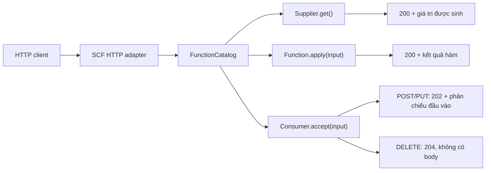

# HTTP method và phản hồi của Supplier, Function, Consumer trong Spring Cloud Function

## 1. Vì sao cùng một endpoint lại có phản hồi khác nhau?

Trong **Spring Cloud Function (SCF)**, logic nghiệp vụ được khai báo bằng các bean Java chuẩn:

- `Supplier<O>`: tạo dữ liệu mà không nhận tham số đầu vào.
- `Function<I, O>`: nhận dữ liệu và trả một kết quả.
- `Consumer<I>`: nhận dữ liệu để xử lý nhưng không trả kết quả nghiệp vụ.

Các bean được quản lý qua `FunctionCatalog`, có thể được gọi từ HTTP, Spring Cloud Stream hoặc adapter serverless. Khi thêm **SCF HTTP adapter**, mỗi kiểu hàm có những quy tắc riêng về **HTTP method**, **request body**, **response body** và **HTTP status**.

Ví dụ, cùng gửi body `"hello"` đến một hàm xử lý:

- `Function<String, String> uppercase` trả về `"HELLO"` với status thông thường `200 OK`.
- `Consumer<String> auditEvent` xử lý chuỗi đầu vào và thường trả `202 Accepted`; adapter có thể phản chiếu đầu vào trong response, nhưng Consumer không tự sinh kết quả nghiệp vụ.
- `Supplier<String> greeting` không đọc body; client thường gọi bằng `GET` và nhận `200 OK`.

Sự khác biệt này đến từ **hợp đồng Java của hàm và quy tắc HTTP adapter**, không phải do tên đường dẫn hay cách đặt tên class.

### Mục tiêu học tập

Sau bài này, người học có thể:

1. Đối chiếu chính xác method, path, request, response và status cho ba loại hàm theo mặc định.
2. Thực hành gọi `Supplier`, `Function`, `Consumer` bằng `curl` với văn bản và JSON.
3. Phân biệt `200 OK`, `202 Accepted` và `204 No Content`; tránh suy luận sai về trạng thái xử lý.
4. Hiểu tác động của `Content-Type`, `Accept`, header, `Message<?>` và dữ liệu nhiều phần tử.
5. Phân tích lỗi HTTP thường gặp và biết khi nào cần cơ chế REST/controller riêng.

## 2. Bảng ánh xạ HTTP mặc định của SCF

Bảng dưới dựa trên quy tắc *Standalone Web Applications* của Spring Cloud Function. Phần `/{function}`, `/{supplier}`, `/{consumer}` là **tên bean đã được SCF đăng ký trong FunctionCatalog**, không phải tên class Java. Giả định HTTP adapter được kích hoạt, đường dẫn mặc định là `/` và các request có media type phù hợp.

| HTTP method | Đường dẫn | Request | Response | Status thông thường |
| --- | --- | --- | --- | --- |
| `GET` | `/{supplier}` | Không cần body | Giá trị/đối tượng do Supplier sinh ra | **200 OK** |
| `POST` | `/{function}` | Text hoặc JSON trong body | Kết quả của `Function.apply(input)` | **200 OK** |
| `PUT` | `/{function}` | Text hoặc JSON trong body | Kết quả của `Function.apply(input)` | **200 OK** |
| `GET` | `/{function}/{item}` | Đầu vào ở segment `{item}` | Kết quả sau khi chuyển `item` thành input | **200 OK** |
| `POST` | `/{consumer}` | Text hoặc JSON trong body | Phản chiếu dữ liệu đầu vào, đồng thời đưa payload đến Consumer | **202 Accepted** |
| `PUT` | `/{consumer}` | Text hoặc JSON trong body | Phản chiếu dữ liệu đầu vào, đồng thời đưa payload đến Consumer | **202 Accepted** |
| `DELETE` | `/{consumer}` | Text hoặc JSON theo hợp đồng adapter | Không có response body | **204 No Content** |

Các status trên là **hành vi thông thường của adapter khi request hợp lệ và hàm xử lý thành công**. Chúng không bảo đảm mọi request đều trả status như vậy: lỗi giải mã JSON, sai URL, sai method, lỗi nghiệp vụ và cấu hình bảo mật có thể làm thay đổi phản hồi.

### Đọc bảng theo luồng dữ liệu



Chú ý: `Function` **có thể có tác dụng phụ**, còn `Supplier` **có thể sinh giá trị khác nhau mỗi lần gọi**. Tên interface không tự đảm bảo một nghiệp vụ an toàn, thuần hàm, idempotent hoặc không ghi dữ liệu.

## 3. Ví dụ Java để thực hành cả ba loại hàm

Chuẩn bị một ứng dụng Spring Boot với **Spring Cloud Function web starter** và một bộ Spring Boot/Spring Cloud BOM tương thích. Với dự án Spring MVC, dependency Maven thường là:

```xml
<dependency>
    <groupId>org.springframework.cloud</groupId>
    <artifactId>spring-cloud-starter-function-web</artifactId>
</dependency>
```

Không cần tự thêm version cho dependency nếu dự án đã import BOM Spring Cloud đúng dòng Spring Boot. Với ứng dụng WebFlux, sử dụng starter SCF WebFlux phù hợp với release train đang dùng; cần kiểm thử behavior trên runtime cụ thể. Các ví dụ dưới đây dựa trên SCF HTTP adapter thông thường của ứng dụng MVC.

Tạo file `src/main/java/demo/FunctionHttpMethodsApplication.java`. Ví dụ dùng Java 17+ để khai báo DTO bằng `record`:

```java
package demo;

import java.math.BigDecimal;
import java.util.Locale;
import java.util.function.Consumer;
import java.util.function.Function;
import java.util.function.Supplier;

import org.springframework.boot.SpringApplication;
import org.springframework.boot.autoconfigure.SpringBootApplication;
import org.springframework.context.annotation.Bean;

@SpringBootApplication
public class FunctionHttpMethodsApplication {

    public static void main(String[] args) {
        SpringApplication.run(FunctionHttpMethodsApplication.class, args);
    }

    // GET: tạo thông tin trạng thái đơn giản.
    @Bean
    public Supplier<ServiceStatus> serviceStatus() {
        return () -> new ServiceStatus("SPRING_CLOUD_FUNCTION", "READY");
    }

    // POST/PUT, hoặc GET /uppercase/{item}.
    @Bean
    public Function<String, String> uppercase() {
        return text -> text.toUpperCase(Locale.ROOT);
    }

    // POST/PUT: dữ liệu vào/ra theo JSON.
    @Bean
    public Function<QuoteRequest, QuoteResponse> quote() {
        return request -> {
            if (request == null || request.sku() == null
                    || request.sku().isBlank()
                    || request.quantity() <= 0) {
                throw new IllegalArgumentException("Invalid quote request");
            }

            BigDecimal unitPrice = new BigDecimal("120000");
            BigDecimal total = unitPrice.multiply(
                    BigDecimal.valueOf(request.quantity()));

            return new QuoteResponse(
                    request.sku(), request.quantity(), total);
        };
    }

    // POST/PUT/DELETE: có tác dụng phụ, không có giá trị trả về Java.
    @Bean
    public Consumer<AuditEvent> auditEvent() {
        return event -> System.out.printf(
                "Audit received: type=%s, reference=%s%n",
                event.type(), event.reference());
    }

    public record ServiceStatus(String service, String state) {}
    public record QuoteRequest(String sku, int quantity) {}
    public record QuoteResponse(
            String sku, int quantity, BigDecimal totalPrice) {}
    public record AuditEvent(String type, String reference) {}
}
```

Trong ví dụ:

- `serviceStatus` trả một object; JSON serialization do HTTP adapter và message converter/codec đảm nhiệm.
- `uppercase` chuyển chuỗi đầu vào thành chữ hoa, minh họa HTTP text.
- `quote` nhận JSON và trả JSON; giá cố định 120.000 chỉ phục vụ học tập.
- `auditEvent` chỉ ghi console; một ứng dụng thực tế có thể gọi service hay ghi event/database, cần tự thiết kế hợp đồng lỗi và bảo đảm xử lý.

Chạy dự án:

```bash
mvn spring-boot:run
```

Các lệnh `curl` tiếp theo dùng cú pháp Bash. Trên Windows PowerShell, nên gọi `curl.exe` và dùng cú pháp xuống dòng tương ứng.

## 4. Supplier: GET trả dữ liệu do hàm sinh

### 4.1. Hợp đồng Supplier

Bean `Supplier<ServiceStatus> serviceStatus` không nhận dữ liệu đầu vào từ HTTP. Với cấu hình mặc định, request tương ứng là:

```http
GET /serviceStatus HTTP/1.1
Host: localhost:8080
Accept: application/json
```

Gọi bằng `curl`:

```bash
curl -i 'http://localhost:8080/serviceStatus' \
  -H 'Accept: application/json'
```

Phản hồi điển hình:

```http
HTTP/1.1 200 OK
Content-Type: application/json

{"service":"SPRING_CLOUD_FUNCTION","state":"READY"}
```

`200 OK` nghĩa là HTTP request được xử lý thành công và giá trị Supplier sinh ra được đưa vào response. Một Supplier khác có thể trả chuỗi `String`, một đối tượng JSON hoặc một nguồn nhiều phần tử tùy loại dữ liệu mà function khai báo.

### 4.2. GET có chắc là không thay đổi trạng thái?

Theo ý nghĩa chung của HTTP, GET là phương thức đọc an toàn (*safe*) đối với trạng thái được quản lý bởi ứng dụng. Nhưng Java `Supplier.get()` **không tự thực thi quy tắc này**: lập trình viên vẫn có thể viết Supplier tăng bộ đếm, gọi API tốn phí hoặc thay đổi database.

Để giữ hợp đồng HTTP dễ dự đoán, nên dùng Supplier GET cho thao tác đọc/tạo dữ liệu có thể lặp lại mà không tạo tác dụng phụ ngoài mong đợi. Nếu GET thực hiện hành động có tác dụng phụ, cache, crawler hoặc hệ thống giám sát có thể kích hoạt logic ngoài dự kiến.

### 4.3. Khi nào gọi đường dẫn gốc?

Nếu chỉ có **một functional bean** trong catalog, có thể gọi Supplier tại `GET /` thay vì `GET /serviceStatus`. Nhưng ứng dụng ví dụ hiện có **bốn bean**; vì vậy phải dùng tên, trừ khi cấu hình một function mặc định bằng `spring.cloud.function.definition`. Quy tắc này đúng cho cả ba loại Supplier, Function và Consumer.

## 5. Function: POST và PUT trả kết quả của apply()

### 5.1. Function xử lý văn bản bằng POST

Request:

```bash
curl -i -X POST 'http://localhost:8080/uppercase' \
  -H 'Content-Type: text/plain' \
  -H 'Accept: text/plain' \
  --data 'spring cloud function'
```

Phản hồi điển hình:

```http
HTTP/1.1 200 OK
Content-Type: text/plain

SPRING CLOUD FUNCTION
```

HTTP adapter chuyển request body thành `String`, gọi `uppercase.apply(...)` và đưa kết quả vào response body. Nếu client gửi `PUT` với cùng body:

```bash
curl -i -X PUT 'http://localhost:8080/uppercase' \
  -H 'Content-Type: text/plain' \
  -H 'Accept: text/plain' \
  --data 'hello'
```

Theo mapping mặc định, kết quả nghiệp vụ là `HELLO` và status thông thường vẫn là **200 OK**.

### 5.2. Function nhận JSON và trả JSON

Ví dụ bean `quote` nhận `QuoteRequest`, trả `QuoteResponse`:

```bash
curl -i -X POST 'http://localhost:8080/quote' \
  -H 'Content-Type: application/json' \
  -H 'Accept: application/json' \
  --data '{"sku":"BOOK-001","quantity":2}'
```

Phản hồi điển hình:

```http
HTTP/1.1 200 OK
Content-Type: application/json

{"sku":"BOOK-001","quantity":2,"totalPrice":240000}
```

Điều kiện quan trọng là kiểu generic của `Function<I, O>` đủ cụ thể để converter biết chuyển body JSON thành kiểu `QuoteRequest`, và môi trường có JSON codec phù hợp.

### 5.3. Function còn có dạng GET với input trong path

SCF hỗ trợ pattern:

```text
GET /{function}/{item}
```

Ví dụ:

```bash
curl -i 'http://localhost:8080/uppercase/hello'
# Status: 200 OK
# Body: HELLO
```

Trong request này, `uppercase` là tên function, còn `hello` là **dữ liệu đầu vào lấy từ path**. Nếu input chứa dấu cách, dấu gạch chéo hoặc ký tự đặc biệt, phải URL-encode đúng cách. Cách gọi GET phù hợp với đầu vào đơn giản; với DTO phức tạp, cách truyền JSON trong body của POST/PUT dễ kiểm soát hơn.

**Không suy luận rằng `GET /uppercase` (không có `/{item}`) tương đương `POST /uppercase`.** SCF phân biệt method và hình dạng đường dẫn; việc một function có tên đúng chưa đủ để đáp ứng mọi method.

### 5.4. PUT và tính idempotent

Theo ngữ nghĩa HTTP, PUT được kỳ vọng **idempotent**: thực hiện nhiều lần với cùng request phải có hiệu ứng mong muốn tương đương thực hiện một lần. Tuy nhiên, adapter SCF có thể gọi cùng một `Function.apply()` qua POST hoặc PUT; **nó không kiểm chứng tính idempotent của code**.

Nếu Function thực hiện trừ tiền, phát hành hóa đơn hoặc gửi email khi được gọi qua PUT, nghiệp vụ có thể lặp tác dụng phụ. Khi thiết kế API thực, hãy quy định rõ phương thức phù hợp, xử lý retry và idempotency key nếu cần, thay vì coi chỉ riêng HTTP method đảm bảo hành vi.

## 6. Consumer: POST/PUT trả 202, DELETE trả 204

### 6.1. Consumer không có kết quả trả về trong Java

Bean mẫu:

```java
@Bean
public Consumer<AuditEvent> auditEvent() {
    return event -> System.out.println(event.reference());
}
```

Chữ ký `void accept(AuditEvent event)` không cung cấp đối tượng kết quả. Nhưng SCF HTTP adapter vẫn phải tạo một HTTP response để client biết request đã đi đến endpoint.

### 6.2. POST/PUT: 202 Accepted và phản chiếu dữ liệu đầu vào

Gửi sự kiện mẫu:

```bash
curl -i -X POST 'http://localhost:8080/auditEvent' \
  -H 'Content-Type: application/json' \
  -H 'Accept: application/json' \
  --data '{"type":"ORDER_CREATED","reference":"ORD-100"}'
```

Theo hợp đồng HTTP mặc định được mô tả trong tài liệu SCF, adapter chuyển dữ liệu vào Consumer, đồng thời **phản chiếu input vào response** và trả **202 Accepted**. Với JSON ví dụ, phản hồi có thể trông như:

```http
HTTP/1.1 202 Accepted
Content-Type: application/json

{"type":"ORDER_CREATED","reference":"ORD-100"}
```

Cách biểu diễn chính xác của header, khoảng trắng và JSON có thể phụ thuộc phiên bản, converter và cấu hình. Đừng viết client dựa vào việc body phải giống hệt từng byte của request. Điểm chính là **Consumer không tạo ra giá trị nghiệp vụ mới**; phần phản chiếu input là hành vi của adapter.

Đối với `PUT /auditEvent`, hành vi theo mapping mặc định cũng tương tự: input được đưa vào Consumer và phản hồi thông thường là `202 Accepted`.

### 6.3. 202 Accepted không đồng nghĩa với “đã lưu xong”

HTTP status **202 Accepted** thường biểu thị yêu cầu được chấp nhận để xử lý. Nhưng trong SCF, status này được dùng theo mapping mặc định cho Consumer, **không tự chứng minh ứng dụng có hàng đợi, xử lý bất đồng bộ hay lưu bền vững**.

Cần phân biệt:

| Sự kiện | Có thể kết luận từ `202` không? |
| --- | --- |
| HTTP adapter đã trả status chấp nhận request | **Có** |
| Consumer đã được adapter gọi theo đường xử lý thành công | **Thông thường có**, nếu không phát sinh lỗi |
| Đã commit transaction xuống database | **Không**, trừ khi thiết kế nghiệp vụ bảo đảm |
| Event đã được broker xác nhận và lưu bền vững | **Không** |
| Tác vụ chạy hoàn toàn bất đồng bộ | **Không** |
| Xử lý “exactly once”, không lặp lại khi retry | **Không** |

Trong ví dụ, `auditEvent` ghi console. Status `202` không thay console log thành một audit trail đáng tin cậy. Nếu cần bảo đảm giao dịch, retry, outbox hoặc acknowledgment từ broker, phải thiết kế và kiểm thử riêng.

### 6.4. DELETE: 204 No Content

SCF cũng ánh xạ DELETE cho Consumer:

```bash
curl -i -X DELETE 'http://localhost:8080/auditEvent' \
  -H 'Content-Type: application/json' \
  --data '{"type":"ORDER_REMOVED","reference":"ORD-100"}'
```

Phản hồi thông thường:

```http
HTTP/1.1 204 No Content
```

`204 No Content` nghĩa là **response không chứa body**. Đừng cố parse JSON từ response DELETE 204. HTTP adapter chuyển input vào Consumer theo mapping của nó, nhưng tên phương thức DELETE **không tự biến code Consumer thành thao tác xóa tài nguyên**. Trong ví dụ, Consumer vẫn chỉ ghi console.

Lưu ý khi dùng DELETE có request body: một số client, proxy, middleware hoặc API gateway có chính sách riêng về body của DELETE. Nếu xây dựng API xóa tài nguyên theo id, controller/router với path `/resources/{id}` và hợp đồng rõ ràng thường dễ tương thích hơn.

## 7. Vì sao Content-Type và Accept quan trọng?

SCF HTTP adapter hỗ trợ truyền **văn bản thuần** và **JSON**, đồng thời dựa vào kiểu đầu vào/đầu ra của function để chuyển đổi payload.

| Header | Vai trò | Ví dụ |
| --- | --- | --- |
| `Content-Type` | Mô tả **định dạng request body** mà client gửi lên | `text/plain`, `application/json` |
| `Accept` | Cho biết **định dạng response** client muốn nhận | `text/plain`, `application/json` |
| `Content-Length` | Kích thước body truyền qua HTTP | Do HTTP client/runtime xử lý |
| Các custom headers | Metadata kèm request | `X-Correlation-ID`, `X-Tenant-ID` (nếu ứng dụng tự định nghĩa) |

Ví dụ đúng cho `Function<String, String> uppercase`:

```bash
curl -i -X POST 'http://localhost:8080/uppercase' \
  -H 'Content-Type: text/plain' \
  -H 'Accept: text/plain' \
  --data 'hello'
```

Ví dụ đúng cho `Function<QuoteRequest, QuoteResponse> quote`:

```bash
curl -i -X POST 'http://localhost:8080/quote' \
  -H 'Content-Type: application/json' \
  -H 'Accept: application/json' \
  --data '{"sku":"BOOK-001","quantity":2}'
```

**Sai Content-Type** có thể gây lỗi `415 Unsupported Media Type`, giải mã dữ liệu sai hoặc lỗi conversion. **Không thể tạo response theo Accept** có thể gây `406 Not Acceptable`, tùy HTTP runtime và cấu hình codec. Những status lỗi này do tầng web/converter quyết định, không phải nhánh thành công trong bảng HTTP của SCF.

### 7.1. Message giúp truy cập header

Nếu function khai báo input là `org.springframework.messaging.Message<T>`, adapter có thể đưa HTTP headers vào `MessageHeaders`. Ví dụ:

```java
@Bean
public Function<org.springframework.messaging.Message<String>, String>
        describeInput() {
    return message ->
            "payloadLength=" + message.getPayload().length();
}
```

Với kiểu `Message<?>` là kết quả đầu ra, các header trong message có thể được chuyển thành HTTP response headers. HTTP query parameters được adapter lưu trong message header có key `http_request_param`, dưới dạng map; chúng không tự trở thành tham số Java riêng của `Function.apply()`.

Theo tài liệu SCF, **phần lớn request headers được sao chép sang response headers theo mặc định**. Nếu muốn loại trừ một số header, có thể cấu hình:

```properties
spring.cloud.function.http.ignored-headers=X-Internal-Token,X-Tenant-Secret
```

Cấu hình này là bộ lọc header của SCF, không thay thế chính sách loại trừ thông tin nhạy cảm ở reverse proxy, security middleware hoặc code xử lý. Đối với header do client cung cấp, luôn kiểm tra độ tin cậy trước khi dùng để quyết định quyền truy cập hoặc tenant.

### 7.2. Dữ liệu nhiều phần tử và streaming

Các ví dụ trước sử dụng dữ liệu đơn giá trị. Nếu một function trả collection hoặc kiểu reactive như `Flux<T>`, HTTP adapter có thể trả nhiều phần tử; client có thể yêu cầu server-sent events bằng:

```http
Accept: text/event-stream
```

Lúc này response không nhất thiết là một JSON object hoàn chỉnh như ví dụ `quote`. Streaming, backpressure và hủy kết nối phải được kiểm thử trên HTTP runtime cùng phiên bản SCF thực tế. Việc bean dùng `Flux` không tự chứng minh tất cả dependency bên trong đã non-blocking.

## 8. Cách HTTP adapter tìm đúng hàm

HTTP method hoạt động **cùng** quy tắc chọn function từ `FunctionCatalog`:

1. Nếu catalog chỉ có một functional bean, tên trong URL có thể được bỏ qua; ví dụ `POST /` gọi Function duy nhất.
2. Nếu có nhiều bean, route mặc định theo tên: `/serviceStatus`, `/quote`, `/auditEvent`.
3. Có thể chọn một hàm hoặc composition làm mặc định qua `spring.cloud.function.definition`.
4. Khi `definition` liệt kê nhiều hàm/composition bằng dấu `;`, adapter áp dụng lọc: chỉ các mục được liệt kê được xuất, và không tự ánh xạ root.
5. Có thể đổi prefix bằng `spring.cloud.function.web.path`; method và ý nghĩa response của từng kiểu không thay đổi vì prefix.

Ví dụ cho cùng ứng dụng ở mục 3:

```properties
spring.cloud.function.web.path=/api/functions
```

Khi đó bảng URL trở thành:

| Method | URL | Bean | Status thành công thông thường |
| --- | --- | --- | --- |
| GET | `/api/functions/serviceStatus` | Supplier | 200 |
| POST | `/api/functions/quote` | Function | 200 |
| PUT | `/api/functions/uppercase` | Function | 200 |
| POST | `/api/functions/auditEvent` | Consumer | 202 |
| DELETE | `/api/functions/auditEvent` | Consumer | 204 |

Đây chỉ là **đổi path**. Không có sự chuyển đổi từ Supplier sang Consumer hoặc từ `202` sang `200` vì thêm tiền tố URL.

### Tùy chỉnh method mapping

SCF cho phép chỉ định tên hàm/composition cho HTTP method bằng property có dạng:

```properties
spring.cloud.function.http.GET=serviceStatus
spring.cloud.function.http.POST=quote;auditEvent
spring.cloud.function.http.PUT=quote
spring.cloud.function.http.DELETE=auditEvent
```

Trong ví dụ, dấu `;` phân tách các tên hàm được ánh xạ cho cùng method; dấu `|` có thể dùng để biểu diễn composition. Đây là **cấu hình lựa chọn các hàm theo HTTP method**, không tự thực thi tính an toàn của GET, idempotency của PUT hay ngữ nghĩa xóa tài nguyên của DELETE. Khi sử dụng property này, cần kiểm thử method nào thực sự được công bố trên phiên bản SCF đang chạy.

## 9. Cách đọc status code cho đúng

| Status | Ý nghĩa HTTP thông thường | Trong ví dụ SCF | Điều không được tự suy ra |
| --- | --- | --- | --- |
| **200 OK** | Request được xử lý thành công | Supplier trả dữ liệu; Function trả kết quả | Không chứng minh tính thuần hàm, idempotent hay dữ liệu đã được lưu bền vững |
| **202 Accepted** | Request được chấp nhận để xử lý | Consumer nhận input qua POST/PUT; adapter thường phản chiếu input | Không đảm bảo có queue, chạy bất đồng bộ hoặc commit transaction |
| **204 No Content** | Xử lý thành công, response không có body | Consumer nhận DELETE theo mapping | Không tự chứng minh một record đã bị xóa |
| **400 Bad Request** | Request không hợp lệ | Có thể xuất hiện khi đầu vào sai/không parse được | Không mặc định mọi exception nghiệp vụ biến thành 400 |
| **404 Not Found** | Không tìm thấy URL/route phù hợp | Tên function sai, sai prefix, bean không được xuất | Không đảm bảo path lạ luôn 404 nếu cấu hình fallback function |
| **405 Method Not Allowed** | Route tồn tại nhưng method không hợp lệ | Gọi GET/POST/PUT/DELETE ngoài mapping được hỗ trợ | Không đồng nghĩa bean đã xử lý request |
| **406/415** | Không đáp ứng được media type mong muốn/được gửi | Sai `Accept` hoặc `Content-Type` | Không nhất thiết là lỗi nghiệp vụ của function |
| **500 Internal Server Error** | Lỗi xử lý phía server | Function/Consumer ném lỗi chưa có HTTP error mapping phù hợp | Không nên trả nguyên stack trace hoặc dữ liệu nội bộ cho client |

Đặc biệt, nếu hàm `quote` ném `IllegalArgumentException` khi `quantity <= 0`, adapter **không bảo đảm tự biến lỗi nghiệp vụ thành `400 Bad Request`**. Nếu hợp đồng API yêu cầu status và error body chính xác, nên xây dựng lớp xử lý lỗi tại HTTP boundary (Spring MVC/WebFlux exception handling hoặc controller/router) thay vì chỉ ném exception từ Function.

## 10. Kiểm thử đầy đủ các method bằng curl

Khi chạy ứng dụng mục 3 với đường dẫn mặc định, có thể kiểm tra các nhánh cơ bản:

```bash
# 1. Supplier GET -> 200, body JSON.
curl -i -H 'Accept: application/json' \
  'http://localhost:8080/serviceStatus'

# 2. Function POST text -> 200, body HELLO.
curl -i -X POST 'http://localhost:8080/uppercase' \
  -H 'Content-Type: text/plain' \
  -H 'Accept: text/plain' --data 'hello'

# 3. Function PUT text -> 200, body HELLO.
curl -i -X PUT 'http://localhost:8080/uppercase' \
  -H 'Content-Type: text/plain' \
  -H 'Accept: text/plain' --data 'hello'

# 4. Function GET/{item} -> 200, body HELLO.
curl -i 'http://localhost:8080/uppercase/hello'

# 5. Function POST JSON -> 200, body QuoteResponse.
curl -i -X POST 'http://localhost:8080/quote' \
  -H 'Content-Type: application/json' \
  -H 'Accept: application/json' \
  --data '{"sku":"BOOK-001","quantity":2}'

# 6. Consumer POST -> 202, có thể thấy input phản chiếu.
curl -i -X POST 'http://localhost:8080/auditEvent' \
  -H 'Content-Type: application/json' \
  --data '{"type":"ORDER_CREATED","reference":"ORD-100"}'

# 7. Consumer PUT -> 202, input được đưa đến Consumer.
curl -i -X PUT 'http://localhost:8080/auditEvent' \
  -H 'Content-Type: application/json' \
  --data '{"type":"ORDER_CHANGED","reference":"ORD-100"}'

# 8. Consumer DELETE -> 204, không có response body.
curl -i -X DELETE 'http://localhost:8080/auditEvent' \
  -H 'Content-Type: application/json' \
  --data '{"type":"ORDER_REMOVED","reference":"ORD-100"}'
```

Ngoài status, cần xác minh **nội dung body, loại media, headers và tác dụng phụ thực tế**. Với Consumer ở ví dụ này, quan sát console để thấy dữ liệu đã được đưa vào bean. Không thể kiểm chứng độ bền vững của sự kiện chỉ bằng việc nhận status 202.

### Bảng tự kiểm

| Request | Kỳ vọng chính | Kiểm tra bổ sung |
| --- | --- | --- |
| `GET /serviceStatus` | 200 + JSON trạng thái | Kiểu dữ liệu, Content-Type |
| `POST /uppercase` | 200 + chữ hoa | Dữ liệu được chuyển đổi đúng |
| `PUT /uppercase` | 200 + chữ hoa | Kết quả nhất quán với POST |
| `GET /uppercase/hello` | 200 + chữ hoa | Path item được giải mã |
| `POST /quote` | 200 + DTO kết quả | Giá trị `totalPrice` chính xác |
| `POST /auditEvent` | 202 + input phản chiếu | Side effect trong console |
| `DELETE /auditEvent` | 204 + body rỗng | Side effect theo logic Consumer |
| Sai Content-Type hoặc JSON malformed | Lỗi 4xx/5xx theo runtime | Không ghi lệnh sai vào hệ thống thật |

## 11. Các lỗi thiết kế thường gặp

### 11.1. Dùng Consumer nhưng mong đợi DTO kết quả

Nếu client cần nhận `{"orderId":"...","status":"CREATED"}` ngay sau xử lý, mô hình `Consumer<OrderRequest>` là không đủ vì `accept()` trả `void`. Hãy cân nhắc `Function<OrderRequest, OrderResponse>` hoặc controller/API thích hợp để tạo phản hồi nghiệp vụ.

### 11.2. Coi 202 là xử lý nền

Một Consumer đơn giản có thể chạy đồng bộ trong request. Nếu cần ack sớm và xử lý sau, phải thiết kế queue/worker, trạng thái công việc, cơ chế kiểm tra kết quả và retry. Status 202 của adapter không tự tạo tất cả thành phần đó.

### 11.3. Cho rằng PUT tự chống trùng request

SCF chỉ gọi code trong `Function` hoặc `Consumer`. Đối với tác dụng phụ như thanh toán, cần tự bảo đảm tính idempotent bằng thiết kế nghiệp vụ, khóa định danh request hay ràng buộc dữ liệu thích hợp.

### 11.4. Xử lý DELETE như REST CRUD hoàn chỉnh

Việc SCF hỗ trợ `DELETE /{consumer}` không phải là một REST controller theo tài nguyên. Một Consumer tên `auditEvent` không đương nhiên biết tài nguyên nào bị xóa. Khi cần thao tác `DELETE /orders/{id}` đúng nghĩa, thường phải thiết kế route, validation, phân quyền và response code rõ ràng ở web layer.

### 11.5. Lạm dụng HTTP adapter cho API công khai phức tạp

SCF web adapter hữu ích khi cần công bố nhanh logic độc lập giao thức qua HTTP. Tuy vậy, một API production có phân trang, OAuth/security, versioning, upload, error contract và nhiều response code chuyên biệt thường cần thêm khả năng của Spring MVC hoặc WebFlux. Nghiệp vụ vẫn có thể nằm trong functional bean để tái sử dụng từ HTTP, sự kiện và serverless.

## 12. Bài tập thực hành

1. Cho `Supplier<String> greeting` trả `"Hello"`. Viết method, URL, HTTP status và response body dự kiến khi ứng dụng có nhiều functional bean.
2. `Function<String, String> uppercase` nhận `"scf"`. So sánh các request `POST /uppercase`, `PUT /uppercase` và `GET /uppercase/scf`.
3. Vì sao `POST /auditEvent` có thể trả 202 cùng payload đầu vào dù Java `Consumer.accept()` trả `void`?
4. Nếu `DELETE /auditEvent` trả 204, client có nên cố parse response thành JSON không? Có thể khẳng định đã xóa một record hay chưa?
5. Với `Function<QuoteRequest, QuoteResponse>`, hãy viết request JSON hợp lệ và giải thích vai trò của hai header `Content-Type` và `Accept`.
6. Khi `quantity = -1` làm Function ném `IllegalArgumentException`, vì sao không nên mặc định nhận 400? Thiết kế nào giúp API trả lỗi ổn định?
7. Nếu muốn chỉ định `quote` nhận POST và `auditEvent` nhận DELETE, hãy viết các property `spring.cloud.function.http.*` tương ứng và đề xuất các test cần chạy.
8. Phân tích sự khác nhau giữa: “Consumer trả 202”, “event đã lưu vào message broker”, “worker đã xử lý xong”, “không có request nào bị xử lý hai lần”.
9. Thử cấu hình `spring.cloud.function.web.path=/api/functions`. Viết lại URL cho `serviceStatus`, `quote` và `auditEvent` và kiểm tra status vẫn đúng theo loại bean.

## Tài liệu tham khảo

- [Spring Cloud Function Reference — Standalone Web Applications](https://docs.spring.io/spring-cloud-function/reference/spring-cloud-function/standalone-web-applications.html): bảng method/path/request/response/status, chuyển đổi content type, streaming, message headers, function mapping và HTTP method routing.
- [Spring Cloud Function Reference — Programming Model](https://docs.spring.io/spring-cloud-function/reference/spring-cloud-function/programming-model.html): `Supplier`, `Function`, `Consumer`, `FunctionCatalog` và composition.
- [Spring Cloud Function Reference — Functional Bean Definitions](https://docs.spring.io/spring-cloud-function/reference/functional.html): cách khai báo functional bean và tổ chức logic độc lập transport.
- [HTTP Semantics — RFC 9110](https://www.rfc-editor.org/rfc/rfc9110.html): ý nghĩa của GET/POST/PUT/DELETE và status 200, 202, 204.

> **Ghi nhớ:** `Supplier → GET → 200`, `Function → POST/PUT (hoặc GET với item) → 200`, `Consumer → POST/PUT → 202 hoặc DELETE → 204`. Đó là **hợp đồng HTTP mặc định của SCF web adapter** khi xử lý thành công; trạng thái nghiệp vụ, bảo đảm giao dịch và lỗi cụ thể vẫn phải do ứng dụng thiết kế, kiểm thử.
