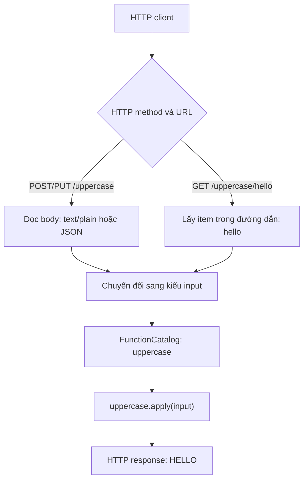
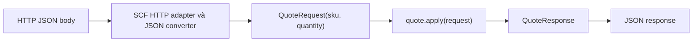

# Truyền đầu vào qua request body và biến đường dẫn trong Spring Cloud Function

## 1. Bài toán và mục tiêu

Trong **Spring Cloud Function (SCF)**, logic nghiệp vụ có thể được viết một lần dưới dạng `Supplier<T>`, `Function<I, O>` hoặc `Consumer<I>` và đăng ký vào `FunctionCatalog`. Adapter HTTP, hệ thống sự kiện hoặc môi trường serverless tra cứu cùng một hàm nhưng chuyển dữ liệu đầu vào từ các nguồn khác nhau. Nhờ vậy, function không cần phụ thuộc trực tiếp vào `HttpServletRequest` hoặc chú thích `@RequestBody` của Spring MVC.

Với HTTP, có hai cách đưa **giá trị nghiệp vụ chính** vào function:

1. **Request body:** gửi văn bản hoặc JSON bằng `POST /{function}` hoặc `PUT /{function}`. Adapter đọc body, chuyển thành kiểu tham số của function rồi gọi `apply(...)` hoặc `accept(...)`.
2. **Biến đường dẫn:** đưa một giá trị vào URL `GET /{function}/{item}`. Adapter lấy `item`, chuyển đổi sang kiểu đầu vào rồi gọi function.

Ngoài ra, **query parameters** như `?lang=vi` là metadata của request: SCF có thể đặt chúng trong message header `http_request_param` khi function sử dụng `Message<?>`. Cần phân biệt query parameters với chính biến đường dẫn `{item}`.

Ví dụ với bean `Function<String, String> uppercase`, hai lệnh sau cho cùng kết quả nghiệp vụ khi cấu hình mặc định:

```bash
# Dữ liệu "hello" nằm trong HTTP request body:
curl -i -X POST http://localhost:8080/uppercase \
  -H 'Content-Type: text/plain' \
  -H 'Accept: text/plain' \
  --data 'hello'

# Dữ liệu "hello" nằm trong segment cuối của đường dẫn:
curl -i 'http://localhost:8080/uppercase/hello'
```

Cả hai đều có thể nhận body `HELLO` và status thông thường `200 OK`. Điểm khác biệt nằm ở **cách truyền, cách mã hóa và giới hạn của dữ liệu đầu vào**.

### Mục tiêu học tập

Sau bài này, bạn có thể:

- Đọc quy tắc HTTP method và xác định nơi SCF lấy dữ liệu đầu vào.
- Thực hành truyền `String` qua `text/plain`, DTO qua `application/json` và giá trị đơn qua URL.
- Phân biệt tham số đường dẫn, query parameter và HTTP header khi xây dựng functional bean.
- Sử dụng `Message<T>` khi hàm thật sự cần metadata HTTP nhưng vẫn giữ phần nghiệp vụ có thể tái sử dụng.
- Chẩn đoán lỗi do URI encoding, content negotiation, chuyển đổi DTO hoặc chọn nhầm endpoint.

## 2. Quy tắc nhận đầu vào của HTTP adapter

Theo *Standalone Web Applications* của SCF, HTTP adapter công bố các function với quy tắc mặc định sau:

| Loại bean | HTTP method | Đường dẫn mặc định | Nguồn dữ liệu đầu vào | Phản hồi thông thường |
| --- | --- | --- | --- | --- |
| `Supplier<O>` | `GET` | `/{supplier}` | Không cần body | `200 OK`, dữ liệu do `get()` tạo |
| `Function<I, O>` | `POST` | `/{function}` | Request body | `200 OK`, kết quả `apply()` |
| `Function<I, O>` | `PUT` | `/{function}` | Request body | `200 OK`, kết quả `apply()` |
| `Function<I, O>` | `GET` | `/{function}/{item}` | Một giá trị trong path | `200 OK`, kết quả `apply()` |
| `Consumer<I>` | `POST` / `PUT` | `/{consumer}` | Request body | `202 Accepted`, adapter phản chiếu đầu vào |
| `Consumer<I>` | `DELETE` | `/{consumer}` | Dữ liệu theo hợp đồng adapter | `204 No Content` |

Các status trên giả định request đã đi tới endpoint và xử lý thành công; lỗi đường dẫn, method, codec hoặc nghiệp vụ có thể tạo phản hồi khác. Chữ `{function}` là **tên bean đã đăng ký trong FunctionCatalog**. Nó khác với `{item}`, là **giá trị đầu vào** của một lần gọi GET.



**Không suy ra:** `GET /uppercase` không mặc nhiên tương đương `POST /uppercase`, và `GET /uppercase/hello` không có nghĩa là hàm nhận hai tham số Java riêng biệt. Function vẫn có đúng một đối số `I` trong `apply(I input)`.

## 3. Chuẩn bị một ứng dụng thực hành

Ví dụ sử dụng Spring Boot với Spring MVC và SCF HTTP starter. Trong dự án Maven đã quản lý phiên bản Spring Boot và Spring Cloud bằng **BOM tương thích**, thêm:

```xml
<dependency>
    <groupId>org.springframework.cloud</groupId>
    <artifactId>spring-cloud-starter-function-web</artifactId>
</dependency>
```

Khi dự án dùng WebFlux, chọn starter SCF WebFlux tương ứng với release train đang chạy; các ví dụ sau tập trung vào hợp đồng HTTP adapter. **Không** gắn tùy ý một phiên bản SCF khác dòng BOM đang dùng.

Tạo `src/main/java/demo/FunctionInputApplication.java` (Java 17+ để sử dụng `record`):

```java
package demo;

import java.math.BigDecimal;
import java.util.Locale;
import java.util.function.Consumer;
import java.util.function.Function;
import java.util.function.Supplier;

import org.springframework.boot.SpringApplication;
import org.springframework.boot.autoconfigure.SpringBootApplication;
import org.springframework.context.annotation.Bean;
import org.springframework.messaging.Message;

@SpringBootApplication
public class FunctionInputApplication {

    public static void main(String[] args) {
        SpringApplication.run(FunctionInputApplication.class, args);
    }

    // Xử lý văn bản: dùng được với POST body và GET /uppercase/{item}.
    @Bean
    public Function<String, String> uppercase() {
        return text -> text.toUpperCase(Locale.ROOT);
    }

    // DTO minh họa: phù hợp để nhận JSON trong body.
    @Bean
    public Function<QuoteRequest, QuoteResponse> quote() {
        return request -> {
            if (request == null
                    || request.sku() == null
                    || request.sku().isBlank()
                    || request.quantity() <= 0) {
                throw new IllegalArgumentException("Invalid quote request");
            }

            BigDecimal unitPrice = new BigDecimal("120000");
            BigDecimal total = unitPrice.multiply(
                    BigDecimal.valueOf(request.quantity()));
            return new QuoteResponse(
                    request.sku(), request.quantity(), total);
        };
    }

    // Đọc payload và metadata request qua Spring Messaging.
    @Bean
    public Function<Message<String>, String> inspect() {
        return message -> {
            String payload = message.getPayload();
            boolean hasQueryParams =
                    message.getHeaders().containsKey("http_request_param");
            return "input=" + payload
                    + "; hasQueryParams=" + hasQueryParams;
        };
    }

    @Bean
    public Consumer<String> audit() {
        return payload -> System.out.println(
                    "Received input length=" + payload.length());
    }

    @Bean
    public Supplier<String> greeting() {
        return () -> "Hello from Spring Cloud Function";
    }

    public record QuoteRequest(String sku, int quantity) {}

    public record QuoteResponse(
            String sku, int quantity, BigDecimal totalPrice) {}
}
```

Giá 120.000 ở bean `quote` là giá minh họa cố định. Khi làm ứng dụng thật, cần tra cứu giá và kiểm tra dữ liệu theo quy tắc nghiệp vụ. Hàm `inspect` dùng `Message<String>` để học metadata; logic xử lý báo giá trong `quote` vẫn không phụ thuộc HTTP.

Khởi động ứng dụng:

```bash
mvn spring-boot:run
```

Các ví dụ `curl` sử dụng cách xuống dòng của Bash. Nếu chạy trên Windows PowerShell, dùng `curl.exe` và chỉnh cách xuống dòng cho phù hợp. Các ví dụ giả định ứng dụng lắng nghe tại `http://localhost:8080` và chưa cấu hình tiền tố URL khác.

## 4. Truyền chuỗi bằng request body

### 4.1. Gửi `text/plain` đến Function

Request:

```bash
curl -i -X POST 'http://localhost:8080/uppercase' \
  -H 'Content-Type: text/plain' \
  -H 'Accept: text/plain' \
  --data 'spring cloud function'
```

Body do HTTP client gửi là:

```text
spring cloud function
```

SCF nhận chuỗi, gọi `uppercase.apply("spring cloud function")` rồi ghi kết quả:

```http
HTTP/1.1 200 OK
Content-Type: text/plain

SPRING CLOUD FUNCTION
```

Các header thực tế (như `Content-Length`, encoding) có thể khác nhau theo runtime. Với `Function<String, String>`, `text/plain` là lựa chọn dễ hiểu: body là chuỗi văn bản, không phải chuỗi JSON có dấu nháy kép.

### 4.2. Sử dụng PUT với body

Theo mapping mặc định, `Function` cũng có thể nhận `PUT`:

```bash
curl -i -X PUT 'http://localhost:8080/uppercase' \
  -H 'Content-Type: text/plain' \
  -H 'Accept: text/plain' \
  --data 'hello'
```

Response body vẫn là `HELLO`. Tuy nhiên, việc SCF cho phép POST và PUT gọi cùng một function **không bảo đảm code tự idempotent**. Nếu function có side effect như trừ tiền hoặc gửi thư, retry có thể làm việc đó lặp lại; ứng dụng phải thiết kế hành vi theo HTTP contract của mình.

### 4.3. Giữ nguyên các ký tự xuống dòng

Nếu muốn truyền nội dung nhiều dòng, nên kiểm tra khả năng giữ nguyên byte của HTTP client. Ví dụ:

```bash
printf 'first line\nsecond line\n' |
  curl -i -X POST 'http://localhost:8080/uppercase' \
    -H 'Content-Type: text/plain; charset=UTF-8' \
    -H 'Accept: text/plain' \
    --data-binary @-
```

`--data-binary @-` đọc dữ liệu từ stdin và giữ dữ liệu thô theo cách gửi của curl; `--data` có những quy tắc xử lý riêng với dữ liệu lấy từ file. Với dữ liệu cần bảo toàn từng byte, phải quy định charset, độ dài và kiểm thử đầu vào/đầu ra.

## 5. Truyền DTO JSON bằng request body

Đối với dữ liệu có nhiều trường, một JSON object trong body thường phù hợp hơn việc nối các giá trị lên URL. Bean `quote` nhận một đối tượng `QuoteRequest(String sku, int quantity)`.

```bash
curl -i -X POST 'http://localhost:8080/quote' \
  -H 'Content-Type: application/json' \
  -H 'Accept: application/json' \
  --data '{"sku":"BOOK-001","quantity":2}'
```

Đường đi của dữ liệu:



Phản hồi nghiệp vụ dự kiến:

```json
{
  "sku": "BOOK-001",
  "quantity": 2,
  "totalPrice": 240000
}
```

Tầng HTTP dùng `Content-Type: application/json` để biết cách đọc body và dựa vào kiểu generic `Function<QuoteRequest, QuoteResponse>` để chuyển dữ liệu. Header `Accept: application/json` báo cho server biết client muốn JSON ở response.

**Không cần `@RequestBody` trên tham số `apply()`** vì đó là Java function, không phải phương thức controller. Đổi sang HTTP controller riêng mới cần sử dụng quy tắc của MVC/WebFlux như `@RequestBody`, `@PathVariable` và binding/validation ở cấp web.

### 5.1. Body sai định dạng hoặc sai kiểu

Xét ba request:

```bash
# A. JSON hợp lệ về cú pháp nhưng quantity không hợp lệ về nghiệp vụ:
curl -i -X POST 'http://localhost:8080/quote' \
  -H 'Content-Type: application/json' \
  --data '{"sku":"BOOK-001","quantity":0}'

# B. JSON sai cú pháp:
curl -i -X POST 'http://localhost:8080/quote' \
  -H 'Content-Type: application/json' \
  --data '{"sku":"BOOK-001","quantity":'

# C. Body JSON nhưng khai báo text/plain:
curl -i -X POST 'http://localhost:8080/quote' \
  -H 'Content-Type: text/plain' \
  --data '{"sku":"BOOK-001","quantity":2}'
```

Đây là ba loại vấn đề khác nhau. Trường hợp A có thể tạo `IllegalArgumentException` trong logic nghiệp vụ; trường hợp B có lỗi parse JSON; trường hợp C có thể khiến converter không chọn được phép chuyển đổi phù hợp. **Không mặc định tất cả đều trả 400**: status cuối cùng phụ thuộc HTTP adapter, codec và cơ chế xử lý ngoại lệ trong ứng dụng. Khi API yêu cầu error contract cụ thể, cần bổ sung HTTP exception handling hoặc controller/router.

### 5.2. Đầu vào là mảng hay danh sách

Một request có body JSON array khác với JSON object:

```json
[
  {"sku":"BOOK-001","quantity":2},
  {"sku":"BOOK-002","quantity":3}
]
```

Không nên giả định `Function<QuoteRequest, QuoteResponse>` tự xử lý một mảng thành một phần tử `QuoteRequest`. SCF có quy tắc riêng cho dữ liệu nhiều phần tử và reactive/collection types; nếu cần batch, hãy quyết định rõ hợp đồng `Function<List<QuoteRequest>, List<QuoteResponse>>` hoặc dạng phù hợp khác, rồi kiểm thử converter và giới hạn kích thước request.

## 6. Truyền một giá trị bằng biến đường dẫn

SCF hỗ trợ `GET /{function}/{item}`, trong đó:

- `{function}`: tên của bean được đăng ký trong catalog.
- `{item}`: **một giá trị** mà adapter lấy từ đường dẫn, chuyển đổi thành input của function.

Với `uppercase`, gọi:

```bash
curl -i 'http://localhost:8080/uppercase/hello'
```

Adapter đọc `hello` rồi gọi tương đương:

```java
String result = uppercase.apply("hello"); // "HELLO"
```

Status thông thường `200 OK`, response body `HELLO`. Với input đơn giản, cách gọi này gọn và có thể tiện cho thử nghiệm nhanh.

### 6.1. Vì sao không cần `@PathVariable`?

Trong SCF HTTP adapter, `GET /uppercase/hello` được ánh xạ đến `Function<String, String>` theo quy tắc có sẵn. Phương thức `apply()` chỉ nhận một `String`. Bạn không khai báo:

```java
// Đây là ví dụ chữ ký controller Spring MVC,
// KHÔNG phải chữ ký của Function<String, String>.
@GetMapping("/uppercase/{item}")
public String controllerMethod(@PathVariable String item) {
    return item.toUpperCase(Locale.ROOT);
}
```

Đoạn controller chỉ minh họa sự khác biệt về cách định nghĩa HTTP route. Khi dùng SCF adapter, **route được xây dựng từ tên function**, còn nghiệp vụ giữ chữ ký Java `Function<I, O>`.

### 6.2. Với URL có khoảng trắng và ký tự đặc biệt

Một chuỗi chứa dấu cách phải được mã hóa khi xuất hiện trong URI:

```bash
curl -i 'http://localhost:8080/uppercase/hello%20world'
# Đầu vào dự kiến sau URL decoding: "hello world"
# Response body: HELLO WORLD
```

Các ký tự như `#`, `?`, `/`, `%` có ý nghĩa riêng trong URI. Nếu gửi nguyên trạng, chúng có thể tạo fragment, query string, segment mới hoặc escape sequence. Không nối dữ liệu người dùng trực tiếp vào URL bằng string concatenation. Hãy dùng URI builder có cơ chế percent-encoding đúng với **path segment**, rồi kiểm thử với web server và gateway thực tế.

Đặc biệt, ký tự `/` đã percent-encode thành `%2F` có thể bị servlet container, proxy hoặc gateway chặn/giải mã theo chính sách riêng. Với nội dung tự do, có slash, newline, JSON hoặc dữ liệu dài, **ưu tiên truyền trong request body**.

### 6.3. Không tự suy ra nhiều biến đường dẫn

Pattern được SCF mô tả cho HTTP function là `/{function}/{item}`. Chẳng hạn:

```text
GET /quote/BOOK-001/2
```

Không nên giả định SCF tự gán `BOOK-001` vào field `sku` và `2` vào field `quantity` của một record. Hàm `quote` chỉ có một tham số kiểu `QuoteRequest`; SCF không cung cấp cơ chế binding nhiều path variables thành các field giống controller có `@PathVariable`.

Nếu cần nhiều tham số nghiệp vụ, hãy dùng JSON body hoặc viết HTTP controller/router tùy biến để có URL như `/orders/{orderId}/items/{itemId}`, rồi gọi functional bean từ lớp web đó.

## 7. Phân biệt path variable và query parameters

Xét URL:

```text
GET /inspect/hello?lang=vi&mode=short
```

Phân tích:

| Thành phần | Giá trị | Vai trò |
| --- | --- | --- |
| `inspect` | Tên bean | SCF tra cứu function cần gọi |
| `hello` | Path item | Payload được đưa vào function |
| `lang=vi` | Query parameter | Metadata request |
| `mode=short` | Query parameter | Metadata request |

Tài liệu SCF mô tả query parameters được đặt trong **message header** tên `http_request_param`; giá trị là một `Map` các request parameters. Chúng **không** tự thành một đối số thứ hai của `Function.apply()`.

Với bean `Function<Message<String>, String> inspect` trong ví dụ:

```bash
curl -i 'http://localhost:8080/inspect/hello?lang=vi&mode=short'
```

Hàm `inspect` kiểm tra:

```java
String input = message.getPayload();
Object requestParams =
        message.getHeaders().get("http_request_param");
```

Phản hồi nghiệp vụ dự kiến (nếu adapter đưa query vào headers theo hợp đồng đang dùng):

```text
input=hello; hasQueryParams=true
```

Trong SCF, hằng `HeaderUtils.HTTP_REQUEST_PARAM` cũng được cung cấp để tránh tự gõ chuỗi key. Ví dụ giữ key dạng literal cho dễ nhìn và không phụ thuộc import phụ khi học khái niệm.

### 7.1. HTTP headers cũng là metadata

Khi function nhận `Message<T>`, HTTP headers được chuyển thành `MessageHeaders`:

```java
@Bean
public Function<Message<String>, String> describe() {
    return message -> {
        String payload = message.getPayload();
        Object trace = message.getHeaders().get("x-trace-id");
        return "payload=" + payload + ", tracePresent=" + (trace != null);
    };
}
```

Giả định Spring Messaging đang có trong dependency do SCF starter mang vào. Header có thể bị chuẩn hóa tên hoặc lọc tùy tầng HTTP. Không nên phụ thuộc vào kiểu runtime cụ thể hay coi header do client gửi là dữ liệu đáng tin.

```bash
curl -i -X POST 'http://localhost:8080/describe' \
  -H 'Content-Type: text/plain' \
  -H 'X-Trace-Id: req-100' \
  --data 'hello'
```

Hàm giữ một tham số là `Message<String>` chứa **payload + metadata**. Đây là cách dùng abstraction của Spring Messaging khi muốn cùng function nhận dữ liệu từ HTTP lẫn sự kiện. Để giữ tối đa tính độc lập với transport, nên chuyển các metadata thật sự cần thiết sang một model nghiệp vụ hoặc tách lớp adapter.

### 7.2. Khi nào chọn query parameter?

Query thường phù hợp với **điều khiển truy vấn không nhạy cảm**, ví dụ bộ lọc, sắp xếp hoặc tuỳ chọn hiển thị. Nhưng nếu function cần những thông số đó, phải thiết kế cách đọc header `http_request_param` hoặc dùng controller/router để bind tham số rõ ràng. Tránh coi query parameter là cách truyền một JSON DTO thay thế request body.

## 8. So sánh body, path và query

| Tiêu chí | Request body | Path item `/{item}` | Query parameters |
| --- | --- | --- | --- |
| Cách gọi thường dùng trong SCF | `POST` / `PUT /{function}` | `GET /{function}/{item}` | Đi kèm URL, ví dụ `?lang=vi` |
| Kiểu dữ liệu phù hợp | Text, JSON, DTO nhiều field, batch có hợp đồng rõ | Một giá trị ngắn, đơn giản | Bộ lọc và tùy chọn không nhạy cảm |
| Cách đến function | Payload được converter chuyển sang `I` | `item` được chuyển sang `I` | Header `http_request_param` trong `Message<?>` |
| Mã hóa | Chọn `Content-Type` và charset phù hợp | Percent-encode từng path segment | Percent-encode tên/giá trị query |
| Nguy cơ khi ghi log URL | Body có thể bị log nếu cấu hình sai | Path thường xuất hiện trong access log | Query thường xuất hiện trong access log |
| Dữ liệu lớn, nhiều dòng | Thường phù hợp hơn, vẫn cần giới hạn kích thước | Không khuyến khích | Không khuyến khích |
| DTO nhiều trường | Tốt với JSON | Không tự bind nhiều field | Cần thêm logic binder |
| Chữ ký hàm ví dụ | `Function<QuoteRequest, QuoteResponse>` | `Function<String, String>` | `Function<Message<String>, String>` |

**Không đưa mật khẩu, token hoặc dữ liệu cá nhân nhạy cảm vào path hay query**: URL có thể xuất hiện trong lịch sử trình duyệt, reverse proxy logs, tracing, monitoring và đôi khi header referrer. Với dữ liệu nhạy cảm cần kiểm soát log, TLS, quyền truy cập và thời hạn lưu giữ ở mọi lớp, kể cả khi dùng body.

## 9. Cách chọn function vẫn là quy tắc riêng

**Cách truyền đầu vào** không quyết định function nào được gọi. SCF trước tiên phải chọn đúng bean từ `FunctionCatalog`:

1. Nếu catalog chỉ có một function, tên trong URL có thể được bỏ qua: `POST /` và `POST /uppercase` có thể tương đương.
2. Nếu có nhiều function, dùng đường dẫn theo tên bean như `/uppercase`, `/quote`, `/inspect`.
3. Có thể chọn một function/composition mặc định bằng `spring.cloud.function.definition` hoặc lọc danh sách bằng dấu `;`.
4. Có thể đổi HTTP base path bằng `spring.cloud.function.web.path`, ví dụ `/api/functions`.

Nếu thêm:

```properties
spring.cloud.function.web.path=/api/functions
```

thì URL của các ví dụ chuyển thành:

```text
POST /api/functions/uppercase                 (body text/plain)
POST /api/functions/quote                     (body JSON)
GET  /api/functions/uppercase/hello           (input từ path item)
GET  /api/functions/inspect/hello?lang=vi     (item + query metadata)
```

Tên hàm, kiểu input và giá trị response giữ nguyên. Nếu cấu hình `spring.cloud.function.definition` cho một hàm mặc định, cần kiểm tra thêm hành vi fallback của adapter khi URL không giải quyết được tên function; tuyệt đối không coi path là cơ chế kiểm soát quyền truy cập.

## 10. Kiểm thử và chẩn đoán lỗi

### 10.1. Bộ lệnh thử nhanh

```bash
# Body văn bản:
curl -i -X POST 'http://localhost:8080/uppercase' \
  -H 'Content-Type: text/plain' \
  -H 'Accept: text/plain' --data 'hello'

# Body JSON DTO:
curl -i -X POST 'http://localhost:8080/quote' \
  -H 'Content-Type: application/json' \
  -H 'Accept: application/json' \
  --data '{"sku":"BOOK-001","quantity":2}'

# Path item đơn giản:
curl -i 'http://localhost:8080/uppercase/hello'

# Path item có khoảng trắng được mã hóa:
curl -i 'http://localhost:8080/uppercase/hello%20world'

# Path item cùng query metadata:
curl -i 'http://localhost:8080/inspect/hello?lang=vi'

# Consumer nhận text trong body:
curl -i -X POST 'http://localhost:8080/audit' \
  -H 'Content-Type: text/plain' --data 'order-created'
```

Kiểm tra **HTTP status, Content-Type, response body và chức năng thực tế của bean**. Function thường trả `200 OK`, còn Consumer nhận POST/PUT thường trả `202 Accepted` và có thể phản chiếu đầu vào. `202` không tự bảo đảm dữ liệu đã được lưu bền vững hay xử lý bất đồng bộ.

### 10.2. Bảng lỗi thường gặp

| Hiện tượng | Nguyên nhân có thể | Hướng xử lý |
| --- | --- | --- |
| `POST /quote` không giải mã được JSON | Sai `Content-Type`, body malformed, generic type hoặc codec | Gửi JSON hợp lệ, khai báo `application/json`, kiểm tra DTO và converter |
| `GET /uppercase/hello` chạy, `GET /uppercase` không chạy | Thiếu path item theo mapping GET của Function | Dùng `GET /uppercase/{item}` hoặc `POST /uppercase` với body |
| `GET /quote/BOOK-001/2` không hợp lệ | SCF không tự bind hai segment vào hai field DTO | Dùng JSON body hoặc controller/router tùy chỉnh |
| `GET /uppercase/hello world` thất bại | URI chứa dấu cách chưa mã hóa | Mã hóa thành `hello%20world` bằng URI builder |
| Chữ có slash `/` bị lỗi khi nằm trong path | Slash là dấu phân cách; encoded slash có thể bị proxy/container chặn | Chuyển dữ liệu sang body nếu là chuỗi tùy ý |
| Query `?lang=vi` không thành tham số thứ hai | Function chỉ nhận một input; query được gắn vào message header | Sử dụng `Function<Message<T>, O>` hoặc controller |
| `404 Not Found` | Sai tên function, base path, root mapping hoặc bị filtering | Kiểm tra `@Bean`, `FunctionCatalog`, `definition`, `web.path` |
| `405 Method Not Allowed` | Gọi method không được ánh xạ cho kiểu function | Đối chiếu bảng method của SCF |
| `400`, `415` hoặc `500` | Lỗi parse, conversion hoặc exception nghiệp vụ | Kiểm tra HTTP headers và log, thiết kế error contract riêng |
| Gửi body JSON nhưng response là text ngoài dự kiến | `Accept` và kiểu trả về không khớp | Kiểm tra content negotiation, generic return type |

### 10.3. Một bài kiểm thử tích hợp tối thiểu

Trong dự án Spring Boot, hãy kiểm thử HTTP adapter thật ở mức integration thay vì chỉ gọi trực tiếp `uppercase.apply()`. Test cần xác nhận body và path cho cùng một input:

```java
// Pseudocode độc lập thư viện kiểm thử:
String fromBody = post(
        "/uppercase",
        "text/plain",
        "hello").responseBody();

String fromPath = get(
        "/uppercase/hello").responseBody();

assertEquals("HELLO", fromBody);
assertEquals("HELLO", fromPath);
```

Đây là **pseudocode**: các hàm `post`, `get` và `assertEquals` không có sẵn trong Java/Spring Boot nếu chưa chọn test framework. Có thể hiện thực bằng `MockMvc` (MVC), `WebTestClient` (WebFlux) hoặc HTTP client tích hợp thích hợp với phiên bản Boot đang dùng. Nên thêm ca JSON DTO, query parameter, URI có ký tự đặc biệt và input sai.

## 11. Khi nào cần controller thay vì SCF HTTP adapter?

SCF HTTP adapter thích hợp với **hàm nghiệp vụ tái sử dụng** có giao diện đơn giản: nhận input rồi trả output. Tuy nhiên, nếu yêu cầu API là:

- Nhiều path variables như `/orders/{orderId}/items/{itemId}`.
- Binding query parameters sang DTO và validation chi tiết.
- Upload multipart, xử lý stream phức tạp hoặc hợp đồng API versioning chặt chẽ.
- Trả các status đặc thù như `201 Created`, `409 Conflict` hoặc error JSON theo chuẩn nội bộ.
- Quy tắc phân quyền theo tài nguyên và HTTP method.

thì một lớp **Spring MVC/WebFlux controller hoặc router** có thể đảm nhiệm binding/HTTP contract, rồi gọi lại function qua `FunctionCatalog` hoặc bean nghiệp vụ. Việc thêm controller không buộc phải viết lại logic `Function<I, O>`. Cùng function vẫn có thể được gọi từ adapter sự kiện hoặc serverless.

## 12. Bài tập tự luyện

1. Cho `Function<String, String> uppercase`. Viết hai request để truyền `"cloud"` qua (a) POST body và (b) GET path item. So sánh status và body trả về.
2. Khi input là `"a/b"`, vì sao nên chọn request body thay vì đưa trực tiếp vào `/{item}`?
3. Viết một JSON request hợp lệ cho `quote` với `sku="NOTE-100"`, `quantity=3`; tính `totalPrice` mong đợi.
4. Vì sao request `GET /quote/NOTE-100/3` không đồng nghĩa với việc Spring tự tạo `QuoteRequest("NOTE-100", 3)`?
5. Giải thích chức năng của `Content-Type` và `Accept` khi gọi `POST /quote`.
6. Với `GET /inspect/hello?lang=vi&mode=short`, xác định tên function, payload và metadata; làm thế nào để function đọc query parameters?
7. Đổi `spring.cloud.function.web.path` thành `/v1/functions`. Viết lại URL cho POST body `uppercase` và GET path item `uppercase`.
8. Giải thích vì sao chỉ kiểm tra HTTP `202 Accepted` khi gửi `POST /audit` không chứng minh event đã được lưu vào message broker.
9. Nếu API cần `PATCH /orders/{orderId}/items/{itemId}` với phân quyền riêng, hãy phác thảo ranh giới giữa HTTP controller và functional bean để vẫn tái sử dụng nghiệp vụ.

## Tài liệu tham khảo

- [Spring Cloud Function — Standalone Web Applications](https://docs.spring.io/spring-cloud-function/reference/spring-cloud-function/standalone-web-applications.html): bảng HTTP method, chuyển đổi body text/JSON, pattern `/{function}/{item}`, mục *HTTP Request Parameters* và `http_request_param`.
- [Spring Cloud Function — Programming Model](https://docs.spring.io/spring-cloud-function/reference/spring-cloud-function/programming-model.html): `Supplier`, `Function`, `Consumer`, `FunctionCatalog` và `Message`.
- [Spring Framework — Mapping Requests (Spring MVC)](https://docs.spring.io/spring-framework/reference/web/webmvc/mvc-controller/ann-requestmapping.html): cơ chế `@PathVariable` khi cần xây dựng controller/router độc lập với SCF adapter.
- [HTTP Semantics — RFC 9110](https://www.rfc-editor.org/rfc/rfc9110): method, ý nghĩa của URI và phản hồi HTTP.

> **Ghi nhớ:** `POST/PUT /{function}` dùng **request body** để truyền text hoặc JSON; `GET /{function}/{item}` dùng **một giá trị trong path**. Query parameters nằm trong message header `http_request_param` khi dùng `Message<?>`. Hãy chọn nơi truyền dữ liệu dựa trên kiểu input, yêu cầu URI encoding, bảo mật và hợp đồng API, đồng thời giữ nghiệp vụ độc lập với HTTP.
